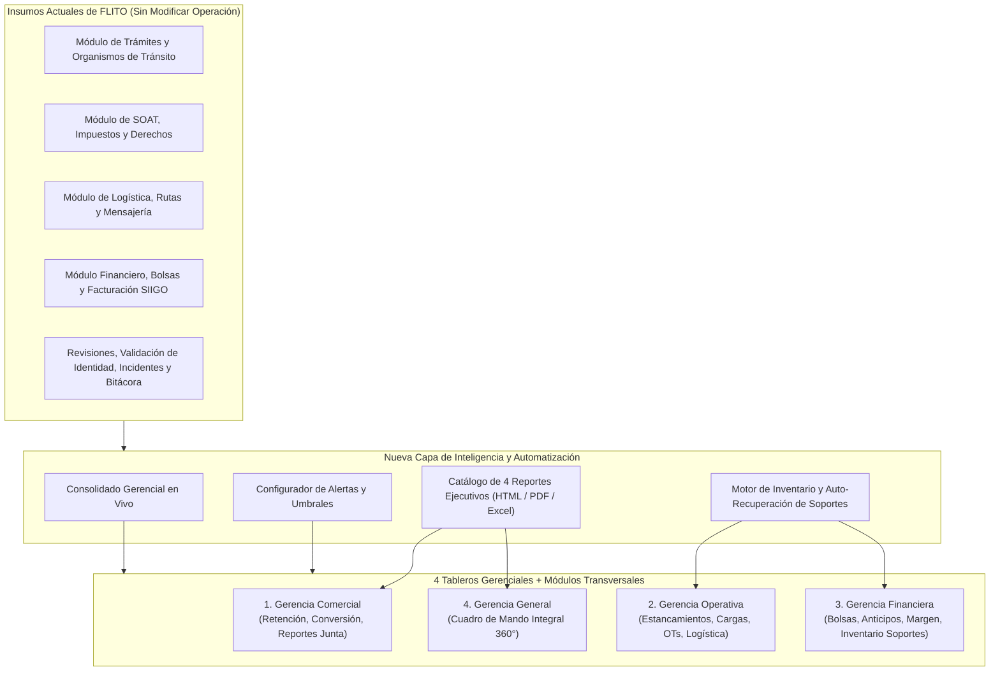
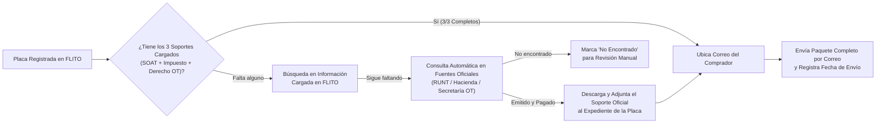

# 📋 SPEC MAESTRA DEL PROYECTO
## Torre de Control Gerencial, Automatización de Reportes e Inventario de Soportes — FLITO 2.0

> **Estado:** Especificación Funcional Completa (Cero Lenguaje Técnico — Enfoque 100% Negocio, Producto e Indicadores)  
> **Versión:** 3.0  
> **Principio Rector:** **Cero impacto a la operación diaria actual.** Todo el proyecto aprovecha la información, estados, documentos, pagos y bitácoras que FLITO ya recolecta hoy en su operación normal.

---

## 1. Propósito y Visión del Proyecto

Hasta hoy, **FLITO** ha operado como una plataforma enfocada en **"el hacer"**: registrar trámites, expedir SOAT, liquidar impuestos, asignar rutas de mensajería y gestionar pagos.

Este proyecto evoluciona a FLITO hacia un **Centro de Control Gerencial y Automatización**, resolviendo tres necesidades críticas del negocio:
1. **Visibilidad Diferenciada por Gerencia:** Cada área directiva necesita sus propios indicadores de gestión y alertas, en lugar de ver listados operativos planos.
2. **Eliminación de Reportes Manuales:** Operaciones ya no deberá construir manualmente informes mensuales, trimestrales, semestrales ni de calidad para clientes clave (como Tesla) o la Junta Comercial; el sistema los generará con un catálogo definido de **4 Reportes Estandarizados** listos para descargar.
3. **Cierre Documental Sin Fugas:** Consolidar por cada vehículo los 3 soportes obligatorios (SOAT, Impuesto y Derecho de Tránsito), auto-recuperarlos desde fuentes oficiales si faltan y enviarlos automáticamente al comprador final.

> [!IMPORTANT]
> **Alcance Definido:**  
> Esta entrega cubre exclusivamente a las **4 Gerencias Internas** (*Comercial, Operativa, Financiera y Gerencia General*). El portal de analítica para el *Cliente Final* queda fuera de esta fase (manteniendo únicamente el envío de soportes al comprador y los informes descargables para cuentas clave).

---

## 2. Arquitectura Funcional del Proyecto

---

## 3. Especificación Funcional de Tableros por Gerencia

### 💼 3.1 Tablero de Gerencia Comercial
**Ubicación en Menú:** `Torre de Control` ➔ `Gerencia Comercial`  
**Objetivo:** Proteger la cartera de clientes, detectar caídas de volumen a tiempo, identificar oportunidades de venta cruzada y acceder al centro de informes ejecutivos.

| Indicador / Bloque | Qué Muestra Exactamente | Objetivo de Negocio |
| :--- | :--- | :--- |
| **1. Alerta de Fuga / Caída de Volumen (Churn)** | Lista de clientes cuyo volumen de radicación en los últimos $N$ días cayó por debajo del umbral configurado frente a su promedio histórico. | Detectar a tiempo si un cliente está migrando sus trámites a otro proveedor para activar gestión comercial. |
| **2. Concentración de Cartera (Top Clientes)** | Gráfica de participación (%) mostrando cuánto del volumen e ingresos totales depende de los Top 3 y Top 5 clientes. | Medir el riesgo de dependencia comercial frente a cuentas clave. |
| **3. Efectividad de Conversión** | Embudo comparativo: *Borradores / Solicitudes Iniciadas* vs. *Trámites Radicados y Cobrados* por cliente. | Identificar clientes que cotizan o inician procesos pero no los concretan. |
| **4. Matriz de Venta Cruzada (Cross-Selling)** | Tabla de clientes vs. líneas de servicio (*Traspasos, Matrículas, SOAT, Impuestos, Logística*) marcando qué compra hoy y qué no. | Detectar oportunidades concretas de venta en clientes que solo consumen 1 servicio. |
| **5. Tendencia de Volumen por Periodo** | Gráfica evolutiva mensual/trimestral por cliente y por tipo de trámite. | Entender estacionalidad y crecimiento real de cada cuenta. |

---

### ⚙️ 3.2 Tablero de Gerencia Operativa
**Ubicación en Menú:** `Torre de Control` ➔ `Gerencia Operativa`  
**Objetivo:** Detectar trámites o solicitudes estancadas antes de que se conviertan en reclamos, balancear cargas del equipo y medir el desempeño real de los Organismos de Tránsito (OT), gestores y mensajería.

#### A. Radar de Estancamiento y Cuellos de Botella (Semáforos Activos)
1. **Trámites Sin Gestión:** Cantidad y listado de trámites radicados que nadie ha tomado pasado el umbral de horas configurado.
2. **Borradores Abandonados:** Trámites dejados en estado *Borrador* por más de $N$ días sin completarse.
3. **Solicitudes de SOAT / Impuestos Varadas:** Pedidos que superaron el tiempo límite sin respuesta o sin soporte cargado.
4. **Estancamiento en Organismo de Tránsito (OT):** Trámites entregados en la ventanilla del OT que superan los días esperados sin respuesta o emisión.

#### B. Indicadores de Eficiencia, Calidad y Capacidad
| Indicador / Bloque | Qué Muestra Exactamente | Objetivo de Negocio |
| :--- | :--- | :--- |
| **1. Calidad al Primer Intento (First Time Right)** | % de carpetas, SOATs e impuestos aprobados sin devoluciones vs. rechazados, clasificando si el error fue *interno*, del *cliente* o del *OT*. | Reducir reprocesos operativos y demostrar con datos dónde nace la fricción. |
| **2. Carga Activa (WIP) por Funcionario / Mesa** | Trámites activos asignados a cada operador o gestor frente a su capacidad diaria esperada. | Evitar cuellos de botella humanos y rebalancear cargas en el día a día. |
| **3. Benchmarking de Organismos de Tránsito (OT)** | Tabla comparativa de volumen, % aprobación, % rechazo, backlog y tiempo promedio real de respuesta por cada OT. | Saber qué OT es más ágil o cuál está represado para tomar decisiones de radicación. |
| **4. Desempeño de Gestores** | Ranking por gestor mostrando trámites gestionados, aprobados, rechazados, % de aprobación y tiempo promedio. | Medir productividad y calidad individual en campo y plataforma. |
| **5. Eficiencia Logística y Mensajería** | % de recogidas y entregas exitosas al primer intento, viajes fallidos y tiempos promedio de traslado. | Controlar el cumplimiento de rutas físicas de expedientes. |

---

### 💰 3.3 Tablero de Gerencia Financiera
**Ubicación en Menú:** `Torre de Control` ➔ `Gerencia Financiera`  
**Objetivo:** Cuidar la liquidez de las bolsas de dinero, controlar anticipos entregados en campo, evitar trabajo sin facturar y asegurar el margen por servicio.

| Indicador / Bloque | Qué Muestra Exactamente | Objetivo de Negocio |
| :--- | :--- | :--- |
| **1. Salud y Proyección de Agotamiento de Bolsas** | Saldo actual por bolsa de cliente + **días estimados de cobertura** según su ritmo de consumo reciente, con semáforo preventivo (Verde / Amarillo / Rojo). | Evitar que una bolsa llegue a \$0 y paralice la operación de un cliente clave. |
| **2. Anticipos Pendientes de Legalizar** | Dinero total girado a gestores/operadores para pago de derechos e impuestos en ventanilla que aún no tiene soporte oficial cargado y conciliado. | Prevenir fugas de caja y acelerar la legalización de gastos en campo. |
| **3. Trabajo Completado Sin Facturar** | Cantidad y valor estimado de trámites finalizados operativamente que aún no han sido facturados en SIIGO. | Acelerar el ciclo de facturación y recaudo. |
| **4. Margen Bruto Real por Servicio y Cliente** | Comparativo entre lo cobrado al cliente y el costo real pagado (derechos OT + impuestos + mensajería + proveedor + honorarios). | Identificar qué servicios o cuentas generan mayor rentabilidad o pérdidas. |
| **5. Estado de Conciliación Documental** | Resumen de expedientes con los 3 soportes completos (SOAT + Impuesto + Derecho OT) vs. expedientes con soportes faltantes. | Asegurar el cierre financiero y documental de cada vehículo. |

---

### 👔 3.4 Tablero de Gerencia General (Visión 360°)
**Ubicación en Menú:** `Torre de Control` ➔ `Resumen Ejecutivo 360°`  
**Objetivo:** Brindar una vista consolidada de alto nivel para la toma de decisiones estratégicas sin necesidad de entrar al detalle operativo.

1. **Cuadro de Mando Integral (Balanced Scorecard):** 3 tarjetas ejecutivas unificadas:
   * *Frente Comercial:* Volumen total del periodo, variación % vs. mes anterior y clientes en riesgo de fuga.
   * *Frente Operativo:* Carga activa total, % de aprobación global, calidad al primer intento y principal cuello de botella actual.
   * *Frente Financiero:* Margen bruto consolidado, saldo total en bolsas activas, anticipos por legalizar y monto pendiente de facturar.
2. **Proyección de Cierre de Mes:** Curva comparativa del ritmo actual del mes frente al mes anterior y la meta esperada.
3. **Top 5 Riesgos Críticos del Día:** Listado priorizado automáticamente con las alertas de mayor impacto para toda la empresa (ej. bolsa crítica de cliente principal, OT bloqueado, caída abrupta de cuenta clave).

---

## 4. Parametrización de Umbrales (Configurador Administrativo)

**Ubicación en Menú:** `Administración` ➔ `Configuración de Alertas y Umbrales`

Para que los tableros y semáforos se adapten a la realidad del negocio sin depender de cambios futuros, el Administrador podrá configurar y ajustar libremente:
* **Umbrales Operativos:** Horas máximas para un trámite sin gestión, días máximos en borrador, horas límite para SOAT/Impuestos sin soporte, y días esperados de respuesta por cada Organismo de Tránsito.
* **Umbrales Comerciales:** Porcentaje de caída de volumen y días de inactividad para disparar la alerta de fuga (Churn) de un cliente.
* **Umbrales Financieros:** Días mínimos de cobertura o monto mínimo en bolsas para encender alerta preventiva (Amarillo / Rojo), y días máximos para legalizar un anticipo.

---

## 5. Catálogo Detallado de Reportes Ejecutivos y Operativos (4 Reportes Estándar)

**Ubicación en Menú:** `Reportes` ➔ `Centro de Informes Ejecutivos`  
**Regla de Distribución:** Todos los reportes se generan bajo demanda en pantalla (seleccionando rango de fechas y filtros aplicables) y se **descargan en HTML Interactivo, PDF Ejecutivo o Excel** para que cada responsable los envíe a quien corresponda (Clientes o Junta Comercial).

A continuación se detalla **exactamente qué reportes existen, cuál es su objetivo y qué debe mostrar cada uno**:

---

### 📄 Reporte 1: Informe Operativo de Gestión por Cliente (Mensual / Trimestral)
* **Público / Destinatario:** Gerencia Comercial, Operaciones y Clientes B2B clave (ej. modelo *Informe Mensual / Trimestral Tesla*).
* **Objetivo:** Rendir cuentas detalladas al cliente sobre el volumen gestionado en un periodo específico, demostrar los tiempos reales de respuesta por Organismo de Tránsito y evidenciar con datos objetivos las fricciones que nacen en la operación del propio cliente.
* **Qué Debe Mostrar (8 Secciones Obligatorias):**
  1. **Portada y Resumen Ejecutivo (8 KPIs):** Periodo analizado, Total Trámites Depurados, Aprobados, En Proceso (Backlog), Rechazados, Abortados, Tasa de Aprobación (sobre gestionados), Tiempo Promedio de Gestión (ANS) y Casos de Fricción Detectados.
  2. **Trámites por Organismo de Tránsito (OT) y Estado:** Tabla y gráfica comparativa por ciudad/secretaría mostrando: *OT, Total Radicados, Aprobados, Rechazados, Backlog, % Participación y Máximo de Días*.
  3. **Tiempos de Gestión por OT:** Tiempo global ponderado vs. desglose por cada OT (destacando el OT más ágil y el más lento del periodo).
  4. **Desempeño de Gestores:** Tabla por gestor con columnas: *Gestor, Gestionados, Aprobados, Rechazados, % Aprobación y Tiempo Promedio en Plataforma*.
  5. **Errores y Causales de Rechazo del Proceso:** Matriz desglosada por causal exacta: *RUNT / Datos, Factura / Mal concepto, Prenda no registrada / Error prenda, Vehículo ya tiene placa, Problema de VIN, Improntas, Declaración de importación, Sin SOAT, Documentación y Otros*, incluyendo **% de casos subsanados**.
  6. **Validación de Identidad (Biometría):** Conteo y % de casos *Sin observaciones* vs. motivos de rechazo biométrico: *Fotos ilegibles, No sostiene documento bajo el rostro, Recorte de bordes, No es el inscrito, Falta lado A/B, Fotocopia en vez de físico, Contraseña en vez de original, Firma/Nombre incorrecto y Otro dispositivo*.
  7. **Fricciones Generadas por el Cliente (Pre-Radicación):** Tabla de hallazgos de origen atribuibles al cliente con columnas: *Tipo de Caso, Qué Pasa, Qué Hace el Equipo, Valor Generado y Cantidad de Eventos*.
  8. **Conclusiones Gerenciales Automáticas:** Resumen estructurado en 3 bloques (*Problemas Estructurales, Problemas Operativos y Problemas Técnicos / Plataforma*).

---

### 📈 Reporte 2: Informe Ejecutivo de Evolución Multiperíodo (Semestral / Junta Comercial)
* **Público / Destinatario:** Gerencia General, Gerencia Comercial y Junta Directiva (ej. modelo *Informe Ejecutivo de Evolución / Primer Semestre*).
* **Objetivo:** Evaluar la **tendencia comparativa entre múltiples meses o trimestres** para identificar si la operación está mejorando o deteriorándose, detectar alertas crecientes y sustentar decisiones estratégicas de junta.
* **Qué Debe Mostrar (6 Secciones Obligatorias):**
  1. **Barra Ejecutiva del Último Mes + Visión General Comparativa:** Matriz comparativa mes a mes (ej. Mes 1 vs. Mes 2 vs. Mes 3 vs. Mes 4) con: *Trámites Totales, Aprobados, Tasa de Aprobación, Tiempo Promedio (ANS), OTs Activos, Tendencia (Alza/Baja) y Análisis Ejecutivo*.
  2. **Evolución de Tiempos (ANS) y Aprobación por Gestor:** Tabla histórica comparando el tiempo promedio y % de aprobación de cada gestor mes a mes, con columna de **Variación de ANS**.
  3. **Evolución de Causales de Rechazo y Nuevas Alertas:** Tabla mes a mes (Casos y %) por cada causal de rechazo para detectar patrones que van en aumento.
  4. **Validación de Identidad — Riesgo Creciente:** Gráfica y comparativo mensual de la tasa de rechazo biométrico para medir si la fricción de identidad sube o baja.
  5. **Fricciones Pre-Radicación (El Origen Real del Problema):** Tabla consolidada de *Tipo de Fricción, Casos, % Participación, Descripción del Problema e Impacto en la Operación*.
  6. **Hallazgos y Recomendaciones Estratégicas:** Síntesis ejecutiva orientada a decisiones de Junta.

---

### 🐛 Reporte 3: Informe de Calidad, Incidentes y Estabilidad Operativa
* **Público / Destinatario:** Gerencia Operativa y Liderazgo de Producto/TI (ej. modelo *Reporte Mensual de Bugs e Incidentes*).
* **Objetivo:** Medir la estabilidad de la operación y la plataforma durante el mes, controlar los tiempos de solución de incidentes y hacer seguimiento a los compromisos entre Operaciones y Tecnología.
* **Qué Debe Mostrar (7 Secciones Obligatorias):**
  1. **Resumen Ejecutivo del Mes:** Total de incidentes reportados, cerrados, en tránsito y tiempo promedio de resolución.
  2. **Distribución por Prioridad e Impacto:** Conteo por nivel (*Crítico, Alto, Medio, Bajo*) e impacto operativo.
  3. **Días de Gestión:** Promedio y máximo de días desde el reporte hasta el cierre del caso.
  4. **Áreas Involucradas y Módulos Más Recurrentes:** Ranking de qué módulos concentraron más incidencias en el mes.
  5. **Detalle de Casos y Casos en Tránsito:** Listado de incidentes relevantes y casos abiertos que pasan al mes siguiente.
  6. **Acuerdos Operaciones – TI:** Seguimiento de casos en revisión, mejora y compromisos entre áreas.
  7. **Conclusión Gerencial y Próximos Pasos Recomendados.**

---

### 📦 Reporte 4: Informe de Reconciliación y Brechas Documentales (Inventario de Soportes)
* **Público / Destinatario:** Gerencia Financiera y Gerencia Operativa.
* **Objetivo:** Auditar qué vehículos ya cuentan con su expediente completo de cierre (SOAT + Impuesto + Derecho OT), detectar faltantes críticos antes del cierre contable y controlar el envío de soportes al comprador.
* **Qué Debe Mostrar:**
  1. **Resumen de Cobertura:** Total de placas/trámites, cantidad y % con los 3 soportes completos vs. incompletos.
  2. **Brechas por Tipo de Soporte:** Conteo exacto de *Consultados / Sin Consultar / No Encontrados* para SOAT, Impuesto y Derecho OT.
  3. **Control de Despacho:** Cantidad de compradores con *Correo Enviado* vs. *Sin Enviar*.
  4. **Detalle Exportable (Excel):** Listado fila por fila con *ID, Placa, Vehículo, VIN, Comprador, Correo, Secretaría/OT, Fecha Trámite, Estado de los 3 Soportes y Fecha de Envío*.

---

## 6. Módulo Transversal: Inventario de Trámites y Soportes

**Ubicación en Menú:** `Trámites` ➔ `Inventario de Trámites y Soportes`  
**Propósito:** Consolidar, por cada placa vehicular registrada en FLITO, el expediente documental completo de cierre (**SOAT**, **Impuesto** y **Derecho OT**), recuperar faltantes automáticamente y despachar el paquete al comprador final.

### 6.1 Funcionamiento de la Pantalla
* **Tarjetas de Resumen Superior:** Contadores en vivo del total de trámites, estado de cada uno de los 3 soportes (*Consultados / Sin consultar / No encontrados*) y estado del envío al comprador (*Correo Enviado / Sin Enviar*).
* **Buscador y Filtros:** Búsqueda por Placa, VIN, Marca, Secretaría o Comprador, más filtros por estado de cada soporte, correo y fechas.
* **Acciones por Fila y Masivas:** Botones para descargar soportes individuales, `Reprocesar` un soporte faltante, `Sincronizar / Actualizar` todo el inventario, `Descargar Excel` (Reporte 4) y `Envío de Soportes`.

### 6.2 Flujo de Auto-Recuperación y Despacho

---

## 7. Recomendación de Roles y Permisos (¿Usar Existentes o Crear Nuevos?)

Tras revisar la estructura actual de roles en FLITO, mi recomendación es **reutilizar al máximo los roles existentes (incluyendo el rol operativo actual)** y **crear únicamente 2 roles nuevos especializados** para separar la visibilidad directiva comercial y ejecutiva:

| Gerencia / Función | Decisión Recomendada | Justificación de Negocio |
| :--- | :--- | :--- |
| **Gerencia Operativa / Coordinación** | ♻️ **Reutilizar rol existente: `Administrador` (Rol Operativo actual)** | En FLITO, el rol operativo/coordinador ya vive bajo este perfil. Se le habilita directamente el tablero de *Gerencia Operativa*, el *Inventario de Soportes* y el *Reporte de Calidad/Incidentes* sin crear roles redundantes. |
| **Gerencia Financiera** | ♻️ **Reutilizar rol existente: `Financiera`** | El rol ya existe en FLITO y su propósito coincide al 100% con controlar bolsas, anticipos, facturación, márgenes e inventario de soportes. |
| **Auditoría / Consulta Transversal** | ♻️ **Reutilizar rol existente: `Auditor`** | Ideal para quienes necesiten consultar tableros, reportes e inventarios en **modo solo lectura**, sin permiso para modificar umbrales ni despachar envíos masivos. |
| **Gerencia Comercial** | 🆕 **Crear nuevo rol: `Gerencia Comercial`** | No existe equivalente hoy. Accede a métricas de Churn, concentración, conversión, cross-selling y descarga los *Reportes 1 y 2* (Clientes y Junta), sin ver detalle operativo interno ni costos/anticipos. |
| **Gerencia General** | 🆕 **Crear nuevo rol: `Gerencia General`** | Perfil ejecutivo limpio (C-Level). Entra directo al **Resumen Ejecutivo 360°** y a la descarga de los reportes consolidados de Junta sin saturarse con pantallas operativas del día a día. |

> [!TIP]
> **Regla de Segmentación por Alcance:**  
> Si un usuario tiene restringida su visibilidad a ciertos clientes o a ciertos Organismos de Tránsito, todos estos tableros, reportes descargables e inventarios respetarán automáticamente ese filtro para no mostrar información de terceros no autorizados.
