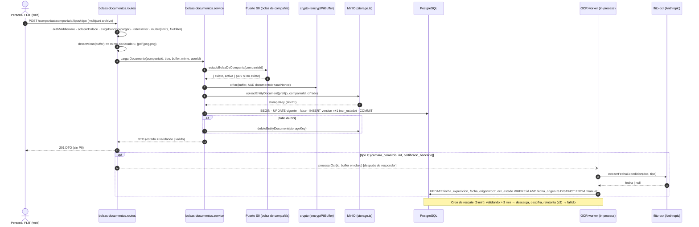
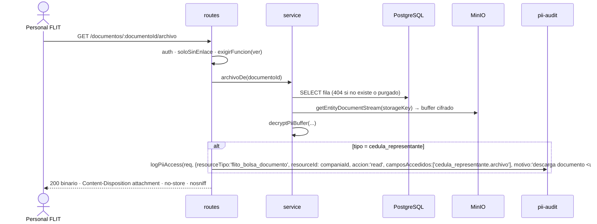

# ADR-0028 — Expediente documental de la compañía (bolsas): una tabla de versiones cifradas, OCR asíncrono y vigencia calculada al leer

- **Estado:** Propuesto (lo aprueba el Líder Técnico humano; ningún agente lo marca Aceptado)
- **Fecha:** 2026-10-23
- **Feature:** #13888 «[BOLSAS] - Expediente documental de la compañía» (Épica #13407) — HUs #13889 (carga + historial), #13890 (OCR de vigencia), #13891 (purga), #13892 (sección UI), #13893 (chip + endpoint en lote)
- **Módulo:** FLITO, nuevo submódulo `flito-bolsas-documentos`. **No** es el legacy `soat`/`liquidacion` y **no** toca `modules/flito-bolsas/**`.
- **Relacionados (ninguno se supersede):**
  - ADR-0016 (`exigirFuncion` a nivel de ruta) y ADR-0025 (árbol de permisos: la acción concede, la ruta pide la operación).
  - ADR-0024 (frontera por enlace): se monta con `conAlcance('bolsas', …)` y además se cierra a todo enlace con `soloSinEnlace`.
  - Frontera con la sesión flito-df (Épica #13412): el modelo de bolsa no tiene documentos. Este ADR consume un **contrato S0** que esa sesión tiene que exportar (§6).
- **Diseño operativo:** este documento (no hay un `docs/diseno/` aparte).

## 1. Contexto

FLIT tiene que guardar, por cada **compañía** que tiene bolsa de compañía, cinco documentos de vinculación. Cuatro son principales (`camara_comercio`, `rut`, `cedula_representante`, `certificado_bancario`) y uno es opcional (`adicional`). Tres de ellos vencen: la cámara de comercio, el RUT y el certificado bancario valen 30 días desde que se expiden. La cédula del representante es **PII** (Ley 1581). Al reemplazar un documento se guarda la versión anterior, y las versiones reemplazadas se purgan pasado un plazo. Solo lo usa el personal FLIT.

Decisiones de producto cerradas que este ADR no reabre: los documentos cuelgan de `clients.id` (RESTRICT) y no de la bolsa; las bolsas de tránsito no llevan documentos; se aceptan PDF/JPG/PNG de hasta 15 MB comprobando el MIME real; el OCR guarda la fecha de expedición, y la regla de 30 días se calcula **al leer**; hay fecha manual auditada; hay cuatro estados (`pendiente`, `valido`, `vencido`, `no_validado`); el chip «completo» exige los 4 principales en `valido`; hay dos funciones, `bolsas.documentos.cargar` y `.ver`, que no se asignan a ningún rol por seed; no se toca `USER_ROLES`; cada descarga de la cédula pasa por `logPiiAccess`.

Restricciones técnicas que deciden el diseño. Todas se verificaron leyendo el código:

| Hecho | Dónde | Consecuencia |
|---|---|---|
| `anthropicMessages` usa `timeoutMs: 60_000, retries: 1`, así que puede tardar más de 120 s | `modules/tramites/anthropic.ts:47` | El OCR **no cabe** en una petición web con timeout de 90 s (`apps/web/src/lib/api.ts`) |
| `flito-ocr` solo trae extractores por documento (SOAT, impuesto, factura, comprobante). No hay uno de «fecha de expedición» | `modules/flito-ocr/flito-ocr.service.ts` | Hace falta un extractor nuevo, en un archivo hermano dentro de `flito-ocr/` |
| `storage.ts` sube sin SSE. La descarga de la app va por `firmarDescargaEntidad` → `/api/files?key=…` (HMAC, 300 s) | `services/storage.ts:198,265` | No hay cifrado en reposo de archivos. La URL firmada se puede reutilizar sin pasar por `logPiiAccess` |
| `encryptPii`/`decryptPii` cifran con AES-256-GCM y `PII_ENC_KEY`, con AAD ligado a la fila, pero **solo cadenas** utf8 | `shared/utils/crypto.ts:163-185` | Se añade una variante para `Buffer` que reusa la misma clave y el mismo AAD |
| `logPiiAccess` acepta `resourceId?: number` | `shared/pii-audit.ts:16-22` | Con un id uuid, `resourceId` lleva el `companiaId` y el uuid va en `motivo` |
| `GET /:companiaId` de `flito-bolsas.routes.ts` captura todo `/api/flito/bolsas/*` | `app.ts:291` | El montaje va en `/api/flito/bolsas-documentos` |
| `flito_bolsas.compania_id` hoy es `UNIQUE`, y flito-df lo va a migrar a un modelo único | `schema.ts:3888` | No se hace JOIN propio ni se asume la unicidad: se usa un puerto (§6) |
| Patrón multer + MIME real: `memoryStorage`, `limits`, `fileFilter`, y luego `checkMagicNumber`/`detectMime` | `flito-bolsas.routes.ts:45-74`, `modules/pesv/magic-number.ts` | Se replica sin importar `recibirSoporte` |
| Patrón de purga: cron diario en hora de Bogotá, puerta positiva por env, `withLock`, lotes, y cola `flito_storage_borrados_pendientes` con `origen` | `flito-soat-retencion.cron.ts`, `db/schema/flito-storage-borrados-pendientes.ts` | Se reusa tal cual |
| Patrón de trabajo asíncrono con rescate: barrido de huérfanos cada 5 min | `flito-impuestos-analisis.cron.ts` | Es el vecino del rescate del OCR |
| Siembra del catálogo de permisos: `INSERT … ON CONFLICT (codigo) DO UPDATE … WHERE … IS DISTINCT FROM` con `padre_codigo`/`nivel` | `migrations/0238_…`, `0240_…` | Es la forma de la siembra de 0248 |

## 2. Alternativas

Los tres ejes que tienen un tradeoff real son el modelo de versiones, el modo del OCR y el cifrado. Cada alternativa es una combinación coherente de los tres.

### Opción 1 — Tabla única de versiones + OCR asíncrono en el proceso con cron de rescate + cifrado AES-GCM en la aplicación (**recomendada**)

Una fila por versión en `flito_bolsas_documentos`. La versión vigente la marca `vigente = true`, protegida por un índice único parcial `(compania_id, tipo) WHERE vigente`. La carga responde en cuanto el archivo está guardado. El OCR corre después de la respuesta, en el mismo proceso, y un cron rescata los que quedaron colgados. Los 5 tipos se cifran con AES-256-GCM antes de subirlos a MinIO, con la clave `PII_ENC_KEY` que ya existe.

- **Pros:** una sola fuente para el expediente y el historial (consultas triviales; el historial es `ORDER BY version`). Un índice parcial garantiza «una vigente por compañía y tipo» en la base. La carga nunca choca con los 90 s. Sin dependencias nuevas: el patrón del rescate ya existe en `flito-impuestos`. Cifrar todo usa un único camino de código, protege también el certificado bancario (datos financieros) y la cámara/RUT (nombre y cédula del representante), y no depende de configurar el KMS de MinIO/S3 en cada ambiente. La descarga pasa siempre por la API, así que `logPiiAccess` no se puede saltar.
- **Contras:** estado transitorio «validando» que la UI tiene que pintar y refrescar. Un `Buffer` de hasta 15 MB se descifra en memoria (dos copias como máximo). Hay un cambio transversal pequeño en `shared/utils/crypto.ts`.
- **Esfuerzo:** M.
- **Riesgos:** si el proceso se reinicia con OCR en vuelo, el rescate lo retoma (tope de 3 intentos y luego `no_validado`). Perder `PII_ENC_KEY` deja los archivos ilegibles: es el mismo riesgo que ya corren las columnas cifradas de conductores/RNDC, y hay rotación por `keyVersion`.

### Opción 2 — Dos tablas (expediente vigente + historial) + OCR síncrono con presupuesto reducido + SSE de MinIO/S3

Una tabla `…_vigentes` (PK `compania_id, tipo`) y una `…_historial` a la que se mueve la fila al reemplazar. El OCR va dentro del POST con su propio cliente, a 25 s y sin reintento. El cifrado lo hace el servidor de objetos (SSE-S3 / KMS).

- **Pros:** la PK compuesta da la unicidad sin índice parcial. Sin estado «validando»: la respuesta trae el resultado. No hay código de cripto.
- **Contras:** obliga a mover filas entre tablas en cada reemplazo, lo que duplica el esquema y complica la purga y el historial unificado. Un OCR a 25 s sin reintento falla más (`no_validado` más frecuente) y además ocupa la petición web. Habría que escribir un cliente distinto de `anthropicMessages` o tocar su firma, que es compartida. SSE depende de infraestructura que **no está en el repo** (KMS de MinIO en DEV/QA/PDN) y no protege si se filtran las credenciales del bucket: quien tenga la clave S3 lee en claro.
- **Esfuerzo:** M–L (más la infraestructura).
- **Riesgos:** deriva entre ambientes si el KMS no está igual en todos. Timeouts de la web en picos de Anthropic.

### Opción 3 — Reusar `flito_soportes` con tipos nuevos + cola Redis (BullMQ) para el OCR + sin cifrado (solo control de acceso)

- **Pros:** sin tabla nueva. Cola con reintentos «de manual».
- **Contras:** `flito_soportes` vive en `schema.ts` y la comparten SOAT y bolsas. Añadirle columnas (fecha de expedición, versión, vigente) mezcla dos políticas de retención en una tabla y toca la zona de otra sesión. BullMQ es una **dependencia nueva** cuando ya existe el patrón del rescate con `setInterval` y `withLock` (regla 4: no se justifica). Guardar la cédula sin cifrar contradice AGENTS.md §16 («cifrado en reposo cuando aplica»).
- **Esfuerzo:** M.
- **Riesgos:** rotura en SOAT por una columna nueva en una tabla compartida, y superficie de Habeas Data sin mitigar.

## 3. Decisión

**Opción 1.** Gana porque reusa tres patrones ya probados en el repo (cripto de PII, purga de SOAT, rescate de impuestos), no añade dependencias ni infraestructura, y deja el expediente, el historial y la purga sobre una sola tabla aislada en su propio archivo de esquema, sin tocar nada de flito-df.

Sub-decisiones:

| # | Decisión |
|---|---|
| D1 | **Una fila por versión.** `vigente` + índice único parcial `(compania_id, tipo) WHERE vigente`. `version` es correlativa por `(compania_id, tipo)` y también única. El reemplazo es una transacción: se marca la vigente con `vigente=false, reemplazado_en=now()` y se inserta `version = max+1`. Si dos cargas simultáneas violan el índice (`23505`), se responde 409. |
| D2 | **La vigencia se calcula al leer**, en el API (una sola verdad, con el día de Bogotá). La base guarda `fecha_expedicion` y su origen (`ocr`/`manual`), nunca el estado. |
| D3 | **OCR asíncrono.** La carga responde 201 con `estado: 'validando'` para los 3 tipos con OCR. Después de la respuesta, el proceso lanza `procesarOcr(id)` con el `Buffer` en claro que aún tiene en memoria, con concurrencia acotada por `shared/utils/limitador.ts`. Un cron de rescate cada 5 min retoma los que llevan más de 3 min en `validando` (descarga y descifra). Tras 3 intentos queda `ocr_estado='fallido'` y el documento sale `no_validado`. |
| D4 | **«validando» es un estado TRANSITORIO de presentación, no un quinto estado de producto.** El DTO lo expone como `estado: 'validando'` mientras `ocr_estado='validando'`. En el chip cuenta como no completo. Si producto no quiere ese valor en el enum, la alternativa es `estado: 'no_validado'` + `validando: true` (§12). |
| D5 | **Cifrado AES-256-GCM en la aplicación de los 5 tipos**, con `PII_ENC_KEY` y la AAD `flito_bolsas_documentos|archivo|<documentoId>|<aadNonce>|<keyVersion>`. El objeto en MinIO es el texto cifrado; `iv`, `auth_tag`, `key_version` y `aad_nonce` van en la fila. El cifrado es obligatorio para la cédula. Extenderlo a los otros 4 es decisión del diseño (un solo camino, y el certificado bancario y la cámara llevan datos del representante y de la cuenta). |
| D6 | **La descarga pasa siempre por la API** (`GET /documentos/:id/archivo`), que descifra y transmite. **No** se usa `firmarDescargaEntidad`: serviría el blob cifrado, pondría la clave en la URL y dejaría 300 s de reutilización sin `logPiiAccess`. |
| D7 | **Clave de objeto sin PII:** `uploadEntityDocument('flito-bolsas-documentos', companiaId, 'archivo.bin', cifrado, 'application/octet-stream')` → `flito-bolsas-documentos/<companiaId>/<ts>_<uuid>.bin`. **No se guarda el nombre original del archivo** (suele llevar el nombre de la persona). La descarga sale como `<tipo>-v<version>.<ext según mime>`. |
| D8 | **La cédula nunca va al OCR** (no se envía a Anthropic): ni el tipo `cedula_representante` ni el `adicional` disparan OCR. Cámara, RUT y certificado sí se envían, con el mismo encargado y las mismas condiciones que ya usan las facturas y los comprobantes. |
| D9 | **Frontera:** montaje `app.use('/api/flito/bolsas-documentos', conAlcance('bolsas', router))` y `soloSinEnlace` en cada ruta (solo personal FLIT; el enlace `compania` queda cerrado aunque `FRONTERA_POR_ENLACE` le abra `bolsas`). |
| D10 | **Retención de las versiones reemplazadas: N = 5 años** contados desde `reemplazado_en` (§9). Las vigentes no se purgan nunca mientras sean vigentes. |
| D11 | **Una sola migración (0248)** con la tabla completa (incluidas las columnas de OCR) y la siembra de permisos, entregada en #13889. El ADR fija las columnas de #13890/#13891 ahora para no tener que editar una migración ya aplicada. |

## 4. Diagramas de secuencia

### 4.1 Carga y reemplazo (#13889) + OCR (#13890)



### 4.2 Descarga de la cédula (#13889/#13892)



## 5. Contrato de endpoints

Base `/api/flito/bolsas-documentos`. **Todas** las rutas llevan `authMiddleware` + `soloSinEnlace` + `exigirFuncion(...)` a nivel de ruta. Errores de negocio: `BolsaDocumentoError(estado, mensaje)` exportada por el servicio. El cuerpo es `{ error }` con copy de producto, nunca el mensaje crudo.

| # | Método y ruta | Guarda | Zod de entrada | Respuesta | HU |
|---|---|---|---|---|---|
| E1 | `GET /companias/:companiaId` | `bolsas.documentos.ver` | `params: { companiaId: z.coerce.number().int().positive() }` | `200 ExpedienteCompaniaDto` · 404 si la compañía no existe | #13889 / #13892 |
| E2 | `GET /companias/:companiaId/tipos/:tipo/historial` | `bolsas.documentos.ver` | `params: { companiaId, tipo: z.enum(TIPOS_DOCUMENTO_BOLSA) }` | `200 { versiones: DocumentoBolsaVersionDto[] }` (desc por versión; las purgadas salen con `archivoDisponible:false`) | #13889 |
| E3 | `POST /companias/:companiaId/tipos/:tipo` (multipart, campo `archivo`) | `bolsas.documentos.cargar` + `bolsasDocumentosCargaLimiter` | params como E2. Archivo: multer `limits {fileSize: 15 MiB, files: 1}`, `fileFilter` mime declarado ∈ `MIMES_DOCUMENTO_BOLSA`. Después, `detectMime(buffer)` tiene que coincidir con el declarado | `201 DocumentoBolsaDto` · 400 (tipo/tamaño/MIME real) · 404 compañía · **409** «La compañía no tiene bolsa de compañía» (AC8) · 409 carga concurrente | #13889 |
| E4 | `PUT /documentos/:documentoId/fecha-expedicion` | `bolsas.documentos.cargar` | `params: { documentoId: z.string().uuid() }`; `body: { fecha: z.string().regex(/^\d{4}-\d{2}-\d{2}$/) }` + refine fecha válida y ≤ hoy (Bogotá) | `200 DocumentoBolsaDto` · 404 · 409 si no es vigente · 422 si el tipo no lleva vigencia (cédula/adicional) | #13890 |
| E5 | `GET /documentos/:documentoId/archivo` | `bolsas.documentos.ver` | `params: { documentoId: uuid }` | `200` binario descifrado; `Content-Type` = mime guardado; `Content-Disposition: attachment; filename="<tipo>-v<n>.<ext>"`; `Cache-Control: no-store`; `X-Content-Type-Options: nosniff` · 404 si está purgado · cédula → `logPiiAccess` | #13889 / #13892 |
| E6 | `POST /estado-lote` | `bolsas.documentos.ver` | `body: { companiaIds: z.array(z.number().int().positive()).min(1).max(200) }` + refine sin duplicados | `200 { estados: EstadoExpedienteLoteDto[] }`. Los ids sin bolsa o inexistentes salen con `completo:false` y todos `pendiente` (no se filtra para no filtrar existencia) | #13893 |

Notas del contrato:
- **E6 va por POST con body** porque es un lote (tope de 200 = tamaño máximo razonable de una página del listado de bolsas). Los ids son opacos y no son PII, pero el lote no cabe bien en una query. No requiere ADR de excepción GET+query.
- La fecha manual (E4) **no** se pide en la carga (E3): se fija sobre la versión vigente ya creada, así el audit queda con su propio quién/cuándo.
- `audit()` (`shared/middleware/audit.ts`) en E3 y E4 con `tipo`, `version` y `companiaId`, sin nombre de archivo.
- **DTO sin PII:** ni nombre de archivo, ni contenido OCR, ni `storageKey`, ni hash. Solo metadatos y el nombre del usuario FLIT que cargó o fijó la fecha (personal interno, ya visible en otras bitácoras FLITO).

Reglas de cálculo (`estadoDe(fila, hoyBogota)`, en el servicio):

| Condición | estado |
|---|---|
| No hay fila vigente | `pendiente` |
| tipo ∈ {`cedula_representante`, `adicional`} y hay vigente | `valido` |
| `ocr_estado = 'validando'` y `fecha_expedicion IS NULL` | `validando` (transitorio, D4) |
| `fecha_expedicion IS NULL` | `no_validado` («No se pudo validar») |
| `hoyBogota − fecha_expedicion ≤ 30 días` (el día 30 es inclusivo) | `valido` |
| en otro caso | `vencido` |

`completo = ['camara_comercio','rut','cedula_representante','certificado_bancario'].every(t => estado === 'valido')`. El `adicional` no cuenta.

## 6. Contrato S0 con flito-df (AC8 de #13889) — PENDIENTE

Este módulo **no** consulta las tablas de bolsa con un JOIN propio ni asume `unique(compania_id)`. Define un puerto:

```ts
// apps/api/src/modules/flito-bolsas-documentos/flito-bolsas-documentos.bolsa-compania.ts
export interface EstadoBolsaCompania { existe: boolean; activa: boolean }
/** CONTRATO S0 — flito-df exportará `estadoBolsaDeCompania` desde modules/flito-bolsas/… (Épica #13412). */
export type ConsultaBolsaCompania = (companiaId: number) => Promise<EstadoBolsaCompania>;
```

- **Fallback temporal** (solo en este archivo, con `// TODO S0 #13412`): `SELECT EXISTS(SELECT 1 FROM flito_bolsas WHERE compania_id = $1)` con el query builder → `{ existe, activa: existe }`. Usa `EXISTS` y no `unique`, así que sigue funcionando con varias filas. Como hoy no hay columna de estado, se asume `activa = existe`.
- Cuando flito-df publique su función, el cambio es **una línea** en este archivo (import) y se borra el fallback. Los tests mockean el puerto, no la tabla.
- **Regla de uso:** E3 exige `existe` (409 si no). Que se exija también `activa` es una pregunta de producto abierta (§12). Las lecturas (E1, E2, E5, E6) no consultan el puerto.

## 7. Modelo de datos

### 7.1 Drizzle — `apps/api/src/db/schema/flito-bolsas-documentos.ts`

```ts
// HU #13889 (Feature #13888, Épica #13407) — expediente documental de la COMPAÑÍA, migración 0248.
// ADR-0028. Archivo propio (frontera con flito-df): schema.ts solo lo re-exporta. CHECK declarados aquí
// también (lección de la 0157).
import { pgTable, uuid, integer, smallint, varchar, text, boolean, date, timestamp, customType,
  index, uniqueIndex, check } from 'drizzle-orm/pg-core';
import { sql } from 'drizzle-orm';
import { clients, users } from '../schema.js'; // verificar ciclo de import; si lo hay, usar el patrón de schema/permisos.ts

const bytea = customType<{ data: Buffer }>({ dataType: () => 'bytea' });

export const flitoBolsasDocumentos = pgTable('flito_bolsas_documentos', {
  id: uuid('id').primaryKey(),                         // generado ANTES del INSERT: es parte de la AAD
  companiaId: integer('compania_id').notNull().references(() => clients.id, { onDelete: 'restrict' }),
  tipo: varchar('tipo', { length: 30 }).notNull(),
  version: smallint('version').notNull(),
  vigente: boolean('vigente').notNull(),
  // Archivo (cifrado AES-256-GCM, D5). storage_key NULL ⇔ purgado.
  storageKey: text('storage_key'),
  mime: varchar('mime', { length: 30 }).notNull(),
  tamanoBytes: integer('tamano_bytes').notNull(),
  cifradoIv: bytea('cifrado_iv').notNull(),
  cifradoTag: bytea('cifrado_tag').notNull(),
  cifradoKeyVersion: smallint('cifrado_key_version').notNull(),
  aadNonce: uuid('aad_nonce').notNull(),
  // Vigencia (D2): se guarda la fecha, nunca el estado.
  fechaExpedicion: date('fecha_expedicion'),
  fechaOrigen: varchar('fecha_origen', { length: 10 }),           // 'ocr' | 'manual'
  fechaManualPor: integer('fecha_manual_por').references(() => users.id, { onDelete: 'set null' }),
  fechaManualEn: timestamp('fecha_manual_en', { withTimezone: true }),
  ocrEstado: varchar('ocr_estado', { length: 12 }).notNull(),     // no_aplica|validando|leido|sin_fecha|fallido
  ocrIntentos: smallint('ocr_intentos').notNull().default(0),
  ocrActualizadoEn: timestamp('ocr_actualizado_en', { withTimezone: true }).notNull().defaultNow(),
  // Trazabilidad
  cargadoPor: integer('cargado_por').references(() => users.id, { onDelete: 'set null' }),
  cargadoEn: timestamp('cargado_en', { withTimezone: true }).notNull().defaultNow(),
  reemplazadoEn: timestamp('reemplazado_en', { withTimezone: true }),
  purgadoEn: timestamp('purgado_en', { withTimezone: true }),
}, (t) => ({
  vigenteUq: uniqueIndex('uq_flito_bolsas_documentos_vigente').on(t.companiaId, t.tipo).where(sql`${t.vigente}`),
  versionUq: uniqueIndex('uq_flito_bolsas_documentos_version').on(t.companiaId, t.tipo, t.version),
  purgaIdx: index('idx_flito_bolsas_documentos_purga').on(t.reemplazadoEn)
    .where(sql`NOT ${t.vigente} AND ${t.purgadoEn} IS NULL`),
  ocrIdx: index('idx_flito_bolsas_documentos_ocr').on(t.ocrActualizadoEn).where(sql`${t.ocrEstado} = 'validando'`),
  tipoChk: check('ck_flito_bolsas_documentos_tipo', sql`${t.tipo} IN ('camara_comercio','rut','cedula_representante','certificado_bancario','adicional')`),
  mimeChk: check('ck_flito_bolsas_documentos_mime', sql`${t.mime} IN ('application/pdf','image/jpeg','image/png')`),
  tamanoChk: check('ck_flito_bolsas_documentos_tamano', sql`${t.tamanoBytes} > 0 AND ${t.tamanoBytes} <= 15728640`),
  versionChk: check('ck_flito_bolsas_documentos_version', sql`${t.version} >= 1`),
  origenChk: check('ck_flito_bolsas_documentos_origen', sql`(${t.fechaOrigen} IS NULL) = (${t.fechaExpedicion} IS NULL) AND (${t.fechaOrigen} IS NULL OR ${t.fechaOrigen} IN ('ocr','manual'))`),
  manualChk: check('ck_flito_bolsas_documentos_manual', sql`(${t.fechaOrigen} = 'manual') = (${t.fechaManualEn} IS NOT NULL)`),
  ocrChk: check('ck_flito_bolsas_documentos_ocr', sql`${t.ocrEstado} IN ('no_aplica','validando','leido','sin_fecha','fallido')`),
  ocrTipoChk: check('ck_flito_bolsas_documentos_ocr_tipo', sql`(${t.tipo} IN ('cedula_representante','adicional')) = (${t.ocrEstado} = 'no_aplica')`),
  vigenciaChk: check('ck_flito_bolsas_documentos_vigencia', sql`${t.vigente} = (${t.reemplazadoEn} IS NULL)`),
  purgaChk: check('ck_flito_bolsas_documentos_purga', sql`(${t.purgadoEn} IS NULL) = (${t.storageKey} IS NOT NULL) AND (${t.purgadoEn} IS NULL OR NOT ${t.vigente})`),
}));
```

Nota: `manualChk` exige que, al pasar de manual a OCR, se limpie `fecha_manual_en`. Eso no ocurre: el OCR nunca pisa una fecha manual (D3). `fecha_manual_por` puede quedar NULL si se borra el usuario (`SET NULL`), y por eso el CHECK se ancla en `fecha_manual_en`.

`schema.ts`: **una línea** `export * from './schema/flito-bolsas-documentos.js';`, junto a la re-exportación de `schema/permisos.ts` (fuera del bloque de bolsas 3872-4110).

### 7.2 SQL — `apps/api/src/db/migrations/0248_flito_bolsas_documentos.sql`

`0248` es el siguiente libre en `origin/develop` a 2026-10-23 (el último es `0247_flito_drflit_cupo_ia.sql`). **Hay que verificarlo otra vez antes del commit**: flito-df puede tomar ese número.

```sql
-- HU #13889 (Feature #13888) — ADR-0028. Idempotente. NO drizzle-kit.
CREATE TABLE IF NOT EXISTS flito_bolsas_documentos (
  id uuid PRIMARY KEY,
  compania_id integer NOT NULL REFERENCES clients(id) ON DELETE RESTRICT,
  tipo varchar(30) NOT NULL,
  version smallint NOT NULL,
  vigente boolean NOT NULL,
  storage_key text,
  mime varchar(30) NOT NULL,
  tamano_bytes integer NOT NULL,
  cifrado_iv bytea NOT NULL,
  cifrado_tag bytea NOT NULL,
  cifrado_key_version smallint NOT NULL,
  aad_nonce uuid NOT NULL,
  fecha_expedicion date,
  fecha_origen varchar(10),
  fecha_manual_por integer REFERENCES users(id) ON DELETE SET NULL,
  fecha_manual_en timestamptz,
  ocr_estado varchar(12) NOT NULL,
  ocr_intentos smallint NOT NULL DEFAULT 0,
  ocr_actualizado_en timestamptz NOT NULL DEFAULT now(),
  cargado_por integer REFERENCES users(id) ON DELETE SET NULL,
  cargado_en timestamptz NOT NULL DEFAULT now(),
  reemplazado_en timestamptz,
  purgado_en timestamptz,
  CONSTRAINT ck_flito_bolsas_documentos_tipo CHECK (tipo IN ('camara_comercio','rut','cedula_representante','certificado_bancario','adicional')),
  CONSTRAINT ck_flito_bolsas_documentos_mime CHECK (mime IN ('application/pdf','image/jpeg','image/png')),
  CONSTRAINT ck_flito_bolsas_documentos_tamano CHECK (tamano_bytes > 0 AND tamano_bytes <= 15728640),
  CONSTRAINT ck_flito_bolsas_documentos_version CHECK (version >= 1),
  CONSTRAINT ck_flito_bolsas_documentos_origen CHECK ((fecha_origen IS NULL) = (fecha_expedicion IS NULL) AND (fecha_origen IS NULL OR fecha_origen IN ('ocr','manual'))),
  CONSTRAINT ck_flito_bolsas_documentos_manual CHECK ((fecha_origen = 'manual') = (fecha_manual_en IS NOT NULL)),
  CONSTRAINT ck_flito_bolsas_documentos_ocr CHECK (ocr_estado IN ('no_aplica','validando','leido','sin_fecha','fallido')),
  CONSTRAINT ck_flito_bolsas_documentos_ocr_tipo CHECK ((tipo IN ('cedula_representante','adicional')) = (ocr_estado = 'no_aplica')),
  CONSTRAINT ck_flito_bolsas_documentos_vigencia CHECK (vigente = (reemplazado_en IS NULL)),
  CONSTRAINT ck_flito_bolsas_documentos_purga CHECK ((purgado_en IS NULL) = (storage_key IS NOT NULL) AND (purgado_en IS NULL OR NOT vigente))
);
CREATE UNIQUE INDEX IF NOT EXISTS uq_flito_bolsas_documentos_vigente ON flito_bolsas_documentos (compania_id, tipo) WHERE vigente;
CREATE UNIQUE INDEX IF NOT EXISTS uq_flito_bolsas_documentos_version ON flito_bolsas_documentos (compania_id, tipo, version);
CREATE INDEX IF NOT EXISTS idx_flito_bolsas_documentos_purga ON flito_bolsas_documentos (reemplazado_en) WHERE NOT vigente AND purgado_en IS NULL;
CREATE INDEX IF NOT EXISTS idx_flito_bolsas_documentos_ocr ON flito_bolsas_documentos (ocr_actualizado_en) WHERE ocr_estado = 'validando';

-- Catálogo de permisos (ADR-0025): dos ACCIONES concedibles bajo la página de bolsas + las dos OPERACIONES
-- que piden las rutas, colgadas de su acción. No se asignan a roles (decisión 8). Forma de 0238/0240.
INSERT INTO permisos_funciones (codigo, modulo, nombre_negocio, descripcion, tipo, padre_codigo, nivel, orden) VALUES
  ('accion.bolsas.ver_documentos', 'bolsas', 'Ver el expediente documental', 'Consultar y descargar los documentos de vinculación de la compañía.', 'accion', 'pagina.flito_bolsas', '3', '<orden>'),
  ('accion.bolsas.cargar_documentos', 'bolsas', 'Cargar documentos del expediente', 'Subir o reemplazar documentos de la compañía y fijar su fecha de expedición.', 'accion', 'pagina.flito_bolsas', '3', '<orden>')
ON CONFLICT (codigo) DO UPDATE SET … WHERE … IS DISTINCT FROM …;   -- copiar literal de 0238
INSERT INTO permisos_funciones (codigo, modulo, nombre_negocio, descripcion, tipo, padre_codigo) VALUES
  ('bolsas.documentos.ver', 'bolsas', '…', '…', 'operacion', 'accion.bolsas.ver_documentos'),
  ('bolsas.documentos.cargar', 'bolsas', '…', '…', 'operacion', 'accion.bolsas.cargar_documentos')
ON CONFLICT (codigo) DO UPDATE SET … WHERE … IS DISTINCT FROM …;
```

Los textos `…` y los `<orden>` **tienen que ser idénticos** a los que genere `catalogo.ts`. El arranque compara el catálogo del código con el de la base. El backend-agent los copia de la salida de `npm run permisos:seed -w apps/api` (en seco) y no los inventa. Si el árbol trata las operaciones nuevas del área de Finanzas como «nacen absorbidas, no se siembran» (`catalogoOperacionesNuevas`), el segundo INSERT sobra: lo decide el chequeo de arranque, no este ADR (§12).

## 8. Storage, cifrado, OCR y rate limit

- **Storage:** `services/storage.ts` (`uploadEntityDocument`, `getEntityDocumentStream`, `deleteEntityDocument`, `removeEntityDocument`). Endpoint, credenciales y bucket por `env` (ya es así). No hay env nuevo para storage.
- **Cripto** (`shared/utils/crypto.ts`, cambio transversal pequeño): `encryptPiiBuffer(buf: Buffer, aad: AadParts): CipherBundle` y `decryptPiiBuffer(bundle, aad): Buffer`. Son las mismas `loadPiiKey`/`buildAad`, sin `'utf8'`. `AadParts = { table: 'flito_bolsas_documentos', column: 'archivo', empresaNit: <documentoId>, aadNonce }`. Hacen falta tests propios: ida y vuelta, AAD de otra fila falla, tag alterado falla.
- **OCR** (`modules/flito-ocr/flito-ocr-expedicion.ts`, archivo nuevo, no se engorda `flito-ocr.service.ts`): `extraerFechaExpedicion(doc: DocumentoAAnalizar, tipo: 'camara_comercio'|'rut'|'certificado_bancario'): Promise<{ fecha: string | null; confiable: boolean }>`. Usa `anthropicMessages` + `normalizarFecha`, con un prompt nuevo por tipo en `flito-ocr.prompts.ts` («fecha de expedición / generación del certificado»). Con `confiable=false` o una fecha futura, se trata como `sin_fecha`. **No se persiste nada más del OCR** (ni texto ni campos).
- **Worker** (`flito-bolsas-documentos.ocr.ts`): `procesarOcr(id, buffer?)`. Si no recibe buffer, descarga y descifra. Hace `UPDATE … SET ocr_intentos = ocr_intentos + 1` al empezar y, al terminar: `leido` + fecha (`WHERE fecha_origen IS DISTINCT FROM 'manual'`), `sin_fecha`, o `validando` con reintento (si el error es `OcrNoDisponibleError` y quedan intentos) o `fallido` (≥3). Los logs llevan solo id, tipo, estado y nombre del error.
- **Rescate** (`flito-bolsas-documentos-ocr.cron.ts`): vecino `flito-impuestos-analisis.cron.ts`, cada 5 min, arranque a los 5 s, `withLock('flito-bolsas-docs-ocr', …)`, lote de 20, `ocr_actualizado_en < now() - 3 min`. Activo por defecto; `BOLSAS_DOCUMENTOS_OCR_CRON_ENABLED=0` lo apaga (no borra nada, así que no necesita puerta positiva).
- **Rate limit:** `bolsasDocumentosCargaLimiter` en `shared/middleware/rateLimiter.ts`, mismo molde que `comprobantesCargaLimiter`: `userOrIpKey('bolsas-docs')`, `makeStore`, `frenoConRastro`. Propuesta: 30 cargas / 10 min por usuario. Solo E3; el resto queda bajo `apiLimiter`.
- **Copy de la UI:** «Validando…» con refresco automático de E1 cada 5 s mientras algún documento esté en `validando`, con tope de 2 min, y después un botón «Actualizar».

## 9. Purga (#13891) — N = 5 años (para que lo valide security-agent)

**Política:** las versiones **reemplazadas** se purgan (objeto en MinIO + `storage_key`) **5 años** después de `reemplazado_en`. La fila se conserva como constancia (tipo, versión, fechas, quién cargó), sin archivo. Las vigentes no se purgan.

**Justificación:**
- Ley 1581 de 2012, art. 4 lit. b (finalidad) y Decreto 1377 de 2013, art. 11 (los datos se conservan solo el tiempo necesario para la finalidad). La finalidad de una versión **reemplazada** ya no es operar la bolsa (para eso está la vigente). Es la **trazabilidad de la debida diligencia** de vinculación: demostrar con qué soportes se operó en una fecha frente a un reclamo, una auditoría o una controversia contractual con la compañía.
- 5 años cubre el horizonte típico de auditoría y de reclamos derivados de la relación comercial y de la debida diligencia de contrapartes. Es más corto que los 10 años de los libros y papeles del comerciante (Código de Comercio art. 60 / Ley 962 de 2005 art. 28), que **no** aplican a una versión sustituida porque no es un soporte contable.
- **Lo tiene que confirmar el área legal/security:** si FLIT es sujeto obligado de SAGRILAFT/SARLAFT con un plazo de conservación de soportes de conocimiento de la contraparte distinto, N se ajusta a ese plazo. El valor vive en **una constante** (`ANIOS_RETENCION_VERSIONES = 5`) y en `docs/privacy/retencion-flito-bolsas-documentos.md`, no en la base.
- Alternativa para security: un plazo más corto solo para `cedula_representante` (por ejemplo 1 año). No se recomienda: rompe la trazabilidad uniforme del expediente y añade una rama al cron.

**Mecánica** (`flito-bolsas-documentos-purga.cron.ts` + `.purga.service.ts`, vecino `flito-soat-retencion.cron.ts`):
- Diaria a las 03:xx `America/Bogota` vía `relojBogota`. **Puerta positiva** `BOLSAS_DOCUMENTOS_PURGA_CRON_ENABLED=1` (un job que borra no se enciende solo por desplegarse). `withLock('flito-bolsas-docs-purga', 30 min)`. Lote de 200 por corrida.
- Por fila elegible (`NOT vigente AND purgado_en IS NULL AND reemplazado_en <= now() - interval '5 years'`), en una transacción: `INSERT flito_storage_borrados_pendientes (storage_key, clave_hash = huellaClave(key), origen = 'bolsas-documentos')` + `UPDATE fila SET storage_key = NULL, purgado_en = now()`. Después, `removeEntityDocument` y cerrar el pendiente con `cerrarPendienteTrasBorrado`. Es el patrón de `flito-soat-documentos.service.ts:475`: si el almacenamiento falla, el pendiente queda abierto y lo reintenta su barrido.
- **Verificación obligatoria del backend:** el barrido de `flito-soat-borrados-pendientes.cron.ts` tiene que ser **independiente del `origen`** (`condicionAbiertos`). Si filtra por origen, la alternativa es no marcar `purgado_en` hasta que el borrado se confirme y reintentar en la corrida siguiente. Va sin pendiente y no hace falta cambiar el modelo.
- Una entrada de bitácora por corrida (`bolsas.documentos.versiones_purgadas`) con conteos y bytes. Sin ids de compañía, claves ni nombres.

## 10. Tipos compartidos — `packages/shared-types/src/flito-bolsas-documentos.ts`

```ts
export const TIPOS_DOCUMENTO_BOLSA = ['camara_comercio','rut','cedula_representante','certificado_bancario','adicional'] as const;
export type TipoDocumentoBolsa = typeof TIPOS_DOCUMENTO_BOLSA[number];
export const TIPOS_DOCUMENTO_BOLSA_PRINCIPALES = ['camara_comercio','rut','cedula_representante','certificado_bancario'] as const;
export const TIPOS_DOCUMENTO_BOLSA_CON_VIGENCIA = ['camara_comercio','rut','certificado_bancario'] as const;
export const MIMES_DOCUMENTO_BOLSA = ['application/pdf','image/jpeg','image/png'] as const;
export const TAMANO_MAX_DOCUMENTO_BOLSA = 15 * 1024 * 1024;
export const DIAS_VIGENCIA_DOCUMENTO_BOLSA = 30;
export const TOPE_ESTADO_LOTE_BOLSAS = 200;
export type EstadoDocumentoBolsa = 'pendiente' | 'valido' | 'vencido' | 'no_validado' | 'validando';
export type OrigenFechaExpedicion = 'ocr' | 'manual';

export interface DocumentoBolsaDto {
  id: string; tipo: TipoDocumentoBolsa; version: number; estado: EstadoDocumentoBolsa;
  fechaExpedicion: string | null;          // yyyy-mm-dd
  fechaOrigen: OrigenFechaExpedicion | null;
  venceEl: string | null;                  // fechaExpedicion + 30 (solo tipos con vigencia)
  fechaManual: { por: string | null; en: string } | null;   // nombre del usuario FLIT
  mime: (typeof MIMES_DOCUMENTO_BOLSA)[number]; tamanoBytes: number;
  cargadoPor: string | null; cargadoEn: string;
}
export interface ExpedienteCompaniaDto {
  companiaId: number; completo: boolean;
  documentos: Array<{ tipo: TipoDocumentoBolsa; estado: EstadoDocumentoBolsa; vigente: DocumentoBolsaDto | null }>;
}
export interface DocumentoBolsaVersionDto extends DocumentoBolsaDto {
  vigente: boolean; reemplazadoEn: string | null; archivoDisponible: boolean;
}
export interface EstadoExpedienteLoteDto {
  companiaId: number; completo: boolean;
  estados: Record<(typeof TIPOS_DOCUMENTO_BOLSA_PRINCIPALES)[number], EstadoDocumentoBolsa>;
}
```

Se re-exporta desde `packages/shared-types/src/index.ts`. Es un archivo nuevo, así que el grep de la regla 7 sale vacío. Hay que declararlo igual.

## 11. Archivos a crear o modificar (por HU)

| HU | Archivo | Acción |
|---|---|---|
| #13889 | `apps/api/src/db/schema/flito-bolsas-documentos.ts` | crear |
| #13889 | `apps/api/src/db/schema.ts` | 1 línea de re-export (fuera de 3872-4110) |
| #13889 | `apps/api/src/db/migrations/0248_flito_bolsas_documentos.sql` | crear (tabla completa + siembra de permisos) |
| #13889 | `apps/api/src/shared/utils/crypto.ts` | añadir `encryptPiiBuffer`/`decryptPiiBuffer` |
| #13889 | `apps/api/src/shared/middleware/rateLimiter.ts` | añadir `bolsasDocumentosCargaLimiter` |
| #13889 | `apps/api/src/modules/flito-bolsas-documentos/flito-bolsas-documentos.routes.ts` | crear (E1, E2, E3, E5; multer propio + `detectMime`) |
| #13889 | `apps/api/src/modules/flito-bolsas-documentos/flito-bolsas-documentos.service.ts` | crear (`cargarDocumento`, `expedienteDe`, `historialDe`, `archivoDe`, `estadoDe`, `BolsaDocumentoError`) |
| #13889 | `apps/api/src/modules/flito-bolsas-documentos/flito-bolsas-documentos.bolsa-compania.ts` | crear (puerto S0 + fallback) |
| #13889 | `apps/api/src/app.ts` | montaje `conAlcance('bolsas', …)` en `/api/flito/bolsas-documentos` |
| #13889 | `apps/api/src/modules/permisos/catalogo-operaciones.ts` | `op()` por ruta (`BDOC = 'flito-bolsas-documentos/flito-bolsas-documentos.routes.ts'`) |
| #13889 | `apps/api/src/modules/permisos/arbol/acciones-finanzas.ts` | `accion.bolsas.ver_documentos` (lectura, `['bolsas.documentos.ver']`) y `accion.bolsas.cargar_documentos` (`['bolsas.documentos.cargar']`, apoyo `['bolsas.documentos.ver']`) |
| #13889 | `packages/shared-types/src/flito-bolsas-documentos.ts` + `index.ts` | crear + re-export |
| #13889 | `apps/api/__tests__/…/flito-bolsas-documentos.routes.test.ts`, `…service.test.ts`, `crypto-buffer.test.ts` | crear |
| #13890 | `apps/api/src/modules/flito-ocr/flito-ocr-expedicion.ts` + `flito-ocr.prompts.ts` | crear + 3 prompts |
| #13890 | `apps/api/src/modules/flito-bolsas-documentos/flito-bolsas-documentos.ocr.ts` | crear (worker) |
| #13890 | `apps/api/src/modules/flito-bolsas-documentos/flito-bolsas-documentos-ocr.cron.ts` | crear (rescate) |
| #13890 | `flito-bolsas-documentos.routes.ts` / `.service.ts` | E4 + disparo del OCR después de responder |
| #13890 | `apps/api/src/server.ts` | start/stop del cron de rescate |
| #13890 | `apps/api/__tests__/…/flito-bolsas-documentos-ocr.test.ts` | crear (OCR mockeado; vencido / válido el día 30 / sin fecha / manual que no se pisa) |
| #13891 | `apps/api/src/modules/flito-bolsas-documentos/flito-bolsas-documentos-purga.service.ts` + `-purga.cron.ts` | crear |
| #13891 | `apps/api/src/server.ts` · `apps/api/src/config/env.ts` (si las puertas se leen por `env`) | start/stop + `BOLSAS_DOCUMENTOS_PURGA_CRON_ENABLED` |
| #13891 | `docs/privacy/retencion-flito-bolsas-documentos.md` | crear (política, N, base legal) |
| #13891 | `apps/api/__tests__/…/flito-bolsas-documentos-purga.test.ts` | crear |
| #13892 | `apps/web/src/lib/api.ts` | funciones `expedienteBolsa`, `historialDocumentoBolsa`, `cargarDocumentoBolsa` (multipart), `fijarFechaExpedicion`, `descargarDocumentoBolsa` (blob) |
| #13892 | `apps/web/src/components/flito-bolsas-documentos/ExpedienteDocumental.tsx` (+ subcomponentes) | crear (4 estados, «Validando…», historial, fecha manual) |
| #13892 | Vista de detalle de bolsa de compañía (ruta exacta a confirmar con `ux-agent`/flito-df) | **1 línea** de montaje de la sección; sin página ni `PageSlug` nuevos |
| #13892 | `apps/web/e2e/tests/flito-bolsas-documentos.spec.ts` | crear |
| #13893 | routes/service: E6 `POST /estado-lote` | añadir |
| #13893 | `apps/web/src/components/flito-bolsas-documentos/ChipExpediente.tsx` + 1 línea en el listado de bolsas + `api.ts` (`estadoExpedientesLote`) | crear / montar |

## 12. Notas operativas por agente

- **backend-agent:**
  - No importes nada de `modules/flito-bolsas/**`.
  - En la carga, el orden es: subir a MinIO → transacción. Si la transacción falla, `deleteEntityDocument` (patrón `flito-bolsas.routes.ts:233-274`).
  - Genera `id` y `aad_nonce` (`newUuid()`) **antes** de cifrar.
  - `23505` sobre `uq_…_vigente` → 409.
  - El disparo del OCR va con `void procesarOcr(...).catch(log)` **después** de `res.status(201).json(...)`.
  - Al descargar: `res.setHeader` de `no-store`/`nosniff`, y no loguees la clave.
  - `logPiiAccess` **antes** de enviar los bytes de la cédula, con `await` (si falla internamente, no tumba la petición).
  - Tests P1 solo con los archivos de este WI.
  - `build:api` con `NODE_OPTIONS=--max-old-space-size=8192`.
  - La migración se aplica dos veces sobre la BD local (P6).
- **frontend-agent:**
  - Todo por `src/lib/api.ts`, incluida la descarga como blob (no un enlace `/api/files`).
  - La sección tiene los 4 estados más «Validando…».
  - La fecha manual solo aparece si el usuario tiene `cargar` (la UI se guía por el 403 y por las funciones de la sesión).
  - El chip se oculta si E6 responde 403.
  - El `<input type=file>` lleva `<label>` y `accept="application/pdf,image/jpeg,image/png"`.
  - Ninguna cédula ni nombre de archivo en la URL del router.
- **db-review-agent:** revisar los CHECK compuestos (`origen`, `manual`, `ocr_tipo`, `purga`) frente a todas las transiciones (carga → OCR → manual → reemplazo → purga), el índice parcial de vigente y la doble aplicación de 0248.
- **security-agent:**
  - Validar N = 5 años (§9) y el envío de cámara/RUT/certificado a Anthropic (la cédula no se envía, D8).
  - Validar el cifrado en la aplicación con `PII_ENC_KEY` (D5).
  - Validar E6 por body con tope de 200.
  - Validar `logPiiAccess` con `resourceId = companiaId` y el uuid en `motivo`.
- **ux-agent (full):** la sección y el chip dentro de la pantalla de bolsas existente (sin PageSlug nuevo); la copy de «No se pudo validar» y «Validando…».

## 13. Riesgos abiertos y qué falta decidir

1. **Contrato S0 con flito-df:** firma `estadoBolsaDeCompania(companiaId): Promise<{ existe; activa }>` y ruta del export. Hasta entonces se usa el fallback `EXISTS` sobre `flito_bolsas`.
2. **Producto:** ¿se puede cargar documentos a una compañía con bolsa **inactiva**? Propuesta: sí se lee, y la carga exige `activa`. Hoy no hay columna de estado: depende del modelo de flito-df.
3. **Producto:** ¿`validando` como valor del enum `estado` (D4), o `no_validado` + bandera?
4. **Legal/security:** N = 5 años (§9), o el plazo SAGRILAFT si aplica.
5. **Catálogo:** ¿las operaciones `bolsas.documentos.*` se siembran como filas `operacion` hijas de su acción, o nacen absorbidas sin fila? Lo dirime el chequeo de arranque de `catalogo.ts`. Ninguna de las dos opciones cambia el diseño.
6. **Número de migración:** 0248, si nadie lo toma antes del merge.
7. **Barrido de borrados pendientes independiente del origen:** hay que verificarlo (§9). Si no lo es, se usa la alternativa sin cola.
8. **Montaje web:** confirmar con flito-df qué archivo de la vista de bolsas recibe las dos líneas (sección y chip), para no pisar su trabajo.

## 14. Decisiones cerradas (2026-10-23)

Respondidas por David Chica en la sesión flito-ba:

- **Bolsa inactiva:** el expediente se lee y se descarga, pero **no** se carga ni se reemplaza hasta reactivar la bolsa (`estadoBolsaDeCompania().activa === false` → 409 en E2 y en la fecha manual).
- **Cifrado:** se cifran en reposo los **5** tipos (D-cifrado tal como está en §8).
- **Retención:** N = **5 años** para las versiones reemplazadas (§9). security-agent lo revisa en el PR de #13891.
- **OCR:** se envían Cámara, RUT y certificado bancario al motor Anthropic ya integrado; la cédula nunca se envía.

Decisión del hilo (no de producto), consistente con el AC4 de #13892 («Validando…»): se mantiene **D4** — `validando` es un valor transitorio del `estado` en el DTO.

Siguen pendientes: el contrato S0 con flito-df (§6, `estadoBolsaDeCompania`) y los puntos de montaje en la UI de #13886. Hasta S0 rige el fallback de §6.

## Adenda HU #13964 — retiro de la versión vigente

> Modo **slim** (architecture-agent, 2026-10-25). Extiende el patrón de E4 (`PUT …/fecha-expedicion`): misma
> guarda, mismo UPDATE condicionado por `vigente`, misma traducción de errores. **ADR nuevo: no aplica** — no
> cambia D1–D11 ni contradice §14; es una transición de estado más sobre la misma tabla. Estado: **Propuesto**.

### A.1 Decisiones cerradas (David Chica, 2026-10-25)

Permiso `bolsas.documentos.cargar` (sin función nueva) · motivo opcional ≤ 300 · purga de 5 años contada
desde el retiro · confirmación modal · 409 con la bolsa inactiva · aplica a los 5 tipos · se puede retirar
con el OCR en curso («Validando…») · solo se retira la vigente; restaurar = volver a cargar · sin
`logPiiAccess` al retirar (sigue en la descarga de la cédula, como hoy).

### A.2 Verificado contra el código (develop `85c5224e`)

| Pregunta | Respuesta |
|---|---|
| ¿`completo` y el chip dependen solo de `vigente`? | **Sí.** `expedienteDe` y `estadoLoteDe` filtran `vigente = true`; sin fila vigente el tipo sale `pendiente`, y `completo` es `false` si es uno de los 4 principales. El `adicional` retirado no afecta a `completo`. Nada que cambiar en el cálculo. |
| ¿Versión siguiente? | `max(version) + 1` por (compañía, tipo) dentro de la transacción de `cargarDocumento` — **no** un count. La retirada conserva su fila, así que tras retirar la v2 la carga siguiente es la **v3** (AC4). Nada que cambiar. |
| ¿Cubre la purga a las retiradas? | **Sí, sin tocar el código.** Elegible = `NOT vigente AND purgado_en IS NULL AND storage_key IS NOT NULL AND reemplazado_en <= ahora − N`. El retiro escribe `reemplazado_en = retirado_en`, así que los 5 años cuentan desde el retiro. |
| ¿Lock por compañía+tipo? | **No hace falta.** La carga tampoco toma lock: confía en los índices únicos parciales. El retiro es un único `UPDATE … WHERE id = $1 AND vigente` (atómico). Retiro ∥ carga: si la carga confirma antes, el retiro afecta 0 filas → 409; si el retiro confirma antes, el `UPDATE` de la carga re-evalúa `vigente` (READ COMMITTED), no toca nada e inserta `max+1` (la retirada conserva su número). Retiro ∥ retiro: el segundo afecta 0 filas → 409. Retiro ∥ fecha manual: E4 ya filtra `vigente` → 409. |
| ¿Retirar con el OCR en curso? | El OCR (`.ocr.ts`) escribe por `id` sin filtrar `vigente`: completará fecha y estado sobre la fila retirada, igual que hoy pasa con una versión reemplazada durante «Validando…». No toca `vigente` ni `reemplazado_en`, así que no viola ningún CHECK. El cron de rescate puede retomarla una vez más. Es inocuo, se acepta y no se añade filtro. |
| ¿Choca con el CHECK `ck_…_vigencia` (`vigente = (reemplazado_en IS NULL)`)? | No: el retiro pone `vigente = false` **y** `reemplazado_en`, en el mismo `UPDATE`. |

### A.3 Contrato delta

**E7** — `POST /api/flito/bolsas-documentos/documentos/:documentoId/retirar`
- Guardas: `soloSinEnlace()`, `exigirFuncion('bolsas.documentos.cargar')` (con `authMiddleware` del router). Sin `rateLimiter` (no es carga ni OCR).
- Params: `documentoParams` existente (uuid). Body: `z.object({ motivo: z.string().trim().max(300).optional() }).strict()`; un motivo vacío tras `trim` se guarda como `NULL`. Error 400: «El motivo admite hasta 300 caracteres.».
- Respuesta **200**: `DocumentoExpedienteDto`, la **fila** del tipo ya actualizada: `{ tipo, estado: 'pendiente', opcional, vigente: null, tieneHistorial: true }`. Sigue el patrón de E3/E4: devuelven el DTO y `ExpedienteDocumental.aplicarDocumento` lo aplica a la fila y recalcula `completo` en el cliente, sin releer. Aquí se reemplaza la fila entera, en lugar de solo `vigente`. No se devuelve el expediente completo: los otros tipos no cambian.
- Errores (cuerpo `{ error, codigo? }`; la UI decide por `status` y `codigo`, nunca por el texto):

  | Status | `codigo` | Cuándo | Copy (`error`) |
  |---|---|---|---|
  | 400 | `motivo_invalido` | el body no pasa Zod (motivo > 300, clave extra) | «El motivo admite hasta 300 caracteres.» |
  | 400 | — | `documentoId` no es uuid | «El documento no es válido.» (igual que E4) |
  | 403 | — | `soloSinEnlace()` / `exigirFuncion` | respuesta estándar de los middlewares |
  | 404 | — | el documento no existe | «El documento no existe.» |
  | 409 | `bolsa_inactiva` | `!estadoBolsaDeCompania().activa` | «La bolsa de la compañía está inactiva: reactívala para retirar documentos.» |
  | 409 | `no_vigente` | ya reemplazada o retirada (en la lectura o porque el UPDATE afectó 0 filas) | «Esta versión ya no es la vigente: actualiza para ver el expediente.» |
  | 429 | — | solo si lo devuelve un limitador global montado antes del router; E7 **no** añade limitador propio (no es carga ni OCR) | estándar del limitador |

  El `codigo` sale barato: `BolsaDocumentoError` gana un tercer parámetro opcional `codigo?: string`, y `fallo()` lo añade al JSON cuando existe. Es compatible hacia atrás: E3, E4 y E5 no lo usan, y la web actual solo lee `error`.
- Auditoría: `audit(req, { action: 'update', resource: 'flito_bolsa_documento', resourceId: <uuid>, detail: 'Retiro del documento <tipo> v<version> de la compañía <companiaId>' })`. **No** lleva el motivo (es texto libre y puede traer PII; vive en la fila) ni el nombre del archivo.

**Servicio** `retirarDocumento(documentoId, motivo: string | null, userId: number | null)` (en `.service.ts`, mismo molde que `fijarFechaManual`):
1. `SELECT companiaId, tipo, version, vigente` por id → 404 si no existe; 409 si `!vigente`.
2. `estadoBolsaDeCompania(companiaId)`; si `!activa` → 409.
3. `UPDATE … SET vigente=false, reemplazado_en=:ahora, retirado_en=:ahora, retirado_por=:userId, motivo_retiro=:motivo WHERE id=:id AND vigente RETURNING id`. Con 0 filas → 409. `:ahora` es **un solo** `new Date()`, para cumplir el CHECK de igualdad.
4. Devolver la fila del expediente: `{ tipo, estado: 'pendiente', opcional: tipo === 'adicional', vigente: null, tieneHistorial: true }`. No hace falta releer, porque tras un retiro correcto el tipo no tiene vigente: el índice único parcial garantiza que no hay otra.

**shared-types** (`packages/shared-types/src/flito-bolsas-documentos.ts`):
```ts
export interface RetiroDocumentoBolsaDto {
  /** ISO 8601 */
  en: string;
  /** Nombre del usuario FLIT que retiró (null si el usuario ya no existe). */
  por: { nombre: string | null };
  motivo: string | null;
}
export interface DocumentoBolsaVersionDto extends DocumentoBolsaDto {
  vigente: boolean;
  reemplazadoEn: string | null;
  archivoDisponible: boolean;
  retiro: RetiroDocumentoBolsaDto | null;   // NUEVO
}
export interface DocumentoExpedienteDto {
  // …campos actuales…
  /** NUEVO: el tipo tiene al menos una versión (vigente o no). Habilita «Historial» aunque no haya vigente. */
  tieneHistorial: boolean;
}
export interface RetirarDocumentoBolsaBody { motivo?: string }
export const MOTIVO_RETIRO_DOCUMENTO_BOLSA_MAX = 300;
/** E7 responde con la fila del expediente (`DocumentoExpedienteDto`). Códigos de error estables para la UI. */
export type CodigoErrorDocumentoBolsa = 'motivo_invalido' | 'bolsa_inactiva' | 'no_vigente';
```
**Retirada vs. reemplazada** en el historial: `vigente` → «vigente»; `retiro !== null` → «retirada el <fecha> por <nombre>» (+ motivo si lo hay); en otro caso → «reemplazada el <reemplazadoEn>». La señal es `retiro`, nunca una comparación de fechas.

**`tieneHistorial` (hallazgo propio, confirmado también por UX en `docs/ux/hu-13964-quitar-version-vigente.md`; sin él falla el AC1):** hoy (`FilaDocumento.tsx`, botón en la línea ~180 y montaje en la ~197) `FilaDocumento` muestra el botón Historial y monta `HistorialDocumento` solo con `vigente && …`. Tras retirar la única vigente, el tipo queda `pendiente` con `vigente: null` y **la versión retirada no se podría consultar**. E1 añade `tieneHistorial`, calculado con **una** consulta agregada adicional (`SELECT tipo FROM … WHERE compania_id = $1 GROUP BY tipo`), y la web condiciona el Historial a `doc.tieneHistorial`.

### A.4 Migración `0265_flito_bolsas_documentos_retiro.sql` (nueva; la 0248 no se toca)

```sql
-- HU #13964 (Feature #13888, ADR-0028 adenda): retiro de la versión vigente. Idempotente.
ALTER TABLE flito_bolsas_documentos
  ADD COLUMN IF NOT EXISTS retirado_en   timestamptz NULL,
  ADD COLUMN IF NOT EXISTS retirado_por  integer NULL,
  ADD COLUMN IF NOT EXISTS motivo_retiro varchar(300) NULL;

DO $$
BEGIN
  IF NOT EXISTS (SELECT 1 FROM pg_constraint WHERE conname = 'flito_bolsas_documentos_retirado_por_users_id_fk') THEN
    ALTER TABLE flito_bolsas_documentos
      ADD CONSTRAINT flito_bolsas_documentos_retirado_por_users_id_fk
      FOREIGN KEY (retirado_por) REFERENCES users(id) ON DELETE SET NULL;
  END IF;
  -- Motivo y autor solo existen con fecha de retiro.
  IF NOT EXISTS (SELECT 1 FROM pg_constraint WHERE conname = 'ck_flito_bolsas_documentos_retiro_datos') THEN
    ALTER TABLE flito_bolsas_documentos
      ADD CONSTRAINT ck_flito_bolsas_documentos_retiro_datos
      CHECK (retirado_en IS NOT NULL OR (motivo_retiro IS NULL AND retirado_por IS NULL));
  END IF;
  -- Retirada ⇒ no vigente y reemplazada en el mismo instante (la purga cuenta desde ahí).
  IF NOT EXISTS (SELECT 1 FROM pg_constraint WHERE conname = 'ck_flito_bolsas_documentos_retiro') THEN
    ALTER TABLE flito_bolsas_documentos
      ADD CONSTRAINT ck_flito_bolsas_documentos_retiro
      CHECK (retirado_en IS NULL OR (NOT vigente AND reemplazado_en = retirado_en));
  END IF;
END $$;
```
Las filas existentes cumplen ambos CHECK: tienen `retirado_en` NULL, así que se validan sin backfill. **Sin índice nuevo:** el historial ya se lee por `(compania_id, tipo)` y la purga usa `idx_…_purga`. Drizzle (`schema/flito-bolsas-documentos.ts`): `retiradoEn`, `retiradoPor` (`references(() => users.id, { onDelete: 'set null' })`), `motivoRetiro: varchar(300)` y los dos `check(...)` con los mismos nombres (lección de la 0157).

### A.5 Archivos a crear o modificar

**backend-agent**
- `apps/api/src/db/migrations/0265_flito_bolsas_documentos_retiro.sql` (nuevo; el número se confirma contra develop justo antes del PR).
- `apps/api/src/db/schema/flito-bolsas-documentos.ts`: 3 columnas y 2 `check`.
- `apps/api/src/modules/flito-bolsas-documentos/flito-bolsas-documentos.service.ts`: RN-BD7 en la cabecera; `retirarDocumento`; alias `retirador` de `users` en `consultaDto()`; `retiradoEn`, `motivoRetiro` y `retiradorNombre` en `columnasDto`/`FilaDto`; `retiro` en `aVersionDto`; `tieneHistorial` en `expedienteDe`. Hoy tiene 341 líneas: hay margen frente a 800.
- `apps/api/src/modules/flito-bolsas-documentos/flito-bolsas-documentos.routes.ts`: E7 y Zod strict; `fallo()` emite `codigo` cuando viene.
- En `.service.ts`, además: `BolsaDocumentoError(estado, mensaje, codigo?)`.
- `apps/api/src/modules/flito-bolsas-documentos/flito-bolsas-documentos-purga.service.ts`: **solo el comentario** de RN-BDP1 («versiones reemplazadas **o retiradas**; para una retirada, `reemplazado_en = retirado_en`»). La consulta no cambia.
- `apps/api/src/modules/permisos/inventario.generado.ts`: entrada a mano tras la de E4: `{ modulo: "bolsas", fichero: "flito-bolsas-documentos/flito-bolsas-documentos.routes.ts", metodo: "POST", ruta: "/documentos/:documentoId/retirar", roles: [], heredada: false }, // HU #13964 (E7)`.
- Tests: `permisos.reconduccion-cierre.test.ts` cuenta **directorios (43) y ficheros (35)**, que no cambian porque la ruta va en un fichero existente; hay que revisar el total de montajes de `leerMontajes` (comentario «238 = …»), que sí podría subir +1. Revisar también `permisos-catalogo.test.ts` y la fixture `__tests__/fixtures/permisos-rutas-reconducidas.ts`, por si E4 tiene fila ahí y E7 necesita su gemela. Test nuevo del servicio y la ruta en el `__tests__` del módulo (P1: solo esos archivos).
- `packages/shared-types/src/flito-bolsas-documentos.ts`: los tipos de A.3. Después, `grep` de `DocumentoBolsaVersionDto` y `DocumentoExpedienteDto` en `apps/web` (regla 7).
- `docs/privacy/retencion-flito-bolsas-documentos.md`: fila **Retirada** en la tabla («5 años desde `retirado_en` (= `reemplazado_en`), frontera inclusiva»; se purga lo mismo que en una reemplazada; la fila se conserva con `retirado_en`/`retirado_por`/`motivo_retiro`) y una línea sobre el motivo como texto libre (ver R1).

**frontend-agent**
- `apps/web/src/lib/api.ts`: `retirar: (documentoId, motivo?) => api.post<DocumentoExpedienteDto>(\`${BOLSAS_DOCS}/documentos/${encodeURIComponent(documentoId)}/retirar\`, { motivo })` en el bloque `BOLSAS_DOCS`.
- `apps/web/src/components/flito-bolsas-documentos/FilaDocumento.tsx`: acción secundaria «Quitar» (con `aria-label` que nombre el documento) cuando `puedeCargar && vigente`, también en `validando`; Historial condicionado a `doc.tieneHistorial` en lugar de `vigente`. Si el archivo se acerca al límite, extraer el modal.
- `apps/web/src/components/flito-bolsas-documentos/ModalRetirarDocumento.tsx` (nuevo): confirmación modal con `<textarea>` etiquetado, contador de 300, primaria destructiva, foco atrapado y devuelto al cerrar. Sigue el patrón del modal del kit `components/flit/`.
- `apps/web/src/components/flito-bolsas-documentos/ExpedienteDocumental.tsx`: `aplicarFila(fila: DocumentoExpedienteDto)`, gemela de `aplicarDocumento`. Reemplaza la fila del tipo, recalcula `completo` con `PRINCIPALES` y actualiza `previos`, **sin releer**. Errores: 409 o 404 → `onCarrera` (relee E1), con copy distinto según `codigo` (`bolsa_inactiva` / `no_vigente`); 400 se muestra en línea en el modal; 403 y 429 → toast cerrable con copy pulido, sin el error crudo. Si la página tiene un chip de lote aparte (E6), lo refresca el mismo callback `onBolsaCambio`/padre que ya use la carga.
- `apps/web/src/components/flito-bolsas-documentos/HistorialDocumento.tsx`: etiqueta «retirada el … por …» y el motivo, según `retiro` (A.3).
- Ficha de ayuda: `flit-ayuda-flito` si la pantalla de bolsas tiene ficha.

### A.6 Riesgos y Notas

- **R1 (pendiente humano/security):** `motivo_retiro` es texto libre y puede traer PII (p. ej. «la cédula de Juan Pérez está vencida»). La purga conserva la fila como constancia, así que el motivo quedaría **para siempre**. Propuesta: que la purga también anule `motivo_retiro` (una línea en el `SET` de la purga), y un hint en el modal: «No escribas datos personales». Hay que decidirlo antes del PR.
- **R2:** con `retirado_por` ON DELETE SET NULL, el retiro puede quedar sin autor. El CHECK `retiro_datos` lo admite y la UI muestra «por —».
- **R4:** E7 devuelve la fila sin releer. Si entre el UPDATE y la respuesta entra una carga concurrente, la UI mostrará `pendiente` hasta el siguiente refresco o sondeo. Es el mismo margen que hoy tiene E3 y se acepta.
- **R3:** numeración de la migración: si alguien mergea una 0265 antes, se renumera **antes** de aplicar en cualquier ambiente.
- **Nota db-review:** no hay índice sobre `retirado_por`. Es consistente con `cargado_por` y `fecha_manual_por` de la 0248.
- **Gates:** `security-agent` aplica (ruta nueva + PII), igual que `db-review-agent` (migración). `ux-agent` en slim para el modal y la etiqueta del historial.
