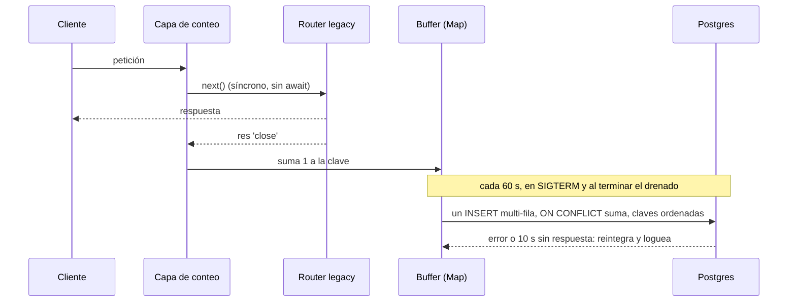

# ADR-0033 — Conteo de uso de rutas legacy en agregados diarios (buffer en memoria + UPSERT por lotes)

- **Estado:** Aceptado (aprobado por David Chica el 2026-11-03, con `permisos.catalogo.ver` como guarda; responde por el retiro, registrado en la Discussion de #13990)
- **Fecha:** 2026-11-03
- **Contexto de trabajo:** Épica #14272, Feature #13980, HU #13989. El dato es evidencia para la revisión futura de ADR-0038 o para un retiro (ajustado el 2026-11-04; ver nota de §5)
- **Supersedes:** ninguno. **No contradice** ningún ADR aceptado
- **Módulos:** habla con los legacy `soat`, `tramites` (incluye `firma` bajo su prefijo) y `liquidacion`. No toca `flito-*` ni `apps/web`

## Contexto

Hay que saber qué rutas legacy se usan y quién las usa, durante 4 semanas en PDN, sin procesar logs a mano y sin PII.

> **Nota 2026-11-04 (HU #13990, ADR-0038):** este párrafo decía «Antes de decidir el destino de los módulos legacy». La ventana **ya no condiciona el destino**: David Chica decidió ese día no esperarla, y el destino lo fija ADR-0038 con evidencia de código y uso desde `apps/web`. El conteo sigue siendo la evidencia para la revisión futura o para un retiro. Las demás menciones a #13990 como lectora del dato (§1, §2, §5 y «Riesgos y límites») se leen como esa revisión: el cruce con el inventario de rutas queda para ella.

**Decisiones del humano (fuera de discusión aquí):** todos los routers de los tres módulos; se registra el patrón de ruta, nunca la URL; tabla Postgres de agregados por día más GET restringido a admin; escritura no bloqueante por lotes, válida con varias réplicas; consumidor = rol o `publico`.

Este ADR resuelve el cómo. **Se aparta en tres puntos de lo que sugería el pedido,** cada uno con evidencia:

| Pedido | Decisión | Por qué |
|---|---|---|
| `requireRole` | `exigirFuncion('permisos.catalogo.ver')` | `permisos.valla-legacy.test.ts` falla en CI con cualquier `requireRole(` dentro de `src/modules` (§4) |
| `res.on('finish')` + `req.baseUrl` | `res.once('close')` + prefijo declarado | `finish` no cuenta el SSE y `baseUrl` se vacía en errores y conserva la grafía del cliente (§1) |
| Tabla en `schema.ts` | `schema/uso-legacy.ts` + re-export en `schema.ts` | `schema.ts` está contra su techo de max-lines; los vecinos ya hacen esto (`schema/flito-soat-masivo.ts`) |

## Decisión

### 1. Enganche en `app.ts`

| Opción | Pros | Contras | Esfuerzo |
|---|---|---|---|
| **A. Una capa por prefijo, antes de las rutas** (elegida) | Una petición ajena no ejecuta el middleware; un router nuevo bajo el prefijo queda contado; cada prefijo escucha una sola vez; `app.ts` casi no cambia | 7 capas más que Express compara en cada petición (medido en §6) | S |
| B. Decorar cada montaje (`app.use(p, contar, router)`) | Explícito en cada línea | 11 líneas tocadas; doble listener con dos routers bajo un prefijo; un router nuevo queda sin contar en silencio | M |
| C. Un `app.use(fn)` global que compara el path | Una sola capa | Corre en todas las peticiones, justo lo contrario del AC2 | S |

**Punto exacto:** una línea, `montarConteoUsoLegacy(app)`, justo antes de `// Routes` y después de `apiLimiter`. Consecuencia: un 429 o un JSON inválido no cuentan como uso, y una inundación no infla el dato.

**Tabla de prefijos** (`uso-legacy.middleware.ts`):

| Prefijo | Módulo |
|---|---|
| `/api/soat` | `soat` |
| `/api/tramites`, `/api/validacion-identidad`, `/api/transito`, `/api/public/tramite-verificar`, `/api/tramite-portal` | `tramites` |
| `/api/liquidaciones` | `liquidacion` |

**Comportamiento verificado** con un prototipo sobre el Express 4.22.3 del repo:

| Caso | `req.baseUrl` al cerrar | `req.route.path` | `finish` | Regla que se deriva |
|---|---|---|---|---|
| Handler responde | `/api/soat` | `/ok/:id` | sí | Caso base |
| `/API/SOAT/ok/2` | **`/API/SOAT`** (grafía del cliente) | `/ok/:id` | sí | No usar `baseUrl`: abre cardinalidad y deja entrar parte de la URL real |
| Handler llama `next(err)` | **`''`** | `/err/:id` | sí | Es la vía de todo error con `express-async-errors`. El prefijo no puede salir de `baseUrl` |
| 401 de `router.use(authMiddleware)` | `/api/soat` | **ninguno** | sí | Sin ruta casada: centinela |
| 404 o sin token, con `?cedula=1` | `/api/soat` | ninguno | sí | Centinela; la URL no se lee nunca |
| SSE cerrado por el cliente | `/api/soat` | `/sse` | **no** | Hace falta `close` |

El último caso importa: `GET /api/validacion-identidad/sse` nunca termina por sí solo. Con `finish` se registraría como **ruta sin uso**, el error más caro posible para la HU #13990. `close` se emite tanto al completar como al cortar.

**Regla de construcción de la clave**, evaluada dentro de `res.once('close')`:

- **`ruta`:** prefijo literal de la tabla + `req.route.path`; `/` no se añade. Sin `req.route`, si el path no es string o si pasa de 200 caracteres: `<prefijo>/(sin_ruta)`. `req.originalUrl`, `req.url` y `req.params` no se leen nunca.
- **`metodo`:** `GET|POST|PUT|PATCH|DELETE|HEAD`; cualquier otro, `OTRO`.
- **`consumidor`:** `req.user?.role || 'publico'`. `authMiddleware` corre dentro de los routers, así que en `close` ya está resuelto.
- **`dia`:** día civil de Colombia en el momento del conteo, con un `Intl.DateTimeFormat` de módulo. **No llamar a `hoyColombia()` por petición:** construye el formateador en cada llamada.

**Cómo leer el dato** (va en el comentario de cabecera del módulo):

- `publico` en una ruta autenticada es un rechazo, no un uso anónimo. `identidad.routes.ts` monta `authMiddleware` por ruta y por eso sus 401 sí traen patrón.
- `(sin_ruta)` agrupa 401 y 403 de frontera a nivel de router, y 404. Son máximo 7 prefijos × 6 métodos × consumidores: la cardinalidad queda acotada aunque se barran URL al azar.

### 2. Escritura



- **Buffer:** `Map<clave, n>` por proceso. El temporizador de 60 s se arma con el primer conteo y lleva `.unref()`, así funciona en todo ambiente sin tocar el bloque de crons de `server.ts`, que solo corre en producción.
- **Flush:** intercambia el `Map` por uno vacío y lanza **una** sentencia `INSERT … ON CONFLICT (dia, modulo, ruta, metodo, consumidor) DO UPDATE SET total = uso_legacy_diario.total + EXCLUDED.total`.
- **Varias réplicas:** las claves van **ordenadas**, para que dos réplicas tomen los bloqueos en el mismo orden y no haya deadlock. El incremento atómico evita perder sumas.
- **Solapamiento:** un flush en curso impide otro. Tope de 10 s con `Promise.race`, para que una conexión colgada no bloquee los siguientes.

**Fallo de BD:**

| Opción | Pros | Contras |
|---|---|---|
| Descartar el lote | Lo más simple | Un corte de 2 minutos de Postgres borra 2 minutos de todas las réplicas, sin necesidad |
| **Reintegrar al buffer con tope** (elegida) | Un corte corto no pierde nada; ~3 líneas más | Si un timeout llegó a confirmar en BD, ese lote se cuenta doble. Se acepta: raro, y #13990 decide por orden de magnitud |

- **Tope:** 5000 claves. Muy por encima de lo esperado (§5); solo ataja un error de cardinalidad. Pasado el tope, una clave **nueva** se descarta y se mide; las existentes siguen sumando.
- **Garantía para la petición:** todo el flush va en `try/catch` y nunca rechaza. Ninguna ruta espera por él.

**SIGTERM y rollout.** `shutdown()` en `server.ts` hoy para los crons, espera `server.close` con hasta 120 s de gracia y sale; no cierra la BD. Se añade:

1. Al recibir la señal: `void flushUsoLegacy()`. El temporizador **sigue vivo** durante el drenado.
2. En el callback de `server.close`, antes de `closeRedis`: `await cerrarUsoLegacy()`, que para el temporizador y hace el flush final con tope de 5 s.

El flush inmediato es necesario: un cliente SSE abierto puede impedir que `server.close` termine a tiempo, y entonces el proceso sale por `forceExitTimer` sin pasar por el callback. Además, `terminationGracePeriodSeconds` vive en `flit-gitops`, no lo verifiqué y podría ser menor de 120 s.

**Pérdida tolerada:**

| Evento | Se pierde |
|---|---|
| Rollout normal | Nada |
| Salida forzada o SIGKILL durante el drenado | Hasta 60 s de lo contado después de la señal, en ese pod |
| Caída u OOM del pod | Hasta 60 s de ese pod |
| BD caída | Nada hasta el tope; después, solo claves nuevas |
| SSE abierto cuando muere el pod | Esa conexión; su reconexión sí cuenta |

Criterio: **menos del 1 % de la ventana.** Como referencia, una caída semanal pierde ~4 min de 40 320 (0,01 %) en ese pod. El riesgo real es una ruta que se usa una sola vez al mes y cae en ese minuto; #13990 no debe tratar `0` como prueba absoluta.

**Dependencias:** ninguna nueva. Redis se descartó para contar: agregaría una llamada de red por petición y el repo lo trata como opcional.

### 3. Modelo de datos

`apps/api/src/db/schema/uso-legacy.ts`, re-exportado **añadiéndolo a la línea `export *` ya existente** de `schema.ts`, para no sumar línea contra el techo:

```ts
export const usoLegacyDiario = pgTable('uso_legacy_diario', {
  dia: date('dia').notNull(),
  modulo: varchar('modulo', { length: 20 }).notNull(),
  ruta: varchar('ruta', { length: 240 }).notNull(), // prefijo + patrón; nunca la URL real
  metodo: varchar('metodo', { length: 10 }).notNull(),
  consumidor: varchar('consumidor', { length: 40 }).notNull(), // permisos_roles.codigo o 'publico'
  total: bigint('total', { mode: 'number' }).notNull(),
}, (t) => ({
  pk: primaryKey({ columns: [t.dia, t.modulo, t.ruta, t.metodo, t.consumidor] }),
  moduloCheck: check('uso_legacy_diario_modulo_check', sql`${t.modulo} IN ('soat','tramites','liquidacion')`),
  totalCheck: check('uso_legacy_diario_total_check', sql`${t.total} > 0`),
}));
```

- **Sin FK a `permisos_roles`:** a propósito. Borrar un rol no debe borrar ni bloquear el histórico, y una FK podría tumbar el lote entero.
- **Sin índices extra:** la PK empieza por `dia` y resuelve la consulta por rango. La tabla es pequeña (§5).
- **Migración `0287_uso_legacy_diario.sql`:** SQL a mano, `CREATE TABLE IF NOT EXISTS`, sin BEGIN/COMMIT, siguiendo a la 0286. El número se confirma al integrar.

### 4. Dónde vive y contrato del GET

| Opción | Pros | Contras |
|---|---|---|
| **Módulo `modules/uso-legacy/`** con middleware, service y routes (elegida) | Par routes/service del repo. **Retirarlo es borrar un directorio** y unas pocas líneas de cableado | Un módulo más para algo temporal |
| Middleware en `shared/middleware/` y resto en un módulo | Sigue la costumbre de `shared/` | Reparte algo temporal en dos sitios; `shared/` pasaría a depender de un módulo |

Sin prefijo `flito-`: mide legacy y no es producto FLITO.

**Guarda:**

| Opción | Pros | Contras |
|---|---|---|
| `requireRole('admin')` | Lo pedido | **Rompe CI:** `permisos.valla-legacy.test.ts` exige cero `requireRole(` en `src/modules` |
| **`exigirFuncion('permisos.catalogo.ver')`** (elegida) | Sembrada para `admin` (0186); sin migración de catálogo; reutilizar un código ya tiene precedente (HU #13684, #13836) | El código no es exclusivo: si se concede a otro rol desde el panel, ese rol también ve el conteo. Son agregados sin PII |
| Función nueva `permisos.uso_legacy.ver` | Semántica exacta y exclusiva posible | Catálogo, árbol, siembra y fixtures, en una HU de 2 SP y para algo temporal |

**Pendiente humano:** aceptar esa holgura, o pedir la función nueva. No verifiqué el reparto real de cada ambiente; solo revisé la siembra de `admin` en la migración 0186.

El montaje va **sin** `conAlcance`, así nace cerrado para todo usuario con enlace.

```
GET /api/uso-legacy?desde=YYYY-MM-DD&hasta=YYYY-MM-DD&modulo=soat|tramites|liquidacion
authMiddleware (router) + exigirFuncion('permisos.catalogo.ver') (en la ruta)

Zod: fechas válidas (reusar parseFechaQuery de shared/utils/fecha-rango.ts), desde <= hasta,
     rango <= 92 días. Por defecto: los últimos 28 días, con hasta = hoy en Colombia.
200: { desde, hasta,
       filas: [{ modulo, ruta, metodo, consumidor, total, primerDia, ultimoDia }],
       truncado: boolean }
     Agregado sobre el rango. Orden: total DESC, modulo, ruta, metodo, consumidor.
     Tope de 2000 filas (se piden 2001 para calcular truncado).
400: { error } · 401 / 403: como el resto de rutas del motor
```

- **GET con query es válido aquí:** los filtros son fechas y un enumerado, no PII ni cuasi-PII (`AGENTS.md` regla 14). No aplica `logPiiAccess`.
- **El dato llega con hasta 60 s de retraso** por réplica.
- **`shared-types` no cambia:** ningún consumidor en `apps/web`. El contrato vive en este ADR.

### 5. Retención

La tabla no guarda PII. Con 93 rutas contadas por `grep` (aproximado), 12 roles de sistema más `publico`, y centinelas, el peor caso teórico ronda 1750 filas por día (93 × 13 consumidores + 546 de centinelas); lo real será mucho menos.

| Opción | Pros | Contras |
|---|---|---|
| **Sin cron: retirar la instrumentación** (elegida) | Cero código de purga. La tabla no sobrevive a su propósito | Depende de que alguien la retire |
| Cron de purga (patrón `rum/purge.cron.ts`) | Automático | Cron, candado y variable para una tabla sin riesgo y de vida corta |
| `DELETE` oportunista en el flush | Sin cron | Escritura extra en cada réplica, sin necesidad |

**Política declarada (regla 16):** se conserva hasta aceptar el ADR de la HU #13990, con un **máximo de 6 meses** desde el primer despliegue en PDN. Al retirarla: se borra `modules/uso-legacy/`, sus líneas en `app.ts`, `server.ts`, `metrics.ts` y `env.ts`, y una migración nueva hace `DROP TABLE`. El SQL de la 0287 lleva esta política en su cabecera.

> **Nota 2026-11-04 (HU #13990, ADR-0038 §5 y §7, aceptado ese día):** el retiro **ya no se dispara al aceptar el ADR de #13990**. Queda solo el **máximo de 6 meses** desde el primer despliegue en PDN, y David Chica sigue respondiendo por el retiro. La instrumentación sigue su camino a PDN sin bloquear la Épica. La cabecera de la 0287 conserva el texto anterior porque una migración aplicada no se edita (`AGENTS.md`, regla 6): prevalece esta nota. Si #13989 nunca llega a PDN, el reloj no arranca; ver ADR-0038 §5.

Si la retirada se olvida, el daño está acotado: ~640 000 filas de agregados por año en el peor caso teórico.

Nota para `security-agent`: un rol con un único usuario hace que el conteo diario de ese rol describa a esa persona. El riesgo es bajo porque solo lo lee quien tiene el permiso, y no se registra identificador alguno.

### 6. Overhead (AC2)

**Medido con un prototipo, no con el código final.** Node 24.15, Express 4.22.3, una app con 120 routers de relleno, peticiones secuenciales por loopback con keep-alive, 7 rondas alternadas de 5000 tras calentar. Cifras en µs, mediana de rondas:

| Ruta | p50 sin | p50 con | p99 sin | p99 con | Dispersión del p50 entre rondas |
|---|---|---|---|---|---|
| `/api/flito/soat/1` (ajena) | 161,3 | 159,7 | 779,6 | 649,0 | sin 148–175 · con 153–186 |
| `/api/soat/1` (legacy) | 159,6 | 191,4 | 612,5 | 959,7 | sin 150–213 · con 157–297 |

**Con el middleware real** (`apps/api/scripts/bench-uso-legacy.ts`, 2026-11-03, HU #13989; mismo método, en una máquina de desarrollo con otra carga, no aislada):

| Ruta | p50 sin | p50 con | Δp50 | p99 sin | p99 con | Δp99 | Dispersión del p50 entre rondas |
|---|---|---|---|---|---|---|---|
| `/api/flito/soat/1` (ajena) | 159,9 | 149,9 | −9,9 | 842,0 | 736,8 | −105,2 | sin 147–202 · con 143–164 |
| `/api/soat/1` (legacy) | 167,4 | 172,3 | 4,8 | 1024,2 | 790,0 | −234,2 | sin 144–516 · con 163–334 |

Cumple el umbral: Δp50 de la ajena dentro de la dispersión y Δp50 de la legacy muy por debajo de 1 ms. Un Δ negativo no es una mejora: es ruido, y la dispersión de la ronda legacy es grande, así que esta corrida acota el coste, no lo mide con precisión. La lectura de abajo se escribió sobre el prototipo y sigue valiendo.

**Lectura honesta:**

- **Ruta ajena:** sin diferencia detectable; el delta es negativo y cae dentro del ruido.
- **Ruta legacy:** ~30 µs en p50, sin poder separarlo del ruido; una ronda sin conteo llegó a 213. Se toma como cota, no como coste real. El p99 subió ~350 µs, con la misma reserva.
- **No medido:** la app real, concurrencia, PDN ni el efecto del flush (una sentencia por minuto y réplica, sobre un pool de 50). El contador corre en `close`, después de enviada la respuesta, y no retrasa esa respuesta.

**Cómo queda documentado y comprobable:**

1. **Tests deterministas (CI):** sin asertos de tiempo, que serían inestables. Comprueban que una ruta ajena no ejecuta el middleware, que la respuesta es idéntica con y sin conteo, y que una BD colgada no demora nada (lista en «Tests»).
2. **`apps/api/scripts/bench-uso-legacy.ts` (fuera de CI):** repite el método anterior con el middleware real. `backend-agent` pega la salida real en el PR y actualiza la tabla de esta sección.
3. **Umbral propuesto:** Δp50 de la ruta ajena dentro de la dispersión, y Δp50 de la legacy por debajo de 1 ms.
4. **Interruptor:** `USO_LEGACY_CONTEO_ENABLED=0` no monta las capas. Por defecto está encendido, como `SOAT_MASIVO_WORKER_ENABLED`: una puerta positiva olvidada haría perder la ventana de 4 semanas. Solo se apaga para aislar un problema, o para comparar en un ambiente real.

### 7. Log y métrica (AC1)

La tabla es la fuente de verdad. **Sin log por petición:** duplicaría el dato y volvería a exigir procesar logs.

Solo se añade lo que la tabla no puede contar, que es su propia pérdida:

- `log.warn` por flush fallido, con `{ err, claves, conteos }`. Sin rutas ni roles.
- `uso_legacy_flush_total{resultado="ok|error"}` en `shared/metrics.ts`.
- `uso_legacy_conteos_descartados_total`, sin etiquetas.

## Riesgos y límites

- **Una ruta sin tráfico no aparece en la tabla.** Para #13990, «sin uso» exige cruzar el resultado con el inventario de rutas declaradas. Ese cruce no está en los AC de esta HU y queda para #13990.
- **`total` cuenta peticiones, no éxitos:** un 403 de `exigirFuncion` lleva patrón y suma. La clave acordada no incluye el status.
- **Fuera de medición:** `/api/webhooks/firma` no está en la lista acordada, aunque es del módulo `firma`.
- **La ventana empieza** cuando el código llega a PDN. El dato de DEV y QA no sirve para decidir.
- **Interno de Express:** `req.route` es API pública, pero el reinicio de `baseUrl` es un detalle del router. Los tests lo fijan ante un cambio de versión.

## Archivos por bloque

Un solo `backend-agent`, en este orden. No hay bloques paralelos: el B y el C dependen del A.

**Bloque A — Contrato**
- Crear `apps/api/src/db/migrations/0287_uso_legacy_diario.sql`
- Crear `apps/api/src/db/schema/uso-legacy.ts`
- Modificar `apps/api/src/db/schema.ts` (re-export en la línea existente)
- Crear `apps/api/__tests__/db/migracion-0287.test.ts` (patrón `migracion-0286.test.ts`)

**Bloque B — Conteo y escritura**
- Crear `apps/api/src/modules/uso-legacy/uso-legacy.service.ts` (`acumular`, `flushUsoLegacy`, `cerrarUsoLegacy`, `consultarUso`)
- Crear `apps/api/src/modules/uso-legacy/uso-legacy.middleware.ts` (`PREFIJOS_USO_LEGACY`, `montarConteoUsoLegacy`)
- Modificar `apps/api/src/app.ts` (imports, `montarConteoUsoLegacy(app)`, montaje del GET)
- Modificar `apps/api/src/server.ts` (las 2 llamadas de §2)
- Modificar `apps/api/src/shared/metrics.ts` (2 contadores)
- Modificar `apps/api/src/config/env.ts` y `apps/api/.env.example` (`USO_LEGACY_CONTEO_ENABLED`, regla `v !== '0'`)
- Modificar `apps/api/__tests__/setup.ts` (`USO_LEGACY_CONTEO_ENABLED='0'`)
- Crear `apps/api/__tests__/services/uso-legacy.middleware.test.ts` y `uso-legacy.service.test.ts`
- Crear `apps/api/scripts/bench-uso-legacy.ts`

**Bloque C — Consulta**
- Crear `apps/api/src/modules/uso-legacy/uso-legacy.routes.ts`
- Crear `apps/api/__tests__/services/uso-legacy.routes.test.ts`

**No se tocan:** `packages/shared-types`, `apps/web`, routers legacy, `flito-*`, el catálogo de permisos.

## Tests para `backend-agent`

**`setup.ts` apaga el conteo en toda la suite**, igual que `PERMISOS_SKIP_BITACORA_INTENTOS`: así la instrumentación no interfiere con los mocks del resto de la suite. Los tres archivos nuevos lo encienden con `process.env.USO_LEGACY_CONTEO_ENABLED = '1'` **antes** del `await import` de la app, porque `env` es una foto tomada en el import.

**`uso-legacy.middleware.test.ts`** (`createApp()` real, BD mockeada):

| # | Caso | AC |
|---|---|---|
| M1 | Ruta legacy autenticada → `soat`, `/api/soat/<patrón>`, método, rol | 1 |
| M2 | Dos routers bajo un prefijo (`soat` + `batch`, `tramites` + `firma`) → suma exactamente 1 | 1 |
| M3 | `/api/tramite-portal/TOKENREAL?cedula=123` → `/api/tramite-portal/:token` + `publico`; el buffer serializado no contiene `TOKENREAL` ni `123` | 1 |
| M4 | `/API/SOAT/…` → prefijo canónico en minúsculas | 1 |
| M5 | Handler que lanza error → conserva prefijo y patrón, no queda `''` + patrón | 1 |
| M6 | 401 de router y 404 con 50 URL al azar → una sola clave `(sin_ruta)` por combinación | 1 |
| M7 | SSE cortado por el cliente (servidor real, no supertest) → `/api/validacion-identidad/sse` suma 1 | 1 |
| M8 | `/api/transito` con `conAlcance` → cuenta con patrón, y la decisión de frontera no cambia | 1 |
| M9 | `/api/flito/soat/…` y `/api/vehicles/…` → buffer vacío y `acumular` sin llamar | 2 |
| M10 | Misma ruta legacy con y sin conteo → status y cuerpo idénticos, sin cabeceras nuevas | 2 |
| M11 | `db.insert` que nunca resuelve o que rechaza, con flush forzado → la petición responde igual | 2 |
| M12 | Con la variable en `0` → no hay capas de conteo en `app._router.stack` | 2 |

**`uso-legacy.service.test.ts`:**

| # | Caso |
|---|---|
| S1 | Agrega por clave; el `dia` es el de Colombia (a las 19:30 de Bogotá no avanza) y lo fija el momento del conteo, no el del flush |
| S2 | El flush emite una sentencia con claves ordenadas y vacía el buffer; con buffer vacío no consulta |
| S3 | Si falla: reintegra, `warn` y métrica `error`; el flush siguiente envía la suma |
| S4 | Con 5000 claves: una nueva se descarta y se mide; una existente sigue sumando |
| S5 | Timeout de 10 s con timers falsos; un flush en curso no lanza otro |
| S6 | `cerrarUsoLegacy` vacía el buffer y nunca rechaza |
| S7 | Método raro → `OTRO`; patrón de más de 200 caracteres → `(sin_ruta)` |

**`uso-legacy.routes.test.ts`:**

| # | Caso | AC |
|---|---|---|
| R1 | Admin → 200 con filas agregadas, `primerDia`, `ultimoDia` | 3 |
| R2 | Sin token → 401; sin la función → 403; enlace compañía → 403 de frontera | 3 |
| R3 | Fecha inválida, `desde > hasta`, rango > 92 días o `modulo` desconocido → 400 | 3 |
| R4 | Sin parámetros → los últimos 28 días; `truncado` con 2001 filas | 3 |

**Centinelas existentes que este diff toca de lleno (excepción P1, declarada):** `permisos.valla-legacy.test.ts`, `permisos.reconduccion-cierre.test.ts`, `frontera-enlace.centinela.test.ts`.

**Verificación manual, declarada en el PR:**

- **Migración (P6):** aplicar la 0287 dos veces sobre la BD local.
- **Apagado:** `server.ts` no se cubre con Vitest. Levantar el API en local, hacer una petición legacy, enviar SIGTERM y comprobar la fila con `SELECT`.

## Notas operativas

- **`backend-agent`:**
  - Acceder a `usoLegacyDiario` y a las métricas **solo dentro del flush**, en su `try/catch`: varios tests mockean `schema.js` o `metrics.js` parcialmente.
  - `uso-legacy/uso-legacy.routes.ts` no va en `FICHEROS_EN_ALCANCE`: `montajesDeFunciones()` solo lee esa lista y el módulo es temporal. Comprobé los lectores, no corrí la suite. Si un centinela lo exige, se añaden su fila y su `op(...)` y se declara.
- **`devops-agent`:** ningún cambio de configuración, porque el valor por defecto es encendido. Tras llegar a PDN, anotar la fecha de inicio de la ventana.
- **Gates:** `db-review-agent` (migración) y `security-agent` (ruta nueva) aplican.
