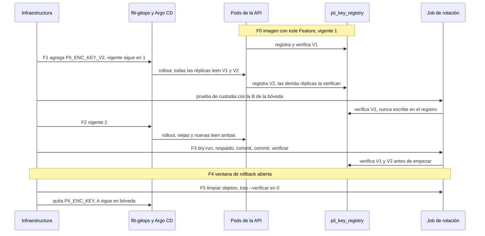

# ADR-0033 — Rotación de `PII_ENC_KEY`: llaves por versión, registro de llaves en BD y recifrado por catálogo de columnas

- **Estado:** Aceptado (aprobado por el Líder Técnico humano, David Chica, el 2026-11-03; se entrega en 2 PRs del Feature #13978; `PII_HMAC_KEY` no se rota; métrica de fallos en los `catch` de drivers, manifiestos, LAFT y `acta-pdf` sin cambiar la respuesta)
- **Fecha:** 2026-11-03
- **Contexto de trabajo:** Épica #13973, Feature #13978, HU #13987 y #14100. Apilado sobre el Feature #14097 (PR #715)
- **Relacionado:** ADR-0002 (keyspaces por dominio), ADR-0012 (tokens HMAC en `pii_access_log`, §8.4 deuda de rotación), ADR-0028 D5 (cifrado de documentos de bolsa), ADR-0030 §9 (cédula del firmante)
- **Supersedes:** ninguno. No contradice ADR aceptados: ADR-0012 pide versión como constante de código solo para `PII_HMAC_KEY`, que este ADR no rota.
- **Módulos:** legacy `drivers`, `rndc`, `laft`, `tramites`; FLITO `flito-logistica`, `flito-bolsas-documentos`
- **Alcance:** entrega la capacidad. **No rota ninguna llave real.**

## Contexto

`loadPiiKey` solo conoce la versión 1, aunque cada valor cifrado ya lleva su versión. Rotar exige tres cosas que hoy no existen: que la API lea dos llaves a la vez, una herramienta que recifre todo sin perder datos, y una forma de saber que una columna nueva no se quedó fuera.

El Feature #14097 dejó la lección: un cifrado comprobado con la misma llave equivocada pasa la verificación y destruye el dato. En una rotación ese riesgo se traslada a la llave **destino**. La llave fuente se defiende sola, porque GCM no descifra con una llave equivocada y sin descifrar no se escribe. La destino no: cifrar y descifrar con B siempre cuadra, sea B la que usa la API o no.

## Inventario de lo cifrado

### Dentro: keyspace `PII_ENC_KEY`

| # | Tabla.columna | Formato en BD | Helper / escritor | AAD | Trampa |
|---|---|---|---|---|---|
| 1 | `driver_profile.cedula` | bytea `*_cipher`, `*_iv`, `*_auth_tag`, `*_aad_nonce`, `*_key_version` | `encryptPii`, `drivers.routes.ts` | `driver_profile\|cedula\|<user_id>\|<nonce>\|<ver>` | `key_version` admite NULL, que se lee como 1 |
| 2 | `driver_profile.licencia_numero` | igual | igual | igual, con su columna | igual |
| 3 | `driver_profile.runt_payload` | igual | igual | igual, con su columna | igual |
| 4 | `manifiestos.titular_pago_cuenta` | igual | `encryptPii`, `manifiestos.routes.ts` | `manifiestos\|titular_pago_cuenta\|<numero>\|<nonce>\|<ver>` | La clave de fila es `numero`, **no** `id`. El comentario de `encryptPii` dice lo contrario |
| 5–7 | `laft_counterparties.doc_number_enc`, `email_enc`, `phone_enc` | jsonb `{cipher,iv,authTag,aadNonce,keyVersion}` en base64 | `encryptPii`, `counterparty-pii.ts` | `laft_counterparties\|doc_number\|<id>\|<nonce>\|<ver>` | La columna de la AAD **no** lleva `_enc` |
| 8 | `flito_logistica_acta_firmas.documento_cifrado` | text `v1:<ver>:<nonce>:<iv>:<tag>:<cipher>` | `encryptPii`, `flito-logistica.cifrado.ts` | `flito_logistica_acta_firmas\|documento_cifrado\|<id>\|<nonce>\|<ver>` | El `v1` inicial es versión de **formato**; la de llave es el segundo campo |
| 9 | `flito_logistica_recogida_firmantes.documento_cifrado` | igual | igual | **La misma tabla literal `flito_logistica_acta_firmas`**, con el id del firmante | La AAD nombra otra tabla |
| 10 | `flito_bolsas_documentos` columna lógica `archivo` | **Objeto en MinIO**; en BD `cifrado_iv`, `cifrado_tag`, `cifrado_key_version`, `aad_nonce`, `storage_key` | `encryptPiiBuffer`, `flito-bolsas-documentos.service.ts` | `flito_bolsas_documentos\|archivo\|<id>\|<nonce>\|<ver>` | El dato no está en la BD: `pg_dump` no lo respalda y el UPDATE no es atómico con el objeto. `storage_key` NULL = purgado |
| 11–13 | `tramites_validaciones.foto_rostro`, `foto_cedula_frontal`, `foto_cedula_reverso` | text `v<ver>:<iv hex>:<tag hex>:<b64>` | `encryptPiiText`, `flito-recifrar-biometria.ts` | `tramites_validaciones\|<columna>\|<id>` | Sin marca en el nombre. Conviven con clases `viejo`, `data_uri`, `base64_plano`, `storage_key` |

Comprobado por búsqueda: en `apps/api/src`, `createCipheriv` y `createDecipheriv` solo aparecen en `shared/utils/crypto.ts`. **No queda PII cifrada con otra derivación fuera del helper común**, salvo `decryptLegacyBiometric` (misma pasada V1, otra sal), que vive en ese archivo y está marcado para retirarse.

### Fuera, con motivo

| Columna | Llave | Motivo |
|---|---|---|
| `rndc_credenciales.clave_qr_cipher` | `RNDC_ENC_KEY` | Credencial de integración, no PII. Keyspace propio por ADR-0002: se rota a su ritmo |
| `siigo_credenciales.access_key_cipher` | `SIIGO_ENC_KEY` | Igual |
| `flito_comparendos_token_simit.token_cipher` | `COMPARENDOS_ENC_KEY` | Igual |
| `flito_sync_flit2_acceso.secret_cipher` | `FLIT2_ENC_KEY` | Igual |
| `driver_profile.cedula_hash`, `laft_counterparties.doc_number_hash`, tokens en `pii_access_log.motivo` | `PII_HMAC_KEY` | HMAC, no cifrado. Ver D7 |
| `pkcs7_signature`, `hash_sha256` (firmas PESV) | ninguna | Firma e integridad, no cifrado |

TOTP: no existe en el código. Los cuatro keyspaces de credenciales tampoco pueden rotar hoy (versión fija en 1): queda como deuda declarada, no se resuelve aquí.

### Hallazgos del inventario

1. **Dato en claro junto al cifrado en LAFT.** `laft_counterparties.doc_number`, `email` y `phone` siguen en el esquema. La 0063 anunciaba su `DROP` en una «0064» que resultó ser otra migración, y no hay `DROP COLUMN` de ellas. Rotar la llave no protege esa copia. Falta medir si hay filas con dato. No se corrige en este Feature.
2. **Fallos de descifrado silenciosos fuera de biometría.** `decryptField` de drivers, manifiestos, `decryptCounterpartyField` y `acta-pdf` capturan el error y devuelven `null`. `pii_decrypt_failures_total` solo lo incrementa biometría. Una llave ausente se ve como «sin dato» y la métrica sigue en 0, así que **no sirve como verificación post-rotación**. Por eso existe `--verificar` (D3).
3. **`PII_ENC_KEY` tiene otros dos usos:** `decryptLegacyBiometric` y el respaldo de RNDC fuera de producción (`env.PII_ENC_KEY + 'rndc:dev'`). Al volverse opcional, ese respaldo no puede concatenar `undefined` en silencio: debe lanzar.
4. **Contradicción en `AGENTS.md`:** la regla 5 ubica la configuración de PDN en el `.env` del VPS; la regla 6 y la sección de ambientes dicen que PDN va por GitOps desde 2026-10-23. El runbook lo deja como dato a confirmar con infraestructura.

## Alternativas

### A. Quién decide la versión con la que se escribe

| Opción | Pros | Contras | Esfuerzo | Riesgo |
|---|---|---|---|---|
| **A1. `PII_ENC_KEY_CURRENT_VERSION` + `PII_ENC_KEY_V<n>` (elegida)** | Agregar la llave y empezar a escribir con ella son dos rollouts separados. Rotar no exige promover imagen | Una variable más que se puede equivocar: se cubre con validación estática y registro | S | Bajo |
| A2. Constante en código, como Comparendos | Imposible de desconfigurar | Cada fase exige `develop → staging → release`: inviable en una rotación por compromiso | S | Medio |
| A3. Vigente = la mayor configurada | Sin variable extra | Agregar B ya escribe con B durante el rolling update, y las réplicas viejas no la leen. **Es el fallo que hay que evitar** | S | Alto |

### B. Cómo se ancla la llave destino

| Opción | Pros | Contras | Esfuerzo | Riesgo |
|---|---|---|---|---|
| **B1. Tabla `pii_key_registry` con un canario por versión; lo escribe la API al arrancar y el Job solo lo lee (elegida)** | Detecta divergencia entre Job y API sin intervención humana. Hace que una llave bien formada pero equivocada falle en el arranque (AC3) | Migración y BD en el arranque | M | Bajo |
| B2. Canarios solo con datos, como biometría | Sin migración | B no tiene filas hasta que la API escriba con ella: un ambiente de poco tráfico queda en `sin_canario`. No cubre AC3 en un ambiente vacío | S | Medio |
| B3. Huella de la llave en ConfigMap, calculada por el custodio | Sin BD en el arranque | Paso manual en tres ambientes, opcional en la práctica. Una huella calculada de la llave equivocada también pasa | M | Medio |

### C. Forma del script

| Opción | Pros | Contras | Esfuerzo | Riesgo |
|---|---|---|---|---|
| **C1. Script nuevo con catálogo de descriptores (elegida)** | Una entrada por columna, con la prueba AC5 apoyada en el mismo catálogo. Biometría se retira sin arrastrar nada | Un script más mientras conviven | M | Bajo |
| C2. Generalizar `flito-recifrar-biometria` | Reutiliza código ya revisado | Semánticas opuestas: aquel cifra texto en claro y clasifica; este solo recifra lo autenticado. Mezclarlas reabre la vía de destrucción, y aquel está marcado para retirarse | M | Alto |
| C3. Un script por formato | Simple de leer | Cuatro motores con guardas duplicadas y sin punto único para la prueba | L | Medio |

## Decisión

### D1. Llaves en tiempo de ejecución

- `PII_ENC_KEY` sigue siendo **la versión 1 para siempre**: ningún cambio en los tres ambientes al desplegar. Pasa a opcional para poder retirarla.
- `PII_ENC_KEY_V<n>` para n ≥ 2, leída por patrón de `process.env`: otra rotación no exige código. `PII_ENC_KEY_V1` se rechaza: dos nombres para una llave invitan a la divergencia.
- `PII_ENC_KEY_CURRENT_VERSION`, entero ≥ 1, por defecto 1.
- **Sales:** v1 conserva `kyverum-pii-2026`, o dejaría de leer lo existente; n ≥ 2 usa `flito-pii-v<n>`. Una derivación memoizada por versión (ya existe la memoización desde #14097).
- `decryptLegacyBiometric` toma la pasada de la versión 1. Sin V1 falla como `PiiDecryptError`, sin escribir nada.
- **Lectura:** cada valor usa su versión. **Escritura:** siempre la vigente.

### D2. Validación en dos etapas (AC3 de #14100)

**Etapa estática, en `env.ts` (`superRefine`), sin BD y sin derivar.** Aplica a todo lo que importe `env`, igual que hoy:

- la versión vigente tiene llave;
- cada llave tiene al menos 32 caracteres y entropía suficiente (solo n ≥ 2; a V1 no se le exige una regla nueva que pueda tumbar el ambiente actual);
- **ninguna pareja de versiones comparte pasada.** Se comparan las pasadas y no las llaves derivadas: las sales distintas harían que A y A parecieran diferentes;
- los mensajes nunca incluyen valores.

**Etapa de arranque, `comprobarLlavesPiiAlArrancar()`, llamada en `server.ts` antes de `app.listen` y de los crons.** No va en `crypto.ts` ni en `app.ts`, así que tests y scripts que importan el helper no la ejecutan:

1. Deriva todas las versiones configuradas, de modo que la primera petición ya no paga scrypt.
2. Por cada versión: si tiene fila en el registro, debe descifrar su canario; si no la tiene, se registra.
3. **Primer registro de la versión 1:** antes de registrar, una muestra de hasta 5 valores por columna (sin objetos de MinIO) debe tener al menos un éxito. Sin datos, registra.
4. **Primer registro de n ≥ 2:** con esa pasada y la sal de cada versión ya registrada, se intenta descifrar el canario de esa versión. Si descifra, es una llave retirada reutilizada y se rechaza.
5. El registro usa `INSERT … ON CONFLICT DO NOTHING` y **relee y verifica**: de dos réplicas con B distintas, la segunda no arranca.
6. Fallo: `log.fatal` sin detalle de la llave y `process.exit(1)`. Es deliberadamente distinto de `verificarCatalogoAlArrancar`, que solo registra el error: arrancar con una llave equivocada corrompe datos. El rolling update se detiene y los pods anteriores siguen sirviendo.
7. Al terminar, una línea de log con la versión vigente y las configuradas, nunca las llaves. Con ella se comprueba cada fase del runbook pod por pod.

### D3. Script `flito-rotar-llave-pii`

Banderas, exactamente un modo:

| Modo | Efecto |
|---|---|
| `--dry-run --target-version=N` | Descifra, recifra en memoria y cuenta. Cero escrituras |
| `--commit --target-version=N` | Escribe |
| `--verificar --target-version=N` | Descifra todo y sale 0 solo si cada celda está en N, legible, y no quedan formatos que dependan de la llave retirada. **Es el gate para retirar la llave anterior** |
| `--solo-llaves` | Solo comprueba llaves contra el registro. Para la prueba de custodia |
| `--limpiar-objetos` | Borra los objetos anteriores de MinIO. Solo al cerrar la ventana de rollback |

**No hay «origen» ni «destino»:** todo valor con versión distinta de la vigente se recifra a la vigente. `--target-version` es una afirmación del operador: si no coincide con la vigente, aborta. La misma herramienta sirve de rollback, y las filas mezcladas no son un caso aparte (AC2).

**Descriptor por columna**, en un registro tipado con `satisfies Record<ColumnaCifrada, Descriptor>`:

```text
id · lote · pendientes(despuesDe, versionObjetivo) · muestra(n)
descifrar(fila) → Buffer · cifrar(Buffer, fila) → valor · escribir(fila, valor) → boolean
```

Cuatro formas comparten el motor: bundle bytea, jsonb, texto serializado y objeto.

- **Byte exacto:** se recifra por `decryptPiiBuffer`/`encryptPiiBuffer`, que producen el mismo formato que `encryptPii` sin pasar por utf8.
- **AAD:** se conserva `aad_nonce`, y los descriptores usan los constructores de AAD de cada módulo, sin copiarlos.
- **Lotes y reanudación:** por clave primaria (keyset). No guarda estado: lo pendiente es lo que no está en la versión objetivo, así que reanudar es volver a correr.
- **Guarda de concurrencia:** un solo `UPDATE` con cipher, iv, tag y versión, condicionado a `iv` y versión leídos (texto: valor completo leído). Si la API escribió o anonimizó mientras tanto, cuenta `omitido_concurrente` y no pisa nada.
- **Biometría:** `viejo`, `data_uri`, `base64_plano` y `desconocido` **no se tocan**. Se cuentan como `formato_legado`. Si hay `viejo` o texto en claro de biometría, `--verificar` no pasa. Se resuelven con el script de #14097, que al escribir usa la versión vigente.
- **Salida:** conteos e ids de fila. Nunca `numero` de manifiesto, valores ni causas. Códigos 0, 2 y 1 como en biometría.

**Objetos de bolsas:** 1) descargar y descifrar; 2) cifrar y subir a una clave **nueva**; 3) releer el objeto y descifrarlo; 4) `UPDATE` de `storage_key`, `storage_key_previa`, `cifrado_iv`, `cifrado_tag` y `cifrado_key_version`, con guarda. Si la guarda falla, se borra el objeto recién subido. El objeto anterior se conserva: los lectores en vuelo siguen funcionando y restaurar el dump sigue siendo posible. `--limpiar-objetos` lo borra al cerrar la ventana. Una purga ocurrida durante la ventana deja el objeto anterior hasta esa limpieza, y por eso el runbook pone plazo a la ventana. Si una fila se recifra otra vez con previa ocupada, se conserva solo la inmediatamente anterior.

### D4. Llave equivocada con dos llaves

| Caso | Qué lo detecta | Resultado |
|---|---|---|
| El Job tiene una B distinta a la de la API | Canario de B en el registro, escrito por la API y nunca por el Job | Aborta en los modos que escriben y en dry-run: salida 1, cero escrituras |
| B no registrada aún (Job antes de la fase 1) | Falta la fila | Aborta. **El Job nunca registra** |
| B no configurada | `--target-version` sin llave; o vigente sin llave en `env.ts` | Aborta o no arranca |
| B == A | Validación estática de pasadas | No arranca nada |
| B es una llave retirada | Comprobación cruzada en el primer registro | No arranca |
| La «vieja» no descifra nada | Canario de V1 en el registro: no arranca. Si el fallo es de una sola columna, normalmente un descriptor mal hecho: canario de columna en `fallo`, esa columna no se escribe, salida 2 | Sin escritura posible: GCM falla antes |
| Valor en claro | El motor solo recifra lo que descifró autenticado | **Se cierra la vía de #14097** |
| Sealed secret y bóveda con B distintas | Prueba de custodia: `--solo-llaves` con la B de la bóveda | Se detecta antes de retirar A |

**Riesgo residual declarado:** si la misma B errónea llega a toda la API en el primer registro, se registra. Es coherente y legible mientras esa B exista; lo que la cubre es la prueba de custodia.

### D5. Prueba de cobertura (AC5)

Catálogo sin dependencias, `shared/utils/pii-columnas.ts`: `COLUMNAS_CIFRADAS_PII`, `FUERA_DE_ALCANCE` (con motivo) y `ESCRITORES`. Cinco capas, porque ninguna basta sola:

1. **Barrido Drizzle** con `getTableConfig` (ya usado en las pruebas de migración), sobre `schema.ts` y `schema/*.ts`: toda columna `bytea`, o cuyo nombre sea `*_cipher`, `*_enc`, `*_encrypted`, `*_cifrado` o `cifrado_*`, debe estar en el catálogo, ser parte de un paquete o estar en `FUERA_DE_ALCANCE`.
2. **Barrido de migraciones SQL:** la misma regla, para lo que no llegó a Drizzle.
3. **Barrido de fuentes:** todo archivo que llame `encryptPii`, `encryptPiiBuffer` o `encryptPiiText` debe estar en `ESCRITORES`, y `createCipheriv` fuera de `crypto.ts` hace fallar la prueba. Es lo que cubre las columnas `v<n>:` **sin marca de nombre**, y las derivaciones propias como la de `identidad.routes`.
4. **Tipo en los escritores:** la AAD de las funciones `encrypt*` de PII acepta solo pares `tabla/columna` del catálogo. Una columna nueva en un archivo ya registrado no compila hasta declararla. El gate es `build:api`.
5. **Paridad:** catálogo ↔ descriptores ↔ columnas reales ↔ inventario del runbook.

El test incluye **autopruebas del detector**: una tabla sintética con `x_cipher` y una fuente sintética con `encryptPiiText(` deben reportarse como no cubiertas.

Límite conocido: un `as any` en la AAD dentro de un escritor ya registrado escapa a las capas 3 y 4. Se acepta; lo cubre la revisión de código.

### D6. Migración: sí

Una, numerada con el **siguiente `NNNN` libre al integrar** e idempotente:

- `CREATE TABLE IF NOT EXISTS pii_key_registry (version smallint PRIMARY KEY, canario text NOT NULL, creada_en timestamptz NOT NULL DEFAULT now())`. El canario es una constante cifrada, sin PII, con AAD `pii_key_registry|canario|<version>`.
- `ALTER TABLE flito_bolsas_documentos ADD COLUMN IF NOT EXISTS storage_key_previa text`.

Sin índices nuevos: la corrida es por clave primaria y puntual. `db-apply` corre antes de que arranque la API, así que la tabla existe en la etapa de arranque.

### D7. `PII_HMAC_KEY`: recomendación, no rotarla

**Dónde se usa:**

| Uso | Recalculable | Nota |
|---|---|---|
| `driver_profile.cedula_hash` (índice único parcial): búsqueda de conductores y olvido del art. 15 | Sí, desde la cédula descifrada | |
| `laft_counterparties.doc_number_hash` (índice) | Sí, desde el documento | |
| `pii_access_log.motivo`, tokens `v1:` de VIN y placa | **No** | La tabla es append-only por trigger (0059), con retención de 6 años |

No hay índice por VIN: el VIN solo existe como token en `motivo`.

**Motivo:** rotar exige cambio de código con su ADR (ADR-0012 §4), búsqueda con dos llaves y recálculo de dos índices. Además obliga a conservar la llave vieja seis años o a perder la correlación histórica del registro del art. 17. Y comprometer esta llave no expone datos cifrados. El runbook documenta la decisión y el procedimiento de contingencia si se llegara a comprometer. **Pendiente de confirmación humana.**

### D8. `crypto.ts` no se parte; se extrae solo lo nuevo

Con 651 líneas físicas cabe en el límite de 800, pero añadir llaves dobles lo acerca y mezcla responsabilidades. Va a `shared/utils/pii-keyring.ts`: lectura, sales, memoización, validación. Mover los cuatro keyspaces de credenciales tocaría imports de varios de los 27 archivos que hoy importan `crypto.ts`, sin ganancia para esta HU.

### D9. Rollback

| Estado | Cómo volver | Pérdida |
|---|---|---|
| V2 agregada, vigente 1 | Quitar V2 del secreto. La fila del registro queda inerte | Ninguna |
| Vigente 2, recifrado parcial o completo | Vigente 1, rollout, `--commit --target-version=1` con V2 aún configurada | Ninguna |
| V1 retirada, aún en bóveda | Reponer `PII_ENC_KEY`, y el caso anterior | Ninguna |
| Imagen anterior al Feature con filas en V2 | **Prohibido sin antes recifrar a V1.** Esa imagen no conoce V2: drivers, manifiestos y LAFT devolverían `null` con 200 | Datos invisibles sin aviso |
| Restaurar `pg_dump` | Último recurso. Requiere A y los objetos anteriores de MinIO | Lo escrito tras el dump |
| A destruida | **No hay vuelta atrás** | |

**Retirar A de la API no es destruirla.** Cada `pg_dump` y respaldo previo sigue cifrado con A: A se conserva en bóveda hasta que expire el último respaldo que la necesite. En una rotación por compromiso, esos respaldos quedan expuestos mientras A exista fuera de control, y hay que tratarlos en la decisión.

## Orden de despliegue



Separar F1 de F2 es lo que garantiza que ninguna réplica escriba con una llave que otra no lee: cuando alguna empieza a escribir con B, todas ya la leen. Cambiar un ConfigMap no siempre reinicia pods: el runbook exige comprobar la línea de log en cada pod antes de pasar de fase. Un pod rezagado no daña datos: escribe en V1, y `--commit` y `--verificar` lo detectan.

## Consecuencias

- La API depende de la BD para arrancar. Hoy el initContainer `db-apply` ya exige lo mismo en los ambientes remotos.
- **Un desarrollador con una `PII_ENC_KEY` local distinta a la que cifró su BD demo verá fallar el arranque**, con un mensaje explícito. Es el comportamiento de AC3.
- `manifiestos.updated_at` avanza al recifrar, por `trg_manifiestos_touch`. El trigger de conductor apto solo aplica a `UPDATE OF conductor_id, vehiculo_principal_id`, así que no bloquea. Por búsqueda en las migraciones, no hay triggers de inmutabilidad en las demás tablas del inventario.
- Los dumps de una rotación contienen lo mismo que los de #14097: se custodian y se borran igual.

## Riesgos abiertos

1. Rendimiento en `tramites_validaciones` y bolsas: el Job baja objetos de hasta 15 MB y fotos de varios MB. Sin datos de volumen de PDN no se puede estimar la duración.
2. `logPiiAccess` exige un `Request`: el Job no encaja en la auditoría actual. Debe decidirlo `security-agent`.
3. Hallazgo 1 (LAFT en claro) y 2 (fallos silenciosos): fuera del pedido, sujetos a confirmación humana.
