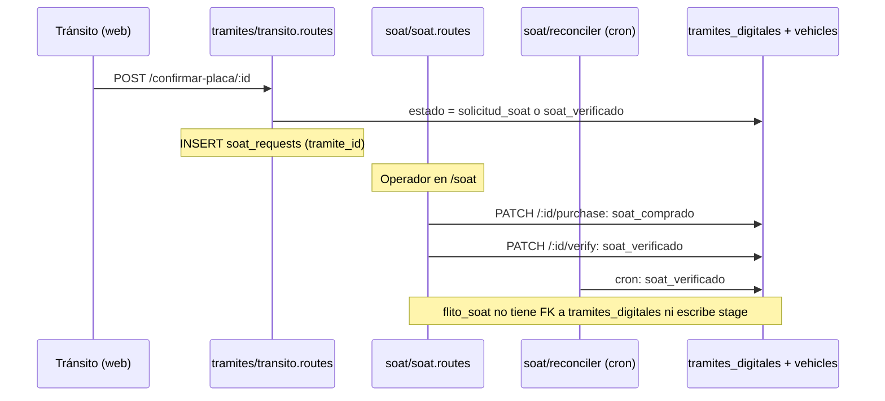

# ADR-0038 — Destino de los módulos legacy `soat`, `tramites`, `liquidacion` y `firma`

- **Estado:** Aceptado (aprobado por David Chica el 2026-11-04, tal cual)
- **Fecha:** 2026-11-04
- **Contexto de trabajo:** Épica #14272, Feature #13980, HU #13990. La HU #13991 depende de este ADR
- **Supersedes:** ninguno. Ajusta con notas fechadas la política de retiro de ADR-0033 (§5) y las referencias a #13990 de ADR-0037 (§4, §2.3, «Pendiente humano»)
- **Módulos:** habla con los legacy `soat`, `tramites` (incluye `firma` y los prefijos `/transito`, `/validacion-identidad`, `/tramite-portal`, `/public/tramite-verificar`) y `liquidacion`, y los compara con `flito-soat`, `flito-tramites`, `flito-liquidacion`, `flito-parametrizacion`, `flito-ocr` y `flito-logistica`. **No cambia código, tablas ni rutas**
- **Base verificada:** `origin/develop` en `ad0b7bc4` (comprobado con `git ls-remote`). Todas las referencias `archivo:línea` son de ese commit

## Contexto

ADR-0037 §4 dejó el destino de cada módulo a esta HU, «con datos de tráfico». David Chica decidió el 2026-11-04 no esperar la ventana de 4 semanas: se decide con evidencia de código y uso desde `apps/web`, sin consultar PDN. También aceptó que sin tráfico no se puede afirmar que una ruta concreta esté sin uso, y por eso **este ADR no decide ningún retiro**.

**Rutas abreviadas:** `soat/…`, `tramites/…`, etc. cuelgan de `apps/api/src/modules/`. `pages/…` y `components/…` cuelgan de `apps/web/src/`. `db/`, `scripts/`, `app.ts` y `server.ts` cuelgan de `apps/api/src/`, salvo que se indique la raíz del repo.

**Qué significa cada destino en este ADR:**

| Destino | Significado | Lo que no significa |
|---|---|---|
| **Mantener** | El módulo sigue siendo la casa de su flujo. Recibe cambios según ADR-0037 §3 (C1, C4) | No es un compromiso permanente: se revisa en la fecha de §5 |
| **Converger** | Existe un concepto equivalente en `flito-*` y es la dirección a futuro. Lo nuevo va allí (ADR-0037 C5); legacy recibe correcciones | No es una tarea aprobada, ni una fecha de corte, ni un retiro |
| **Redirigir** | Una ruta legacy puede servir a sus consumidores con una ruta `flito-*`. Exige mismo propósito y contrato compatible | No aplica a ningún módulo (§3) |

## Hallazgos que complican el cierre

| Hallazgo | Evidencia | Consecuencia |
|---|---|---|
| **El mayor solapamiento no es el de `tramites`, sino el de `soat`.** Mismo concepto y un mapeo de estados ya escrito, pero contrato incompatible | `scripts/flito-backfill-soat.ts:24` (`traducirEstado`), §1.3 | `soat` es el único candidato a converger, y no se puede redirigir |
| **`soat` no se puede mover solo.** Es un paso de la matrícula inicial legacy: `confirmar-placa` crea la solicitud y `soat` empuja el estado del trámite | `tramites/transito.routes.ts:255`, `:292`, `:301`; `soat/soat.routes.ts:298`, `:370`; `soat/reconciler.ts:99`. Ningún `flito-*` toca `tramites_digitales` | Converger exige decidir antes qué pasa con esa cadena, y hoy no hay puente (§4) |
| **`GET /api/flito/parametrizacion/organismos` y `GET /api/transito/organismos-config` leen la misma tabla y no son intercambiables** | `flito-parametrizacion/flito-parametrizacion.routes.ts:488-511`; `tramites/transito-config.ts:68-85` | Es el único par de rutas de catálogo sobre la misma tabla. La propia pantalla consume los dos: `pages/TransitoOrganismos.tsx:108-109` |
| **`/validacion-identidad` tiene más consumidor web del que dice ADR-0037 §4.** `public/validar-identidad.html` llama a `info` y `completar`, y el `grep` sobre `apps/web/src` no lo ve | `apps/web/public/validar-identidad.html:112`, `:241`; enlace en `tramites/identidad.routes.ts:297`, `:424` | Son 2 líneas más fuera de los 137 literales. Parecían rutas sin consumidor y no lo son |
| **`POST /api/soat/verificar-runt` marca `verificado` sin consultar el RUNT** en 3 tablas. Sin consumidor literal en la web | `soat/soat.routes.ts:524-553`; comentario en `:533` | No se decide aquí: se declara y queda como pregunta (Pendiente humano 3) |
| **La política vieja sigue escrita en código ya desplegado** | `db/migrations/0287_uso_legacy_diario.sql:10`; `uso-legacy/uso-legacy.service.ts:2`, `:123` | La 0287 está en `staging` y no se puede editar (`AGENTS.md`, regla 6). Prevalece la nota de ADR-0033 §5 |

## Método

- **Rutas:** leídas de los 12 archivos `*.routes.ts` legacy con `grep` sobre `router.<verbo>(`, incluidas las de varias líneas. **96 rutas:** 95 bajo los 7 prefijos de ADR-0033 y `POST /api/webhooks/firma`, que no se mide.
- **Uso web:** recorrido de `apps/web/src` buscando un literal que abre con el prefijo, sin comentarios ni rutas del router, enlaces o `Navigate`. Lo comparé luego ruta por ruta.
- **Equivalente:** para cada grupo leí la ruta legacy y su candidata `flito-*`. Solo cuenta como equivalente real con **mismo propósito y contrato compatible** (identificador, cuerpo, respuesta y efectos). Un nombre parecido no cuenta.
- **ADR-0037 cotejado, no copiado:** entre `9ad65ce7` y esta base, en los módulos legacy solo cambió `tramites/identidad.routes.ts` (5 líneas), y las líneas citadas aquí se volvieron a leer.
- **No ejecuté nada:** sin consultas a BD, sin datos de `uso_legacy_diario`, sin llamadas a ningún ambiente.

## 1. Análisis (AC1)

### 1.1 Uso desde `apps/web/src` por prefijo

**Reproducido contra `ad0b7bc4`: mismas cifras que ADR-0037 §4.**

| Prefijo API | Líneas | Archivos | Con literal `/api/…` |
|---|---|---|---|
| `/tramites` | 81 | 19 | 9 |
| `/soat` | 18 | 3 | 7 |
| `/transito` | 18 | 6 | 0 |
| `/validacion-identidad` | 10 | 5 | 3 |
| `/tramite-portal` | 6 | 1 | 6 |
| `/liquidaciones` | 3 | 1 | 0 |
| `/public/tramite-verificar` | 1 | 1 | 1 |
| **Total** | **137** | **29** | **26** |

Fuera de esta cuenta: las 2 llamadas de `apps/web/public/validar-identidad.html`, y las rutas construidas por partes, como `generar-improntas` (`pages/tramite/TraspasoStepDocumentos.tsx:135`, `pages/TransitoTraspasoExpediente.tsx:57`), que sí se cuentan por su prefijo pero no por su nombre.

La HU #13988 reparte `pages/TramiteTraspaso.tsx` en otros archivos y aún no está en esta base. Puede mover las cifras de líneas y archivos de `/tramites` sin cambiar el uso real.

Solo **un** componente de FLITO usa estos prefijos: `components/flito/BolsaForm.tsx:480` (`/transito/organismos-config`).

### 1.2 Por grupo de rutas: uso y equivalente `flito-*`

| Grupo | Rutas | Con literal en la web | Dónde se usa | Candidato `flito-*` | ¿Equivalente real? |
|---|---|---|---|---|---|
| `soat`: cola, alta, compra, export | 12 (`soat/soat.routes.ts`, `soat/batch.routes.ts`) | 10 | `pages/Soat.tsx`, `components/BatchValidator.tsx`, `pages/Dashboard.tsx:98` | `flito-soat` | **Parcial de propósito, contrato incompatible** (§1.3) |
| `tramites`: expediente, wizard, pre-vuelo, documentos, FUR | 32 de `tramites/tramites.routes.ts` | 28 | `pages/tramite/*`, `pages/TramiteTraspaso.tsx`, `pages/TransitoTraspasoExpediente.tsx`, `components/ExpedienteVisor.tsx` | `flito-tramites` | **No existe** |
| `tramites`: lote de flota | 10 de `tramites/tramites.routes.ts:112-211` | 8 | `pages/tramite/LoteFlota.tsx` | `flito-soat` masivo | **No existe** |
| `tramites`: OCR | 2 (`tramites/ocr-docs.routes.ts`) | 2 | `pages/tramite/useTramiteWizard.ts:338`, `pages/tramite/useTramiteDocUpload.ts:30` | `flito-ocr` | **No existe** como ruta: no tiene router |
| `firma` (bajo `/api/tramites`) | 2 (`firma/firma.routes.ts`) | 2 | `pages/tramite/FirmaPanel.tsx:33`, `:46` | `flito-logistica` (firmantes) | **No existe** |
| `firma`: webhook (`/api/webhooks/firma`) | 1 (`firma/webhook.routes.ts:20`) | no aplica | Proveedor externo con HMAC | ninguno | **No existe** |
| `/transito`: bandeja | 8 (`tramites/transito.routes.ts`) | 8 | `pages/TransitoBandeja.tsx`, `pages/TransitoTraspasoExpediente.tsx:302` | ninguno | **No existe** |
| `/transito`: `organismos-config` | 8 (`tramites/transito-config.routes.ts`) | 8, una por URL armada en el servidor (`tramites/transito-config.ts:29`) | `pages/TransitoOrganismos.tsx`, `pages/TransitoBandeja.tsx:176`, `components/flito/BolsaForm.tsx:480`, `pages/tramite/ChecklistTipologia.tsx:59`, `pages/tramite/steps/StepExpediente.tsx:61` | `flito-parametrizacion` | **Solapamiento en lectura, no compatible** (§1.3) |
| `/validacion-identidad` sin `/sse` | 8 (`tramites/identidad.routes.ts:269-847`) | 6 en `src`, 2 en `public/` | `pages/tramite/TraspasoStepIdentidad.tsx`, `pages/tramite/useTramiteWizard.ts:144`, `components/ExpedienteVisor.tsx`, `public/validar-identidad.html` | ninguno | **No existe** |
| `/validacion-identidad/sse` | 1 (`tramites/identidad.routes.ts:259`) | 0 | Sin `EventSource` en `apps/web` | ninguno | **No existe.** Límite propio en §6 |
| `/tramite-portal` (público) | 6 (`tramites/portal.public.routes.ts`) | 6 | `pages/PublicTramitePortal.tsx` | ninguno | **No existe** |
| `/public/tramite-verificar` (público) | 2 (`tramites/verify.public.routes.ts`) | 1 | `pages/PublicTramiteVerify.tsx:45` | ninguno | **No existe** |
| `/liquidaciones` | 4 (`liquidacion/liquidacion.routes.ts`) | 3 | `components/maintenance/LiquidacionPanel.tsx`, montado en `pages/WorkOrderDetail.tsx:197` | `flito-liquidacion` | **No existe** |

**Rutas sin literal en la web (11). No se deciden: sin tráfico no se puede afirmar que estén sin uso.**

| Grupo | Rutas |
|---|---|
| `soat` | `PATCH /:id/reject`, `POST /verificar-runt` |
| `tramites` | `GET /tipologias`, `POST /lote`, `POST /lote/confirm`, `GET /stats/metricas`, `GET /stats/resumen`, `DELETE /:tramiteId/documentos/:docId` |
| Otros | `GET /api/validacion-identidad/sse`, `GET /api/public/tramite-verificar/qr-png/:token`, `GET /api/liquidaciones/:id` |

### 1.3 Por qué no hay contrato compatible

| Par | Identificador | Entrada y salida | Efectos | Evidencia |
|---|---|---|---|---|
| `GET /api/soat` ↔ `GET /api/flito/soat` | `bigserial` ↔ `uuid` | `?status=` con 5 valores y lista plana ↔ filtros múltiples y página | Legacy: `assignedTo` para el proveedor. FLITO: `contextoSoat` por compañía | `db/schema.ts:521`, `:2729`; `soat/soat.routes.ts:95`, `:150`; `flito-soat/flito-soat.routes.ts:136` |
| `POST /api/soat` ↔ `POST /api/flito/soat/cliente` | Por `vehicleIds` ↔ por VIN o placa | Lista de vehículos ↔ alta con RUNT y factura obligatoria en Inicial (opcional en Renovación) | Legacy mueve `vehicles.stage`. FLITO no lo mueve (ADR-0037 §1.3) | `soat/soat.routes.ts:105-110`; `flito-soat/flito-soat-cliente.routes.ts:627` |
| `PATCH /api/soat/:id/purchase` ↔ `POST /api/flito/soat/:id/factura` | Igual que arriba | Campos tecleados y evidencia opcional ↔ archivo con OCR | Legacy propaga a `vehicles` y `tramites_digitales` | `soat/soat.routes.ts:195`, `:214`, `:293-298`; `flito-soat/flito-soat.routes.ts:707` |
| `PATCH /api/soat/:id/verify` ↔ corrida de vigencia | Sin par HTTP | No aplica | Legacy mueve estado. FLITO no lo mueve, por diseño (RN-D7, regla R6 de ADR-0037) | `soat/soat.routes.ts:343`; `flito-soat/flito-soat-vigencia.service.ts:380` |
| `GET /api/transito/organismos-config` ↔ `GET /api/flito/parametrizacion/organismos` | `codigo` en ambas | Legacy: **todo el catálogo nacional**, con `ciudad`, logo y conteos. FLITO: **solo filas ya sembradas**, sin `ciudad` y con `nombre = alias ?? codigo` | `BolsaForm` necesita `{ codigo, nombre, ciudad, alias }` | `tramites/transito-config.ts:68-85`; `flito-parametrizacion/flito-parametrizacion.routes.ts:488-511`; `components/flito/BolsaForm.tsx:421-428` |
| `tramites` ↔ `flito-tramites` | `serial` ↔ `uuid` + `id_flit` | Wizard con estados y documentos ↔ cola de lo que llega de FLIT y FLIT 2, con acciones de despacho | `flito-tramites` no crea trámites reales: solo `POST /demo` | `db/schema.ts:423`, `:3077-3078`; `tramites/tramites.state.ts:8`; `flito-tramites/flito-tramites.routes.ts:265`; `flito-sync/flito-sync.service.ts:1`; `packages/shared-types/src/flito-tramite-fuente.ts:9` |
| `liquidacion` ↔ `flito-liquidacion` | `bigserial` con `woId` o `tramiteId` entero ↔ `tramiteId` `uuid` | Ítems y pago manual ↔ cálculo con tarifa, GMF y sellado | El código lo declara: «no tiene relación con FLITO» | `db/schema.ts:1384-1386`, `:3714`; `liquidacion/liquidacion.routes.ts:19-24`; `flito-liquidacion/flito-liquidacion.service.ts:21-22` |
| `tramites` lote ↔ `flito-soat` masivo | `tramite_lotes` ↔ `flito_soat_masivo_lotes` | Crea **trámites** ↔ crea **solicitudes SOAT** del canal Cliente | Objetos distintos | `tramites/tramites.routes.ts:135`; `flito-soat/flito-soat-masivo.routes.ts:103` |
| `firma` ↔ `flito-logistica` | Firma electrónica del contrato ↔ firmantes de actas de recogida | Sobre con proveedor y webhook ↔ confirmación interna | Propósito distinto | `firma/firma.routes.ts:19`; `firma/webhook.routes.ts:20`; `flito-logistica/flito-logistica.routes.ts:519` |

**Sin candidato en `flito-*`:** biometría, portal de participantes, verificación pública por QR y bandeja de los organismos de tránsito. Lo busqué por nombre de tabla y término en `modules/flito-*`. Ningún archivo usa `tramites_validaciones`, `tramite_participantes` ni `tramite_firmas`. `POST /tramites/impuesto-vehicular/consultar` y el pre-vuelo tampoco tienen ruta par: la consulta de impuesto no se usa desde ningún `flito-*`, y el pre-vuelo lo usa `flito-soat` importando el código legacy.

### 1.4 Dependencias entre módulos

Cotejadas contra el código. Las marcadas **(nueva)** no están en ADR-0037 §1.5.

| Origen | Destino | Tipo | Evidencia |
|---|---|---|---|
| `flito-soat` | `tramites/preflight.ts` | Código | `flito-soat/flito-soat-cliente-runt.ts:40`, `:162` |
| `flito-ocr` | `tramites/anthropic.ts` | Código | `flito-ocr/flito-ocr.service.ts:13` |
| `privacy` y 2 scripts | `tramites/identidad.fotos.ts` | Código | `privacy/rotacion/descriptores.ts:28`; `scripts/backfill-fotos-s3.ts:23`; `scripts/flito-recifrar-biometria.ts:29` |
| `firma` ↔ `tramites` | En los dos sentidos | Código | `firma/firma.service.ts:6-7`; `tramites/portal.ts:16`; **(nueva)** `tramites/preflight.ts:21` |
| `tramites` → `soat_requests` | Tabla del otro módulo | Escritura | `tramites/transito.routes.ts:292`, `:301` |
| `soat` → `tramites_digitales` | Tabla del otro módulo | Escritura | `soat/soat.routes.ts:298`, `:370`; `soat/reconciler.ts:99` |
| `vehicles` → `soat_requests` | Lectura | Lectura | `vehicles/vehicles.routes.ts:138-148`; `vehicles/vehiculo-historial.ts:167` |
| `components/flito/BolsaForm.tsx` | `/transito/organismos-config` | HTTP | `:480` |
| `flito-tramites` | `organismos_transito_config.alias`, editado por `tramites` | Dato | ADR-0037 §1.3 |
| **(nueva)** `app.ts` | `soat/reconciler-health.ts` | Monitoreo | `app.ts:470` (`GET /api/health/soat-reconciler`). El comentario de `app.ts:467` cita un runbook, `docs/runbook/SOAT-RECONCILER-HEALTH.md`, que no está en esta base |
| **(nueva)** `server.ts` | Crons legacy | Arranque | `server.ts:84-85` (`soat`), `:106-107` (`tramites`) |
| `liquidacion` | FK a `work_orders` y `tramites_digitales` | Esquema | `db/schema.ts:1385-1386`. **Ningún módulo la importa**: su único importador es `app.ts:114` |

**En sentido contrario, cero:** ningún archivo de `soat`, `tramites`, `liquidacion` ni `firma` importa de un `flito-*`.

### 1.5 Otros consumidores en el repo

| Consumidor | Qué usa |
|---|---|
| E2E | `apps/web/e2e/tests/soat.spec.ts`, `tramite-embudo.spec.ts`, `tramite-traspaso*.spec.ts`, `tramite-wizard.spec.ts`, `transito-bandeja.spec.ts`, `transito-organismos.spec.ts` |
| Tests del API | `apps/api/__tests__/services/`, entre otros `soat.routes.test.ts`, `tramites.*.test.ts`, `transito*.test.ts`, `identidad.routes.test.ts`, `firma.routes.test.ts`, `liquidacion.routes.test.ts` |
| Operación | `scripts/verificar-nginx-logs-pii.sh:64-69` (raíz del repo); `apps/web/nginx.conf.template`; `apps/api/src/shared/middleware/ruta-segura.ts:51`; `apps/api/scripts/bench-uso-legacy.ts` |
| Documentación | `apps/api/templates/README.md:29` documenta un `curl` a `generar-fur` |
| **Enlaces ya emitidos** | Portal: `tramites/portal.ts:67`, `:193`. Biometría: `tramites/identidad.routes.ts:297`, `:424`. Verificación: `tramites/expediente-pdf.ts:269`, `:274`; `tramites/notificaciones.ts:80`. Viven en correos, mensajes y documentos fuera del repo |

### 1.6 Lo que no se puede afirmar sin datos de tráfico

- **Que una ruta se use o no.** Un literal en la web no prueba tráfico, y su ausencia no prueba desuso.
- **Qué volumen tiene cada grupo y qué rol lo usa.** Incluye `/soat`, que no tiene entrada en `components/shell/navEntradas.ts` y solo se alcanza por `pages/Dashboard.tsx:289`, `:317` o por URL directa. No se puede concluir que nadie entre.
- **Si `soat_requests` y `tramites_digitales` siguen recibiendo filas nuevas en PDN.**
- **Si la ramificación `tramiteId` de `/api/liquidaciones` se usa.** La web solo envía `woId` (`components/maintenance/LiquidacionPanel.tsx:23`).

## 2. Alternativas

| Opción | Pros | Contras | Esfuerzo | Riesgos |
|---|---|---|---|---|
| **A. Mantener todo, sin distinción** | Lo más simple; cero trabajo futuro implícito | Ignora que `soat` sí tiene concepto par y un mapeo escrito; deja sin dirección la regla C5 en SOAT | S | Las dos generaciones de SOAT divergen sin que nadie lo decida |
| **B. Destino por grupo, con evidencia** (elegida) | Separa lo que tiene par de lo que no; declara lo indeterminable; no compromete trabajo ni retiros | Requiere una revisión futura | S | Que `converger` se lea como tarea aprobada: se aclara arriba |
| **C. Redirigir `soat` a `flito-soat` con un adaptador** | Daría un solo backend de SOAT | Traducir `bigserial` a `uuid` entre tablas sin FK; `flito-soat` no propaga a `tramites_digitales` ni a `vehicles.stage`; la factura obligatoria en el alta Inicial y el RUNT cambian lo que el operador hace | L | Cortaría la matrícula inicial legacy; escrituras en la tabla equivocada |

**Decisión: opción B.** Es la única que responde al AC2 por módulo sin inventar compatibilidad. La C se descarta por evidencia de contrato (§1.3), no por falta de tráfico.

## 3. Decisión por módulo (AC2)

| Módulo o grupo | Destino | Justificación | Equivalente `flito-*` | Fecha |
|---|---|---|---|---|
| `soat` | **Converger hacia `flito-soat`**, sin ejecución aprobada | Mismo concepto; `scripts/flito-backfill-soat.ts` ya traduce estados y se declara «shadow-run: el módulo legacy sigue vivo»; las funciones se llaman `soat.antiguo.*` y se describen como «módulo anterior» (`db/migrations/0230_permisos_sensibles_por_permiso.sql:72`). Bloqueado por la cadena de §4. El reconciliador sigue en marcha (`server.ts:84`) | Parcial de propósito, contrato incompatible | Revisión 2027-05-04 |
| `tramites`: expediente, wizard, pre-vuelo, documentos, FUR, lote, OCR, métricas | **Mantener** | Flujo sin par (ADR-0037 C1). `flito-tramites` es una cola de lo sincronizado desde FLIT y FLIT 2; no crea trámites ni tiene wizard. `flito-soat` y `flito-ocr` dependen de este módulo | **No existe** | Revisión 2027-05-04 |
| `firma`, incluido el webhook | **Mantener** | Sin par; unido a `tramites` en los dos sentidos (§1.4); tiene un consumidor externo por webhook | **No existe** | Revisión 2027-05-04 |
| `/transito`: bandeja | **Mantener** | Es la cola de los organismos de tránsito, con alcance propio (`app.ts:353`). Sin par | **No existe** | Revisión 2027-05-04 |
| `/transito`: `organismos-config` | **Mantener** | Único que edita `alias` y logo (`flito-parametrizacion` solo inserta la fila inicial, ADR-0037 §1.3), y único escritor de `organismo_checklist_overrides`. La lectura de `flito-parametrizacion` no sirve el mismo conjunto ni los mismos campos (§1.3). `BolsaForm` depende de ella | Solapamiento en lectura, no compatible | Revisión 2027-05-04 |
| `/validacion-identidad` sin `/sse` | **Mantener** | Biometría sin par; `privacy` y la rotación de llave (ADR-0034) dependen de su código y sus tablas | **No existe** | Revisión 2027-05-04 |
| `/validacion-identidad/sse` | **Sin decisión de retiro.** Se mantiene como está | Ver §6 | **No existe** | Revisión 2027-05-04 |
| `/tramite-portal` | **Mantener** | Público, con enlaces ya enviados a participantes | **No existe** | Revisión 2027-05-04 |
| `/public/tramite-verificar` | **Mantener** | Público, con enlaces en documentos y notificaciones | **No existe** | Revisión 2027-05-04 |
| `liquidacion` | **Mantener** | Pago manual sobre órdenes de trabajo, usado desde mantenimiento. `flito-liquidacion` exige un `flito_tramites` y no sabe de órdenes de trabajo | **No existe** | Revisión 2027-05-04 |

**No se decide ningún retiro.** Tampoco el de las 11 rutas de §1.2.

**Indeterminable, y por eso no se elige:**

- **`vehicles`:** ADR-0037 §1.2 lo dejó `pendiente de #13990`. El código no permite elegir dueño: 9 módulos escriben con políticas distintas. Sigue la regla C3 y queda para decisión humana.
- **Si el traspaso de `tramites` duplica lo que el negocio ya hace en FLIT o FLIT 2.** El repo solo ve el resultado que llega por sincronización. Si fuera así, `mantener` cambiaría en la revisión.

**Rutas objetivo que ADR-0037 §1.2 dejó pendientes:**

| Tablas | Queda |
|---|---|
| `soat_requests`, `soat_refresh_attempts` | En `soat`, sin migración decidida |
| `tramites_digitales`, `tramites_documentos`, `tramites_historial`, `tramites_validaciones`, `tramite_eventos`, `tramite_participantes`, `tramite_preflight`, `tramite_lotes`, `tramite_lote_filas`, `organismo_checklist_overrides` | En `tramites`; `privacy` conserva lo suyo en `tramites_validaciones` |
| `tramite_firmas` | En `firma` |
| `liquidaciones`, `liquidacion_items`, `pagos` | En `liquidacion` |
| `organismos_transito_config` | **Sin consolidar:** sigue el reparto por columnas de ADR-0037 §1.3, porque los dos escritores no se pisan |
| `vehicles` | **Indeterminable**, regla C3 |

**Contratos:** sin endpoints, modelo de datos ni cambios en `shared-types`.

## 4. Por qué `soat` no converge todavía

Para converger habría que decidir, en un work item propio, al menos: (1) qué hace la matrícula inicial en lugar de insertar en `soat_requests`; (2) quién mueve `tramites_digitales.estado` y `vehicles.stage`; (3) las diferencias de R1, R2, R5, R7 y R8 de ADR-0037 §2; y (4) qué pasa con las filas históricas y su retención. **Nada de eso se decide aquí.**

## 5. Fecha de revisión

**2027-05-04.** Es la misma para todos los módulos.

**Por qué esa fecha.** La revisión tiene datos útiles si la ventana mínima de 4 semanas ya terminó y la instrumentación sigue viva. Si #13989 llega a PDN el día `T`, la fecha `D` sirve cuando `T + 4 semanas ≤ D ≤ T + 6 meses`. `T` no puede ser anterior a hoy, porque hoy no ha llegado: `origin/release` (`daaa7e33`) no contiene `modules/uso-legacy/`, y `origin/staging` (`6aa888b8`) sí.

2027-05-04 es hoy más 6 meses: **la fecha más tardía que sigue dentro del máximo aunque #13989 llegara a PDN hoy mismo.** Da además el mayor margen de llegada: sirve para cualquier `T` hasta 2027-04-06. No supone ninguna fecha de despliegue.

| Si… | Entonces, el 2027-05-04… |
|---|---|
| #13989 llegó a PDN a más tardar el 2027-04-06 | Se revisa con los datos de `uso_legacy_diario`, cruzados con el inventario de §1.2 (ADR-0033, «Riesgos y límites»). Para no perderlos, la instrumentación no debería retirarse antes de la revisión |
| Llegó después del 2027-04-06 | Se revisa con menos de 4 semanas de datos, y se declara. David decide si la aplaza |
| **No llegó nunca** | Se revisa solo con evidencia de código, repitiendo §1. Los destinos siguen vigentes, porque no dependen del tráfico, y **no se puede decidir ningún retiro basado en uso**. El reloj de 6 meses no arrancó, así que David decide si promueve o retira la instrumentación (Pendiente humano 2) |

**Qué se revisa:** repetir §1.1 a §1.4 contra el `develop` de ese día, comprobar los destinos y decidir si `soat` abre un work item de convergencia. **No hay fecha de ejecución** para ningún módulo, porque ningún destino la tiene aprobada.

## 6. Límite declarado: `GET /api/validacion-identidad/sse`

- **Da 504 a los 60 s en DEV y QA sin abrir el stream**, según se reportó en este trabajo. No lo reproduje en esta HU.
- **No se probó en PDN.** Una nota anterior pedía comprobarlo antes de decidir su destino, y **no se comprobó**.
- **`apps/web` no lo consume:** no hay `EventSource` ni literal `/sse`. El código sí sigue vivo: `tramites/identidad.routes.ts:259` registra clientes y `:628` les escribe al completar una validación.
- **Causa no determinada:** `apps/web/nginx.conf.template` fija `proxy_read_timeout 900s` para `/api/`, así que ese corte de 60 s no sale de esa línea. No revisé el ingress de `flit-gitops`.
- **Consecuencia: esta ruta queda sin decisión de retiro.** Que falle en DEV y QA y que la web no la use no prueba que en PDN nadie la use. ADR-0033 la cuenta con `close` justamente para no dar por «sin uso» una conexión larga.

## 7. Instrumentación de #13989 (AC4)

- **Aceptar este ADR no retira la instrumentación.** Sigue su camino a PDN sin bloquear la Épica.
- **Mide como evidencia** para la revisión de §5 o para un retiro futuro.
- **Se retira como máximo a los 6 meses de llegar a PDN.** David Chica sigue respondiendo por el retiro.
- **Cómo se actualiza la política de ADR-0033:** con la nota fechada del mismo diff en su §5: el retiro ya no se dispara al aceptar este ADR y queda solo el máximo de 6 meses desde PDN. También se corrige lo que decía que la ventana condicionaba el destino.
- **Lo que no se puede corregir con esa nota:** la cabecera de `db/migrations/0287_uso_legacy_diario.sql:10` conserva el texto anterior, porque una migración aplicada no se edita. Prevalece ADR-0033 §5.

## 8. Consecuencia para #13991

**Ningún módulo tiene redirección aprobable.** Ningún grupo cumple «mismo propósito y contrato compatible»:

| Candidato más cercano | Por qué no |
|---|---|
| `soat` → `flito-soat` | Identificadores, cuerpos y efectos incompatibles (§1.3). Redirigir cortaría la cadena de §4 |
| `GET /transito/organismos-config` → `GET /flito/parametrizacion/organismos` | Conjunto y campos distintos (§1.3). Cambiar a `BolsaForm` de fuente exigiría ampliar antes la ruta FLITO, y sería un cambio de consumidor, no una redirección |
| El resto | Sin equivalente |

Con este ADR aceptado, #13991 **no tiene nada que redirigir**. David Chica decidió el 2026-11-04: queda no aplicable, sin código, con la justificación en su Discussion; pasa a `Resolved` cuando este ADR llegue a `staging`, y el `Closed` lo pone el PO.

## 9. Validación (AC3)

- **David Chica aceptó este ADR el 2026-11-04**, antes de resolver #13991.
- **No decidió redirigir** ningún módulo: §8 se mantiene.

## Límites

| Sin verificar | Detalle |
|---|---|
| Tráfico real | Sin datos de `uso_legacy_diario` ni consultas a PDN, por decisión de David |
| **Consumidores externos** | **No verificables desde el repo:** otros repositorios, integraciones, marcadores, monitoreo externo (`/api/health/soat-reconciler`) o el proveedor de firma. Los enlaces públicos ya emitidos no se pueden inventariar |
| Web | El literal es por `grep`: una URL armada de forma que el literal no abra con el prefijo no se detecta. §1.2 se comparó ruta por ruta, sin ejecutar la web |
| Reparto de permisos | No verifiqué qué roles tienen hoy `soat.antiguo.*` en cada ambiente; solo la siembra. `soat.antiguo.administrar` se describe como «Transitorio (retira la HU #13429)» (`db/migrations/0230_permisos_sensibles_por_permiso.sql:71`): no leí #13429 y no lo tomé como decisión sobre el módulo |
| Datos | No sé cuántas filas hay en cada tabla, ni si se ejecutó `scripts/flito-backfill-soat.ts` en algún ambiente |
| Negocio | Si FLIT o FLIT 2 ya hacen el traspaso que hace `tramites` (§3) |
| Equivalencia | Lectura de contratos, no pruebas de paridad. Declarar «no existe» se apoya en buscar por nombre de tabla y término en `modules/flito-*` |

## Riesgos abiertos

- **`soat` puede quedarse en «converger» sin avanzar.** Es aceptable: lo que obliga hoy es solo C5. La revisión decide si se abre el work item.
- **Este documento envejece.** Las cifras y líneas son de `ad0b7bc4`. HU en curso, como #13988 y #14291, mueven líneas citadas.
- **El reconciliador legacy y la corrida de vigencia de `flito-soat` consultan el RUNT sin coordinarse** (R6 de ADR-0037). Sigue igual.

## Pendiente humano

1. **David Chica:** aceptó este ADR el 2026-11-04 y decidió qué se hace con #13991 (§8).
2. **David Chica, en la revisión del 2027-05-04:** si #13989 no ha llegado a PDN, promover o retirar la instrumentación.
3. **David Chica, en la misma revisión:** `POST /api/soat/verificar-runt` marca `verificado` sin consultar el RUNT (`soat/soat.routes.ts:533`). Sin tráfico no se sabe si se usa. Es deuda preexistente, fuera del alcance de esta HU. David decidió el 2026-11-04 no abrir un work item: queda aquí para la revisión.
4. **Negocio:** qué respuesta es la correcta en R1 (ADR-0037 §2.1), si algún día `soat` converge.

## Archivos

| Acción | Archivo |
|---|---|
| Crear | `docs/adr/ADR-0038-destino-de-modulos-legacy.md` |
| Modificar (notas fechadas) | `docs/adr/ADR-0033-conteo-de-uso-de-rutas-legacy-en-agregados-diarios.md` |
| Modificar (notas fechadas) | `docs/adr/ADR-0037-propiedad-de-tablas-y-reglas-legacy-flito.md` |

## Notas operativas

- **`backend-agent` y `frontend-agent`:** ningún código que implementar. Antes de tocar SOAT, seguir ADR-0037 C5 y §3 de este ADR.
- **`tech-lead-agent`:** #13991 según §8; la extracción de reglas es #14291, ver la nota en ADR-0037 §2.3.
- **`devops-agent`:** anotar la fecha en que #13989 llega a PDN, como ya pide ADR-0033. Es el inicio de la ventana y del máximo de 6 meses.
- **`architecture-agent` en la revisión:** partir de §1 y §5.
