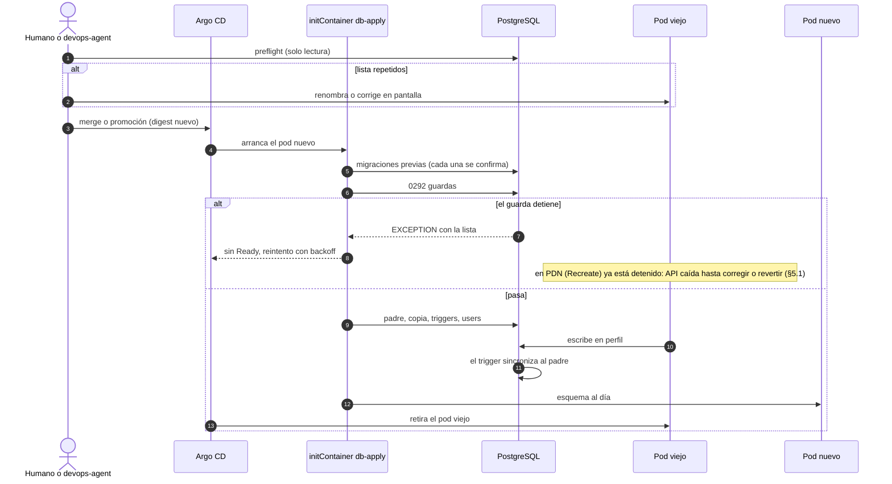
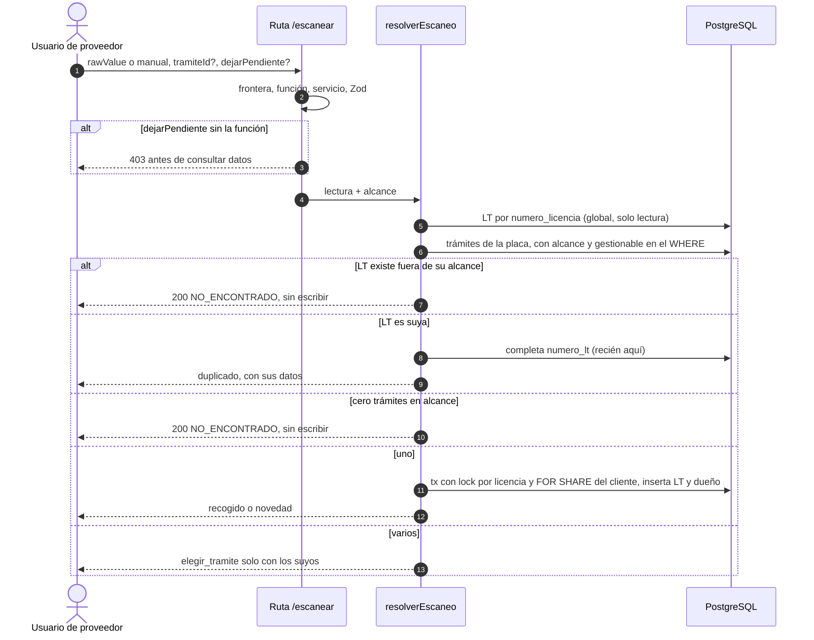

# ADR-0039 — Proveedores con varios servicios y logística operada por el proveedor

- **Estado:** Aceptado (aprobado por David Chica el 2026-11-05)
- **Fecha:** 2026-11-05
- **Épica:** ADO #13757. Features en ADO: F1 #14323, F2 #14324, F3 #14325, F4 #14326, F5 #14327.
- **Requisitos:** las 23 reglas acordadas con el humano en la sesión del 2026-11-05, citadas como `R1`…`R23`. El texto de la Épica en ADO está desactualizado (7 tipos, CIA, CDA, «Otro») y **no** se usa.
- **Módulos:** FLITO `flito-parametrizacion`, `flito-logistica`, `flito-soat`, `users`, `auth` y la frontera (`shared/middleware/frontera-enlace.ts`). No toca los legacy `soat`, `tramites`, `liquidacion`.
- **Base verificada:** `develop` en `2a51d221`. Última migración en disco: `0288_pii_key_registry.sql`.
- **Modo:** full (modelo nuevo, contrato nuevo, PII, apertura a terceros).

**Relación con otros ADR**

| ADR | Relación |
|---|---|
| ADR-0024 (frontera por enlace) | **Se extiende, no se supersede.** `FRONTERA_POR_ENLACE` sigue siendo código. Se añade una capa que comprueba el servicio del proveedor (§6). Se respeta «abrir el módulo en el mismo PR que filtra sus filas» (§13). |
| ADR-0025 (árbol de permisos) | Las funciones nuevas siguen su patrón. Ninguna regla lee el nombre del rol. |
| ADR-0035 (migraciones) | SQL a mano, sin `drizzle-kit`. Una migración aplicada no se edita. |
| ADR-0037 (propiedad de tablas) | `flito-parametrizacion` sigue siendo el dueño de los proveedores. |
| `ADR-0030-flito-logistica-traslados-actas-por-evento.md` | **Sin trackear, Propuesto, no se edita.** Este ADR reemplaza los pasajes de §12. Comparte número con `ADR-0030-flito-soat-renovacion-runt-…`; por eso se cita con el nombre completo. |

---

## 1. Contexto: lo que dice el código hoy

| Tema | Hecho | Dónde |
|---|---|---|
| Dos tablas | SOAT con baja lógica (`deleted_at`), nombre único solo entre vigentes. Logística con borrado físico, nombre único global, NIT único parcial | `schema.ts:2670`, `:3756`; migraciones `0259`, `0278` |
| Datos | SOAT no tiene NIT, teléfono, contacto, correo, dirección ni ciudad. Logística no tiene correo, dirección ni ciudad | `schema.ts` |
| FK hacia las tablas | **Seis:** `users.flito_proveedor_soat_id`, `flito_soat.proveedor_soat_id`, `flito_reglas_proveedor_soat.proveedor_soat_id` (`CASCADE`), `clients.flito_proveedor_soat_sin_tramite_id`, `clients.flito_proveedor_logistica_id`, `flito_logistica_actas.proveedor_logistica_id` | `0096`, `0102`, `0175`, `0279` |
| Trigger | `users_ambito_requerido` exige `flito_proveedor_soat_id` si el enlace es `proveedor` | `0231:76` |
| Frontera | `logistica` abre solo a `compania`; `soat` a `compania` y `proveedor`. `alcanceDeUsuario` lee `flitoProveedorSoatId` | `permisos-roles.ts:45`, `frontera-enlace.ts:231` |
| Rutas de logística | 20 usos de `soloSinEnlace()`; ese guarda también cierra a `compania` | `flito-logistica*.ts` |
| Inactivar | SOAT: permitido con asignaciones, invalida sesiones. Logística: 409 si hay compañías asignadas (N1 de ADR-0030). **Son asimétricos** | `flito-proveedores-estado.service.ts`, `flito-logistica-proveedor-compania.service.ts` |
| Roles | Ninguna migración siembra funciones de logística a un rol con enlace `proveedor`. `mensajero` tiene enlace `ninguno`. Lo concedido a mano desde el panel no se consultó | `0178` |

### Lo que la revisión previa no recogía o tenía distinto

Cada punto cambia el diseño:

1. **Actas históricas con proveedor, no sin él (afecta a R17).** Hasta la HU #14114, `cerrarLote` estampaba `proveedorPorDefecto(tx)`: el primer proveedor activo con estrategia `pwa_propia`. Si en PDN existe esa fila, sus actas viejas tienen `proveedor_logistica_id` lleno. Un filtro `= P` ingenuo se las daría al primer usuario creado bajo «Mensajería FLIT», con firmas incluidas. Ver §6.3.
2. **El escaneo escribe antes de decidir.** `escanearLt` llama `completarNumeroLt(previa.id, …)` sobre cualquier LT con ese número, de cualquier compañía: un usuario de proveedor podría sobrescribir el `numero_lt` ajeno.
3. **Las respuestas del escaneo tienen formas distintas.** `{placa, vin, ...d.r}` frente a `{...base()}`: cambian los campos, no solo el mensaje. Además `sin_match` puede traer `idFlit`.
4. **La idempotencia es global en cuatro rutas.** `/escanear`, `/documentos/:id/novedad`, `/actas/:id/entregar` y `/actas/:id/devolucion` usan `conIdempotencia` sin `ruta`, así que la clave no lleva usuario. Con la misma cabecera, otro usuario recibe la respuesta guardada, con compañía y propietario.
5. **No hay unicidad de `numero_licencia`.** Solo la columna (`0104`). Dos escaneos simultáneos crean dos LT.
6. **`destinoDeTraslado` responde 404 antes de cualquier alcance** en `POST /traslados/:id/entregar`. Es un oráculo de existencia y de destino.
7. **Precios en las respuestas.** `POST /traslados` devuelve `precio` y `tarifaVigenciaId`; `/facetas` devuelve `precioEntregaCliente/Flit`. Es la tarifa de FLITO a la compañía (D4, §15).
8. **`revelarDocumentoFirmante(id)` y `recogidaDetalle` no tienen alcance por proveedor**, y `ctx.operaAjenas` significa «todo» en `miRuta`, `ltPendientesFirma` y `recogidaDetalle`.
9. **El motivo de llegada se monta sin `conAlcance`:** para un enlace queda cerrado, y el proveedor lo necesita para un viaje a FLIT.
10. **`GET /?buscar=` lleva placa o VIN en la query** (`FlitoLogistica.tsx:134`). ADR-0036 lo tiene pendiente, y aquí se abre a un tercero.
11. **El NIT se compara como texto.** `NIT_VALIDO` admite dígito de verificación opcional: `900123456` y `900123456-7` no chocan en el índice actual (R8).

---

## 2. Alternativas de modelo

### Opción 1 — Tabla única + tabla de servicios + configuración SOAT (la inclinación inicial)

`flito_proveedores` + `flito_proveedor_servicios(proveedor_id, servicio)` + `flito_proveedor_config_soat`. Las seis FK se reapuntan a la tabla única y las dos tablas viejas se eliminan.

- **Pros:** el modelo mental más simple; listar y filtrar por servicio es una sola unión; agregar un servicio sin configuración es una constante y un CHECK.
- **Contras:**
  - Reapuntar seis FK incluye `flito_soat`. El runner envuelve cada archivo en una transacción, así que `NOT VALID` + `VALIDATE` juntos retienen el bloqueo mientras los pods viejos siguen sirviendo.
  - Corte único: un grep en `apps/api/src` da 15 archivos con `flitoProveedoresSoat` y 22 con `flitoProveedorSoatId` o `proveedorSoatId`. Tienen que cambiar junto con el reapuntado.
  - Rollback: revertir el digest no revierte el esquema. La imagen anterior leería tablas viejas sin los proveedores nuevos, salvo que se mantenga sincronización en ambos sentidos entre esquemas distintos.
  - La tabla de configuración SOAT es de todos modos una tabla por servicio. `estrategia` existe en las dos tablas con significados distintos.
  - Una FK simple a la tabla única no garantiza que el proveedor preste el servicio. Hace falta un trigger o una FK compuesta con columna generada.
- **Esfuerzo:** L. **Riesgo:** alto en el corte, medio en el rollback.

### Opción 2 — Tabla padre + perfil por servicio, conservando las tablas actuales como perfiles (RECOMENDADA)

`flito_proveedores` tiene los datos generales, el estado y la baja. Las tablas actuales quedan como **perfil del servicio**, con `id` = `flito_proveedores.id`. Prestar un servicio = tener el perfil con `deleted_at IS NULL`.

- **Pros:**
  - **Cinco de las seis FK no se tocan** y siguen garantizando en la base que el asignado tiene perfil de ese servicio. Solo cambia la pertenencia del usuario.
  - **Sin bloqueos pesados:** `flito_soat` no se altera.
  - **Rollback real:** las columnas viejas siguen pobladas hasta la contracción, y la imagen anterior funciona (§5.5).
  - **Sin corte único:** los lectores migran por Feature, no todos a la vez.
  - R7 sale natural: la configuración SOAT solo existe en el perfil SOAT.
- **Contras:**
  - Datos repetidos (`nombre`, `activo`, `nit`, `contacto`, `telefono`) entre padre y perfil hasta la contracción, sostenidos por triggers. Si F5 no se hace, queda como deuda.
  - «Qué servicios presta» consulta N perfiles (se resuelve con una vista).
  - Un servicio nuevo pide tabla aunque no tenga configuración (compatible con R1: agregar uno es un desarrollo).
  - El perfil de logística queda casi vacío tras la contracción.
- **Esfuerzo:** M. **Riesgo:** medio (triggers de transición, acotados y retirables).

### Opción 3 — Mantener las dos tablas y federarlas por NIT

Una vista une ambas; «el mismo proveedor» se deduce del NIT.

- **Contras:** R8 no se cumple (SOAT no tiene NIT y los existentes no se obligan, R9). R21 y R22 se volverían una fusión automática por dato, justo lo que se prohíbe. El usuario seguiría atado a una tabla por servicio.
- **Esfuerzo:** S. **Riesgo:** no cumple las reglas. **Descartada.**

### Comparación

| Criterio | Opción 1 | Opción 2 |
|---|---|---|
| Tablas al final | 3 | 3 |
| FK reapuntadas | 6 | 0 (más 1 columna nueva en `users`) |
| El asignado tiene el servicio, en BD | Requiere trigger o FK compuesta | Sí, por la FK al perfil |
| Lectores a cambiar de golpe | ~15 + 22 archivos | 0; se migran por Feature |
| Rollback tras el corte | Limitado | Hasta la contracción, completo |
| Consulta de servicios | Una unión | Vista sobre N perfiles |

---

## 3. Decisión

**Opción 2.** La inclinación por una sola tabla se conserva en lo que importa: hay **una** identidad de proveedor, con UUID conservado, nombre y NIT únicos. Lo que se descarta es la tabla genérica de servicios como destino de las FK: el costo son seis reapuntados y un rollback limitado, y el beneficio frente a la Opción 2 es solo una unión más simple. Al final ambas tienen tres tablas.

**Qué cambiaría esta recomendación:** si se esperan varios servicios más, todos sin configuración propia. Hoy R1 solo nombra SOAT y Logística.

### Destino de cada FK

| FK | Destino | Motivo |
|---|---|---|
| `users.flito_proveedor_soat_id` | **Columna nueva** `users.flito_proveedor_id` → `flito_proveedores(id)` `ON DELETE RESTRICT`. La vieja se sincroniza por trigger y se elimina en F5 | Un usuario es del proveedor, no de un servicio (R21). Un `RENAME` rompería a los pods viejos durante el rollout |
| `clients.flito_proveedor_soat_sin_tramite_id` | Sin cambio (perfil SOAT) | Asignación por servicio (R10) |
| `clients.flito_proveedor_logistica_id` | Sin cambio (perfil logística) | Ídem |
| `flito_soat.proveedor_soat_id` | Sin cambio | Histórico, sin bloqueo sobre la tabla |
| `flito_reglas_proveedor_soat.proveedor_soat_id` | Sin cambio. El `CASCADE` queda inerte: ya no hay borrado físico | Enrutamiento: bloquea quitar el servicio (§4.3) |
| `flito_logistica_actas.proveedor_logistica_id` | Sin cambio | R16: el acta sigue con quien la creó |
| **Nuevas** `flito_logistica_documentos.proveedor_logistica_id`, `flito_logistica_recogida_firmantes.proveedor_logistica_id` | Perfil logística, `ON DELETE RESTRICT` | Dueño explícito (§6.3) |
| **Nueva** perfil.`id` | → `flito_proveedores(id)` `ON DELETE RESTRICT` | Identidad única |

### Baja lógica o física

**Solo lógica.** Se retira el borrado físico de logística (`eliminarProveedorLogistica`, RN-PROVU-3).

- `flito_proveedores.deleted_at` = proveedor eliminado. Libera nombre y NIT.
- perfil.`deleted_at` = servicio retirado. Conserva la fila porque el histórico la referencia, y un SOAT histórico sigue leyendo su estrategia. Volver a dar el servicio la reactiva.
- Motivo: la FK `RESTRICT` de las actas ya impide el borrado físico con historia, y la auditoría (R23) exige que el proveedor siga siendo identificable.

### ¿Pueden chocar los UUID?

Los dos conjuntos salen de `gen_random_uuid()`; la colisión real es despreciable. Pero un `ON CONFLICT DO NOTHING` la **ocultaría y fusionaría dos proveedores**, lo que R22 prohíbe. Por eso la migración comprueba el caso y se detiene (§5.2).

---

## 4. Modelo de datos

### 4.1 Drizzle

Archivo nuevo: `apps/api/src/db/schema/flito-proveedores.ts`, reexportado desde `schema.ts`. `schema.ts` tiene techo congelado: las columnas nuevas de `users`, `flitoProveedoresLogistica`, `flitoLogisticaDocumentos` van en líneas existentes, como ya se hace, y las FK circulares solo en SQL.

```ts
export const SERVICIOS_PROVEEDOR = ['soat', 'logistica'] as const; // shared-types; fuente única

export const flitoProveedores = pgTable('flito_proveedores', {
  id: uuid('id').primaryKey().defaultRandom(),         // conserva el UUID del perfil de origen (R21)
  nombre: varchar('nombre', { length: 150 }).notNull(),
  // R6. NULLABLE en BD: los existentes no se obligan (R9). La obligación es de la API, no un CHECK:
  // un CHECK NOT VALID fallaría en cualquier UPDATE de una fila vieja, incluso al cambiar `activo`.
  nit: varchar('nit', { length: 20 }),
  telefono: varchar('telefono', { length: 30 }),
  correo: varchar('correo', { length: 150 }),
  direccion: varchar('direccion', { length: 300 }),
  ciudad: varchar('ciudad', { length: 100 }),
  contacto: varchar('contacto', { length: 150 }),
  activo: boolean('activo').notNull().default(true),
  version: integer('version').notNull().default(1),    // aviso de edición simultánea
  createdAt: timestamp('created_at', { withTimezone: true }).notNull().defaultNow(),
  updatedAt: timestamp('updated_at', { withTimezone: true }).notNull().defaultNow(),
  deletedAt: timestamp('deleted_at', { withTimezone: true }),
  deletedBy: integer('deleted_by'),                    // FK a users solo en SQL (RESTRICT, ADR-0005)
});
// Solo en SQL:
//   uq_flito_proveedores_nombre_vivo ON (lower(btrim(regexp_replace(nombre,'\s+',' ','g')))) WHERE deleted_at IS NULL
//   uq_flito_proveedores_nit_vivo    ON (split_part(nit,'-',1)) WHERE deleted_at IS NULL AND nit IS NOT NULL   -- R8, ignora el DV

export const flitoProveedoresAuditoria = pgTable('flito_proveedores_auditoria', {
  id: uuid('id').primaryKey().defaultRandom(),
  proveedorId: uuid('proveedor_id').notNull().references(() => flitoProveedores.id, { onDelete: 'restrict' }),
  accion: varchar('accion', { length: 20 }).notNull(), // crear|editar|activar|desactivar|eliminar|servicio_agregado|servicio_quitado
  campo: varchar('campo', { length: 30 }),             // lista blanca, CHECK
  valorAntes: text('valor_antes'),                     // YA enmascarado si es R23
  valorDespues: text('valor_despues'),
  actorId: integer('actor_id'),                        // FK solo en SQL (RESTRICT)
  createdAt: timestamp('created_at', { withTimezone: true }).notNull().defaultNow(),
}, (t) => ({ proveedorIdx: index('idx_flito_prov_aud_proveedor').on(t.proveedorId, t.createdAt) }));

// Extensiones:
// flito_proveedores_soat:      id FK → flito_proveedores; conserva estrategia, umbral_ocr, sla_horas, deleted_at
// flito_proveedores_logistica: id FK → flito_proveedores; + deleted_at, deleted_by
// users:                       + flito_proveedor_id uuid FK → flito_proveedores RESTRICT, índice
// VIEW flito_proveedor_servicios_v (proveedor_id, servicio): UNION ALL de perfiles con deleted_at IS NULL
//
// Solo F4.1:
// flito_logistica_documentos:         + proveedor_logistica_id FK RESTRICT, índice (proveedor_logistica_id, estado), índice (numero_licencia) parcial
// flito_logistica_recogida_firmantes: + proveedor_logistica_id FK RESTRICT
```

La comparación normalizada de nombre es más estricta que la actual (exacta). Sus choques entran a la parada de R22.

### 4.2 Reglas que viven en la API

- **R2:** crear con al menos un servicio. Quitar el último → 422. Se comprueba en transacción con `FOR UPDATE` sobre el padre.
- **R7:** `soat` solo se acepta si el servicio está pedido o existe.
- **R9:** crear exige los siete generales. **Editar el bloque de generales** exige el bloque completo y responde 422 con los campos que faltan. Cambiar solo estado, servicios o configuración SOAT **no** los exige. La lista marca `datosCompletos`.
- **R8:** `normalizarNit` + comparación sin dígito de verificación; 23505 → 409.
- **Editar simultáneo:** `versionEsperada` obligatorio → 409 `PROVEEDOR_EDITADO_POR_OTRO` («Otro usuario cambió este proveedor. Recarga para ver sus datos»). Reemplaza el `activoEsperado` de SOAT y el que logística aceptaba e ignoraba.
- **Auditoría:** dentro de la transacción y lanzando si falla, como `permisos-auditoria.ts` (ADR-0014). Registra quién, cuándo, antes y después. **Las máscaras se aplican al escribir** (R23): `telefono`, `correo`, `direccion`, `contacto` nunca llegan en claro a la fila. El `detail` de `audit()` lleva solo id y nombre.
- **Inactivar:** se conservan las reglas vigentes por servicio. Con compañías de logística asignadas → 409 (N1, `RN-PLOGC-3`). SOAT sigue permitiéndolo. Un proveedor con ambos servicios queda bajo la regla más estricta. Siempre invalida sesiones y la caché de permisos (R5).

### 4.3 Quitar un servicio (R4)

Función `motivoNoQuitableServicio(tx, proveedorId, servicio)`, con `FOR UPDATE` sobre padre y perfil, misma forma que `motivoNoEliminableProveedor`. Las asignaciones toman `FOR SHARE` (`exigirProveedorSoatUsable` y su gemelo), así que una en curso espera y luego relee.

| Servicio | Bloquea |
|---|---|
| SOAT | Compañías vigentes con `flito_proveedor_soat_sin_tramite_id`; SOAT con `proveedor_soat_id` y `estado <> 'pagado'` (`ESTADOS_SOAT_TERMINALES`); **reglas en `flito_reglas_proveedor_soat`** |
| Logística | Compañías vigentes con `flito_proveedor_logistica_id` (también las que la tienen apagada, como RN-PROVU-1); actas con `proveedor_logistica_id` y estado `generada`/`despachada`; LT con `proveedor_logistica_id` y estado distinto de `entregado` |

R4 incluye las reglas de enrutamiento: sin ese bloqueo, el motor seguiría enviando SOAT a quien ya no lo presta.

### 4.4 Eliminar

Unifica RN-PROV-6/7: inactivo, sin bloqueos de **ningún** servicio, sin compañías. Baja lógica de padre y perfiles. Usuarios `active=false` con sesión invalidada, dentro de `conSeguroAntiBloqueo`.

---

## 5. Migración y despliegue

### 5.1 Restricción real

`db-apply` corre en el initContainer de cada rollout, **en cada ambiente**, sin un humano delante. **Corrección verificada el 2026-11-05 en `flit-gitops` (`services/flito-pdn/deployments.yaml`): la API de PDN usa `strategy: Recreate`, con una réplica, porque lleva crons. El pod viejo se detiene antes del initContainer y no sigue sirviendo.** Con eso, un guarda que detiene deja la API de PDN caída hasta corregir el dato o revertir el digest. **Decisión del humano (2026-11-05):** se mantiene la parada de R22; la comprobación previa (§5.3) es requisito antes de cada promoción, y la reversa por digest se prueba en DEV. De ahí salen cuatro consecuencias:

1. La imagen vieja y el esquema nuevo conviven: nada de `RENAME`, `DROP` ni `NOT NULL` en la misma entrega.
2. Revertir el digest no revierte el esquema.
3. El guarda que detiene (R22) deja el rollout sin Ready **y bloquea los despliegues siguientes de ese ambiente** hasta corregir el dato. El initContainer se reintenta, y el runner vuelve a ejecutar el archivo porque no quedó registrado.
4. El runner hace una transacción por archivo: lo anterior al guarda **sí queda aplicado**.

### 5.2 `0292_flito_proveedores_padre.sql` (expand, F1)

Sin `BEGIN`/`COMMIT` propio. Idempotente. **Orden:**

**Paso 0 — Guardas, antes de cualquier DDL.** Un solo `DO` que acumula todo y lanza un `RAISE EXCEPTION` con la lista completa, para no destapar los problemas de uno en uno:

| Guarda | Condición | Se lista |
|---|---|---|
| Nombres (R22) | Vigentes de SOAT + todos los de logística, por nombre normalizado, **con ids distintos**. Incluye repetidos dentro de una tabla por diferencias de mayúsculas o espacios | Nombre e ids |
| NIT (R8) | Logística, por `split_part(normalizado,'-',1)`, ids distintos | **Solo nombres e ids. Nunca el NIT:** el de persona natural equivale a su cédula, y el log del initContainer no es lugar para eso |
| UUID | Mismo id en ambas tablas **sin fila en `flito_proveedores`** | Ids |

- Comparar ids distintos y exigir que no exista el padre hace **idempotente** al guarda: al correrlo de nuevo a mano tras F2, un proveedor legítimo con ambos servicios tiene el mismo id y ya tiene padre.
- Un SOAT eliminado lógicamente no cuenta: su nombre ya está liberado (`0259`). Un inactivo sí cuenta.
- **NIT vacío:** `NULLIF(btrim(nit),'')` lo vuelve NULL; no detiene (R9). SOAT queda sin NIT.

**Paso 1 — Tablas:** `flito_proveedores`, `flito_proveedores_auditoria`, índices únicos.

**Paso 2 — Copia conservando UUID (R21):** `INSERT … SELECT … ON CONFLICT (id) DO NOTHING`. `activo` y `deleted_at` se heredan. La normalización de NIT solo afecta al padre.

**Paso 3 — Perfiles:** `ADD COLUMN IF NOT EXISTS` de `deleted_at`/`deleted_by` en logística; FK del id hacia el padre, solo si no existe; vista `flito_proveedor_servicios_v`.

**Paso 4 — Triggers de transición** (`CREATE OR REPLACE` + `DROP TRIGGER IF EXISTS`). Se retiran en F5:

| Trigger | Cuándo | Efecto |
|---|---|---|
| `perfil_crea_padre` | `BEFORE INSERT` en perfil | Si el padre no existe, lo crea: es el camino del pod viejo |
| `perfil_a_padre` | `AFTER UPDATE` en perfil, con `pg_trigger_depth() < 2` | `nombre`, `activo`, `nit`, `contacto`, `telefono` suben al padre |
| `padre_a_perfil` | `AFTER UPDATE` en padre, con `IS DISTINCT` | Baja a las columnas viejas: es lo que mantiene el rollback |
| `perfil_borrado` | `AFTER DELETE` en logística | Si el pod viejo borra y no queda perfil vivo, baja lógica del padre, que además vacía `nit`, `telefono`, `correo`, `direccion` y `contacto` (la baja lógica de SOAT sube al padre igual, desde `perfil_a_padre`) |

**Paso 5 — Usuarios:** columna `flito_proveedor_id`; `UPDATE … WHERE flito_proveedor_soat_id IS NOT NULL AND flito_proveedor_id IS DISTINCT FROM …`; trigger `BEFORE` que sincroniza. La columna vieja solo se llena si el proveedor tiene perfil SOAT. Se reescribe `users_ambito_requerido` para exigir `flito_proveedor_id`.

**Paso 6 — Comprobación final:** `RAISE EXCEPTION` si algún perfil no tiene padre, o si un usuario quedó con proveedor distinto.

Comprobación de idempotencia local (P6): este archivo aplicado dos veces sobre la BD local ya migrada, con conteos iguales.

### 5.3 Parada antes de que pare el rollout

Se añade `apps/api/src/db/manual/flito-proveedores-preflight.sql`: **las mismas consultas del guarda, solo lectura.** Precedente: `flito-bolsas-backfill-comprobantes-simulacion.sql`.

Además informa, sin detener nada, cuántas filas de logística tienen `estrategia <> 'pwa_propia'`.

**Se ejecuta antes del merge de F1 en DEV y antes de cada promoción, en QA y PDN.** Si lista filas, un humano corrige los datos antes:

- Con nombre repetido y empresas distintas, renombrar uno de los dos desde la pantalla actual hace pasar el guarda. **Quedan dos proveedores separados.** Con NIT repetido, renombrar no basta: hay que corregir el NIT. El guarda también detiene por UUID repetidos o por repetidos dentro de una misma tabla, más allá de lo que pide R22.
- Si en realidad son la misma empresa, unirlos no está diseñado ni automatizado (R22). Se decide con el caso concreto. Ver D5, §15.

Si aun así el rollout se detiene en PDN: **la API queda caída** (§5.1), la lista se ve en los logs del initContainer y **no** en el health. Corregido el dato, el siguiente reintento pasa. Revertir el digest debería devolver el servicio, porque la imagen anterior no conoce `0292`, pero está sin probar.

### 5.4 Secuencia



### 5.5 Rollback y contracción

| Entrega | Rollback (revertir el digest) |
|---|---|
| F1-F3 | Limpio. La imagen vieja lee perfiles sincronizados. Un usuario de un proveedor **solo de logística** queda con la columna vieja en NULL y falla cerrado |
| F4 | Limpio. Las columnas nuevas se ignoran; la frontera vuelve a cerrar a `proveedor` en logística |
| **F5** | **No reversible sin restaurar.** Con `pg_dump` previo; solo cuando F4 lleve un tiempo estable en PDN |

**F5 (contract):** deja de leer las columnas viejas, migra los lectores, elimina triggers, `nombre`/`activo`/`nit`/`contacto`/`telefono` de los perfiles, `estrategia` de logística, `users.flito_proveedor_soat_id`. También actualiza `users_ambito_requerido` si aún la nombra y retira las rutas `proveedores-soat`/`proveedores-logistica` que queden.

---

## 6. Pertenencia y frontera

### 6.1 Servicio del proveedor en la frontera (R3, R5)

`resolverPermisos` añade `proveedor: { id, activo, servicios[] } | null`, leído en `leerFilasDePermisos` (caché 60 s). Se añade al hash `version` y al seam de pruebas. `invalidarPermisosDeProveedor(id)` se llama después del commit de cada cambio de servicio o estado.

`guardiaFrontera`, tras `moduloAbiertoA`, si el enlace es `proveedor`:

```ts
const servicio = SERVICIO_DE_MODULO[modulo]; // shared-types: { soat: 'soat', logistica: 'logistica' }
if (!servicio || !p.proveedor?.activo || !p.proveedor.servicios.includes(servicio)) → 403 { error: 'Sin permisos' }
```

Falla cerrado. Mismo cuerpo que hoy. La tabla `FRONTERA_POR_ENLACE` sigue siendo código; esta capa se suma a ella.

**Menú:** `paginasEfectivasDeUsuario` retira las páginas cuyo módulo pide un servicio no prestado. La web no cambia su lógica porque ya pinta desde `allowedPages`, y no ofrece una ruta que el API cierra.

**Login:** `proveedorSoatInactivo` → `proveedorInactivo(flitoProveedorId)`, sobre el padre. La sesión viva la corta `session_invalidated_at` + la guarda anterior.

`alcanceDeUsuario` pasa a leer `users.flito_proveedor_id`.

### 6.2 Quién es «Operaciones» y quién es mensajero

- **Operaciones** no es un rol (no existe en `USER_ROLES`): es un usuario con enlace `ninguno` y la función de cada acción. Eso incluye al mensajero de FLITO para efectos del escaneo (R19).
- **Usuario de proveedor** = rol con enlace `proveedor` + `users.flito_proveedor_id`.
- **Mensajero de proveedor** = tiene `logistica.actas.entregar`, no tiene `operar_ajenas`, y su `flito_proveedor_id` es P. **Mensajero de FLITO** = igual, con enlace `ninguno` y sin proveedor.
- **Roles:** no se siembran roles de sistema nuevos. El administrador crea los roles con enlace `proveedor` en el panel (ADR-0015); una vez abierta la frontera, `funcionesAlcanzables` ya le ofrece las funciones de logística. Conjuntos recomendados en §12.

**Selección de mensajero (R14):** `exigirMensajeroAsignable(tx, mensajeroId, alcance, proveedorDelActa)`, en servidor, en **los cuatro caminos**: `POST /traslados`, `/traslados/:id/despachar`, `/actas/:id/despachar` y `mensajerosAsignables`, que también debe exigir `active` (hoy no lo hace). Proveedor: solo los suyos. Operaciones: los de FLITO y los del proveedor dueño del acta (R13; confirmado por el humano el 2026-11-05).

**Creación del mensajero (decisión del humano, 2026-11-05):** se crea atado a su proveedor y lo puede crear quien tenga el permiso, incluido el propio proveedor si su rol tiene `usuarios.usuario.crear`. Por ahora lo hace Operaciones.

**Trabajo que esto exige, en F3 y con revisión obligatoria de `security-agent`:** hoy dar ese permiso a un proveedor no basta, porque `/api/users` no está en ningún módulo de `FRONTERA_POR_ENLACE` y la frontera lo rechaza. Abrirlo solo al enlace `proveedor` exige, en el mismo PR (ADR-0024): tomar el proveedor de la sesión y nunca del cuerpo, limitar los roles asignables a los de enlace `proveedor` para impedir que se escale a un rol con más permisos (`POST /api/users` acepta hoy cualquier rol y proveedor), y filtrar a su proveedor la lista de usuarios y cada acción abierta sobre ellos. Sin esas guardas no se abre.

### 6.3 Dueño de cada fila (R12, R15, R16, R17)

**Alternativa descartada: derivar el dueño de la compañía en cada consulta.** Al cambiar de proveedor, el nuevo vería por la compañía las LT ya entregadas por el anterior, con receptores y firmas.

**Decisión: dueño estampado en la LT** (`documentos.proveedor_logistica_id`). `NULL` = solo Operaciones.

| Momento | Efecto |
|---|---|
| Escaneo con trámite / resolver trámite | Dueño = proveedor actual de la compañía, leído en la transacción |
| LT pendiente | `NULL`: solo Operaciones (R20) |
| `registrarTraslado` | Exige dueño = proveedor actual; estampa el acta con él (ya lo hace) |
| `confirmarRecogida` | Estampa el acta de organismo (hoy queda NULL). El firmante recibe el proveedor si todas sus LT son del mismo; si no, `NULL` |
| **Cambio de proveedor (R16)** | En la transacción del PATCH: `UPDATE` de LT de esa compañía con dueño anterior o `NULL`, estado distinto de `entregado` y **sin acta abierta** (`generada`/`despachada`). Quitar el proveedor (→ NULL) no reasigna |
| **Cierre de un acta abierta** | `pasarAlProveedorVigente(tx, docIds)` tras `entregarTraslado`, `firmarLlegadaFlit`, `devolverTraslado`, `anularTraslado`, `entregar`, `registrarDevolucion`, `reversar`: lo no entregado va al proveedor actual, si hay uno |

**Bloqueos sin interbloqueo:** el cliente antes que las LT, `FOR UPDATE` en el PATCH y `FOR SHARE` en escaneo y registro de viaje.

**Condiciones (en `flito-logistica.alcance.ts`, SIEMPRE en el WHERE):**

```sql
-- Documentos
d.proveedor_logistica_id = :p

-- Trámites: el de su LT, o el de la compañía si aún no tiene LT
EXISTS (SELECT 1 FROM flito_logistica_documentos d WHERE d.tramite_id = t.id AND d.proveedor_logistica_id = :p)
OR (NOT EXISTS (SELECT 1 FROM flito_logistica_documentos d WHERE d.tramite_id = t.id)
    AND EXISTS (SELECT 1 FROM clients c WHERE c.id = t.compania_id
                AND c.flito_proveedor_logistica_id = :p AND c.logistica_autogestionable = false))

-- Actas: excluye las históricas estampadas con el proveedor por defecto (§1.1)
a.proveedor_logistica_id = :p
AND NOT EXISTS (SELECT 1 FROM flito_logistica_traslados tr WHERE tr.id = a.traslado_id AND tr.legado)
```

**R17 (decisión del humano, 2026-11-05: fecha de corte):** el proveedor solo ve lo creado desde que se activa la operación por proveedor en cada ambiente, es decir, al desplegar F4.2. Las actas anteriores las termina y las ve solo Operaciones, también las abiertas y las creadas entre #13758 y F4. Una LT anterior al corte, sin terminar y sin acta abierta, pasa al proveedor actual (confirmado por el humano): es trabajo aún no iniciado. `legado = true` no alcanza como filtro, porque solo marca lo anterior al modelo de viajes. La condición de actas de arriba debe sumar `a.created_at >= :corte`. El corte lo registra la migración del PR 2 de F4 en una tabla de una sola fila, sin paso manual (#14349, decisión del humano); sin fecha registrada, el proveedor no ve actas.

**Backfill al activar el corte (idempotente):** LT sin terminar y sin acta abierta → proveedor actual de la compañía. **El resto queda en `NULL`**, incluidas las terminadas y las que tienen un acta abierta anterior al corte. Al cerrarse esa acta, `pasarAlProveedorVigente` lleva lo no entregado al proveedor actual.

### 6.4 Contrato de alcance

- `Recurso` añade `traslado` y `firmante`. `exigirPropiosLogistica(recurso, ids[], alcance)` valida lotes.
- Fuera de alcance: **403 en escritura sin comprobar existencia; 404 en lectura**, igual que lo inexistente. Se comprueba **antes** de las validaciones de negocio: de otro modo `LT_NO_ENCONTRADA`, `LT_OTRO_ORGANISMO` o `TRASLADO_COMPANIA_MIXTA` serían oráculos.
- `LogisticaCtx` añade `alcance`: `operaAjenas` pasa a significar «todas las de mi alcance» en `miRuta`, `ltPendientesFirma`, `recogidaDetalle`, `registrarTraslado`, `confirmarRecogida`.
- `soloSinEnlace()` se conserva. Guarda nueva `soloSinEnlaceOProveedor()`, marcada para el centinela: mantiene cerradas a las compañías (P-2 de la HU #13426).

### 6.5 Matriz de rutas de `/api/flito/logistica`

| Rutas | Enlace `proveedor` | Filtro |
|---|---|---|
| `GET /`, `/facetas`, `/:id`, `/actas`, `/actas/:id`, `/actas/:id/pdf` | Abiertas | Condición §6.3; proyección §7.2 |
| `POST /validar-lt`, `/consultar-vehiculo`, `/escanear` | Abiertas | §8 |
| `POST /recogidas/confirmar`, `GET /recogidas/mias`, `/recogidas/pendientes-firma`, `/recogidas/:firmanteId`, `POST /recogidas/:firmanteId/documento` | Abiertas | Por LT o firmante; `documento` no se siembra |
| `GET /mi-ruta`, `POST /traslados`, `/traslados/buscar`, `/traslados/:id/despachar`, `/entregar` (destino cliente), `/devolucion`, `/anular` | Abiertas | Por traslado, vía acta. `destinoDeTraslado` va **después** del alcance |
| `POST /documentos/:id/novedad`, `/actas/:id/despachar`, `/entregar`, `/devolucion` | Abiertas | `exigirPropio` |
| `GET /documentos/:id/linea-tiempo`, `/tramites/:id/linea-tiempo` | Abiertas | `actorNombre` solo si el actor es de P |
| `GET /motivos-llegada` | Abierta (nuevo `conAlcance` + guarda en GET); escritura sigue `soloSinEnlace` | Sin PII |
| `/traslados/:id/entregar` destino FLIT (`firmar_flit`) | **Cerrada** | Lo firma Operaciones (N4) |
| `GET /pendientes-tramite`, `/documentos/:id/candidatos-tramite`, `POST /documentos/:id/resolver-tramite` | **Cerradas** (R20) | — |
| `POST /documentos/:id/reversar`, `/cerrar-lote` | **Cerradas** | Excepción de Operaciones; el adaptador se retira |
| Viajes adicionales (`flito-logistica-viajes.routes.ts`) | **Cerradas por defecto** | D3, §15 |

Se añade `POST /buscar` (`.strict()`, placa/VIN en el cuerpo) y la web deja de enviar `buscar` por query (AGENTS §14, ADR-0036). Los filtros `empresas` (NIT) quedan a lo que resuelva ADR-0036: Nota de `security-agent`.

---

## 7. Contratos

### 7.1 `/api/flito/parametrizacion/proveedores` (router nuevo, montado antes del general)

Todas con `authMiddleware` + `exigirFuncion`. **Cerradas a todo enlace** (montaje sin `conAlcance`).

| Método y ruta | Función | Notas |
|---|---|---|
| `GET /?servicio=&activo=` | `…proveedores.listar` | `{id, nombre, nit, servicios[], activo, companiasPorServicio, datosCompletos, version}`. **Sin** teléfono, correo, dirección ni contacto. El servicio no es PII. Reemplaza el listado unificado, que hoy manda contacto y teléfono |
| `GET /selector?servicio=` | `…proveedores.listar` | `{id, nombre}` de **activos, vigentes y con ese servicio** (R11) |
| `GET /asignables-usuario` | `…proveedores.listar` | Para la atadura de usuarios, con cualquier servicio |
| `GET /:id` | `…proveedores.listar` | Con datos personales; `logPiiAccess`, `Cache-Control: no-store` |
| `POST /` | `…proveedores.crear` | `{generales, servicios[], soat?}` |
| `PATCH /:id` | `…proveedores.editar` | `{versionEsperada, generales?, soat?}` |
| `POST /:id/servicios/:servicio` · `DELETE …` | `…proveedores.editar` | R2, R4; 409 con el motivo |
| `GET /:id/impacto` | `…proveedores.estado` | Bloqueos por servicio, sesiones afectadas |
| `PATCH /:id/estado` | `…proveedores.estado` | `{activo, versionEsperada}` |
| `DELETE /:id` | `…proveedores.eliminar` | §4.4 |
| `GET /:id/historial` | ★`…proveedores.historial` | Lo auditado, con máscaras |

Se conservan como compatibilidad hasta F5: `GET /proveedores-soat`, ya acotado a lo vigente. Tiene que filtrar por perfil vivo.

**R11 en servidor:** `exigirProveedorSoatUsable` y `exigirProveedorLogisticaUsable` comprueban padre activo y vigente **y** perfil vivo, con `FOR SHARE`, en envío de SOAT, sin trámite y logística de la compañía.

### 7.2 Proyección al usuario de proveedor

| Dato | Al proveedor |
|---|---|
| `precio`, `tarifaVigenciaId`, `precioEntrega*` (`/traslados`, `/facetas`) | **No, por defecto** (D4). Sin precio configurado: mensaje genérico sin la cifra |
| `propietarioDocumento`, foto del propietario | No |
| `propietario` (nombre), placa, n.º de licencia | Sí, lo tiene en la mano |
| `actorNombre` de un usuario ajeno | No (`null`, misma forma) |
| Firmas, nombre del receptor, PDF del acta | Sí, de sus actas (R15), bajo revisión §9 |

### 7.3 Funciones nuevas

- ★`logistica.documento.dejar_pendiente` — sembrada solo a `admin` (R20).
- ★`parametrizacion.proveedores.historial` — `admin` y `auditor`.

Se registran en `catalogo-operaciones.ts`/`acciones-gestion.ts`, con migración de siembra (patrón `0286`).

---

## 8. Escaneo: filtrar antes de decidir

### 8.1 Reglas

- `R18` Usuario de proveedor: inexistente, de otro proveedor, compañía sin logística gestionada o LT registrada por otro → mensaje único.
- `R19` Operaciones: ese mensaje solo si no existe o la compañía no tiene logística gestionada.
- `R20` Cada usuario elige solo entre lo que puede gestionar. Pendientes, solo Operaciones.

### 8.2 Flujo único (`flito-logistica.escaneo.ts`)

Todo lo anterior a la escritura se concentra en `resolverEscaneo(lectura, opc, alcance)`, sin escrituras, compartida por `escanearLt` y `validarLt`.



**Las dos consultas iniciales corren siempre, las dos,** para no distinguir por tiempo los caminos. La búsqueda global no filtra alcance porque tiene que impedir duplicar una LT física ajena. La de trámites trae además el conteo de candidatos fuera de alcance, que solo va a `audit().detail` (D2) y nunca a la respuesta.

### 8.3 Respuesta única

```ts
// shared-types
export const MENSAJE_LT_NO_ENCONTRADA = 'No se encontró un trámite para esta licencia';

// Único constructor. Solo devuelve lo que el usuario envió o lo que trae el código que tiene en la mano.
const noEncontrado = (l: Lectura): ResultadoEscaneo => ({
  resultado: 'sin_match', motivo: MENSAJE_LT_NO_ENCONTRADA,
  placa: l.placa, vin: l.vin ?? '', numeroLicencia: l.numeroLicencia, propietarioNombre: l.propietarioNombre,
});
```

Siempre HTTP 200, misma forma, sin `idFlit`, `companiaNombre`, `organismoCodigo`, `documentoId` ni `candidatos`. El motivo real (`inexistente`, `fuera_de_alcance`, `no_gestionada`, `lt_ajena`) se escribe solo en `audit().detail`, sin PII, para soporte.

### 8.4 Matriz de casos

| Caso | Usuario de proveedor | Operaciones |
|---|---|---|
| Sin trámite aprobado | `NO_ENCONTRADO` | `NO_ENCONTRADO` |
| Compañía autogestionada | `NO_ENCONTRADO` | `NO_ENCONTRADO` (cambia: hoy `no_gestionable` con nombre) |
| Trámite de otro proveedor | `NO_ENCONTRADO` | Se gestiona (R13) |
| LT registrada por otro proveedor | `NO_ENCONTRADO`, **sin** `completarNumeroLt` | `duplicado` con compañía |
| LT propia repetida | `duplicado` | `duplicado` |
| `tramiteId` ajeno o inventado | `NO_ENCONTRADO` | `NO_ENCONTRADO` si no existe |
| Trámite sin compañía u organismo | Fuera del WHERE: `NO_ENCONTRADO` | Mensaje específico actual |
| Trámites propios, todos con LT | «Sin trámite pendiente» (solo revela lo propio) | Igual |
| Varios propios | `elegir_tramite`, solo los suyos | `elegir_tramite`, solo gestionables |
| **Un propio y otro ajeno en la misma placa** | Se usa el propio. Ver D2 | Elige entre ambos |
| `dejarPendiente` sin función | 403 previo | Con función, funciona |
| Licencia ilegible | Mensaje actual: depende solo de la entrada | Igual |

**`no_gestionable` se retira** de los tipos; `gestionable` también, porque todo candidato ya lo es. Consumidores: `PanelRecogida`, `HojaElegirTramite`, `IngresoManual`, `recogidaTipos.ts`, `flito-logistica.escaneo-vehiculo.test.ts`.

### 8.5 Otros endpoints

- **`validar-lt`:** mismo `resolverEscaneo` con su resultado propio (`ya_registrada` solo para lo propio). Se le añade limitador por usuario: hoy no tiene.
- **`consultar-vehiculo`:** `tramitesDelVehiculo` con alcance y gestionable; `{encontrado:false}` idéntico. Los `candidatos` llevan VIN y vehículo solo de lo propio. **La web pinta `MENSAJE_LT_NO_ENCONTRADA`.** Mantiene `consultarVehiculoLimiter`.
- **`resolver-tramite` y candidatos:** cerrados (R20).

### 8.6 Duplicado en carrera

`pg_advisory_xact_lock(hashtext('flito-lt-' || numero_licencia))` dentro de la transacción de inserción (precedente: `laft/cash`, `rndc/manifiestos`), y relectura global con el lock tomado. Si la relectura encuentra una LT ajena: `NO_ENCONTRADO` sin insertar.

**No se crea un índice único:** datos viejos con números repetidos convertirían la migración en una segunda parada de rollout. Sí se crea un índice no único para la búsqueda, que hoy recorre la tabla.

### 8.7 Idempotencia

`/escanear`, `/novedad`, `/actas/:id/entregar` y `/actas/:id/devolucion` pasan `ruta` a `conIdempotencia`: la clave queda `usuarioId:ruta:cabecera`. Efecto: un reenvío offline de una clave vieja, en el momento del despliegue, se ejecuta una vez más; los índices de la operación lo contienen. Por eso entra en F4.1, antes de abrir.

---

## 9. Datos personales: qué debe revisar `security-agent`

Un tercero pasa a ver y capturar firmas, nombres y cédulas. **Revisión obligatoria en F4.2**, además de la propia de F1-F3.

**Bloqueantes de verificación**

1. **Frontera de cada ruta de §6.5:** ninguna sin condición en el WHERE. Prueba con proveedor A sobre filas de B: `GET` 404, escritura 403.
2. **Oráculos del escaneo (§8):** igualdad byte a byte de las respuestas de los cuatro casos de R18 (los tres que enumera, más la licencia ya registrada por otro proveedor). Sin efectos en BD: conteos y `updated_at` iguales.
3. **Idempotencia entre usuarios** (§8.7).
4. **PDF con cédula completa (Q6b de ADR-0030):** ya no solo lo ve FLITO. Vida de la URL prefirmada, `logPiiAccess` en generar y descargar, si procede que un proveedor lo descargue.
5. **`POST /recogidas/:firmanteId/documento`** por proveedor: no se siembra. Valorar si cerrarlo: el proveedor ya capturó ese dato al firmar, pero un coordinador no.
6. **Firmante compartido:** una recogida de Operaciones con varias compañías mezcla la firma de un funcionario en actas de varios proveedores (§6.3, `NULL`).
7. **`/actas/:id/entregar` escribe `Entrega a ${receptorNombre}` en `audit.detail`** (`flito-logistica.routes.ts:462`). PII en la bitácora; ya existe, pero corregirlo es condición de abrir.
8. **`GET /?buscar=`** retirado para el nuevo enlace; `empresas` por query según ADR-0036.
9. **Datos del propietario** y foto: proyección §7.2 en `tramiteDetalle`, `listar` (`propietarioLt`) y `actaDetalle`.
10. **Límite de la cuenta del proveedor:** al inactivar se corta el acceso de inmediato; lo que ya descargó queda fuera del sistema.

**A declarar (AGENTS §16)**

11. **Cifrado en reposo** de teléfono, correo, dirección y contacto. Hoy `telefono` y `contacto` están en claro (`0278`). Propuesta: en claro + enmascarado en auditoría + `logPiiAccess` en detalle (R23), porque suelen ser datos de contacto empresarial. Si es persona natural, `security-agent` decide.
12. **NIT en la auditoría:** R23 enumera cuatro campos y no el NIT. El de persona natural equivale a la cédula. Se cumple R23 tal cual y se marca como Nota.
13. **Política de retención** de `flito_proveedores_auditoria` y de los datos del proveedor: a registrar en `privacy/`.
14. **Encargado del tratamiento:** el proveedor pasa a tratar datos de receptores y funcionarios por cuenta de FLITO. Ver D6, §15.

---

## 10. Interacción con la Épica #13758 (en DEV/QA, no en PDN)

| Tema | Efecto |
|---|---|
| **Orden de promoción** | `develop→staging→release` es lineal: `0275-0288` llegan a PDN antes o junto con `0292`. Si van en la misma promoción, **todo lo anterior al guarda queda aplicado aunque el guarda detenga**, con la imagen vieja sirviendo sobre `0275-0288`. Se recomienda promover #13758 primero o, como mínimo, correr el preflight en PDN antes |
| **Datos** | En PDN, logística probablemente solo tiene «Mensajería FLIT» (el seed no sabe de NIT). El riesgo de repetidos es mayor en **DEV/QA**, con filas de prueba. El preflight de DEV y QA es el primero en importar |
| **Compañías sin proveedor** | La `0279` deja NULL a las encendidas. Regla N1 sigue: bloquean viajes. Sus LT sin acta pasan al proveedor al asignarlo (§6.3) |
| **Código reemplazado** | #14103 (alta), #14104 (asignación), #14148 (listado unificado, eliminar físico) y `FormProveedor`, `TabProveedores`, `proveedoresDatos`, `useEliminarProveedor`. Sus tests cambian; **no se reabren esas HU**: trabajo nuevo bajo #13757 |
| **QA en curso** | Si Daniel Amado valida #13758 en `staging`, promover F2-F4 cambia lo que está probando. Conviene coordinar el momento |
| **Mensajería FLIT** | Conserva UUID y servicio (R21). Compañía asignada a ella = opera FLITO en contingencia, sin usuarios de proveedor. **No crear usuarios de enlace `proveedor` bajo esa fila** sin revisar §6.3 |

---

## 11. Archivos a crear y modificar

Ver «Archivos por bloque» en §13.2.

---

## 12. Efecto sobre `ADR-0030-flito-logistica-traslados-actas-por-evento.md`

ADR-0030 sigue vigente para traslados, actas, firmas, precios y estados. **No se edita**. Cuando se apruebe, este cuadro manda:

| Pasaje de ADR-0030 | Efecto |
|---|---|
| §6 + Q7 «C solo aplica a mensajería propia» | **Reemplazado.** El dueño es el proveedor asignado y ejecuta con sus usuarios (R12). `estrategia` sigue sin leerse |
| §6 `proveedorDeCompania` | Se conserva, para estampar la LT. Ya no es solo informativo |
| §4 y §5 Operaciones firma el despacho (Q5) | **Modificado:** quien despacha, sea proveedor u Operaciones |
| N4, NQ1 Acta FLIT firmada por Operaciones | **Se conserva.** R12 no incluye recibir en FLIT |
| §9 y §12 Rutas nuevas con `soloSinEnlace()` | **Reemplazado** por §6.5 |
| §9 Frontera: acta de organismo invisible a todo enlace | **Modificado:** invisible a compañía; el proveedor ve la suya |
| Q9 Mensajero opera solo LT propias | **Se conserva**, ahora dentro del alcance del proveedor |
| §17.2.3 El mensajero deja la LT pendiente | **Reemplazado:** requiere la función nueva, solo Operaciones (R20) |
| §17.3 Resolver: «Operaciones y quien opere la logística del proveedor» | **Reemplazado:** solo Operaciones (R20) |
| N1 Bloquear inactivar con asignadas | **Se conserva** para logística |
| §17.2 regla de duplicados, riesgo 11 | **Completado** con §8.6 |
| HU #14148 / RN-PROVU-3 Eliminar físico | **Reemplazado** por baja lógica |

**Conjuntos recomendados para los roles** (los crea el administrador; no se siembran):

| Rol sugerido | Funciones |
|---|---|
| Mensajero de proveedor | `logistica.ruta.ver`, `logistica.documento.escanear`, `logistica.lt.validar`, `logistica.recogida.confirmar`, `logistica.traslado.registrar`, `logistica.actas.entregar`, `logistica.actas.devolver`, `logistica.documento.reportar_novedad` |
| Coordinador de proveedor | Los anteriores + `logistica.consola.ver`, `logistica.consola.filtrar`, `logistica.documento.ver`, `logistica.actas.listar`, `logistica.actas.ver`, `logistica.actas.descargar`, `logistica.actas.despachar`, `logistica.actas.operar_ajenas`, `logistica.traslado.anular` |

---

## 13. Corte en Features

### 13.1 Cambios frente al corte tentativo

Propuesto: (1) modelo y migración, (2) gestión, (3) asignación, usuarios y mensajeros, (4) operación y escaneo.

1. **Elegir mensajero al despachar pasa de 3 a 4.** La rama de proveedor de `mensajerosAsignables` no tiene uso hasta abrir la frontera. Crear usuarios y mensajeros del proveedor queda en F3 (§6.2).
2. **La frontera por servicio entra en F3.** Desde F3 se pueden crear usuarios de un proveedor solo de logística; sin esa guarda verían SOAT en el menú.
3. **F4 se parte en 2 PR del mismo Feature.** F4.1 es invisible para el proveedor y puede fallar sin exponer nada. F4.2 abre `FRONTERA_POR_ENLACE.logistica` **en el mismo PR** que filtra (ADR-0024). **F4.2 no se parte**, aunque pase de ~1500 líneas.
4. **F5 es nuevo:** la contracción. No está en el pedido; es la consecuencia de elegir expand/contract, y sin ella queda duplicación permanente. Su momento depende de PDN.

### 13.2 Features, reglas y Archivos por bloque

**F1 — Modelo y migración.** R1, R2, R8, R21, R22 (solo esquema; sin cambio visible). `db-review-agent` y `security-agent` por el trigger de `users`. **Paso contract-first: serial, un solo agente.**

- `apps/api/src/db/migrations/0292_flito_proveedores_padre.sql` (el número se confirma al integrar)
- `apps/api/src/db/manual/flito-proveedores-preflight.sql`
- `apps/api/src/db/schema/flito-proveedores.ts`, `apps/api/src/db/schema.ts`
- `packages/shared-types/src/flito-proveedores.ts` (`SERVICIOS_PROVEEDOR`, `SERVICIO_DE_MODULO`, DTO), `index.ts`
- `apps/api/src/scripts/flito-seed.ts`
- `apps/api/__tests__/services/flito-proveedores-migracion.test.ts`

**F2 — Gestión de proveedores.** R1, R2, R4, R5 (parcial), R6, R7, R8, R9, R23, auditoría, edición simultánea, lista con etiquetas y filtro. Depende de F1. **Puede ir en paralelo a F3, salvo en `flito-proveedores-estado.service.ts`,** que comparten y va en serie, F2 primero. F2 agrega el montaje en `app.ts` y F3 no lo toca.

- *Backend:* `modules/flito-parametrizacion/flito-proveedores.routes.ts`, `flito-proveedores.service.ts`, `flito-proveedores-servicios.service.ts` (R4), `flito-proveedores-auditoria.ts`; modifica `flito-proveedores-estado.service.ts`, `flito-proveedores-eliminar.service.ts`, `flito-proveedores-logistica-gestion.service.ts`, `app.ts`, `permisos/catalogo-operaciones.ts`, `permisos/arbol/acciones-gestion.ts`; migración de siembra de `historial`.
- *Frontend (∥ backend tras el contrato):* `components/clientes/FormProveedor.tsx`, `TabProveedores.tsx`, `proveedoresDatos.ts`, `useEliminarProveedor.tsx`. Con `ux-agent` y maqueta.
- *Tests:* `proveedores-gestion.routes.test.ts`, más los cuatro `proveedores-*` existentes que cambien.

**F3 — Asignación, pertenencia y frontera por servicio.** R3, R5, R10, R11, R14 (creación), R21. Depende de F1. Sin abrir logística. Abre `/api/users` solo al enlace `proveedor`, con las guardas de §6.2 y revisión obligatoria de `security-agent`; los archivos adicionales de esa apertura se precisan en las HUs de F3.

- *Backend:* `shared/permisos-efectivos.ts`, `shared/middleware/frontera-enlace.ts`, `modules/auth/auth.routes.ts`, `modules/users/users.routes.ts`, `users.service.ts`, `modules/flito-parametrizacion/flito-parametrizacion.routes.ts` (solo PATCH de compañías y GET de selectores), `flito-logistica-proveedor-compania.service.ts`, `flito-proveedores-estado.service.ts` (`exigirProveedorSoatUsable`).
- *Frontend:* `components/clientes/ServiciosCliente.tsx`, `pages/users/AtaduraFields.tsx`, `pages/FlitoSoat.tsx`, `pages/FlitoTramites.tsx`.
- **Comparte con F2:** `flito-proveedores-estado.service.ts`. Es F2 → F3 en ese archivo, o ambos en serie en esa parte.

**F4.1 — Dueño de la fila y preparación del escaneo (PR 1).** R16, R17, R19, R20 (Operaciones), R14 (validación). Depende de F2 y F3. Serial.

- `migrations/NNNN_flito_logistica_dueno_proveedor.sql` (columnas, índices, backfill idempotente), migración de siembra de `dejar_pendiente`
- `db/schema.ts`
- `modules/flito-logistica/flito-logistica.alcance.ts`, `flito-logistica.base.ts` (`alcance` en el ctx, rama de proveedor con `NINGUNA_FILA`)
- `flito-logistica.escaneo.ts` (`resolverEscaneo`, respuesta única, sin `no_gestionable`), `flito-logistica.routes.ts` (idempotencia, `dejarPendiente`), `flito-logistica.recogida.ts`, `flito-logistica.pendientes.ts`, `flito-logistica-traslados.service.ts`, `flito-logistica-traslados-ciclo.service.ts`, `flito-logistica.service.ts`
- `flito-parametrizacion.routes.ts` (reasignación en el PATCH)
- `shared-types/src/flito-logistica.ts`
- *Web:* `components/flito/ruta/PanelRecogida.tsx`, `HojaElegirTramite.tsx`, `IngresoManual.tsx`, `recogidaTipos.ts`

**F4.2 — Apertura al proveedor (PR 2, atómico).** R12, R13, R14, R15, R18, R20 + §7.2 + §9. Depende de F4.1. `security-agent` obligatorio; `ux-agent`.

- *Serial primero:* `packages/shared-types/src/permisos-roles.ts` (`logistica: ['compania','proveedor']`), `shared/middleware/frontera-enlace.ts` (`soloSinEnlaceOProveedor`), `shared/alcance-filas.ts`.
- *Backend:* `flito-logistica.alcance.ts`, `flito-logistica.routes.ts`, `flito-logistica-motivos.routes.ts`, `flito-logistica.escaneo.ts`, `flito-logistica.consulta.ts`, `flito-logistica.firmante.ts`, `flito-logistica.pendientes-firma.ts`, `flito-logistica.entregas.ts`, `flito-logistica-traslados*.ts`, `flito-logistica-viajes.routes.ts`, `flito-logistica.limitadores.ts`, `app.ts` (motivos).
- *Frontend (∥ backend tras el contrato):* `pages/FlitoLogistica.tsx`, `pages/FlitoRuta.tsx`, `components/flito/logistica/ViajesACliente.tsx`, `TabEntregas.tsx`, `content/ayuda/` (`flit-ayuda-flito`).
- *Tests:* `flito-logistica.alcance-proveedor.test.ts`, `flito-logistica.escaneo-proveedor.test.ts`, `frontera-por-enlace.test.ts`, `frontera-enlace.centinela.test.ts`; E2E del mensajero de proveedor.

**F5 — Contracción.** Sin regla propia. Tras F4 estable en PDN. Con `pg_dump`.

- Lectores de `flitoProveedoresSoat` y `flitoProveedorSoatId` en `clients/`, `flito-soat/`, `flito-tablero/`, `flito-tramites/`, `flito-excepciones/`, `flito-revisiones/`, `flito-sync/`, `users/`, `scripts/`
- Migración que elimina triggers y columnas; `schema.ts`; retiro de `flito-proveedores-logistica.routes.ts`, `flito-proveedores-logistica.service.ts`

### 13.3 Orden y paralelismo

```
F1 ──┬── F2 ──┐
     └── F3 ──┴── F4.1 ── F4.2 ──(estable en PDN)── F5
```

Solo F2 ∥ F3 es paralelo entre Features, con la salvedad del archivo compartido; lo planifica `orchestrator-agent` (`DUEÑOS`). Dentro de F2 y F4.2, backend ∥ frontend tras el paso de contrato. F1, F4.1 y F5 son seriales porque tocan `schema.ts` y migraciones.

### 13.4 Impacto en `shared-types`

Nuevo: `flito-proveedores.ts`. Modifica: `permisos-roles.ts` (F4.2), `flito-logistica.ts` (`MENSAJE_LT_NO_ENCONTRADA`, retiro de `no_gestionable`, precios opcionales), `permissions.ts` si aplica. Grep obligatorio (regla 7): `grep -rnE "FRONTERA_POR_ENLACE|no_gestionable|gestionable|precioEntrega|ProveedorUnificado" apps/web/src apps/api/src packages/shared-types/src`.

---

## 14. Notas operativas por agente

**`backend-agent`**
- Nada de leer el dueño fuera de la transacción que escribe. El alcance va en el WHERE, nunca como filtro en memoria.
- Un solo constructor `noEncontrado`. Un test afirma la igualdad con `toStrictEqual` entre los casos de R18.
- El orden de bloqueo se respeta: cliente → documentos; padre → perfil.
- No añadir `RENAME`, `DROP` ni `NOT NULL` antes de F5. No editar `0292` una vez aplicada.

**`frontend-agent`**
- `dejarPendiente` no se ofrece sin la función. El mensaje de «no encontrado» sale de la constante, sin variantes.
- La página de usuarios toma `/asignables-usuario`; compañías y SOAT, `/selector?servicio=`.
- Maqueta aprobada antes de F2 y de F4.2. Nada de PII en la URL: `POST /buscar`.

**`db-review-agent`**
- Triggers de `0292`: recursión, profundidad, guarda idempotente. Tiempo de los `UPDATE` sobre `users`. Costo del backfill de F4.1 en PDN.

**`devops-agent`**
- Preflight en cada ambiente antes de la entrega de F1. Si el rollout no llega a Ready, mirar los logs del initContainer, no el health.

**`qa-agent`**
- Dos proveedores, A y B, con compañías, LT y actas cruzadas en cada estado. Cambio de proveedor con LT sin acta, con acta abierta, con acta cerrada y con la devuelta.

---

## 15. Decisiones que requieren al humano

Todas tienen un valor por defecto en el diseño, que se aplica si se aprueba tal cual.

**Respuesta del humano (David Chica, sesión del 2026-11-05):** aprobó la Opción 2 y los valores por defecto de D1 a D5. Los ajustes a R4, R5, R17 y R20 se le presentaron en ese mismo mensaje y no los objetó, sin aprobarlos por separado. D6 sigue abierta, pendiente de jurídica. Después, sobre las contradicciones halladas al crear los Features, aprobó la fecha de corte de R17 (§6.3) y **dejar D5 sin decidir hasta que la comprobación previa muestre un caso real, lo que reemplaza el valor por defecto de la tabla.** También indicó que el mensajero se crea atado al proveedor, que lo puede hacer quien tenga el permiso, y que por ahora lo hace Operaciones (§6.2). Al cerrar las HUs aprobó: gestión completa de los usuarios de su propio proveedor, cada acción con su permiso, con exportar, resumen y auditoría cerrados (#14343); fecha de corte automática al desplegar (#14349); historial solo por API (#14335); y flujo local para F1 a F4, con merge retenido hasta validar la épica en local. El estado del ADR no lo cambia ningún agente.

| # | Pregunta | Por defecto | Por qué importa |
|---|---|---|---|
| **D1** | Si el proveedor cambia y una LT tiene **acta de organismo firmada** pero aún sin viaje, ¿pasa al nuevo? | **Pasa al nuevo.** El acta de organismo nace terminada (`recogida.ts`), así que «hasta terminar» se cumple de inmediato | El papel lo tiene físicamente el mensajero del anterior. El sistema no sabe de custodia física: la entrega entre proveedores queda por fuera |
| **D2** | Una placa con un trámite del proveedor A y otro de B (o autogestionado): A escanea. ¿Se liga solo? | **Se liga al de A sin preguntar.** Preguntar revelaría que existe otro trámite (R18) | Si la LT física era del otro trámite, queda ligada mal y se cobra ahí. Se corrige con reversa de Operaciones. Se registra el conteo de candidatos fuera de alcance en auditoría. La alternativa es no ligar y tratarlo como no encontrada, que frena casos legítimos |
| **D3** | ¿El proveedor registra **viajes adicionales** (HU #12619)? R12 dice «viajes» y ese término cubre dos cosas | **No.** Solo traslados; los adicionales siguen en Operaciones | Los adicionales llevan un valor que se cobra a la compañía |
| **D4** | ¿El proveedor ve el **precio** que FLITO cobra a la compañía? | **No.** | Las respuestas actuales lo incluyen. Es dato comercial |
| **D5** | Si dos filas repetidas son **la misma empresa**, ¿cómo se unen? R22 prohíbe la fusión automática, pero no dice qué sigue | **Sin decidir por ahora:** se decide con el caso concreto si la comprobación previa lo muestra (decisión del humano, reemplaza el valor inicial de renombrar) | Unir exige reapuntar compañías, usuarios y actas. Si el preflight no lista nada, esta decisión no aplica |
| **D6** | ¿Hay un **instrumento legal** con cada proveedor como encargado del tratamiento (Ley 1581)? | Fuera del código. Sugerencia: confirmar con jurídica/cumplimiento antes de operar F4.2 en PDN | Un tercero tratará firmas y cédulas |

Valores que **no** se preguntan porque salen de las reglas o se pueden cambiar en el panel: `dejar_pendiente` solo a `admin` (literal de R20; el mensajero de FLITO lo pierde y el administrador puede concederlo), roles creados por el administrador.

---

## 16. Riesgos abiertos y lo no verificado

**No verificado**

1. **Datos reales:** nombres repetidos, NIT repetidos y si «Mensajería FLIT» existe en PDN. No se consultó ningún ambiente. Lo resuelve el preflight.
2. **Estrategia de rollout de la API:** verificada en PDN: `Recreate` (§5.1). **Un guarda que detiene deja la API de PDN caída** hasta corregir el dato o revertir el digest. DEV y QA no se revisaron. Las conclusiones de §5 y de este apartado que suponen un pod viejo sirviendo no aplican a PDN.
3. **Filas con `estrategia = 'integracion_tercero'` en `flito_proveedores_logistica`:** el valor existe en `shared-types` (`EstrategiaProveedorLogistica`) y la columna se conserva hasta F5, pero el código de viajes no la lee. Si hubiera filas así en algún ambiente, este diseño las trata igual que a las demás, porque R12 no distingue. El preflight las cuenta.
4. **`usuariosConFuncion` con roles creados por administrador** y enlace `proveedor`: revisado por lectura, no ejecutado.
5. **`empresas` por query (ADR-0036):** su decisión sigue abierta allá.

**Riesgos**

6. **Parada en cadena (§5.1):** un guarda que detiene en DEV frena los despliegues del equipo. Mitigado con el preflight.
7. **Triggers de transición:** si F5 no se hace, quedan indefinidamente. Mitigado con F5 como Feature explícito.
8. **Escrituras de la imagen anterior (reversa por digest o ambiente con rollout gradual):** no se auditan en `flito_proveedores_auditoria`. Un nombre repetido cruzado responde 409 porque la 0292 relanza el choque con el nombre de restricción que reconocen las rutas.
8b. **Pendientes de F1 para F2, hallados en sus gates:**
   - La unicidad de Logística (`flito_proveedores_logistica_nombre_key` y `uq_flito_proveedores_logistica_nit`) no filtra por `deleted_at`: F2 necesita una migración para que dar de baja libere nombre y NIT (§3), y que el servicio reconozca `_key` además de `_unique`.
   - F2 debe escribir padre y perfiles en la misma transacción y dar de baja primero el padre. La primera rama de `perfil_a_padre` no mira `deleted_at`, así que un UPDATE sobre un perfil de baja podría volver a copiar datos al padre.
   - Debe traducir a 409 el 23505 de una escritura directa en el padre sin registrar el DETAIL, que trae el NIT.
   - **NIT (decisión del humano, 2026-11-05):** los proveedores de FLITO son solo empresas. El NIT sigue en claro y se trata como dato de empresa, sin cifrado ni índice ciego. F2 debe enmascarar `nit` en auditoría y aclarar en el formulario que el proveedor es una empresa.
   - La imagen anterior no filtra `deleted_at` en Logística: desde F2, un perfil de baja reaparecería al revertir el digest (matiza §5.5).
   - Una baja que en el mismo UPDATE cambia `activo`, nombre, NIT, contacto o teléfono sube `version` en 2. Solo afecta al aviso de edición simultánea.
   - Carrera entre las dos últimas bajas de un proveedor mixto: en READ COMMITTED, ninguna ve al otro perfil de baja y el padre queda vigente, sin perfiles y con sus datos. F2 debe bloquear el padre con `FOR UPDATE` antes de comprobar la vista.
   - Retención: con «solo empresas», el registro de baja conserva id, nombre y ciudad de una empresa, sin datos personales, y la auditoría guarda los valores enmascarados. No hay registro de plazos en `privacy/` y F2 no inventa uno: el plazo de retención de `flito_proveedores_auditoria` se confirma con jurídica, junto con D6.
   - **Decisiones de F2 (humano e hilo, 2026-11-05) que ajustan §4 y §7.1:** datos de SOAT opcionales; agregar un servicio cuenta como editar y exige los datos generales (matiza R9); las licencias `entregado` y `devuelto` no bloquean quitar Logística y `novedad` sí; `PATCH /:id` acepta `servicios[]` en una transacción y se retira `POST /:id/servicios/:servicio`; las rutas antiguas de escritura se retiran en F2 y sus `GET` conviven hasta F5.
9. **`pasarAlProveedorVigente` tiene varios puntos de llamada.** Si se olvida uno, una LT queda con el anterior. Se prueba por camino en QA.
10. **`Mensajería FLIT` con usuarios de proveedor:** §6.3 protege las legadas, no las posteriores.
11. **Inactivar con asimetría por servicio (§4.2):** R5 no la cambia y se conserva. Un proveedor mixto queda bajo la regla más estricta.
12. **Rendimiento:** la condición de trámites con dos subconsultas se ejecuta en `listar` y `facetas`. Los índices están en §4.1; `db-review-agent` valida el plan.
