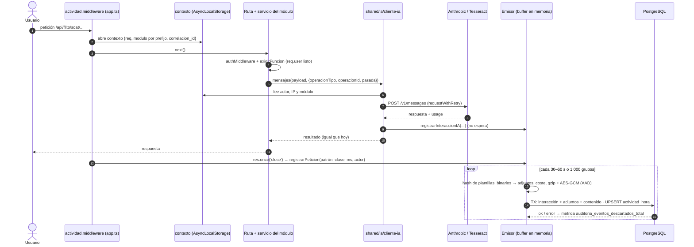
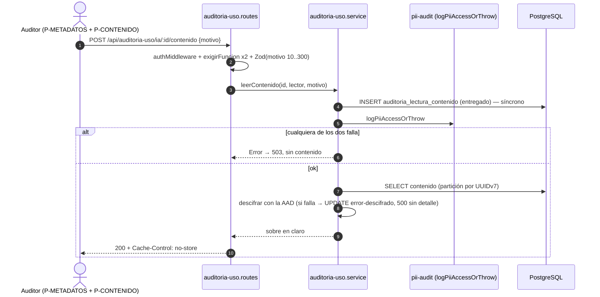

# ADR-0042 — Auditoría portable del uso de IA y de la actividad por módulo

- **Estado:** Propuesto (pendiente de aprobación del Líder Técnico; nada implementado)
- **Fecha:** 2026-11-11
- **Contexto de trabajo:** Épica #14548. Los Features y HUs se derivan de la Épica cuando se apruebe
- **Supersedes:** ninguno. **No contradice** ningún ADR aceptado:
  - convive con `audit_logs`, `pii_access_log` y `uso_legacy_diario` (ADR-0033), que se mantiene hasta su retiro;
  - reutiliza el anillo de llaves de ADR-0034;
  - respeta ADR-0035 (migración SQL a mano) y ADR-0036 (sin PII en URLs).
- **Documento del modelo (el que se adjunta a la Épica):** `docs/arquitectura/auditoria-portable/modelo-de-datos.md`
- **Módulos:** es **transversal**. Habla con los `flito-*` y con los legacy (todo lo montado en
  `app.ts` cuenta como actividad, y toda llamada a IA de cualquier módulo se audita). Se monta como
  módulo sin prefijo `flito-`, igual que `uso-legacy/` y `privacy/`, porque no es un módulo de
  producto (ver Q11 del modelo).

## Contexto

Hay que poder responder, en FLITO y en cualquier otro sistema del grupo (por ejemplo FLIT 2, con
otro repositorio y otro stack), dos preguntas:

1. ¿Qué se le pidió a la IA, quién, desde qué IP, en qué módulo, con qué modelo, qué respondió y
   con qué rendimiento?
2. ¿Quién entró a cada módulo, cuándo y qué hizo, tanto a nivel técnico como de negocio?

Cada sistema guarda en **su propia BD** con **el mismo esquema**.

**Decisiones del humano (fuera de discusión aquí):**
- campos por interacción, con prompt y respuesta completos y cifrados;
- dos niveles de actividad (técnico automático y de negocio instrumentado), empezando por
  `flito-soat`, `flito-impuestos`, `flito-derechos` y `flito-tramites`;
- retención de 3 meses, parametrizable;
- dos permisos (metadatos frente a contenido descifrado);
- cobertura de **toda** llamada a IA en FLITO;
- convivencia con las auditorías existentes.

**Estado real en FLITO (leído, no supuesto):**
- `modules/tramites/anthropic.ts` (`anthropicMessages(payload, op)`, con `op` = `'ocr'|'biometric'|'checklist'`)
  mide `ms` y cuenta `tram_anthropic_request_total`. **No** registra tokens, modelo, usuario ni
  contenido. Lo usa `flito-ocr`, con pasadas Haiku → Sonnet y respaldo local con Tesseract.
- **Siete puntos** llaman a `api.anthropic.com` **por fuera** de ese cliente:
  - `vehicles/ocr.pipeline.ts` (`callAnthropic`, Haiku → Sonnet);
  - `vehicles/ocr.routes.ts`;
  - `runt/runt.routes.ts` (`claude-sonnet-4-6`, modelo fijo en el código);
  - `runt/runt-direct.service.ts` (captcha, `max_tokens: 16`);
  - `drive/procesador.service.ts` (`claude-haiku-4-5-20251001`, modelo fijo en el código);
  - `flito-dr-flit/dr-flit-ia.client.ts` (su propia clasificación de errores, ADR-0027);
  - el sondeo de salud `modules/ai/anthropic-health.ts` que cita ese cliente.
- Los prompts de `flito-ocr` son constantes (`flito-ocr.prompts.ts`). Los de `vehicles` y `drive`
  están en línea en el código.
- **Cifrado:** AES-256-GCM con `iv`, `tag`, `key_version` y `aad_nonce` (`flito_bolsas_documentos`),
  helpers `encryptPii*` con catálogo de pares tabla/columna tipado (ADR-0034, capas 3–4) y registro
  de llaves `pii_key_registry` con canario.
- **Conteo por patrón de ruta:** ADR-0033 ya resolvió, con un prototipo verificado, cómo obtener el
  patrón sin leer la URL (`res.once('close')`, prefijo literal + `req.route.path`, centinela
  `(sin_ruta)`) y cómo escribir sin bloquear desde varias réplicas (buffer en memoria + UPSERT por
  lotes). **Se reutiliza tal cual**: solo cambian la granularidad (hora en vez de día, más usuario) y
  el alcance (todos los prefijos en vez de tres módulos legacy).
- **Permisos:** `exigirFuncion('<codigo>')`. `requireRole(` está vetado en `src/modules` por
  `permisos.valla-legacy.test.ts` (ADR-0033 §4).

## Alternativas

### D1. Forma de las tablas

#### Opción 1 — Tabla única de eventos genérica (`tipo` + `payload jsonb`)

| | |
|---|---|
| Pros | Una sola tabla que portar, una sola purga y un esquema mínimo. Añadir tipos no requiere migración |
| Contras | Contrato débil: cada sistema llena el `payload` a su manera y la portabilidad se vuelve nominal. Las consultas del modelo (p95 por modelo y prompt, usuarios distintos por módulo) se hacen sobre extracciones de JSON, sin índices tipados y con traducción costosa a MySQL y SQL Server. El contenido cifrado y los metadatos comparten fila, así que cada listado arrastra los datos pesados. No hay `CHECK` por campo |
| Esfuerzo | S para escribir, L para consultar y mantener |
| Riesgos | Deriva entre sistemas. Se cuela PII en el `payload` sin que nada lo frene |

#### Opción 2 — Tablas separadas: interacción IA, contenido 1:1, adjuntos, actividad técnica agregada por hora y actividad de negocio por evento (**recomendada**)

| | |
|---|---|
| Pros | Columnas tipadas con `CHECK`. Índices para cada consulta del contrato. El contenido cifrado vive aparte: los listados son estrechos, y el permiso y la purga se razonan por tabla. Los catálogos dan el «módulo sin uso». El SQL es estándar y se traduce bien |
| Contras | Doce tablas, cinco de ellas particionadas. Hacen falta un proceso de particiones y purga y un emisor algo más rico |
| Esfuerzo | L en total, repartible en 4 Features (ver «Reparto») |
| Riesgos | El agregado horario pierde el detalle por petición; se acepta (ver D3) |

#### Opción 3 — Como la 2, pero con la actividad técnica cruda (una fila por petición)

| | |
|---|---|
| Pros | Precisión al segundo y la secuencia exacta de peticiones |
| Contras | Entre 10 y 50 veces más filas que el agregado (el *polling* de bandejas genera la mayoría). Más PII por fila si se añadiera la IP. No responde nada que el requisito pida y la Opción 2 no responda |
| Esfuerzo | M |
| Riesgos | Volumen, y que se convierta en un rastreo minucioso de empleados (Ley 1581) |

### D2. Granularidad del cifrado

| Opción | Pros | Contras | Esfuerzo |
|---|---|---|---|
| **A. Por fila: un sobre JSON (prompts + parámetros + respuesta), comprimido y cifrado una vez, en tabla 1:1** (recomendada) | Un solo `iv`, `tag`, versión y AAD. Atómico. La compresión rinde más sobre el conjunto. El descifrado siempre quiere el par prompt + respuesta | No permite descifrar solo la respuesta (nadie lo pidió) | S |
| B. Por columna (`prompt_sistema_cifrado`, `prompt_usuario_cifrado`, `respuesta_cifrada`, cada una con su `iv` y `tag`) | Lectura parcial posible | Triplica `iv`, `tag` y AAD. Un error en una columna deja la fila medio legible. Más columnas que portar | M |
| C. Cifrado de la BD o del disco (TDE) | Transparente | Protege del robo del disco, no de un volcado ni de un lector con acceso SQL. No lo ofrecen igual los tres motores | S |

### D3. Actividad técnica: agregados frente a eventos crudos

| Opción | Responde «a qué hora y qué usuarios» | Volumen (escenario medio, 90 d) | Esfuerzo |
|---|---|---|---|
| Agregado **diario** (lo que hace ADR-0033) | No (sin hora) | ~0,2 M | S (ya existe) |
| **Agregado horario por usuario + método + patrón + clase de estado** (recomendada) | Sí: hora y, con `primera_en`, el minuto exacto | ~1,7 M | S–M (generaliza ADR-0033) |
| Evento crudo por petición | Sí | ~20–80 M | M |

### D4. Retención parametrizable: dónde vive el parámetro

| Opción | Pros | Contras |
|---|---|---|
| **Variable de entorno por ambiente** (`AUDITORIA_RETENTION_MONTHS`, como `COMPARENDOS_RETENTION_MONTHS` del cron `flito-comparendos-purga`) (recomendada, **supuesto discutible**) | Reducirla pasa por el control de cambios (commit en `flit-gitops` o en el `.env` del ambiente), no por un clic | Exige redesplegar |
| Columna editable en `auditoria_sistema` desde la pantalla | Inmediato | El administrador auditado puede borrar su propio rastro bajando el valor |

## Decisión y justificación

- **D1: Opción 2.** Es la única que mantiene el contrato portable **por columnas**, con lo que las
  consultas del modelo funcionan igual en otro motor.
- **D2: A.**
- **D3: agregado horario.** Responde el requisito con un volumen moderado y reutiliza el mecanismo
  ya probado de ADR-0033.
- **D4: variable de entorno.**

Se añaden las reglas transversales del modelo:
- sin FK a tablas del sistema: id opaco + copia del momento;
- sin FK en las tablas de eventos;
- particiones mensuales en UTC, sin partición `DEFAULT`;
- emisor asíncrono at-most-once con pérdida medida;
- lectura del contenido con fallo cerrado;
- rotación de llave sin recifrar, porque la retención es menor que la vida de una llave.

## Diagrama de secuencia (FLITO)

Lectura del contenido (con fallo cerrado):

## Mapeo a FLITO

### Enganches

| Pieza | Dónde | Patrón vecino |
|---|---|---|
| **Punto único de IA** | Nuevo `apps/api/src/shared/ia/cliente-ia.ts`, que absorbe `anthropicMessages` (timeout, retry, clasificación, métrica y log sin PII) y añade la llamada al emisor. `modules/tramites/anthropic.ts` queda como re-export para no romper a sus llamadores. El tipo `op` se abre a `operacionTipo` (string kebab-case del modelo) | `modules/tramites/anthropic.ts` |
| **Migrar los siete puntos** | `vehicles/ocr.pipeline.ts`, `vehicles/ocr.routes.ts`, `runt/runt.routes.ts`, `runt/runt-direct.service.ts`, `drive/procesador.service.ts`, `flito-dr-flit/dr-flit-ia.client.ts` (conserva su clasificación `ia-error` sobre el resultado del cliente único) y `ai/anthropic-health.ts` (módulo `plataforma`, actor `sistema`; Q6) | — |
| **Respaldo Tesseract** | `flito-ocr.service.ts` registra la pasada local con `proveedor='local'`, `modelo='tesseract'` y `coste_estimado=0`, en el mismo `operacion_id` | — |
| **Valla de cobertura** | Test nuevo que falla si `api.anthropic.com` aparece en `apps/api/src` fuera de `shared/ia/` | `permisos.valla-legacy.test.ts` |
| **Contexto de petición** | Nuevo `apps/api/src/shared/auditoria/contexto.ts` con `AsyncLocalStorage` de `node:async_hooks` (**sin dependencia nueva**). Guarda `req` y lee `req.user` **tarde**, porque la autenticación va por router | — |
| **Actividad técnica** | Nuevo `apps/api/src/shared/auditoria/actividad.middleware.ts`, que generaliza las reglas de construcción de clave de ADR-0033 §1 (`close`, prefijo literal + `req.route.path`, centinela `(sin_ruta)`, nunca `originalUrl` ni `params`). Se monta con **una** línea en `app.ts`, justo después de `apiLimiter` y junto a `montarConteoUsoLegacy(app)`, que **sigue**. Tabla prefijo → `modulo_codigo` con un test que exige que todo prefijo montado esté mapeado | `modules/uso-legacy/uso-legacy.middleware.ts` |
| **Emisor** | Nuevo `apps/api/src/shared/auditoria/emisor.ts`: buffer acotado, vaciado por lotes, flush en `SIGTERM`, métrica nueva en `shared/metrics.ts`. El nombre de usuario se resuelve con una caché de proceso por `sub` (el JWT trae `sub` y `role`; si no trae nombre, se resuelve una vez por usuario con TTL) | `uso-legacy.service.ts` |
| **Nivel de negocio** | `emisor.registrarAccion(...)` en los servicios de `flito-soat`, `flito-impuestos`, `flito-derechos` y `flito-tramites`, **después** del commit. Un catálogo de acciones por módulo, sembrado en la migración (Q10) | — |
| **Esquema** | Nuevo `apps/api/src/db/schema/auditoria-uso.ts` (re-export en `schema.ts`; `bytea` de `_comunes.ts`). Drizzle **no** modela `PARTITION BY`: el archivo define las tablas padre para el query builder y el particionado vive solo en el SQL. `db-review-agent` decide si hace falta una entrada en `migrations/derivas-aceptadas.json` | `schema/uso-legacy.ts`, `schema/flito-bolsas-documentos.ts` |
| **Migración** | `apps/api/src/db/migrations/NNNN_auditoria_uso.sql`, escrita a mano. Hoy la última es `0301`; el número se fija **al integrar**. Contiene el DDL del modelo §6 **sin** `auditoria_llave` (ver Cifrado), con las particiones del mes en curso y los 2 siguientes y la siembra de `auditoria_sistema('flito')`, `auditoria_modulo` y `auditoria_accion` con `ON CONFLICT DO NOTHING` | ADR-0035 |
| **Cifrado** | Se reutiliza **el anillo de llaves de PII** (ADR-0034, `pii_key_registry` como registro de versiones y canario) mediante `encryptPiiBuffer`, con el par `auditoria_ia_contenido / cifrado` dado de alta en el catálogo tipado. Si el helper solo acepta su formato de AAD (`tabla|columna|<id>|<nonce>|<ver>`), se usa ese formato con `id = interaccion_id` y se declara la variante en `formato_version`. El descriptor de recifrado de ADR-0034 **excluye** esta tabla salvo compromiso de llave (el dato caduca antes) | ADR-0034 |
| **Retención y particiones** | `apps/api/src/modules/auditoria-uso/auditoria-uso.cron.ts`: diario, con cerrojo, asegura particiones, purga por `DROP` y aplica el freno de 2 particiones. `AUDITORIA_RETENTION_MONTHS` (por defecto 3, de 1 a 24) y `AUDITORIA_LECTURAS_RETENTION_MONTHS` (por defecto 12) en `src/config/env.ts`. Valor por ambiente según AGENTS.md regla 5 | cron `flito-comparendos-purga`, `COMPARENDOS_RETENTION_MONTHS` |
| **Permisos** | Dos códigos de función: `auditoria.uso.ver` (P-METADATOS) y `auditoria.ia-contenido.ver` (P-CONTENIDO), en el catálogo de funciones que lee `exigirFuncion`. Sin `requireRole` y sin el rol `operaciones` | `exigirFuncion('permisos.catalogo.ver')` (ADR-0033) |
| **Auditoría PII** | `ia/buscar` y `actividad/buscar` proyectan IP y nombre de empleados, así que usan `logPiiAccess` (abierto, clase bandeja). El contenido usa `logPiiAccessOrThrow` (cerrado) **y** la fila de `auditoria_lectura_contenido` | `shared/pii-audit.ts` |

### Contrato de endpoints (`/api/auditoria-uso`, todos con `authMiddleware` y `exigirFuncion`)

| Método y ruta | Permiso | Body / respuesta |
|---|---|---|
| `GET /catalogo/modulos` | uso.ver | Módulos del catálogo |
| `POST /actividad/buscar` | uso.ver | `{desde, hasta, modulo?, usuarioExtId?, agrupar: 'modulo'\|'franja'\|'usuario'\|'linea-tiempo'}` → consultas §11.1–11.4 |
| `POST /actividad/modulos-sin-uso` | uso.ver | `{desde, hasta}` → §11.5 |
| `POST /ia/buscar` | uso.ver | `{desde, hasta, modulo?, usuarioExtId?, modelo?, resultado?, cursor?}` → §11.7, paginado |
| `POST /ia/rendimiento` | uso.ver | `{desde, hasta}` → §11.6 |
| `GET /ia/:id` | uso.ver | Metadatos de la interacción, adjuntos (hash, tipo y tamaño) y cadena de pasadas (§11.8). El `id` es un UUID opaco |
| `POST /ia/:id/contenido` | uso.ver **y** ia-contenido.ver | `{motivo}` → sobre descifrado, fallo cerrado. `rateLimiter` propio (descifrado uno a uno) |

Sin GET con query de PII (ADR-0036). `npm run contrato:generar` regenera
`contracts/openapi/flito-api.v1.yaml`.

### Modelo de datos (Drizzle)

Es una transcripción de las doce tablas del modelo §6, menos `auditoria_llave`, con los tipos del
vecino `flito-bolsas-documentos.ts`: `uuid`, `timestamp({ withTimezone: true })`, `varchar`,
`smallint`, `numeric`, `jsonb`, `bytea` de `_comunes.ts` e `inet` como `customType` si no está ya en
`_comunes.ts`. Los `CHECK` se declaran en el SQL; en Drizzle, solo los que el vecino ya declara con
`check()`.

### Archivos a crear o modificar

**Crear**
- `apps/api/src/db/schema/auditoria-uso.ts`
- `apps/api/src/db/migrations/NNNN_auditoria_uso.sql` (número al integrar)
- `apps/api/src/shared/ia/cliente-ia.ts`
- `apps/api/src/shared/auditoria/contexto.ts`
- `apps/api/src/shared/auditoria/emisor.ts`
- `apps/api/src/shared/auditoria/cifrado-contenido.ts` (sobre, reemplazo de binarios, gzip + `encryptPiiBuffer`)
- `apps/api/src/shared/auditoria/actividad.middleware.ts`
- `apps/api/src/modules/auditoria-uso/auditoria-uso.routes.ts`
- `apps/api/src/modules/auditoria-uso/auditoria-uso.service.ts`
- `apps/api/src/modules/auditoria-uso/auditoria-uso.cron.ts`
- `apps/api/src/__tests__/…/ia-punto-unico.valla.test.ts`, más los tests del emisor, el middleware, el servicio y el cron
- `packages/shared-types/src/auditoria-uso.ts` (DTOs, códigos de función, códigos de módulo)

**Modificar**
- `apps/api/src/db/schema.ts` (re-export)
- `apps/api/src/app.ts` (middleware + montaje de rutas + cron)
- `apps/api/src/config/env.ts` (dos variables)
- `apps/api/src/shared/metrics.ts` (contador de descartes)
- `apps/api/.env.example`
- `apps/api/src/modules/tramites/anthropic.ts` (re-export)
- `vehicles/ocr.pipeline.ts`, `vehicles/ocr.routes.ts`, `runt/runt.routes.ts`, `runt/runt-direct.service.ts`, `drive/procesador.service.ts`, `flito-dr-flit/dr-flit-ia.client.ts`, `ai/anthropic-health.ts`, `flito-ocr/flito-ocr.service.ts`
- Servicios de `flito-soat`, `flito-impuestos`, `flito-derechos` y `flito-tramites` (una HU por módulo)
- El catálogo de pares AAD de ADR-0034
- El catálogo de funciones de permisos
- `packages/shared-types/src/index.ts`
- `contracts/openapi/flito-api.v1.yaml` (generado)
- **Fuera del repo:** `flit-gitops/services/flito-<env>/configmaps.yaml` (variables de retención)

**Web (Feature aparte, con `ux-agent` full):** página nueva con `PageSlug` y guarda de permiso,
registrada con `lazy()` en `App.tsx`, datos por `src/lib/api.ts` y sus 4 estados. No se diseña aquí.

### Reparto sugerido (Modo Feature)

| Feature | Contenido | Archivos compartidos (van en serie) |
|---|---|---|
| F1 Contrato y punto único de IA | Esquema + migración + shared-types + emisor + cifrado + `cliente-ia` + 8 llamadores + valla | `schema.ts`, migración, shared-types, `app.ts` |
| F2 Actividad técnica | Middleware + tabla de prefijos + test de cobertura | `app.ts` (después de F1) |
| F3 Actividad de negocio | Catálogo y emisión en los 4 módulos (bloques en paralelo, uno por módulo) | Siembra del catálogo en la migración de F1 o en una nueva |
| F4 Consulta | Endpoints + cron de purga + pantalla | `App.tsx`, shared-types |

## Impacto en shared-types

Nuevo `auditoria-uso.ts` con:
- DTOs de búsqueda y respuesta (sin `cifrado`, `iv` ni `tag`);
- los dos códigos de función;
- la unión de `operacionTipo`, `resultado` y `status_clase`.

No cambia tipos existentes, así que no hay usos que revisar en `apps/web`. Si el `PageSlug` nuevo
toca `permissions.ts`, es obligatorio el `grep` de usos (AGENTS.md regla 7).

## Notas operativas por agente

- **backend-agent:** el emisor **nunca** lanza al llamador ni se espera en el camino de la petición.
  `cliente-ia` debe devolver exactamente el mismo `AnthropicResult` que hoy (los llamadores no
  cambian de comportamiento). Leer `usage.*`, `stop_reason` y el header `request-id`. Reemplazar los
  binarios **antes** de cifrar. Hay que verificar `app.set('trust proxy', …)` frente al ingress del
  k3s: si no está bien configurado, `req.ip` es la IP del ingress y el dato no sirve. Se escribe
  después del commit del negocio, nunca dentro de su transacción.
- **db-review-agent:** tablas particionadas sin FK cruzadas (decisión), PK con la columna de
  partición, sin partición `DEFAULT`, y la deriva Drizzle ↔ SQL que deja el particionado.
  Idempotencia P6.
- **security-agent:** dispara por PII (IP, nombre, contenido OCR), cifrado, rutas nuevas y fallo
  cerrado. Revisar que ni el logger ni el access log lleven contenido ni IP.
- **frontend-agent / ux-agent:** los filtros van en el body, nunca en la URL del router. El
  contenido descifrado nunca va a `localStorage` ni a la consola. Abrirlo exige el motivo en un
  diálogo. La pantalla muestra la ventana de retención vigente.
- **devops-agent:** variables por ambiente en `flit-gitops`. Alertar con la métrica de descartes y
  con «no hay partición del mes siguiente» al día 25.

## Riesgos abiertos y qué falta decidir

- **Riesgos:**
  - **cobertura de IA:** sin la valla, un llamador nuevo se salta la auditoría;
  - **IP del proxy** (`trust proxy`);
  - **volumen real** desconocido, porque las cifras son supuestos (modelo §12);
  - **pérdida at-most-once** bajo caída de la BD;
  - el **freno de purga** puede dejar más datos de lo debido si nadie atiende el aviso.
- **Ley 1581:** aviso a empleados y finalidad (Legal), supresión sobre contenido cifrado y
  biometría (modelo §14).
- **Preguntas para el humano:** las Q1–Q16 del modelo, §16. **Cerradas el 12-nov-2026** con las
  propuestas por defecto (Q1–Q14): nombre en claro (Q1), pérdida at-most-once aceptada y medida
  (Q4), sin contenido biométrico (Q5), anillo de llaves de ADR-0034 (Q7), P-METADATOS a admin y
  P-CONTENIDO nominal sin asignación por defecto (Q9). **Siguen con Legal** Q15 (supresión) y Q16
  (aviso a empleados): bloquean la activación en PDN, no el desarrollo.
