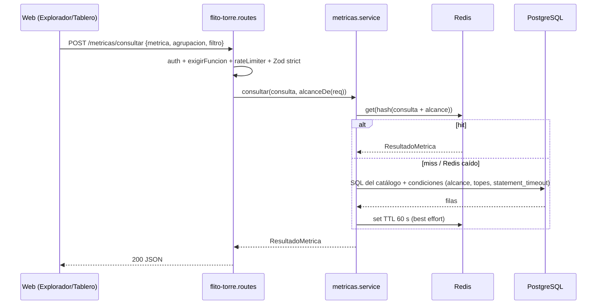

# ADR-0043 — Motor de métricas de la Torre de Control Gerencial (`flito-torre`)

- **Estado:** Propuesto. Según el coordinador de la sesión, el humano aprobó el plan; el paso a
  `Aceptado` lo firma el Líder Técnico humano en este archivo (el `architecture-agent` no marca ADRs
  como aceptados).
- **Fecha:** 2026-11-17
- **Contexto de trabajo:** Épica ADO #14590 (sin Features ni HUs por decisión del humano). Rama
  `FEATURE/14590-davidchica-torre-fundacion-api`, apilada sobre `FEATURE/14560` (rediseño del kit).
- **Spec:** `docs/SPEC_TORRE_CONTROL_GERENCIAL_FLITO.md` v3.0, recortada por el plan de la Épica.
- **Módulos:** dominio **FLITO**. El módulo nuevo es `apps/api/src/modules/flito-torre/` y se monta en
  `/api/flito/torre`. Lee `flito_tramites` y sus vecinas (`flito_tramite_historial`,
  `flito_liquidaciones`, `flito_impuestos`, `flito_derechos_tramite`,
  `flito_tramite_viajes_logistica`, `siigo_factura_tramites`). No lee el legacy `tramites_digitales`.
- **Supersedes:** ninguno. Respeta ADR-0035 (migración SQL a mano) y ADR-0036 (sin PII en URLs).

## Contexto

La Torre tiene que responder preguntas de negocio que combinan filtros: aprobados hoy por compañía,
tiempo de ciclo de un conjunto de trámites, costo de logística del mes, impuestos y derechos pagados,
volumen por departamento o ciudad, y estado o línea de tiempo de una placa. Además alimenta 4 tableros
(Comercial, Operativo, Financiero y 360°). Plazo: 4 días. Regla de la Épica: **construir solo con los
datos que FLITO ya tiene**.

## Alternativas

| Opción | Pros | Contras | Esfuerzo | Riesgos |
|---|---|---|---|---|
| **1. Catálogo cerrado en vivo (Drizzle + `sql` parametrizado) + Redis TTL corto** | Sin tablas derivadas ni cron; un solo motor para el Explorador y los 4 tableros; lista blanca | Las consultas pesadas pagan en cada carga | M | Latencia si el volumen crece (mitigado con índices, topes y caché) |
| 2. Snapshot / agregados diarios (tabla + cron) | Lecturas baratas | Cron, backfill y deriva frente a la fuente; «hoy» exige un camino en vivo igual | L | No cabe en el plazo; datos viejos |
| 3. Consultas ad hoc por tablero, sin motor | Lo más rápido para un tablero | Una pantalla por pregunta; duplica filtros y alcance | M→L | Inconsistencia entre tableros; fugas de alcance |

## Decisión

**Opción 1.** Las 8 decisiones de la mesa redonda, con los acuerdos posteriores:

### D1. Forma del motor
Un catálogo **cerrado** (`flito-torre.catalogo.ts`). Cada métrica declara su tabla base, el campo de
fecha, la expresión SQL fija, la unidad y las agrupaciones permitidas. El cliente solo manda claves:
`metrica` y `agrupacion` como `z.enum` del catálogo y `FiltroTorre` con `.strict()`. No hay SQL
dinámico construido desde el cliente. Contrato en `packages/shared-types/src/flito-torre.ts`:

```ts
type RangoTorre = { preset: 'hoy'|'ayer'|'mes'|'mes_anterior'|'trimestre' } | { desde: string; hasta: string }; // YYYY-MM-DD, Bogotá
interface FiltroTorre { rango: RangoTorre; companiaIds?: number[]; organismos?: string[]; departamentos?: string[]; // 'NN'
  tiposTramite?: string[]; flitEstados?: string[]; fuente?: 'flit'|'flit2' }
type Agrupacion = 'dia'|'semana'|'mes'|'trimestre'|'compania'|'organismo'|'departamento'|'tipo_tramite'|'flit_estado';
interface ConsultaMetrica { metrica: MetricaId; agrupacion?: Agrupacion; filtro: FiltroTorre; limite?: number }
interface ResultadoMetrica { metrica: MetricaId; unidad: 'conteo'|'cop'|'horas'|'pct';
  total: { valor: number; n: number; mediana?: number; p90?: number; max?: number; lapsoHoras?: number };
  filas: { clave: string; etiqueta: string; valor: number; n: number; mediana?: number; p90?: number }[];
  baseFecha: { campo: string; excluidos: number }; generadoEn: string }
```

Métricas iniciales:
- `tramites_creados`, `tramites_aprobados`
- `tiempo_creacion_aprobacion` (mediana y p90 con `percentile_cont`, máximo y lapso)
- `costo_logistica`, `impuestos_pagados`, `derechos_pagados`
- `ingreso_liquidado`, `wip_activo`, `tasa_aprobacion`, `sin_facturar`

Los tableros son **presets** del mismo motor.

### D2. En vivo y caché
Consultas en vivo, sin snapshot. La caché Redis (`shared/redis.ts`) dura 60 s y su clave es el hash de
la consulta normalizada **más el alcance resuelto**. Si Redis falla, el motor consulta la base igual.
El 360° hace sus consultas en paralelo (`Promise.all`) y lleva topes.

### D3. Índices
Dictamen de `db-review`. Van en la migración `0303_flito_torre_fundacion.sql`, todos con
`CREATE INDEX IF NOT EXISTS`:
- `flito_tramites (compania_id, fecha_aprobacion)`
- `flito_tramites (fecha_aprobacion) WHERE fecha_aprobacion IS NOT NULL`
- `flito_tramites (organismo_codigo)`
- `flito_tramites ((COALESCE(fecha_creacion_flit, created_at)))`
- `flito_tramites (upper(plate_complete))`
- `flito_tramite_historial (campo, created_at) INCLUDE (tramite_id)`
- `flito_impuestos (compania_id, pagado_en)`
- `flito_derechos_tramite (fecha_pago) WHERE fecha_pago IS NOT NULL`

Ya existían y se reutilizan: `flit_estado`, `estado`, `compania_nit`, `fecha_creacion_flit` y
`created_at` sobre `flito_tramites`, e `idx_flito_tramite_historial_campo`.

### D4. Fechas y zona horaria
- Los rangos se resuelven en el servidor a `[desde 00:00, hasta+1 00:00)` en `TZ_COLOMBIA`
  (`shared/utils/fecha-rango.ts`). Se agrupa con `date_trunc(…, col AT TIME ZONE 'America/Bogota')`.
- **Aprobado** = `fecha_aprobacion IS NOT NULL` dentro del rango; no se usa `flit_estado`. «Matriculado»
  es solo un rótulo de la UI cuando el filtro de tipo es matrícula.
- **Tiempos:** los trámites sin `fecha_creacion_flit` se **excluyen** de las métricas de tiempo, porque
  su `created_at` es la fecha de la carga masiva. Se cuentan en `baseFecha.excluidos` y la UI lo
  declara. Las métricas de conteo por creación usan `COALESCE(fecha_creacion_flit, created_at)`.
- `compania_id` nulo → fila **«Sin compañía»** en las agrupaciones por compañía, para que los totales
  cuadren.

### D5. Departamento y ciudad
La ciudad sale de `ORGANISMOS_TRANSITO` (`packages/shared-types/src/organismos-transito.ts`). En el
mismo archivo se añade `DEPARTAMENTO_POR_CODIGO`, que hoy no existe (`DEPARTAMENTOS_COLOMBIA` solo
trae nombres). El departamento se agrupa con `substr(organismo_codigo, 1, 2)`; si el código es nulo,
la fila es «Sin secretaría».

### D6. Costo de logística
La fuente es `flito_liquidaciones.valor_logistica`, que ya vale `tarifa + Σ viajes adicionales
+ Σ traslados` (cabecera de `flito-liquidacion.service.ts`). Se fecha con la `fecha_aprobacion` del
trámite. **No** se suma `flito_tramite_viajes_logistica.valor`, porque contaría doble. Los viajes
solo alimentan la métrica operativa (viajes adicionales, `numero >= 2`). Lo que no está liquidado no
entra, y la UI lo declara.

### D7. Umbrales
Tabla tipada `flito_torre_umbrales`:
- `clave` varchar PK
- `valor numeric(14,2)`
- `unidad`, con CHECK `dias|horas|porcentaje|cop|conteo`
- CHECK de rango por unidad (≥ 0; porcentaje ≤ 100)
- `descripcion`
- `actualizado_por` FK `users` ON DELETE SET NULL
- `actualizado_en`

La semilla va con `ON CONFLICT DO NOTHING` y los umbrales de ANS arrancan desde `ANS_OPERATIVO`.
Esquema en `apps/api/src/db/schema/flito-torre.ts`, re-exportado en el barril.

### D8. Roles y filtros en la web
- Roles nuevos `gerencia_comercial` y `gerencia_general`, con `tipo_enlace = 'ninguno'`. Se siembran
  en `permisos_roles` y `permisos_rol_funcion` (patrón 0178) y se añaden a `USER_ROLES`, `ROLE_LABELS`
  y `DEFAULTS_POR_ROL`, con el grep en `apps/web` que exige la regla 7.
- Los filtros de la Torre viven en **`sessionStorage`** del navegador, **nunca en la URL** (regla 14,
  ADR-0036).

## Requisitos de seguridad (checklist obligatorio)

1. El catálogo usa `z.enum` y `FiltroTorre` es `.strict()`. Se rechaza cualquier clave desconocida.
2. Un **constructor único** de condiciones (`flito-torre.filtro.ts`) exige `AlcanceResuelto` y aplica
   `condicionPorCompania`. Ninguna métrica arma su `WHERE` por fuera de él. La clave de caché incluye
   el alcance.
3. Topes:
   - rango máximo de 24 meses, y de 366 días si se agrupa por día;
   - máximo 5.000 grupos por consulta;
   - máximo 50.000 filas al exportar;
   - `SET LOCAL statement_timeout` en cada consulta del motor.
4. `rateLimiter` en `metricas/consultar`, `metricas/exportar` y `placa/buscar`.
5. `POST /flito/torre/placa/buscar`:
   - la placa va en el body y en la caché solo como hash;
   - `logPiiAccess` con acción de búsqueda;
   - un 404 indistinto para «no existe» y «fuera de alcance»;
   - sin datos del comprador y con el VIN enmascarado.
6. `exigirFuncion` en **cada** ruta, con una función por página o acción.
7. Los roles `gerencia_*` y `auditor` no editan umbrales. La edición la tiene solo la función de
   administración.

## Diagrama de secuencia



## Archivos

- **Contrato (serial):**
  - `apps/api/src/db/schema/flito-torre.ts` y su línea en `apps/api/src/db/schema.ts`
  - `apps/api/src/db/migrations/0303_flito_torre_fundacion.sql` (roles, funciones, umbrales e índices)
  - `packages/shared-types/src/flito-torre.ts`
  - `packages/shared-types/src/permissions.ts`
  - `packages/shared-types/src/organismos-transito.ts` (`DEPARTAMENTO_POR_CODIGO`)
  - stubs de `apps/api/src/modules/flito-torre/flito-torre.routes.ts` y su montaje
- **Backend, en `apps/api/src/modules/flito-torre/`:**
  - `flito-torre.catalogo.ts`, `flito-torre.filtro.ts` y `flito-torre.metricas.service.ts`
  - `flito-torre.placa.service.ts`
  - `flito-torre.{comercial,operativa,financiera,ejecutivo}.service.ts`
  - `flito-torre.umbrales.service.ts` y `flito-torre.export.ts` (reusa `sendExcel`)
  - `flito-torre.tableros.routes.ts`, para que el router no pase de 800 líneas
  - tests en `apps/api/src/__tests__/services/flito-torre/`
- **Frontend:**
  - `apps/web/src/pages/torre/*` y `apps/web/src/components/torre/BarraFiltrosTorre.tsx`
  - `apps/web/src/components/flit/LineaTendencia.tsx`
  - las entradas en `App.tsx`, `navEntradas.ts` y `navItems.ts`

Backend y frontend no comparten archivos; `shared-types` se cierra en el paso de contrato.

## Consecuencias y riesgos

- La latencia depende de los índices de D3. Si una consulta pasa de 1 s en DEV, se revisa con un
  snapshot en un ADR nuevo.
- La carga masiva histórica queda fuera de los tiempos; `baseFecha.excluidos` la hace visible.
- La rama está apilada sobre 14560: un rebase de esa rama toca `App.tsx` y la navegación.
- La placa es cuasi-PII: este diff pasa por `security-agent` y por `db-review-agent` (por la migración
  0303).
