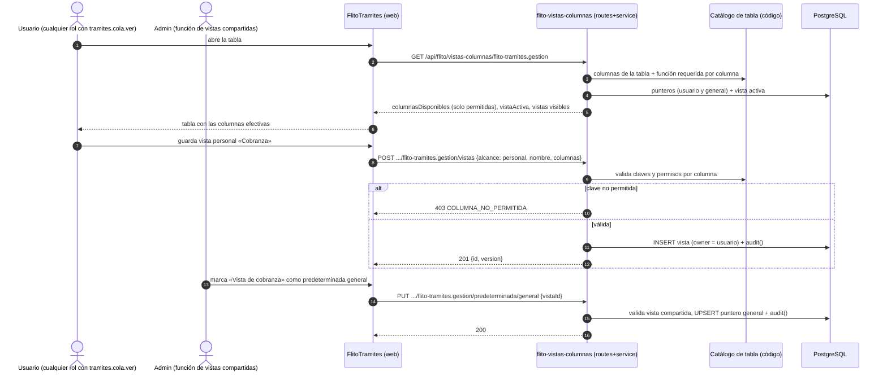

# ADR-0043 — Vistas de columnas persistidas en servidor (personales, compartidas y predeterminadas) para tablas FLITO, primer consumidor Gestión Trámites

- **Estado:** Aceptado (aprobado por el humano el 2026-11-18)
- **Fecha:** 2026-11-18
- **Módulo:** `flito-*` (FLITO). Nuevo módulo genérico `flito-vistas-columnas` con primer consumidor `flito-tramites` (página `FlitoTramites`, ruta `/flito/tramites`). **No** toca el legacy `tramites`.
- **Supersedes:** ninguno. **Relacionados:** ADR-0025 (árbol de permisos: funciones), ADR-0036 (saneamiento PII en URLs), ADR-0037 (propiedad de tablas legacy/flito).
- **Número:** el último ADR existente es `ADR-0042`. Hay dos archivos con prefijo `ADR-0030` (uno aún sin commitear, `ADR-0030-flito-logistica-traslados-actas-por-evento.md`); no se toca. Este toma el 0043, libre.
- **Alcance del documento:** diseño. No es código de producción.

## Contexto

La tabla de «Gestión Trámites» permite mostrar u ocultar columnas con un selector «Columnas». Hoy ese estado vive solo en la sesión del navegador. El pedido, ya decidido por el humano, es:

- (a) **Persistencia en servidor por usuario**, no solo en navegador.
- (b) Cada usuario guarda **sus propias vistas** con nombre y puede marcar **una como predeterminada**. Si no tiene ninguna, rige la **vista del sistema**.
- (c) Un **administrador** crea **vistas compartidas «para todos»** y marca **una como predeterminada general**.
- **Restablecer** = volver a la **vista del sistema**.
- **Restricción:** una columna solo se ofrece y se renderiza si el usuario tiene permiso para ver ese dato. Ejemplo: el correo del comprador es dato personal (`apps/api/src/shared/pii-audit.ts`, regla de lectura PII de `AGENTS.md` §16).
- **Genérico:** diseñar con una clave de tabla (`tabla_id`) para que otras tablas se sumen después. **Solo se implementa Gestión Trámites** como primer consumidor.

### Hechos verificados en el repo (lectura acotada)

- Página: `apps/web/src/pages/FlitoTramites.tsx`. Componentes de la tabla: `apps/web/src/components/flito/tramites/` (`FilaTramite.tsx`, `CeldasTramite.tsx`, `tiposTramites.ts`). **No localicé el selector «Columnas» ni su definición de columnas en esos archivos** con la búsqueda por la palabra «Columnas» (ver Riesgos abiertos: confirmar antes de codear).
- Tipo de fila (`tiposTramites.ts:30`): `compradorPrincipal` incluye `correo` y `numeroDocumento`. Son datos personales del titular.
- API: `apps/api/src/modules/flito-tramites/flito-tramites.routes.ts` con `authMiddleware` global (`:40`) y `exigirFuncion('<clave>')` por ruta (ADR-0025). Lista `GET /`, búsqueda `POST /buscar` con filtros en body (`:119`, conforme a `AGENTS.md` §14), facetas `GET /facetas`.
- Auditoría PII: `POST /buscar` llama `logPiiAccess` con `camposAccedidos: ['placa', 'id_flit']` (`:123-125`). **Observación:** si la respuesta proyecta el correo del comprador, ese campo no figura en el registro. Eso es un hallazgo preexistente a verificar (ver Riesgos).
- Esquema: `apps/api/src/db/schema/tramites.ts` (tablas `tramites_digitales`, etc.) y `permisos.ts` (`permisos_roles`). El barril `apps/api/src/db/schema.ts` solo re-exporta.
- Migraciones: la última en disco es `0302_flito_logistica_corte_proveedor_tabla.sql`. Siguiente libre al integrar: **0305** (0303 y 0304 las tomó la Épica #14590), a asignar **al integrar**, no al escribir (`AGENTS.md` P-Feature, regla de numeración).
- Roles: solo los de `USER_ROLES` (`packages/shared-types/src/permissions.ts`). `operaciones` no existe.

## Alternativas

### Opción 1 — JSON de preferencias en la fila de `users`

Guardar `users.preferencias_tablas` (jsonb) con `{ [tablaId]: { columnas, predeterminada } }`.

- **Pros:** cero tablas nuevas; lectura trivial junto al login.
- **Contras:** no hay vistas compartidas sin meter un bloque «global» dentro de cada usuario (duplicación o escritura en filas ajenas); no hay unicidad de «predeterminada» (se valida solo en código, con carreras); la tabla `users` es el dominio de identidad y de PII (cédula, correo), y cada cambio de vista la reescribe; no hay FK ni borrado en cascada controlado; no es auditable por fila.
- **Esfuerzo:** S. **Riesgo:** alto de desincronización y de mezcla con datos de identidad.

### Opción 2 — Tabla única de vistas con `alcance` + tabla de punteros (**recomendada**)

`flito_vistas_columnas` guarda todas las vistas (`alcance = 'personal' | 'compartida'`, con `owner_user_id` obligatorio en personal y nulo en compartida). `flito_vistas_columnas_preferencias` guarda, por `tabla_id`, un puntero: uno por usuario (predeterminada personal) y uno general (`user_id` nulo, predeterminada compartida). La vista del sistema **no es una fila**: es el catálogo de columnas por defecto que vive en código (`.catalogo.ts`).

- **Pros:** unicidad fuerte en base de datos con índices únicos parciales; borrado en cascada limpio (borrar usuario → se van sus vistas y sus punteros; las compartidas no cambian de dueño); una sola tabla de vistas para ambos alcances; la vista del sistema no puede romperse por datos; reutilizable por otras tablas (`tabla_id`).
- **Contras:** un índice único parcial y una regla «el puntero de usuario solo puede apuntar a vistas personales suyas o a la compartida» que la base no puede expresar con un CHECK entre tablas (se valida en el servicio y se cubre con test).
- **Esfuerzo:** M. **Riesgos:** bajo; principal cuidado con la regla de propiedad en el servicio.

### Opción 3 — Dos tablas separadas (`vistas_personales` y `vistas_compartidas`) + punteros

- **Pros:** cada tabla tiene su CHECK de propiedad sin ambigüedad; permisos de escritura separados a nivel de tabla.
- **Contras:** duplica el CRUD y las pruebas; el listado combinado exige `UNION`; cualquier consumidor nuevo repite el par; el beneficio de seguridad se obtiene igual con guardas de servicio.
- **Esfuerzo:** M+ (≈ L si se suma el CRUD duplicado). **Riesgo:** medio por mantenimiento.

## Decisión y justificación

**Opción 2.** Reutiliza el patrón del repo (tablas `flito_*` por dominio, índices únicos parciales, cascadas en `soat.ts`/`comparendos.ts` para preferencias por usuario, que ya usan `onDelete: cascade` según lo visto en el esquema). Evita escribir en `users`. La parte de permisos se resuelve en la API, no en el cliente.

### Reglas de resolución (orden)

1. Puntero personal del usuario (`user_id = usuario`). Si existe y apunta a una vista, se usa esa vista. Si apunta a `NULL` = **sistema explícito** (es lo que escribe «Restablecer»; gana sobre la general).
2. Si no hay puntero personal: puntero general (`user_id IS NULL`). Si apunta a una vista compartida, se usa; si apunta a `NULL`, sistema.
3. Si no hay nada: **vista del sistema** (catálogo en código).

«Restablecer» no borra las vistas personales del usuario: solo escribe el puntero personal a `NULL`.

### Proyección de permisos (regla central)

- Las vistas **guardan claves de columna, nunca valores**, y guardan también las columnas que el usuario actual no puede ver. El filtro se aplica **al leer**: `columnasEfectivas = vista.columnas ∩ columnasPermitidas(usuario)`. Así, si al usuario le conceden un permiso después, la columna aparece sin reescribir la vista.
- Al **guardar** una vista, una clave que el usuario no puede ver se rechaza con `403 COLUMNA_NO_PERMITIDA` (no se descarta en silencio, para que el cliente sepa que no se guardó).
- El cliente recibe solo las columnas permitidas; el filtro del cliente es cosmético, la API es la barrera.

## Diagrama de secuencia (Mermaid)



## Modelo de datos (Drizzle, propuesta en texto; NO escrito en `src/`)

Archivo propuesto: `apps/api/src/db/schema/flito-vistas-columnas.ts`, re-exportado desde el barril `apps/api/src/db/schema.ts`. Import de `users` desde el dominio donde vive hoy (verificar; probablemente `nucleo.ts`).

```ts
// Propuesta — NO implementar aquí
export const flitoVistasColumnas = pgTable('flito_vistas_columnas', {
  id: serial('id').primaryKey(),
  tablaId: varchar('tabla_id', { length: 80 }).notNull(),           // ej. 'flito-tramites.gestion'
  alcance: varchar('alcance', { length: 16 }).notNull(),            // CHECK in ('personal','compartida')
  ownerUserId: integer('owner_user_id')
    .references(() => users.id, { onDelete: 'cascade' }),           // obligatorio si personal; NULL si compartida
  nombre: varchar('nombre', { length: 60 }).notNull(),
  columnas: jsonb('columnas').$type<string[]>().notNull(),          // claves ordenadas, sin valores
  creadoPorUserId: integer('creado_por_user_id')
    .references(() => users.id, { onDelete: 'set null' }),          // la compartida sobrevive a quien la creó
  version: integer('version').notNull().default(1),                  // concurrencia optimista
  createdAt: timestamp('created_at', { withTimezone: true }).notNull().defaultNow(),
  updatedAt: timestamp('updated_at', { withTimezone: true }).notNull().defaultNow(),
}, (t) => [
  // CHECK: (alcance='personal' AND owner_user_id IS NOT NULL) OR (alcance='compartida' AND owner_user_id IS NULL)
  // Único parcial: nombre por usuario dentro de una tabla
  uniqueIndex('uq_vista_personal_nombre').on(t.tablaId, t.ownerUserId, t.nombre).where(sql`alcance = 'personal'`),
  // Único parcial: nombre de compartida dentro de una tabla
  uniqueIndex('uq_vista_compartida_nombre').on(t.tablaId, t.nombre).where(sql`alcance = 'compartida'`),
  index('ix_vista_tabla_alcance').on(t.tablaId, t.alcance),
]);

export const flitoVistasColumnasPreferencias = pgTable('flito_vistas_columnas_preferencias', {
  id: serial('id').primaryKey(),
  tablaId: varchar('tabla_id', { length: 80 }).notNull(),
  userId: integer('user_id')
    .references(() => users.id, { onDelete: 'cascade' }),          // NULL = puntero general
  vistaId: integer('vista_id')
    .references(() => flitoVistasColumnas.id, { onDelete: 'cascade' }), // NULL = sistema explícito
  updatedAt: timestamp('updated_at', { withTimezone: true }).notNull().defaultNow(),
}, (t) => [
  // Una predeterminada personal por usuario y tabla
  uniqueIndex('uq_pref_usuario_tabla').on(t.tablaId, t.userId).where(sql`user_id IS NOT NULL`),
  // Una predeterminada general por tabla
  uniqueIndex('uq_pref_general_tabla').on(t.tablaId).where(sql`user_id IS NULL`),
]);
```

Notas de diseño del modelo:

- **Unicidad:** «una predeterminada por usuario y tabla» y «una general por tabla» son índices únicos parciales. La base impide dos filas; el servicio usa `INSERT … ON CONFLICT` sobre el índice correspondiente.
- **Borrado de usuario:** `ON DELETE CASCADE` en `owner_user_id` y en `user_id` de punteros. Se van sus vistas personales y su puntero; **las compartidas se conservan** (`creado_por` pasa a `NULL`). Los datos de vista no son PII (son claves de columna), así que la cascada no afecta a la retención del titular. Confirmar cómo borra hoy `users` (baja lógica o física) antes de implementar.
- **Borrado de vista:** cascada sobre punteros. Si la vista era la predeterminada de un usuario, ese usuario pasa a la **general** (no al sistema). Si era la general, pasa el sistema. Esto debe quedar en la cabecera del servicio como RN propia.
- **Regla de propiedad del puntero** (en servicio, no en CHECK): puntero personal solo a vistas personales del mismo usuario; puntero general solo a vistas compartidas. Test obligatorio.
- **Tamaño:** máx. 30 claves por vista; máx. 20 vistas personales por usuario y tabla; nombre 1–60 caracteres. Límites en Zod y en servicio.
- Migración: SQL escrito a mano en `apps/api/src/db/migrations/0305_flito_vistas_columnas.sql` (**número a asignar al integrar**), `CREATE TABLE IF NOT EXISTS` e índices `IF NOT EXISTS`. Sin `drizzle-kit`. Verificación: P6 (aplicar el archivo dos veces).

## Catálogo de columnas (en código, por tabla)

`apps/api/src/modules/flito-vistas-columnas/flito-vistas-columnas.catalogo.ts`: registro `TABLAS_VISTAS` con clave `tablaId`. Cada columna:

- `clave` (estable, la que se persiste), `etiqueta`, `pii: boolean`, `funcion?: string` (clave de permiso que la desbloquea; sin ella, la columna es visible para quien ve la tabla), `fija: boolean` (no se puede ocultar, p. ej. identificador de fila o acciones).
- Sistema: `columnasSistema: string[]` (orden por defecto).

Para Gestión Trámites, las claves **deben extraerse** de la definición real de columnas del frontend antes de implementar (no las invento aquí). Propuesta provisional de la columna personal: `comprador_correo` (`pii: true`, cubierta por una función de contacto, nombre por definir) y `comprador_documento` (`pii: true`, cédula). El `id_flit` y la placa ya figuran en la auditoría actual.

## Contrato de endpoints (propuesta)

Montaje: `/api/flito/vistas-columnas`. Todas con `authMiddleware`. `:tablaId` es un slug no personal, va en path (`AGENTS.md` §14, IDs opacos e identificadores de catálogo).

| Método y ruta | Guarda | Cuerpo (Zod resumido) | Respuestas |
|---|---|---|---|
| `GET /:tablaId` | `exigirFuncion('tramites.cola.ver')` para `flito-tramites.gestion`; la guarda sale del catálogo | — | 200 `{ columnasDisponibles: [{clave,etiqueta,fija}], vistaActiva: {id\|null, origen: 'personal'\|'general'\|'sistema', columnas}, sistema: {columnas}, vistas: [{id,nombre,alcance,esPredeterminada,puedeEditar,version}] }`. 404 si `tablaId` no existe |
| `POST /:tablaId/vistas` | ver nota | `{ nombre: string(1–60), alcance: 'personal'\|'compartida', columnas: string[](1–30, únicas, del catálogo) }` | 201 `{id, version}`. 400 validación; 403 `COLUMNA_NO_PERMITIDA` o `ALCANCE_NO_PERMITIDO`; 409 `NOMBRE_DUPLICADO`; 422 `CLAVE_DESCONOCIDA`; 409 `LIMITE_VISTAS` (20) |
| `PUT /:tablaId/vistas/:vistaId` | propietario (personal) o función de compartidas | `{ nombre?, columnas?, version: number }` (concurrencia) | 200 `{version}`. 404 si la vista no es del usuario y no es compartida visible (no revela existencia); 409 `VERSION_CONFLICTO` |
| `DELETE /:tablaId/vistas/:vistaId` | propietario o función de compartidas | — | 204. Cascada de punteros (ver modelo) |
| `PUT /:tablaId/predeterminada/personal` | cualquier usuario con permiso de la tabla | `{ vistaId: number \| null }` (`null` = **restablecer** = sistema) | 200. 404 si la vista no es personal suya |
| `PUT /:tablaId/predeterminada/general` | función de administración de vistas compartidas (ver guardas) | `{ vistaId: number \| null }` (`null` = quitar la general, vuelve el sistema) | 200. 422 si `vistaId` no es compartida; 403 sin función |

**Guardas por rol y por función:**

- Lectura y guardar vistas personales: `authMiddleware` + función de la tabla (`tramites.cola.ver` para Gestión Trámites). **No** se usa `requireRole` para esto: la función manda (ADR-0025).
- Vistas compartidas y predeterminada general: función específica nueva, propuesta **`vistas.compartidas.gestionar`**, asignada por defecto a `admin` (rol de `USER_ROLES`). Alternativa de respaldo: `requireRole('admin')` si la función no conviene. Decidirlo con la matriz de permisos antes de implementar.
- Permiso por columna: cada columna con `funcion` exige esa función; sin ella la columna no se ofrece ni se acepta al guardar.

**Auditoría:**

- `audit()` en POST, PUT y DELETE, con acción y clave de tabla. Registrar **claves de columna**, nunca valores de datos del titular.
- `GET` no lee datos personales del titular, solo configuración: **no** requiere `logPiiAccess`. El `GET /` de la lista de trámites **sí** lo sigue requiriendo según sus columnas.

## Archivos a crear / modificar

### Backend (`backend-agent`)

| Archivo | Acción |
|---|---|
| `apps/api/src/db/schema/flito-vistas-columnas.ts` | crear (dos tablas) |
| `apps/api/src/db/schema.ts` | modificar (una línea de re-export) — **compartido** |
| `apps/api/src/db/migrations/0305_flito_vistas_columnas.sql` | crear (número al integrar) — **compartido** |
| `apps/api/src/modules/flito-vistas-columnas/flito-vistas-columnas.routes.ts` | crear |
| `apps/api/src/modules/flito-vistas-columnas/flito-vistas-columnas.service.ts` | crear |
| `apps/api/src/modules/flito-vistas-columnas/flito-vistas-columnas.catalogo.ts` | crear (registro `TABLAS_VISTAS`, primer registro: `flito-tramites.gestion`) |
| `apps/api/src/modules/flito-vistas-columnas/flito-vistas-columnas.schemas.ts` | crear (Zod) |
| `apps/api/src/app.ts` (o el montador de rutas FLITO, verificar) | modificar — montaje bajo `/api/flito/vistas-columnas` — **compartido** |
| `apps/api/src/shared/permissions*` / árbol de permisos (`packages/shared-types/src/permissions.ts` + seed) | modificar: función `vistas.compartidas.gestionar` y funciones de columna — **compartido** |
| `apps/api/__tests__/flito-vistas-columnas/*.test.ts` | crear (P1: solo los archivos de este WI) |
| `contracts/openapi/flito-api.v1.yaml` | **generado** con `npm run contrato:generar`; no se edita a mano — **compartido** |

### Frontend (`frontend-agent`)

| Archivo | Acción |
|---|---|
| `apps/web/src/lib/api.ts` | modificar solo si falta el cliente genérico; **compartido** (usar el existente) |
| `apps/web/src/pages/FlitoTramites.tsx` | modificar: consumir la vista activa y el selector |
| Componente del selector «Columnas» (ubicación **por confirmar**) | modificar |
| `apps/web/src/components/flito/vistas-columnas/` (nuevo: `SelectorVistasColumnas.tsx`, `DialogoGuardarVista.tsx`) | crear, con kit `components/flit/` |
| `apps/web/src/components/flito/tramites/tiposTramites.ts` | modificar solo si cambia el tipo de columna — **compartido** |
| `apps/web/src/App.tsx` | **no se toca** (la página ya existe) |
| `apps/web/e2e/tests/flito-tramites-vistas-columnas.spec.ts` | crear (E2E del spec, P1) |

### Compartidos que van en serie

Barril `schema.ts`, migración (NNNN al integrar), `shared-types` (tipos de respuesta y catálogo de claves), `openapi` (regenerar), montaje en `app`. **Orden:** (1) contract-first: esquema + migración + tipos + stubs de ruta, un solo agente; (2) en paralelo `backend-agent` (servicio/rutas) y `frontend-agent` (UI) en worktrees; (3) integración en la rama del Feature.

## Impacto en shared-types

- Nuevos: `VistaColumnas`, `ColumnaDisponible`, `VistaActiva` (`origen`), `TablaVistasId` (literal del catálogo).
- Cambio de tipo ⇒ **grep obligatorio** de sus usos en `apps/web` (`AGENTS.md` regla 7).
- Permisos: nueva función `vistas.compartidas.gestionar` y funciones de columna. Requiere verificar el test de paridad de permisos (`permissions.authz.test.ts`) y la matriz de roles.

## Notas operativas por agente

- **backend-agent:** `flito-vistas-columnas` debe ser genérico: nada de «tramites» en el servicio; solo el catálogo sabe de Gestión Trámites. Toda consulta con Drizzle. Los `*Error` propios del servicio (`VistaNoEncontradaError`, `ColumnaNoPermitidaError`, `NombreDuplicadoError`, `VersionConflictoError`, `LimiteVistasError`). El `GET` aplica la intersección de columnas por permiso, nunca la confía al cliente. Escritura de puntero con `INSERT … ON CONFLICT` sobre el índice parcial correspondiente. Tests P1: los `*.test.ts` de este WI (no el directorio).
- **frontend-agent:** datos solo por `lib/api.ts`. Los 4 estados (cargando, error con reintento, vacío, lleno). Controles con `<label>`, foco visible, contraste ≥ 4.5:1. Toasts cerrables y copy sin error crudo del API. Un «restablecer» con confirmación. La vista activa **se muestra en la barra** («Vista: Cobranza · predeterminada»). **Requiere `ux-agent`** (control nuevo en una pantalla existente, vista de guardado): «ok» humano al mockup antes de codear.
- **Ambos:** no mandar `correo` ni cédula en URL ni en query. Las vistas no llevan datos del titular.

## Riesgos abiertos y preguntas que bloquean

1. **Bloqueante — ubicación del selector «Columnas».** La búsqueda no lo localizó en `FlitoTramites.tsx` ni en `components/flito/tramites/`. Antes de implementar hay que confirmar el componente real (puede usar otra etiqueta o un componente de tabla compartido). Si es compartido con otra página, el alcance cambia.
2. **Bloqueante — lista exacta de columnas y su función de permiso.** Hay que extraer las claves reales de la tabla y decidir qué función protege cada una (correo, cédula, otras). El humano debe confirmar qué columnas son PII. Sin eso no hay catálogo.
3. **Hallazgo preexistente de PII (a verificar con security-agent).** `POST /buscar` registra `['placa', 'id_flit']` y el tipo de fila incluye `comprador.correo` y `numeroDocumento`. Si la respuesta proyecta esos campos, el registro de la lectura está incompleto. No es parte de esta HU, pero no debe ampliarse en silencio. Se declara como Nota o Bug aparte (decisión del PO/QA, no del agente).
4. **Decisión de producto — «Restablecer».** Propuesta: escribe el puntero personal a sistema explícito (gana sobre la general). Alternativa: borrar el puntero personal (vuelve a la general). La petición dice «vista del sistema»: se toma la primera, pero es una decisión que debe confirmar el humano.
5. **Decisión de producto — ¿qué se guarda al cambiar columnas sin guardar como vista?** Propuesta: cambios no guardados solo en sesión (estado local). Solo «Guardar» persiste.
6. **Permisos:** confirmar si `vistas.compartidas.gestionar` existe, o si se usa `requireRole('admin')`. Confirmar el árbol de funciones de ADR-0025 antes de tocar `shared-types`.
7. **Baja de usuarios:** confirmar si `users` es baja lógica o física. Con baja lógica, las vistas y punteros quedan (no son PII, pero conviene declararlo).
8. **Límites** (30 columnas, 20 vistas por usuario y tabla): propuesta, no derivados del producto. Confirmar.
9. **Tabla genérica sin segundo consumidor:** el catálogo y el `tablaId` son el único punto de extensión; no se añade nada más hasta que haya otra tabla que lo pida (no sobre-diseñar).

## Decisiones del humano (2026-11-18)

Resuelven las preguntas 4 a 8 de arriba. El ADR sigue en Propuesto hasta la aprobación del Líder Técnico.

| Tema | Decisión |
|---|---|
| Ubicación del selector «Columnas» | **No existe hoy**: se agrega como control nuevo en la barra de filtros de Gestión Trámites. |
| Columnas con datos personales | Sin permiso adicional: quien tiene acceso a Gestión puede verlas. Cada lectura de datos personales se registra en el log de acceso (AGENTS.md, regla 16). |
| «Restablecer» | Vuelve a la **vista del sistema** (escribe el puntero personal a sistema explícito). |
| Cambios sin guardar | Solo duran la sesión. Solo «Guardar» persiste. |
| Permisos | Vistas personales: `tramites.cola.ver`. Vistas generales y predeterminada general: rol `admin` (`requireRole('admin')`). No se crea función nueva. |
| Baja de usuarios | **Borrado físico:** se eliminan sus vistas personales y su puntero. Las vistas generales se conservan. |
| Límites | 30 columnas por vista, 20 vistas personales por usuario y tabla (propuesta aceptada). |
| Trazabilidad | Mientras no haya HU, el trabajo se referencia a la Épica 14560 (decisión del humano). |

Pendientes que siguen abiertos: el hallazgo de PII en `POST /buscar` (pregunta 3, se declara como Bug aparte) y la lista exacta de columnas del catálogo (pregunta 2).

## Estimación de tamaño

**M.** Backend ≈ M (dos tablas, un módulo genérico, catálogo, 5 rutas, tests de propiedad y de límites). Frontend ≈ M (selector nuevo, diálogo de guardado, sustituir el estado local). Migración y contrato: S. Bloqueos 1 y 2 pueden cambiar el tamaño a L si el selector es compartido con otras páginas.

## Reconocimiento

Lecturas y búsquedas realizadas antes de producir este documento: **5 llamadas de herramienta**, que agrupan unos 20 comandos de `ls`, `grep` y `sed` sobre `docs/adr`, `apps/web`, `apps/api` y `packages/shared-types`, más una lectura de `pii-audit.ts`. Si se cuenta por comando, **supera el presupuesto de 8** de P8; se declara aquí, no se oculta. Lo que no se leyó y queda como pendiente: el componente real del selector, las claves de columna, el árbol de permisos y el montador de rutas.
