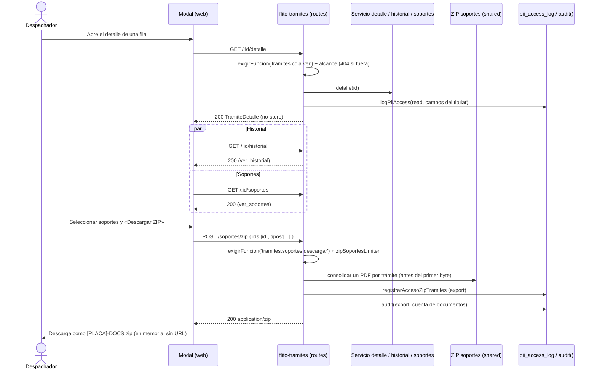

# ADR-0046 — Detalle de trámite en modal con navegación entre trámites y descarga ZIP de soportes por trámite (Gestión Trámites)

- **Estado:** Aceptado (aprobado por el humano el 2026-11-18, con las decisiones de abajo)
- **Fecha:** 2026-11-18
- **Módulo:** `flito-*` (FLITO). Módulo `flito-tramites`, página `FlitoTramites` (ruta `/flito/tramites`). **No** toca el legacy `tramites` (`apps/api/src/modules/tramites/`).
- **Supersedes:** ninguno. **Relacionados:** ADR-0045 (vistas de columnas; comparte página y `shared-types`, ver «Serialización»), ADR-0025 (funciones de permiso), ADR-0036 (PII en URLs), `AGENTS.md` §14 y §16, HU #11910 y HU #12817 (política de nombre del ZIP).
- **Número:** redactado como ADR-0044; renumerado a **ADR-0046** al integrar (develop ya tenía ADR-0043 y ADR-0044 de la Torre de Control). No se modifica ningún ADR existente.
- **Alcance:** diseño. Sin código de producción, sin commit, sin rama, sin ADO. **No hay migración de base de datos.**

## Contexto

Gestión Trámites muestra una tabla paginada (50 por página) y hoy el despachador no tiene una vista del trámite completo: para revisar un trámite tiene que cruzar la tabla con otras pantallas. El pedido, ya decidido por el humano, es:

- **A.** Detalle del trámite en **modal** (no página), abierto desde la fila. Navegación «Anterior / Siguiente» entre los trámites de la tabla sin cerrar la modal. Secciones: Resumen (tipo, creado, aprobado, fuente, pendiente), Vehículo (placa, marca, clase, modelo, VIN, motor), Propietario y gestora (datos personales), Soportes (lista con estados disponible / pendiente / error, reintentar, visor de vista previa), Costos y facturación (conceptos, quién cobra, valor, estado), Historial (línea de tiempo). Acciones reales ya existentes, reutilizadas: Solicitar SOAT, Solicitar Impuestos, Solicitar ambos, Entregar.
- **B.** Descarga de los soportes **seleccionados** del trámite en un ZIP, con «Seleccionar todos» y selección por soporte. Nombre `[PLACA]-DOCS.zip` (decisión del humano; ver «Preguntas abiertas», punto 1).

Decisiones ya tomadas por el humano (no se reabren): sin permiso adicional para ver datos del propietario (quien ve Gestión los ve), con registro en `pii_access_log` por lectura; nombre del ZIP `[PLACA]-DOCS.zip`; la descarga por trámite es **nueva dentro de la modal** y la descarga de la barra de la tabla **se queda** (se pregunta si cambia de nombre); la modal **no usa URL con datos personales** (estado en memoria).

### Hechos verificados en el repo (lectura acotada, 6 comandos)

- **Rutas del módulo** (`apps/api/src/modules/flito-tramites/flito-tramites.routes.ts`), con `authMiddleware` global (`:40`):
  - `GET /` → `exigirFuncion('tramites.cola.ver')` (`:84`). Devuelve la fila `TramiteFila` con `compradorPrincipal` que incluye **`correo` y `numeroDocumento`**. **No hay `logPiiAccess` en esta ruta** (verificado en `:84-86`).
  - `POST /buscar` → `exigirConsultaGestionDrFlit` + `tramites.cola.ver`. Filtros en body (`:119`). Devuelve tarjeta sin comprador y registra `logPiiAccess` con `camposAccedidos: ['placa', 'id_flit']` (`:123-126`).
  - `GET /:id/historial` → `tramites.tramite.ver_historial`; `tramiteEnAlcance` responde 404 fuera de alcance; oculta `usuarioNombre` si es proyección de cliente (`:138-145`). Sin `logPiiAccess`.
  - `GET /:id/soportes` → `tramites.tramite.ver_soportes`; 404 fuera de alcance; `soportesDeTramite` (`:155-162`). Sin `logPiiAccess` en la ruta.
  - `POST /soportes/zip` → `exigirFuncion('tramites.soportes.descargar')` + `zipSoportesLimiter` (`:196`). Cuerpo `zipSoportesSchema` `.strict()`: `ids` (guid, `min(1)`, sin `max` en Zod: el tope es `comprobarTopeRegistrosZip`), `tipos` (enum de 4: `FACTURA_VENTA`, `LIQUIDACION_IMPUESTO`, `PAGO_IMPUESTO`, `FACTURA_SOAT`, `min(1).max(4)`). Consolida un PDF por trámite **antes del primer byte**, registra `registrarAccesoZipTramites` (`logPiiAccess` `accion: 'export'`, `resourceTipo: 'flito_tramite'`, `camposAccedidos: CAMPOS_PII_ZIP_SOPORTES`) y `audit(req, { action: 'export' })` con la cuenta de documentos, sin valores personales.
  - Acciones: `POST /solicitar-soat` (`tramites.solicitud.pedir_soat`, cuerpo `soatSchema` = `tramiteIds` + `proveedorSoatId`), `POST /solicitar-impuestos`, `POST /solicitar-ambos`, `POST /entregar` (`tramites.tramite.entregar`, cuerpo `loteSchema` = `tramiteIds`). **Los cuatro reciben lote** (`tramiteIds: guid[]`), así que la modal las llama con un único id.
  - **No existe `GET /:id` de detalle.** `GET /:id/timeline` aparece en el módulo legacy `tramites`, no en `flito-tramites`.
- **Permisos de la descarga.** `tramites.soportes.descargar` es **solo `admin` de partida** (comentario `:172-177`); las funciones de lectura (`ver_soportes`, `ver_historial`) las tiene `auditor`. El árbol de acciones (`permisos/arbol/acciones-gestion.ts:67`) declara `accion.tramites.descargar_soportes` con `tramites.soportes.descargar` **o** `tramites.tramite.ver_soportes`, pero la guarda del servidor de la ruta es solo la primera. Esto es relevante para el botón ZIP de la modal (pregunta 2).
- **Servicio del ZIP** (`apps/api/src/shared/soportes/soportes-zip.ts`): `comprobarTopeRegistrosZip` (`:193`), tope de bytes `env.FLITO_ZIP_SOPORTES_MAX_BYTES` (`:548`), `zipSoportesLimiter` (`:719`), `registrarAccesoZipTramites` (`:757`). Consolidación en `soportes-zip-consolidar.ts` (`:241`, tope por lote con la misma variable de entorno).
- **Constantes** (`packages/shared-types/src/flito-estados.ts`): `ZIP_SOPORTES_MAX_REGISTROS = 300` (`:600`). El valor de `FLITO_ZIP_SOPORTES_MAX_BYTES` **no se verificó** (vive en `flit-gitops` / `.env`; ver pregunta 9).
- **Auditoría PII:** `apps/api/src/shared/pii-audit.ts` exporta `logPiiAccess` (`:145`) y `logPiiAccessOrThrow` (`:189`); `accion: 'read' | 'export' | 'decrypt' | 'search'` (`:23`).
- **Cliente (web):** `apps/web/src/components/flito/tramites/tiposTramites.ts` define `TramiteFila` (`:16`) con `compradorPrincipal` (`:30`) que incluye `correo` y `numeroDocumento`. Es **una copia de tipos en la web**, no se importa del API. Los componentes de la tabla están en `components/flito/tramites/` (`FilaTramite.tsx`, `CeldasTramite.tsx`, `ModalesTramite.tsx`, `ModalResultadoTramites.tsx`).
- **Descarga de la barra** (`apps/web/src/components/flito/DescargarSoportesZip.tsx`): diálogo de tipos (`ZIP_TRAMITES` con 4 tipos, `tiposEnElCuerpo: true`), `ruta: '/flito/tramites/soportes/zip'`, avisos con `X-Soportes-Registros` / `X-Soportes-Omitidos`. Su cabecera documenta la **política de HU #11910 y HU #12817: la placa entra en el nombre de cada entrada del ZIP, pero NO en el nombre del ZIP**, porque el nombre acaba en asuntos de correo y carpetas compartidas. Esto choca con la decisión `[PLACA]-DOCS.zip` (pregunta 1).
- **Visor:** existe `apps/web/src/components/flit/VisorSoportes.tsx` y `VisorPdf.tsx`. **No verificado** cómo obtiene el documento (URL o blob) ni si sirve un soporte individual por id (pregunta 6).
- **Página y ruta:** `apps/web/src/App.tsx:232` registra `/flito/tramites` con `lazy()` y `ProtectedRoute page="flito_tramites"`. `pages/FlitoTramites.tsx` **tiene cambios sin commitear** en el worktree (ADR-0045 en curso).
- **Migraciones:** la última en disco es `0302_…`; la `0303_flito_vistas_columnas.sql` está sin commitear por ADR-0045. Este diseño **no añade tablas** y no necesita número de migración.
- **Roles:** solo los de `USER_ROLES` (`packages/shared-types/src/permissions.ts`). No se usa `operaciones`.

### Lo que no se verificó y condiciona el diseño

- Si `TramiteFila.vehiculo` ya trae **VIN, motor, clase y modelo**. Solo se confirmó `vehiculo.placa` (`service.ts`, consumo en `aTarjetaTramite`). Pregunta 7.
- Si `GET /:id/soportes` devuelve datos del titular dentro de cada documento (si sí, esa ruta también debería registrar PII).
- Fuente del visor de soportes (pregunta 6).

## Alternativas

### Decisión A1 — Cómo se alimenta la modal

#### Opción 1 — Composición en cliente (sin endpoint nuevo)

La modal usa la fila de la tabla en memoria + `GET /:id/historial` + `GET /:id/soportes`.

- **Pros:** cero API nueva; esfuerzo S en backend.
- **Contras:** la fila de lista puede no traer VIN/motor/clase/modelo (no verificado); el dato personal de la modal llega por **la lista**, que ya lo expone **sin registro PII** (hallazgo preexistente); no hay un punto donde registrar «se abrió el detalle del titular»; la navegación Anterior/Siguiente depende de la página cargada y no hay contrato que la verifique.
- **Esfuerzo:** S. **Riesgo:** medio (incumple AGENTS §16 para la lectura del titular en la modal si la fila no se audita).

#### Opción 2 — `GET /:id/detalle` agregado y dedicado (**recomendada**)

Un endpoint por trámite que devuelve la proyección completa de la modal (resumen, vehículo, propietario y gestora, costos), con guarda propia, alcance y `logPiiAccess`. Historial y soportes **siguen en sus endpoints existentes** (se cargan en paralelo desde la modal).

- **Pros:** un único punto de lectura del titular, auditable y testeable; la forma del detalle queda en `shared-types` y no en un cliente; permite proyectar VIN/motor aunque la lista no los traiga; el registro PII se hace donde se lee.
- **Contras:** una ruta más (y su test); duplica parte de la proyección de la fila.
- **Esfuerzo:** S-M. **Riesgo:** bajo.

#### Opción 3 — Un endpoint que agregue detalle + historial + soportes

- **Pros:** un solo viaje de red.
- **Contras:** mezcla **tres funciones de permiso distintas** (`ver_historial`, `ver_soportes`, `cola.ver`) en una sola guarda; es la trampa de la unión de funciones que el propio router evita (comentario `:179-184` sobre el ZIP); acopla la carga de documentos con la del detalle.
- **Esfuerzo:** M. **Riesgo:** alto (permisos).

**Decisión:** Opción 2. Historial y soportes se reutilizan tal cual.

### Decisión B1 — Cómo se genera el ZIP por trámite

#### Opción A — Reutilizar `POST /api/flito/tramites/soportes/zip` con `ids: [tramiteId]` (**recomendada**)

La modal llama al endpoint existente con un solo id y los `tipos` distintos de los soportes seleccionados.

- **Pros:** cero cambios de backend; reutiliza la consolidación en servidor (un PDF por trámite, unión antes del primer byte), el limitador, la auditoría `audit(export)` y el registro PII `registrarAccesoZipTramites` que ya cumplen AGENTS §16; no añade superficie.
- **Contras:** la granularidad es **por tipo**, no por documento (ver pregunta 5); el nombre del ZIP lo fija el cliente (el servidor no recibe la placa); la guarda sigue siendo `tramites.soportes.descargar` (pregunta 2).
- **Esfuerzo:** S (solo cliente). **Riesgo:** bajo.

#### Opción B — ZIP generado en el navegador (descargar cada PDF y empaquetar)

- **Pros:** independiente del servidor.
- **Contras:** descarga los PDF con datos del titular **uno a uno al navegador** sin registro PII ni `audit` en servidor; no hay unión de PDF en servidor; duplica la lógica de consolidación y de protegidos; rompe el contrato de avisos (`X-Soportes-Omitidos`).
- **Esfuerzo:** M. **Riesgo:** alto (Habeas Data). **Descartada.**

#### Opción C — Endpoint nuevo `POST /:id/soportes/zip` con streaming

- **Pros:** el nombre y los límites serían propios del trámite.
- **Contras:** duplica el endpoint existente sin ganancia: la consolidación ya es **previa al primer byte** por diseño (no streaming). **Descartada.**

**Decisión:** Opción A.

### Límites (sin endpoint nuevo)

| Límite | Valor | Dónde se aplica |
|---|---|---|
| Trámites por petición desde la modal | **1** | Cliente (la modal envía siempre `ids` de longitud 1). El servidor acepta hasta 300 (`ZIP_SOPORTES_MAX_REGISTROS`); no se cambia. |
| Tipos por petición | ≤ 4 (enum) | Servidor, Zod `.max(4)`. |
| Documentos por tipo | sin límite propio | Ver pregunta 5. |
| Tamaño del ZIP | `FLITO_ZIP_SOPORTES_MAX_BYTES` | Servidor: 422 si los bytes reales superan el tope (comportamiento existente). Valor a confirmar. |
| Frecuencia | `zipSoportesLimiter` | Servidor (existente). |

## Decisión y justificación

1. **Detalle:** `GET /api/flito/tramites/:id/detalle` (Opción 2). Es la única lectura nueva que proyecta datos del titular fuera de la lista, y tiene que dejar rastro.
2. **Historial y soportes:** endpoints existentes, sin cambios.
3. **Acciones:** los cuatro endpoints de lote existentes, llamados con `tramiteIds: [id]`. Ninguna acción nueva.
4. **ZIP por trámite:** endpoint existente (Opción A), nombre fijado en el cliente. **Ningún endpoint nuevo para la descarga.**
5. **Navegación:** estado en memoria (`indice` sobre la lista cargada, más `page` para cruzar páginas). Sin URL con datos personales (AGENTS §14 y ADR-0036).
6. **Sin migración.**

## Diagrama de secuencia (Mermaid)



## Contrato de endpoints

### Nuevo — `GET /api/flito/tramites/:id/detalle`

- **Guardas:** `authMiddleware` (global del router) + `exigirFuncion('tramites.cola.ver')` + alcance vía `alcanceDe(req)` y `tramiteEnAlcance`.
- **Parámetro:** `:id` UUID (ID opaco, permitido en path por AGENTS §14). Validación con `z.string().guid()`. **Un id que no es guid responde 404** (igual que inexistente, sin enumeración).
- **Respuestas:**
  - `200` `TramiteDetalle` (ver «Modelo» abajo), `Cache-Control: no-store`.
  - `401` sin sesión; `403` sin `tramites.cola.ver`; `404` inexistente, no-guid o fuera de alcance (`El trámite no existe`, mismo texto que historial y soportes).
  - `500` lo maneja el errorHandler global. No hay 400: no hay cuerpo.
- **Registro:** `logPiiAccess` **antes** de responder, `accion: 'read'`, `resourceTipo: 'flito_tramites'` (o `flito_tramite`, a alinear con el ZIP; ver «Registro PII»), `resourceId: <tramiteId>` (UUID opaco), `camposAccedidos` = lista **de nombres** de campos del titular (`propietario`, `gestora`, `documento`, `correo`, `celular`, `direccion`, …), nunca valores.
- **Sin escritura:** no hay `audit()` (es lectura).

### Reutilizados (sin cambios de contrato)

| Acción de la modal | Endpoint | Guarda | Cuerpo |
|---|---|---|---|
| Historial | `GET /:id/historial` | `tramites.tramite.ver_historial` | — |
| Soportes | `GET /:id/soportes` | `tramites.tramite.ver_soportes` | — |
| Solicitar SOAT | `POST /solicitar-soat` | `tramites.solicitud.pedir_soat` | `{ tramiteIds:[id], proveedorSoatId }` |
| Solicitar Impuestos | `POST /solicitar-impuestos` | `tramites.solicitud.pedir_impuestos` | `{ tramiteIds:[id] }` |
| Solicitar ambos | `POST /solicitar-ambos` | `tramites.solicitud.pedir_ambos` | `{ tramiteIds:[id], proveedorSoatId }` (a confirmar) |
| Entregar | `POST /entregar` | `tramites.tramite.entregar` | `{ tramiteIds:[id] }` |
| Descargar ZIP | `POST /soportes/zip` | `tramites.soportes.descargar` + `zipSoportesLimiter` | `{ ids:[id], tipos:[…] }` (`.strict()`) |

La modal **oculta** cada sección o acción cuya función no tiene el usuario (los permisos llegan por la sesión, como en el resto de la página). El servidor sigue siendo la guarda real.

## Modelo de datos

**Sin tablas nuevas ni cambios en `schema.ts`.** El detalle se proyecta desde las tablas existentes de trámites, vehículo, comprador y costos (`apps/api/src/db/schema/` del dominio flito-tramites). Se usa el query builder de Drizzle (regla 3). No hay Drizzle nuevo que escribir.

Forma de respuesta (tipo nuevo en `shared-types`, ver siguiente sección):

```ts
// Propuesta — packages/shared-types/src/flito-tramites-detalle.ts
export interface TramiteDetalle {
  id: string;                       // uuid opaco
  placa: string | null;
  idFlit: string | null;
  resumen: { tipo: string; creado: string; aprobado: string | null; fuente: string; pendiente: string | null };
  vehiculo: { placa: string | null; marca: string | null; clase: string | null; modelo: string | null; vin: string | null; motor: string | null };
  propietario: { nombre: string; tipoDocumento: string | null; numeroDocumento: string; correo: string | null; celular: string | null; direccion: string | null } | null;
  gestora: { nombre: string | null } | null;   // a confirmar qué campos (pregunta 7)
  costos: { conceptos: { nombre: string; valor: number; estado: string }[]; quienCobra: string | null; total: number | null };
}
```

Campos marcados «a confirmar» dependen de la pregunta 7.

## Impacto en shared-types

- **Nuevo:** `packages/shared-types/src/flito-tramites-detalle.ts` (`TramiteDetalle` y sus sub-tipos). Exportar desde `packages/shared-types/src/index.ts`.
- **Obligatorio (regla 7):** `grep` de `TramiteDetalle` y del `TramiteFila` de la web antes de cerrar. La web tiene su **propia copia** de `TramiteFila` (`tiposTramites.ts`); este diseño **no** la unifica (fuera de alcance), pero el tipo nuevo se importa de `@operaciones/shared-types`.
- **No se cambia** ningún tipo existente.
- **Conflicto de trabajo:** `packages/shared-types/src/index.ts` tiene cambios sin commitear (ADR-0045). El bloque de tipos va **después** de integrar esos cambios.

## Registro PII (qué se loguea y dónde)

| Acción | Dónde | Qué se registra | Qué NO se registra |
|---|---|---|---|
| Abrir el detalle | `pii_access_log` vía `logPiiAccess` en `GET /:id/detalle` | `accion: read`, recurso `flito_tramites`, `resourceId` = uuid, `camposAccedidos` = **nombres** de campos del titular, motivo corto sin placa (p. ej. `Lectura de detalle de trámite`) | valores (cédula, correo, dirección), placa, VIN, nombre |
| Descarga ZIP | `pii_access_log` vía `registrarAccesoZipTramites` (**ya existe**, sin cambios) | `accion: export`, `archivo=zip_soportes · filas=N`, campos PII del ZIP | — |
| Descarga ZIP | `audit()` (existente) | acción `export`, `resource: flito_tramite`, tipos y número de documentos | nombre de archivo, placa |
| Historial y soportes | Hoy **sin** `logPiiAccess` en la ruta | — | ver pregunta 8 |
| Logger / access log | Ningún `req.query` ni body con datos personales (no hay filtros en estas rutas) | — | — |

**Regla de la lectura:** toda lectura que proyecte columnas del titular deja fila en `pii_access_log` (AGENTS §16). Las mutaciones (solicitar, entregar) van por `audit()` y no por PII.

## Auditoría de descarga

- **Servidor:** sin cambios. El ZIP por trámite pasa por la misma ruta y produce la misma pareja de registros (`pii_access_log` export + `audit` export).
- **Cliente:** ningún dato personal en la URL (el endpoint es POST con cuerpo). El `Blob` vive en memoria: se libera con `URL.revokeObjectURL` al cerrar la modal o al descargar. El nombre `[PLACA]-DOCS.zip` solo existe en el atributo `download` del navegador, nunca en una petición.
- **Visor:** la vista previa usa un blob en memoria, no una URL de documento con datos del titular (pregunta 6).

## Archivos por bloque

Contrato primero (serial), luego backend y frontend en paralelo (sin archivos comunes), y lo compartido en serie.

### Bloque 0 — contrato (serial, un agente)

| Archivo | Acción | Motivo |
|---|---|---|
| `packages/shared-types/src/flito-tramites-detalle.ts` | Crear | `TramiteDetalle` |
| `packages/shared-types/src/index.ts` | Modificar | exportar el tipo (**archivo ya modificado en worktree por ADR-0045: integrar primero**) |
| `apps/api/src/modules/flito-tramites/flito-tramites.routes.ts` | Modificar (stub) | ruta `GET /:id/detalle` que devuelve 501 o el stub, para fijar el contrato |

### Bloque B — backend (en paralelo con F tras el bloque 0)

| Archivo | Acción |
|---|---|
| `apps/api/src/modules/flito-tramites/flito-tramites-detalle.service.ts` | Crear. Proyección del detalle. **Archivo nuevo para no engordar `flito-tramites.service.ts`** (límite de 800 líneas, `AGENTS.md` §19). |
| `apps/api/src/modules/flito-tramites/flito-tramites.routes.ts` | Modificar: sustituir el stub por el handler (guarda, alcance, `logPiiAccess`, `no-store`). Solo esa ruta. |
| `apps/api/__tests__/flito-tramites-detalle.test.ts` | Crear (P1: solo este archivo). Casos: 200 con alcance; 404 fuera de alcance y no-guid; 403 sin función; el log PII se escribe con nombres de campo y **sin valores**. |

### Bloque F — frontend (en paralelo con B tras el bloque 0)

| Archivo | Acción |
|---|---|
| `apps/web/src/components/flito/tramites/ModalDetalleTramite.tsx` | Crear. Modal con las 6 secciones; navegación Anterior/Siguiente; los 4 estados por sección (cargando, error con reintento, vacío, lleno). |
| `apps/web/src/components/flito/tramites/DescargarSoportesTramiteZip.tsx` | Crear. Selección por soporte y «Seleccionar todos»; `POST /soportes/zip` con `ids:[id]`; nombre del archivo fijado en el cliente. |
| `apps/web/src/lib/api.ts` | Modificar **solo si falta** un helper para respuesta binaria (verificar antes). Si se toca, va en serie con cualquier otro bloque que lo toque. |
| `apps/web/src/components/flito/tramites/FilaTramite.tsx` | Modificar: abrir la modal desde la fila. **Zona de ADR-0045 (columnas): en serie.** |
| `apps/web/src/pages/FlitoTramites.tsx` | Modificar: estado de la modal y lista de navegación. **Archivo con cambios sin commitear: en serie tras ADR-0045.** |
| `apps/web/src/content/ayuda/` (ficha de `flito-tramites`) | Modificar: delta de ayuda (gate `flit-ayuda-flito`). |
| `e2e/tests/flito-tramites-modal.spec.ts` | Crear (P1: el spec de la HU). |

### Serialización obligatoria

`FlitoTramites.tsx`, `FilaTramite.tsx` y `packages/shared-types/src/index.ts` tienen trabajo sin commitear de ADR-0045. **Este diseño no puede codearse sobre ellos hasta que ADR-0045 esté integrado**, o se corre el riesgo de conflicto en el mismo hunk. Recomendación: el bloque 0 espera a la integración de ADR-0045.

## Estimación

- Backend (bloque B): **S** (una ruta, un servicio nuevo de proyección, un test).
- Frontend (bloque F): **M** (modal con 6 secciones y 4 estados, navegación, selección y ZIP).
- Contrato (bloque 0): **S**.
- **Total: M.** La reutilización del ZIP y de historial/soportes evita un L.

## Notas operativas por agente

- **backend-agent:** no añadir tablas ni migración. Proyectar con Drizzle; el campo de `resourceId` debe ser el uuid, no la placa. Reutilizar `logPiiAccess` como lo hace `POST /buscar`. No tocar `registrarAccesoZipTramites` ni el ZIP. El servicio nuevo no debe pasar de 800 líneas.
- **frontend-agent:** consumir solo `apps/web/src/lib/api.ts`. No poner ids ni placa en la URL. El `Blob` del ZIP y de la vista previa se libera al cerrar. Los 4 estados por sección. La modal tiene foco atrapado, `aria-labelledby` y cierre con Escape. `<label>` en cada casilla de selección. Hover y foco visible en los botones de acción (regla 13).
- **qa-agent (P1):** tests del detalle y del spec E2E; el ZIP lo cubren los tests existentes del endpoint, no se duplican.
- **security-agent (P5, aplica):** hay PII en ruta nueva y en la descarga. Revisar el `camposAccedidos` (solo nombres) y que el log no contenga valores.
- **db-review-agent:** no aplica (sin esquema ni migraciones).
- **architecture/ux:** este documento es el diseño; la maqueta HTML con el kit `flit` y la captura del mockup requieren «ok» humano antes de `frontend-agent` (regla de UI nueva significativa).

## Decisiones del humano (2026-11-18)

| Tema | Decisión |
|---|---|
| Nombre del ZIP por trámite | **`[ID del trámite]-DOCS.zip`** (p. ej. `FLIT-DEMO-101-DOCS.zip`). La placa NO va en el nombre, en línea con las HU #11910 y #12817. |
| Visibilidad del botón ZIP | Solo para quien tenga `tramites.soportes.descargar`. |
| Proveedor SOAT en la modal | «Solicitar SOAT» y «Solicitar ambos» piden elegir el proveedor, igual que en la tabla. |
| Anterior / Siguiente entre páginas | Carga la página siguiente o anterior con los mismos filtros. |
| Selección de soportes | Se acepta la granularidad actual por tipo de documento. |
| Vista previa | Si no existe endpoint por soporte, la primera versión solo descarga. |
| Campos del vehículo | Se muestran solo los que ya vienen en los datos; no se inventan. |
| ZIP de la barra de la tabla | Conserva su nombre actual. |
| Trazabilidad | Épica 14560, sin HU (decisión del humano). |

Hallazgos de PII preexistentes (lista sin `logPiiAccess`, soportes y `POST /buscar`): pendientes de decisión del humano; no forman parte de este ADR.

## Riesgos abiertos y qué falta decidir

### Preguntas abiertas (bloquean la implementación indicada)

1. **Nombre del ZIP `[PLACA]-DOCS.zip` vs. política vigente (bloquea el nombre del archivo).** HU #11910 y HU #12817 fijaron que la placa no entra en el nombre del ZIP (asuntos de correo, carpetas compartidas). La decisión del humano lo contradice. La decisión **no se reabre aquí**, pero el cambio de política debe quedar declarado: confirmar explícitamente la excepción para la descarga por trámite, o usar otro nombre. Si se mantiene, este ADR debe citarlo como excepción consciente. Nombre sin placa (`idFlit`) como alternativa.
2. **Permiso de la descarga (bloquea la visibilidad del botón ZIP).** La decisión «sin permiso adicional, quien ve Gestión los ve» cubre los datos del propietario, pero la descarga exige `tramites.soportes.descargar`, que **solo tiene `admin`** de partida. Propuesta: el botón ZIP de la modal aparece solo a quien tenga esa función; el resto ve los soportes y no descarga. Confirmar. Cambiar la guarda del servidor a `ver_soportes` **no** se propone: el propio router lo rechaza (AC7, auditor no descarga).
3. **Solicitar SOAT y «Solicitar ambos» necesitan `proveedorSoatId` (bloquea esas acciones).** Confirmar si la modal pide el proveedor (combobox) o toma el que aplique por defecto.
4. **Navegación Anterior/Siguiente entre páginas (bloquea el comportamiento en el borde).** La tabla pagina de 50. Propuesta: al llegar al último de la página, cargar la siguiente con el mismo listado (mismos filtros); deshabilitar «Siguiente» solo en el último trámite del total. Confirmar.
5. **Granularidad de la selección (bloquea el significado del ZIP).** El endpoint filtra por **tipo**: si un trámite tiene dos soportes del mismo tipo (p. ej., dos liquidaciones), elegir uno no se puede expresar. Propuesta: el tipo entra si al menos un soporte de ese tipo está marcado, y se dice en el aviso. Confirmar, o pedir un endpoint por soporte (no recomendado ahora).
6. **Visor de vista previa (bloquea la implementación del visor).** No se verificó si existe un endpoint de documento individual por soporte ni cómo lo consume `VisorSoportes.tsx`. Verificar antes de codear; si no existe, es un bloque nuevo con su propio análisis de PII.
7. **Campos del vehículo y del comprador (bloquea el contrato `TramiteDetalle`).** Confirmar si VIN, motor, clase y modelo existen en el modelo de datos del trámite y qué es «gestora» (nombre de la empresa gestora o de su contacto).
8. **Hallazgos preexistentes (no se corrigen en esta ráfaga, P9).** (a) `GET /` devuelve `correo` y `numeroDocumento` del comprador **sin `logPiiAccess`**; (b) `GET /:id/soportes` no registra PII aunque su contenido puede incluir datos del titular. Se declaran; el humano decide si son HU o Bug aparte. Este ADR no los arregla.
9. **Valor de `FLITO_ZIP_SOPORTES_MAX_BYTES` (bloquea solo la cifra de límite que se muestra al usuario).** Confirmar en `flit-gitops` (`configmaps.yaml`) o en `.env`. Hasta entonces el aviso de tamaño es genérico.
10. **Nombre del ZIP de la barra de la tabla.** La descarga de la barra se queda, y se pregunta si cambia de nombre (decisión del humano). Pendiente de respuesta; no bloquea este diseño.

### Riesgos

- **Serialización con ADR-0045** (ver «Serialización obligatoria»): riesgo alto de conflicto en `FlitoTramites.tsx`, `FilaTramite.tsx` y `shared-types/index.ts`.
- **Desalineación de la modal con la fila**: la modal lee el detalle por id; si la fila cambia entre la carga de la lista y la apertura, la modal muestra el dato nuevo. Aceptable; se declara.
- **Granularidad por tipo** (pregunta 5): puede dar un ZIP sin el documento concreto que se quiso. Mitigación: aviso con cifras.
- **Alcance (`tramiteEnAlcance`)**: el detalle debe usar el mismo alcance que historial y soportes; si no, una fila visible en la tabla podría abrir un detalle fuera de alcance. Mitigación: test de 404 fuera de alcance en el bloque B.

## HANDOFF

```
HANDOFF
  Modo: full
  Resultado: OK (diseño propuesto; implementación BLOQUEADA hasta preguntas 1, 2, 4, 5 y la serialización con ADR-0045)
  Decisión recomendada: GET /:id/detalle nuevo (con logPiiAccess) + reutilizar historial, soportes, acciones de lote y POST /soportes/zip con ids:[id] (sin endpoint nuevo para el ZIP)
  ADR: docs/adr/ADR-0046-flito-tramites-detalle-modal-y-zip-por-tramite.md
  Estado: Propuesto (no aprobado; lo aprueba el Líder Técnico humano)
  Archivos: ver «Archivos por bloque» (bloque 0 serial; B y F en paralelo; FlitoTramites.tsx, FilaTramite.tsx y shared-types/index.ts en serie tras ADR-0045)
  Estimación: M (B: S, F: M, contrato: S)
  Reconocimiento: 6
  Siguiente: aprobación del Líder Técnico humano, luego bloque 0 (contract-first) → backend-agent ∥ frontend-agent
  Pendiente humano: (1) nombre [PLACA]-DOCS.zip vs. política de HU #11910/#12817; (2) visibilidad del ZIP (función tramites.soportes.descargar solo admin); (3) proveedor SOAT en la modal; (4) navegación entre páginas; (5) granularidad por tipo; (6) fuente del visor; (7) campos VIN/motor/gestora; (8) hallazgos preexistentes GET / y GET /:id/soportes sin PII log; (9) valor de FLITO_ZIP_SOPORTES_MAX_BYTES; (10) nombre del ZIP de la barra
```
