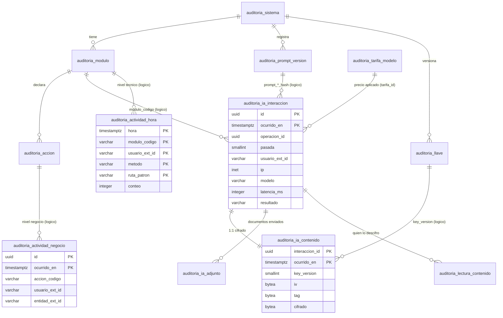

# Auditoría portable del uso de IA y de la actividad por módulo — Modelo de datos

- **Estado:** Propuesto (para discusión; nada de esto está implementado)
- **Épica:** Épica #14548
- **Decisión de arquitectura asociada:** `docs/adr/ADR-0042-auditoria-portable-uso-ia-y-actividad-por-modulo.md` (Propuesto)
- **Fecha:** 2026-11-11
- **Esquema de contrato:** `esquema_version = 1`

Este documento es **autocontenido**: lo puede leer y adoptar otro equipo que no conozca FLITO. Lo
específico de FLITO está solo en el §15, y en ningún otro lugar se da por sabido.

---

## 1. Qué resuelve y qué no

**Premisa.** Todo sistema del grupo tiene usuarios, usa OCR o IA, envía prompts y está dividido en
módulos, aunque estos se llamen distinto en cada uno. El modelo solo da por hecho eso.

**Preguntas que responde:**

1. ¿Qué se le pidió a la IA, quién, desde dónde (IP), en qué módulo, con qué modelo, qué respondió,
   cuánto tardó y cuánto costó?
2. ¿Cuántos usuarios entraron a cada módulo, a qué hora, quiénes fueron y qué hicieron? Se mide en
   dos niveles: **técnico** (automático, por método y patrón de ruta) y **de negocio** (acciones
   semánticas que cada módulo instrumenta).
3. ¿Qué módulos no usó nadie en un periodo?
4. ¿Quién leyó el contenido descifrado de una interacción de IA, y con qué motivo?

**Despliegue.** Cada sistema guarda estos datos **en su propia base de datos**, con **el mismo
esquema**. No hay almacén central. Como las tablas son idénticas, una consolidación futura sería una
exportación y no un rediseño, pero esa consolidación queda fuera de este alcance.

**Convive con** las auditorías que cada sistema ya tenga (bitácora de mutaciones, registro de
accesos a PII). No las sustituye.

**No es:**
- un APM o sistema de trazas: no guarda cuerpos de petición HTTP ni URLs;
- un almacén de documentos: de los archivos solo guarda hash, tipo y tamaño, nunca el binario;
- una herramienta de evaluación de desempeño laboral (ver §14).

---

## 2. Principios de diseño

| # | Principio | Consecuencia en el modelo |
|---|---|---|
| P1 | **Sin FK a tablas del sistema anfitrión** | El usuario es un `usuario_ext_id` opaco más una **copia del momento** (nombre y rol). El módulo es un código de catálogo propio. Borrar o renombrar un usuario en el sistema no altera la auditoría |
| P2 | **SQL estándar primero** | Los enumerados son `varchar` con `CHECK`, no tipos `ENUM` del motor. Las claves son `uuid` generados por el emisor. `jsonb` aparece solo en `metadatos` |
| P3 | **Solo se añaden filas** | Ningún evento se actualiza después de escrito. La única excepción es el agregado horario, que suma con un UPSERT. Así es seguro escribir desde varias réplicas |
| P4 | **Particionado mensual por fecha** | La purga es `DROP` de una partición, no un `DELETE` masivo. Las consultas por periodo leen solo las particiones del periodo |
| P5 | **Metadatos en claro, contenido cifrado** | Lo que hace falta para listar, contar y filtrar va en columnas legibles. Prompt y respuesta van en una tabla aparte, cifrados por fila |
| P6 | **La escritura nunca rompe la operación** | El emisor es asíncrono y por lotes. Si falla, se pierde el evento, se cuenta en una métrica y la operación de negocio sigue igual |
| P7 | **Leer el contenido falla cerrado** | Si no se puede registrar quién lee, no se descifra nada |
| P8 | **Minimización** | La IP se guarda solo donde se decidió (interacción de IA y lectura del contenido). La actividad técnica se agrega por hora y usuario, sin IP ni URL |

---

## 3. Entidades y relaciones



**Relaciones «lógicas» (sin FK declarada).** Las tablas de eventos, que son grandes y están
particionadas, **no** declaran FK hacia los catálogos ni entre ellas. Hay dos motivos:

1. Si un emisor manda un módulo que falta en el catálogo, una FK haría fallar el INSERT y el evento
   se perdería. Es preferible guardarlo y detectarlo después con la consulta de integridad del §11.9.
2. Una FK entre tablas particionadas impide hacer `DROP` de la partición referenciada antes que la
   de la tabla que la referencia, lo que ata el orden de purga. La purga ya respeta ese orden por sí
   misma (§12).

Las tablas de catálogo sí declaran sus FK, porque son pequeñas y no reciben escrituras continuas.

**Tablas**

| Tabla | Clase | Particionada | Qué guarda |
|---|---|---|---|
| `auditoria_sistema` | Catálogo | No | El sistema que escribe (en su BD, normalmente una sola fila) |
| `auditoria_modulo` | Catálogo | No | Módulos del sistema. Es la base del «módulo sin uso» |
| `auditoria_accion` | Catálogo | No | Acciones de negocio declaradas por módulo |
| `auditoria_prompt_version` | Catálogo | No | Plantillas de prompt por hash, con su texto y su vigencia |
| `auditoria_tarifa_modelo` | Catálogo | No | Precio por millón de tokens por modelo y vigencia, para el coste estimado |
| `auditoria_llave` | Catálogo | No | Versiones de la llave de cifrado, cada una con un canario |
| `auditoria_ia_interaccion` | Evento | Mensual | Una llamada a un modelo (o a un OCR local) con sus metadatos y su rendimiento |
| `auditoria_ia_contenido` | Evento | Mensual | Prompt y respuesta completos, cifrados. Relación 1:1 con la interacción |
| `auditoria_ia_adjunto` | Evento | Mensual | Documentos enviados en la interacción: hash, tipo, tamaño y páginas |
| `auditoria_actividad_hora` | Agregado | Mensual | Nivel técnico: conteo por hora, módulo, usuario, método, patrón de ruta y clase de estado |
| `auditoria_actividad_negocio` | Evento | Mensual | Nivel de negocio: una acción semántica |
| `auditoria_lectura_contenido` | Evento | No (se purga con `DELETE`) | Cada intento de descifrar contenido, con su motivo |

---

## 4. Identificación de usuario, sistema y módulo (sin FK al sistema)

**Usuario.** Cada evento lleva:

| Columna | Qué es |
|---|---|
| `actor_tipo` | `usuario` (persona autenticada), `sistema` (cron, cola o proceso interno) o `anonimo` (endpoint público) |
| `usuario_ext_id` | Identificador **opaco y estable** del usuario en el sistema anfitrión: su uuid o su id interno como texto. **Nunca** cédula, correo ni login. Es `NULL` si el actor no es `usuario` (en `auditoria_actividad_hora`, centinela; ver §5.9) |
| `usuario_nombre` | Copia del nombre visible **en el momento** del evento. Sirve para mostrar quién fue aunque el usuario cambie de nombre o se borre |
| `usuario_rol` | Copia del rol o perfil principal **en el momento** |
| `organizacion_ext_id` | Opcional. Id opaco del tenant, empresa o compañía, en sistemas multiempresa |

La copia del momento existe para que la auditoría no dependa de las tablas del sistema: si mañana se
borra el usuario, el registro sigue diciendo quién fue. Resolver el nombre con un JOIN al momento de
mostrarlo rompería esa garantía y ataría el esquema a cada sistema.

**Sistema.** `sistema_codigo` es un código corto en kebab-case (`flito`, `flit2`…) y está en todas
las filas. Aunque cada BD tenga un solo sistema, la columna permite una consolidación futura sin
reescribir los datos y blinda la AAD del cifrado (§9).

**Módulo.** `modulo_codigo` también es kebab-case, lo define cada sistema y debe existir en
`auditoria_modulo`. Hay un código reservado, `plataforma`, para lo que no pertenece a un módulo de
negocio: sesión, salud, crons transversales.

---

## 5. Diccionario de datos

Convenciones de las tablas:
- **PII:** `Sí` = dato personal; `Cuasi` = permite reidentificar si se cruza; `No`.
- **Cifr.:** `Sí` = cifrado en reposo a nivel de aplicación.
- Las fechas son `timestamptz`, en UTC.
- `ext_id` = identificador opaco del sistema anfitrión.

### 5.1 `auditoria_sistema`

| Columna | Tipo | Nulo | Descripción | PII | Cifr. |
|---|---|---|---|---|---|
| `sistema_codigo` | varchar(40) PK | No | Código del sistema (`^[a-z0-9][a-z0-9-]{1,39}$`) | No | No |
| `nombre` | varchar(120) | No | Nombre legible | No | No |
| `zona_horaria` | varchar(64) | No | Zona IANA para las franjas horarias (`America/Bogota`) | No | No |
| `creado_en` | timestamptz | No | Alta del registro | No | No |

### 5.2 `auditoria_modulo`

| Columna | Tipo | Nulo | Descripción | PII | Cifr. |
|---|---|---|---|---|---|
| `sistema_codigo` | varchar(40) PK, FK | No | Sistema | No | No |
| `modulo_codigo` | varchar(60) PK | No | Código del módulo (`^[a-z0-9][a-z0-9-]{1,59}$`) | No | No |
| `nombre` | varchar(120) | No | Nombre legible que se muestra en pantalla | No | No |
| `instrumenta_negocio` | boolean | No | `true` si el módulo emite acciones de negocio | No | No |
| `activo_desde` | date | No | Desde cuándo existe. Un módulo nuevo no cuenta como «sin uso» antes de esa fecha | No | No |
| `retirado_en` | date | Sí | Fecha de retiro. Un módulo retirado no se reporta como «sin uso» | No | No |

### 5.3 `auditoria_accion`

| Columna | Tipo | Nulo | Descripción | PII | Cifr. |
|---|---|---|---|---|---|
| `sistema_codigo` | varchar(40) PK | No | Sistema | No | No |
| `accion_codigo` | varchar(80) PK | No | `<modulo>.<objeto>.<verbo>` (p. ej. `soat.poliza.registrar`) | No | No |
| `modulo_codigo` | varchar(60) FK | No | Módulo al que pertenece | No | No |
| `descripcion` | varchar(200) | No | Qué significa, en lenguaje de negocio | No | No |
| `registrada_en` | timestamptz | No | Alta | No | No |
| `retirada_en` | timestamptz | Sí | Baja (el código no se reutiliza) | No | No |

### 5.4 `auditoria_prompt_version`

| Columna | Tipo | Nulo | Descripción | PII | Cifr. |
|---|---|---|---|---|---|
| `sistema_codigo` | varchar(40) PK | No | Sistema | No | No |
| `prompt_hash` | char(64) PK | No | SHA-256 hex del texto de la plantilla en UTF-8, sin normalizar | No | No |
| `clave` | varchar(120) | No | Nombre estable de la plantilla (`ocr.factura-soat`) | No | No |
| `rol` | varchar(10) | No | `sistema` o `usuario` | No | No |
| `texto` | text | No | Texto completo de la **plantilla**. Por contrato **no** contiene datos de personas | No | No |
| `bytes` | integer | No | Tamaño del texto | No | No |
| `vigente_desde` | timestamptz | No | Primera vez que se registró | No | No |
| `vigente_hasta` | timestamptz | Sí | Se llena cuando aparece una versión nueva con la misma `clave` | No | No |

La versión **se registra sola**: el emisor hace `INSERT … ON CONFLICT DO NOTHING` la primera vez
que ve un hash. Así ningún despliegue tiene que acordarse de darla de alta. El texto **interpolado**
(con datos del caso) nunca va aquí: va en el contenido cifrado (§5.8).

### 5.5 `auditoria_tarifa_modelo`

| Columna | Tipo | Nulo | Descripción | PII | Cifr. |
|---|---|---|---|---|---|
| `tarifa_id` | integer identity PK | No | Id | No | No |
| `proveedor` | varchar(40) | No | `anthropic`, `openai`, `local`… | No | No |
| `modelo` | varchar(100) | No | Id exacto del modelo según el proveedor | No | No |
| `vigente_desde` / `vigente_hasta` | timestamptz | No / Sí | Ventana de validez del precio | No | No |
| `moneda` | char(3) | No | ISO 4217 (`USD`) | No | No |
| `precio_entrada_mtok`, `precio_salida_mtok`, `precio_cache_lectura_mtok`, `precio_cache_escritura_mtok` | numeric(12,6) | No / Sí | Precio por millón de tokens | No | No |
| `fuente` | varchar(200) | Sí | De dónde sale el precio (página del proveedor, contrato) | No | No |

### 5.6 `auditoria_llave`

| Columna | Tipo | Nulo | Descripción | PII | Cifr. |
|---|---|---|---|---|---|
| `sistema_codigo` | varchar(40) PK | No | Sistema | No | No |
| `version` | smallint PK | No | Versión de la llave, desde 1 | No | No |
| `algoritmo` | varchar(20) | No | `AES-256-GCM` | No | No |
| `canario` | bytea | No | Constante cifrada con esa versión. Permite comprobar al arrancar que la llave cargada es la correcta | No | Sí |
| `creada_en` | timestamptz | No | Alta | No | No |
| `retirada_en` | timestamptz | Sí | Desde aquí no cifra; descifra hasta que se purga su último dato | No | No |

La llave **nunca** se guarda en la BD: aquí solo están su versión y su canario.

### 5.7 `auditoria_ia_interaccion` (particionada por `ocurrido_en`)

Hay una fila por **pasada**, es decir, por llamada a un modelo o a un motor local. Las pasadas de una
misma operación (por ejemplo, un OCR que hace Haiku, luego Sonnet y luego Tesseract) comparten
`operacion_id` y se numeran en `pasada`.

| Columna | Tipo | Nulo | Descripción | PII | Cifr. |
|---|---|---|---|---|---|
| `id` | uuid PK | No | **UUIDv7** generado por el emisor. Lleva el instante, lo que permite localizar la partición desde el id | No | No |
| `ocurrido_en` | timestamptz PK | No | Inicio de la llamada | No | No |
| `sistema_codigo` | varchar(40) | No | Sistema | No | No |
| `modulo_codigo` | varchar(60) | No | Módulo desde el que se pidió | No | No |
| `operacion_tipo` | varchar(40) | No | `ocr`, `biometria`, `checklist`, `clasificacion`, `chat`, `captcha`, `salud`… (lista abierta, kebab-case) | No | No |
| `operacion_id` | uuid | No | Correlaciona las pasadas de una misma operación de negocio | No | No |
| `pasada` | smallint | No | 1..20, en orden | No | No |
| `motivo_pasada` | varchar(40) | Sí | `inicial`, `escalamiento`, `reintento-parseo`, `respaldo-local`… | No | No |
| `correlacion_id` | uuid | Sí | Id de la petición HTTP o del trabajo que la originó. Cruza con `auditoria_actividad_negocio` | No | No |
| `actor_tipo` | varchar(10) | No | `usuario`, `sistema` o `anonimo` | No | No |
| `usuario_ext_id` | varchar(128) | Sí | Ver §4. Obligatorio si `actor_tipo = 'usuario'` | Cuasi | No |
| `usuario_nombre` | varchar(200) | Sí | Copia del momento | **Sí** | No (ver Q1) |
| `usuario_rol` | varchar(64) | Sí | Copia del momento | No | No |
| `organizacion_ext_id` | varchar(128) | Sí | Tenant opaco | No | No |
| `ip` | inet | Sí | IP de origen del usuario final (no la del proxy) | **Sí** | No |
| `proveedor` | varchar(40) | No | `anthropic`, `local`… | No | No |
| `modelo` | varchar(100) | No | Id exacto del modelo o del motor (`tesseract-5`) | No | No |
| `prompt_sistema_hash` | char(64) | Sí | Plantilla de sistema usada (§5.4) | No | No |
| `prompt_usuario_hash` | char(64) | Sí | Plantilla de usuario usada (§5.4) | No | No |
| `max_tokens` | integer | Sí | Tope pedido | No | No |
| `tokens_entrada`, `tokens_salida`, `tokens_cache_lectura`, `tokens_cache_escritura` | integer | Sí | Consumo que informa el proveedor. `NULL` si no lo informa | No | No |
| `latencia_ms` | integer | No | Tiempo total de la llamada, reintentos incluidos | No | No |
| `reintentos` | smallint | No | Reintentos que hizo el cliente | No | No |
| `coste_estimado` | numeric(14,6) | Sí | Tokens por tarifa vigente, calculado al escribir. `0` en motor local | No | No |
| `moneda` | char(3) | Sí | Moneda del coste | No | No |
| `tarifa_id` | integer | Sí | Tarifa aplicada (§5.5) | No | No |
| `resultado` | varchar(20) | No | `exito`, `error`, `timeout`, `sin-llave`, `no-parseable`, `rechazado` (límite o política), `cancelado` | No | No |
| `http_status` | smallint | Sí | Estado HTTP del proveedor | No | No |
| `codigo_error` | varchar(80) | Sí | Tipo de error del proveedor (`overloaded_error`…). Nunca el mensaje libre | No | No |
| `motivo_fin` | varchar(40) | Sí | `end_turn`, `max_tokens`… | No | No |
| `proveedor_request_id` | varchar(120) | Sí | Id de la petición del lado del proveedor, para soporte | No | No |
| `contenido_registrado` | boolean | No | `false` si por política no se guarda contenido (ver Q5) | No | No |
| `metadatos` | jsonb | Sí | Fuera de contrato (§8) | **Prohibido PII** | No |
| `esquema_version` | smallint | No | Versión del contrato con que se escribió | No | No |

### 5.8 `auditoria_ia_contenido` (particionada por `ocurrido_en`, 1:1 con la interacción)

| Columna | Tipo | Nulo | Descripción | PII | Cifr. |
|---|---|---|---|---|---|
| `interaccion_id` | uuid PK | No | = `auditoria_ia_interaccion.id` | No | No |
| `ocurrido_en` | timestamptz PK | No | = `auditoria_ia_interaccion.ocurrido_en` (misma partición) | No | No |
| `sistema_codigo` | varchar(40) | No | Entra en la AAD | No | No |
| `algoritmo` | varchar(20) | No | `AES-256-GCM` | No | No |
| `key_version` | smallint | No | Versión de llave con que se cifró | No | No |
| `iv` | bytea(12) | No | Nonce aleatorio de 96 bits, único por fila | No | No |
| `tag` | bytea(16) | No | Etiqueta de autenticación GCM | No | No |
| `cifrado` | bytea | No | Texto cifrado del sobre (abajo) | **Sí** | **Sí** |
| `compresion` | varchar(10) | No | `gzip` o `ninguna`. Se comprime **antes** de cifrar | No | No |
| `bytes_claro` | integer | No | Tamaño del sobre en claro, antes de comprimir | No | No |
| `formato_version` | smallint | No | Versión del formato del sobre | No | No |

**Sobre en claro (`formato_version = 1`)**, en JSON UTF-8:

```json
{
  "prompt_sistema": "<texto completo tal como se envió, interpolado>",
  "mensajes": [
    { "rol": "user", "partes": [
      { "tipo": "texto", "texto": "<prompt de usuario completo>" },
      { "tipo": "adjunto", "sha256": "<hex>", "mime": "application/pdf", "bytes": 482113 }
    ]}
  ],
  "parametros": { "max_tokens": 2000, "temperature": 0 },
  "respuesta_cruda": "<cuerpo de la respuesta del proveedor, tal cual, incluso si es un error>"
}
```

El emisor **reemplaza** cada bloque binario (imagen o PDF en base64) por su referencia `adjunto`
**antes** de cifrar. El binario nunca llega a esta tabla.

### 5.9 `auditoria_ia_adjunto` (particionada por `ocurrido_en`)

| Columna | Tipo | Nulo | Descripción | PII | Cifr. |
|---|---|---|---|---|---|
| `interaccion_id` | uuid PK | No | Interacción | No | No |
| `ocurrido_en` | timestamptz PK | No | Partición | No | No |
| `orden` | smallint PK | No | Posición en el mensaje, desde 1 | No | No |
| `sha256` | char(64) | No | Hash del binario tal como se envió | Cuasi | No |
| `mime` | varchar(100) | No | MIME **real** (por firma de bytes, no por extensión) | No | No |
| `bytes` | bigint | No | Tamaño | No | No |
| `paginas` | smallint | Sí | Páginas, si es PDF | No | No |

### 5.10 `auditoria_actividad_hora` (nivel técnico, agregado, particionada por `hora`)

Un **agregado por hora** hace dos trabajos: es la «entrada al módulo» (si hay fila, el usuario
estuvo en el módulo esa hora) y es el detalle técnico de qué hizo.

| Columna | Tipo | Nulo | Descripción | PII | Cifr. |
|---|---|---|---|---|---|
| `hora` | timestamptz PK | No | Inicio de la hora UTC (minutos y segundos en 0) | No | No |
| `sistema_codigo` | varchar(40) PK | No | Sistema | No | No |
| `modulo_codigo` | varchar(60) PK | No | Módulo | No | No |
| `usuario_ext_id` | varchar(128) PK | No | Id opaco, o los centinelas `~sistema` / `~anonimo` (empiezan por `~` para no chocar con un id real) | Cuasi | No |
| `metodo` | varchar(7) PK | No | `GET`, `POST`, `PUT`, `PATCH`, `DELETE` | No | No |
| `ruta_patron` | varchar(200) PK | No | Patrón de la ruta (`/api/x/:id`), **nunca** la URL. Si no hubo ruta casada, el centinela `<prefijo>/(sin_ruta)` | No | No |
| `status_clase` | varchar(8) PK | No | `2xx`, `3xx`, `4xx`, `5xx` o `cerrada` (el cliente cortó) | No | No |
| `actor_tipo` | varchar(10) | No | Coherente con `usuario_ext_id` | No | No |
| `usuario_nombre` | varchar(200) | Sí | Última copia vista en la hora | **Sí** | No |
| `usuario_rol` | varchar(64) | Sí | Última copia vista en la hora | No | No |
| `organizacion_ext_id` | varchar(128) | Sí | Tenant | No | No |
| `conteo` | integer | No | Peticiones en el grupo (>0) | No | No |
| `latencia_total_ms` | bigint | No | Suma, para calcular el promedio | No | No |
| `latencia_max_ms` | integer | No | Máximo | No | No |
| `primera_en` / `ultima_en` | timestamptz | No | Primer y último instante dentro de la hora. Dan el minuto exacto de la entrada | No | No |

Sin IP (P8, ver Q2). Si el anfitrión trabaja con husos de horas enteras, como Colombia (UTC−5 sin
horario de verano), la hora UTC se convierte limpia a la franja local.

### 5.11 `auditoria_actividad_negocio` (nivel de negocio, particionada por `ocurrido_en`)

| Columna | Tipo | Nulo | Descripción | PII | Cifr. |
|---|---|---|---|---|---|
| `id` | uuid PK | No | UUIDv7 | No | No |
| `ocurrido_en` | timestamptz PK | No | Instante de la acción | No | No |
| `sistema_codigo` | varchar(40) | No | Sistema | No | No |
| `modulo_codigo` | varchar(60) | No | Módulo | No | No |
| `accion_codigo` | varchar(80) | No | Acción del catálogo (§5.3) | No | No |
| `actor_tipo`, `usuario_ext_id`, `usuario_nombre`, `usuario_rol`, `organizacion_ext_id` | (como §5.7) | | Ver §4 | Cuasi / Sí | No |
| `entidad_tipo` | varchar(60) | Sí | Tipo del objeto afectado (`poliza`, `tramite`) | No | No |
| `entidad_ext_id` | varchar(128) | Sí | Id **opaco** del objeto. **Nunca** placa, cédula, NIT ni número de documento | Cuasi | No |
| `resultado` | varchar(12) | No | `ok`, `rechazado` (regla de negocio) o `error` | No | No |
| `duracion_ms` | integer | Sí | Duración, si aplica | No | No |
| `correlacion_id` | uuid | Sí | Petición o trabajo de origen. Cruza con las interacciones de IA | No | No |
| `metadatos` | jsonb | Sí | Fuera de contrato (§8) | **Prohibido PII** | No |
| `esquema_version` | smallint | No | Versión del contrato | No | No |

### 5.12 `auditoria_lectura_contenido` (no particionada)

| Columna | Tipo | Nulo | Descripción | PII | Cifr. |
|---|---|---|---|---|---|
| `id` | uuid PK | No | UUIDv7 | No | No |
| `leido_en` | timestamptz | No | Instante del intento | No | No |
| `sistema_codigo` | varchar(40) | No | Sistema | No | No |
| `lector_ext_id` | varchar(128) | No | Quién pidió descifrar | Cuasi | No |
| `lector_nombre` / `lector_rol` | varchar(200) / varchar(64) | Sí | Copia del momento | Sí / No | No |
| `ip` | inet | Sí | IP del lector | **Sí** | No |
| `interaccion_id` / `interaccion_ocurrido_en` | uuid / timestamptz | No | Qué se intentó leer | No | No |
| `motivo` | varchar(300) | No | Justificación escrita por el lector (≥10 caracteres, ver Q8) | Posible | No |
| `resultado` | varchar(20) | No | `entregado`, `denegado` o `error-descifrado` | No | No |

---

## 6. DDL de referencia (PostgreSQL ≥ 13)

Es idempotente en lo posible. Las particiones son de ejemplo: un proceso diario (§12) crea las
siguientes. **No** hay partición `DEFAULT`, por dos razones: con datos dentro impediría adjuntar
particiones nuevas, y escondería que el proceso diario dejó de correr. Una fila sin partición hace
fallar el INSERT, el emisor lo cuenta (P6) y la alerta lo detecta.

```sql
-- ───────────── Catálogos ─────────────
CREATE TABLE IF NOT EXISTS auditoria_sistema (
  sistema_codigo varchar(40)  PRIMARY KEY CHECK (sistema_codigo ~ '^[a-z0-9][a-z0-9-]{1,39}$'),
  nombre         varchar(120) NOT NULL,
  zona_horaria   varchar(64)  NOT NULL DEFAULT 'America/Bogota',
  creado_en      timestamptz  NOT NULL DEFAULT now()
);

CREATE TABLE IF NOT EXISTS auditoria_modulo (
  sistema_codigo      varchar(40)  NOT NULL REFERENCES auditoria_sistema (sistema_codigo),
  modulo_codigo       varchar(60)  NOT NULL CHECK (modulo_codigo ~ '^[a-z0-9][a-z0-9-]{1,59}$'),
  nombre              varchar(120) NOT NULL,
  instrumenta_negocio boolean      NOT NULL DEFAULT false,
  activo_desde        date         NOT NULL DEFAULT current_date,
  retirado_en         date,
  PRIMARY KEY (sistema_codigo, modulo_codigo),
  CONSTRAINT auditoria_modulo_retiro_ck CHECK (retirado_en IS NULL OR retirado_en >= activo_desde)
);

CREATE TABLE IF NOT EXISTS auditoria_accion (
  sistema_codigo varchar(40)  NOT NULL,
  accion_codigo  varchar(80)  NOT NULL CHECK (accion_codigo ~ '^[a-z0-9-]+(\.[a-z0-9-]+){2,}$'),
  modulo_codigo  varchar(60)  NOT NULL,
  descripcion    varchar(200) NOT NULL,
  registrada_en  timestamptz  NOT NULL DEFAULT now(),
  retirada_en    timestamptz,
  PRIMARY KEY (sistema_codigo, accion_codigo),
  FOREIGN KEY (sistema_codigo, modulo_codigo) REFERENCES auditoria_modulo (sistema_codigo, modulo_codigo)
);

CREATE TABLE IF NOT EXISTS auditoria_prompt_version (
  sistema_codigo varchar(40)  NOT NULL REFERENCES auditoria_sistema (sistema_codigo),
  prompt_hash    char(64)     NOT NULL CHECK (prompt_hash ~ '^[0-9a-f]{64}$'),
  clave          varchar(120) NOT NULL,
  rol            varchar(10)  NOT NULL CHECK (rol IN ('sistema', 'usuario')),
  texto          text         NOT NULL,
  bytes          integer      NOT NULL CHECK (bytes >= 0),
  vigente_desde  timestamptz  NOT NULL DEFAULT now(),
  vigente_hasta  timestamptz,
  PRIMARY KEY (sistema_codigo, prompt_hash),
  CONSTRAINT auditoria_prompt_vigencia_ck CHECK (vigente_hasta IS NULL OR vigente_hasta >= vigente_desde)
);
CREATE INDEX IF NOT EXISTS auditoria_prompt_clave_idx
  ON auditoria_prompt_version (sistema_codigo, clave, vigente_desde DESC);

CREATE TABLE IF NOT EXISTS auditoria_tarifa_modelo (
  tarifa_id                    integer GENERATED BY DEFAULT AS IDENTITY PRIMARY KEY,
  proveedor                    varchar(40)  NOT NULL,
  modelo                       varchar(100) NOT NULL,
  vigente_desde                timestamptz  NOT NULL,
  vigente_hasta                timestamptz,
  moneda                       char(3)      NOT NULL DEFAULT 'USD',
  precio_entrada_mtok          numeric(12,6) NOT NULL CHECK (precio_entrada_mtok >= 0),
  precio_salida_mtok           numeric(12,6) NOT NULL CHECK (precio_salida_mtok >= 0),
  precio_cache_lectura_mtok    numeric(12,6) CHECK (precio_cache_lectura_mtok >= 0),
  precio_cache_escritura_mtok  numeric(12,6) CHECK (precio_cache_escritura_mtok >= 0),
  fuente                       varchar(200),
  CONSTRAINT auditoria_tarifa_vigencia_ck CHECK (vigente_hasta IS NULL OR vigente_hasta > vigente_desde),
  CONSTRAINT auditoria_tarifa_uk UNIQUE (proveedor, modelo, vigente_desde)
);

CREATE TABLE IF NOT EXISTS auditoria_llave (
  sistema_codigo varchar(40) NOT NULL REFERENCES auditoria_sistema (sistema_codigo),
  version        smallint    NOT NULL CHECK (version >= 1),
  algoritmo      varchar(20) NOT NULL DEFAULT 'AES-256-GCM' CHECK (algoritmo IN ('AES-256-GCM')),
  canario        bytea       NOT NULL,
  creada_en      timestamptz NOT NULL DEFAULT now(),
  retirada_en    timestamptz,
  PRIMARY KEY (sistema_codigo, version)
);

-- ───────────── Interacciones de IA ─────────────
CREATE TABLE IF NOT EXISTS auditoria_ia_interaccion (
  id                     uuid         NOT NULL,
  ocurrido_en            timestamptz  NOT NULL,
  sistema_codigo         varchar(40)  NOT NULL,
  modulo_codigo          varchar(60)  NOT NULL,
  operacion_tipo         varchar(40)  NOT NULL CHECK (operacion_tipo ~ '^[a-z0-9-]{2,40}$'),
  operacion_id           uuid         NOT NULL,
  pasada                 smallint     NOT NULL DEFAULT 1 CHECK (pasada BETWEEN 1 AND 20),
  motivo_pasada          varchar(40),
  correlacion_id         uuid,
  actor_tipo             varchar(10)  NOT NULL CHECK (actor_tipo IN ('usuario', 'sistema', 'anonimo')),
  usuario_ext_id         varchar(128),
  usuario_nombre         varchar(200),
  usuario_rol            varchar(64),
  organizacion_ext_id    varchar(128),
  ip                     inet,
  proveedor              varchar(40)  NOT NULL,
  modelo                 varchar(100) NOT NULL,
  prompt_sistema_hash    char(64),
  prompt_usuario_hash    char(64),
  max_tokens             integer      CHECK (max_tokens > 0),
  tokens_entrada         integer      CHECK (tokens_entrada >= 0),
  tokens_salida          integer      CHECK (tokens_salida >= 0),
  tokens_cache_lectura   integer      CHECK (tokens_cache_lectura >= 0),
  tokens_cache_escritura integer      CHECK (tokens_cache_escritura >= 0),
  latencia_ms            integer      NOT NULL CHECK (latencia_ms >= 0),
  reintentos             smallint     NOT NULL DEFAULT 0 CHECK (reintentos >= 0),
  coste_estimado         numeric(14,6) CHECK (coste_estimado >= 0),
  moneda                 char(3),
  tarifa_id              integer,
  resultado              varchar(20)  NOT NULL CHECK (resultado IN
                           ('exito', 'error', 'timeout', 'sin-llave', 'no-parseable', 'rechazado', 'cancelado')),
  http_status            smallint,
  codigo_error           varchar(80),
  motivo_fin             varchar(40),
  proveedor_request_id   varchar(120),
  contenido_registrado   boolean      NOT NULL DEFAULT true,
  metadatos              jsonb,
  esquema_version        smallint     NOT NULL DEFAULT 1,
  PRIMARY KEY (ocurrido_en, id),
  CONSTRAINT auditoria_ia_actor_ck CHECK ((actor_tipo = 'usuario') = (usuario_ext_id IS NOT NULL)),
  CONSTRAINT auditoria_ia_coste_ck CHECK (coste_estimado IS NULL OR moneda IS NOT NULL),
  CONSTRAINT auditoria_ia_metadatos_ck CHECK (metadatos IS NULL
    OR (jsonb_typeof(metadatos) = 'object' AND octet_length(metadatos::text) <= 4096))
) PARTITION BY RANGE (ocurrido_en);

CREATE INDEX IF NOT EXISTS auditoria_ia_usuario_idx   ON auditoria_ia_interaccion (usuario_ext_id, ocurrido_en DESC);
CREATE INDEX IF NOT EXISTS auditoria_ia_modulo_idx    ON auditoria_ia_interaccion (modulo_codigo, ocurrido_en DESC);
CREATE INDEX IF NOT EXISTS auditoria_ia_modelo_idx    ON auditoria_ia_interaccion (modelo, prompt_usuario_hash, ocurrido_en);
CREATE INDEX IF NOT EXISTS auditoria_ia_operacion_idx ON auditoria_ia_interaccion (operacion_id);

CREATE TABLE IF NOT EXISTS auditoria_ia_contenido (
  interaccion_id  uuid        NOT NULL,
  ocurrido_en     timestamptz NOT NULL,
  sistema_codigo  varchar(40) NOT NULL,
  algoritmo       varchar(20) NOT NULL DEFAULT 'AES-256-GCM' CHECK (algoritmo IN ('AES-256-GCM')),
  key_version     smallint    NOT NULL CHECK (key_version >= 1),
  iv              bytea       NOT NULL CHECK (octet_length(iv) = 12),
  tag             bytea       NOT NULL CHECK (octet_length(tag) = 16),
  cifrado         bytea       NOT NULL,
  compresion      varchar(10) NOT NULL DEFAULT 'gzip' CHECK (compresion IN ('gzip', 'ninguna')),
  bytes_claro     integer     NOT NULL CHECK (bytes_claro >= 0),
  formato_version smallint    NOT NULL DEFAULT 1,
  PRIMARY KEY (ocurrido_en, interaccion_id)
) PARTITION BY RANGE (ocurrido_en);

CREATE TABLE IF NOT EXISTS auditoria_ia_adjunto (
  interaccion_id uuid         NOT NULL,
  ocurrido_en    timestamptz  NOT NULL,
  orden          smallint     NOT NULL CHECK (orden >= 1),
  sha256         char(64)     NOT NULL CHECK (sha256 ~ '^[0-9a-f]{64}$'),
  mime           varchar(100) NOT NULL,
  bytes          bigint       NOT NULL CHECK (bytes >= 0),
  paginas        smallint     CHECK (paginas >= 1),
  PRIMARY KEY (ocurrido_en, interaccion_id, orden)
) PARTITION BY RANGE (ocurrido_en);
CREATE INDEX IF NOT EXISTS auditoria_ia_adjunto_hash_idx ON auditoria_ia_adjunto (sha256);

-- ───────────── Actividad ─────────────
CREATE TABLE IF NOT EXISTS auditoria_actividad_hora (
  hora                timestamptz  NOT NULL,
  sistema_codigo      varchar(40)  NOT NULL,
  modulo_codigo       varchar(60)  NOT NULL,
  usuario_ext_id      varchar(128) NOT NULL,
  metodo              varchar(7)   NOT NULL CHECK (metodo IN ('GET', 'POST', 'PUT', 'PATCH', 'DELETE')),
  ruta_patron         varchar(200) NOT NULL,
  status_clase        varchar(8)   NOT NULL CHECK (status_clase IN ('2xx', '3xx', '4xx', '5xx', 'cerrada')),
  actor_tipo          varchar(10)  NOT NULL CHECK (actor_tipo IN ('usuario', 'sistema', 'anonimo')),
  usuario_nombre      varchar(200),
  usuario_rol         varchar(64),
  organizacion_ext_id varchar(128),
  conteo              integer      NOT NULL CHECK (conteo > 0),
  latencia_total_ms   bigint       NOT NULL CHECK (latencia_total_ms >= 0),
  latencia_max_ms     integer      NOT NULL CHECK (latencia_max_ms >= 0),
  primera_en          timestamptz  NOT NULL,
  ultima_en           timestamptz  NOT NULL,
  PRIMARY KEY (hora, sistema_codigo, modulo_codigo, usuario_ext_id, metodo, ruta_patron, status_clase),
  CONSTRAINT auditoria_act_hora_ck CHECK (extract(minute FROM hora) = 0 AND extract(second FROM hora) = 0),
  CONSTRAINT auditoria_act_ventana_ck CHECK (primera_en >= hora AND ultima_en < hora + interval '1 hour'
                                             AND ultima_en >= primera_en),
  CONSTRAINT auditoria_act_actor_ck CHECK (
       (actor_tipo = 'usuario' AND usuario_ext_id NOT LIKE '~%')
    OR (actor_tipo = 'sistema' AND usuario_ext_id = '~sistema')
    OR (actor_tipo = 'anonimo' AND usuario_ext_id = '~anonimo'))
) PARTITION BY RANGE (hora);
CREATE INDEX IF NOT EXISTS auditoria_act_modulo_idx  ON auditoria_actividad_hora (modulo_codigo, hora);
CREATE INDEX IF NOT EXISTS auditoria_act_usuario_idx ON auditoria_actividad_hora (usuario_ext_id, hora);

CREATE TABLE IF NOT EXISTS auditoria_actividad_negocio (
  id                  uuid         NOT NULL,
  ocurrido_en         timestamptz  NOT NULL,
  sistema_codigo      varchar(40)  NOT NULL,
  modulo_codigo       varchar(60)  NOT NULL,
  accion_codigo       varchar(80)  NOT NULL,
  actor_tipo          varchar(10)  NOT NULL CHECK (actor_tipo IN ('usuario', 'sistema', 'anonimo')),
  usuario_ext_id      varchar(128),
  usuario_nombre      varchar(200),
  usuario_rol         varchar(64),
  organizacion_ext_id varchar(128),
  entidad_tipo        varchar(60),
  entidad_ext_id      varchar(128),
  resultado           varchar(12)  NOT NULL CHECK (resultado IN ('ok', 'rechazado', 'error')),
  duracion_ms         integer      CHECK (duracion_ms >= 0),
  correlacion_id      uuid,
  metadatos           jsonb,
  esquema_version     smallint     NOT NULL DEFAULT 1,
  PRIMARY KEY (ocurrido_en, id),
  CONSTRAINT auditoria_neg_actor_ck CHECK ((actor_tipo = 'usuario') = (usuario_ext_id IS NOT NULL)),
  CONSTRAINT auditoria_neg_metadatos_ck CHECK (metadatos IS NULL
    OR (jsonb_typeof(metadatos) = 'object' AND octet_length(metadatos::text) <= 4096))
) PARTITION BY RANGE (ocurrido_en);
CREATE INDEX IF NOT EXISTS auditoria_neg_modulo_idx  ON auditoria_actividad_negocio (modulo_codigo, ocurrido_en);
CREATE INDEX IF NOT EXISTS auditoria_neg_usuario_idx ON auditoria_actividad_negocio (usuario_ext_id, ocurrido_en DESC);
CREATE INDEX IF NOT EXISTS auditoria_neg_accion_idx  ON auditoria_actividad_negocio (accion_codigo, ocurrido_en);
CREATE INDEX IF NOT EXISTS auditoria_neg_correl_idx  ON auditoria_actividad_negocio (correlacion_id)
  WHERE correlacion_id IS NOT NULL;

-- ───────────── Lecturas del contenido ─────────────
CREATE TABLE IF NOT EXISTS auditoria_lectura_contenido (
  id                      uuid         PRIMARY KEY,
  leido_en                timestamptz  NOT NULL DEFAULT now(),
  sistema_codigo          varchar(40)  NOT NULL,
  lector_ext_id           varchar(128) NOT NULL,
  lector_nombre           varchar(200),
  lector_rol              varchar(64),
  ip                      inet,
  interaccion_id          uuid         NOT NULL,
  interaccion_ocurrido_en timestamptz  NOT NULL,
  motivo                  varchar(300) NOT NULL CHECK (char_length(btrim(motivo)) >= 10),
  resultado               varchar(20)  NOT NULL CHECK (resultado IN ('entregado', 'denegado', 'error-descifrado'))
);
CREATE INDEX IF NOT EXISTS auditoria_lectura_fecha_idx       ON auditoria_lectura_contenido (leido_en);
CREATE INDEX IF NOT EXISTS auditoria_lectura_interaccion_idx ON auditoria_lectura_contenido (interaccion_id);
CREATE INDEX IF NOT EXISTS auditoria_lectura_lector_idx      ON auditoria_lectura_contenido (lector_ext_id, leido_en DESC);

-- ───────────── Particiones (ejemplo: noviembre de 2026; el proceso diario crea las siguientes) ─────────────
CREATE TABLE IF NOT EXISTS auditoria_ia_interaccion_p2026_11 PARTITION OF auditoria_ia_interaccion
  FOR VALUES FROM ('2026-11-01 00:00:00+00') TO ('2026-12-01 00:00:00+00');
CREATE TABLE IF NOT EXISTS auditoria_ia_contenido_p2026_11 PARTITION OF auditoria_ia_contenido
  FOR VALUES FROM ('2026-11-01 00:00:00+00') TO ('2026-12-01 00:00:00+00');
CREATE TABLE IF NOT EXISTS auditoria_ia_adjunto_p2026_11 PARTITION OF auditoria_ia_adjunto
  FOR VALUES FROM ('2026-11-01 00:00:00+00') TO ('2026-12-01 00:00:00+00');
CREATE TABLE IF NOT EXISTS auditoria_actividad_hora_p2026_11 PARTITION OF auditoria_actividad_hora
  FOR VALUES FROM ('2026-11-01 00:00:00+00') TO ('2026-12-01 00:00:00+00');
CREATE TABLE IF NOT EXISTS auditoria_actividad_negocio_p2026_11 PARTITION OF auditoria_actividad_negocio
  FOR VALUES FROM ('2026-11-01 00:00:00+00') TO ('2026-12-01 00:00:00+00');
```

**Notas del DDL.**
- Los meses se cortan en **UTC**. En Colombia eso hace que las 19:00–23:59 del último día del mes,
  hora local, caigan en la partición del mes siguiente. No afecta las consultas, porque filtran por
  rango; solo cambia qué partición se lee.
- El UPSERT del agregado horario (`ON CONFLICT (…PK…) DO UPDATE SET conteo = t.conteo +
  EXCLUDED.conteo, …`) funciona sobre tablas particionadas porque la PK incluye la columna de
  partición.
- `id` como UUIDv7 permite derivar `ocurrido_en` aproximado (precisión de ms) desde el id. Así un
  endpoint `…/:id` poda particiones sin pedir la fecha.

---

## 7. Mapeo de tipos a otros motores

| PostgreSQL | MySQL 8 | SQL Server 2019+ | Nota |
|---|---|---|---|
| `uuid` | `BINARY(16)` (con `UUID_TO_BIN(x, 0)`) o `CHAR(36)` | `uniqueidentifier` | UUIDv7 lo genera la aplicación. En SQL Server, `uniqueidentifier` ordena por bytes distintos: si importa la localidad del índice, usar `BINARY(16)` |
| `timestamptz` (UTC) | `DATETIME(3)` en UTC por convención (`TIMESTAMP` tiene el límite de 2038) | `datetime2(3)` en UTC, o `datetimeoffset(3)` | La aplicación escribe siempre en UTC |
| `varchar(n)` + `CHECK` | `VARCHAR(n)` + `CHECK` (se aplica desde 8.0.16) | `nvarchar(n)` + `CHECK` | No usar `ENUM` |
| regex `~` en `CHECK` | `REGEXP_LIKE()` en `CHECK` | Sin regex nativa: `LIKE` con clases, o validar en el emisor | El emisor valida igual |
| `text` | `MEDIUMTEXT` | `nvarchar(max)` | |
| `bytea` | `VARBINARY(n)` para iv/tag, `LONGBLOB` para `cifrado` | `varbinary(16)` / `varbinary(max)` | |
| `inet` | `VARBINARY(16)` (`INET6_ATON`) o `VARCHAR(45)` | `varbinary(16)` o `varchar(45)` | |
| `jsonb` | `JSON` | `nvarchar(max)` + `CHECK (ISJSON(metadatos) = 1)` | Tope de 4 KB con `LENGTH` / `DATALENGTH` |
| `numeric(p,s)` | `DECIMAL(p,s)` | `decimal(p,s)` | |
| `integer GENERATED … AS IDENTITY` | `INT AUTO_INCREMENT` | `int IDENTITY(1,1)` | |
| `PARTITION BY RANGE` mensual | `PARTITION BY RANGE COLUMNS(ocurrido_en)`. La PK y **toda** UNIQUE deben incluir la columna (ya la incluyen). Sin FK en tablas particionadas (ya no las hay) | `PARTITION FUNCTION` + `PARTITION SCHEME`; purga con `TRUNCATE TABLE … WITH (PARTITIONS (n))` o `SWITCH` | Si el motor no particiona, purgar con `DELETE` por lotes de 10 000 |
| `percentile_cont(...) WITHIN GROUP` | No existe: calcular con `ROW_NUMBER()` sobre el conteo, o en la aplicación | `PERCENTILE_CONT(...) WITHIN GROUP (...) OVER (PARTITION BY …)` (solo como función de ventana) | Ver §11.6 |
| `ON CONFLICT … DO UPDATE` | `INSERT … ON DUPLICATE KEY UPDATE` | `MERGE` con `HOLDLOCK` | |

---

## 8. Campo `metadatos` (fuera de contrato)

- Es un objeto JSON de hasta 4 KB, para datos que un sistema necesita y el contrato no cubre:
  versión del cliente, número de páginas detectadas, confianza promedio, nombre del motor de
  respaldo…
- **Prohibido** meter PII o cuasi-PII: cédula, placa, nombre, NIT, correo, teléfono, dirección, URL
  o texto libre del usuario. El emisor aplica una lista de claves **permitidas** por sistema y
  descarta las demás. No intenta adivinar qué es PII.
- Ninguna consulta del contrato (§11) lee `metadatos`. Si un dato se vuelve necesario para todos los
  sistemas, se promueve a columna con `esquema_version` + 1.

---

## 9. Modelo de cifrado (portable)

**Qué se cifra:** solo `auditoria_ia_contenido.cifrado`, es decir, el sobre con el prompt de sistema
interpolado, los mensajes de usuario, los parámetros y la respuesta cruda. Todo lo demás va en
claro, para poder filtrar y agregar (P5).

**Algoritmo:** AES-256-GCM, con nonce aleatorio de 96 bits por fila y etiqueta de 128 bits. El sobre
se comprime con gzip **antes** de cifrar. El riesgo clásico de comprimir antes de cifrar (inferir el
contenido por el tamaño, como en CRIME o BREACH) exige que un atacante inyecte texto y observe
tamaños en línea, y no aplica a datos en reposo de lectura restringida. Aun así, `compresion =
'ninguna'` está disponible.

**AAD (datos asociados autenticados)**, que es texto UTF-8:

```
auditoria_ia_contenido|cifrado|<sistema_codigo>|<interaccion_id>|<ocurrido_en en ms epoch>|<key_version>|<formato_version>
```

Ata cada texto cifrado a **su** fila. Copiar el `cifrado` de una fila a otra, cambiar la versión de
llave o mover el sobre entre sistemas hace fallar el descifrado. La llave sola no basta.

**Llaves:**
- 32 bytes por versión, entregados por el gestor de secretos del ambiente (KMS, sealed secret,
  vault). **Nunca** se guardan en la BD ni en el repositorio.
- `auditoria_llave` registra versión y canario. Al arrancar, el emisor descifra el canario de la
  versión vigente: si no puede, **no cifra** y marca `contenido_registrado = false` en lugar de
  escribir basura. Los metadatos se siguen guardando.
- **Rotación sin recifrar:** se crea la versión N+1, los escritores pasan a usarla y la N queda
  `retirada_en` (solo descifra). Como el contenido se purga a los `RETENCION` meses, al cumplirse
  ese plazo no queda ninguna fila con la N y la llave se puede destruir. El recifrado solo hace
  falta ante una llave **comprometida**. En ese caso se recifran las filas de la N con un proceso
  por lotes, que usa la misma AAD con la versión nueva.
- **Alternativa compatible:** el cifrado de sobre con una llave de datos por fila envuelta por una
  llave maestra en un KMS. El esquema no cambia (la llave envuelta iría en `metadatos` o en una
  columna nueva con `formato_version = 2`). No es el modelo por defecto porque añade una llamada al
  KMS por escritura.

**Qué NO garantiza:** frente a un DBA con la llave, nada. Frente a una copia de la BD o un dump
sin la llave, el contenido es ilegible. Los metadatos (quién, cuándo, IP, modelo) **sí** quedan
legibles en un dump. Por eso la IP y el nombre se tratan como PII en el control de acceso (§13).

---

## 10. Retención y purga

**Supuesto (discutible):** la retención es un parámetro **por ambiente**, en una **variable de
entorno**, no en una tabla editable desde la pantalla.

| Variable | Defecto | Rango | Qué gobierna |
|---|---|---|---|
| `AUDITORIA_RETENTION_MONTHS` | 3 | 1–24 | Lo que se **muestra** (las consultas filtran `>= now() - N meses`) y lo que se **almacena** (particiones) de las cinco tablas de eventos |
| `AUDITORIA_LECTURAS_RETENTION_MONTHS` | 12 | 3–60 | `auditoria_lectura_contenido` (ver Q3) |

**Por qué variable de entorno:** reducir la retención borra evidencia de forma irreversible. Con
la variable, ese cambio pasa por el control de cambios del despliegue (commit revisado, secreto o
configuración del ambiente) en lugar de quedar a un clic de quien tiene permiso de administración,
que puede ser justo la persona auditada. La contrapartida es que cambiarla exige reiniciar o
redesplegar.

**Proceso diario de purga y particiones** (uno por sistema, con cerrojo para que solo lo ejecute una
réplica):

1. **Asegura particiones** del mes en curso y de los 2 siguientes, para las cinco tablas. También
   corre al arrancar.
2. **Purga por partición:** `DROP` de toda partición cuyo **límite superior** sea `<=
   date_trunc('month', now() UTC) - N meses`. El orden es contenido → adjunto → interacción, y luego
   actividad. Así se almacena **como mínimo N meses y como máximo N+1**. Lo que se muestra es
   exactamente N, porque lo recorta el filtro de lectura.
3. **Freno:** si una corrida fuera a eliminar más de 2 particiones por tabla (por ejemplo, porque la
   variable bajó de 12 a 3), **no** las elimina, registra el hecho y exige una ejecución manual
   explícita. Así un error de configuración no borra un año.
4. `auditoria_lectura_contenido`: `DELETE … WHERE leido_en < now() - M meses`, por lotes.
5. Los catálogos no se purgan. `auditoria_prompt_version` es pequeña y no lleva PII por contrato.

---

## 11. Consultas de ejemplo (PostgreSQL)

`$desde` y `$hasta` son instantes UTC; `$tz` sale de `auditoria_sistema.zona_horaria`. Todas
filtran además por la ventana de retención mostrada:
`AND <fecha> >= now() - make_interval(months => $retencion)`.

### 11.1 Usuarios distintos por módulo y periodo
```sql
SELECT m.modulo_codigo, m.nombre,
       count(DISTINCT a.usuario_ext_id) FILTER (WHERE a.actor_tipo = 'usuario') AS usuarios,
       coalesce(sum(a.conteo), 0)                                            AS peticiones
FROM auditoria_modulo m
LEFT JOIN auditoria_actividad_hora a
       ON a.sistema_codigo = m.sistema_codigo AND a.modulo_codigo = m.modulo_codigo
      AND a.hora >= $desde AND a.hora < $hasta
WHERE m.sistema_codigo = $sistema
GROUP BY m.modulo_codigo, m.nombre
ORDER BY usuarios DESC;
```

### 11.2 Uso por franja horaria (hora local)
```sql
SELECT extract(hour FROM a.hora AT TIME ZONE $tz)::int AS franja,
       count(DISTINCT a.usuario_ext_id)                AS usuarios,
       sum(a.conteo)                                   AS peticiones
FROM auditoria_actividad_hora a
WHERE a.sistema_codigo = $sistema AND a.modulo_codigo = $modulo
  AND a.actor_tipo = 'usuario' AND a.hora >= $desde AND a.hora < $hasta
GROUP BY franja ORDER BY franja;
```

### 11.3 Quién entró a un módulo X (y cuándo)
```sql
SELECT a.usuario_ext_id,
       (array_agg(a.usuario_nombre ORDER BY a.ultima_en DESC))[1] AS nombre,
       (array_agg(a.usuario_rol    ORDER BY a.ultima_en DESC))[1] AS rol,
       min(a.primera_en)                 AS primera_entrada,
       max(a.ultima_en)                  AS ultima_actividad,
       count(DISTINCT date_trunc('day', a.hora AT TIME ZONE $tz)) AS dias_con_uso,
       sum(a.conteo)                     AS peticiones
FROM auditoria_actividad_hora a
WHERE a.sistema_codigo = $sistema AND a.modulo_codigo = $modulo
  AND a.actor_tipo = 'usuario' AND a.hora >= $desde AND a.hora < $hasta
GROUP BY a.usuario_ext_id
ORDER BY ultima_actividad DESC;
```

### 11.4 Acciones de un usuario (negocio y técnico en una línea de tiempo)
```sql
SELECT n.ocurrido_en AS cuando, 'negocio' AS nivel, n.modulo_codigo, n.accion_codigo AS que,
       n.resultado, 1 AS veces, n.entidad_tipo
FROM auditoria_actividad_negocio n
WHERE n.sistema_codigo = $sistema AND n.usuario_ext_id = $usuario
  AND n.ocurrido_en >= $desde AND n.ocurrido_en < $hasta
UNION ALL
SELECT a.primera_en, 'tecnico', a.modulo_codigo, a.metodo || ' ' || a.ruta_patron,
       a.status_clase, a.conteo, NULL
FROM auditoria_actividad_hora a
WHERE a.sistema_codigo = $sistema AND a.usuario_ext_id = $usuario
  AND a.hora >= $desde AND a.hora < $hasta
ORDER BY cuando DESC
LIMIT 500;
```

### 11.5 Módulos sin uso en el periodo
```sql
SELECT m.modulo_codigo, m.nombre, m.activo_desde
FROM auditoria_modulo m
WHERE m.sistema_codigo = $sistema
  AND m.activo_desde <= ($hasta AT TIME ZONE $tz)::date
  AND (m.retirado_en IS NULL OR m.retirado_en > ($desde AT TIME ZONE $tz)::date)
  AND NOT EXISTS (SELECT 1 FROM auditoria_actividad_hora a
                  WHERE a.sistema_codigo = m.sistema_codigo AND a.modulo_codigo = m.modulo_codigo
                    AND a.actor_tipo = 'usuario' AND a.hora >= $desde AND a.hora < $hasta)
ORDER BY m.modulo_codigo;
```

### 11.6 Coste y latencia p95 por modelo y versión de prompt
```sql
SELECT i.proveedor, i.modelo, p.clave AS prompt, left(i.prompt_usuario_hash, 12) AS version,
       count(*)                                                      AS llamadas,
       count(*) FILTER (WHERE i.resultado <> 'exito')                AS fallidas,
       sum(i.coste_estimado)                                         AS coste,
       percentile_cont(0.95) WITHIN GROUP (ORDER BY i.latencia_ms)   AS p95_ms,
       avg(i.tokens_entrada)::int AS tokens_entrada_prom, avg(i.tokens_salida)::int AS tokens_salida_prom
FROM auditoria_ia_interaccion i
LEFT JOIN auditoria_prompt_version p
       ON p.sistema_codigo = i.sistema_codigo AND p.prompt_hash = i.prompt_usuario_hash
WHERE i.sistema_codigo = $sistema AND i.ocurrido_en >= $desde AND i.ocurrido_en < $hasta
GROUP BY i.proveedor, i.modelo, p.clave, i.prompt_usuario_hash
ORDER BY coste DESC NULLS LAST;
```
En MySQL se reemplaza `percentile_cont` por un `ROW_NUMBER()` sobre `latencia_ms` dentro de cada
grupo, tomando la fila `ceil(0.95 * n)`. En SQL Server, por `PERCENTILE_CONT(0.95) WITHIN GROUP
(ORDER BY latencia_ms) OVER (PARTITION BY modelo, prompt_usuario_hash)` con un `DISTINCT` externo.

### 11.7 Interacciones de IA de un usuario, con su IP
```sql
SELECT i.id, i.ocurrido_en, i.modulo_codigo, i.operacion_tipo, i.operacion_id, i.pasada,
       i.modelo, i.ip, i.latencia_ms, i.coste_estimado, i.resultado, i.contenido_registrado
FROM auditoria_ia_interaccion i
WHERE i.sistema_codigo = $sistema AND i.usuario_ext_id = $usuario
  AND i.ocurrido_en >= $desde AND i.ocurrido_en < $hasta
ORDER BY i.ocurrido_en DESC
LIMIT 200;
```

### 11.8 Cadena de pasadas de una operación
```sql
SELECT pasada, motivo_pasada, proveedor, modelo, resultado, latencia_ms, coste_estimado
FROM auditoria_ia_interaccion
WHERE operacion_id = $operacion
ORDER BY pasada;
```

### 11.9 Integridad (eventos con módulo, acción o prompt fuera de catálogo)
```sql
SELECT 'modulo' AS tipo, i.modulo_codigo AS codigo, count(*) FROM auditoria_ia_interaccion i
WHERE i.ocurrido_en >= now() - interval '1 day'
  AND NOT EXISTS (SELECT 1 FROM auditoria_modulo m
                  WHERE m.sistema_codigo = i.sistema_codigo AND m.modulo_codigo = i.modulo_codigo)
GROUP BY 1, 2
UNION ALL
SELECT 'contenido-huerfano', c.interaccion_id::text, 1 FROM auditoria_ia_contenido c
WHERE c.ocurrido_en >= now() - interval '1 day'
  AND NOT EXISTS (SELECT 1 FROM auditoria_ia_interaccion i
                  WHERE i.ocurrido_en = c.ocurrido_en AND i.id = c.interaccion_id);
```

---

## 12. Volumen estimado e impacto

Las cifras son **supuestos de órdenes de magnitud**. Cada sistema debe sustituirlos con sus métricas
reales (en FLITO: el contador de llamadas a IA y el agregado de rutas existente; ver Q12).

| Tabla | Supuesto (escenario medio) | Filas por 90 días | Tamaño aprox. con índices |
|---|---|---|---|
| `auditoria_ia_interaccion` | 3 000 llamadas/día | 270 000 | ~250 MB (~600 B/fila más 4 índices) |
| `auditoria_ia_contenido` | 1 por interacción; sobre de ~15 KB en claro → ~5 KB comprimido y cifrado | 270 000 | **~1,4 GB** (TOAST) |
| `auditoria_ia_adjunto` | 1,3 por interacción | 350 000 | ~60 MB |
| `auditoria_actividad_hora` | 200 usuarios × 6 h × 2 módulos × 8 combinaciones | 1,7 M | ~500 MB |
| `auditoria_actividad_negocio` | 200 usuarios × 50 acciones | 900 000 | ~350 MB |
| **Total** | | | **~2,5 GB** estables (se purga lo que entra) |

**Escenario alto** (×5 en IA, por OCR masivo): ~8 GB, dominado por el contenido. **Escenario bajo**
(÷5): menos de 1 GB.

**Impacto:**
- **Escritura:** cientos de filas por minuto en lotes. Es despreciable frente a la latencia de la IA
  (segundos por llamada) y frente a la base transaccional.
- **Lectura:** las consultas del §11 leen 1–4 particiones y usan índices por (módulo|usuario,
  fecha). La p95 (§11.6) recorre las interacciones del periodo, unas 270 000 filas en 3 meses:
  cientos de ms. Es una pantalla de consulta, no un tablero en tiempo real.
- **Respaldos:** el contenido cifrado entra en los volcados. Restaurar un volcado en otro ambiente
  **no** lo hace legible sin la llave de ese ambiente: es lo deseado.
- **Lo que mueve la aguja:** el prompt de sistema se repite en cada sobre (P5 lo guarda completo,
  como se decidió). Guardarlo solo por hash cuando no está interpolado bajaría el contenido entre un
  30 % y un 60 % (Q14).

---

## 13. Quién lee qué (dos permisos) y registro de la lectura

| Permiso | Qué habilita | Qué **no** habilita |
|---|---|---|
| **P-METADATOS** («ver auditoría de uso») | Listados y agregados de las consultas §11.1–11.9, incluida la IP y la copia del nombre | Descifrar el contenido |
| **P-CONTENIDO** («ver prompt y respuesta») | Descifrar el contenido de **una** interacción a la vez, con motivo | Exportar en lote. No hay endpoint de descifrado masivo |

- P-CONTENIDO **exige** P-METADATOS: sin la lista no hay nada que abrir.
- Los dos son permisos **por función**, no nombres de rol. Cada sistema decide qué perfil los
  recibe. La recomendación es que nadie tenga P-CONTENIDO por defecto: se asigna de forma explícita
  y nominal.
- **Flujo de lectura del contenido (falla cerrado):**
  1. Se verifican P-METADATOS y P-CONTENIDO. Si falta alguno, se registra
     `resultado = 'denegado'` en un intento con mejor esfuerzo y se responde 403.
  2. Se inserta la fila de `auditoria_lectura_contenido` con `resultado = 'entregado'`, **antes** de
     descifrar y de forma **síncrona**. Si el INSERT falla, se responde 503 y **no** se descifra.
  3. Se descifra. Si falla (AAD o llave), se actualiza esa fila a `error-descifrado` y se responde
     un error sin detalle.
  4. La respuesta no se cachea (`Cache-Control: no-store`) y nada del contenido va al log.
- Los listados que proyectan IP o nombre se registran en el log de acceso a PII **del sistema**, si
  lo tiene, con fallo abierto. Es la misma clase que una bandeja.
- **Filtros con PII o cuasi-PII** (usuario, IP, entidad) van en el **cuerpo** de un `POST …/buscar`,
  nunca en la query de la URL. Los ids opacos (uuid de la interacción) sí pueden ir en el path.

---

## 14. Riesgos frente a la Ley 1581 de 2012 (Habeas Data) y su decreto reglamentario

| Riesgo | Por qué | Mitigación en el modelo | Lo que el modelo **no** resuelve |
|---|---|---|---|
| **IP y seguimiento individual de empleados** | La IP y el registro por persona de qué hizo y a qué hora son datos personales del empleado, y permiten un perfilamiento laboral | La IP solo se guarda en la IA y en la lectura del contenido. La actividad se agrega por hora, sin IP ni URL. Retención de 3 meses. Permiso P-METADATOS nominal | La **finalidad** declarada (seguridad, control de costes, auditoría) y el **aviso a los empleados** en la política de tratamiento son tarea de Legal o del oficial de privacidad. Usar estos datos para evaluar desempeño exige una base distinta (Q16) |
| **Respuestas OCR con cédulas, nombres y placas de titulares** (conductores, propietarios) | El sobre contiene, en claro antes de cifrar, datos personales de terceros que no son usuarios del sistema | Cifrado por fila con AAD. Permiso separado y nominal. Lectura una a una, con motivo y fallo cerrado. Retención corta. El binario del documento nunca se guarda | Si el titular pide la **supresión**, no hay búsqueda por cédula (el contenido está cifrado). Solo se puede localizar por id de operación o por hash del documento si el sistema los conserva. La retención corta es la mitigación principal (Q15) |
| **Biometría** (cotejo facial) | El resultado y el razonamiento del modelo sobre una cara son un dato sensible (Art. 5) | Las imágenes no se guardan, solo su hash. Q5 propone **no** guardar contenido de `operacion_tipo = 'biometria'` (`contenido_registrado = false`) | Decisión del humano |
| **Hash de documentos** | Un hash permite comprobar si alguien envió *ese* archivo | Requiere tener el archivo para compararlo; su utilidad es la trazabilidad | Se acepta |
| **Metadatos legibles en un volcado** | Nombre, IP y módulo están en claro | Los volcados tienen el control de acceso propio de la BD | Si se exige cifrar también el nombre, la búsqueda por nombre se pierde (Q1) |
| **Texto libre en `motivo` y `metadatos`** | Pueden colarse datos | `metadatos` con lista de claves permitidas. `motivo` acotado a 300 caracteres, con la instrucción en pantalla de no escribir datos de personas | La revisión humana |
| **Registro de bases de datos** | Una base nueva con datos de empleados y de titulares | Inventario de este documento | Verificar con el oficial de privacidad si hace falta actualizar el Registro Nacional de Bases de Datos o el inventario interno |

---

## 15. Cómo lo adopta otro sistema

### 15.1 Contrato de escritura

El sistema implementa (o reutiliza) un **emisor** con tres operaciones. Los nombres son
orientativos; lo que se exige son los campos.

```
registrarInteraccionIA({
  id: uuidv7, ocurridoEn, moduloCodigo, operacionTipo, operacionId, pasada, motivoPasada?,
  correlacionId?, actor: {tipo, extId?, nombre?, rol?, organizacionExtId?}, ip?,
  proveedor, modelo, promptSistema: {clave, plantilla, interpolado}, promptUsuario: {clave, plantilla, interpolado},
  mensajes (con binarios), parametros, respuestaCruda, uso: {entrada, salida, cacheLectura, cacheEscritura}?,
  latenciaMs, reintentos, resultado, httpStatus?, codigoError?, motivoFin?, proveedorRequestId?, metadatos?
})
registrarPeticion({ moduloCodigo, actor, metodo, rutaPatron, statusClase, latenciaMs, instante })   // nivel técnico
registrarAccion({ id: uuidv7, ocurridoEn, moduloCodigo, accionCodigo, actor, entidadTipo?, entidadExtId?,
                  resultado, duracionMs?, correlacionId?, metadatos? })                            // nivel negocio
```

El emisor, **no** el llamador, es quien:
- calcula el SHA-256 de las plantillas y las registra si son nuevas;
- reemplaza los binarios por `{sha256, mime, bytes}` y llena `auditoria_ia_adjunto`;
- calcula el coste con la tarifa vigente;
- comprime, cifra con la AAD del §9 y escribe interacción + adjuntos + contenido **en una misma
  transacción** (o nada);
- agrega las peticiones por la PK horaria en memoria y las vuelca con UPSERT cada 30–60 s o cada
  1 000 grupos;
- filtra `metadatos` por la lista de claves permitidas.

### 15.2 Garantías

| Garantía | Detalle |
|---|---|
| **Asíncrono** | Las llamadas encolan en memoria y vuelven de inmediato. La escritura va por lotes, fuera del camino de la petición |
| **Un fallo no rompe la operación** | Ninguna operación del emisor lanza excepción al llamador. Si la BD falla, el lote se reintenta una vez y luego se descarta |
| **Cola acotada** | Tope de memoria (p. ej. 5 000 eventos o 50 MB). Al desbordar, se descarta lo más viejo y se cuenta |
| **Semántica** | *Como máximo una vez* (at-most-once). La pérdida se **mide**: contador `auditoria_eventos_descartados_total{tabla,motivo}` y alerta si supera el 0,1 % diario (Q4) |
| **Varias réplicas** | Los eventos son inserts con uuid propio, y el agregado suma con UPSERT. Sin coordinación entre réplicas |
| **Apagado ordenado** | En el cierre del proceso, vaciado con plazo (p. ej. 5 s) |
| **Sin PII en logs** | El emisor nunca registra en log el contenido, la IP ni el nombre. Solo tabla, conteo y tipo de error |
| **Cobertura total de IA** | Toda llamada a un modelo pasa por **un solo cliente** que llama al emisor. Una prueba automática falla si el host del proveedor aparece fuera de ese cliente |

### 15.3 Lista de adopción

1. Aplicar el DDL del §6 (traducido con el §7) y sembrar `auditoria_sistema`, `auditoria_modulo` y
   `auditoria_accion`.
2. Elegir el `usuario_ext_id` (siempre el id interno opaco) y de dónde sale la copia del nombre.
3. Implementar el emisor y el cliente único de IA, con la prueba de «host fuera del cliente».
4. Un middleware de peticiones que dé `modulo_codigo` y `ruta_patron` **sin leer la URL** (por la
   tabla de prefijos del sistema más el patrón de la ruta casada) y que tome `actor` al **terminar**
   la petición, cuando la autenticación ya se resolvió.
5. Un contexto de petición (almacenamiento local asíncrono o equivalente) para que el cliente de IA
   obtenga actor, IP, módulo y `correlacion_id` sin cambiar la firma de cada llamador. Los procesos
   sin petición (crons) declaran `actor_tipo = 'sistema'` y su módulo.
6. Crear las dos variables de retención y el proceso diario del §10.
7. Crear los dos permisos del §13 y la pantalla. Comprobar que las consultas del §11 corren.

### 15.4 Lo propio de FLITO

Está en `docs/adr/ADR-0042-auditoria-portable-uso-ia-y-actividad-por-modulo.md`, sección «Mapeo a
FLITO». Allí se detallan el punto único de IA, los siete puntos de llamada a migrar, el middleware,
el archivo de esquema, la migración, el cifrado con el anillo de llaves existente y los permisos.

---

## 16. Preguntas abiertas para la discusión

> **Decisión (12-nov-2026, David Alejandro Chica Hernández):** se aceptan las propuestas por
> defecto de **Q1–Q14** tal como están en la tabla. Las bloqueantes de F1 (Q1, Q4, Q5, Q7, Q9)
> quedan cerradas. **Q15** y **Q16** siguen pendientes con Legal y son condición para activar en
> PDN, no para desarrollar.

| # | Pregunta | Propuesta por defecto |
|---|---|---|
| Q1 | ¿El nombre del usuario se guarda en claro como copia del momento, o solo el id, resolviendo el nombre al mostrar? | En claro: es la condición de «sin FK» y de la búsqueda por nombre |
| Q2 | ¿También se guarda la IP en la actividad (entrada al módulo), no solo en la IA? | No (minimización). Si se quiere, `ip_ultima` en el agregado horario |
| Q3 | ¿Cuánto se guarda el registro de quién descifró contenido? | 12 meses, más que el dato, porque es la auditoría de la auditoría |
| Q4 | ¿Se acepta perder eventos (at-most-once, medido) o se exige garantía? | Se acepta, como dice el requisito («un fallo no rompe la operación»). Garantizarlo exigiría una bandeja de salida transaccional por llamada |
| Q5 | ¿Se guarda el contenido de las operaciones biométricas? | No: metadatos sí y `contenido_registrado = false` |
| Q6 | ¿Se registran los sondeos de salud de la IA y la resolución de captcha? | Sí, en el módulo `plataforma` con `actor_tipo = 'sistema'`. Tienen coste |
| Q7 | ¿Llave propia de la auditoría o el anillo de llaves de PII existente? | En FLITO, el anillo existente (ver el ADR) |
| Q8 | ¿El motivo al descifrar es obligatorio? | Sí, de 10 a 300 caracteres |
| Q9 | ¿Qué perfiles reciben cada permiso? | P-METADATOS: admin. P-CONTENIDO: nadie por defecto, asignación nominal |
| Q10 | ¿Cuál es el catálogo inicial de acciones de negocio de los cuatro módulos de FLITO? | Una HU por módulo, con el PO, de 5 a 10 acciones cada una |
| Q11 | ¿La granularidad horaria basta para «a qué hora entró»? | Sí. `primera_en` da el minuto exacto de la primera petición de la hora |
| Q12 | ¿Cuál es el volumen real de llamadas a IA y de usuarios activos? | Medirlo en PDN antes de dimensionar |
| Q13 | ¿Las franjas se muestran en la zona horaria del sistema o en la del usuario? | La del sistema (`America/Bogota`) |
| Q14 | ¿El prompt de sistema va completo en cada sobre o solo por hash cuando no está interpolado? | Completo, como está decidido. El hash sería una optimización si el volumen real lo pide |
| Q15 | ¿Cómo se atiende una solicitud de supresión de un titular sobre el contenido de IA? | Por la retención corta, más un borrado por `operacion_id` si el módulo lo conserva. Confirmarlo con Legal |
| Q16 | ¿Está cubierto el aviso a empleados en la política de tratamiento? | Pendiente con Legal antes de activar en PDN |
