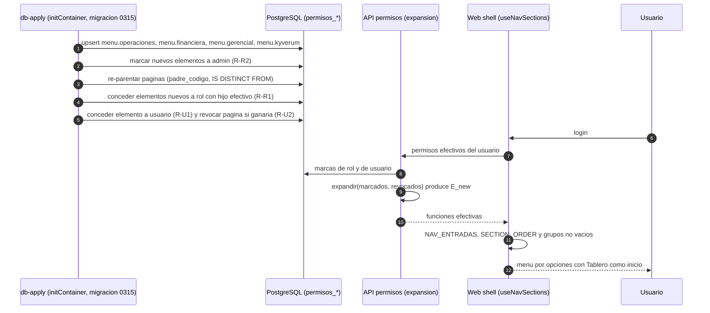

# Diseño — Menú de FLITO por áreas de la empresa (Épica #14678)

- **Modo:** full (cambia el árbol de permisos y una migración de roles y usuarios).
- **ADR:** `docs/adr/ADR-0048-navegacion-por-areas.md` (Propuesto).
- **Mapa:** FINAL, aprobado por el humano el 2026-11-24 tras la retroalimentación de Andrés (PO).
- **Estado del diseño:** CON-OBSERVACIONES. El mapa está cerrado; quedan páginas sin leer en código, que PR1 verifica («Lo que valida PR1»).
- **Trazabilidad:** la Épica #14678 no tiene Features ni HUs. Sin HUs no hay rama ni PR de producto (AGENTS, Git flow). El tipo Epic no tiene `Custom.Commits` ni `DeployDEV`.

---

## Contexto

Pedido (Épica #14678): reemplazar el agrupamiento del menú por dominios por ocho áreas, en este orden: Operaciones, Financiera, Comercial, Diseño, Tecnología, Infraestructura, Producto, Gerencial. Rutas, pantallas y funciones no cambian. Un área sin entradas visibles no se muestra. Deep links y Command Palette apuntan al área nueva. Sin pantallas, iconos ni landings nuevos. Facturación y Cotización FLIT 2.0 quedan fuera (Cotización no existe como entrada de menú).

**Desviación decidida por el PO:** el menú final tiene, además de las áreas, dos opciones que no son áreas de la empresa: **Kyverum** (módulos legacy, pedido de Andrés) y **Administración** (opción propia, no subgrupo de Operaciones). Ayuda queda fuera, al final.

Decisiones tomadas (no se reabren): alcance = presentación + árbol de permisos; mapa final (sección 2.2); áreas vacías ocultas; expand → contract; landing = Tablero explícito; PRs en serie; `menu.administracion` se reutiliza.

### Verificado en el código (lectura en esta sesión)

| Qué | Dónde | Hecho |
|---|---|---|
| Tipo de sección | `apps/web/src/components/shell/navEntradas.ts` (`NavItem.section`, l. ~21) | Unión de 12 valores: general, torre, gestion, transito, flota, mantenimiento, pesv, rndc, laft, finanzas, admin, ayuda. Hay que añadir `kyverum` y las áreas nuevas. |
| Orden de secciones | `navEntradas.ts` (`SECTION_ORDER`, l. ~26) | Orden fijo; el menú lo recorre en ese orden. |
| Entradas | `navEntradas.ts` (`NAV_ENTRADAS`, l. ~65–204) | La primera entrada es `dashboard` (`/`, sección general). Las de Torre van al final «a propósito» porque `rutaInicio` toma la primera permitida. |
| Rótulos | `apps/web/src/components/shell/navItems.ts` | `ELEMENTO_DE_SECCION` mapea sección → `menu.*`. `SECTION_LABEL` sale del nombre del elemento en `ELEMENTOS_PERMISOS`. `ROTULO_SIN_ELEMENTO` solo tiene torre → «Torre de Control». `etiquetaDeRuta` lo usa `NoAccess`. |
| Filtro de áreas vacías | `apps/web/src/components/shell/useNavSections.ts` | Agrupa por `SECTION_ORDER` y descarta grupos con `items.length === 0`. Ya oculta áreas vacías. |
| Elementos del árbol | `packages/shared-types/src/permisos-arbol/elementos.ts` | `menu.general` 10, `gestion` 20, `transito` 30, `flota` 40, `mantenimiento` 50, `pesv` 60, `rndc` 70, `laft` 80, `finanzas` 90, `administracion` 100, `ayuda` 110 (derivado, sin permiso propio), `perfil` 120. |
| Composición | `permisos-arbol/index.ts` | `ARBOL_PERMISOS = [...ELEMENTOS_PERMISOS, ...ARBOL_ITEMS_Y_ACCIONES]`. Cada `ItemDef` cuelga de `menu.${elemento}` (`nodos.ts`, `itemsANodos`). |
| Ítems de Gestión, Tránsito y Clientes | `permisos-arbol/gestion.ts` | `flito_tramites`, `flito_soat`, `flito_impuestos`, `flito_derechos`, `flito_revisiones`, `flito_logistica`, `flito_logistica_ruta`, `flito_comparendos` → `gestion`. `clients` y `flito_bitacora` → `gestion`. `transito_organismos` → `transito` (pasará a `administracion`). |
| Ítems de Finanzas | `permisos-arbol/finanzas.ts` | `finanzas_reporte_costos`, `finanzas_gastos_diarios`, `flito_bolsas`, `flito_tarifas`, `flito_servicios_adicionales`, `flito_comprobantes`, `flito_conciliacion` → `finanzas`. El archivo sigue después de la línea 60 (no leído). |
| Tablero | `permisos-arbol/general.ts` | `dashboard` → `general`, con la acción `ver`. |
| Siigo (`siigo_credenciales`) | `navEntradas.ts` | Sección `admin` (hoy en `menu.administracion`). Pasa a `menu.financiera`. |
| Catálogo | `apps/api/src/modules/permisos/catalogo.ts`, `catalogoCompleto` (~l. 360–430) | Los roles de cada `menu.*` se **derivan** de sus páginas hijas; no hay lista literal. Las filas de elemento se generan desde `ELEMENTOS_PERMISOS` (no derivados). `modulo` del elemento = `codigo.slice(5)`. |
| Reparto posterior | `catalogo.ts`, `REPARTO_POSTERIOR_AL_ARBOL` | Aplica `proveedor` y `REPARTO_TORRE` **después** de derivar los roles de elementos y páginas (hipótesis R7). |
| Expansión | `apps/api/src/modules/permisos/arbol/expansion.ts` (`claseDe`, `efectivoDeNodos`, `expandir`) | `efectivo(n) = n ∈ M ∧ (padre(n) = null ∨ efectivo(padre(n)))`. Los `revocados` se restan de `M = R ∪ C`. |
| Migración de referencia | `apps/api/src/db/migrations/0240_permisos_sueltos_a_su_item.sql` | Tablas y columnas: `permisos_funciones(codigo, modulo, nombre_negocio, descripcion, tipo, padre_codigo, nivel, orden)`, `permisos_rol_funcion(rol_codigo, funcion_codigo)`, `permisos_usuario_funcion(user_id, funcion_codigo, efecto)` con `conceder`/`revocar`, `permisos_roles(codigo)`, `users(id)`. Upsert con `IS DISTINCT FROM`. El paso 2b marca a `admin` con `JOIN permisos_roles`. |
| Regla de admin | ADR-0022 (citado en ADR-0023) | Toda función sembrada en migración ≥ 0225 marca a `admin` **en el mismo archivo**; su test lo exige. |
| Legado por permiso | ADR-0023 (Propuesto, 2026-10-07) | Una página por ítem del menú legacy (PESV ~19 ítems y mantenimiento 3 en esa fecha); acciones «Administrar <ítem>» transitorias; `legado: true` en `nodos.ts`. |
| Ayuda | `apps/web/src/content/ayuda/catalogo.ts` (`GRUPOS_ORDEN`, l. ~75) | `['general','torre','gestion','transito','finanzas','administracion']`. Independiente de `SECTION_ORDER`. Se conserva en esta Épica. |
| Numeración | `apps/api/src/db/migrations/` | Última 0314. Siguiente libre 0315 (se numera al integrar). |
| ADRs | `docs/adr/` | Última ADR-0047 (hay dos archivos con ese número; anomalía previa, no la toca este diseño). Siguiente libre: **ADR-0048**. |

### No verificado en código

- `navEntradas.ts` l. 80–180: entradas de Tránsito (Bandeja), Flota, Mantenimiento, PESV, RNDC, LAFT, Administración (privacidad, drive, usuarios, roles, log PII) y Siigo (`siigo_parametrizacion`, `siigo_operacion`).
- Slugs de LAFT (`laft`, `laft_unusual`, `laft_trainings`, `laft_manual`, `laft_oficial`, `laft_audit_plan`, `laft_dashboard`), PESV (25 entradas), RNDC (`rndc`, `rndc_admin`) y mantenimiento (`maintenance_inicio`, `maintenance_ordenes`, `maintenance_indicadores`) y flota (`fleet`): aportados por el humano, no comprobados en código.
- `permisos-arbol/torre.ts`, `administracion.ts`, `legado.ts`, `dr-flit.ts`, `perfil.ts`, y `finanzas.ts` después de la línea 60.
- `lib/permissions.ts` (`rutaInicio`; chunk de /login con presupuesto `check:bundle`), CommandPalette, `iconosNav.ts`, `sectionMeta.ts`, `permisos-efectivos.ts`, `arbol/sql-legado.ts`, `arbol/reparto-sueltos.ts`, `arbol/acciones-torre.ts`.
- Esquema Drizzle de permisos (`src/db/schema/`) y si el contrato OpenAPI describe enumeraciones de códigos.
- Lista exacta de tests (los nombres vienen del brief).

---

## 1. Alternativas

### 1.a Presentación separada de permisos (solo web) vs árbol por opción

- **Opción A — solo presentación.** Solo cambian `section` y `SECTION_ORDER` en la web. El árbol no cambia.
  - Pros: cero migración; cero pérdidas o ganancias; revertible con un commit; esfuerzo S.
  - Contras: el panel «Roles y permisos» sigue mostrando los dominios viejos. Admin concede por dominio y usuario ve por opción. No cumple el alcance decidido.
  - Riesgo: divergencia permanente entre lo que se concede y lo que se ve.
- **Opción B — árbol por opción, expand → contract (recomendada y aprobada).** Nuevos `menu.*`, re-parentado de páginas, migración de marcas y excepciones de usuario, viejos deprecados.
  - Pros: un solo modelo; alcance decidido; el panel muestra las opciones.
  - Contras: migración con riesgo de ganancias y pérdidas; contrato compartido cambia; PR1 pide verificación fuerte.
  - Esfuerzo: M–L, tres PRs. Riesgos: sección 3 y «Lo que valida PR1».
- **Opción C — migración directa** (renombrar códigos o mover padres sin expansión y borrar los viejos). Rompe marcas y deep links de permisos; pérdidas no controladas; rollback imposible. Rechazada por expand → contract.

### 1.b Dónde vive la agrupación: código vs BD

- **c1. Todo en código.** Rechazada: el resolutor corre en la API y la BD es la verdad de las marcas.
- **c2. Todo en BD.** Rechazada: tabla y migración para algo que cambia poco, y duplica el árbol.
- **c3. Híbrido (recomendada).** El padre en el árbol (BD + `shared-types`) decide el permiso. El orden de opciones, los rótulos y el riel de subgrupos viven en código. Un test de consistencia une los dos: para cada `NAV_ENTRADAS`, la sección coincide con el elemento padre del `pagina.*` en `ARBOL_PERMISOS`.

### 1.c Subgrupos

- **Nivel de grupo en el árbol.** Rechazado. Rompe la invariante elemento → ítem → acción que usan `expansion.ts`, `efectivoDeNodos`, `catalogoCompleto` y el panel.
- **Riel de subgrupos en el panel, solo presentación (aprobada).** Un mapa `página → subgrupo` en la web. Solo Kyverum lo necesita (43 entradas, 7 subgrupos: Tránsito, Flota, Mantenimiento, PESV, RNDC, LAFT, Trámites). Operaciones (11) y Administración (7) van en lista plana.

---

## 2. Decisión y modelo de datos del árbol

### 2.1 Elementos (`menu.*`)

| Código | Nombre (rótulo) | `orden` | `padre` | Entradas | Estado en PR1 |
|---|---|---|---|---|---|
| `menu.operaciones` | Operaciones | 10 | null | 11 | **Nuevo** |
| `menu.financiera` | Financiera | 20 | null | 10 | **Nuevo** |
| `menu.gerencial` | Gerencial | 30 | null | 9 | **Nuevo** |
| `menu.kyverum` | Kyverum | 40 | null | 43 | **Nuevo** |
| `menu.administracion` | Administración | 100 | null | 7 | **Reutilizado** (sin cambio de código ni de nombre; entra `transito_organismos`, sale Siigo) |
| `menu.general` | General | 10 | null | 0 en menú (queda `flito_dr_flit`) | Sin cambio; fuera de áreas |
| `menu.ayuda` | Ayuda | 110 | null | derivado | Sin cambio; fuera de áreas |
| `menu.perfil` | Perfil | 120 | null | 0 en menú | Sin cambio; fuera de áreas |

El panel ordena por grupo de presentación (opciones del menú, luego «fuera de áreas»), no por `orden` global. El orden de la presentación es: Operaciones, Financiera, Gerencial, Kyverum, Administración, Ayuda. Comercial, Diseño, Tecnología, Infraestructura y Producto no tienen `menu.*` hasta que tengan entradas.

Total de entradas de menú en las opciones con entradas: 11 + 10 + 9 + 43 + 7 = 80.

### 2.2 Mapa de páginas (`pagina.*`): menú actual → menú nuevo

Leyenda de confianza: **V** = verificado en el código o en una decisión cerrada; **H** = sección o slug no leídos en código, o aportado por el humano. **D** = decidido por el humano (2026-11-24).

| Slug / página | Menú actual (árbol) | Sección hoy (menú) | Menú nuevo | Conf. |
|---|---|---|---|---|
| **Operaciones (11)** | | | | |
| `vehicles` (Vehículos) | `menu.gestion` (H) | gestion | `menu.operaciones` | D |
| `clients` (Clientes y proveedores) | `menu.gestion` | gestion | `menu.operaciones` | V (`gestion.ts`); D |
| `flito_tramites`, `flito_derechos`, `flito_revisiones`, `flito_bitacora`, `flito_comparendos`, `flito_logistica`, `flito_logistica_ruta`, `flito_soat`, `flito_impuestos` | `menu.gestion` | gestion | `menu.operaciones` | V (`gestion.ts`); D |
| **Financiera (10)** | | | | |
| `finanzas_reporte_costos`, `finanzas_gastos_diarios`, `flito_bolsas`, `flito_tarifas`, `flito_servicios_adicionales`, `flito_comprobantes`, `flito_conciliacion` | `menu.finanzas` | finanzas | `menu.financiera` | V (`finanzas.ts`); D |
| `siigo_parametrizacion`, `siigo_operacion` | `menu.finanzas` (H) | finanzas | `menu.financiera` | H (slug aportado); D |
| `siigo_credenciales` | `menu.administracion` | admin | `menu.financiera` | V (sección admin); D. Sale de `menu.administracion`. |
| **Gerencial (9)** | | | | |
| `dashboard` (Tablero) | `menu.general` | general | `menu.gerencial` | V (`general.ts`); D |
| `torre_360`, `torre_comercial`, `torre_operativa`, `torre_productos`, `torre_logistica`, `torre_financiera`, `torre_explorador`, `torre_umbrales` | `menu.general` (según brief) | torre / admin (umbrales) | `menu.gerencial` | V en menú; H en árbol (`torre.ts` no leído); D |
| **Kyverum (43)** | | | | |
| `transito` (Bandeja de trámites) | `menu.transito` (H) | transito | `menu.kyverum` | H; D |
| `fleet` (Flota) | `menu.flota` (H) | flota | `menu.kyverum` | H; D |
| `maintenance_inicio`, `maintenance_ordenes`, `maintenance_indicadores` (Mantenimiento, 3) | `menu.mantenimiento` (H) | mantenimiento | `menu.kyverum` | H; D. ADR-0023: un permiso de página por ítem. |
| PESV (25 entradas, una página por ítem) | `menu.pesv` (H) | pesv | `menu.kyverum` | H; D. ADR-0023 registró ~19 ítems en 2026-10-07. Recuento a verificar en PR1. |
| `rndc` (RNDC, Remesas, Manifiestos, Maestros; 4 entradas) | `menu.rndc` (H) | rndc | `menu.kyverum` | H; D |
| `rndc_admin` | `menu.rndc` (H) | rndc | `menu.kyverum` | H; D |
| `laft`, `laft_unusual`, `laft_trainings`, `laft_manual`, `laft_oficial`, `laft_audit_plan`, `laft_dashboard` (7) | `menu.laft` (H) | laft | `menu.kyverum` | H; D |
| `tramite` (Trámite Digital; legacy) | padre H (sección gestion) | gestion | `menu.kyverum` | H; D. Es el único módulo legacy que cuenta como tal en esta Épica, además de los de Kyverum. |
| **Administración (7, reutiliza `menu.administracion`)** | | | | |
| `privacy` (Privacidad y datos) y `privacy_log_pii` (Log accesos PII) | `menu.administracion` (H) | admin | `menu.administracion` (sin cambio) | H; D |
| `users`, `roles_permisos`, `drive` (Google Drive), `admin_rendimiento` | `menu.administracion` | admin | `menu.administracion` (sin cambio) | V (`admin_rendimiento`, 0240); H para el resto; D |
| `transito_organismos` (Organismos STT, movido desde Tránsito por Andrés) | `menu.transito` | transito | `menu.administracion` | V (`gestion.ts`); D. **Riesgo específico** (ver sección 3.6). |
| **Fuera de áreas** | | | | |
| `flito_dr_flit` (Dr. Flit) | `menu.general` | — (no es entrada) | sin cambio | V (árbol); D |
| `perfil` (Perfil) | `menu.perfil` | — | sin cambio | V; D |
| `flito_ayuda` (Ayuda FLITO) | derivado `menu.ayuda` | ayuda | sin cambio | V; D |

Recuento de control: 11 + 10 + 9 + 43 + 7 = 80 entradas de menú. Los recuentos son del humano; PR1 los verifica contra los `ItemDef` del árbol.

### 2.3 Qué pasa con cada elemento viejo

| Elemento viejo | Tras PR1 (expand) | Justificación |
|---|---|---|
| `menu.gestion` | **Deprecado.** Sus hijos pasan a Operaciones (y `tramite` a Kyverum). | Marcas intactas; pérdidas = 0 por construcción de la expansión. |
| `menu.finanzas` | **Deprecado.** Hijos a Financiera. | Igual. |
| `menu.transito`, `menu.flota`, `menu.mantenimiento`, `menu.pesv`, `menu.rndc`, `menu.laft` | **Deprecados.** Hijos a Kyverum (y `transito_organismos` a Administración). | Igual. Requiere que todas sus páginas se re-parenten en el mismo PR. |
| `menu.administracion` | **No se deprecia.** Es elemento vivo (Administración). Pierde Siigo, gana `transito_organismos`. | Reutilizado: los roles que ya lo tenían lo conservan. |
| `menu.general` | **No se deprecia.** Queda como elemento fuera de áreas con `flito_dr_flit`. | Deprecarlo con un hijo vivo obligaría a moverlo sin decisión. |
| `menu.ayuda`, `menu.perfil` | Sin cambio. | Fuera de áreas. |

**Deprecación.** Flag `deprecado?: boolean` en `NodoArbolDef`. El panel lo oculta; la API lo sigue devolviendo para que el catálogo y el arranque no vean códigos huérfanos. Son 8 elementos deprecados. Alternativa sin contrato (ocultar elementos sin hijos) descartada: un elemento viejo con un hijo legado (`legado.ts`, no leído) quedaría visible sin motivo.

**Contract (futuro).** Retirar los deprecados cuando: (1) ninguna página ni ítem legado cuelga de ellos; (2) el recuento de marcas de sus códigos en prod es 0 o está declarado; (3) un release completo sin incidencias.

### 2.4 Presentación (web, sin contrato)

- `SECTION_ORDER` = operaciones, financiera, comercial, diseno, tecnologia, infraestructura, producto, gerencial, kyverum, administracion, ayuda. Las áreas sin entradas se ocultan por `useNavSections`.
- Tipo `NavItem.section`: añadir `kyverum` y las áreas nuevas; quitar las secciones viejas (`gestion`, `transito`, `flota`, `mantenimiento`, `pesv`, `rndc`, `laft`, `finanzas`, `torre`, `general`, `admin`). `tsc` obliga a re-seccionar todas las entradas, lo que es una garantía a favor.
- `ELEMENTO_DE_SECCION` pasa a `Partial` (comercial, diseño, tecnología, infraestructura, producto no tienen elemento). `admin` → `menu.administracion` (reutilizado); `kyverum` → `menu.kyverum`.
- `ROTULO_SIN_ELEMENTO` deja de necesitar torre; los rótulos de las áreas sin elemento vienen de una constante.
- **Riel de subgrupos de Kyverum** (solo presentación): Tránsito · Flota · Mantenimiento · PESV · RNDC · LAFT · Trámites. Mapa `página → subgrupo` en la web.
- **El array `NAV_ENTRADAS` no se reordena.** `rutaInicio` depende de su orden, no de `SECTION_ORDER`.
- Iconos: `iconosNav.ts` y `sectionMeta.ts` se mapean a las opciones nuevas reutilizando los iconos de la sección de origen. Sin iconos nuevos.

### 2.5 Landing (`rutaInicio`, `lib/permissions.ts`, no leído)

Regla: `/` si el usuario tiene `pagina.dashboard`; si no, la primera entrada permitida del array `NAV_ENTRADAS`, igual que hoy. Quien no tiene Tablero conserva su inicio. Logo → Tablero (decisión de UX, no cambia la regla de permisos).

### 2.6 Deep links y Command Palette

- Ninguna URL cambia. «Deep links apuntan al área nueva» se entiende como: la sección resaltada por `activeSectionForPath` y el grupo de la paleta de comandos son los de la opción nueva. Supuesto a validar.
- La paleta usa `NAV_ITEMS` (`navItems.ts`); sus `keywords` no cambian. El agrupamiento sale de `SECTION_LABEL`, así que cambia solo.

### 2.7 Pendientes de UX (no de permisos)

- Nombre «Operaciones» para el canal Cliente: el PO lo revisa con la maqueta.
- Logo → Tablero.

---

## 3. Migración expand → contract (PR1)

### 3.1 Reglas

- **R-R1 (grant de elemento a rol).** El rol `r` recibe `menu.n` si existe una página `p` mapeada a `n` marcada para `r` **y** el elemento viejo `v` de `p` está marcado para `r`. Es la condición de efectividad de la expansión de hoy. Se expresa con una tabla de mapa `(pagina, viejo, nuevo)` en `WITH … VALUES` y sin literales de rol, como en 0240.
  - Para `transito_organismos`: el rol que lo tiene por `menu.transito` recibe `menu.administracion`, salvo que ya lo tenga.
  - Para Siigo: el rol que tiene `siigo_*` por `menu.administracion` recibe `menu.financiera`.
- **R-R2 (admin explícito, ADR-0022).** Los elementos nuevos se marcan a `admin` en el mismo archivo 0315, con `JOIN permisos_roles` como en 0240 (paso 2b). No basta con que `admin` tenga todas las páginas.
- **R-U1 (no pérdida en usuario).** Si el usuario `u` tiene `p` efectiva en `E_old(u)` y `menu.n` no está en `E_new(u)`, se concede `conceder menu.n` a `u`.
- **R-U2 (no ganancia en usuario).** Si `p ∈ E_new(u)` y `p ∉ E_old(u)`, se añade `revocar p` a `u`. Supuesto a confirmar: `revocar` de una página anula sus acciones (`expansion.ts`).
- **R-U3 (revocar de elemento viejo).** Un `revocar menu.v` en `u` no se traduce a `revocar menu.n`: si `n` agrupa páginas de varios viejos, revocar uno dejaría sin pantallas a las demás. Se traduce por páginas (R-U2).
- **R-D (dormantes).** Una marca `p` de rol cuyo `v` no está marcado no se concede. Si R-R1 hace efectivo `menu.n` por otra página, `p` despierta: ganancia. Se cuantifica (consulta A).
- **R-S (sin fila de auditoría).** Como 0240: sin fila en `permisos_auditoria` (CHECK de origen no admite `'migracion'`). La trazabilidad es el SQL versionado y la salida de en-seco pegada en el PR.
- **R-I (idempotencia).** Upsert con `IS DISTINCT FROM` para elementos nuevos y `padre_codigo` re-parentados. Grants con `ON CONFLICT DO NOTHING`. P6: dos ejecuciones sobre la BD local.
- **Reutilización de `menu.administracion`.** Los roles que ya lo tienen lo conservan sin cambio. El único cambio de grants es el de R-R1 para `transito_organismos` y Siigo.

### 3.2 Verificación bidireccional (criterio de aceptación de PR1)

Para cada rol `r` y cada usuario `u`:

- `pérdidas(x) = { f ∈ E_old(x) : f ∉ E_new(x) }` → ∅, excepto los elementos viejos deprecados (excluidos por el mapa) y las excepciones declaradas por el PO (3.6).
- `ganancias(x) = { f ∈ E_new(x) : f ∉ E_old(x) }` → ∅, excepto los `menu.*` nuevos (excluidos por el mismo mapa).

`E_old` se calcula con el árbol de `develop` antes del merge; `E_new` con el árbol de la rama tras aplicar la migración dos veces. El cálculo es lógica TS (`expandir`, `efectivoDeNodos`), no SQL puro. La herramienta es `npm run permisos:en-seco -w apps/api -- …` (en 0240 se usó con `--hu`). **Propuesta:** extenderla para comparar `E_old` y `E_new` por rol y por usuario, en ambos sentidos, y para listar las marcas dormantes. Si no es posible, bloquear PR1 y preguntar.

Consultas de apoyo (borrador para backend-agent; validar en local):

```sql
-- A. Marcas dormantes por rol: página marcada, padre (elemento viejo) no marcado.
SELECT prf.rol_codigo, f.codigo AS pagina, f.padre_codigo
  FROM permisos_rol_funcion prf
  JOIN permisos_funciones f ON f.codigo = prf.funcion_codigo AND f.tipo = 'pagina'
 WHERE NOT EXISTS (
        SELECT 1 FROM permisos_rol_funcion m
         WHERE m.rol_codigo = prf.rol_codigo AND m.funcion_codigo = f.padre_codigo);

-- B. Riesgo de ganancia por usuario: revocaciones directas de elementos menu.*.
SELECT k.user_id, k.funcion_codigo
  FROM permisos_usuario_funcion k
 WHERE k.efecto = 'revocar' AND k.funcion_codigo LIKE 'menu.%';

-- C. Conteo de marcas por elemento viejo (para decidir el contract luego).
SELECT funcion_codigo, COUNT(*) FROM permisos_rol_funcion
 WHERE funcion_codigo LIKE 'menu.%' GROUP BY funcion_codigo;

-- D. Caso de la pérdida conocida (3.6): usuarios con revocar de menu.administracion
--    que tienen transito_organismos por SU rol (users.role) vía menu.transito.
SELECT DISTINCT k.user_id
  FROM permisos_usuario_funcion k
  JOIN users u ON u.id = k.user_id
  JOIN permisos_rol_funcion prf ON prf.rol_codigo = u.role AND prf.funcion_codigo = 'pagina.transito_organismos'
  JOIN permisos_rol_funcion mt  ON mt.rol_codigo = u.role AND mt.funcion_codigo = 'menu.transito'
 WHERE k.efecto = 'revocar' AND k.funcion_codigo = 'menu.administracion';
```

Antes de la migración se pegan A, B, C y D en el PR. Después, la salida de en-seco y A, B, D otra vez. (La consulta D usa el código real de la página; `pagina.transito_organismos` se confirma en PR1.)

### 3.3 Riesgo de cadena (un `pagina.*` sin padre efectivo desaparece)

Tras el re-parentado, `pagina.X` cuelga de `menu.n`. Si `menu.n` no es efectivo para el rol o usuario, la página desaparece aunque esté marcada. R-R1 y R-U1 lo evitan al conceder el elemento. No evitan un usuario con `revocar` de un elemento viejo (R-U3) ni una marca dormante (R-D).

### 3.4 Coexistencia durante el rollout

La migración corre en el initContainer `db-apply` antes de que el pod nuevo esté Ready (AGENTS, §6). Durante el rolling update conviven pods viejos y nuevos contra la misma BD. Los pods viejos resuelven `E_new`, que por construcción es igual a `E_old` si la verificación cierra. La ventana es segura solo en ese caso.

### 3.5 Rollback

La migración es hacia adelante. Revertir el commit de GitOps devuelve el código viejo, pero el árbol de la BD ya tiene los padres nuevos. **Riesgo:** al arrancar, el código viejo puede reconciliar padres o borrar códigos que no conoce (`menu.kyverum` incluido). Se verifica en PR1 (V2).

### 3.6 Riesgo específico: reutilización de `menu.administracion`

`transito_organismos` pasa de `menu.transito` a `menu.administracion`. Un usuario con `revocar` directo sobre `menu.administracion` que tenga `transito_organismos` por su rol perdería la página, porque el modelo de tres niveles no permite conservar una página con su padre revocado. **Es una pérdida que la migración no evita.** Si la consulta D encuentra usuarios, se declara como excepción aprobada por el PO (la pérdida queda listada en el PR) o se decide otra ubicación. No se resuelve en silencio. Ganancia correlativa: ninguna.

---

## 4. Diagrama de secuencia (Mermaid)



---

## 5. Contrato de endpoints

- **Sin rutas nuevas ni cambios de método.** El menú sigue leyendo los permisos efectivos existentes.
- **Respuesta de `GET /api/permisos/arbol`** (`ArbolPermisosRespuesta`): aparecen cuatro elementos nuevos (`menu.operaciones`, `menu.financiera`, `menu.gerencial`, `menu.kyverum`) y el flag `deprecado` en los 8 viejos. Delta de contrato en la respuesta, no en la ruta.
- **`GET /api/permisos/roles/:codigo/arbol`** y **`GET /api/users/:id/arbol`** reflejan el árbol nuevo; mismo tipo.
- **OpenAPI:** `contracts/openapi/flito-api.v1.yaml` se regenera con `npm run contrato:generar` solo si el esquema de respuesta describe campos o enumeraciones de códigos. No verificado.
- Sin PII nueva: los datos son códigos de permiso y `user_id`. Sin `pii_access_log` nuevo.

---

## 6. Modelo de datos (Drizzle)

- **No hay tablas ni columnas nuevas.** La migración inserta 4 filas en `permisos_funciones`, actualiza `padre_codigo` de páginas, y concede filas en `permisos_rol_funcion` y `permisos_usuario_funcion`.
- Si el esquema Drizzle de permisos declara los códigos como enum o `check`, hay que tocarlo en PR1. No verificado (`src/db/schema/`).
- Migración: `apps/api/src/db/migrations/0315_flito_menu_por_areas.sql` (nombre provisional; el número se fija al integrar). SQL plano, idempotente, sin `BEGIN`/`COMMIT`, sin literales de rol, con el grant de `admin` explícito (R-R2) y sin fila en `permisos_auditoria`.

---

## 7. Archivos a crear o modificar, por bloque

Dueños sin solapes. PR1 → PR2 → PR3 en serie (decisión de la Épica). PR2 solo lee `shared-types`.

### PR1 — Contrato y migración (dueño: `backend-agent`)

Contrato en `packages/shared-types` (primer commit, para que PR2 tenga el código):

- `packages/shared-types/src/permisos-arbol/elementos.ts`: añadir `menu.operaciones` (10), `menu.financiera` (20), `menu.gerencial` (30), `menu.kyverum` (40). Marcar deprecados: `menu.gestion`, `menu.finanzas`, `menu.transito`, `menu.flota`, `menu.mantenimiento`, `menu.pesv`, `menu.rndc`, `menu.laft`. **No** se deprecia `menu.administracion`.
- `packages/shared-types/src/permisos-arbol/index.ts`: campo `deprecado?: boolean` en `NodoArbolDef`.
- `packages/shared-types/src/permisos-arbol/gestion.ts`:
  - `elemento` a `operaciones`: `flito_tramites`, `flito_soat`, `flito_impuestos`, `flito_derechos`, `flito_revisiones`, `flito_logistica`, `flito_logistica_ruta`, `flito_comparendos`, `clients`, `flito_bitacora`.
  - `elemento` a `administracion`: `transito_organismos` (hoy `transito`).
  - `vehicles` a `operaciones` (archivo H: confirmar dónde está).
- `packages/shared-types/src/permisos-arbol/finanzas.ts`: `elemento` a `financiera` (7 ítems).
- `packages/shared-types/src/permisos-arbol/administracion.ts`: sin cambio de `elemento` para `privacy`, `privacy_log_pii`, `users`, `roles_permisos`, `drive`, `admin_rendimiento` (no leído). Quitar `siigo_credenciales` (archivo H) y pasarla a `financiera`.
- Siigo (`siigo_parametrizacion`, `siigo_operacion`, `siigo_credenciales`) a `financiera`: archivo H.
- `packages/shared-types/src/permisos-arbol/general.ts`: `dashboard` a `gerencial`.
- `packages/shared-types/src/permisos-arbol/torre.ts`: `elemento` de las 8 Torre a `gerencial` (no leído).
- Kyverum a `kyverum`: `transito` (bandeja), `fleet`, `maintenance_*` (3), las 25 PESV, `rndc` (4) y `rndc_admin`, las 7 LAFT, `tramite`. Archivos H: `legado.ts` (ítems `legado: true`, PESV con «Administrar») y posibles `pesv`, `laft`, `rndc`, `maintenance`, `fleet` no leídos. Cada ítem se re-parenta por `ItemDef.elemento` (ADR-0023: una página por ítem).
- `packages/shared-types/src/permisos-arbol/nodos.ts`: revisar la forma de `legado` y del nivel 2 de los ítems de PESV.
- `packages/shared-types/src/permisos-arbol/dr-flit.ts`, `perfil.ts`: sin cambio.

Backend:

- `apps/api/src/db/migrations/0315_flito_menu_por_areas.sql` (nuevo; numeración al integrar). Incluye R-R1, R-R2 (grant a `admin` explícito con `JOIN permisos_roles`), R-U1 y R-U2 como SQL set-based.
- `apps/api/src/modules/permisos/catalogo.ts`: revisar el orden de `REPARTO_POSTERIOR_AL_ARBOL` frente a la derivación de roles (V3); sin cambio de contrato.
- `apps/api/src/modules/permisos/arbol/reparto-sueltos.ts` (usa `menu.administracion`): sigue apuntando a un elemento vivo; revisar que no haya que moverlo.
- `apps/api/src/modules/permisos/arbol/sql-legado.ts`, `acciones-torre.ts` (l. 75–85): revisar padres de grants.
- Herramientas: extender `permisos:en-seco` para comparar `E_old`/`E_new` (sección 3.2).
- Tests: `permisos-arbol-*.test.ts`, `permisos-expansion.test.ts`, `migracion-0238.test.ts` (lista del brief; comprobar nombres con `ls`), y nuevo `permisos-menu-por-areas.test.ts`. Cubre: el mapa completo (80 entradas), R-R1, R-R2 (admin marcado a los elementos nuevos), R-U1, R-U2, la consistencia de deprecados y que `menu.administracion` sigue vivo.

Gates PR1: `security-agent` (cambia autorización) y `db-review-agent` (migración). Local: `npm test -w apps/api -- <archivos de este WI>` (P1), `build:api` si cambian tipos, `npm run build -w packages/shared-types` y `grep` de usos de `ELEMENTOS_PERMISOS`, `menu.` y `ARBOL_PERMISOS` en `apps/web` (AGENTS, regla 7).

### PR2 — Shell web (dueño: `frontend-agent`)

- `apps/web/src/components/shell/navEntradas.ts`: unión de `section` con `operaciones`, `financiera`, `gerencial`, `kyverum`, `administracion`, `ayuda` y las áreas sin entradas; `SECTION_ORDER` con las ocho áreas + kyverum + administracion + ayuda; `section` de cada entrada; **sin reordenar `NAV_ENTRADAS`**.
- `apps/web/src/components/shell/navItems.ts`: `ELEMENTO_DE_SECCION` a `Partial` (`kyverum` → `menu.kyverum`, `admin` → `menu.administracion`); `ROTULO_SIN_ELEMENTO` sin torre; rótulos de áreas sin elemento.
- `apps/web/src/components/shell/sectionMeta.ts`: metadatos de las opciones nuevas (reutilizando iconos y textos).
- `apps/web/src/components/shell/iconosNav.ts`: iconos existentes; sin iconos nuevos.
- `apps/web/src/components/shell/useNavSections.ts`: sin cambio previsto. Confirmar.
- `apps/web/src/lib/permissions.ts`: `rutaInicio` con la regla de la sección 2.5. **Vigilar `check:bundle`** (chunk de /login).
- Command Palette (no leído): confirmar que agrupa por `SECTION_LABEL`.
- Panel «Roles y permisos» (no leído): ocultar `deprecado`; riel de subgrupos de Kyverum (sección 2.4); «fuera de áreas» para `menu.general`, `menu.ayuda` y `menu.perfil`.
- E2E: `e2e/tests/shell-navbar.spec.ts` (ajustar a las opciones nuevas).
- Test de consistencia NAV↔árbol (si no va en PR1).

Gates PR2: `flit-code-review`, `qa-agent` B. `flit-ayuda-flito`: N/A salvo que cambie comportamiento visible con ficha (ver PR3).

### PR3 — Ayuda in-app y E2E (dueño: `frontend-agent`)

- `apps/web/src/content/ayuda/**`: fichas que nombren dominios viejos («Menú › Gestión», «Finanzas», «LAFT», «Trámite»…). Comprobar con `grep` acotado a `content/ayuda`.
- `apps/web/src/content/ayuda/catalogo.ts`: `GRUPOS_ORDEN` **no cambia** (decisión del humano: Ayuda conserva sus categorías en esta Épica).
- E2E nuevo: opciones ocultas cuando no hay entradas, landing en Tablero, deep links y paleta a la opción nueva.

Gates PR3: `flit-ayuda-flito` (delta de ficha), `qa-agent` B.

### Solapes

- `packages/shared-types` lo escribe solo PR1. PR2 y PR3 leen.
- `apps/api` solo PR1.
- `apps/web` lo escriben PR2 y PR3 en serie (ambos tocan `navEntradas`/`navItems`).

---

## 8. Impacto en shared-types

- `ELEMENTOS_PERMISOS` (`elementos.ts`): 4 nuevos, 8 con `deprecado`, `menu.administracion` reutilizado sin cambio.
- `NodoArbolDef` (`index.ts`): `deprecado?: boolean`.
- `ItemDef.elemento` (`nodos.ts`): valores nuevos (`operaciones`, `financiera`, `gerencial`, `kyverum`).
- Consumidores a revisar con grep obligatorio en `apps/web`: `ELEMENTOS_PERMISOS`, `ARBOL_PERMISOS`, `menu.`, `ELEMENTO_DE_SECCION`, `SECTION_LABEL`, y el tipo `NavItem['section']`.

---

## 9. Impacto por área

- **Panel Roles y permisos.** Kyverum tiene 43 entradas con riel de 7 subgrupos. Operaciones (11) y Administración (7) van en lista plana. Los deprecados se ocultan.
- **Ayuda in-app.** `GRUPOS_ORDEN` (`content/ayuda/catalogo.ts:75`) no cambia. Sin efecto en permisos.
- **Command Palette.** Cambia solo por `SECTION_LABEL` y `NAV_ITEMS`. Keywords sin cambio.
- **`rutaInicio`.** Regla de la sección 2.5. Vigilar bundle.
- **Tests existentes que se revisan (lista del brief, nombres por comprobar):**
  - `permisos-arbol-*.test.ts` (estructura del árbol)
  - `permisos-expansion.test.ts` (cadena y `expandir`)
  - `migracion-0238.test.ts` (patrón de migraciones de permisos)
  - `shell-navbar.spec.ts` (E2E del menú)
  - Añadir: test de `catalogoCompleto` con elementos nuevos y deprecados; test de consistencia NAV↔árbol; test de la regla de admin (R-R2).

---

## 10. Notas operativas por agente

- **backend-agent (PR1):** empezar por el contrato (`shared-types`), luego migración, luego `catalogo.ts`. Antes de codear, leer las páginas H (sección 2.2, en especial PESV, LAFT, Siigo y Trámite) y confirmar que coinciden con lo aprobado; si no, parar y preguntar. Verificar el rollback (V2). Pegar en el PR la salida de en-seco y las consultas A, B, C y D. P6: dos ejecuciones sobre BD local. P1: solo los tests de este WI. Incluir `admin` explícito en la migración (R-R2, ADR-0022).
- **frontend-agent (PR2 y PR3):** no reordenar `NAV_ENTRADAS`. Kyverum con su riel; Administración como opción propia. `SECTION_ORDER` según la sección 2.4. Revisar `lib/permissions.ts` con `check:bundle`. No añadir iconos. Ayuda no cambia de categorías.
- **security-agent:** PR1 cambia autorización (rol y usuario). Revisar R-U2 (revocar página anula acciones), R-D (marcas dormantes) y el caso 3.6.
- **db-review-agent:** PR1 migración. Idempotencia, `IS DISTINCT FROM`, ausencia de literales de rol, grant de `admin` explícito.
- **tech-lead-agent (antes de PR1):** crear el Feature bajo la Épica #14678 y sus HUs (AC pegados). Sin HU no hay rama de producto (AGENTS, trazabilidad).
- **devops-agent (post-merge):** M1 al tip de la ráfaga. Comprobar que el initContainer aplica 0315 antes de Ready.

---

## 11. Lo que valida PR1

| ID | Qué se valida | Criterio de cierre | Estado |
|---|---|---|---|
| V1 | **Pérdidas = 0 y ganancias = 0** por rol y por usuario (sección 3.2). Incluye marcas dormantes (R-D), revocaciones de elementos viejos (R-U3) y el caso 3.6. | Salida real pegada en el PR; excepciones declaradas (deprecados, `menu.*` nuevos y, si existe, el caso 3.6 aprobado por el PO). | Abierto. Criterio de aceptación del ADR. |
| V2 | **Rollback:** el código viejo no borra ni reconcilia a la baja códigos desconocidos (`menu.operaciones`, `menu.financiera`, `menu.gerencial`, `menu.kyverum`) al arrancar. | Lectura de `catalogoCompleto` y su consumidor de arranque; si borra, SQL inverso documentado antes de promover. | Abierto. |
| V3 | **Hipótesis R7:** `REPARTO_POSTERIOR_AL_ARBOL` se aplica después de derivar roles de elementos y páginas en `catalogoCompleto`; el catálogo podría no reflejar la concesión de Torre a financiera o auditor. | Test de `catalogoCompleto` que confirme o descarte. Afecta a semillas, no a las marcas existentes. | Hipótesis sin confirmar. |
| V4 | **Filas no verificadas del mapa:** Trámite Digital, PESV (25), RNDC (4+1), LAFT (7), mantenimiento (3), flota, Siigo (2 slugs y `siigo_credenciales`), Administración (privacidad, drive, usuarios, roles), `torre.ts`, `administracion.ts`, `legado.ts`. Recuentos del humano (11/10/9/43/7). | Leer en código y contrastar con los `ItemDef`; si una página no encaja, parar y preguntar, no reasignar en silencio. | Abierto. |
| V5 | **Recuentos de riesgo:** marcas dormantes por rol (consulta A); `revocar` de `menu.*` en usuarios (B); marcas por elemento viejo (C); usuarios con el caso 3.6 (D). | Decisión explícita si cualquiera es distinto de cero. | Abierto. |

---

## Decisiones tomadas y pendientes

**Tomadas por el humano (2026-11-24, tras la retroalimentación de Andrés):**

1. Operaciones: vehicles, clients, flito_tramites, flito_derechos, flito_revisiones, flito_bitacora, flito_comparendos, flito_logistica, flito_logistica_ruta, flito_soat, flito_impuestos (11).
2. Financiera: las 7 de Finanzas y las 3 de Siigo (10).
3. Gerencial: Tablero y las 8 de Torre, con `torre_umbrales` (9).
4. Kyverum (opción propia, legado): Tránsito (bandeja), Flota, Mantenimiento (3), PESV (25), RNDC (4 más `rndc_admin`), LAFT (7), Trámite Digital (43).
5. Administración (opción propia, reutiliza `menu.administracion`): privacidad (2), usuarios, roles, Drive, Rendimiento y `transito_organismos` (7).
6. Dr. Flit y Perfil fuera de áreas, como Ayuda. Ayuda conserva `GRUPOS_ORDEN`.
7. Subgrupos: riel en Kyverum (7 subgrupos), solo presentación.
8. Orden: Operaciones, Financiera, (áreas vacías), Gerencial, Kyverum, Administración, Ayuda.
9. Landing: Tablero. Logo → Tablero.

**Pendientes de UX (no de permisos):** nombre «Operaciones» para el canal Cliente.

**Pendientes de verificación en PR1:** todo lo que V1–V5 marca.

## Supuestos a validar en PR (no preguntas)

- Landing: Tablero si está permitido; si no, la primera entrada permitida del orden actual de `NAV_ENTRADAS`.
- «Deep links» = sección resaltada y grupo de la paleta; ninguna URL cambia.
- `revocar` de una página anula sus acciones (confirmar en `expansion.ts`).

## Bloqueos de proceso (no técnicos)

- No hay Feature ni HUs bajo la Épica #14678: sin ellas no hay rama ni PR de producto (AGENTS, trazabilidad). tech-lead-agent debe descomponer tras la ronda de cierre (P9).
- La Épica no tiene `Custom.Commits` ni `DeployDEV`: la trazabilidad de PR va en las HUs hijas.
- PR0 (gate naming, CHORE) fuera de este alcance.

---

## PR 4 — áreas vacías y próximamente

**Modo slim.** Rama `EPICA/14678-davidchica-areas-proximamente` desde `develop` `ae67adb`. Pedido de David (2026-11-25): las cinco áreas sin pantallas existen como permiso. Si un rol tiene marcada una de ellas, el área aparece en el menú y al abrirla dice «Próximamente».

**Desviaciones declaradas (decisión de David, no se reabren):**
- **ADR-0048 §2 y «áreas vacías ocultas».** Ahora hay `menu.*` para las cinco áreas sin entradas. Un área vacía sigue oculta salvo que el usuario tenga su elemento efectivo. Ver la enmienda 1 en `docs/adr/ADR-0048-navegacion-por-areas.md`.
- **ADR-0022 («admin recibe lo sembrado») y ADR-0048 §9.** Los cinco elementos se siembran **sin marca para ningún rol, `admin` incluido**. Es una excepción con nombre en el test que vigila la regla (`permisos-siembra-admin.test.ts`, ver 4.5). La regla no se apaga para el resto de migraciones.

### 4.1 Patrón reutilizado

- Siembra de elementos: `apps/api/src/db/migrations/0315_flito_menu_por_areas.sql`, paso 1 (upsert con `IS DISTINCT FROM`). La 0316 usa solo ese paso: no hay re-padre ni reparto.
- Resolutor: `apps/api/src/modules/permisos/arbol/expansion.ts`, funciones `efectivoDeNodos` y `expandir`, llamadas desde `conjuntoEfectivo` en `apps/api/src/shared/permisos-efectivos.ts`. Sin cambios.
- Elemento sin hijos en el panel: es el caso de los ocho deprecados, que el panel oculta. Aquí no se ocultan: llevan una marca.

### 4.2 Resolución de efectividad (sin cambio de servidor ni de contrato)

- `efectivoDeNodos` define `efectivo(n) = n ∈ M ∧ (padre(n) = null ∨ efectivo(padre(n)))`. Un `menu.*` marcado tiene padre `null`, así que **es efectivo aunque no tenga hijos**, siempre que esté en `PADRE`, es decir, en `ARBOL_PERMISOS` de shared-types.
- `expandir` devuelve los nodos efectivos, más las operaciones de `OPS_DE` (vacío para un `menu.*`) y las conjunciones (ninguna lo usa), menos lo revocado.
- `GET /api/permisos/mios` (`permisos.routes.ts`) ya devuelve `funciones: [...p.funciones].sort()`. `funcionesDePermisos` (`/me`, enlace `proveedor`) conserva todo código sin página en su cadena, y eso incluye los `menu.*`.
- **El cliente se entera porque `menu.comercial` viaja en `funciones`.** No cambia el contrato ni el tipo: solo cambia el valor.
- **Un área vacía no da acceso a ninguna página.**
  - Ningún `pagina.*` cuelga de ella: `expandir(['menu.comercial'])` devuelve exactamente `{'menu.comercial'}`.
  - Ninguna ruta usa `exigirFuncion('menu.*')`.
- **Pérdidas = 0 y ganancias = 0** al desplegar:
  - los códigos son nuevos, así que no hay marcas previas;
  - no se mueve ninguna página;
  - el `orden` de `permisos_funciones` no entra en el resolutor.
- `revocar` del elemento lo saca del conjunto («revocar gana»), y el área no se pinta.

### 4.3 Contrato delta

| Pieza | Cambio |
|---|---|
| `packages/shared-types/src/permisos-arbol/elementos.ts` (`ELEMENTOS_PERMISOS`) | +5 elementos y se re-numera el orden (abajo). Sin tipos nuevos ni campos nuevos en `NodoArbolDef`. |
| `GET /api/permisos/mios` y `/me` | Misma forma. `funciones` puede traer `menu.comercial`, `menu.diseno`, `menu.tecnologia`, `menu.infraestructura` y `menu.producto`. |
| `GET /api/permisos/arbol`, `/roles/:codigo/arbol`, `/usuarios/:id/arbol` | Misma forma. Traen 5 nodos de nivel 1 con `hijos: []`. |
| `PUT` de rol y `PATCH` de usuario | Sin cambio. Los 5 códigos existen en `permisos_funciones`, así que no hay `FuncionesInexistentesError`. |

Orden nuevo, en el mismo orden que `SECTION_ORDER`. Ordenar por `orden` sigue dando el orden del menú, que es lo que usa `normalizar` del panel:

```ts
elemento('operaciones', 'Operaciones', 1),
elemento('financiera', 'Financiera', 2),
elemento('comercial', 'Comercial', 3),
elemento('diseno', 'Diseño', 4),
elemento('tecnologia', 'Tecnología', 5),
elemento('infraestructura', 'Infraestructura', 6),
elemento('producto', 'Producto', 7),
elemento('gerencial', 'Gerencial', 8),   // antes 3
elemento('kyverum', 'Kyverum', 9),       // antes 4
// general 10 … perfil 120, sin cambios
```

**Sí hay que re-numerar** Gerencial (3 → 8) y Kyverum (4 → 9). `orden` es entero y no cabe nada entre Financiera (2) y Gerencial (3). Operaciones (1) y Financiera (2) no se tocan. General (10) y los deprecados (20-90) no se tocan.

### 4.4 Migración `0316_flito_menu_areas_proximamente.sql` (la escribe `backend-agent`)

- Cabecera al estilo de la 0315, con la desviación de ADR-0022 declarada en ella.
- Sin `BEGIN`/`COMMIT`: el runner envuelve el archivo.
- Sin `permisos_rol_funcion` ni `permisos_usuario_funcion`.
- Sin `permisos_auditoria`.
- El re-orden va en un `UPDATE` aparte y no en el `INSERT`. Así el parser de `permisos-siembra-admin.test.ts` solo ve como sembrados los 5 nuevos.

```sql
-- 1. Las cinco áreas sin pantallas (nivel 1, sin padre), orden 3-7. Sin marca para ningún rol, admin incluido.
INSERT INTO permisos_funciones (codigo, modulo, nombre_negocio, descripcion, tipo, nivel, orden) VALUES
  ('menu.comercial', 'comercial', 'Comercial', 'Ver la sección «Comercial» del menú.', 'elemento', '1', '3'),
  ('menu.diseno', 'diseno', 'Diseño', 'Ver la sección «Diseño» del menú.', 'elemento', '1', '4'),
  ('menu.tecnologia', 'tecnologia', 'Tecnología', 'Ver la sección «Tecnología» del menú.', 'elemento', '1', '5'),
  ('menu.infraestructura', 'infraestructura', 'Infraestructura', 'Ver la sección «Infraestructura» del menú.', 'elemento', '1', '6'),
  ('menu.producto', 'producto', 'Producto', 'Ver la sección «Producto» del menú.', 'elemento', '1', '7')
ON CONFLICT (codigo) DO UPDATE SET modulo = EXCLUDED.modulo, nombre_negocio = EXCLUDED.nombre_negocio, descripcion = EXCLUDED.descripcion, tipo = EXCLUDED.tipo, nivel = EXCLUDED.nivel, orden = EXCLUDED.orden
  WHERE (permisos_funciones.modulo, permisos_funciones.nombre_negocio, permisos_funciones.descripcion, permisos_funciones.tipo, permisos_funciones.nivel, permisos_funciones.orden)
    IS DISTINCT FROM (EXCLUDED.modulo, EXCLUDED.nombre_negocio, EXCLUDED.descripcion, EXCLUDED.tipo, EXCLUDED.nivel, EXCLUDED.orden);

-- 2. Gerencial y Kyverum pasan detrás de las cinco (orden del menú = SECTION_ORDER).
UPDATE permisos_funciones AS f SET orden = v.orden
  FROM (VALUES ('menu.gerencial', 8), ('menu.kyverum', 9)) AS v(codigo, orden)
 WHERE f.codigo = v.codigo AND f.orden IS DISTINCT FROM v.orden;
```

- `modulo` = `codigo` sin el prefijo `menu.`. Es lo que emite `catalogoCompleto()` para un elemento, y `verificarCatalogoAlArrancar` lo compara fila a fila.
- `nombre_negocio` y `descripcion` siguen el patrón exacto del catálogo: `Ver la sección «${nombre}» del menú.`.
- Idempotente: la 2.ª corrida no inserta ni actualiza filas.
- P6: aplicar este archivo dos veces sobre la BD local ya migrada.
- **Rollback:** `docs/arquitectura/epica-14678-0316-rollback.sql`.
  - Si hay que revertir las dos, este inverso va **antes** que el de la 0315.
  - La imagen anterior arranca contra una base con la 0316: `verificarCatalogoAlArrancar` registra «sobran» los 5 y `server.ts` no tumba el proceso. Es el mismo caso que la 0315.

### 4.5 Ajustes de backend fuera de la migración (obligatorios para que CI siga verde)

| Archivo | Cambio | Por qué |
|---|---|---|
| `apps/api/src/modules/permisos/arbol/menu-por-areas.ts` | Exporta `ELEMENTOS_AREAS_VACIAS_14678` (los 5 códigos) y `NUEVOS = new Set([...ELEMENTOS_NUEVOS_14678, ...ELEMENTOS_AREAS_VACIAS_14678])`. | `PADRE_ANTES_DE_AREAS` y `catalogoAntesDeAreas` regeneran las migraciones históricas (0232-0239, 0303-0309) y la 0238 siembra elementos desde el catálogo. Si no se excluyen los 5, los generadores históricos ya no coinciden con el disco. |
| `apps/api/__tests__/helpers/permisos-seed-sql.ts` | Añade `'0316_flito_menu_areas_proximamente.sql'` al final de `MIGRACIONES_CON_REPARTO`. | La paridad de hoy (`migracion-0233.test.ts`, pliegue de todas las migraciones frente a `catalogoCompleto()`) debe ver los 5 códigos sembrados. El catálogo les da `roles: []`, porque un elemento recibe los roles de sus páginas y no tiene ninguna, y el pliegue tampoco les da roles: cuadra. |
| `apps/api/__tests__/services/permisos-siembra-admin.test.ts` | Constante `SIN_ADMIN_POR_DECISION_14678` con los 5 literales y un comentario (decisión de David, 2026-11-25, Épica #14678 PR 4). Se excluye en el filtro de `huecos`, y un `it` nuevo comprueba tres cosas: que es **exactamente** esa lista, que son `tipo: 'elemento'` y que solo la 0316 los siembra. | Sin la excepción, el aserto «ninguna migración ≥ 0226 siembra sin admin» se pone rojo. Con lista literal, la excepción no puede crecer en silencio. |
| `apps/api/__tests__/services/permisos-arbol-legado.test.ts` (l. 177) | Excluir también `ELEMENTOS_AREAS_VACIAS_14678`. | «admin tiene todos los elementos» ya no es cierto para los 5, y además no existían en la 0239. |
| `apps/api/__tests__/services/permisos-menu-por-areas.test.ts` | Actualizar el aserto de `vivos` y del orden: Gerencial pasa a 8 y Kyverum a 9. El aserto sobre el texto de la 0315 (`'1', '4'`) se queda: el archivo no cambia. Nuevo `describe('la migración 0316')` y nuevo `describe('áreas vacías')` (ver 4.9). | Matriz de QA. |

### 4.6 Web — archivos y cambio en cada uno

| Archivo | Cambio |
|---|---|
| `apps/web/src/components/shell/navItems.ts` | `ELEMENTO_DE_SECCION` pasa a mapear las 11 áreas: se añaden `comercial: 'menu.comercial'`, `diseno: 'menu.diseno'`, `tecnologia: 'menu.tecnologia'`, `infraestructura: 'menu.infraestructura'` y `producto: 'menu.producto'`. Se exporta como `Record<AreaMenu, string>`. **Se borra `ROTULO_SIN_ELEMENTO`**, y `rotuloDeSeccion` queda `NOMBRE_ELEMENTO.get(ELEMENTO_DE_SECCION[s]) ?? s`. Nuevo export derivado: `AREAS_SIN_ENTRADAS = new Set(SECTION_ORDER.filter((s) => s !== 'ayuda' && !NAV_ENTRADAS.some((e) => e.section === s)))`. Es **derivado a propósito**: el día que Comercial tenga su primera entrada deja de ser «próximamente» sin tocar nada, y entonces se oculta si el usuario no tiene la página, como hoy. |
| `apps/web/src/components/shell/useNavSections.ts` | `SectionGroup` gana `proximamente: boolean`. `grouped` mapea `SECTION_ORDER` a `{ section, items, proximamente: items.length === 0 && AREAS_SIN_ENTRADAS.has(section) && (funciones?.includes(ELEMENTO_DE_SECCION[section]) ?? false) }` y filtra con `items.length > 0 \|\| proximamente`. Un área **con** entradas y sin páginas para el usuario sigue oculta: nunca dice «Próximamente», porque sería falso. `visibleItems` y `routeSection` no cambian. |
| `apps/web/src/components/shell/sectionMeta.ts` | Copy compartido por el dock y el drawer: `COPY_PROXIMAMENTE = 'Próximamente'` y `copyProximamente(rotulo) => \`Aquí aparecerán las pantallas de ${rotulo} cuando estén listas.\``. La redacción final la confirma UX. |
| `apps/web/src/components/shell/useEstadoMenu.ts` | **Sin cambio.** Un área próximamente cuenta como opción, así que el estado es `lleno`: el usuario tiene algo asignado y lo ve. |
| `apps/web/src/components/flit/FlitNavBar.tsx` (dock) | (a) `pintarSeccion`: la rama de enlace directo pasa a ser solo `items.length === 1`. Con `proximamente`, el disclosure es igual al de un área con entradas. La cabecera del panel lleva `<small>{COPY_PROXIMAMENTE}</small>` en vez de «N módulos». El cuerpo, en vez de `<ContenidoPanel>`, es un aviso del kit: `<p className="dock-aviso" data-tono="info">` con `/kit/aviso-info.svg` y `copyProximamente(titulo)`. Sin `role="status"`: es contenido estático que el usuario abrió, no un cambio en vivo. Sin enlaces. (b) Panel «Más»: un área próximamente pinta su `rejilla-sub` y debajo la línea `COPY_PROXIMAMENTE`, en vez de `<RejillaEntradas items={[]}>`. (c) En el espejo de medida, la flecha pasa de `items.length > 1` a `items.length !== 1`, igual que en la fila real. (d) El arreglo del parpadeo (4.7). |
| `apps/web/src/components/flit/FlitSidebar.tsx` (drawer) | En `Opcion`, el enlace directo pasa a ser solo `items.length === 1`. Con `proximamente`: el mismo botón de acordeón, sin `menu-lateral__cuenta` (no hay número que contar) y con el aviso `dock-aviso menu-lateral__aviso` `data-tono="info"` dentro del `<Acordeon>`, con el mismo copy. |
| `apps/web/src/components/shell/CommandPalette.tsx` | **Sin cambio.** Lista `NAV_ITEMS` filtrados, no `grouped`, y un área vacía no tiene ítems: no se lista. `grouped` solo alimenta `useEstadoMenu`. |
| `apps/web/src/pages/roles-permisos/arbol.ts` | Nuevo `COPY_SIN_PANTALLAS = 'Sin pantallas aún'` y `elementoSinPantallas(n) = n.tipo === 'elemento' && !n.derivado && n.hijos.length === 0`. `normalizar` y `gruposDelPanel` no cambian: los 5 no son `deprecado`, caen en `areas` y salen en el orden 3-7 entre Financiera y Gerencial gracias a 4.3. |
| `apps/web/src/pages/roles-permisos/NodoArbol.tsx` | En `FilaNodo`: si `elementoSinPantallas(nodo)`, `meta = COPY_SIN_PANTALLAS` en los dos modos, rol y usuario. Hoy `textoCuenta` daría `''` porque el elemento es hoja. La casilla sigue marcable: no se deshabilita. |
| `apps/web/src/pages/roles-permisos/ArbolPermisos.tsx` | Sin cambio. |
| `apps/web/e2e/tests/shell-menu-por-areas.spec.ts` | Casos del dock, el drawer, la paleta y el parpadeo (4.9), con `sobreDeMios(user, [...funcionesDe(user), 'menu.comercial'])`. |
| `apps/web/e2e/tests/permisos-arbol.spec.ts` | Casos del panel (4.9). |

UX: el estado «Próximamente» es nuevo y visible. Se recomienda `ux-agent` **slim** solo para el copy del aviso y para la marca «Sin pantallas aún», con una maqueta corta antes de `frontend-agent`. Todo se compone con piezas que ya existen (`dock-aviso`, tono `info`). Sin iconos, colores ni componentes nuevos.

### 4.7 Parpadeo al cerrar el panel del dock (`FlitNavBar.tsx`, el `useEffect` de cierre)

**El diagnóstico del hilo es correcto**, y le sumo una segunda causa.

- **Causa 1, un fotograma sin panel.** Al cerrar, el render con `openSection = null` y `saliendo = null` da `visible = false`, y el `<div>` del panel se desmonta y se confirma. `setSaliendo(antes)` llega después, en el `useEffect`. En React 18, la actualización que se programa dentro de un efecto pasivo, aunque el efecto se vacíe a la vez tras un evento discreto, se renderiza en otra tarea. Entre medias el navegador puede pintar el dock sin panel.
- **Causa 2, el fundido arranca de cero.** Al volver a montarse, el nodo es **nuevo**, con `flit-panel-up` y `dock__menu--saliendo` a la vez. `panel-salir` arranca sobre un elemento recién insertado, no sobre el que el usuario veía.

**Arreglo:** derivar `saliendo` en el render (patrón prevProp con `useState`), para que el mismo nodo siga montado y solo cambien su clase y sus props. Se elimina el ref `abiertaAntes`.

```ts
const [abiertaAntes, setAbiertaAntes] = useState<ClaveDock | null>(openSection);
const [saliendo, setSaliendo] = useState<ClaveDock | null>(null);
if (openSection !== abiertaAntes) {           // ajuste en render: React re-renderiza antes de confirmar
  setAbiertaAntes(openSection);
  if (abiertaAntes && !sinMovimiento()) setSaliendo(abiertaAntes);
  else if (saliendo === openSection || sinMovimiento()) setSaliendo(null);
}
useEffect(() => {
  if (!saliendo) return;
  const t = window.setTimeout(() => setSaliendo((s) => (s === saliendo ? null : s)), SALIDA_MS);
  return () => window.clearTimeout(t);
}, [saliendo]);
```

- Corrección sobre la propuesta del hilo: al abrir B mientras A se funde (A → null → B rápido), **no** se pone `saliendo = null`. Si se pusiera, el fundido de A se cortaría y A se desmontaría de golpe. Solo se limpia si el que se abre es el mismo que salía.
- La clase `.dock__menu.dock__menu--saliendo` (`styles/kit/kit-react.css:299`) tiene más especificidad que `.flit-panel-up` (`index.css:197`). Al cambiar la clase, cambia `animation-name` y `panel-salir` arranca sobre el nodo vivo.
- El panel «Más» usa el mismo `saliendo`: queda arreglado con el mismo cambio.
- **El drawer no tiene el patrón.** `Acordeon` está siempre montado y solo cambia `data-abierto` (transición de `grid-template-rows`).
- **La paleta tampoco.** No tiene estado de salida: se desmonta sin fundido.

### 4.8 Archivos por bloque y paralelismo

1. **Contract-first (serial, `backend-agent`, un commit):** `packages/shared-types/src/permisos-arbol/elementos.ts`. Son los 5 elementos más el re-orden, unas 8 líneas. Va primero porque lo necesitan los tests de API (`PADRE`, el catálogo) y la web (`NOMBRE_ELEMENTO`, el orden del panel). Gates: `npm run build -w packages/shared-types` y grep de `ELEMENTOS_PERMISOS` en `apps/web` (AGENTS regla 7). Usos conocidos: `navItems.ts` y la función `opcion()` de los E2E.
2. **Backend (`backend-agent`):**
   - `apps/api/src/db/migrations/0316_flito_menu_areas_proximamente.sql`
   - `apps/api/src/modules/permisos/arbol/menu-por-areas.ts`
   - `apps/api/__tests__/helpers/permisos-seed-sql.ts`
   - `apps/api/__tests__/services/permisos-siembra-admin.test.ts`
   - `apps/api/__tests__/services/permisos-arbol-legado.test.ts`
   - `apps/api/__tests__/services/permisos-menu-por-areas.test.ts`
   - `apps/api/__tests__/db/migracion-0316.test.ts` (nuevo). Usa `enTx` y `leerMigracion` como `migracion-0315.test.ts` y se salta en verde sin base. Aplica la 0316 dos veces y comprueba tres cosas: que no hay filas de rol ni de usuario con los 5, que las páginas efectivas por rol son idénticas antes y después, y que el inverso de 4.4 deja la base como antes.

   No se toca `expansion.ts`, ni `permisos-efectivos.ts`, ni `permisos.routes.ts`.
3. **Frontend (`frontend-agent`):**
   - `apps/web/src/components/shell/navItems.ts`
   - `apps/web/src/components/shell/useNavSections.ts`
   - `apps/web/src/components/shell/sectionMeta.ts`
   - `apps/web/src/components/flit/FlitNavBar.tsx`
   - `apps/web/src/components/flit/FlitSidebar.tsx`
   - `apps/web/src/pages/roles-permisos/arbol.ts`
   - `apps/web/src/pages/roles-permisos/NodoArbol.tsx`
   - `apps/web/e2e/tests/shell-menu-por-areas.spec.ts`
   - `apps/web/e2e/tests/permisos-arbol.spec.ts`

**Paralelizable:** sí, en cuanto el commit 1 está en la rama. Los bloques 2 y 3 no comparten archivos, y los E2E mockean `/permisos/mios` y el árbol, así que no dependen de la migración. Las dos llamadas `Agent` van en el mismo mensaje (AGENTS, Modo Feature 10), cada una en su worktree. Con los topes de memoria, si `free -g` deja < 4 GB disponibles, se encolan: backend primero.

### 4.9 Riesgos y matriz AC → tests

**Riesgos:**
- **R1 — CI rojo por la excepción a ADR-0022.** Se cubre con 4.5. Si falta alguno de los ajustes, se ponen rojos `permisos-siembra-admin`, `permisos-arbol-legado`, la paridad `migracion-0233` o los generadores históricos.
- **R2 — Arranque local sin la 0316.** El catálogo del código exige los 5 y la base no los tiene: el arranque registra «faltan 5». Se arregla aplicando la 0316 (P6). En DEV/QA/PDN la aplica el initContainer `db-apply` antes de Ready.
- **R3 — Panel del admin.** `totalMarcables` sube 5 en todos los roles, y el admin deja de verse «completo» («N-5 de N»). Es la consecuencia visible de la decisión. Algún E2E de `roles-permisos.spec.ts` o `permisos-arbol.spec.ts` que fije el total se ajusta (Nota, no BLOQUEANTE).
- **R4 — Cuadro legado por módulo (`catalogoAgrupado`).** Aparecen 5 grupos de un elemento (`comercial`…`producto`). Es el mismo caso que los 4 de la 0315: no exige cambio, solo se declara.
- **R5 — Usuario cuya única opción es un área próximamente.** El dock pinta esa área y Ayuda. `rutaInicio` no tiene entrada y cae donde cae hoy un usuario sin páginas. Se acepta y se declara.
- **R6 — Primera pantalla de un área (futuro).** La migración que la siembre reparte la página como siempre, con admin según ADR-0022. **Decide** además si marca el elemento ya existente a los roles que reciben la página: sin él, la página no es efectiva. La excepción de 4.5 cubre solo la 0316.
- **R7 — Orden de rollback.** El inverso de la 0316 va antes que el de la 0315. Si se corriera solo el de la 0315 y luego se re-aplicara, Gerencial y Kyverum volverían a 3/4 en la base, una deriva solo cosmética: el `orden` de la base no lo usa nadie y el panel ordena por shared-types.

**AC (Gherkin corto: matriz de QA):**

```gherkin
AC1  Siembra sin reparto
  Dado la 0316 aplicada dos veces sobre la base migrada
  Entonces permisos_funciones tiene menu.comercial, menu.diseno, menu.tecnologia, menu.infraestructura y menu.producto
    nivel 1, sin padre, orden 3..7, y menu.gerencial = 8, menu.kyverum = 9
  Y ningún rol (admin incluido) ni usuario tiene fila con esos 5 códigos
  Y la segunda corrida no inserta ni actualiza filas

AC2  Sin cambio visible al desplegar
  Dado cualquier rol o usuario existente
  Entonces su conjunto efectivo es idéntico antes y después de la 0316 (pérdidas = 0, ganancias = 0)

AC3  Un área vacía no da pantallas
  Dado un rol con solo menu.comercial marcado
  Entonces /permisos/mios incluye menu.comercial y ningún pagina.* ni operación por él
  Y con revocar de menu.comercial en el usuario, no lo incluye

AC4  Panel de roles
  Dado el panel de un rol
  Entonces Comercial, Diseño, Tecnología, Infraestructura y Producto salen entre Financiera y Gerencial, con «Sin pantallas aún»
  Y se pueden marcar, guardar (PUT 200) y la marca persiste al recargar

AC5  Dock (≥ 1024 px)
  Dado un usuario con menu.comercial efectivo y páginas de Financiera
  Entonces el dock muestra «Comercial» entre Financiera y Gerencial
  Y al abrirlo el panel dice «Próximamente», sin enlaces; Esc lo cierra y devuelve el foco al botón
  Pero sin menu.comercial, «Comercial» no aparece

AC6  Drawer (< 1024 px)
  Dado el mismo usuario en móvil
  Entonces el menú lateral muestra «Comercial» y al desplegarlo el aviso «Próximamente», sin contador ni enlaces

AC7  Paleta
  Dado el mismo usuario
  Entonces la paleta no tiene grupo «Comercial» ni entradas de esa área

AC8  Cierre sin parpadeo
  Dado el panel de Financiera abierto en el dock (sin reduced-motion)
  Cuando se cierra
  Entonces el mismo nodo del panel sigue en el DOM con dock__menu--saliendo (no se desmonta y re-monta) y desaparece tras el fundido
  Y con reduced-motion se oculta al instante
```

| AC | Test (P1) |
|---|---|
| AC1 | `permisos-menu-por-areas.test.ts` → `describe('la migración 0316')`: lee el SQL y comprueba los 5 `('menu.x', 'x', …, 'elemento', '1', 'n')`, que no hay `permisos_rol_funcion`, ningún literal de rol, ni `BEGIN`/`COMMIT`, y que hay un `UPDATE` con `IS DISTINCT FROM`. Más `permisos-siembra-admin.test.ts` (excepción literal), el pliegue `migracion-0233.test.ts` y `migracion-0316.test.ts` (ejecutada dos veces en `enTx`). Más P6 en la BD local (salida pegada). |
| AC2 | `permisos-menu-por-areas.test.ts`: `catalogoCompleto()` da `roles: []` a los 5 y `leerRepartoSembrado()` no tiene ningún rol con ellos. Más la paridad `migracion-0233.test.ts` y `migracion-0316.test.ts` (páginas efectivas por rol antes = después). |
| AC3 | `permisos-menu-por-areas.test.ts` → `describe('áreas vacías')`: `expandir(['menu.comercial'])` igual a `{'menu.comercial'}`, y `expandir(['menu.comercial'], ['menu.comercial'])` igual a `∅`. Ningún nodo de `ARBOL_PERMISOS` tiene uno de los 5 como `padre`. **Mutante 1:** quitar la rama `p === null` de `efectivoDeNodos` debe dejar rojo el primer aserto. |
| AC4 | `permisos-arbol.spec.ts` (E2E): orden, marca «Sin pantallas aún», marcar, guardar y recargar. |
| AC5 | `shell-menu-por-areas.spec.ts`: dock con y sin el elemento, aviso, Esc y foco. **Mutante 2:** quitar `AREAS_SIN_ENTRADAS.has(section)` debe dejar rojo un caso «rol con `menu.operaciones` y sin páginas de Operaciones: no aparece». |
| AC6 | `shell-menu-por-areas.spec.ts` con viewport < 1024. |
| AC7 | `shell-menu-por-areas.spec.ts` (paleta abierta: sin grupo «Comercial»). |
| AC8 | `shell-menu-por-areas.spec.ts`: antes de cerrar se instala un `MutationObserver` en `.dock__grupo[data-seccion="financiera"]` y se comprueba que el primer cambio es `attributes/class` sobre el mismo nodo, no un `childList` con `removedNodes`. Luego, que el nodo desaparece. Un segundo caso con `page.emulateMedia({ reducedMotion: 'reduce' })`. **Mutante 3:** volver al `useEffect` debe dejar rojo el primer caso. |

Verificación mínima:
- **shared-types:** build + grep.
- **API:** `npm test -w apps/api -- __tests__/services/permisos-menu-por-areas.test.ts __tests__/services/permisos-siembra-admin.test.ts __tests__/services/permisos-arbol-legado.test.ts __tests__/db/migracion-0233.test.ts __tests__/db/migracion-0316.test.ts __tests__/db/migracion-0315.test.ts`. La de la 0315 entra porque su inverso y su re-aplicación corren ahora sobre una base con la 0316. Como se tocó shared-types (transversal, AGENTS «Verificación»), se suman los `__tests__/services/permisos-*.test.ts` que fijan el árbol. Se declara.
- **Web:** `typecheck -w apps/web` + los dos specs.
- **Migración:** P6 de la 0316.
