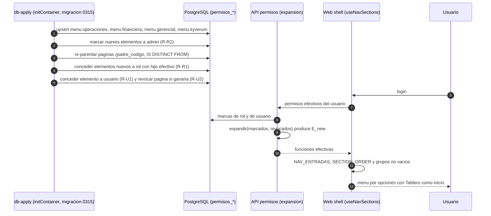

# Diseño — Menú de FLITO por áreas de la empresa (Épica #14678)

- **Modo:** full (cambia el árbol de permisos y una migración de roles y usuarios).
- **ADR:** `docs/adr/ADR-0048-navegacion-por-areas.md` (Propuesto).
- **Mapa:** FINAL, aprobado por el humano el 2026-11-24 tras la retroalimentación de Andrés (PO).
- **Estado del diseño:** CON-OBSERVACIONES. El mapa está cerrado; quedan páginas sin leer en código, que PR1 verifica («Lo que valida PR1»).
- **Trazabilidad:** la Épica #14678 no tiene Features ni HUs. Sin HUs no hay rama ni PR de producto (AGENTS, Git flow). El tipo Epic no tiene `Custom.Commits` ni `DeployDEV`.

---

## Contexto

Pedido (Épica #14678): reemplazar el agrupamiento del menú por dominios por ocho áreas, en este orden: Operaciones, Financiera, Comercial, Diseño, Tecnología, Infraestructura, Producto, Gerencial. Rutas, pantallas y funciones no cambian. Un área sin entradas visibles no se muestra. Deep links y Command Palette apuntan al área nueva. Sin pantallas, iconos ni landings nuevos. Facturación y Cotización FLIT 2.0 quedan fuera (Cotización no existe como entrada de menú).

**Desviación decidida por el PO:** el menú final tiene, además de las áreas, dos opciones que no son áreas de la empresa: **Kyverum** (módulos legacy, pedido de Andrés) y **Administración** (opción propia, no subgrupo de Operaciones). Ayuda queda fuera, al final.

Decisiones tomadas (no se reabren): alcance = presentación + árbol de permisos; mapa final (sección 2.2); áreas vacías ocultas; expand → contract; landing = Tablero explícito; PRs en serie; `menu.administracion` se reutiliza.

### Verificado en el código (lectura en esta sesión)

| Qué | Dónde | Hecho |
|---|---|---|
| Tipo de sección | `apps/web/src/components/shell/navEntradas.ts` (`NavItem.section`, l. ~21) | Unión de 12 valores: general, torre, gestion, transito, flota, mantenimiento, pesv, rndc, laft, finanzas, admin, ayuda. Hay que añadir `kyverum` y las áreas nuevas. |
| Orden de secciones | `navEntradas.ts` (`SECTION_ORDER`, l. ~26) | Orden fijo; el menú lo recorre en ese orden. |
| Entradas | `navEntradas.ts` (`NAV_ENTRADAS`, l. ~65–204) | La primera entrada es `dashboard` (`/`, sección general). Las de Torre van al final «a propósito» porque `rutaInicio` toma la primera permitida. |
| Rótulos | `apps/web/src/components/shell/navItems.ts` | `ELEMENTO_DE_SECCION` mapea sección → `menu.*`. `SECTION_LABEL` sale del nombre del elemento en `ELEMENTOS_PERMISOS`. `ROTULO_SIN_ELEMENTO` solo tiene torre → «Torre de Control». `etiquetaDeRuta` lo usa `NoAccess`. |
| Filtro de áreas vacías | `apps/web/src/components/shell/useNavSections.ts` | Agrupa por `SECTION_ORDER` y descarta grupos con `items.length === 0`. Ya oculta áreas vacías. |
| Elementos del árbol | `packages/shared-types/src/permisos-arbol/elementos.ts` | `menu.general` 10, `gestion` 20, `transito` 30, `flota` 40, `mantenimiento` 50, `pesv` 60, `rndc` 70, `laft` 80, `finanzas` 90, `administracion` 100, `ayuda` 110 (derivado, sin permiso propio), `perfil` 120. |
| Composición | `permisos-arbol/index.ts` | `ARBOL_PERMISOS = [...ELEMENTOS_PERMISOS, ...ARBOL_ITEMS_Y_ACCIONES]`. Cada `ItemDef` cuelga de `menu.${elemento}` (`nodos.ts`, `itemsANodos`). |
| Ítems de Gestión, Tránsito y Clientes | `permisos-arbol/gestion.ts` | `flito_tramites`, `flito_soat`, `flito_impuestos`, `flito_derechos`, `flito_revisiones`, `flito_logistica`, `flito_logistica_ruta`, `flito_comparendos` → `gestion`. `clients` y `flito_bitacora` → `gestion`. `transito_organismos` → `transito` (pasará a `administracion`). |
| Ítems de Finanzas | `permisos-arbol/finanzas.ts` | `finanzas_reporte_costos`, `finanzas_gastos_diarios`, `flito_bolsas`, `flito_tarifas`, `flito_servicios_adicionales`, `flito_comprobantes`, `flito_conciliacion` → `finanzas`. El archivo sigue después de la línea 60 (no leído). |
| Tablero | `permisos-arbol/general.ts` | `dashboard` → `general`, con la acción `ver`. |
| Siigo (`siigo_credenciales`) | `navEntradas.ts` | Sección `admin` (hoy en `menu.administracion`). Pasa a `menu.financiera`. |
| Catálogo | `apps/api/src/modules/permisos/catalogo.ts`, `catalogoCompleto` (~l. 360–430) | Los roles de cada `menu.*` se **derivan** de sus páginas hijas; no hay lista literal. Las filas de elemento se generan desde `ELEMENTOS_PERMISOS` (no derivados). `modulo` del elemento = `codigo.slice(5)`. |
| Reparto posterior | `catalogo.ts`, `REPARTO_POSTERIOR_AL_ARBOL` | Aplica `proveedor` y `REPARTO_TORRE` **después** de derivar los roles de elementos y páginas (hipótesis R7). |
| Expansión | `apps/api/src/modules/permisos/arbol/expansion.ts` (`claseDe`, `efectivoDeNodos`, `expandir`) | `efectivo(n) = n ∈ M ∧ (padre(n) = null ∨ efectivo(padre(n)))`. Los `revocados` se restan de `M = R ∪ C`. |
| Migración de referencia | `apps/api/src/db/migrations/0240_permisos_sueltos_a_su_item.sql` | Tablas y columnas: `permisos_funciones(codigo, modulo, nombre_negocio, descripcion, tipo, padre_codigo, nivel, orden)`, `permisos_rol_funcion(rol_codigo, funcion_codigo)`, `permisos_usuario_funcion(user_id, funcion_codigo, efecto)` con `conceder`/`revocar`, `permisos_roles(codigo)`, `users(id)`. Upsert con `IS DISTINCT FROM`. El paso 2b marca a `admin` con `JOIN permisos_roles`. |
| Regla de admin | ADR-0022 (citado en ADR-0023) | Toda función sembrada en migración ≥ 0225 marca a `admin` **en el mismo archivo**; su test lo exige. |
| Legado por permiso | ADR-0023 (Propuesto, 2026-10-07) | Una página por ítem del menú legacy (PESV ~19 ítems y mantenimiento 3 en esa fecha); acciones «Administrar <ítem>» transitorias; `legado: true` en `nodos.ts`. |
| Ayuda | `apps/web/src/content/ayuda/catalogo.ts` (`GRUPOS_ORDEN`, l. ~75) | `['general','torre','gestion','transito','finanzas','administracion']`. Independiente de `SECTION_ORDER`. Se conserva en esta Épica. |
| Numeración | `apps/api/src/db/migrations/` | Última 0314. Siguiente libre 0315 (se numera al integrar). |
| ADRs | `docs/adr/` | Última ADR-0047 (hay dos archivos con ese número; anomalía previa, no la toca este diseño). Siguiente libre: **ADR-0048**. |

### No verificado en código

- `navEntradas.ts` l. 80–180: entradas de Tránsito (Bandeja), Flota, Mantenimiento, PESV, RNDC, LAFT, Administración (privacidad, drive, usuarios, roles, log PII) y Siigo (`siigo_parametrizacion`, `siigo_operacion`).
- Slugs de LAFT (`laft`, `laft_unusual`, `laft_trainings`, `laft_manual`, `laft_oficial`, `laft_audit_plan`, `laft_dashboard`), PESV (25 entradas), RNDC (`rndc`, `rndc_admin`) y mantenimiento (`maintenance_inicio`, `maintenance_ordenes`, `maintenance_indicadores`) y flota (`fleet`): aportados por el humano, no comprobados en código.
- `permisos-arbol/torre.ts`, `administracion.ts`, `legado.ts`, `dr-flit.ts`, `perfil.ts`, y `finanzas.ts` después de la línea 60.
- `lib/permissions.ts` (`rutaInicio`; chunk de /login con presupuesto `check:bundle`), CommandPalette, `iconosNav.ts`, `sectionMeta.ts`, `permisos-efectivos.ts`, `arbol/sql-legado.ts`, `arbol/reparto-sueltos.ts`, `arbol/acciones-torre.ts`.
- Esquema Drizzle de permisos (`src/db/schema/`) y si el contrato OpenAPI describe enumeraciones de códigos.
- Lista exacta de tests (los nombres vienen del brief).

---

## 1. Alternativas

### 1.a Presentación separada de permisos (solo web) vs árbol por opción

- **Opción A — solo presentación.** Solo cambian `section` y `SECTION_ORDER` en la web. El árbol no cambia.
  - Pros: cero migración; cero pérdidas o ganancias; revertible con un commit; esfuerzo S.
  - Contras: el panel «Roles y permisos» sigue mostrando los dominios viejos. Admin concede por dominio y usuario ve por opción. No cumple el alcance decidido.
  - Riesgo: divergencia permanente entre lo que se concede y lo que se ve.
- **Opción B — árbol por opción, expand → contract (recomendada y aprobada).** Nuevos `menu.*`, re-parentado de páginas, migración de marcas y excepciones de usuario, viejos deprecados.
  - Pros: un solo modelo; alcance decidido; el panel muestra las opciones.
  - Contras: migración con riesgo de ganancias y pérdidas; contrato compartido cambia; PR1 pide verificación fuerte.
  - Esfuerzo: M–L, tres PRs. Riesgos: sección 3 y «Lo que valida PR1».
- **Opción C — migración directa** (renombrar códigos o mover padres sin expansión y borrar los viejos). Rompe marcas y deep links de permisos; pérdidas no controladas; rollback imposible. Rechazada por expand → contract.

### 1.b Dónde vive la agrupación: código vs BD

- **c1. Todo en código.** Rechazada: el resolutor corre en la API y la BD es la verdad de las marcas.
- **c2. Todo en BD.** Rechazada: tabla y migración para algo que cambia poco, y duplica el árbol.
- **c3. Híbrido (recomendada).** El padre en el árbol (BD + `shared-types`) decide el permiso. El orden de opciones, los rótulos y el riel de subgrupos viven en código. Un test de consistencia une los dos: para cada `NAV_ENTRADAS`, la sección coincide con el elemento padre del `pagina.*` en `ARBOL_PERMISOS`.

### 1.c Subgrupos

- **Nivel de grupo en el árbol.** Rechazado. Rompe la invariante elemento → ítem → acción que usan `expansion.ts`, `efectivoDeNodos`, `catalogoCompleto` y el panel.
- **Riel de subgrupos en el panel, solo presentación (aprobada).** Un mapa `página → subgrupo` en la web. Solo Kyverum lo necesita (43 entradas, 7 subgrupos: Tránsito, Flota, Mantenimiento, PESV, RNDC, LAFT, Trámites). Operaciones (11) y Administración (7) van en lista plana.

---

## 2. Decisión y modelo de datos del árbol

### 2.1 Elementos (`menu.*`)

| Código | Nombre (rótulo) | `orden` | `padre` | Entradas | Estado en PR1 |
|---|---|---|---|---|---|
| `menu.operaciones` | Operaciones | 10 | null | 11 | **Nuevo** |
| `menu.financiera` | Financiera | 20 | null | 10 | **Nuevo** |
| `menu.gerencial` | Gerencial | 30 | null | 9 | **Nuevo** |
| `menu.kyverum` | Kyverum | 40 | null | 43 | **Nuevo** |
| `menu.administracion` | Administración | 100 | null | 7 | **Reutilizado** (sin cambio de código ni de nombre; entra `transito_organismos`, sale Siigo) |
| `menu.general` | General | 10 | null | 0 en menú (queda `flito_dr_flit`) | Sin cambio; fuera de áreas |
| `menu.ayuda` | Ayuda | 110 | null | derivado | Sin cambio; fuera de áreas |
| `menu.perfil` | Perfil | 120 | null | 0 en menú | Sin cambio; fuera de áreas |

El panel ordena por grupo de presentación (opciones del menú, luego «fuera de áreas»), no por `orden` global. El orden de la presentación es: Operaciones, Financiera, Gerencial, Kyverum, Administración, Ayuda. Comercial, Diseño, Tecnología, Infraestructura y Producto no tienen `menu.*` hasta que tengan entradas.

Total de entradas de menú en las opciones con entradas: 11 + 10 + 9 + 43 + 7 = 80.

### 2.2 Mapa de páginas (`pagina.*`): menú actual → menú nuevo

Leyenda de confianza: **V** = verificado en el código o en una decisión cerrada; **H** = sección o slug no leídos en código, o aportado por el humano. **D** = decidido por el humano (2026-11-24).

| Slug / página | Menú actual (árbol) | Sección hoy (menú) | Menú nuevo | Conf. |
|---|---|---|---|---|
| **Operaciones (11)** | | | | |
| `vehicles` (Vehículos) | `menu.gestion` (H) | gestion | `menu.operaciones` | D |
| `clients` (Clientes y proveedores) | `menu.gestion` | gestion | `menu.operaciones` | V (`gestion.ts`); D |
| `flito_tramites`, `flito_derechos`, `flito_revisiones`, `flito_bitacora`, `flito_comparendos`, `flito_logistica`, `flito_logistica_ruta`, `flito_soat`, `flito_impuestos` | `menu.gestion` | gestion | `menu.operaciones` | V (`gestion.ts`); D |
| **Financiera (10)** | | | | |
| `finanzas_reporte_costos`, `finanzas_gastos_diarios`, `flito_bolsas`, `flito_tarifas`, `flito_servicios_adicionales`, `flito_comprobantes`, `flito_conciliacion` | `menu.finanzas` | finanzas | `menu.financiera` | V (`finanzas.ts`); D |
| `siigo_parametrizacion`, `siigo_operacion` | `menu.finanzas` (H) | finanzas | `menu.financiera` | H (slug aportado); D |
| `siigo_credenciales` | `menu.administracion` | admin | `menu.financiera` | V (sección admin); D. Sale de `menu.administracion`. |
| **Gerencial (9)** | | | | |
| `dashboard` (Tablero) | `menu.general` | general | `menu.gerencial` | V (`general.ts`); D |
| `torre_360`, `torre_comercial`, `torre_operativa`, `torre_productos`, `torre_logistica`, `torre_financiera`, `torre_explorador`, `torre_umbrales` | `menu.general` (según brief) | torre / admin (umbrales) | `menu.gerencial` | V en menú; H en árbol (`torre.ts` no leído); D |
| **Kyverum (43)** | | | | |
| `transito` (Bandeja de trámites) | `menu.transito` (H) | transito | `menu.kyverum` | H; D |
| `fleet` (Flota) | `menu.flota` (H) | flota | `menu.kyverum` | H; D |
| `maintenance_inicio`, `maintenance_ordenes`, `maintenance_indicadores` (Mantenimiento, 3) | `menu.mantenimiento` (H) | mantenimiento | `menu.kyverum` | H; D. ADR-0023: un permiso de página por ítem. |
| PESV (25 entradas, una página por ítem) | `menu.pesv` (H) | pesv | `menu.kyverum` | H; D. ADR-0023 registró ~19 ítems en 2026-10-07. Recuento a verificar en PR1. |
| `rndc` (RNDC, Remesas, Manifiestos, Maestros; 4 entradas) | `menu.rndc` (H) | rndc | `menu.kyverum` | H; D |
| `rndc_admin` | `menu.rndc` (H) | rndc | `menu.kyverum` | H; D |
| `laft`, `laft_unusual`, `laft_trainings`, `laft_manual`, `laft_oficial`, `laft_audit_plan`, `laft_dashboard` (7) | `menu.laft` (H) | laft | `menu.kyverum` | H; D |
| `tramite` (Trámite Digital; legacy) | padre H (sección gestion) | gestion | `menu.kyverum` | H; D. Es el único módulo legacy que cuenta como tal en esta Épica, además de los de Kyverum. |
| **Administración (7, reutiliza `menu.administracion`)** | | | | |
| `privacy` (Privacidad y datos) y `privacy_log_pii` (Log accesos PII) | `menu.administracion` (H) | admin | `menu.administracion` (sin cambio) | H; D |
| `users`, `roles_permisos`, `drive` (Google Drive), `admin_rendimiento` | `menu.administracion` | admin | `menu.administracion` (sin cambio) | V (`admin_rendimiento`, 0240); H para el resto; D |
| `transito_organismos` (Organismos STT, movido desde Tránsito por Andrés) | `menu.transito` | transito | `menu.administracion` | V (`gestion.ts`); D. **Riesgo específico** (ver sección 3.6). |
| **Fuera de áreas** | | | | |
| `flito_dr_flit` (Dr. Flit) | `menu.general` | — (no es entrada) | sin cambio | V (árbol); D |
| `perfil` (Perfil) | `menu.perfil` | — | sin cambio | V; D |
| `flito_ayuda` (Ayuda FLITO) | derivado `menu.ayuda` | ayuda | sin cambio | V; D |

Recuento de control: 11 + 10 + 9 + 43 + 7 = 80 entradas de menú. Los recuentos son del humano; PR1 los verifica contra los `ItemDef` del árbol.

### 2.3 Qué pasa con cada elemento viejo

| Elemento viejo | Tras PR1 (expand) | Justificación |
|---|---|---|
| `menu.gestion` | **Deprecado.** Sus hijos pasan a Operaciones (y `tramite` a Kyverum). | Marcas intactas; pérdidas = 0 por construcción de la expansión. |
| `menu.finanzas` | **Deprecado.** Hijos a Financiera. | Igual. |
| `menu.transito`, `menu.flota`, `menu.mantenimiento`, `menu.pesv`, `menu.rndc`, `menu.laft` | **Deprecados.** Hijos a Kyverum (y `transito_organismos` a Administración). | Igual. Requiere que todas sus páginas se re-parenten en el mismo PR. |
| `menu.administracion` | **No se deprecia.** Es elemento vivo (Administración). Pierde Siigo, gana `transito_organismos`. | Reutilizado: los roles que ya lo tenían lo conservan. |
| `menu.general` | **No se deprecia.** Queda como elemento fuera de áreas con `flito_dr_flit`. | Deprecarlo con un hijo vivo obligaría a moverlo sin decisión. |
| `menu.ayuda`, `menu.perfil` | Sin cambio. | Fuera de áreas. |

**Deprecación.** Flag `deprecado?: boolean` en `NodoArbolDef`. El panel lo oculta; la API lo sigue devolviendo para que el catálogo y el arranque no vean códigos huérfanos. Son 8 elementos deprecados. Alternativa sin contrato (ocultar elementos sin hijos) descartada: un elemento viejo con un hijo legado (`legado.ts`, no leído) quedaría visible sin motivo.

**Contract (futuro).** Retirar los deprecados cuando: (1) ninguna página ni ítem legado cuelga de ellos; (2) el recuento de marcas de sus códigos en prod es 0 o está declarado; (3) un release completo sin incidencias.

### 2.4 Presentación (web, sin contrato)

- `SECTION_ORDER` = operaciones, financiera, comercial, diseno, tecnologia, infraestructura, producto, gerencial, kyverum, administracion, ayuda. Las áreas sin entradas se ocultan por `useNavSections`.
- Tipo `NavItem.section`: añadir `kyverum` y las áreas nuevas; quitar las secciones viejas (`gestion`, `transito`, `flota`, `mantenimiento`, `pesv`, `rndc`, `laft`, `finanzas`, `torre`, `general`, `admin`). `tsc` obliga a re-seccionar todas las entradas, lo que es una garantía a favor.
- `ELEMENTO_DE_SECCION` pasa a `Partial` (comercial, diseño, tecnología, infraestructura, producto no tienen elemento). `admin` → `menu.administracion` (reutilizado); `kyverum` → `menu.kyverum`.
- `ROTULO_SIN_ELEMENTO` deja de necesitar torre; los rótulos de las áreas sin elemento vienen de una constante.
- **Riel de subgrupos de Kyverum** (solo presentación): Tránsito · Flota · Mantenimiento · PESV · RNDC · LAFT · Trámites. Mapa `página → subgrupo` en la web.
- **El array `NAV_ENTRADAS` no se reordena.** `rutaInicio` depende de su orden, no de `SECTION_ORDER`.
- Iconos: `iconosNav.ts` y `sectionMeta.ts` se mapean a las opciones nuevas reutilizando los iconos de la sección de origen. Sin iconos nuevos.

### 2.5 Landing (`rutaInicio`, `lib/permissions.ts`, no leído)

Regla: `/` si el usuario tiene `pagina.dashboard`; si no, la primera entrada permitida del array `NAV_ENTRADAS`, igual que hoy. Quien no tiene Tablero conserva su inicio. Logo → Tablero (decisión de UX, no cambia la regla de permisos).

### 2.6 Deep links y Command Palette

- Ninguna URL cambia. «Deep links apuntan al área nueva» se entiende como: la sección resaltada por `activeSectionForPath` y el grupo de la paleta de comandos son los de la opción nueva. Supuesto a validar.
- La paleta usa `NAV_ITEMS` (`navItems.ts`); sus `keywords` no cambian. El agrupamiento sale de `SECTION_LABEL`, así que cambia solo.

### 2.7 Pendientes de UX (no de permisos)

- Nombre «Operaciones» para el canal Cliente: el PO lo revisa con la maqueta.
- Logo → Tablero.

---

## 3. Migración expand → contract (PR1)

### 3.1 Reglas

- **R-R1 (grant de elemento a rol).** El rol `r` recibe `menu.n` si existe una página `p` mapeada a `n` marcada para `r` **y** el elemento viejo `v` de `p` está marcado para `r`. Es la condición de efectividad de la expansión de hoy. Se expresa con una tabla de mapa `(pagina, viejo, nuevo)` en `WITH … VALUES` y sin literales de rol, como en 0240.
  - Para `transito_organismos`: el rol que lo tiene por `menu.transito` recibe `menu.administracion`, salvo que ya lo tenga.
  - Para Siigo: el rol que tiene `siigo_*` por `menu.administracion` recibe `menu.financiera`.
- **R-R2 (admin explícito, ADR-0022).** Los elementos nuevos se marcan a `admin` en el mismo archivo 0315, con `JOIN permisos_roles` como en 0240 (paso 2b). No basta con que `admin` tenga todas las páginas.
- **R-U1 (no pérdida en usuario).** Si el usuario `u` tiene `p` efectiva en `E_old(u)` y `menu.n` no está en `E_new(u)`, se concede `conceder menu.n` a `u`.
- **R-U2 (no ganancia en usuario).** Si `p ∈ E_new(u)` y `p ∉ E_old(u)`, se añade `revocar p` a `u`. Supuesto a confirmar: `revocar` de una página anula sus acciones (`expansion.ts`).
- **R-U3 (revocar de elemento viejo).** Un `revocar menu.v` en `u` no se traduce a `revocar menu.n`: si `n` agrupa páginas de varios viejos, revocar uno dejaría sin pantallas a las demás. Se traduce por páginas (R-U2).
- **R-D (dormantes).** Una marca `p` de rol cuyo `v` no está marcado no se concede. Si R-R1 hace efectivo `menu.n` por otra página, `p` despierta: ganancia. Se cuantifica (consulta A).
- **R-S (sin fila de auditoría).** Como 0240: sin fila en `permisos_auditoria` (CHECK de origen no admite `'migracion'`). La trazabilidad es el SQL versionado y la salida de en-seco pegada en el PR.
- **R-I (idempotencia).** Upsert con `IS DISTINCT FROM` para elementos nuevos y `padre_codigo` re-parentados. Grants con `ON CONFLICT DO NOTHING`. P6: dos ejecuciones sobre la BD local.
- **Reutilización de `menu.administracion`.** Los roles que ya lo tienen lo conservan sin cambio. El único cambio de grants es el de R-R1 para `transito_organismos` y Siigo.

### 3.2 Verificación bidireccional (criterio de aceptación de PR1)

Para cada rol `r` y cada usuario `u`:

- `pérdidas(x) = { f ∈ E_old(x) : f ∉ E_new(x) }` → ∅, excepto los elementos viejos deprecados (excluidos por el mapa) y las excepciones declaradas por el PO (3.6).
- `ganancias(x) = { f ∈ E_new(x) : f ∉ E_old(x) }` → ∅, excepto los `menu.*` nuevos (excluidos por el mismo mapa).

`E_old` se calcula con el árbol de `develop` antes del merge; `E_new` con el árbol de la rama tras aplicar la migración dos veces. El cálculo es lógica TS (`expandir`, `efectivoDeNodos`), no SQL puro. La herramienta es `npm run permisos:en-seco -w apps/api -- …` (en 0240 se usó con `--hu`). **Propuesta:** extenderla para comparar `E_old` y `E_new` por rol y por usuario, en ambos sentidos, y para listar las marcas dormantes. Si no es posible, bloquear PR1 y preguntar.

Consultas de apoyo (borrador para backend-agent; validar en local):

```sql
-- A. Marcas dormantes por rol: página marcada, padre (elemento viejo) no marcado.
SELECT prf.rol_codigo, f.codigo AS pagina, f.padre_codigo
  FROM permisos_rol_funcion prf
  JOIN permisos_funciones f ON f.codigo = prf.funcion_codigo AND f.tipo = 'pagina'
 WHERE NOT EXISTS (
        SELECT 1 FROM permisos_rol_funcion m
         WHERE m.rol_codigo = prf.rol_codigo AND m.funcion_codigo = f.padre_codigo);

-- B. Riesgo de ganancia por usuario: revocaciones directas de elementos menu.*.
SELECT k.user_id, k.funcion_codigo
  FROM permisos_usuario_funcion k
 WHERE k.efecto = 'revocar' AND k.funcion_codigo LIKE 'menu.%';

-- C. Conteo de marcas por elemento viejo (para decidir el contract luego).
SELECT funcion_codigo, COUNT(*) FROM permisos_rol_funcion
 WHERE funcion_codigo LIKE 'menu.%' GROUP BY funcion_codigo;

-- D. Caso de la pérdida conocida (3.6): usuarios con revocar de menu.administracion
--    que tienen transito_organismos por su rol vía menu.transito.
SELECT DISTINCT k.user_id
  FROM permisos_usuario_funcion k
  JOIN permisos_rol_funcion prf ON prf.funcion_codigo = 'pagina.transito_organismos'
  JOIN permisos_rol_funcion mt  ON mt.rol_codigo = prf.rol_codigo AND mt.funcion_codigo = 'menu.transito'
 WHERE k.efecto = 'revocar' AND k.funcion_codigo = 'menu.administracion';
```

Antes de la migración se pegan A, B, C y D en el PR. Después, la salida de en-seco y A, B, D otra vez. (La consulta D usa el código real de la página; `pagina.transito_organismos` se confirma en PR1.)

### 3.3 Riesgo de cadena (un `pagina.*` sin padre efectivo desaparece)

Tras el re-parentado, `pagina.X` cuelga de `menu.n`. Si `menu.n` no es efectivo para el rol o usuario, la página desaparece aunque esté marcada. R-R1 y R-U1 lo evitan al conceder el elemento. No evitan un usuario con `revocar` de un elemento viejo (R-U3) ni una marca dormante (R-D).

### 3.4 Coexistencia durante el rollout

La migración corre en el initContainer `db-apply` antes de que el pod nuevo esté Ready (AGENTS, §6). Durante el rolling update conviven pods viejos y nuevos contra la misma BD. Los pods viejos resuelven `E_new`, que por construcción es igual a `E_old` si la verificación cierra. La ventana es segura solo en ese caso.

### 3.5 Rollback

La migración es hacia adelante. Revertir el commit de GitOps devuelve el código viejo, pero el árbol de la BD ya tiene los padres nuevos. **Riesgo:** al arrancar, el código viejo puede reconciliar padres o borrar códigos que no conoce (`menu.kyverum` incluido). Se verifica en PR1 (V2).

### 3.6 Riesgo específico: reutilización de `menu.administracion`

`transito_organismos` pasa de `menu.transito` a `menu.administracion`. Un usuario con `revocar` directo sobre `menu.administracion` que tenga `transito_organismos` por su rol perdería la página, porque el modelo de tres niveles no permite conservar una página con su padre revocado. **Es una pérdida que la migración no evita.** Si la consulta D encuentra usuarios, se declara como excepción aprobada por el PO (la pérdida queda listada en el PR) o se decide otra ubicación. No se resuelve en silencio. Ganancia correlativa: ninguna.

---

## 4. Diagrama de secuencia (Mermaid)



---

## 5. Contrato de endpoints

- **Sin rutas nuevas ni cambios de método.** El menú sigue leyendo los permisos efectivos existentes.
- **Respuesta de `GET /api/permisos/arbol`** (`ArbolPermisosRespuesta`): aparecen cuatro elementos nuevos (`menu.operaciones`, `menu.financiera`, `menu.gerencial`, `menu.kyverum`) y el flag `deprecado` en los 8 viejos. Delta de contrato en la respuesta, no en la ruta.
- **`GET /api/permisos/roles/:codigo/arbol`** y **`GET /api/users/:id/arbol`** reflejan el árbol nuevo; mismo tipo.
- **OpenAPI:** `contracts/openapi/flito-api.v1.yaml` se regenera con `npm run contrato:generar` solo si el esquema de respuesta describe campos o enumeraciones de códigos. No verificado.
- Sin PII nueva: los datos son códigos de permiso y `user_id`. Sin `pii_access_log` nuevo.

---

## 6. Modelo de datos (Drizzle)

- **No hay tablas ni columnas nuevas.** La migración inserta 4 filas en `permisos_funciones`, actualiza `padre_codigo` de páginas, y concede filas en `permisos_rol_funcion` y `permisos_usuario_funcion`.
- Si el esquema Drizzle de permisos declara los códigos como enum o `check`, hay que tocarlo en PR1. No verificado (`src/db/schema/`).
- Migración: `apps/api/src/db/migrations/0315_flito_menu_por_areas.sql` (nombre provisional; el número se fija al integrar). SQL plano, idempotente, sin `BEGIN`/`COMMIT`, sin literales de rol, con el grant de `admin` explícito (R-R2) y sin fila en `permisos_auditoria`.

---

## 7. Archivos a crear o modificar, por bloque

Dueños sin solapes. PR1 → PR2 → PR3 en serie (decisión de la Épica). PR2 solo lee `shared-types`.

### PR1 — Contrato y migración (dueño: `backend-agent`)

Contrato en `packages/shared-types` (primer commit, para que PR2 tenga el código):

- `packages/shared-types/src/permisos-arbol/elementos.ts`: añadir `menu.operaciones` (10), `menu.financiera` (20), `menu.gerencial` (30), `menu.kyverum` (40). Marcar deprecados: `menu.gestion`, `menu.finanzas`, `menu.transito`, `menu.flota`, `menu.mantenimiento`, `menu.pesv`, `menu.rndc`, `menu.laft`. **No** se deprecia `menu.administracion`.
- `packages/shared-types/src/permisos-arbol/index.ts`: campo `deprecado?: boolean` en `NodoArbolDef`.
- `packages/shared-types/src/permisos-arbol/gestion.ts`:
  - `elemento` a `operaciones`: `flito_tramites`, `flito_soat`, `flito_impuestos`, `flito_derechos`, `flito_revisiones`, `flito_logistica`, `flito_logistica_ruta`, `flito_comparendos`, `clients`, `flito_bitacora`.
  - `elemento` a `administracion`: `transito_organismos` (hoy `transito`).
  - `vehicles` a `operaciones` (archivo H: confirmar dónde está).
- `packages/shared-types/src/permisos-arbol/finanzas.ts`: `elemento` a `financiera` (7 ítems).
- `packages/shared-types/src/permisos-arbol/administracion.ts`: sin cambio de `elemento` para `privacy`, `privacy_log_pii`, `users`, `roles_permisos`, `drive`, `admin_rendimiento` (no leído). Quitar `siigo_credenciales` (archivo H) y pasarla a `financiera`.
- Siigo (`siigo_parametrizacion`, `siigo_operacion`, `siigo_credenciales`) a `financiera`: archivo H.
- `packages/shared-types/src/permisos-arbol/general.ts`: `dashboard` a `gerencial`.
- `packages/shared-types/src/permisos-arbol/torre.ts`: `elemento` de las 8 Torre a `gerencial` (no leído).
- Kyverum a `kyverum`: `transito` (bandeja), `fleet`, `maintenance_*` (3), las 25 PESV, `rndc` (4) y `rndc_admin`, las 7 LAFT, `tramite`. Archivos H: `legado.ts` (ítems `legado: true`, PESV con «Administrar») y posibles `pesv`, `laft`, `rndc`, `maintenance`, `fleet` no leídos. Cada ítem se re-parenta por `ItemDef.elemento` (ADR-0023: una página por ítem).
- `packages/shared-types/src/permisos-arbol/nodos.ts`: revisar la forma de `legado` y del nivel 2 de los ítems de PESV.
- `packages/shared-types/src/permisos-arbol/dr-flit.ts`, `perfil.ts`: sin cambio.

Backend:

- `apps/api/src/db/migrations/0315_flito_menu_por_areas.sql` (nuevo; numeración al integrar). Incluye R-R1, R-R2 (grant a `admin` explícito con `JOIN permisos_roles`), R-U1 y R-U2 como SQL set-based.
- `apps/api/src/modules/permisos/catalogo.ts`: revisar el orden de `REPARTO_POSTERIOR_AL_ARBOL` frente a la derivación de roles (V3); sin cambio de contrato.
- `apps/api/src/modules/permisos/arbol/reparto-sueltos.ts` (usa `menu.administracion`): sigue apuntando a un elemento vivo; revisar que no haya que moverlo.
- `apps/api/src/modules/permisos/arbol/sql-legado.ts`, `acciones-torre.ts` (l. 75–85): revisar padres de grants.
- Herramientas: extender `permisos:en-seco` para comparar `E_old`/`E_new` (sección 3.2).
- Tests: `permisos-arbol-*.test.ts`, `permisos-expansion.test.ts`, `migracion-0238.test.ts` (lista del brief; comprobar nombres con `ls`), y nuevo `permisos-menu-por-areas.test.ts`. Cubre: el mapa completo (80 entradas), R-R1, R-R2 (admin marcado a los elementos nuevos), R-U1, R-U2, la consistencia de deprecados y que `menu.administracion` sigue vivo.

Gates PR1: `security-agent` (cambia autorización) y `db-review-agent` (migración). Local: `npm test -w apps/api -- <archivos de este WI>` (P1), `build:api` si cambian tipos, `npm run build -w packages/shared-types` y `grep` de usos de `ELEMENTOS_PERMISOS`, `menu.` y `ARBOL_PERMISOS` en `apps/web` (AGENTS, regla 7).

### PR2 — Shell web (dueño: `frontend-agent`)

- `apps/web/src/components/shell/navEntradas.ts`: unión de `section` con `operaciones`, `financiera`, `gerencial`, `kyverum`, `administracion`, `ayuda` y las áreas sin entradas; `SECTION_ORDER` con las ocho áreas + kyverum + administracion + ayuda; `section` de cada entrada; **sin reordenar `NAV_ENTRADAS`**.
- `apps/web/src/components/shell/navItems.ts`: `ELEMENTO_DE_SECCION` a `Partial` (`kyverum` → `menu.kyverum`, `admin` → `menu.administracion`); `ROTULO_SIN_ELEMENTO` sin torre; rótulos de áreas sin elemento.
- `apps/web/src/components/shell/sectionMeta.ts`: metadatos de las opciones nuevas (reutilizando iconos y textos).
- `apps/web/src/components/shell/iconosNav.ts`: iconos existentes; sin iconos nuevos.
- `apps/web/src/components/shell/useNavSections.ts`: sin cambio previsto. Confirmar.
- `apps/web/src/lib/permissions.ts`: `rutaInicio` con la regla de la sección 2.5. **Vigilar `check:bundle`** (chunk de /login).
- Command Palette (no leído): confirmar que agrupa por `SECTION_LABEL`.
- Panel «Roles y permisos» (no leído): ocultar `deprecado`; riel de subgrupos de Kyverum (sección 2.4); «fuera de áreas» para `menu.general`, `menu.ayuda` y `menu.perfil`.
- E2E: `e2e/tests/shell-navbar.spec.ts` (ajustar a las opciones nuevas).
- Test de consistencia NAV↔árbol (si no va en PR1).

Gates PR2: `flit-code-review`, `qa-agent` B. `flit-ayuda-flito`: N/A salvo que cambie comportamiento visible con ficha (ver PR3).

### PR3 — Ayuda in-app y E2E (dueño: `frontend-agent`)

- `apps/web/src/content/ayuda/**`: fichas que nombren dominios viejos («Menú › Gestión», «Finanzas», «LAFT», «Trámite»…). Comprobar con `grep` acotado a `content/ayuda`.
- `apps/web/src/content/ayuda/catalogo.ts`: `GRUPOS_ORDEN` **no cambia** (decisión del humano: Ayuda conserva sus categorías en esta Épica).
- E2E nuevo: opciones ocultas cuando no hay entradas, landing en Tablero, deep links y paleta a la opción nueva.

Gates PR3: `flit-ayuda-flito` (delta de ficha), `qa-agent` B.

### Solapes

- `packages/shared-types` lo escribe solo PR1. PR2 y PR3 leen.
- `apps/api` solo PR1.
- `apps/web` lo escriben PR2 y PR3 en serie (ambos tocan `navEntradas`/`navItems`).

---

## 8. Impacto en shared-types

- `ELEMENTOS_PERMISOS` (`elementos.ts`): 4 nuevos, 8 con `deprecado`, `menu.administracion` reutilizado sin cambio.
- `NodoArbolDef` (`index.ts`): `deprecado?: boolean`.
- `ItemDef.elemento` (`nodos.ts`): valores nuevos (`operaciones`, `financiera`, `gerencial`, `kyverum`).
- Consumidores a revisar con grep obligatorio en `apps/web`: `ELEMENTOS_PERMISOS`, `ARBOL_PERMISOS`, `menu.`, `ELEMENTO_DE_SECCION`, `SECTION_LABEL`, y el tipo `NavItem['section']`.

---

## 9. Impacto por área

- **Panel Roles y permisos.** Kyverum tiene 43 entradas con riel de 7 subgrupos. Operaciones (11) y Administración (7) van en lista plana. Los deprecados se ocultan.
- **Ayuda in-app.** `GRUPOS_ORDEN` (`content/ayuda/catalogo.ts:75`) no cambia. Sin efecto en permisos.
- **Command Palette.** Cambia solo por `SECTION_LABEL` y `NAV_ITEMS`. Keywords sin cambio.
- **`rutaInicio`.** Regla de la sección 2.5. Vigilar bundle.
- **Tests existentes que se revisan (lista del brief, nombres por comprobar):**
  - `permisos-arbol-*.test.ts` (estructura del árbol)
  - `permisos-expansion.test.ts` (cadena y `expandir`)
  - `migracion-0238.test.ts` (patrón de migraciones de permisos)
  - `shell-navbar.spec.ts` (E2E del menú)
  - Añadir: test de `catalogoCompleto` con elementos nuevos y deprecados; test de consistencia NAV↔árbol; test de la regla de admin (R-R2).

---

## 10. Notas operativas por agente

- **backend-agent (PR1):** empezar por el contrato (`shared-types`), luego migración, luego `catalogo.ts`. Antes de codear, leer las páginas H (sección 2.2, en especial PESV, LAFT, Siigo y Trámite) y confirmar que coinciden con lo aprobado; si no, parar y preguntar. Verificar el rollback (V2). Pegar en el PR la salida de en-seco y las consultas A, B, C y D. P6: dos ejecuciones sobre BD local. P1: solo los tests de este WI. Incluir `admin` explícito en la migración (R-R2, ADR-0022).
- **frontend-agent (PR2 y PR3):** no reordenar `NAV_ENTRADAS`. Kyverum con su riel; Administración como opción propia. `SECTION_ORDER` según la sección 2.4. Revisar `lib/permissions.ts` con `check:bundle`. No añadir iconos. Ayuda no cambia de categorías.
- **security-agent:** PR1 cambia autorización (rol y usuario). Revisar R-U2 (revocar página anula acciones), R-D (marcas dormantes) y el caso 3.6.
- **db-review-agent:** PR1 migración. Idempotencia, `IS DISTINCT FROM`, ausencia de literales de rol, grant de `admin` explícito.
- **tech-lead-agent (antes de PR1):** crear el Feature bajo la Épica #14678 y sus HUs (AC pegados). Sin HU no hay rama de producto (AGENTS, trazabilidad).
- **devops-agent (post-merge):** M1 al tip de la ráfaga. Comprobar que el initContainer aplica 0315 antes de Ready.

---

## 11. Lo que valida PR1

| ID | Qué se valida | Criterio de cierre | Estado |
|---|---|---|---|
| V1 | **Pérdidas = 0 y ganancias = 0** por rol y por usuario (sección 3.2). Incluye marcas dormantes (R-D), revocaciones de elementos viejos (R-U3) y el caso 3.6. | Salida real pegada en el PR; excepciones declaradas (deprecados, `menu.*` nuevos y, si existe, el caso 3.6 aprobado por el PO). | Abierto. Criterio de aceptación del ADR. |
| V2 | **Rollback:** el código viejo no borra ni reconcilia a la baja códigos desconocidos (`menu.operaciones`, `menu.financiera`, `menu.gerencial`, `menu.kyverum`) al arrancar. | Lectura de `catalogoCompleto` y su consumidor de arranque; si borra, SQL inverso documentado antes de promover. | Abierto. |
| V3 | **Hipótesis R7:** `REPARTO_POSTERIOR_AL_ARBOL` se aplica después de derivar roles de elementos y páginas en `catalogoCompleto`; el catálogo podría no reflejar la concesión de Torre a financiera o auditor. | Test de `catalogoCompleto` que confirme o descarte. Afecta a semillas, no a las marcas existentes. | Hipótesis sin confirmar. |
| V4 | **Filas no verificadas del mapa:** Trámite Digital, PESV (25), RNDC (4+1), LAFT (7), mantenimiento (3), flota, Siigo (2 slugs y `siigo_credenciales`), Administración (privacidad, drive, usuarios, roles), `torre.ts`, `administracion.ts`, `legado.ts`. Recuentos del humano (11/10/9/43/7). | Leer en código y contrastar con los `ItemDef`; si una página no encaja, parar y preguntar, no reasignar en silencio. | Abierto. |
| V5 | **Recuentos de riesgo:** marcas dormantes por rol (consulta A); `revocar` de `menu.*` en usuarios (B); marcas por elemento viejo (C); usuarios con el caso 3.6 (D). | Decisión explícita si cualquiera es distinto de cero. | Abierto. |

---

## Decisiones tomadas y pendientes

**Tomadas por el humano (2026-11-24, tras la retroalimentación de Andrés):**

1. Operaciones: vehicles, clients, flito_tramites, flito_derechos, flito_revisiones, flito_bitacora, flito_comparendos, flito_logistica, flito_logistica_ruta, flito_soat, flito_impuestos (11).
2. Financiera: las 7 de Finanzas y las 3 de Siigo (10).
3. Gerencial: Tablero y las 8 de Torre, con `torre_umbrales` (9).
4. Kyverum (opción propia, legado): Tránsito (bandeja), Flota, Mantenimiento (3), PESV (25), RNDC (4 más `rndc_admin`), LAFT (7), Trámite Digital (43).
5. Administración (opción propia, reutiliza `menu.administracion`): privacidad (2), usuarios, roles, Drive, Rendimiento y `transito_organismos` (7).
6. Dr. Flit y Perfil fuera de áreas, como Ayuda. Ayuda conserva `GRUPOS_ORDEN`.
7. Subgrupos: riel en Kyverum (7 subgrupos), solo presentación.
8. Orden: Operaciones, Financiera, (áreas vacías), Gerencial, Kyverum, Administración, Ayuda.
9. Landing: Tablero. Logo → Tablero.

**Pendientes de UX (no de permisos):** nombre «Operaciones» para el canal Cliente.

**Pendientes de verificación en PR1:** todo lo que V1–V5 marca.

## Supuestos a validar en PR (no preguntas)

- Landing: Tablero si está permitido; si no, la primera entrada permitida del orden actual de `NAV_ENTRADAS`.
- «Deep links» = sección resaltada y grupo de la paleta; ninguna URL cambia.
- `revocar` de una página anula sus acciones (confirmar en `expansion.ts`).

## Bloqueos de proceso (no técnicos)

- No hay Feature ni HUs bajo la Épica #14678: sin ellas no hay rama ni PR de producto (AGENTS, trazabilidad). tech-lead-agent debe descomponer tras la ronda de cierre (P9).
- La Épica no tiene `Custom.Commits` ni `DeployDEV`: la trazabilidad de PR va en las HUs hijas.
- PR0 (gate naming, CHORE) fuera de este alcance.
