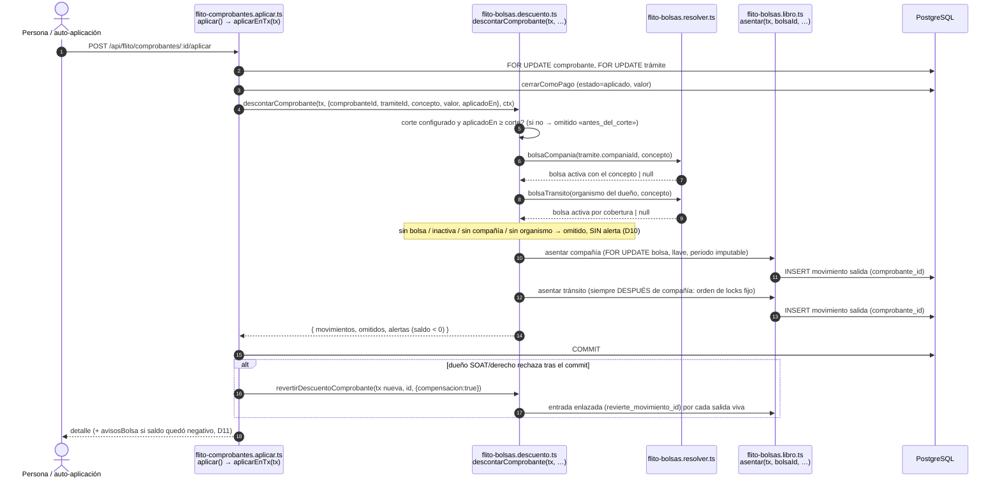
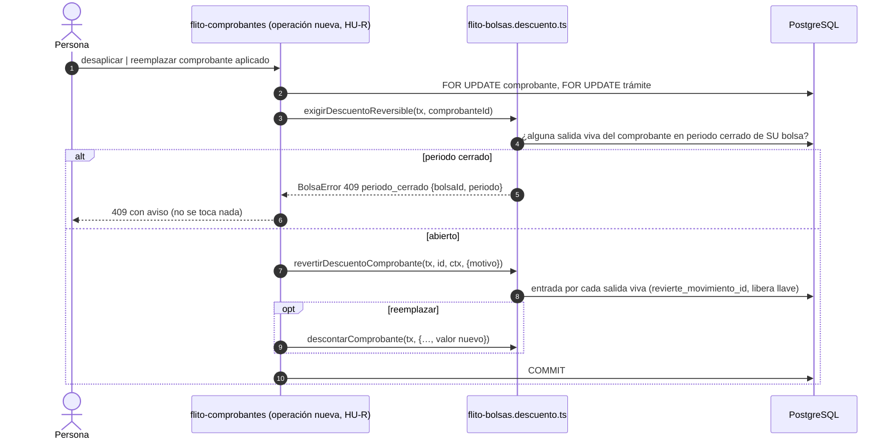

# Diseño — Bolsa única (Features #13886 clientes y #13887 tránsito)

- **Modo:** full · **Épica:** #13412 · **Proyecto ADO:** «FLIT - FLITO»
- **Features:** #13886 «[BOLSAS] - Bolsa de clientes (compañías): modelo único, creación manual y descuento al aplicar el comprobante» · #13887 «[BOLSAS] - Bolsa de tránsito: secretarías sobre el modelo único y doble movimiento compañía + tránsito»
- **ADR:** [`docs/adr/ADR-0029-flito-bolsa-unica-descuento-al-aplicar-comprobante.md`](../adr/ADR-0029-flito-bolsa-unica-descuento-al-aplicar-comprobante.md) (Propuesto)
- **Módulo:** `flito-bolsas` (producto FLITO, `/api/flito/bolsas`). **No** toca el legacy `soat`/`tramites`/`liquidacion` sin prefijo.
- **Coordinación:** la Épica #13407 (gestión documental) es dueña de `schema/flito-bolsas-documentos.ts` y de `modules/flito-bolsas-documentos/`. Este diseño no pone nada ahí; publica sus contratos en la § «Contratos para #13407».
- **Fecha:** 2026-10-23 · **Estado:** Aceptado (ADR-0029, aprobado por David Chica el 2026-10-23). Las decisiones de cierre Q1-Q7 están incorporadas abajo.

---

## Contexto

### Lo que hay hoy (leído en código, no supuesto)

| Pieza | Dónde | Comportamiento actual |
|---|---|---|
| Bolsa de cliente | `flito_bolsas` (`schema.ts` ~3884) | `compania_id UNIQUE NOT NULL`, `saldo` denormalizado y bloqueado con `FOR UPDATE`, puede quedar negativo |
| Libro del cliente | `flito_bolsa_movimientos` (~3905) | append-only; `llave_idempotencia` única parcial (`idx_flito_bolsa_mov_llave`), `corrige_movimiento_id` |
| Cierres | `flito_bolsa_cierres` (~3966) | único por `(compania_id, periodo)`; `periodoImputable` corre al siguiente mes abierto lo que cae en uno cerrado |
| Bolsa de tránsito | `flito_bolsas_transito` + `flito_bolsa_transito_cobertura` + `flito_bolsa_transito_movimientos` (~4032-4103) | `uq_bolsa_transito_cobertura (organismo_codigo, concepto)` **sin condición de estado** |
| Autocreación | `flito-bolsas.service.ts:252-255` | `INSERT … ON CONFLICT DO NOTHING` al primer movimiento de un cliente (recarga, liquidación, conciliación) |
| Descuento | `flito-liquidacion.service.ts` `liquidar()` (~908-955) | `registrarSalidasLiquidacion` (cliente) + `registrarConsumoTransito` (tránsito) dentro de la tx del sellado; `reversar()` (~1025-1030) los devuelve |
| Conciliación de boletas SOAT | `flito-conciliacion.conciliar.service.ts` (ADR-0006) | asienta en ambos libros con las MISMAS llaves que el sellado (`salida:soat:<soatId>` / `consumo:soat:<soatId>`); `flito_concil_lineas.movimiento_bolsa_id` y `movimiento_transito_id` son FK RESTRICT a los dos libros |
| Aplicar comprobante (#12606) | `flito-comprobantes.aplicar.ts` → `aplicar()` / `aplicarEnTx(tx)` (L241-336) | **Existe.** Bloquea comprobante → trámite, cierra la fila con `cerrarComoPago`; SOAT y derecho pagan **tras el commit** (`pagarDespuesDelCommit`, L339) y, si el dueño rechaza, devuelve el comprobante a `pendiente` (compensación). La auto-aplicación (`flito-comprobantes.auto.ts`, flag `COMPROBANTES_AUTO_APLICAR`) entra por el mismo `aplicar(…, { automatico: true })` |
| Descartar comprobante | `flito-comprobantes.aplicar.ts` `descartar()` (L419) | **Solo `pendiente`** (`yaResuelto()` si está aplicado). **No existe** desaplicar, desasociar ni reemplazar un comprobante ya aplicado |
| Permisos | `exigirFuncion('bolsas.…')` + `companiaPropia` / `soloSinEnlace` (ADR-0024/0025); catálogo en `modules/permisos/catalogo-operaciones.ts` L200-217 y `permisos/arbol/acciones-finanzas.ts` | por función, no por rol |
| Techos ESLint | `eslint.config.mjs` | `flito-bolsas.service.ts` congelado en **1120**; `schema.ts` congelado en **3400** — ninguno puede crecer |

### Decisiones de producto cerradas (David Chica, 2026-10-23)

Se diseñan tal cual, sin rediscutirlas: modelo único con alcance COMPAÑÍA (1:1) o TRÁNSITO (N secretarías) y conceptos marcados (D1-D2); pareja (secretaría, concepto) en una sola bolsa **activa** (D3); nunca se borra, se inactiva y se reactiva, inactiva no descuenta (D4); los dos libros se migran con saldo e historial y se retiran, salvo las bolsas de cliente autocreadas sin movimientos (D5); solo creación manual, recargar sin bolsa → «crea la bolsa primero» (D6); se descuenta **al aplicar el comprobante** y la liquidación deja de mover la bolsa (D7); monto = valor documental del comprobante (D8); hasta dos movimientos por comprobante (D9); concepto sin bolsa → nada, sin alerta (D10); saldo insuficiente → alerta, no bloquea (D11); corte por fecha configurable (D12); descartar/desasociar revierte y reemplazar revierte + vuelve a descontar, con la reversión enlazada al original (D13); movimiento en periodo cerrado → se bloquea descartar/eliminar el comprobante, con aviso (D14).

---

## Alternativas

### Opción A — Tablas nuevas del modelo único, copia con ids preservados y retiro diferido de los libros viejos *(recomendada)*

Se crean `flito_bolsas_unicas` (+ `_conceptos`, `_cobertura`, `_movimientos`, `_cierres`, `_eventos`) en un archivo de esquema propio. Una migración de datos por Feature copia cada libro **preservando los UUID** de bolsas, movimientos y cierres, verifica saldos dentro de la misma transacción y re-apunta las FK de `flito_concil_lineas`. Los libros viejos quedan intactos y sin lectores hasta una migración de retiro posterior, que corre después de verificar PDN.

- **Pros:** las restricciones nuevas (alcance, 1:1 parcial, cobertura única solo entre activas, reversión única) nacen limpias, sin `ALTER` sobre un libro vivo. Como los UUID se preservan, repuntar las FK es solo DDL y no hace falta reescribir datos. El rollback es trivial hasta el retiro: los libros viejos siguen ahí con sus datos. Cada Feature migra su libro por separado (cliente en #13886, tránsito en #13887). Cumple al pie de la letra D5 («se migran y se retiran»). El código nuevo no hereda `compania_id NOT NULL` ni `onConflictDoNothing(companiaId)`.
- **Contras:** copia el histórico completo del cliente, que es la tabla más grande. Durante una ventana conviven tablas viejas sin lectores y nuevas. Hay que re-apuntar todo lector de los libros a la vez (bolsas, liquidación, conciliación y el script de backfill).
- **Esfuerzo:** L
- **Riesgos:** escrituras de código viejo durante la copia (se mitiga con api parada + `LOCK` en la migración + verificación que detecta deriva); nombres de tabla nuevos (`_unicas`) que se quedan para siempre.

### Opción B — Evolución in situ: `flito_bolsas` absorbe a la de tránsito

`ALTER` sobre `flito_bolsas` (añade `alcance`, `nombre` y `activa`, `compania_id` pasa a nullable y `UNIQUE` pasa a índice parcial), sobre `flito_bolsa_movimientos` (`compania_id` nullable, más `comprobante_id` y `revierte_movimiento_id`) y sobre `flito_bolsa_cierres` (unicidad por `bolsa_id`). Solo se copia el libro de tránsito, con ids preservados, y se retiran sus tres tablas.

- **Pros:** el histórico del cliente no se mueve, así que su verificación es trivial. `movimiento_bolsa_id` de conciliación no cambia. Los nombres finales son los genéricos de siempre. Es menos SQL de datos.
- **Contras:** `ALTER` y cambio de unicidad sobre el libro contable vivo. El código viejo (`onConflictDoNothing({ target: companiaId })`) **revienta** en cuanto el `UNIQUE` pasa a ser parcial, porque Postgres no encuentra el árbitro del `ON CONFLICT`. El rollback exige una migración inversa sobre datos ya mezclados (las filas de tránsito dentro de `flito_bolsas`). `flito_bolsas` **no se retira**, sino que se transforma, lo que se aparta de la letra de D5 y requiere que el humano lo acepte.
- **Esfuerzo:** M
- **Riesgos:** deriva irreversible si la migración aplica a medias en un ambiente; columnas con semántica condicionada al alcance, como `compania_id`, sobre una tabla con dos años de supuestos «siempre hay compañía» en consultas no inventariadas.

### Opción C — Fachada de servicio sin migrar (dos libros físicos, un puerto común)

Una interfaz `PuertoBolsa` implementada dos veces; se añade `activa`/conceptos a cada tabla; la UI ve un solo modelo.

- **Pros:** sin migración de datos; esfuerzo bajo en esquema.
- **Contras:** **contradice D5** (los libros no se migran ni se retiran) y D1 (el modelo no es único: dos tablas, dos unicidades, dos imputaciones de periodo); duplica cada regla nueva (inactivar, reversión enlazada, bloqueo por cierre) en dos libros.
- **Esfuerzo:** M (y creciente)
- **Riesgos:** las reglas divergen entre los dos libros: es justo lo que el comentario de cabecera de `flito-bolsas-transito.service.ts` pide evitar.
- **Descartada** por incumplir una decisión cerrada; se registra para que conste por qué no.

---

## Decisión y justificación

**Opción A.** Lo que decide es el rollback y la limpieza de las restricciones. En un libro contable de dinero de terceros, poder volver atrás sin migración inversa (los libros viejos siguen intactos hasta el retiro) pesa más que el coste de copiar el histórico. Además, las tres restricciones que hacen cumplir D1, D3 y D13 (1:1 parcial por alcance, cobertura única entre activas y una sola reversión por movimiento) se declaran limpias en tablas vacías, sin `ALTER` sobre filas con supuestos heredados. La B queda registrada como alternativa más barata; si el Líder Técnico prefiere conservar los nombres genéricos, es viable siempre que se acepte que `flito_bolsas` «se transforma y no se retira».

**Dónde se engancha el descuento (Q2: HUs de #13886):** en `aplicarEnTx(tx)` de `flito-comprobantes.aplicar.ts`, después de `cerrarComoPago`, dentro de la misma transacción que deja el comprobante `aplicado`. Si `pagarDespuesDelCommit` compensa (el dueño rechazó), esa misma compensación revierte el descuento. Revertir al desaplicar o reemplazar requiere una operación que hoy no existe. La construye la **HU-R** de #13886 antes de la HU-D (ver § Operación nueva en `flito-comprobantes`).

---

## Diagrama de secuencia (Mermaid)

### Aplicar comprobante → hasta dos movimientos (D7-D11)



### Desaplicar / reemplazar (D13-D14)



---

## Contrato de endpoints

Todos con `authMiddleware` (montaje existente), `exigirFuncion(...)` y la frontera por enlace de ADR-0024. Ningún filtro con PII o cuasi-PII va en la query: NIT, nombre de compañía y nombre de bolsa viajan en el **body** de `POST /buscar`. En el path solo van ids opacos (`uuid` de la bolsa) o el id interno entero de la compañía, que es el mismo que hoy lleva `/:companiaId`.

| Método y ruta | Función exigida | Guarda extra | Body / respuesta | Errores |
|---|---|---|---|---|
| `POST /api/flito/bolsas/buscar` | `bolsas.bolsa.listar` *(nueva)* | `companiaPropia` implícita: un usuario con enlace solo ve la bolsa de su compañía | `BuscarBolsasDto` → `BolsaResumenDto[]` | 400 |
| `POST /api/flito/bolsas` | según `alcance`: `bolsas.bolsa.crear` *(nueva)* \| `bolsas.transito.crear` *(existente)* | tránsito: `soloSinEnlace` | `CrearBolsaDto` → 201 `BolsaDetalleDto` | 400 `datos_invalidos`; 404 compañía; 409 `bolsa_compania_existe` `{bolsaId, activa}`; 409 `cobertura_ocupada` `{pares:[{organismoCodigo, concepto, bolsaId}]}`; 409 `nombre_en_uso` |
| `GET /api/flito/bolsas/bolsa/:bolsaId` | `bolsas.bolsa.ver` \| `bolsas.transito.ver` | `bolsaPropia('leer')` *(nueva, resuelve bolsa → compañía)* | → `BolsaDetalleDto` | 404 |
| `PATCH /api/flito/bolsas/bolsa/:bolsaId` | `bolsas.bolsa.editar` *(nueva)* \| `bolsas.transito.editar` | `bolsaPropia('escribir')` | `EditarBolsaDto` (conceptos; tránsito: nombre + organismos + conceptos). **No** cambia alcance ni compañía | 400; 409 `cobertura_ocupada`; 409 `bolsa_inactiva` |
| `POST /api/flito/bolsas/bolsa/:bolsaId/inactivar` | `bolsas.bolsa.inactivar` *(nueva)* \| `bolsas.transito.inactivar` *(nueva)* | idem | `{ motivo }` (≥5) → `BolsaDetalleDto` | 409 `ya_inactiva` |
| `POST /api/flito/bolsas/bolsa/:bolsaId/reactivar` | idem inactivar | idem | `{ motivo }` → `BolsaDetalleDto` | 409 `ya_activa`; 409 `cobertura_ocupada` (otro activo tomó un par mientras estuvo inactiva) |
| `GET /api/flito/bolsas/bolsa/:bolsaId/movimientos` | `bolsas.movimientos.ver` \| `bolsas.transito.ver_movimientos` | idem | → `MovimientoBolsaDto[]` | 404 |
| `POST /api/flito/bolsas/bolsa/:bolsaId/recargas` | `bolsas.recarga.registrar` \| `bolsas.transito.cargar` | idem + multer actual (`recibirSoporte`) | igual que hoy | 409 `bolsa_inactiva` |
| `GET\|POST /api/flito/bolsas/bolsa/:bolsaId/cierres` | `bolsas.cierres.ver` / `bolsas.cierre.crear` | idem | igual que hoy, por bolsa | igual que hoy |
| `GET /api/flito/bolsas/compania/:companiaId/estado` | `bolsas.bolsa.ver` | `companiaPropia('leer')` | → `EstadoBolsaCompaniaDto` | — (sin bolsa ⇒ 200 `{existe:false, activa:false}`, no 404) |
| `POST /api/flito/bolsas/:companiaId/recargas` *(existente)* | sin cambio | sin cambio | **cambia:** sin bolsa → 409 `bolsa_inexistente` «Crea la bolsa de la compañía primero» (D6); inactiva → 409 `bolsa_inactiva` (Q7) | |
| `POST /api/flito/bolsas/:companiaId/movimientos-manuales` y `…/movimientos/:movimientoId/correccion` *(existentes)* | sin cambio | sin cambio | **cambia:** inactiva → 409 `bolsa_inactiva` «Reactiva la bolsa primero» (Q7) | |

Notas del contrato:
- Las rutas `/:companiaId/*` del canal Cliente se **conservan** (resuelven compañía → bolsa) para no romper `companiaPropia` ni el inventario de permisos. Las `/transito/:bolsaId/*` se sustituyen por `/bolsa/:bolsaId/*` en la HU-G y salen del catálogo de operaciones en la misma HU.
- **Orden de declaración en el router:** `/buscar`, `/bolsa/…` y `/compania/…` van **antes** de `/:companiaId`, igual que hoy lo hace `/transito`.
- Para elegir la función exigida según `alcance` se usa un middleware `exigirFuncionSegunAlcance({compania:'…', transito:'…'})`. En `POST /` lee `req.body.alcance`; en `/bolsa/:id` el alcance de la fila. El backend debe comprobar que `inventario-guardas.ts` admite una guarda que se resuelve en tiempo de petición. Si no la admite, la alternativa es dos rutas, `POST /` y `POST /transito`, y se declara.

### Tipos en `packages/shared-types/src/flito-bolsas.ts`

```ts
export const AlcanceBolsa = { COMPANIA: 'compania', TRANSITO: 'transito' } as const;
export type AlcanceBolsa = (typeof AlcanceBolsa)[keyof typeof AlcanceBolsa];

/** Conceptos que puede marcar una bolsa de compañía: los seis de ConceptoCosto (GMF no es seleccionable). */
export const CONCEPTOS_BOLSA_COMPANIA: readonly ConceptoCosto[];
// Tránsito sigue usando CONCEPTOS_BOLSA_TRANSITO (derecho | soat | impuesto).

export type CrearBolsaDto =
  | { alcance: 'compania'; companiaId: number; conceptos: ConceptoCosto[] }
  | { alcance: 'transito'; nombre: string; organismos: string[]; conceptos: ConceptoBolsaTransito[] };

export type EditarBolsaDto =
  | { alcance: 'compania'; conceptos: ConceptoCosto[] }
  | { alcance: 'transito'; nombre: string; organismos: string[]; conceptos: ConceptoBolsaTransito[] };

export interface BuscarBolsasDto { alcance?: AlcanceBolsa; activa?: boolean; texto?: string /* nombre, NIT: body, nunca query */ }

export interface BolsaResumenDto {
  id: string;
  alcance: AlcanceBolsa;
  /** Nombre a mostrar: el de la compañía (alcance compañía) o el de la bolsa (tránsito). */
  nombre: string;
  /** No nulo ⇔ alcance === 'compania'. Contrato para #13407. */
  companiaId: number | null;
  companiaNombre: string | null;
  activa: boolean;
  conceptos: ConceptoBolsa[];
  cobertura: CoberturaBolsaTransito[];   // [] en compañía
  saldo: number;
  ultimaEntradaValor: number | null;
  ultimaEntradaEn: string | null;
  /** Nivel en la escala de su alcance (compañía: NivelRiesgoBolsa; tránsito: NivelBolsaTransito). */
  nivel: NivelRiesgoBolsa | NivelBolsaTransito;
  porcentaje: number | null;
}
export interface BolsaDetalleDto extends BolsaResumenDto {
  inactivadaEn: string | null; inactivadaPorNombre: string | null; motivoInactivacion: string | null;
}
/** Forma fijada con #13407. `activa` es false cuando `existe` es false. */
export interface EstadoBolsaCompaniaDto { existe: boolean; activa: boolean }

// OrigenMovimientoBolsa += COMPROBANTE: 'comprobante'  (la 'carga' de tránsito se migra como 'recarga')
// MovimientoBolsaDto: + bolsaId: string; + comprobanteId: string | null; + revierteMovimientoId: string | null;
//                     companiaId: number → number | null   ← CAMBIO DE TIPO: grep obligatorio en apps/web (regla 7)
// MovimientoTransitoDto / BolsaTransitoDto: @deprecated, se retiran en HU-G.

export const CodigoErrorBolsa = {
  BOLSA_INEXISTENTE: 'bolsa_inexistente', BOLSA_INACTIVA: 'bolsa_inactiva', BOLSA_COMPANIA_EXISTE: 'bolsa_compania_existe',
  COBERTURA_OCUPADA: 'cobertura_ocupada', NOMBRE_EN_USO: 'nombre_en_uso', YA_ACTIVA: 'ya_activa', YA_INACTIVA: 'ya_inactiva',
  PERIODO_CERRADO: 'periodo_cerrado',
} as const;

/** Lo que el descuento devuelve a quien aplica el comprobante (y el detalle puede mostrar). */
export interface DescuentoBolsaDto {
  movimientos: Array<{ bolsaId: string; alcance: AlcanceBolsa; movimientoId: string; valor: number; saldoResultante: number }>;
  omitidos: Array<{ alcance: AlcanceBolsa; motivo: 'antes_del_corte' | 'sin_compania' | 'sin_organismo' | 'sin_bolsa'
    | 'inactiva' | 'concepto_no_cubierto' | 'cubierto_por_liquidacion' | 'cubierto_por_conciliacion' | 'no_es_pago' }>;
  alertas: Array<{ bolsaId: string; alcance: AlcanceBolsa; saldoResultante: number }>;   // saldo < 0 (D11)
}
```

### Interfaz del gancho (servidor, no HTTP): `apps/api/src/modules/flito-bolsas/flito-bolsas.descuento.ts`

```ts
export interface ComprobanteAplicado {
  comprobanteId: string; tramiteId: string; concepto: ConceptoCosto;
  valor: string;          // flito_comprobantes.valor tal como quedó tras cerrarComoPago (D8)
  aplicadoEn: Date;       // decide el corte (D12)
}
/** Dentro de la tx de aplicar. Nunca lanza por saldo; sí por error de BD. Idempotente por llave. */
export function descontarComprobante(tx: Tx, c: ComprobanteAplicado, ctx: CtxUsuario): Promise<DescuentoBolsaDto>;
/** 409 periodo_cerrado si alguna salida VIVA del comprobante cae en un periodo cerrado de su bolsa (D14). */
export function exigirDescuentoReversible(tx: Tx, comprobanteId: string): Promise<void>;
/** Una entrada enlazada (revierte_movimiento_id) por salida viva; libera la llave. compensacion:true omite D14. */
export function revertirDescuentoComprobante(tx: Tx, comprobanteId: string, ctx: CtxUsuario,
  o: { motivo: string; compensacion?: boolean }): Promise<MovimientoBolsaDto[]>;
```

Reglas del gancho:
1. Solo `esPago = true`. La documentación no mueve dinero. **El GMF (4x1000) no se descuenta** (Q6): no es un concepto de comprobante, y la liquidación, que era quien lo asentaba, deja de mover la bolsa con el corte. `gmf` sigue en `ConceptoBolsa` solo para mostrar el histórico.
1b. **Bolsa inactiva (Q7):** no recibe descuentos, recargas, movimientos manuales ni correcciones; primero hay que reactivarla. Sí admite las **reversiones** de sus propios movimientos (devolver lo que se le cobró) y los cierres. Esta lectura es del arquitecto: Q7 no menciona las reversiones, y negarlas dejaría un comprobante sin poder desaplicarse.
2. **Corte (D12):** `env.FLITO_BOLSAS_CORTE_COMPROBANTES` (`YYYY-MM-DD`, opcional, se valida con Zod en `config/env.ts`, patrón `COMPROBANTES_AUTO_APLICAR`). Sin valor: el gancho no hace nada y la liquidación sigue moviendo la bolsa como hoy, lo que deja desplegar todo el código antes de que haya fecha. Con valor: `liquidar()` deja de mover la bolsa si `fechaContable() ≥ corte`, y el gancho descuenta si `aplicadoEn` (en hora de Colombia) es `≥ corte`. Una vez superada la fecha **no se edita**: queda en el runbook.
3. **Compañía:** `flito_tramites.compania_id`, luego la bolsa con `alcance='compania'` y `activa`, cuyo `_conceptos` contiene el concepto.
4. **Tránsito:** solo `soat | impuesto | derecho`. El organismo sale del registro del dueño (`flito_soat` / `flito_impuestos` / `flito_derechos_tramite` `.organismo_codigo`), con el mismo criterio que `identificadoresDe` en liquidación, y no del trámite. Después se busca la `_cobertura` con `activa`.
5. **Anti doble cobro con lo anterior al corte:** si la bolsa ya tiene una salida viva de origen `automatico` (liquidación) para el mismo trámite y concepto, se omite con `cubierto_por_liquidacion`. Lo liquidado antes del corte «queda como está».
6. **Llaves:** el SOAT usa la llave de ADR-0006 (`salida:soat:<soatId>` / `consumo:soat:<soatId>`), así que conciliación y comprobante **nunca** cobran dos veces el mismo SOAT y la garantía la sigue dando el índice único. El resto de conceptos usa `salida:comprobante:<comprobanteId>` / `consumo:comprobante:<comprobanteId>`. Una llave ocupada con un movimiento de conciliación se omite como `cubierto_por_conciliacion`.
7. **Reversión:** es una entrada con `origen='comprobante'` y `revierte_movimiento_id = original`. Un índice único parcial impide revertir dos veces. La llave del original se libera con el prefijo `rev:`, igual que hace hoy `reversarSalidasLiquidacion`; es la única columna que se reescribe y no toca dinero. Así, reemplazar puede volver a descontar.
8. **Orden de locks:** comprobante → trámite → bolsa compañía → bolsa tránsito. La conciliación y la liquidación ya bloquean compañía antes que tránsito, así que se conserva ese orden y no aparecen deadlocks nuevos.
9. **Periodo:** se mantiene la regla `periodoImputable` (lo que cae en un mes cerrado se corre al primero abierto), ahora por `bolsa_id`. D14 se evalúa sobre el `periodo` **imputado** de la salida original.
10. **Ley 1581:** cada movimiento lleva `registrado_por_id`/`_nombre` del `ctx`; en la auto-aplicación es la persona que cargó, igual que hoy. Los logs llevan solo ids (comprobante, bolsa, movimiento), nunca placa, VIN ni NIT.

### Contrato con conciliación (ADR-0006) y liquidación

| Punto | Antes | Después |
|---|---|---|
| `liquidar()` | asienta en los dos libros (GMF incluido) | con corte vigente: **no** mueve ninguna bolsa, tampoco el GMF (Q6). Sin corte: asienta en el libro único (cliente desde HU-A, tránsito desde HU-F) **sin autocrear** (sin bolsa o bolsa inactiva → nada) |
| `reversar()` | devuelve ambos libros | sin cambio para lo que tenga salidas de liquidación. Si se reversa **después del corte** una liquidación anterior al corte, en la misma tx se llama a `descontarComprobante` por cada comprobante aplicado de ese trámite, porque si no el dinero se devuelve y nunca se vuelve a cobrar. Es HU-C |
| Conciliación de boletas SOAT | asienta en ambos libros con llave `soat:<id>` | **se conserva** (Q1) apuntando al libro único, con la misma llave que el comprobante SOAT. Sin bolsa o inactiva → no asienta en ese lado (D6/D10/Q7) |

---

## Modelo de datos (Drizzle)

Archivo nuevo **`apps/api/src/db/schema/flito-bolsas-unicas.ts`**, re-exportado desde `schema.ts` con `export * from './schema/flito-bolsas-unicas.js'` (patrón `schema/permisos.ts`). `schema.ts` está en su techo de 3400 y **no puede crecer**: el bloque viejo de bolsas (~3871-4103) se elimina de `schema.ts` en la HU de retiro, lo que baja el techo (ratchet). Las referencias cruzadas (`clients`, `users`, `flitoTramites`, `flitoSoportes`, `organismosTransitoConfig`, `flitoComprobantes`) se importan de `../schema.js` y de `./flito-comprobantes.js`. El ciclo de import es seguro porque Drizzle resuelve las FK en callbacks `() => tabla`, lo mismo que ya hace `schema/flito-comprobantes.ts`.

```ts
export const flitoBolsasUnicas = pgTable('flito_bolsas_unicas', {
  id: uuid('id').primaryKey().defaultRandom(),
  /** 'compania' | 'transito'. Inmutable. */
  alcance: varchar('alcance', { length: 12 }).notNull(),
  /** Tránsito: obligatorio. Compañía: NULL (se muestra el nombre del cliente). */
  nombre: varchar('nombre', { length: 120 }),
  companiaId: integer('compania_id').references(() => clients.id, { onDelete: 'restrict' }),
  activa: boolean('activa').notNull().default(true),
  saldo: numeric('saldo', { precision: 14, scale: 2 }).notNull().default('0'),
  ultimaEntradaValor: numeric('ultima_entrada_valor', { precision: 14, scale: 2 }),
  ultimaEntradaEn: timestamp('ultima_entrada_en', { withTimezone: true }),
  inactivadaEn: timestamp('inactivada_en', { withTimezone: true }),
  inactivadaPorId: integer('inactivada_por_id').references(() => users.id, { onDelete: 'set null' }),
  inactivadaPorNombre: varchar('inactivada_por_nombre', { length: 150 }),
  motivoInactivacion: text('motivo_inactivacion'),
  creadaPorId: integer('creada_por_id').references(() => users.id, { onDelete: 'set null' }),
  createdAt: timestamp('created_at', { withTimezone: true }).notNull().defaultNow(),
  updatedAt: timestamp('updated_at', { withTimezone: true }).notNull().defaultNow(),
}, (t) => ({
  alcanceChk: check('flito_bolsas_unicas_alcance_chk', sql`${t.alcance} IN ('compania','transito')`),
  formaChk: check('flito_bolsas_unicas_forma_chk', sql`
    (${t.alcance} = 'compania' AND ${t.companiaId} IS NOT NULL)
    OR (${t.alcance} = 'transito' AND ${t.companiaId} IS NULL AND ${t.nombre} IS NOT NULL)`),
  inactivaChk: check('flito_bolsas_unicas_inactiva_chk', sql`${t.activa} OR ${t.inactivadaEn} IS NOT NULL`),
  // D1/D3: 1:1 compañía-bolsa, INCLUIDA la inactiva (se reactiva, no se crea otra). Parcial: NO es unique(compania_id).
  companiaUq: uniqueIndex('uq_flito_bolsas_unicas_compania').on(t.companiaId).where(sql`${t.alcance} = 'compania'`),
  nombreUq: uniqueIndex('uq_flito_bolsas_unicas_nombre_transito').on(t.nombre).where(sql`${t.alcance} = 'transito'`),
}));

/** Conceptos que descuenta una bolsa de COMPAÑÍA. (Tránsito los expresa en la cobertura.) */
export const flitoBolsasUnicasConceptos = pgTable('flito_bolsas_unicas_conceptos', {
  bolsaId: uuid('bolsa_id').notNull().references(() => flitoBolsasUnicas.id, { onDelete: 'restrict' }),
  concepto: varchar('concepto', { length: 30 }).notNull(),
}, (t) => ({
  pk: primaryKey({ columns: [t.bolsaId, t.concepto] }),
  conceptoChk: check('flito_bolsas_unicas_conceptos_chk', sql`${t.concepto} IN
    ('soat','impuesto','derecho','tramite_digital','logistica','servicios_adicionales')`),
}));

/** Pares (secretaría, concepto) de una bolsa de TRÁNSITO. `activa` es copia de la bolsa: el índice la necesita. */
export const flitoBolsasUnicasCobertura = pgTable('flito_bolsas_unicas_cobertura', {
  bolsaId: uuid('bolsa_id').notNull().references(() => flitoBolsasUnicas.id, { onDelete: 'restrict' }),
  organismoCodigo: varchar('organismo_codigo', { length: 5 }).notNull()
    .references(() => organismosTransitoConfig.codigo, { onDelete: 'restrict' }),
  concepto: varchar('concepto', { length: 20 }).notNull(),
  activa: boolean('activa').notNull().default(true),
  createdAt: timestamp('created_at', { withTimezone: true }).notNull().defaultNow(),
}, (t) => ({
  pk: primaryKey({ columns: [t.bolsaId, t.organismoCodigo, t.concepto] }),
  conceptoChk: check('flito_bolsas_unicas_cobertura_concepto_chk', sql`${t.concepto} IN ('derecho','soat','impuesto')`),
  // D3: el sucesor de uq_bolsa_transito_cobertura, ahora SOLO entre activas.
  parActivoUq: uniqueIndex('uq_flito_bolsas_unicas_cobertura_activa').on(t.organismoCodigo, t.concepto).where(sql`${t.activa}`),
  bolsaIdx: index('idx_flito_bolsas_unicas_cobertura_bolsa').on(t.bolsaId),
}));

/** Libro único, append-only. Valor siempre positivo; la dirección la da `tipo`. */
export const flitoBolsasUnicasMovimientos = pgTable('flito_bolsas_unicas_movimientos', {
  id: uuid('id').primaryKey().defaultRandom(),
  bolsaId: uuid('bolsa_id').notNull().references(() => flitoBolsasUnicas.id, { onDelete: 'restrict' }),
  tipo: varchar('tipo', { length: 10 }).notNull(),             // entrada | salida
  origen: varchar('origen', { length: 20 }).notNull(),         // recarga | automatico | manual | conciliacion | comprobante
  concepto: varchar('concepto', { length: 30 }),
  organismoCodigo: varchar('organismo_codigo', { length: 5 }).references(() => organismosTransitoConfig.codigo, { onDelete: 'restrict' }),
  tramiteId: uuid('tramite_id').references(() => flitoTramites.id, { onDelete: 'set null' }),
  comprobanteId: uuid('comprobante_id').references(() => flitoComprobantes.id, { onDelete: 'restrict' }),
  valor: numeric('valor', { precision: 14, scale: 2 }).notNull(),
  saldoResultante: numeric('saldo_resultante', { precision: 14, scale: 2 }).notNull(),
  periodo: varchar('periodo', { length: 7 }).notNull(),
  fecha: date('fecha').notNull(),
  observacion: text('observacion'),
  soporteId: uuid('soporte_id').references(() => flitoSoportes.id, { onDelete: 'restrict' }),
  registradoPorId: integer('registrado_por_id').references(() => users.id, { onDelete: 'set null' }),
  registradoPorNombre: varchar('registrado_por_nombre', { length: 150 }).notNull(),
  llaveIdempotencia: varchar('llave_idempotencia', { length: 200 }),
  corrigeMovimientoId: uuid('corrige_movimiento_id'),
  revierteMovimientoId: uuid('revierte_movimiento_id'),
  createdAt: timestamp('created_at', { withTimezone: true }).notNull().defaultNow(),
}, (t) => ({
  tipoChk: check('flito_bolsas_unicas_mov_tipo_chk', sql`${t.tipo} IN ('entrada','salida')`),
  valorChk: check('flito_bolsas_unicas_mov_valor_chk', sql`${t.valor} > 0`),
  bolsaIdx: index('idx_flito_bolsas_unicas_mov_bolsa').on(t.bolsaId, t.createdAt),
  periodoIdx: index('idx_flito_bolsas_unicas_mov_periodo').on(t.bolsaId, t.periodo),
  organismoIdx: index('idx_flito_bolsas_unicas_mov_organismo').on(t.organismoCodigo, t.concepto).where(sql`${t.organismoCodigo} IS NOT NULL`),
  tramiteIdx: index('idx_flito_bolsas_unicas_mov_tramite').on(t.tramiteId).where(sql`${t.tramiteId} IS NOT NULL`),
  comprobanteIdx: index('idx_flito_bolsas_unicas_mov_comprobante').on(t.comprobanteId).where(sql`${t.comprobanteId} IS NOT NULL`),
  llaveUq: uniqueIndex('uq_flito_bolsas_unicas_mov_llave').on(t.llaveIdempotencia).where(sql`${t.llaveIdempotencia} IS NOT NULL`),
  corrigeIdx: index('idx_flito_bolsas_unicas_mov_corrige').on(t.corrigeMovimientoId).where(sql`${t.corrigeMovimientoId} IS NOT NULL`),
  // D13: una sola reversión por movimiento original, en la base y no en un if.
  revierteUq: uniqueIndex('uq_flito_bolsas_unicas_mov_revierte').on(t.revierteMovimientoId).where(sql`${t.revierteMovimientoId} IS NOT NULL`),
}));
// FK auto-referenciales (corrige/revierte → id) se declaran en el SQL (Drizzle no las tipa bien en self-ref).

/** Cierre mensual POR BOLSA (cualquier alcance). Sucesor de flito_bolsa_cierres. */
export const flitoBolsasUnicasCierres = pgTable('flito_bolsas_unicas_cierres', {
  id: uuid('id').primaryKey().defaultRandom(),
  bolsaId: uuid('bolsa_id').notNull().references(() => flitoBolsasUnicas.id, { onDelete: 'restrict' }),
  periodo: varchar('periodo', { length: 7 }).notNull(),
  saldoInicial: numeric('saldo_inicial', { precision: 14, scale: 2 }).notNull(),
  totalEntradas: numeric('total_entradas', { precision: 14, scale: 2 }).notNull(),
  totalSalidas: numeric('total_salidas', { precision: 14, scale: 2 }).notNull(),
  saldoFinal: numeric('saldo_final', { precision: 14, scale: 2 }).notNull(),
  movimientos: integer('movimientos').notNull(),
  observaciones: text('observaciones'),
  cerradoPorId: integer('cerrado_por_id').references(() => users.id, { onDelete: 'set null' }),
  cerradoPorNombre: varchar('cerrado_por_nombre', { length: 150 }).notNull(),
  cerradoEn: timestamp('cerrado_en', { withTimezone: true }).notNull().defaultNow(),
}, (t) => ({
  periodoUq: uniqueIndex('uq_flito_bolsas_unicas_cierre_periodo').on(t.bolsaId, t.periodo),
}));

/** Bitácora append-only de la configuración: crear, editar, inactivar, reactivar (quién, cuándo, qué). */
export const flitoBolsasUnicasEventos = pgTable('flito_bolsas_unicas_eventos', {
  id: uuid('id').primaryKey().defaultRandom(),
  bolsaId: uuid('bolsa_id').notNull().references(() => flitoBolsasUnicas.id, { onDelete: 'restrict' }),
  accion: varchar('accion', { length: 20 }).notNull(),   // crear | editar | inactivar | reactivar | migrar
  motivo: text('motivo'),
  snapshot: jsonb('snapshot').notNull(),                  // conceptos/cobertura/nombre; SIN PII de personas
  usuarioId: integer('usuario_id').references(() => users.id, { onDelete: 'set null' }),
  usuarioNombre: varchar('usuario_nombre', { length: 150 }).notNull(),
  createdAt: timestamp('created_at', { withTimezone: true }).notNull().defaultNow(),
}, (t) => ({ bolsaIdx: index('idx_flito_bolsas_unicas_eventos_bolsa').on(t.bolsaId, t.createdAt) }));
```

Invariantes que el servicio garantiza y que la base no puede expresar entre tablas:
- Una bolsa de compañía tiene al menos un concepto y ninguna cobertura; una de tránsito, al menos un par de cobertura y ningún concepto. Se validan en la tx de crear/editar.
- `cobertura.activa = bolsa.activa`: se actualizan juntas en la tx de inactivar/reactivar, bajo `FOR UPDATE` de la bolsa. Al reactivar, el `UPDATE` de la cobertura dispara el 23505 del índice parcial si otro activo tomó el par, y se traduce a 409 `cobertura_ocupada`.

**Cierres de tránsito (Q3):** las bolsas de tránsito tienen cierre mensual igual que las de compañía, único por `bolsa_id` + periodo. `periodoImputable` y D14 rigen igual en los dos alcances. La API y la UI del cierre de tránsito se construyen en la HU-G, y el bloqueo D14 del lado tránsito en la HU-H.

---

## Plan de migración SQL

SQL plano a mano; **nunca** `drizzle-kit`. `origin/develop` va en `0247` y la #13407 tomó `0248_flito_bolsas_documentos.sql`, así que esta Épica empieza en **0249**. Los números de abajo son orientativos y los renumera quien mergee de último. Cada archivo lo aplica el runner en una transacción.

| Archivo | HU | Contenido | Idempotencia |
|---|---|---|---|
| `0249_flito_bolsas_unicas.sql` | HU-A | DDL de las 6 tablas, CHECKs, índices parciales y FKs auto-referenciales | `CREATE TABLE IF NOT EXISTS`, `CREATE [UNIQUE] INDEX IF NOT EXISTS`, constraints en `DO $$ … IF NOT EXISTS (SELECT 1 FROM pg_constraint WHERE conname=…)` |
| `0250_flito_bolsas_unicas_datos_cliente.sql` | HU-A | copia del libro del cliente + verificación + repunte de `flito_concil_lineas.movimiento_bolsa_id` | `INSERT … SELECT … ON CONFLICT (id) DO NOTHING`; repunte en `DO $$` por nombre de constraint |
| `0251_flito_bolsas_unicas_datos_transito.sql` | HU-F | copia del libro de tránsito + cobertura + verificación + repunte de `movimiento_transito_id` | ídem |
| `0252_flito_bolsas_permisos.sql` | HU-B / HU-G | filas de las funciones nuevas en el catálogo de permisos y concesión a los roles que hoy tienen su par (patrón 0235) | `ON CONFLICT DO NOTHING` |
| `0253_flito_bolsas_retiro_libros.sql` | HU-I | `DROP TABLE` de los 6 libros viejos (después de verificar PDN y con `pg_dump` previo). **Precondición de build:** `apps/api/src/modules/flito-bolsas-documentos/flito-bolsas-documentos.bolsa-compania.ts` (fallback temporal de #13407, `EXISTS` sobre `flito_bolsas`) debe importar `estadoBolsaDeCompania` **en este mismo PR o antes**; si no, al quitar `flitoBolsas` de `schema.ts` el build se rompe. Ver también la nota de corrección de datos en «Contratos para #13407» | `DROP TABLE IF EXISTS` |

### 0250 — esqueleto (cliente)

```sql
-- 1) Nadie escribe en el libro viejo mientras se copia (y quien lo intente espera al COMMIT).
LOCK TABLE flito_bolsas, flito_bolsa_movimientos, flito_bolsa_cierres IN EXCLUSIVE MODE;

-- 2) Bolsas con historia (D5: las autocreadas sin movimientos ni cierres NO se migran). UUID preservado.
INSERT INTO flito_bolsas_unicas (id, alcance, compania_id, activa, saldo, ultima_entrada_valor, ultima_entrada_en, created_at, updated_at)
SELECT b.id, 'compania', b.compania_id, true, b.saldo, b.ultima_recarga_valor, b.ultima_recarga_en, b.created_at, b.updated_at
FROM flito_bolsas b
WHERE EXISTS (SELECT 1 FROM flito_bolsa_movimientos m WHERE m.bolsa_id = b.id)
   OR EXISTS (SELECT 1 FROM flito_bolsa_cierres c WHERE c.bolsa_id = b.id)
ON CONFLICT (id) DO NOTHING;

-- 3) Conceptos: preservan el comportamiento de hoy (descontaba todo lo liquidado) → los seis.
INSERT INTO flito_bolsas_unicas_conceptos (bolsa_id, concepto)
SELECT u.id, c.concepto FROM flito_bolsas_unicas u
CROSS JOIN (VALUES ('soat'),('impuesto'),('derecho'),('tramite_digital'),('logistica'),('servicios_adicionales')) c(concepto)
WHERE u.alcance = 'compania' AND EXISTS (SELECT 1 FROM flito_bolsas o WHERE o.id = u.id)
ON CONFLICT DO NOTHING;

-- 4) Movimientos y cierres, UUID preservado (compania_id se descarta: la da la bolsa).
INSERT INTO flito_bolsas_unicas_movimientos (id, bolsa_id, tipo, origen, concepto, organismo_codigo, tramite_id, valor,
  saldo_resultante, periodo, fecha, observacion, soporte_id, registrado_por_id, registrado_por_nombre,
  llave_idempotencia, corrige_movimiento_id, created_at)
SELECT m.id, m.bolsa_id, m.tipo, m.origen, m.concepto, m.organismo_codigo, m.tramite_id, m.valor, m.saldo_resultante,
  m.periodo, m.fecha, m.observacion, m.soporte_id, m.registrado_por_id, m.registrado_por_nombre,
  m.llave_idempotencia, m.corrige_movimiento_id, m.created_at
FROM flito_bolsa_movimientos m ON CONFLICT (id) DO NOTHING;
-- (cierres: análogo, sin compania_id)

-- 5) Evento 'migrar' por bolsa (usuario_nombre = 'migración 0250'), ON CONFLICT DO NOTHING vía NOT EXISTS.

-- 6) Verificación: falla la migración ENTERA si algo no cuadra. Solo ids en el mensaje (nada de NIT).
DO $$
DECLARE n int;
BEGIN
  SELECT count(*) INTO n FROM flito_bolsas_unicas u JOIN flito_bolsas o ON o.id = u.id
  WHERE u.saldo <> o.saldo
     OR u.saldo <> COALESCE((SELECT sum(CASE WHEN tipo='entrada' THEN valor ELSE -valor END)
                             FROM flito_bolsas_unicas_movimientos WHERE bolsa_id = u.id), 0)
     OR (SELECT count(*) FROM flito_bolsas_unicas_movimientos WHERE bolsa_id = u.id)
        <> (SELECT count(*) FROM flito_bolsa_movimientos WHERE bolsa_id = o.id);
  IF n > 0 THEN RAISE EXCEPTION 'flito_bolsas_unicas: % bolsas de cliente no cuadran (saldo ≠ libro o conteo)', n; END IF;
  SELECT count(*) INTO n FROM flito_bolsa_movimientos m
  WHERE NOT EXISTS (SELECT 1 FROM flito_bolsas_unicas_movimientos x WHERE x.id = m.id);
  IF n > 0 THEN RAISE EXCEPTION 'flito_bolsas_unicas: % movimientos sin migrar', n; END IF;
END $$;

-- 7) Conciliación apunta al libro nuevo (los UUID coinciden: solo DDL).
DO $$ BEGIN
  IF EXISTS (SELECT 1 FROM pg_constraint WHERE conname = '<fk actual de movimiento_bolsa_id>') THEN
    ALTER TABLE flito_concil_lineas DROP CONSTRAINT "<fk actual de movimiento_bolsa_id>";
  END IF;
  IF NOT EXISTS (SELECT 1 FROM pg_constraint WHERE conname = 'flito_concil_lineas_mov_bolsa_unica_fk') THEN
    ALTER TABLE flito_concil_lineas ADD CONSTRAINT flito_concil_lineas_mov_bolsa_unica_fk
      FOREIGN KEY (movimiento_bolsa_id) REFERENCES flito_bolsas_unicas_movimientos(id) ON DELETE RESTRICT;
  END IF;
END $$;
```

**0251 (tránsito)** sigue el mismo esqueleto con estas diferencias: todas las bolsas de tránsito se migran (tienen nombre y cobertura aunque no tengan movimientos; D5 solo excluye las de cliente), `alcance='transito'`, `nombre` y `ultima_carga_*` pasan a `ultima_entrada_*`, la cobertura se copia con `activa=true`, el origen `'carga'` pasa a `'recarga'` y se repunta `movimiento_transito_id`. Un detalle: el `uq_bolsa_transito_cobertura` actual no tiene condición, así que la copia no puede violar el índice parcial nuevo.

**Pre-flight obligatorio en cada ambiente, antes del deploy** (solo lectura; lo corre `devops-agent` o la persona que despliega):

```sql
SELECT count(*) FROM flito_bolsas b
WHERE b.saldo <> COALESCE((SELECT sum(CASE WHEN tipo='entrada' THEN valor ELSE -valor END)
                           FROM flito_bolsa_movimientos WHERE bolsa_id=b.id),0);
-- y lo mismo para flito_bolsas_transito / flito_bolsa_transito_movimientos.
```

Si la consulta devuelve más de 0, la migración **fallará a propósito** porque no corrige la deriva en silencio. El procedimiento (Q5) es este:

1. El pre-flight lista los `bolsa_id` descuadrados y la diferencia `saldo − Σ libro`. Solo ids e importes, sin NIT ni nombres.
2. Por cada bolsa descuadrada, **antes de migrar** y con el código viejo todavía desplegado, una persona con `bolsas.movimiento.registrar` registra un **movimiento de ajuste manual auditado** por la ruta existente `POST /api/flito/bolsas/:companiaId/movimientos-manuales`. El tipo sale del signo de la diferencia, el valor es su valor absoluto, el motivo es «Ajuste previo a la migración al modelo único (ADR-0029): saldo X vs libro Y» y se adjunta soporte si existe. Para tránsito, la carga equivalente, o un `INSERT` auditado por SQL si no existe ruta de salida manual (lo decide quien despliega y lo deja escrito en el comentario del Bug o la HU).
3. **Ojo:** el movimiento manual mueve el saldo **y** el libro a la vez, así que por sí solo no cierra un descuadre. Lo cierra cuando la deriva viene de un movimiento que falta en el libro y el saldo ya lo reflejaba. Si la deriva está en el saldo denormalizado (el libro es la verdad), la corrección es un `UPDATE flito_bolsas SET saldo = Σ libro` hecho por DBA, con `pg_dump` previo y la evidencia anotada en el work item. Quien despliega decide cuál de los dos casos es, mirando el `saldo_resultante` del último movimiento.
4. Se vuelve a correr el pre-flight; con 0 filas, se sigue con el runbook.

**Runbook del deploy de 0250/0251.** La migración es manual fuera de local y `docker-compose.prod.yml` no tiene job `migrate`. Los pasos son: `pg_dump`, luego `docker compose stop api` (para que el código viejo no escriba en el libro viejo después de la copia), después `run --rm api node dist/scripts/db-apply.js` y por último `up -d api` con la imagen nueva. El `LOCK … EXCLUSIVE` cubre la ventana dentro de la transacción, y la verificación detecta cualquier escritura que se cuele, porque los conteos dejarían de coincidir.

---

## Archivos a crear/modificar

### API (`apps/api`)

| Acción | Archivo | HU | Qué |
|---|---|---|---|
| Crear | `src/db/schema/flito-bolsas-unicas.ts` | A | las 6 tablas |
| Crear | `src/modules/flito-bolsas/flito-bolsas.estado-compania.ts` | A | **contrato #13407:** `estadoBolsaDeCompania(companiaId: number): Promise<{ existe: boolean; activa: boolean }>`. Es un archivo aparte, pequeño y sin dependencias del resto del módulo (solo `db` + `flitoBolsasUnicas`), porque `flito-bolsas.service.ts` está en su techo y así no hay import circular con #13407 |
| Modificar | `src/modules/flito-bolsas-documentos/flito-bolsas-documentos.bolsa-compania.ts` *(archivo de #13407)* | A (o, como tarde, I) | sustituir el fallback por `import { estadoBolsaDeCompania } from '../flito-bolsas/flito-bolsas.estado-compania.js'`. Lo hace quien llegue después, en coordinación con #13407 (ver Contratos) |
| Modificar | `src/db/schema.ts` | A / I | +1 línea `export *` (A). `flitoConciliacionLineas.movimientoBolsaId/TransitoId` re-apuntan sus `references` (A/F). Eliminar el bloque viejo ~3871-4103 (I) y bajar el techo en `eslint.config.mjs` |
| Crear | `src/db/migrations/0249…0253_*.sql` | A, F, B/G, I | ver plan |
| Crear | `src/modules/flito-bolsas/flito-bolsas.libro.ts` | A | `asentar(tx, bolsaId, datos, ctx)`, `bolsaBloqueadaPorId`, `periodoImputable(bolsaId)`, `periodosCerrados`, llaves y prefijos, `revertir(tx, movimientoId, …)`. **Se mueve aquí** el núcleo de `asentarMovimiento` (hoy en `flito-bolsas.service.ts`), con lo que ese archivo **baja** de su techo de 1120 |
| Crear | `src/modules/flito-bolsas/flito-bolsas.catalogo.service.ts` | B / G | crear, editar, inactivar y reactivar, `buscarBolsas`, `bolsaDetalle` y `bolsaDeCompaniaActiva` (re-exporta `estadoBolsaDeCompania` para el endpoint) |
| Crear | `src/modules/flito-bolsas/flito-bolsas.resolver.ts` | C / H | `bolsaCompaniaPara(tx, companiaId, concepto)` y `bolsaTransitoPara(tx, organismo, concepto)` (sucesor de `bolsaQueCubre`) |
| Crear | `src/modules/flito-bolsas/flito-bolsas.descuento.ts` | C / D / H | `descontarComprobante`, `exigirDescuentoReversible`, `revertirDescuentoComprobante`, `corteVigente()` |
| Crear | `src/modules/flito-bolsas/flito-bolsas.catalogo.routes.ts` | B | sub-router montado en `flito-bolsas.routes.ts` **antes** de `/:companiaId`: `/buscar`, `POST /`, `/bolsa/:bolsaId*` y `/compania/:companiaId/estado` |
| Modificar | `src/modules/flito-bolsas/flito-bolsas.service.ts` | A | lee y escribe el libro único por `bolsa_id`; **quita** el `INSERT … onConflictDoNothing` (L252-255); `registrarRecarga` → 409 `bolsa_inexistente` / `bolsa_inactiva`; cierres por bolsa. **Neto negativo en líneas** |
| Modificar | `src/modules/flito-bolsas/flito-bolsas-transito.service.ts` | F | apunta a las tablas únicas; `bolsaQueCubre` delega en el resolver; creación y edición pasan al catálogo. Queda ≤ 800 |
| Modificar | `src/modules/flito-bolsas/flito-bolsas.routes.ts` | A / B / G | monta el sub-router; las rutas `/transito/*` se retiran en G. ≤ 800 |
| Modificar | `src/modules/flito-liquidacion/flito-liquidacion.service.ts` | A / C / F | A/F: libro único sin autocrear. C: `liquidar()` no mueve bolsa si `corteVigente()` cubre la fecha; `reversar()` re-descuenta los comprobantes de una liquidación anterior al corte |
| Modificar | `src/modules/flito-conciliacion/flito-conciliacion.conciliar.service.ts` | A / F | libro único; sin bolsa o inactiva → no asienta en ese lado |
| Modificar | `src/modules/flito-conciliacion/flito-conciliacion.service.ts`, `.comprobante.service.ts` | A | solo imports de tipos (`Tx`, `CtxUsuario`) si se mueven a `libro.ts` (re-exportar desde `service` para no tocar) |
| Modificar | `src/modules/flito-comprobantes/flito-comprobantes.aplicar.ts` | C / H | **3 puntos**: `descontarComprobante` tras `cerrarComoPago` (rama honorario y rama dueño) y `revertirDescuentoComprobante({compensacion:true})` en `pagarDespuesDelCommit`. Dueño: #13886 (Q2) |
| Crear | `src/modules/flito-comprobantes/flito-comprobantes.desaplicar.ts` | R | `desaplicar` y `reemplazar` (ver § Operación nueva). `aplicar.ts` está en 484 líneas: lo nuevo va aparte |
| Modificar | `src/modules/flito-comprobantes/flito-comprobantes.routes.ts` | R | 2 rutas nuevas |
| Modificar | `packages/shared-types/src/flito-comprobantes.ts` | R | `DesaplicarComprobanteDto`, `ReemplazarComprobanteDto` y los códigos de error nuevos |
| Modificar | `apps/web` — vista de detalle de comprobantes (la que hoy ofrece «Descartar») | R | acciones «Desaplicar» y «Reemplazar» para los comprobantes aplicados; el 409 `periodo_cerrado` se muestra como aviso de página |
| Modificar | `src/config/env.ts` | C | `FLITO_BOLSAS_CORTE_COMPROBANTES: z.string().regex(/^\d{4}-\d{2}-\d{2}$/).optional()` |
| Modificar | `src/modules/permisos/catalogo-operaciones.ts`, `permisos/arbol/acciones-finanzas.ts`, `permisos/inventario-guardas.ts`, `inventario.generado.ts` | B / G | operaciones nuevas y retiradas |
| Modificar / retirar | `src/scripts/flito-backfill-bolsas.ts` (+ su test) | A | importa funciones del libro viejo: se re-apunta o se retira con su test. Su trabajo (sembrar llaves) ya está hecho en los ambientes; confirmarlo en el pre-flight |
| Crear | `__tests__/services/flito-bolsas-unicas-migracion.test.ts`, `flito-bolsas-catalogo.test.ts`, `flito-bolsas-descuento.test.ts`, `flito-bolsas-descuento-reversion.test.ts` | A-D, H | P1 por HU |
| Modificar | `__tests__/services/flito-bolsas*.test.ts` (11 archivos), `flito-conciliacion-conciliar.test.ts`, tests de liquidación que asientan bolsa | A / F | re-apuntar tablas; **no** se reescriben aserciones de negocio |

### shared-types (`packages/shared-types`)

| Acción | Archivo | Qué |
|---|---|---|
| Modificar | `src/flito-bolsas.ts` | tipos de § Contrato. **Cambio de tipo:** `MovimientoBolsaDto.companiaId` pasa a `number \| null` → `grep` obligatorio en `apps/web` (regla 7) |
| Modificar | `src/flito-bolsas-transito.ts` | `@deprecated` en DTOs de tránsito; se eliminan en HU-G |
| Modificar | `src/index.ts` | exports nuevos |

### Web (`apps/web`) — el diseño visual lo define `ux-agent` (slim; extensión de pantalla)

| Acción | Archivo | HU | Qué |
|---|---|---|---|
| Modificar | `src/pages/FlitoBolsas.tsx` | B / G | **listado** unificado (`POST /buscar`) con alcance, estado y `companiaId`; acción primaria «Crear bolsa». **Punto de montaje reservado para #13407:** una celda en la fila, solo cuando `alcance === 'compania'`, con el comentario `{/* #13407: <ChipExpediente companiaId={fila.companiaId} /> */}` |
| Crear | `src/components/flito/BolsaDetalleCompania.tsx` | B | **detalle** de la bolsa de compañía (saldo, conceptos, estado, acciones, movimientos). **Punto de montaje reservado para #13407:** un bloque al final, fuera de las secciones de la bolsa, con el comentario `{/* #13407: <ExpedienteDocumental companiaId={bolsa.companiaId} /> */}`. El detalle de tránsito sigue en `BolsaTransito.tsx` y **no** reserva punto |
| Crear | `src/components/flito/BolsaForm.tsx` | B / G | formulario único: primero el alcance (Compañía / Tránsito); compañía = selector de cliente + conceptos; tránsito = nombre + secretarías + conceptos. **Sin sección de documentos** |
| Retirar | `src/components/flito/BolsaAbrirCliente.tsx`, `BolsaTransitoForm.tsx` | B / G | los sustituye `BolsaForm` |
| Modificar | `BolsaAcciones.tsx`, `BolsaTransito.tsx`, `BolsasTablero.tsx`, `BolsaMovimientos.tsx`, `src/lib/bolsas.ts` | B / G | inactivar y reactivar (con motivo); recarga sin bolsa → aviso «crea la bolsa primero»; movimientos con enlace a la reversión |
| Modificar | `src/lib/api.ts` | B / G | métodos nuevos (única vía de datos) |
| Modificar | `src/content/ayuda/flito_bolsas.md` | B / C / G | delta de ayuda (`flit-ayuda-flito`) |
| Crear | `e2e/tests/flito-bolsas-unica.spec.ts` | B / G | crear, inactivar, reactivar y recarga bloqueada |

---

## Impacto en shared-types

- Nuevos: `AlcanceBolsa`, `CONCEPTOS_BOLSA_COMPANIA`, `CrearBolsaDto`, `EditarBolsaDto`, `BuscarBolsasDto`, `BolsaResumenDto`, `BolsaDetalleDto`, `EstadoBolsaCompaniaDto`, `CodigoErrorBolsa`, `DescuentoBolsaDto`, `OrigenMovimientoBolsa.COMPROBANTE`.
- Cambiado: `MovimientoBolsaDto` (+`bolsaId`, `comprobanteId`, `revierteMovimientoId`; `companiaId` nullable). Antes de tocarlo: `grep -rn "MovimientoBolsaDto\|companiaId" apps/web/src` en los archivos de bolsas.
- Deprecado y retirado en G: `BolsaTransitoDto`, `BolsaTransitoConNivel`, `MovimientoTransitoDto`, `DatosBolsaTransito`, `RespuestaCargaTransito`. Se mantienen `ConceptoBolsaTransito` y `CONCEPTOS_BOLSA_TRANSITO`, que son el dominio de la cobertura.
- `ComprobanteDetalleDto` gana `bolsa?: DescuentoBolsaDto` en la HU-C, para mostrar el aviso de saldo negativo al aplicar (D11). Es parte de #13886 (Q2).

---

## Contratos para #13407

| # | Contrato | Valor |
|---|---|---|
| (a) | Distinción del alcance | Campo discriminante **`alcance: 'compania' \| 'transito'`** en `CrearBolsaDto` / `EditarBolsaDto` (body) y en `BolsaResumenDto` / `BolsaDetalleDto`. En la web, `BolsaForm.tsx` pide el alcance como **primer** control y la rama compañía lleva el selector de cliente. El formulario **no** tiene huecos para documentos: #13407 se monta en el detalle y en el listado (fila (e)), nunca dentro del formulario |
| (b) | Documentos | **Confirmado: el modelo de bolsa no tiene documentos.** Ninguna de las 6 tablas `flito_bolsas_unicas*` lleva columna, tabla hija, sección ni chip de documentos. Los `soporte_id` de los movimientos son el comprobante de cada movimiento de dinero (recarga, movimiento manual), como hoy, y no son gestión documental |
| (c) | `companiaId` en el listado | `BolsaResumenDto.companiaId: number \| null`: no nulo **si y solo si** `alcance === 'compania'`. Viene en cada fila de `POST /api/flito/bolsas/buscar` y en `GET /api/flito/bolsas/bolsa/:bolsaId`, junto a `companiaNombre` |
| (d) | «¿Esta compañía tiene bolsa y está activa?» | **Archivo:** `apps/api/src/modules/flito-bolsas/flito-bolsas.estado-compania.ts` (nuevo, porque `flito-bolsas.service.ts` está en su techo). **Export:** `export async function estadoBolsaDeCompania(companiaId: number): Promise<{ existe: boolean; activa: boolean }>`. Consulta `flito_bolsas_unicas WHERE alcance='compania' AND compania_id=$1`; sin fila devuelve `{ existe:false, activa:false }`. La unicidad 1:1 la da el índice **parcial** `uq_flito_bolsas_unicas_compania … WHERE alcance='compania'`: la tabla **no** tiene `unique(compania_id)`, así que #13407 no hace JOIN propio ni lo asume. **Endpoint equivalente** (para la web): `GET /api/flito/bolsas/compania/:companiaId/estado` → `EstadoBolsaCompaniaDto` (misma forma), con `bolsas.bolsa.ver` + `companiaPropia('leer')`. **Llega en la HU-A** |
| (e) | Puntos de montaje en la web | **Listado:** `apps/web/src/pages/FlitoBolsas.tsx`, una celda por fila de alcance compañía: `<ChipExpediente companiaId={fila.companiaId} />`. **Detalle:** `apps/web/src/components/flito/BolsaDetalleCompania.tsx` (nuevo en la HU-B), un bloque al final: `<ExpedienteDocumental companiaId={bolsa.companiaId} />`. La HU-B deja ambos puntos como comentario `{/* #13407: … */}` en el lugar exacto; #13407 los sustituye con una línea cada uno. Tránsito no tiene punto de montaje |
| (f) | Fallback temporal de #13407 | `modules/flito-bolsas-documentos/flito-bolsas-documentos.bolsa-compania.ts` hace `EXISTS` sobre `flito_bolsas` por `compania_id`. **Deja de ser correcto antes del retiro, no solo en él:** (1) desde la HU-A, las bolsas de cliente autocreadas sin movimientos siguen en `flito_bolsas`, pero no existen en el modelo único, así que el fallback diría «tiene bolsa» cuando no la tiene; (2) desde la HU-B, las bolsas creadas a mano solo existen en `flito_bolsas_unicas`, así que diría «no tiene» cuando sí; (3) el fallback no conoce `activa`. Por eso el cambio a `import { estadoBolsaDeCompania } from '../flito-bolsas/flito-bolsas.estado-compania.js'` debe hacerse **en cuanto la HU-A esté en `develop`**, y **como tarde en el mismo PR que la HU-I** (0253, retiro), que si no rompe el build al quitar `flitoBolsas` de `schema.ts`. **Regla de coordinación acordada:** si el PR de **#13889** (que crea el fallback) entra a `develop` **antes** que la HU-A, el PR de la HU-A cambia la única línea de ese archivo para importar `estadoBolsaDeCompania` desde `../flito-bolsas/flito-bolsas.estado-compania.js`. Si la HU-A entra antes, ese cambio lo hace #13407 |

## Corte sugerido de HUs

El corte sigue los ítems del pedido y no las capas. Las HUs de esquema y migración son BACKEND por naturaleza. El corte (D12) queda **sin configurar** hasta que C y H estén en PDN, así que las HUs pueden aterrizar en cualquier orden sin cambiar el comportamiento visible.

### Feature #13886 — Bolsa de clientes

| HU | Título sugerido | Tipo | Depende de |
|---|---|---|---|
| **A** | Modelo único de bolsa y migración del libro de clientes con saldo e historial | BACKEND (schema + 0249/0250 + `libro.ts` + `flito-bolsas.estado-compania.ts` (contrato #13407) + re-apunte de bolsas, liquidación y conciliación del lado cliente + sin autocreación + recarga, movimiento manual o corrección sin bolsa o con bolsa inactiva → 409 + runbook con pre-flight y procedimiento de ajuste (Q5) + línea de `flito-bolsas-documentos.bolsa-compania.ts` si #13889 entró antes) | — |
| **B** | Crear, editar, inactivar y reactivar la bolsa de una compañía (formulario único con alcance) | FULL-STACK (catálogo, rutas, permisos 0252, `BolsaForm`, listado `FlitoBolsas.tsx` y detalle `BolsaDetalleCompania.tsx` con los puntos de montaje de #13407 reservados, endpoint de estado, ayuda, E2E) | A |
| **C** | Descontar la bolsa de la compañía al aplicar el comprobante, con corte por fecha configurable | BACKEND (`descuento.ts`, resolver, gancho en `aplicarEnTx`, compensación en `pagarDespuesDelCommit`, `env.ts`, la liquidación deja de mover la bolsa (GMF incluido, Q6) tras el corte, re-descuento al reversar, `ComprobanteDetalleDto.bolsa`) | A |
| **R** | Desaplicar y reemplazar un comprobante ya aplicado | BACKEND + FRONTEND en `flito-comprobantes` (operación, rutas, permisos, shared-types y acciones en el detalle del comprobante; ver § Operación nueva) | — (en paralelo a C; si no hay bolsas, deja el gancho de reversión como no-op hasta D) |
| **D** | Revertir el descuento al desaplicar o reemplazar el comprobante, y bloquear si el periodo está cerrado | BACKEND (`exigirDescuentoReversible` + `revertirDescuentoComprobante` llamados desde la operación de R; lado compañía) | C, R |
| **E** | Backfill al activar el corte: descontar los comprobantes aplicados antes del corte en trámites no cubiertos por la liquidación | BACKEND (script `src/scripts/flito-bolsas-backfill-comprobantes.ts`, simulación por defecto y `--apply`; mismas llaves que el gancho, así que es idempotente; los dos alcances) | C, H |

### Feature #13887 — Bolsa de tránsito

| HU | Título sugerido | Tipo | Depende de |
|---|---|---|---|
| **F** | Migrar el libro de tránsito al modelo único (cobertura solo entre bolsas activas) | BACKEND (0251 + re-apunte de tránsito, liquidación y conciliación del lado tránsito + pre-flight y ajuste Q5 del lado tránsito) | A |
| **G** | Crear, editar, inactivar, reactivar y **cerrar el mes** de la bolsa de tránsito sobre el formulario único | FULL-STACK (rama tránsito de `BolsaForm`, cierres de tránsito por `/bolsa/:bolsaId/cierres` con funciones `bolsas.transito.cierres.ver` / `bolsas.transito.cierre.crear` (Q3), retiro de `/transito/*` y de `BolsaTransitoForm`, permisos, ayuda) | B, F |
| **H** | Doble movimiento: descontar también la bolsa de tránsito de la secretaría al aplicar el comprobante, revertirlo y bloquear si su periodo está cerrado | BACKEND (resolver y descuento del lado tránsito + reversión + D14 en tránsito, Q3) | C, D, F |
| **I** | Retirar los libros antiguos de bolsas | BACKEND (0253 DROP + bloque de `schema.ts` + techo ESLint; el fallback de #13407 ya debe importar `estadoBolsaDeCompania`) | F, G, E y **verificación en PDN** |

**Activación del corte:** `FLITO_BOLSAS_CORTE_COMPROBANTES` se fija en PDN cuando A, C, R, D, F y H están desplegadas. En el mismo acto se ejecuta E con `--apply`, después de una simulación revisada.

## Operación nueva en `flito-comprobantes` (HU-R, Feature #13886)

Q2 decide que la operación es de #13886. Hoy `descartar()` solo admite comprobantes `pendiente`.

| Método y ruta | Función (catálogo `comprobantes.*`) | Body | Efecto | Errores |
|---|---|---|---|---|
| `POST /api/flito/comprobantes/:id/desaplicar` | `comprobantes.comprobante.desaplicar` *(nueva)* | `{ destino: 'pendiente' \| 'descartado', motivo: string (≥5) }` | En una tx con `FOR UPDATE` sobre el comprobante (que debe estar `aplicado`) y luego sobre el trámite: la guarda D14, la reversión del descuento y el deshacer del dueño; después la fila pasa a `pendiente` (desasociar: vuelve a la cola, sin trámite) o a `descartado` (con la pareja quién+cuándo+motivo, como el `descartar` actual) | 404; 409 `no_aplicado`; 409 `periodo_cerrado` `{bolsaId, periodo}`; 409 `tramite_liquidado` en honorarios (igual que `exigirNoLiquidado`); 409 `dueno_no_reversible` |
| `POST /api/flito/comprobantes/:id/reemplazar` | `comprobantes.comprobante.reemplazar` *(nueva)* | `{ reemplazoId: uuid (comprobante pendiente), motivo, campos? }` | En **una** tx: desaplica el original a `descartado` (guarda D14 y reversión) y aplica el reemplazo al mismo trámite y concepto por el camino de `aplicarEnTx`, que descuenta el valor nuevo | los de arriba + los de `aplicar` |

- **Permisos:** por defecto, las dos funciones nuevas se conceden a los mismos roles de `USER_ROLES` que hoy tienen `comprobantes.comprobante.aplicar`, en la migración de permisos de la HU, con el patrón de 0235. Se añaden a `catalogo-operaciones.ts`, `inventario-guardas.ts` e `inventario.generado.ts`. Sin rol `operaciones`.
- **Contrato con bolsas:** la operación llama, dentro de su tx y en este orden, a `exigirDescuentoReversible(tx, id)` → `revertirDescuentoComprobante(tx, id, ctx, { motivo })` → (si es reemplazo) `descontarComprobante(tx, {…})`. Hasta que exista la HU-D, R puede aterrizar con esas llamadas detrás de una función no-op exportada desde `flito-bolsas.descuento.ts`, o bien R y D se mergean en orden; lo decide tech-lead.
- **Lado del dueño (decidido por David Chica, 2026-10-23: híbrido):** al aplicar, SOAT, impuesto y derecho escriben su propio estado de pago (`marcarPagado`, `conciliar`, `registrarDesdeRevision`). Al desaplicar, **SOAT e impuesto reutilizan la reversa manual que ya existe** (`reversar()` en `flito-soat.service.ts` y `flito-impuestos.service.ts`, que devuelve el registro a Pendiente con motivo ≥5 y rastro), llamada dentro de la misma transacción. **Derecho** no tiene reversa: responde 409 `dueno_no_reversible` con el aviso «corrige el pago en su módulo» hasta que exista una propia (fuera de esta Épica).

## Notas operativas por agente

- **backend-agent**
  - HU-A mueve el núcleo de `asentarMovimiento` a `libro.ts`. La regla es que `flito-bolsas.service.ts` **no crezca**: cada HU que lo toca debe dejarlo en menos líneas y bajar la entrada de `eslint.config.mjs`. Los archivos nuevos van ≤ 800.
  - Conservar los comentarios `HU #…` y las RN de cabecera que expliquen invariantes, sobre todo las llaves de ADR-0006 y el orden de locks.
  - Tests P1 por HU, los de la columna «Crear»; nada del glob del directorio.
  - Para la migración: P6, el SQL nuevo dos veces sobre la BD local ya migrada; además, un test de migración que siembre los dos libros y compruebe saldo = Σ libro y la exclusión de las bolsas sin movimientos.
- **frontend-agent:** antes de nada, `ux-agent` slim sobre `FlitoBolsas.tsx`. Los 4 estados en el listado y en el detalle. El aviso de recarga sin bolsa va como aviso de página, no como toast, porque es estado persistente. Inactivar pide confirmación con motivo.
- **db-review-agent:** revisar índices parciales (1:1 por alcance y cobertura activa), FKs auto-referenciales, repunte de `flito_concil_lineas` y la verificación de 0250/0251.
- **security-agent:** dispara en B y G (rutas nuevas y permisos) y en C/D (dinero). Comprobar que `POST /buscar` no acepta query y que en los logs del gancho no aparece placa, VIN ni NIT.
- **devops-agent:** runbook del deploy de 0250/0251 (pre-flight, `pg_dump`, api parada, `db:apply`, arranque). `FLITO_BOLSAS_CORTE_COMPROBANTES` se fija **una vez** por ambiente y no se cambia después.
- **qa-agent:** TCs mínimos: crear la bolsa de una compañía que ya tiene una inactiva (409 `bolsa_compania_existe`); reactivar con un par tomado (409); aplicar un comprobante de impuesto con bolsa de compañía y de tránsito (2 movimientos); concepto sin bolsa (0 movimientos, sin alerta); saldo negativo (alerta, no bloquea); auto-aplicación (mismo efecto); dueño que rechaza tras el commit (salida + reversión enlazada); desaplicar con el periodo cerrado (409 sin efectos).

---

## Riesgos abiertos

| Riesgo | Mitigación |
|---|---|
| Escrituras del código viejo durante la copia | Runbook con api parada + `LOCK EXCLUSIVE` + verificación por conteo dentro de la tx |
| Deriva previa saldo ≠ libro en algún ambiente | Pre-flight + procedimiento de ajuste auditado antes de migrar (Q5) |
| Trámites con comprobante aplicado antes del corte y liquidados después: nadie descuenta | HU-E (backfill al activar el corte, Q4) |
| Liquidación anterior al corte reversada después del corte | Re-descuento de los comprobantes aplicados en la misma tx (HU-C) |
| Doble cobro de SOAT entre conciliación y comprobante | Misma llave de ADR-0006; lo protege el índice único y no un `if` |
| Deadlock al tocar dos bolsas | Orden fijo compañía → tránsito en todas las rutas de escritura |
| Extracto con «ruido» salida + reversión cuando el dueño rechaza tras el commit | Aceptado: es honesto y append-only. La alternativa (descontar tras el commit del dueño) dejaba comprobantes aplicados sin descuento si el proceso moría entre medias |
| Deshacer el pago del dueño (SOAT, impuesto o derecho) al desaplicar | Decidido (híbrido): SOAT e impuesto vía su `reversar()` existente; derecho → 409 `dueno_no_reversible` |
| Ratchet de `schema.ts` y `flito-bolsas.service.ts` | Esquema en archivo aparte; lógica nueva en `libro`, `catalogo`, `resolver` y `descuento` |

## Decisiones de cierre (Q1-Q7)

Las comunicó el hilo principal el 2026-10-23, atribuidas a David Chica:

- **Q1.** La conciliación de boletas SOAT (ADR-0006) **sigue** moviendo las bolsas, con la misma llave de idempotencia que el comprobante SOAT.
- **Q2.** El gancho en `aplicarEnTx` y la operación nueva de desaplicar/reemplazar son HUs de **#13886** (C y R), no de #12606.
- **Q3.** Las bolsas de tránsito **sí** tienen cierre mensual (único por `bolsa_id` + periodo), y D14 bloquea también en tránsito (HU-G y HU-H).
- **Q4.** **Sí** hay backfill al activar el corte; la HU-E no es condicional.
- **Q5.** Ante un descuadre, la migración falla y se corrige **antes** con un ajuste manual auditado, y luego se vuelve a correr (procedimiento en el runbook).
- **Q6.** El GMF (4x1000) **deja** de descontarse de la bolsa.
- **Q7.** Una bolsa inactiva **no** admite recargas, movimientos manuales ni descuentos; primero hay que reactivarla. Las reversiones de sus propios movimientos y los cierres sí se admiten (interpretación del arquitecto, ver gancho, regla 1b).

**Sin puntos abiertos de comportamiento.** Q7 confirmado por David: una bolsa inactiva solo acepta las reversiones de sus propios movimientos y el cierre mensual. Solo queda pendiente la fecha del corte (`FLITO_BOLSAS_CORTE_COMPROBANTES`), que bloquea la activación y no el desarrollo.

## Nota de verificación: rutas y montajes (aviso de la Épica #13407, 2026-10-23)

Toda HU que agregue rutas o montajes en `app.ts` (B-back #13900 con `GET /compania/:companiaId/estado`, R-back #13903 con `desaplicar`/`reemplazar`, G-back #13907, I #13911 al retirar `/transito/*`) rompe tests que fijan la lista o el conteo de montajes. Antes del PR hay que correr en local, como parte del mínimo P1:

- `apps/api/__tests__/services/frontera-en-seco.test.ts` (TC-09b, lista fija de montajes)
- `apps/api/__tests__/services/frontera-enlace.centinela.test.ts`
- `apps/api/__tests__/services/permisos.paridad-reconduccion.test.ts`
- `apps/api/__tests__/services/permisos.reconduccion-cierre.test.ts`

Hay que actualizar también el fixture `apps/api/__tests__/fixtures/permisos-rutas-reconducidas.ts`. La Épica #13407 toca los mismos fixtures: quien mergee segundo los reconcilia en el rebase.
