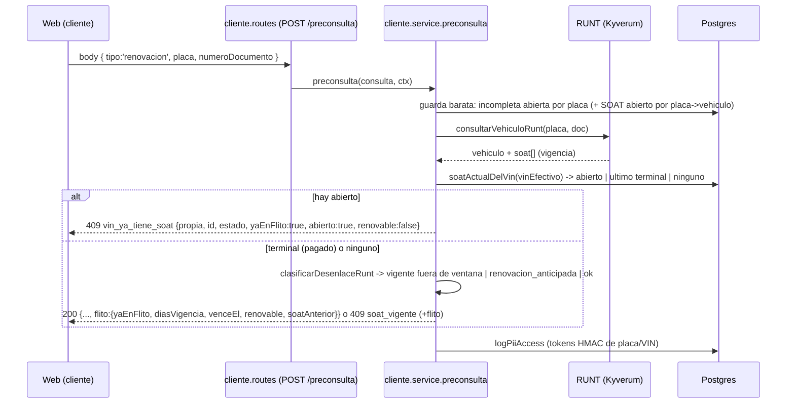

# Diseño full — Feature #14012 / HU0: varios SOAT por vehículo (uno abierto a la vez) y consulta «ya en FLITO»

**Modo:** full (cambio de modelo en una tabla transversal) · **Épica:** #13760 · **ADR:** [ADR-0031](adr/ADR-0031-flito-soat-varios-soat-por-vehiculo-uno-abierto.md) (Propuesto) · **Módulo:** `flito-soat` (prefijo `flito-`, `/api/flito/...`). Los módulos legacy `soat/` y `tramites/` **no se tocan**. Complementa [diseno-feature-14012-soat-tipo-inicial-renovacion.md](diseno-feature-14012-soat-tipo-inicial-renovacion.md) y resuelve su P-1.

Medido sobre el árbol actual (`develop`, última migración `0266`). Numeración y ADR se recomprueban al implementar (hay sesiones en paralelo).

## Contexto

`flito_soat.vin` y `flito_soat.vehiculo_id` son `UNIQUE` incondicionales (`schema.ts:2746-2747`; creados inline en `0096_flito_fase0_schema.sql:72-73`). RN-01 se codificó como «un SOAT por VIN en toda la vida del vehículo». Renovar un SOAT ya gestionado por FLITO da hoy `409 vin_ya_tiene_soat` (`flito-soat-cliente.service.ts:525`).

**Decisión del humano (cerrada):** la renovación cubre SOAT gestionados por FLITO. Varios SOAT por vehículo, **solo uno abierto** a la vez; los anteriores quedan como historial. Con uno abierto, la consulta sigue diciendo «ya está en un proceso». Con uno terminal/vigente, la preconsulta devuelve «ya en FLITO + días de vigencia + renovable» (ventana 30 días ya decidida; vencido = renovable).

**Estados (enum `flito_soat_estado`, solo 4):** `pendiente`, `solicitado`, `con_novedad`, `pagado`.
- **Terminal = `pagado`** (único). `pendiente`/`solicitado`/`con_novedad` son **abiertos** (`con_novedad` se corrige y se reenvía: `flito-estados.ts:171-186`).
- No existe estado `anulado`/`cancelado`: un SOAT en `con_novedad` sin resolver bloquea la renovación indefinidamente (ver pregunta Q2).
- `pagado` es reversible por Operaciones (`reversar`, `flito-soat.service.ts:1631`): hoy podría reabrir un SOAT histórico mientras hay una renovación abierta ⇒ el índice parcial lo rechazaría con 23505 (ver §Inventario, `reversar`).

## Alternativas

### Opción A — Índice único parcial «abierto» (una fila por SOAT, historial = las filas terminales) — RECOMENDADA
Quitar los dos `UNIQUE`; añadir `UNIQUE (vin) WHERE estado <> 'pagado'` y `UNIQUE (vehiculo_id) WHERE estado <> 'pagado'` (+ índices no únicos para lookup). Cada SOAT/renovación es **una fila de `flito_soat`** con su `numero_poliza`, `pagado_en`, `valor_pagado`, `extraccion`, comprobantes (`flito_soportes.soat_id`) y propietario (`flito_compradores.soat_id`).
- Pros: ningún consumidor que ya trabaja **por `flito_soat.id`** cambia (finanzas, liquidación, bolsas, conciliación por póliza, comprobantes, tablero, export, soportes, historial de estados): cada pago sigue siendo una fila, que es lo correcto para contabilidad. La base cierra la carrera «dos abiertos» (23505 ya mapeado a `vin_ya_tiene_soat`). Migración corta y reversible. Patrón ya usado en el repo: `uq_flito_soat_incompletas_vin_abierta` (0210), `uq_flito_vig_vigente`.
- Contras: los lectores que asumen «una fila = un vehículo» (lookups por VIN: sync, excepciones, reintento, RN-01) hay que volverlos conscientes del estado (inventario abajo). El censo del cron de vigencia consulta al RUNT por **fila** ⇒ duplicaría llamadas por vehículo. La cola mostrará dos filas del mismo vehículo (correcto: dos SOAT).
- Esfuerzo: **M**. Riesgos: lookups `limit(1)` sin orden que, con 2 filas, devuelvan la histórica; reversión de un `pagado` histórico.

### Opción B — `flito_soat` queda 1 por vehículo («expediente») + tabla hija `flito_soat_ciclos`
La fila actual sería el vehículo y cada póliza/renovación un ciclo hijo con estado, pago, póliza y soportes.
- Pros: RN-01 intacta; el vehículo conserva una llave estable.
- Contras: `estado`, `valor_pagado`, `pagado_en`, `numero_poliza`, `extraccion`, `proveedor_soat_id`, `gestion_operaciones`, `enviado_*`, `estado_vigencia/vence_el` y las FK de soportes/compradores/historial/tramites **viven en `flito_soat` y las leen ~20 módulos** (finanzas, liquidación, bolsas, conciliación, comprobantes, tablero, export, cron). Moverlas a ciclos es reescribir todos; o duplicarlas (dos fuentes de verdad). La cola tendría una fila por vehículo con el estado del último ciclo: se pierde el conteo por estado y el pago histórico.
- Esfuerzo: **L**. Riesgos: alto (contabilidad, conciliación). Descartada.

### Opción C — Reabrir la misma fila (mutar `pagado → pendiente`) + tabla de snapshots de historial
Mantiene los `UNIQUE`; renovar = volver la fila a `pendiente`, archivando el ciclo previo.
- Pros: cero cambio de esquema en `flito_soat`.
- Contras: **borra el pago anterior** de los agregados (finanzas lee `estado='pagado' AND valor_pagado` por fila, `finanzas.service.ts:214,340`; `pagado_en` se limpia al pasar a pendiente, `flito-soat.service.ts:1664`), rompe la conciliación por póliza y los soportes de la póliza anterior, y mezcla el historial de estados de dos pólizas. Es exactamente lo que ADR-0006/ADR-0008 evitan (la fila es el hecho contable). Descartada.

## Decisión y justificación

**Opción A.** Ancla en el patrón existente (índices parciales de «abierto»), mantiene una fila por póliza (contabilidad intacta) y deja la integridad en la base. El coste real es el inventario de lookups por VIN, que se acota con **un helper único** (`soatActualDelVin`) y un cambio del censo del cron. Detalle y alternativas rechazadas en el ADR-0031.

Reglas del modelo:
1. **A lo sumo un abierto** por `vin` y por `vehiculo_id` (índices parciales).
2. **Cualquier número de terminales** (`pagado`).
3. «SOAT actual de un vehículo» = el abierto si existe; si no, el más reciente (`created_at DESC, id DESC`). Esta definición única la usan sync, excepciones, reintento y el cron.
4. La renovación apunta a su antecesor (`flito_soat_solicitud.soat_anterior_id`, nullable) — historial navegable sin tocar `flito_soat` (que `buscarConAcceso` sirve entera al gestor; ADR-0008 §1.2).
5. `vehicles` sigue 1 ficha por VIN (`vehicles.vin`): no cambia.

## Diagrama de secuencia (preconsulta de renovación sobre un vehículo ya en FLITO)



## Contrato de endpoints (delta)

PII (placa, documento, VIN) **siempre en body**; nada en path/query (AGENTS.md §14). Todas las rutas con `authMiddleware` + los `requireRole`/`soatPreconsultaLimiter` que ya tienen; `registrarAccesoRuntCliente` (`logPiiAccess` con tokens HMAC, ADR-0012) en cada consulta, también en los 409.

`POST /api/flito/soat/cliente/preconsulta` (rutas y límites sin cambio; el cuerpo por tipo es el del diseño principal §4).

DTO nuevo, **aditivo** (`packages/shared-types/src/flito-estados.ts`):

```ts
export interface SoatFlitoContexto {
  yaEnFlito: boolean;                 // existe al menos un flito_soat de ESE vehículo y de ESA compañía
  abierto: boolean;                   // hay uno no terminal (=> en proceso; nunca renovable)
  estadoAbierto: EstadoSoat | null;   // estado del abierto; null si no hay abierto
  soatId: string | null;              // el abierto, o el último terminal (para abrirlo/trazar)
  diasVigencia: number | null;        // venceEl - hoy (día Bogotá). <=0 = vencido. null = sin fecha
  venceEl: string | null;             // 'YYYY-MM-DD'
  fuenteVigencia: 'runt' | 'flito' | null; // RUNT recién consultado manda; si no, flito_soat.vence_el
  renovable: boolean;                 // !abierto && (diasVigencia === null ? false : diasVigencia <= LIMITE_RENOVACION_DIAS(30))
}
```

| Caso | HTTP / código | Cuerpo relevante |
|---|---|---|
| Sin SOAT en FLITO | 200 (como hoy) | `flito: { yaEnFlito:false, abierto:false, renovable:true… }` (renovable lo decide el RUNT: vigente fuera de ventana ⇒ `soat_vigente`) |
| Hay uno **abierto**, propio | 409 `vin_ya_tiene_soat` | `{ propia:true, id, estado, flito:{yaEnFlito:true, abierto:true, estadoAbierto, renovable:false} }`, mensaje «ya está en un proceso» |
| Hay uno abierto, de **otra compañía** | 409 `vin_ya_tiene_soat` | **recortado igual que hoy** (`propia:false`, sin id/estado/vigencia: no se sondea la cartera ajena) |
| Solo terminal(es) propio(s), renovable (`≤30 d` o vencido) | 200 | `flito:{yaEnFlito:true, abierto:false, diasVigencia, venceEl, renovable:true, soatId}` (`vigenciaProxima` actual se conserva) |
| Solo terminal(es) propio(s), fuera de ventana | 409 `soat_vigente` | idem con `renovable:false` y `diasVigencia` |
| Tipo `inicial` y el VIN ya tiene SOAT FLITO (abierto o terminal) | 409 `vin_ya_tiene_soat` (se conserva) | `propia:true` añade `flito` con `renovable` para que la web ofrezca «Renovar» (Q1) |

`diasVigencia` y `fuenteVigencia`: se calcula con el RUNT de la consulta (ya se hace; fuente `runt`); si el RUNT no trae fecha, `flito_soat.vence_el` del último terminal (fuente `flito`); si ninguno, `null` y `renovable:false` (defecto seguro). La ventana usa `limiteRenovacionAnticipada` (`flito-soat-cliente-runt.ts:291`): una sola regla para los dos tipos.

Otros endpoints: cola/detalle sin cambio de contrato salvo `tipoSoat` (diseño principal). `POST /cliente` (alta): el 23505 sobre los índices parciales sigue mapeando a `vin_ya_tiene_soat` (`UNIQUE_VIOLATION`, `flito-soat-cliente.service.ts:1062`, el comentario «solo puede venir del VIN o del vehículo» sigue siendo cierto).

## Modelo de datos (Drizzle) — migración 0267

`schema.ts` (`flitoSoat`): quitar `.unique()` de `vin` y `vehiculoId`; en el callback de índices:

```ts
vinIdx: index('idx_flito_soat_vin').on(t.vin),
vehiculoIdx: index('idx_flito_soat_vehiculo').on(t.vehiculoId),
vinAbiertoUq: uniqueIndex('uq_flito_soat_vin_abierto').on(t.vin).where(sql`${t.estado} <> 'pagado'`),
vehiculoAbiertoUq: uniqueIndex('uq_flito_soat_vehiculo_abierto').on(t.vehiculoId).where(sql`${t.estado} <> 'pagado'`),
```

Migración `0267_flito_soat_varios_por_vehiculo.sql` (SQL a mano, idempotente; **crear antes de quitar**, así nunca hay un instante sin garantía):

```sql
-- 1. índices de lookup (los UNIQUE que se quitan eran también el índice de búsqueda por vin / vehiculo_id)
CREATE INDEX IF NOT EXISTS idx_flito_soat_vin ON flito_soat (vin);
CREATE INDEX IF NOT EXISTS idx_flito_soat_vehiculo ON flito_soat (vehiculo_id);
-- 2. a lo sumo UN SOAT abierto (no terminal) por vin y por vehículo
CREATE UNIQUE INDEX IF NOT EXISTS uq_flito_soat_vin_abierto ON flito_soat (vin) WHERE estado <> 'pagado';
CREATE UNIQUE INDEX IF NOT EXISTS uq_flito_soat_vehiculo_abierto ON flito_soat (vehiculo_id) WHERE estado <> 'pagado';
-- 3. quitar los UNIQUE incondicionales por columnas (nombre por defecto flito_soat_vin_key / _vehiculo_id_key;
--    se resuelve por catálogo para no depender del nombre)
DO $$ DECLARE r record; BEGIN
  FOR r IN
    SELECT c.conname FROM pg_constraint c
    WHERE c.conrelid = 'flito_soat'::regclass AND c.contype = 'u'
      AND (SELECT array_agg(a.attname::text ORDER BY a.attname) FROM pg_attribute a
           WHERE a.attrelid = c.conrelid AND a.attnum = ANY (c.conkey)) IN (ARRAY['vin'], ARRAY['vehiculo_id'])
  LOOP EXECUTE format('ALTER TABLE flito_soat DROP CONSTRAINT %I', r.conname); END LOOP;
END $$;
COMMENT ON TABLE flito_soat IS 'Un SOAT por fila. RN-01 (ADR-0031): a lo sumo UN abierto (estado <> pagado) por vin/vehiculo; los pagados son historial.';
```

- **Backfill: ninguno.** Hoy hay ≤1 fila por vin/vehículo por el `UNIQUE`, así que el índice parcial se crea sin conflicto posible (precondición garantizada por el constraint que se quita después).
- **Idempotente:** `IF NOT EXISTS` y el `DO` no encuentra nada la 2.ª vez (P6: aplicar el archivo dos veces).
- **Locks:** `flito_soat` tiene ~7 000 filas: `CREATE INDEX` (sin `CONCURRENTLY`, el runner puede envolver en transacción) y `DROP CONSTRAINT` son sub-segundo.
- **Rollback (manual, NO va en `migrations/`; el runner no tiene «down»):** solo es válido si **ningún** vin/vehículo tiene >1 fila:
  ```sql
  DO $$ BEGIN IF EXISTS (SELECT 1 FROM flito_soat GROUP BY vin HAVING count(*) > 1 UNION ALL
                         SELECT 1 FROM flito_soat GROUP BY vehiculo_id HAVING count(*) > 1)
    THEN RAISE EXCEPTION 'hay vehículos con varios SOAT: no se puede restaurar el UNIQUE'; END IF; END $$;
  ALTER TABLE flito_soat ADD CONSTRAINT flito_soat_vin_key UNIQUE (vin);
  ALTER TABLE flito_soat ADD CONSTRAINT flito_soat_vehiculo_id_key UNIQUE (vehiculo_id);
  ```
  Una vez creadas renovaciones, el rollback de datos exige decidir qué filas archivar: **el rollback seguro es el de código (revertir el commit en `flit-gitops`)**; el esquema relajado es compatible hacia atrás con el código viejo mientras no existan 2 filas por vin.

### Orden de despliegue (initContainer `db-apply` en cada rollout)

1. **HU0 va sola y primero.** Migración 0267 + código consciente del modelo. **Nadie puede crear la 2.ª fila todavía** (el alta de renovación llega en HU1), así que la ventana del rollout —pod viejo sirviendo mientras el nuevo corre `db-apply`— solo ve el esquema relajado con 1 fila por vin: el código viejo es correcto.
2. HU1 en adelante crea renovaciones, ya con todos los lookups del inventario corregidos en producción. Nunca se despliega la creación de la 2.ª fila junto con la migración.
3. `db-review-agent` obligatorio (toca `schema.ts` y `migrations/`). PDN: `pg_dump` previo a la promoción.
4. Migraciones siguientes del Feature, **reajustadas**: `0268` = tipo en la solicitud + `soat_anterior_id` (antes 0267); `0269` = incompletas multimodalidad (antes 0268).

### Migración 0268 (ajuste al diseño principal) — añade el antecesor

```sql
ALTER TABLE flito_soat_solicitud ADD COLUMN IF NOT EXISTS tipo_soat varchar(10) NOT NULL DEFAULT 'inicial';
ALTER TABLE flito_soat_solicitud ADD COLUMN IF NOT EXISTS soat_anterior_id uuid REFERENCES flito_soat(id);
-- + el CHECK de tipo y la aserción del diseño principal §2, más:
ALTER TABLE flito_soat_solicitud DROP CONSTRAINT IF EXISTS flito_soat_solicitud_anterior_chk;
ALTER TABLE flito_soat_solicitud ADD CONSTRAINT flito_soat_solicitud_anterior_chk
  CHECK (tipo_soat = 'renovacion' OR soat_anterior_id IS NULL);
CREATE INDEX IF NOT EXISTS idx_flito_soat_solicitud_anterior ON flito_soat_solicitud (soat_anterior_id) WHERE soat_anterior_id IS NOT NULL;
```
`soat_anterior_id` es nullable: una renovación cuyo SOAT previo **no** está en FLITO (solo en el RUNT) no tiene antecesor. FK sin `ON DELETE CASCADE` (RESTRICT por defecto): borrar un SOAT histórico no puede dejar huérfana la cadena (ADR-0005).

## Inventario exhaustivo: quién asume «1 SOAT por vin / vehiculo_id»

Búsqueda acotada a `flitoSoat.vin|vehiculoId`, a las lecturas por VIN y a todos los importadores de `flitoSoat` (`apps/api/src`). Veredicto: **CAMBIA** (asume 1 por VIN), **ADAPTAR** (correcto pero con efecto a vigilar) o **OK** (opera por `flito_soat.id`/`tramites.soat_id`, o es un conteo por fila que sigue siendo correcto).

| # | Archivo : línea | Qué asume hoy | Veredicto / cambio |
|---|---|---|---|
| 1 | `flito-soat-cliente.service.ts:515 verificarRn01` | `select … where vin = ? limit 1`; cualquier fila ⇒ 409 | **CAMBIA.** Pasa a `soatActualDelVin`. Abierto ⇒ 409 `vin_ya_tiene_soat` (propia/ajena recortado, como hoy). Solo terminales ⇒ por tipo: `renovacion` continúa y devuelve el contexto; `inicial` conserva el 409 (Q1). El chequeo de `companiaId` ajena se aplica también al terminal (no se renueva el SOAT de otra compañía, `vehiculoAjeno`). Si no hay SOAT, sigue mirando la incompleta abierta |
| 2 | `flito-soat-cliente.service.ts:857 preconsulta` | llama dos veces a RN-01 (antes y después del RUNT) | **CAMBIA.** Devuelve `flito: SoatFlitoContexto`; la RN-01 post-RUNT es la autoritativa; añade la guarda barata por placa (placa→`vehicles`→abierto) solo en renovación |
| 3 | `flito-soat-cliente.service.ts:1418 crearSolicitud` + `insertarSolicitudDespachada` | INSERT con `vin`; la base atrapa el 23505 | **ADAPTAR.** El 23505 ahora viene de `uq_flito_soat_vin_abierto`/`_vehiculo_abierto` (mismo mapeo a 409). Renovación escribe `soat_anterior_id` en el satélite. Fijar el `tipo_soat` ⇒ HU1 |
| 4 | `flito-soat-cliente.service.ts:955 upsertVehiculoRunt` | el comentario dice que la carrera «dos altas del mismo VIN» la cierra `flito_soat.vin UNIQUE` | **OK en código** (opera sobre `vehicles`, que sigue 1 por VIN con `FOR UPDATE`). **Corregir el comentario**: ahora la cierra el índice parcial |
| 5 | `flito-soat-incompletas-reintento.service.ts:126` | `ocupado = existe fila con vin` ⇒ descarta `solicitud_existente` | **CAMBIA.** Inicial: cualquier fila ocupa (como hoy). Renovación (VIN efectivo): solo un **abierto** ocupa; un terminal es el antecesor. `completar` escribe `soat_anterior_id`. El 23505 (`:155`) se mantiene |
| 6 | `flito-soat-incompletas.service.ts` (aparcar) | RN-01 se evalúa antes de aparcar vía `cliente.service` | **ADAPTAR** (hereda #1); `uq_flito_soat_incompletas_vin_abierta` no cambia |
| 7 | `flito-sync/flito-sync.service.ts:521 resolverSoat` | `where vin = tf.vin limit 1`; vincula el trámite y bloquea reencolado si `solicitado/pagado` | **CAMBIA.** Pasa a `soatActualDelVin` (abierto, si no el último). Semántica preservada: un vehículo con SOAT `pagado` sigue vinculando el trámite al SOAT existente y **no** crea uno (la renovación solo nace por el canal Cliente; ver Q5) |
| 8 | `flito-excepciones/flito-excepciones.service.ts:171 crearSoatExcepcional` | idem; marca `excepcion_autogestion` en el existente | **CAMBIA.** Mismo helper; marca el SOAT actual |
| 9 | `flito-soat-vigencia.service.ts:221 vehiculosAVerificar` + `flito-soat-censo.ts` + `vigencia.cron` | el censo es **por fila** (`EXISTS` comprobante) y consulta al RUNT por `vin` | **CAMBIA (importante).** Con historial, cada póliza vieja consultaría el RUNT del mismo vehículo cada noche (coste y `sin_registro` espurio sobre pólizas vencidas). Censo = **solo la fila actual por vehículo** (`DISTINCT ON (vehiculo_id) … ORDER BY vehiculo_id, created_at DESC`, filtrado después por el corte). El resultado se escribe solo a esa fila (ya lo hace por `soat_id`, `:377`) |
| 10 | `flito-soat.service.ts:1631 reversar` (`reversarEnTx`) | mover `pagado → pendiente` siempre es posible | **CAMBIA.** Si el destino es un estado abierto y el vehículo ya tiene otro abierto ⇒ `SoatError(409, 'El vehículo ya tiene otro SOAT abierto')` (evita 23505 crudo). Test nombrado |
| 11 | `flito-soat.service.ts` cola/`condicionesCola`/`conJoinsCola`, `:602,681,1400,1417` | join `flitoSoat.vehiculoId → vehicles` (N:1) | **OK.** Una fila por SOAT: dos filas del mismo vehículo son correctas. Solo suma `tipoSoat` (diseño principal). Ver Nota de UX abajo |
| 12 | `flito-soat.service.ts:1129 buscarConAcceso` | por `id` | **OK.** No usa vin/vehículo |
| 13 | `flito-soat.service.ts:1966, 2089` (`datosCargaPorId`, similar) | por `id` + join vehículo | **OK** |
| 14 | `flito-soat.export.service.ts:77-120`, `flito-soat.export-pago.ts` | una fila por SOAT, columna `vin` | **OK.** Más filas por vehículo es lo esperado; sin dedupe |
| 15 | `flito-liquidacion`, `flito-bolsas.descuento*`, `flito-compuerta`, `flito-comprobantes.cruce/duenos/desaplicar`, `flito-tramites.service`, `finanzas.service`, `flito-tablero:53` | `flito_tramites.soat_id → flito_soat.id` (muchos trámites → 1 SOAT) | **OK.** Los trámites apuntan a un SOAT concreto; los SOAT de renovación (`origen='cliente'`) no tienen trámite |
| 16 | `finanzas.gastos-diarios.ts`, `finanzas.service.ts:214,340` | `estado='pagado' AND valor_pagado` por fila | **OK y es la razón de la Opción A:** cada póliza pagada es una fila contable |
| 17 | `flito-tablero.service.ts:63`, `clients.service.ts:149`, `flito-proveedores-estado.service.ts:78` | conteos `estado` / `ne(estado,'pagado')` por fila | **OK.** `ne('pagado')` ya es «abiertos» |
| 18 | `flito-conciliacion.service.ts:147-274` | cruce por `numero_poliza` y `flito_soat.id` | **OK.** Cada renovación trae su póliza |
| 19 | `flito-revisiones.service.ts:200` | por `id` | **OK** |
| 20 | `scripts/flito-backfill-soat.ts:78,145` | set de VIN existentes para no duplicar | **OK** (idempotente por «existe alguna fila»); documentar que no genera renovaciones |
| 21 | `shared/soportes/soportes-consulta.ts`, `flito-soportes.soat_id`, `flito_compradores.soat_id`, `flito_estado_historial.registro_id` | por `soat_id` | **OK.** Cada póliza conserva sus soportes, propietario e historial |
| 22 | `packages/shared-types/src/flito-estados.ts` (`ESTADOS_SOAT_BLOQUEAN_REENCOLADO`, textos «RN-01 … un vehículo no puede tener dos») | prosa y copy | **CAMBIA.** Añadir `ESTADOS_SOAT_TERMINALES = ['pagado']` + `soatEstaAbierto()`. Reescribir el mensaje de RN-01: «ya tiene un SOAT en proceso» |
| 23 | Tests que citan RN-01/`vin_ya_tiene_soat` (`flito-soat.cliente-alta*.test.ts`, `cliente-incompleta-alta`, `cliente-renovacion-anticipada`, `flito-sync*.test.ts`, `flito-excepciones`, `flito-soat-migracion-0177-vigencia`) | mocks con una sola fila por VIN | Revisar los que afirman el 409 con un `pagado` (cambia por tipo) y añadir los nuevos (P1: solo los de este WI) |
| 24 | Web: `pages/FlitoSoatSolicitud.tsx`, `lib/soatCliente.ts`, `components/flito/soat-cliente/TarjetaSolicitudGuardada.tsx` | tratan `vin_ya_tiene_soat` como bloqueo definitivo | **grep obligatorio (regla 7)** al añadir `flito` a la preconsulta; el copy cambia en HU3 |

**Nota de UX (no es defecto):** la cola mostrará dos filas por vehículo (la renovación abierta y, si el filtro de estado lo permite, la `pagado` previa). El filtro por estado ya separa abiertos de pagados; no se agrupa por vehículo.

### Helper único (`flito-soat-actual.ts`, nuevo, ~40 líneas)

`soatActualDelVin(tx|db, vin): Promise<{ id, estado, companiaId, venceEl, createdAt } | null>` — abierto si existe, si no el último por `created_at DESC, id DESC`. Es la **única** definición de «el SOAT del vehículo»; los lookups #1, #5, #7, #8 la llaman y el censo (#9) la replica en SQL. Un test garantiza que los 4 llamadores no vuelvan a `select … where vin … limit 1` (grep acotado en el test del helper).

## Archivos a crear/modificar (HU0)

**Crear**
- `apps/api/src/db/migrations/0267_flito_soat_varios_por_vehiculo.sql`
- `apps/api/src/modules/flito-soat/flito-soat-actual.ts` (helper) + `apps/api/__tests__/services/flito-soat.actual-del-vin.test.ts`

**Modificar**
- `apps/api/src/db/schema.ts` (`flitoSoat`: quitar `.unique()`, 4 índices; actualizar el comentario «RN-01: un SOAT por VIN»)
- `apps/api/src/modules/flito-soat/flito-soat-cliente.service.ts` (`verificarRn01`, `preconsulta`, comentarios de `upsertVehiculoRunt`)
- `apps/api/src/modules/flito-soat/flito-soat-incompletas-reintento.service.ts` (`ocupado`)
- `apps/api/src/modules/flito-sync/flito-sync.service.ts` (`resolverSoat`)
- `apps/api/src/modules/flito-excepciones/flito-excepciones.service.ts` (`crearSoatExcepcional`)
- `apps/api/src/modules/flito-soat/flito-soat-vigencia.service.ts` (`vehiculosAVerificar`)
- `apps/api/src/modules/flito-soat/flito-soat.service.ts` (`reversarEnTx`; **techo congelado 1090, hoy ≈1076: +≤3 líneas o el guard va a `flito-soat-actual.ts`**)
- `packages/shared-types/src/flito-estados.ts` (`ESTADOS_SOAT_TERMINALES`, `soatEstaAbierto`, `SoatFlitoContexto`, copy RN-01)
- Tests P1 de este WI (alta/RN-01, reintento, sync, excepciones, vigencia-censo, reversar) — nombrar solo los modificados
- `apps/web`: ninguno en HU0 (el DTO es aditivo); grep de `vin_ya_tiene_soat` en web para dejar constancia

## Impacto en shared-types

Aditivo: `ESTADOS_SOAT_TERMINALES`, `soatEstaAbierto(estado)`, `SoatFlitoContexto`, `LIMITE_RENOVACION_DIAS` (30; hoy vive en `limiteRenovacionAnticipada`, se exporta la constante sin cambiar la función). Cambiar el texto de RN-01 en `flito-estados.ts` exige `grep` en `apps/web` (regla 7). `npm run build -w packages/shared-types` + `npm run test:shared-types`.

## Notas operativas por agente

- **backend-agent (HU0):** P1 = solo los tests de esta lista; sin mutantes. `build:api` con el heap documentado. Aplicar el SQL **dos veces** sobre la BD local (P6) y avisar de que se tocó. Logs sin VIN/placa en claro; `diasVigencia` no es PII. El 409 al ajeno **no** lleva `flito` (sondeo).
- **db-review-agent:** índices parciales con predicado `estado <> 'pagado'` (inmutable sobre enum); que el planificador use `uq_…_abierto` en el lookup del abierto; que `idx_flito_soat_vin/vehiculo` cubren los lookups que antes daba el UNIQUE; ausencia de FK a `flito_soat(vin)`.
- **security-agent:** el DTO no debe permitir sondeo cross-compañía (`yaEnFlito/diasVigencia` solo para la compañía dueña); `logPiiAccess` en preconsulta y 409; body-only.
- **qa-agent:** mutantes ≤3 con lógica condicional: (a) `soatEstaAbierto` invertido, (b) lookup sin preferir el abierto, (c) censo sin `DISTINCT ON` (consulta doble al RUNT).
- **frontend-agent:** nada en HU0; HU3 consume `flito` para «ya en FLITO · quedan N días».

## Riesgos abiertos y qué falta decidir

1. **Q1–Q5** (abajo, una ronda al humano).
2. `con_novedad` eterno bloquea la renovación (no hay estado de anulación). Mitigación actual: el flujo normal lo corrige y reenvía, o Operaciones lo `reversar`.
3. Lookups no inventariados en módulos de otros equipos (el grep cubre `apps/api/src`; nada fuera).
4. Rollback de datos tras crear renovaciones: solo por código (arriba).
5. Si Kyverum no trae fecha de vencimiento, `renovable:false` por defecto seguro; el spike §0.4 del diseño principal lo despeja.

### Preguntas para el humano (única ronda, solo las que cambian comportamiento)

- **Q1.** Alta **Inicial** individual de un VIN que ya tiene SOAT FLITO terminal: ¿se mantiene el 409 (con «use Renovación») —recomendado, coherente con la decisión 6 de la Épica— o se permite crear un SOAT nuevo?
- **Q2.** ¿Un SOAT abierto «atascado» (`con_novedad` o `solicitado` sin cerrar) debe poder cerrarse/anularse para liberar al vehículo? Hoy no existe ese estado; ¿se acepta que se resuelva con el flujo normal / `reversar` de Operaciones (recomendado, sin estado nuevo)?
- **Q3.** Confirmar que **terminal = solo `pagado`** (`solicitado` y `con_novedad` cuentan como «en proceso»).
- **Q4.** `reversar` un `pagado` histórico cuando ya hay una renovación abierta: ¿bloquear con 409 (recomendado)?
- **Q5.** Trámite nuevo de FLIT (sync) o excepción sobre un vehículo cuyo SOAT está `pagado` y **vencido**: hoy se vincula al SOAT existente y no se crea otro. ¿Se mantiene (recomendado, fuera de este Feature) o debe crear un SOAT nuevo?

## Corte de HUs recomendado (Feature #14012, re-cortado)

| HU | Tipo | SP | Contenido | Depende de | Prueba |
|---|---|---|---|---|---|
| **HU0** | BACKEND | 8 | Migración 0267 + schema; `soatActualDelVin` y los 4 llamadores (#1, #5, #7, #8); censo del cron (#9); guard de `reversar` (#10); shared-types (`terminales`, `SoatFlitoContexto`); preconsulta/409 de Inicial devuelve `flito` (ya en FLITO, días, renovable) por VIN; PII body + `logPiiAccess`; comentarios RN-01. **Nadie crea aún la 2.ª fila** | — (despliega sola a DEV) | sola por API |
| HU1 | BACKEND | 8 | (antes HU1, −migración, +antecesor) tipo en alta/preconsulta; renovación por placa+documento; AC0 Kyverum; 422 sin SOAT anterior; ventana; alta de renovación sobre un vehículo ya en FLITO (`soat_anterior_id`); migración 0268; DTO cola con tipo | HU0 + spike Kyverum (parada) | sola por API |
| HU2 | BACKEND | 5 | Renovación con RUNT caído → incompleta, reintento por placa+doc, descartes; migración 0269 | HU1 | sola por API |
| HU3 | FRONTEND | 5 | Selector Inicial/Renovación, formulario, «ya en FLITO · quedan N días · renovar», «en proceso», 4 estados, a11y, ayuda, E2E | HU1+HU2 (+ux-agent slim) | con HU1+HU2 |

Cadena: HU0 → HU1 → HU2 → HU3. **Total 26 SP** (antes 18; +8 por el cambio de modelo). El spike Kyverum puede correr en paralelo a HU0 (no la bloquea).
