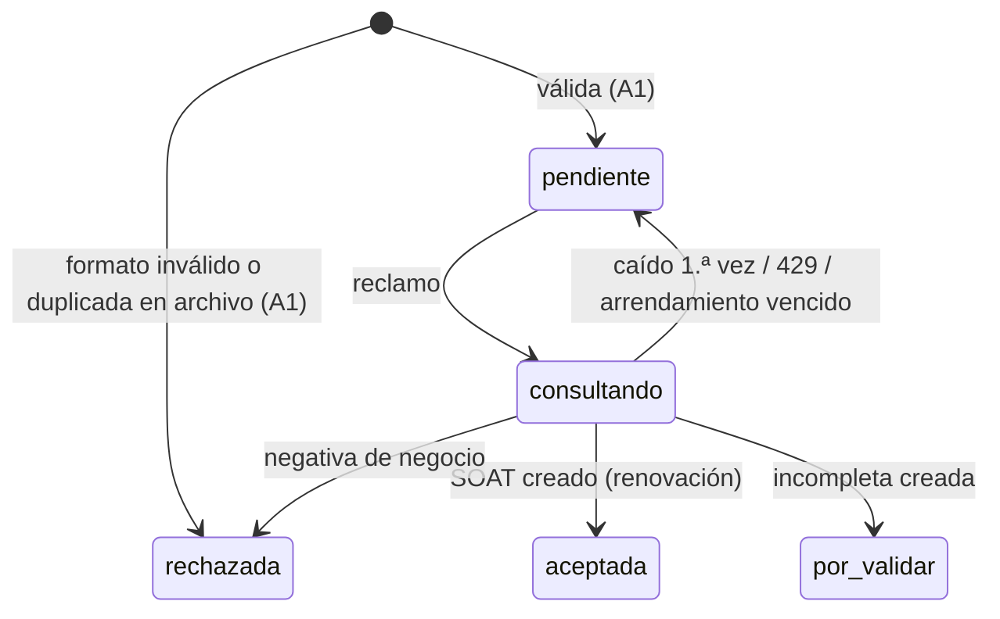

# Diseño — Carga masiva de SOAT sin trámite (Features #14013 y #14014)

**Modo:** full · **Épica:** #13760 · **Features:** #14013 (renovaciones), #14014 (Inicial con factura pendiente) · **HU:** #14131–#14137 · **ADR:** [ADR-0032](adr/ADR-0032-flito-soat-carga-masiva-cola-en-postgres-y-pii-efimera.md) (Propuesto) · **Habla con:** `flito-soat` canal Cliente (**no** el `soat/` legacy). Depende de ADR-0030 (renovación por placa, incompletas multimodalidad) y ADR-0031 (varios SOAT por vehículo, uno abierto).

> Limitaciones de esta lectura: el MCP de ADO no está disponible para este agente, así que los AC Gherkin de #14131–#14137 **no se leyeron**; el reparto por HU de §9 sale del pedido del hilo y de `docs/ado-drafts/epica-13760/ESTADO.md`, y debe contrastarse con los títulos reales (marcado «supuesto»). No se leyó el cuerpo de `crearSolicitud` en `flito-soat-cliente.service.ts`: el punto de costura (R-3) lo confirma el backend-agent.

## 1. Contexto

Ya existe en la rama: compuerta RUNT por VIN o placa+documento (`consultarYClasificar`, `DesenlaceRunt` con `ok | renovacion_anticipada | revise | sin_soat_anterior | caido`), incompletas multimodalidad con motivos `runt_sin_respuesta | falta_factura_venta | faltan_datos_propietario` y el CHECK `factura_inicial_chk` (migración 0269), `aparcarSolicitud`, `reintentarIncompleta` y su `completar`. **No existe** nada de cola, lote, parseo de Excel del canal Cliente, ni endpoint para adjuntar factura / confirmar una incompleta.

Decisiones ya cerradas por el humano (no se reabren, solo se validan en §2): worker en la misma API, `SKIP LOCKED`, concurrencia 2/proceso con tope por compañía y backoff por 429, polling 2–3 s, solo XLSX, 200 filas / 1 MB, un lote activo por compañía, permiso `soat.solicitud.crear`, PII de filas efímera.

## 2. Alternativas de cola / worker / persistencia

| | Opción 1 — Postgres + `SKIP LOCKED`, worker en la API | Opción 2 — BullMQ + Redis | Opción 3 — Bucle en memoria / fire-and-forget | Opción 4 — Worker en Deployment aparte |
|---|---|---|---|---|
| Pros | Sin dependencia ni infra; estado durable y transaccional con las tablas de dominio; reclamo atómico entre réplicas; reutiliza el patrón de crons del módulo | Reintentos, backoff y rate limiting listos | Trivial | Aísla la carga del tráfico web |
| Contras | Hay que escribir reclamo, recuperación y backoff (≈200 líneas); polling sobre Postgres | Dependencia nueva; Redis no es durable aquí (el lote se perdería); el estado de negocio igual vive en Postgres (doble fuente de verdad) | No sobrevive a reinicio/rollout; sin tope entre réplicas | Otro manifiesto en `flit-gitops` y otro entrypoint; sobredimensionado para ≤200 filas |
| Esfuerzo | M | M–L | S | L |
| Riesgos | R-1, R-2, R-4 (abajo) | Pérdida de lotes; superficie nueva | Pérdida silenciosa; cuota Kyverum sin control | Operativo |

**Recomendación: Opción 1.** Límites declarados:

- **Réplicas de la API.** El reclamo `UPDATE … WHERE id IN (SELECT … FOR UPDATE SKIP LOCKED)` entrega cada fila a un solo pod. El tope por compañía se hace exacto bloqueando primero la fila del **lote** con `FOR UPDATE SKIP LOCKED` (un lote por compañía activo, por el índice único parcial), contando las `consultando` de esa compañía y reclamando solo `min(cupoCompañía − enVuelo, cupoLocal)`. Dos pods con el cron encendido **no duplican** trabajo: se reparten el cupo. Capacidad total contra Kyverum = `2 × réplicas` por compañía como máximo 2 (el cupo de compañía manda).
- **Cron en 2 pods.** El tick no necesita `withLock` (el reclamo ya serializa). La **recuperación de huérfanas** y la **purga de PII** sí van bajo `withLock('soat-masivo-mant', ttl)` para no repetir trabajo (son idempotentes de todos modos).
- **Drenado en rollout GitOps.** Al recibir SIGTERM: dejar de reclamar, esperar las filas en vuelo (cada una es una llamada RUNT acotada) hasta `terminationGracePeriodSeconds` (verificar que supere el timeout de `consultarVehiculoRunt`; si no, subirlo en `flit-gitops`). Lo que no termine queda `consultando` y otro pod lo recupera al vencer el arrendamiento (`LEASE = 3 min`, debe ser > timeout RUNT; el backend lo verifica contra el timeout real).
- **Tamaño de transacción.** Reclamo: ms (lote + ≤2 filas). La llamada Kyverum va **fuera** de toda transacción. Resultado de cada fila: una transacción corta (la que ya usa `aparcarSolicitud` / alta). Cierre del lote: un `UPDATE` condicional (`NOT EXISTS` pendientes/consultando) idempotente.
- **Ritmo contra Kyverum.** Compartido con la preconsulta interactiva; el worker no pasa por la ruta limitada a 15/15 min pero respeta su propio tope y el backoff por 429 (R-2). 200 filas a concurrencia 2 y ~3–5 s por llamada son ≈ 5–8 min; **medir** (§8).
- **Idempotencia ante caída a mitad.** `soat_id_reservado` se fija al reclamar. La creación del SOAT o de la incompleta usa ese id; si el pod muere después de crear y antes de marcar la fila, la repetición encuentra el id y marca `aceptada`/`por_validar` en lugar de rechazar por «ya existe» (unique de `soat_id_reservado` en incompletas; PK en `flito_soat`).

## 3. Ciclo de vida

```mermaid
sequenceDiagram
  autonumber
  actor U as Usuario (soat.solicitud.crear)
  participant API as API (routes masivo)
  participant DB as Postgres
  participant W as Worker (cron, misma API)
  participant K as Kyverum / RUNT
  U->>API: POST /cliente/masivo (xlsx, tipo)
  API->>API: limiter -> multer(1 MB) -> parse exceljs -> validar filas
  API->>DB: INSERT lote(en_cola) + filas(pendiente | rechazada)
  API-->>U: 201 {loteId, total, rechazadasDeEntrada}
  loop cada 2 s (todos los pods)
    W->>DB: tx: lote FOR UPDATE SKIP LOCKED; cupo compañía; fila -> consultando (+soat_id_reservado)
    W->>K: consultarYClasificar (fuera de tx)
    alt 429
      W->>DB: fila -> pendiente (sin gastar intento); pausa del proceso con backoff
    else ok / anticipada
      W->>DB: tx: SOAT renovación solicitado (renovación) o incompleta falta_factura_venta (inicial); fila aceptada | por_validar
    else caído (1.ª vez)
      W->>DB: fila -> pendiente (proximo_intento_en = +30 s)
    else caído (2.ª vez)
      W->>DB: tx: incompleta runt_sin_respuesta; fila por_validar
    else negativa de negocio
      W->>DB: fila rechazada (motivo)
    end
    W->>DB: si no quedan pendiente/consultando: lote terminado + contadores + anonimizar PII no rechazada
  end
  loop polling 2-3 s
    U->>API: GET /cliente/masivo/:loteId
    API-->>U: contadores (sin PII)
  end
  U->>API: POST /cliente/masivo/:loteId/rechazadas
  API->>DB: leer PII rechazadas, marcar descargada_en
  API-->>U: xlsx (plantilla + Motivo) y logPiiAccess(export)
  W->>DB: purga: PII + filas fuera a descargada_en+gracia o terminado_en+24 h
```





```mermaid
stateDiagram-v2
  [*] --> en_cola: alta (A1)
  en_cola --> procesando: primer reclamo (A2)
  procesando --> terminado: sin pendientes ni consultando (A2)
  en_cola --> terminado: 0 filas válidas en el alta (A1)
  terminado --> [*]: PII borrada (A3); el lote queda sin filas
```

## 4. Modelo de datos

Archivo nuevo `apps/api/src/db/schema/flito-soat-masivo.ts` (re-exportado por `schema.ts` como `flito-soat-incompletas.ts`; mismas FKs perezosas). Migraciones **SQL a mano, idempotentes**, numeración a comprobar al implementar (hoy la libre es **0270**; hay sesiones en paralelo).

### 4.1 A1 — migración `0270_flito_soat_masivo_lotes_filas.sql`

**`flito_soat_masivo_lotes`**

| Columna | Tipo | Notas |
|---|---|---|
| `id` | uuid PK default random | opaco, va en path |
| `compania_id` | integer NOT NULL FK `clients(id)` | alcance |
| `creado_por_id` | integer FK `users(id)`, `creado_por_nombre varchar(150) NOT NULL` | patrón de incompletas |
| `tipo_soat` | varchar(10) NOT NULL, CHECK `IN ('renovacion','inicial')` | plantilla usada |
| `estado` | varchar(12) NOT NULL default `'en_cola'`, CHECK `IN ('en_cola','procesando','terminado')` | vocabulario completo desde A1 |
| `total_filas` | smallint NOT NULL, CHECK `BETWEEN 1 AND 200` | filas de datos tras ignorar vacías |
| `archivo_hash` | varchar(64) NOT NULL | sha256 del XLSX (trazabilidad sin guardar el archivo; **no** nombre) |
| `creado_en` | timestamptz NOT NULL default now() | |

Índices: **único parcial** `uq_flito_soat_masivo_lote_activo ON (compania_id) WHERE estado IN ('en_cola','procesando')` (un lote activo por compañía; la inserción concurrente pierde con `23505` → 409); `idx_..._compania_creado (compania_id, creado_en DESC)`.

**`flito_soat_masivo_filas`**

| Columna | Tipo | Notas |
|---|---|---|
| `id` | uuid PK | |
| `lote_id` | uuid NOT NULL FK `lotes(id)` **ON DELETE CASCADE** | |
| `n_fila` | smallint NOT NULL | número de fila del Excel (2..201); UNIQUE `(lote_id, n_fila)` |
| `estado` | varchar(12) NOT NULL, CHECK `IN ('pendiente','consultando','aceptada','por_validar','rechazada')` | vocabulario completo |
| `motivo_rechazo` | varchar(30) NULL | CHECK en A1: `placa_invalida, documento_invalido, nombre_invalido, correo_invalido, celular_invalido, vin_invalido, fila_duplicada` |
| `placa` varchar(10), `documento` varchar(20), `nombre` varchar(150), `correo` varchar(150), `celular` varchar(20), `vin` varchar(17) | NULL | **PII de la fila, efímera.** Renovación: placa, documento, nombre, correo, celular. Inicial: vin. Largos a alinear con `flito_compradores` / `PropietarioSolicitud` (backend) |

CHECKs: `(estado = 'rechazada') = (motivo_rechazo IS NOT NULL)`; `estado NOT IN ('pendiente','consultando') OR` la PII de su tipo está completa (placa y documento para renovación, vin para inicial) — evita filas pendientes sin datos. Índice `idx_..._lote (lote_id, estado)`.

**Qué se guarda y qué no.** No se guarda el XLSX, su nombre, ni la fila original cruda. Las filas **rechazadas de entrada** guardan la PII ya parseada (la necesita la descarga de rechazadas); si un valor no se pudo normalizar (p. ej. celular con letras) se guarda el texto recortado a la longitud de la columna, no más. Nada de la PII entra en logs ni en URL.

**Qué NO entrega A1:** columnas del worker, la purga, los contadores congelados.

### 4.2 A2 — migración `0271_flito_soat_masivo_worker.sql`

Lote: `iniciado_en timestamptz`, `terminado_en timestamptz`, `n_aceptadas / n_por_validar / n_rechazadas smallint` (se escriben una sola vez al terminar, **contadores congelados**; durante el avance se calculan con `GROUP BY estado`), CHECK `(estado = 'terminado') = (terminado_en IS NOT NULL)`, índice de lotes por terminar `(estado) WHERE estado <> 'terminado'`.

Fila: `intentos smallint NOT NULL default 0 CHECK (intentos BETWEEN 0 AND 3)`, `proximo_intento_en timestamptz NOT NULL default now()`, `reclamada_en timestamptz`, `soat_id_reservado uuid`, `soat_id uuid FK flito_soat(id)`, `incompleta_id uuid FK flito_soat_incompletas(id)`, `ultima_causa varchar(10)` (mismo vocabulario `timeout|red|circuito|otro`, 429 se mapea a `otro`). CHECKs: `estado = 'consultando' => reclamada_en IS NOT NULL AND soat_id_reservado IS NOT NULL`; `(estado = 'aceptada') = (soat_id IS NOT NULL)`; `(estado = 'por_validar') = (incompleta_id IS NOT NULL)`. Se **amplía** el CHECK de `motivo_rechazo` con `runt_no_cuadra, runt_sin_registro, runt_sin_vin, soat_vigente, sin_soat_anterior, solicitud_existente` (DROP/ADD CONSTRAINT, como la 0269). Índices del reclamo: `idx_..._claim (lote_id, proximo_intento_en) WHERE estado = 'pendiente'` y `idx_..._huerfanas (reclamada_en) WHERE estado = 'consultando'`.

Terminación: `UPDATE … SET estado='terminado'` y, **en la misma transacción**, `UPDATE filas SET placa=NULL, documento=NULL, nombre=NULL, correo=NULL, celular=NULL, vin=NULL WHERE lote_id=… AND estado IN ('aceptada','por_validar')`.

### 4.3 A3 — migración `0272_flito_soat_masivo_purga_pii.sql`

Lote: `descargada_en timestamptz`, `pii_borrada_en timestamptz`; índice `(terminado_en) WHERE estado='terminado' AND pii_borrada_en IS NULL`. Purga = por lote vencido (`descargada_en + gracia` o `terminado_en + 24 h`, lo primero): `DELETE FROM filas WHERE lote_id=…` y `pii_borrada_en = now()`. Los contadores del lote sobreviven sin PII. Política: actualizar `docs/privacy/retencion-flito-soat.md`.

### 4.4 B1 y B2

Se **espera ninguna migración** (el vocabulario de motivos pendientes y el CHECK `factura_inicial_chk` ya existen en 0269; `placa` y `vin` de incompletas bastan). Verificar en B1: la incompleta de una Inicial que ya tiene SOAT (`tipo_soat='renovacion'`, `modalidad_consulta='placa'`, `placa` del RUNT, `vin` tecleado, motivo `faltan_datos_propietario`) cumple `modalidad_chk` y los únicos parciales por VIN y placa abiertos. Si apareciera una columna necesaria (p. ej. guardar el documento esperado), sería `0273` con su revisión de db-review.

### 4.5 Esqueleto Drizzle (referencia, no producción)

```ts
// apps/api/src/db/schema/flito-soat-masivo.ts  (import circular perezoso, como flito-soat-incompletas.ts)
export const flitoSoatMasivoLotes = pgTable('flito_soat_masivo_lotes', {
  id: uuid('id').primaryKey().defaultRandom(),
  companiaId: integer('compania_id').notNull().references(() => clients.id),
  creadoPorId: integer('creado_por_id').references(() => users.id),
  creadoPorNombre: varchar('creado_por_nombre', { length: 150 }).notNull(),
  tipoSoat: varchar('tipo_soat', { length: 10 }).notNull(),
  estado: varchar('estado', { length: 12 }).notNull().default('en_cola'),
  totalFilas: smallint('total_filas').notNull(),
  archivoHash: varchar('archivo_hash', { length: 64 }).notNull(),
  creadoEn: timestamp('creado_en', { withTimezone: true }).notNull().defaultNow(),
  // A2: iniciadoEn, terminadoEn, nAceptadas, nPorValidar, nRechazadas · A3: descargadaEn, piiBorradaEn
}, (t) => ({ /* uq lote activo parcial, idx compañía, CHECKs repetidos aquí (lección de la 0157) */ }));
// flitoSoatMasivoFilas: columnas de §4.1 (+ §4.2 en A2), FK lote ON DELETE CASCADE, FKs a flito_soat y flito_soat_incompletas.
```

## 5. Contrato HTTP

Router nuevo montado **antes** de las rutas `/cliente/:…` de `flito-soat-cliente.routes.ts` (evitar colisión con parámetros), bajo `/api/flito/soat/cliente/masivo…`. Todas: `authMiddleware` + `exigirFuncion('soat.solicitud.crear')` (la misma que ya usa `/cliente`); alcance por compañía con el mismo mecanismo de `/cliente` (`companiaId` solo para usuarios con alcance de varias compañías); lote de otra compañía = **404**. Errores: `{ error: string, codigo?: string }` con copy recortado, nunca el mensaje crudo de Kyverum/exceljs/Postgres.

Limiters nuevos (definidos en `flito-soat-masivo.limiters.ts` si `rateLimit`/`userOrIpKey`/`makeStore` están exportados en `shared/middleware/rateLimiter.ts`; si no, ahí — el backend verifica). **No** se encadena `soatClienteLimiter` (20/15 min): el sondeo lo agotaría.

| Método y ruta | HU | Limiter (antes de multer) | Body / efecto | Respuestas |
|---|---|---|---|---|
| `GET /cliente/masivo/plantilla?tipo=renovacion\|inicial` | A1 (supuesto) | lectura | Devuelve el XLSX con encabezados (sin datos, sin PII; GET legítimo) | 200 xlsx · 400 `tipo_invalido` |
| `POST /cliente/masivo` | **A1** | `soatMasivoAltaLimiter` 5/15 min/usuario | multipart: `archivo` (1 archivo, 1 MB, `fileFilter` xlsx + verificación de firma ZIP `PK` y tope de tamaño descomprimido leyendo el directorio central, antes de pasar a exceljs), campos `tipo`, `companiaId?`. Parsea primera hoja, fila 1 = encabezados (normalizados: sin tilde/mayúsculas, orden libre), celdas como texto, ignora filas vacías al final; crea lote `en_cola` + filas (inválidas nacen `rechazada`). Un `logPiiAccess` por lote | 201 `{ loteId, tipo, total, aceptadasEnCola, rechazadasDeEntrada }` · 400 `archivo_requerido` / `formato_invalido` / `encabezados_invalidos` (lista de nombres de columna, nunca datos) / `archivo_vacio` · 409 `lote_activo` `{ loteId }` · 413 `archivo_muy_grande` · 422 `demasiadas_filas` · 403 · 404 · 429 |
| `GET /cliente/masivo/activo` | A3 (supuesto) | lectura | Lote en curso de la compañía (para volver a la vista) | 200 `{ loteId \| null }` |
| `GET /cliente/masivo/:loteId` | **A3** | `soatMasivoLecturaLimiter` ~90/min/usuario | Polling. **Sin PII**: `{ estado, tipo, total, pendientes, procesando, aceptadas, porValidar, rechazadas, motivosRechazo: [{codigo, cantidad}], rechazadasDescargables: boolean, piiExpiraEn }`; `Cache-Control: no-store` | 200 · 404 |
| `POST /cliente/masivo/:loteId/rechazadas` | **A3** | descarga 10/15 min | POST (no GET) porque marca `descargada_en` y es destructivo diferido. Arma el XLSX al vuelo (formato de la plantilla + columna `Motivo`; los valores que empiecen por `= + - @` se escapan contra inyección de fórmulas). `logPiiAccess(export)` | 200 xlsx · 404 · 409 `lote_no_terminado` · 410 `pii_borrada` · 204 si no hubo rechazadas |
| `POST /cliente/incompletas/:id/factura` | **B2** | `soatClienteLimiter` + multer PDF 15 MB (como `/cliente`) | multipart `facturaVenta`. Verifica PDF real, OCR, compara el VIN de la factura con el de la incompleta. Distinto → **no guarda** y responde 422 `vin_no_coincide`; igual → guarda factura (columnas `factura_*`, S3 con `soat_id_reservado`) y devuelve el prellenado | 200 `{ prellenado: {propietario…} }` · 404 · 409 `incompleta_no_abierta` / `motivo_no_admite_factura` · 422 · 503 `ocr_no_disponible` |
| `POST /cliente/incompletas/:id/confirmar` | **B2** | `soatClienteLimiter` | JSON: datos del propietario revisados (+ `numeroDocumento` si el motivo es `faltan_datos_propietario`). Repite la compuerta RUNT (VIN para Inicial; placa+documento para la Renovación pendiente) y llama a `completar` → SOAT `solicitado` con `id = soat_id_reservado`. Exige factura adjunta si es Inicial | 201 · 404 · 409 · 422 (`runt_no_cuadra`, `sin_soat_anterior`, `soat_vigente`, `factura_requerida`) · 503 `runt_no_disponible` (la incompleta sigue abierta) |

PII en body siempre; el `:loteId`/`:id` es uuid opaco. Cada `registrarAcceso…` nuevo va en `flito-soat-masivo.pii.ts` (HMAC ADR-0012 si el registro necesita referir placa/VIN; el de lote lleva ids, tipo y conteos).

## 6. Reglas por fila (worker)

**Renovación (A2).** `consultarYClasificar({modalidad:'placa', placa, documento}, 'renovacion')`.

| Desenlace | Fila | Efecto |
|---|---|---|
| `ok` / `renovacion_anticipada` | `aceptada` | SOAT renovación `solicitado` sin factura, propietario de la fila |
| `caido` (1.ª) | `pendiente` +30 s | `intentos=1` |
| `caido` (2.ª) | `por_validar` | incompleta `runt_sin_respuesta`, modalidad `placa`, sin factura |
| `revise` (`runt_no_cuadra`/`runt_sin_registro`/`runt_sin_vin`), `sin_soat_anterior`, ya vigente fuera de ventana, otra abierta | `rechazada` | motivo del vocabulario |
| 429 (señal de transporte) | `pendiente` | sin gastar intento; pausa con backoff 5 s → 60 s |

**Inicial (B1).** `consultarYClasificar({modalidad:'vin', vin}, 'inicial')`: negativa → `rechazada`; vigente → `rechazada soat_vigente`; **el VIN ya tiene SOAT** → `por_validar` con Renovación pendiente `faltan_datos_propietario` (placa del RUNT); en otro caso, o RUNT caído tras el reintento → `por_validar` con Inicial `falta_factura_venta`. Una Inicial pendiente **no vence, no va al gestor** y no usa el estado `pendiente` de `flito_soat`.

Dedupe en el alta (A1): placa/VIN repetidos en el mismo archivo → la 2.ª fila `fila_duplicada`. Contra la base: la compuerta del worker detecta `solicitud_existente` (índices únicos abiertos).

## 7. Archivos

**Nuevos (API):**

- `apps/api/src/db/schema/flito-soat-masivo.ts` y migraciones `0270`, `0271`, `0272` (re-export en `schema.ts`: una línea).
- `apps/api/src/modules/flito-soat/flito-soat-masivo.routes.ts` (A1 alta/plantilla; A3 lectura/rechazadas)
- `flito-soat-masivo.service.ts` (alta, lectura, descarga, `ErrorLoteMasivo`)
- `flito-soat-masivo-parse.ts` (exceljs: validación del contenedor, encabezados, normalización, validación de fila)
- `flito-soat-masivo-plantilla.ts` (plantillas y Excel de rechazadas)
- `flito-soat-masivo.pii.ts`, `flito-soat-masivo.limiters.ts`
- `flito-soat-masivo.worker.ts` (reclamo, recuperación, backoff, cierre del lote) · `flito-soat-masivo-fila.ts` (una fila por tipo; compone servicios) · `flito-soat-masivo.cron.ts` (tick, SIGTERM, puerta `SOAT_MASIVO_WORKER_ENABLED`: defecto encendido, `=0` apaga (enmienda 2026-10-28), purga)
- `flito-soat-incompletas-confirmar.service.ts` y `…routes.ts` (B2)
- `packages/shared-types/src/flito-soat-masivo.ts` (DTOs de contrato; exportar en el índice; `grep` en `apps/web`)
- `docs/privacy/retencion-flito-soat.md`: sección de PII de filas (A3)

**Modificaciones mínimas a existentes (sin sumar líneas netas a los archivos sobre su techo):**

- `flito-soat-cliente-runt.ts` (709): el desenlace `caido` lleva `httpStatus?` para distinguir 429 (cambio de tipo; el worker mapea a `otro` al persistir). Revisar usos por `tsc`.
- `flito-soat-incompletas.service.ts` (420): `EntradaAparcar.soatIdReservado?` opcional (A2); `propietario` opcional (B1).
- `flito-soat-cliente.service.ts` (1705, techo congelado): solo `export` de primitivas si hacen falta (R-3); **sin líneas nuevas**.
- Montaje del router en `server.ts`/donde se monta el `flito-soat-cliente.routes` y arranque del cron.
- `flit-gitops` (DEV/QA/PDN): verificar `terminationGracePeriodSeconds`.

**Web (A4/B3, supuesto):** `FlitoSoatSolicitud.tsx` (779/800) **no se toca**. El conmutador «Individual / Masiva» vive en un contenedor nuevo (p. ej. `SoatSolicitudHost.tsx`) y `FlitoSoat.tsx`/`App.tsx` importan este en lugar de la solicitud; componentes nuevos `SoatCargaMasiva*.tsx` bajo `components/` con las 4 estados, polling 2–3 s (`api.ts`, nunca `fetch` suelto), tabla «Por validar» con acción «Adjuntar factura / Completar» (B3). Patrón de referencia para la subida: `CargaMasivaSoat.tsx` (HU #12872).

## 8. Reparto por HU (supuesto: confirmar con los títulos de ADO)

| HU | Alcance | Migración | Dueño |
|---|---|---|---|
| **A1 #14131** | Plantilla, alta (parseo, validación, rechazos de entrada, dedupe, lote `en_cola`, un lote activo, límites, audit, limiter). **Sin worker**: el lote se queda `en_cola`; con 0 filas válidas nace `terminado` | 0270 | backend |
| A2 #14132 | Worker Renovación: reclamo, tope compañía, backoff 429, reintento, recuperación, idempotencia, cierre y anonimización | 0271 | backend |
| A3 #14133 | Polling, `activo`, descarga de rechazadas, purga y gracia, retención documentada | 0272 | backend |
| A4 #14134 | UI Individual/Masiva + resumen (Renovación) | — | frontend |
| B1 #14135 | Plantilla/proceso Inicial; Inicial con SOAT → Renovación pendiente | — (verificar) | backend |
| B2 #14136 | `…/factura` y `…/confirmar` | — (verificar) | backend |
| B3 #14137 | UI Inicial y «Por validar» con completar | — | frontend |

## 9. Riesgos y pruebas

- **R-1 Reclamo sin Postgres real en tests.** El `memDb` del repo no emula `SKIP LOCKED`. Cubrir: tests unitarios de la lógica pura (parseo, clasificación de fila, backoff, mapeo de motivos) y de servicios con memDb; la semántica de concurrencia se **verifica en DEV** con 2 réplicas (o con una prueba de integración contra el Postgres de `docker-compose` marcada aparte).
- **R-2 429 / cuota Kyverum.** Hoy el 429 se pierde dentro de `caido`; sin el cambio de tipo (§7) el backoff no puede dispararse.
- **R-3 Costura con el alta.** No se leyó `crearSolicitud`; si no expone una función reutilizable sin multipart, el worker necesita extraer la inserción del SOAT (mover a un archivo nuevo **reduce** líneas del servicio, permitido) y no duplicarla.
- **R-4 Flag apagado = lote atascado** y bloquea la compañía. Mitigar con el vigilante (Pendiente humano).
- **R-5 XLSX malicioso (zip bomb, fórmulas).** Tope de tamaño descomprimido, número de filas/columnas leídas, celdas como texto, escape al generar rechazadas.
- **R-6 PII.** `security-agent` obligatorio (PII, multer, rutas nuevas): logs solo con ids, el XLSX nunca se persiste, la hoja devuelta no contiene filas de otra compañía, `creado_por` y alcance en cada lectura.
- **R-7 Dependencia de ADR-0030/0031** aún `Propuesto`: la renovación cubre SOAT ya gestionados por FLITO solo con el modelo de 0031.

Medición en DEV antes de dar por buena la concurrencia: lote de ~20 filas reales contra Kyverum; registrar latencia por llamada (p50/p95), cantidad de 429, tiempo total, y que `INTEGRACIONES_MODE` de DEV/QA/PDN sea `cea-proxy` (en `direct` el barrido de tipos cambia la latencia y la clasificación de negativas). Comprobar réplicas del Deployment y reinicio del pod en mitad de un lote (las filas `consultando` vuelven y el lote termina).

Verificación por eslabón: `npm test -w apps/api -- <tests de la HU>`, `build:api` con heap, `build -w packages/shared-types`; `db-review-agent` en cada migración (A1, A2, A3); `security-agent` en A1 y A3 y B2; migraciones aplicadas dos veces sobre la BD local (P6).

## 10. Notas operativas

- **backend-agent:** leer primero `crearSolicitud`/`insertarSolicitudDespachada` para fijar la costura (R-3); mantener todo archivo nuevo < 800 líneas; imports con `.js`; no reordenar el montaje del router (`masivo` antes de `/:id`).
- **frontend-agent:** replicar `CargaMasivaSoat.tsx` y `components/flit/`; el polling se detiene al llegar `terminado` o al desmontar, y al volver a la vista consulta `GET /masivo/activo`; no mostrar PII del lote; `ux-agent` previo (nueva pantalla significativa).
- **devops:** `SOAT_MASIVO_WORKER_ENABLED` ya no se configura por ambiente (defecto encendido; `=0` apaga; enmienda 2026-10-28); `terminationGracePeriodSeconds` ≥ timeout RUNT + margen.

## 11. Pendiente humano

1. Aprobar ADR-0032 (Propuesto).
2. **«Se borra tras la descarga» vs «repetible hasta entonces»:** propuesta = gracia de 15 min tras la primera descarga (o 24 h desde `terminado_en`, lo primero). Alternativa: borrado inmediato y no repetible. Elegir.
3. Lote atascado (flag apagado o fila envenenada): ¿vigilante que cierre lotes sin avance en N horas pasando las pendientes a rechazadas `no_procesada`? Sin esto, la compañía queda bloqueada.
4. Mapeo de la columna `Nombre` (único campo) al propietario que hoy lleva nombres/apellidos separados.
5. Confirmar el reparto de HU de §8 con los títulos reales de ADO.
6. Cuánto se conserva la cáscara del lote (sin PII, solo contadores): propuesta 90 días; hoy sin purga.
7. Si Kyverum no resuelve NIT/CE sin tipo (spike de #14012, R0-a), afecta a la Renovación masiva igual que a la individual.
