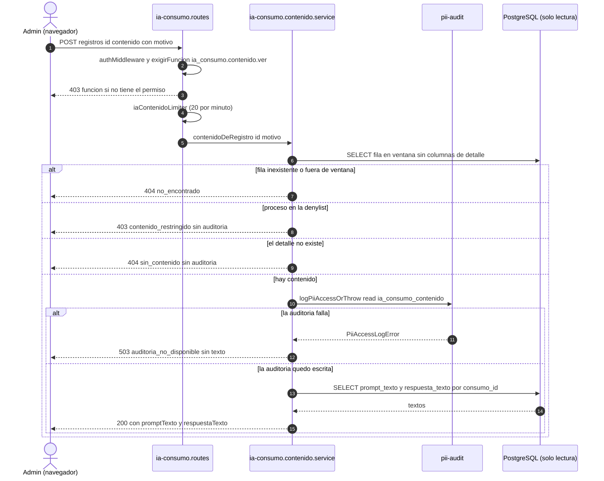

# Diseño — Visor de solo lectura de los registros de consumo de IA (Épica #14548)

- **Estado:** Propuesto. Modo `full`, Épica sola (D1). Lo aprueba el Líder Técnico humano vía ADR-0051.
- **Fecha:** 2026-11-27
- **ADR:** `docs/adr/ADR-0051-ia-consumo-visor-solo-lectura.md`
- **Worktree de diseño:** `/home/david/flit/flito-epica14548`, rama `EPICA/14548-davidchica-ia-consumo-permisos-lectura`, base `origin/develop` 6556591a.
- **Módulo:** transversal, carpeta `ia-consumo` (no es `flito-*`). Montaje `/api/ia-consumo`, sin `conAlcance`.
- **Nota de alcance:** este documento no contiene código de producción. Los fragmentos son contratos, no implementación.

---

## 1. Validación del plan contra el código

El plan se sostiene en lo esencial. Las discrepancias que cambian archivos, pruebas o el reparto A/B están abajo. Ninguna contradice una decisión humana, salvo la línea de `metadatos` del plan, que choca con D7; se resuelve a favor de D7 y queda marcada para confirmación (§16, R4).

| # | Plan | Código real (ruta:línea) | Corrección propuesta |
|---|---|---|---|
| V1 | `lectura: true` y `predecesores: []` → nadie más que admin | `arbol/expansion.ts:157-162` (`cumpleGrupo`): con `[]`, lectura usa `some` (da false) y no lectura usa `every` (da **true para todos**). `catalogo.ts:325-327` da solo `admin` en ambos casos. | Confirmado para el catálogo. Lo que impide que `exportar` y `ver_contenido` lleguen a todos es **`ACCIONES_NACIDAS_TRAS_LA_SIEMBRA`** (obligatorio: sin ella `catalogo.ts:299` lanza «acción sin operaciones»). Además, **no** añadir las acciones a `ACCIONES_POR_AREA` (`expansion.ts:52-58`). |
| V2 | Orden 70 libre en Administración | Ocupados en `administracion.ts`: 10, 20, 60. `legado.ts:62` `items('administracion', 40, …)` da 40 y 50. `gestion.ts:94` da 80. | Confirmado: 70 libre. Sin cambio. |
| V3 | Acciones del ítem (plan no las lista) | `catalogo.ts:295` exige un nodo por acción. El código sale de `nodos.ts:15`: `accion.${item.clave}.${clave}`. | El ítem declara `acciones: [ver, exportar, ver_contenido]` con `slug` y `clave` = `ia_consumo`. Modelo: `torre.ts:37-40`. |
| V4 | Acción de exportar solo con `exportar` | `flito-torre.detalle.routes.ts:84`: la exportación exige **dos** guardas (`torre.detalle.exportar` y `torre.detalle.ver`). | `POST /registros/exportar` exige también `ia_consumo.registros.ver`. Para que la acción sirva sola en el panel: `apoyo: ['ia_consumo.registros.ver']` (`acciones-gestion.ts:23`, `AccionArbol.apoyo`). A confirmar con los tests `permisos-arbol-*`. |
| V5 | `inventario.generado.ts`: editar | Cabecera `inventario.generado.ts:1-12`: ya no se genera; se edita **a mano junto con su migración**. | Confirmado. Filas con `roles: []`, `heredada: false`, como Torre (`inventario.generado.ts:791-834`). |
| V6 | Módulo de la guarda: no especificado | `catalogo.ts:166-170` (`catalogoDeOperaciones`): el prefijo del código de la operación debe ser igual a `g.modulo`. | **`modulo: 'ia_consumo'`** (guion bajo), no la carpeta `ia-consumo`. `DIRECTORIOS_RECONDUCIDOS` sí usa el nombre de la carpeta. |
| V7 | Test de reconducción: 731 → 734 / 736 | `permisos.reconduccion-cierre.test.ts:237` (GUARDAS_MEDIDAS) **y** `:239` (`montajes`), ambos en 731. | Mover **los dos** contadores: 734 en A, 736 en B. |
| V8 | Test de menú: añadir `ia_consumo` a Administración | `permisos-menu-por-areas.test.ts:31-56` y `hijosDe` (igualdad exacta). | Confirmado. `'menu.administracion'` pasa a incluir `'ia_consumo'`. |
| V9 | PAGES 85 → 86 | `permissions.ts`: 85 claves (verificado). `permisos-catalogo.test.ts:66-67` (PAGE_GROUPS 85/84 → 86/85) y `:99` (PAGES). | Confirmado. El conteo del mundo plano (`:46`, `paginas`, 73) **no cambia** porque la página nace en el árbol. Sí cambian el texto de `:93` («los 85 slugs… y las nueve de la Torre») y la lista de exclusiones. `suyas` (`:420`, 73) tampoco cambia. |
| V10 | `reagrupaciones()` | `catalogo-agrupacion.ts:161-167`: solo recorre los mapas explícitos `AGRUPACION_DE_PAGINA` y `AGRUPACION_DE_OPERACION`. | No cambia (47 pares). **No** añadir ia a esos mapas. |
| V11 | Paridad: `OPERACIONES_TORRE` en `:309` | `permisos.paridad-reconduccion.test.ts:309`. | Confirmado: `new Set([...OPERACIONES_TORRE, ...OPERACIONES_IA_CONSUMO])`. |
| V12 | Generador de semillas | No está en el plan. `generar-seed-permisos.ts:7` y `:97-108` solo aceptan áreas listadas. | Añadir la rama `--arbol ia-consumo` (`sqlSiembraIaConsumo`, `sqlRepartoIaConsumo`). |
| V13 | Copiar `sql-torre.ts` | `sql-torre.ts:41-44`: `cadena()` usa `padreAntesDeAreas` porque la Torre se sembró antes de la 0315. | `sql-ia-consumo.ts` usa `ancestrosDe` directo: la 0321 es posterior a la 0315 y `pagina.ia_consumo` no está en `ELEMENTO_ANTERIOR` (`menu-por-areas.ts:73`). |
| V14 | Test generador ↔ migración | `sql-torre.ts:2-3` dice que `flito-torre-permisos.test.ts` compara la salida con la 0303. | Falta el equivalente para ia: nuevo test (TC-A-25). |
| V15 | Migración sin BEGIN/COMMIT | `migrations/README.md:23`: el runner aplica en transacción. | Confirmado. |
| V16 | Rollback: plan sin borrar el ledger | `docs/arquitectura/epica-14678-0315-rollback.sql:52` borra la fila de `_kyverum_applied_migrations` para que el roll-forward reaplique. `db-apply.ts:44` define la tabla. | Añadido en el rollback entregado. Sin ese DELETE, el permiso no vuelve en el roll-forward. |
| V17 | Rollback: «sin BEGIN/COMMIT» | El precedente 0315 usa `BEGIN`/`COMMIT`. | El fichero no lleva transacción propia (como pide el plan) y se ejecuta con `psql -1` (una transacción). Es re-ejecutable. |
| V18 | Rollback: concesiones de usuario | `db/schema/permisos.ts:100-103`: `permisos_usuario_funcion` tiene FK restrict sobre `permisos_funciones`. | El rollback borra también `permisos_usuario_funcion` (entregado). Las concesiones del panel se pierden; se declara. |
| V19 | `recortado` con `octet_length` | `shared/ia-consumo/registro.ts:40-45`: `recortarBytes` corta sin marca. `db/schema/ia-consumo.ts` no tiene columna de truncado. Un texto truncado mide entre 65 533 y 65 536 bytes (el corte puede caer en un carácter multibyte), y un texto no truncado de esas medidas es indistinguible. Con `≥ 65 533` no hay falsos negativos, pero sí falsos positivos. | No afirmar «recortado». Campo `posiblementeRecortado = bytes ≥ 65 533`, documentado como aproximado. |
| V20 | `metadatos`: «nunca en lista ni en CSV» | Choca con **D7** (CSV con todas las columnas, incluido `metadatos`). | Prevalece D7. Detalle: `metadatos` solo si ≤ 4096 bytes (su regla); CSV completo. Confirmar (R4). |
| V21 | `filas` en `PiiAuditOpts` | `pii-audit.ts:20-26`: no hay campo `filas`. | Convención de comparendos: `filas=<n>` dentro de `motivo` (`flito-comparendos.pii.ts:193`). |
| V22 | `accion` y `resourceId` | `pii-audit.ts:22-23`: `accion` admite `read`, `export`, `decrypt`, `search`; `resourceId` es `number`. `nucleo.ts:308-321`: `resource_tipo` varchar(50), `accion` varchar(20), `motivo` varchar(200), `resource_id` integer. | Confirmado. `resource_id` = null (un UUID no cabe). Usar `read`, `search`, `export`; no `decrypt`. |
| V23 | Filtro sensible de comparendos | `flito-comparendos.pii.ts:153`: `/nit\|documento\|cedula\|…/` no cubre `usuario` ni `entidad`. | Confirmado: no reutilizar. Clave-solo en `ia-consumo.pii.ts`. |
| V24 | Error 500 por defecto | `errorHandler.ts:93`: 500 para errores no controlados. | Confirmado. Catch local → 503 en contenido y exportación. |
| V25 | `parseFechaRangoQuery` | `fecha-rango.ts:36`: intercambia `desde` y `hasta` en silencio. | Confirmado. No usarlo. Validar a mano. `createdInRangeCondition` (`fecha-rango.ts:54`) sí sirve (`fecha_inicio` es timestamptz). |
| V26 | Celda CSV | `certificados-zip.ts:102-116`: `celda` es privada. `laft/cash/rte.routes.ts:38-44` (`csvCell`) **no** tiene guarda anti-fórmulas. | `shared/utils/csv.ts` nuevo, con la guarda de `celda`. No reutilizar `csvCell`. Extraer `celda` a `csv.ts` es una Nota aparte, fuera de alcance. |
| V27 | Limitadores | `rateLimiter.ts:13` (`userOrIpKey`), `:23` (`makeStore`), `:66` (`frenoConRastro`) exportados. `flito-comparendos.routes.ts:235-246` (`registrosLimiter`) es local. | Confirmado. Limitadores locales con el mismo patrón. |
| V28 | Cadena de guardas | `flito-comparendos.routes.ts:1039`: `exigirFuncion` → limitador → handler. `flito-torre.detalle.routes.ts:31`: `router.use(authMiddleware)`. | Usar `router.use(authMiddleware)` (Torre) y, en cada ruta, `exigirFuncion` → limitador → handler (comparendos). |
| V29 | Montaje sin `conAlcance` | `frontera-enlace.ts:186` y su cabecera: sin `conAlcance` = cerrado a todo enlace. Precedente `app.ts:411` (`/api/uso-legacy`). | Confirmado. |
| V30 | Prefijo de montaje | AGENTS: módulos `flito-*` bajo `/api/flito/<modulo>`. | `ia-consumo` no es `flito-*`: se declara en el ADR (transversal, precedente `/api/uso-legacy`, `/api/privacy`). |
| V31 | Env | `env.ts:264` (`COMPARENDOS_EXPORT_MAX_FILAS`, `z.coerce.number()`): `coerce('')` vale 0 y no pasa `min(1)`. `env.ts:67` usa `vacioComoAusente`. `env.ts:478-486`: bloque `IA_CONSUMO_*`. | `z.preprocess(vacioComoAusente, z.coerce.number().int().min(…).max(…).default(…))`. Nuevas claves junto a `IA_CONSUMO_*`. |
| V32 | `setup.ts` | Precedente: `COMPARENDOS_EXPORT_MAX_FILAS` (con min/max y default) no está en `setup.ts`. | No hace falta. |
| V33 | Contador `ANTES` 0315 | `menu-por-areas.ts:53` y `:56`. | No hay que tocar la lista histórica: `pagina.ia_consumo` no se movió. |
| V34 | Ayuda in-app | `content/ayuda/catalogo.ts` es opt-in por ficha; ningún test exige una ficha por `PageSlug`. | N/A declarado para C1 y C2. |
| V35 | UX | AGENTS, matriz «Antes de UI nueva significativa»: PageSlug nuevo y bandeja → `ux-agent` full. | **Falta en el plan**: prerrequisito de C1 (§15). |
| V36 | Tabla de migraciones libres | `git log --all --diff-filter=A` sobre migraciones y ADR: no hay 0321+ ni ADR-0051+. ADR-0050 lo reclaman ramas `EPICA/14707…` y `wt-prB-14707`. | Confirmado. 0321 y 0051 libres. Reverificar al integrar. |
| V37 | Dos ADR-0047 en `develop` | `docs/adr/`: `ADR-0047-flito-torre-…` (Aceptado) y `ADR-0047-registro-consumo-ia-contrato-v1.md` (Propuesto). | Citar siempre por nombre de fichero. |

**Conteos del plan confirmados:** 85 páginas en `PAGES`; `DIRECTORIOS_RECONDUCIDOS` 45 (`reconduccion-cierre:137`), `FICHEROS_DE_RUTAS` 46 (`:138`), `GUARDAS_MEDIDAS` 731 (`:237`), `montajes` 731 (`:239`, no citado en el plan), `permisos-catalogo` 85/84 y 85 (`:66-67`, `:99`).

---

## 2. Contexto

La migración 0306 creó `ia_consumo_log`, `ia_consumo_detalle` e `ia_tarifa_modelo`. El registro se escribe desde `shared/ia-consumo/` y está en `release`. Hoy no hay pantalla ni ruta de lectura: quien quiere ver un consumo usa SQL directo, sin permisos ni rastro (H8). La Épica #14548 pide un visor de solo lectura con permisos del árbol y exportación. El diseño no toca las tablas (D2).

## 3. Alternativas

### 3.1 Cómo se expone el contenido (prompt y respuesta)

- **Opción A (recomendada): endpoint propio `POST /registros/:id/contenido`** con permiso propio, motivo obligatorio, auditoría antes de leer y fallo cerrado.
  - Pros: la auditoría dice qué texto se leyó y por qué; el listado y el detalle nunca cargan texto; el permiso se puede separar del de lectura.
  - Contras: un viaje extra por registro; más código (≈150 líneas).
  - Esfuerzo: M. Riesgo: motivo libre (R10).
- **Opción B: texto dentro de `GET /registros/:id`** con permiso.
  - Descartada: cada apertura de detalle leería texto; la auditoría no distingue «ver metadatos» de «leer el prompt».
- **Opción C: texto solo en la exportación.**
  - Descartada: D7 prohíbe el texto en el CSV, y no sirve para revisar un caso.

### 3.2 Exportación

- **Opción A (recomendada): CSV en memoria con tope duro**, auditoría con `await` antes del primer byte. Mismo patrón que comparendos (`flito-comparendos.routes.ts:1107`, 5/min).
  - Pros: esfuerzo S; la auditoría puede contar filas reales.
  - Contras: memoria proporcional al tope (R7).
  - Esfuerzo: S-M.
- **Opción B: CSV en streaming.**
  - Descartada por ahora: la auditoría debe escribirse antes del primer byte y el número de filas no se conoce hasta el final. Haría falta un conteo previo, con coste extra.
  - Esfuerzo: M-L.
- **Opción C: XLSX con ExcelJS** (como `flito-torre.detalle-export.ts`).
  - Descartada: D7 pide CSV. ExcelJS ya está en el repo, así que no sería dependencia nueva.

### 3.3 Dónde se aplica la ventana

- **Opción A (recomendada): en servidor**, en todas las rutas (`calcularVentana` con `hoyColombia`).
- **Opción B: solo en la UI.** Descartada: no es un control.
- **Opción C: vista o RLS en BD.** Descartada: D2 prohíbe tocar el esquema y es sobreingeniería.

## 4. Decisión y justificación

1. Visor de **solo lectura**, nuevo módulo `ia-consumo`, sin tablas ni columnas nuevas (D2).
2. Permisos en el árbol: ítem `ia_consumo` en Administración, orden 70, con tres acciones. Solo `admin` por defecto (D4).
3. Búsqueda y filtros por `POST` con cuerpo (AGENTS §14). Ningún dato personal en URL ni en query.
4. Contenido con endpoint propio, motivo, auditoría previa y fallo cerrado. Denylist por proceso en `shared-types` (D3, D6).
5. Exportación CSV de metadatos completos, sin texto, con tope y auditoría previa (D7).
6. Ventana de `IA_CONSUMO_VISOR_VENTANA_MESES` meses aplicada en servidor a todas las rutas (D8).
7. Cuatro PRs en serie: A (lectura y permisos), B (contenido y exportación), C1 (página), C2 (contenido y exportación en UI). Cada uno cierra su gate antes del siguiente.

## 5. Matriz de decisiones → pruebas

Cada fila apunta a los IDs de §6. Los IDs de prueba son los de los criterios, para que `qa-agent` use una sola lista.

| ID | Decisión o default | Cómo se cumple | Pruebas | Bloque |
|---|---|---|---|---|
| D1 | Solo la Épica #14548, sin Features ni HUs | Único artefacto de planificación: ADR y este diseño. PR con título `EPICA 14548: …`. | TC-PR-01 (`check-naming` verde en rama y título); TC-PR-02 (el diff de cada PR toca solo §12) | Todos |
| D2 | Tablas `ia_consumo_*` intactas; única migración 0321 | Sin cambios en `db/schema/ia-consumo.ts` ni en 0306. | A-27, A-28 (migración idempotente, sin BEGIN/COMMIT) | A |
| D3 | Contenido con permiso aparte y motivo; nunca exportado | Endpoint propio. La exportación no toca `ia_consumo_detalle`. | B-01 … B-06, B-10 | B |
| D4 | Admin siempre; el resto desde el panel; sin reparto por defecto | Tres acciones con `predecesores: []`, en `ACCIONES_NACIDAS_TRAS_LA_SIEMBRA`. | A-24, A-25, A-26 | A |
| D5 | Integración directa a DEV | PR a `develop`; `pr-monitor-agent` mergea con CI verde. | TC-PR-03 (CI verde: `build + test`, `naming`, `pr-gates`, `secret-scan`, `dependency-audit`) | Todos |
| D6 | `validar_identidad` y `recortar_cedula` → 403 `contenido_restringido` | Denylist en `shared-types`; comprobación antes de auditar y de leer. | B-05, B-19 | B |
| D7 | CSV con todas las columnas de `ia_consumo_log`, incluidos `error_mensaje` y `metadatos`; nunca el texto del detalle | Columnas desde `iaConsumoLog` (43). | B-09, B-10, B-13 | B |
| D8 | Ventana de N meses, env 1..24, defecto 3 | `calcularVentana(hoy, meses)`. | A-02, A-08, A-09, A-10, A-30 | A |
| Def. | Rango obligatorio, máximo 31 días | `validarRango` (sin `parseFechaRangoQuery`). | A-05, A-06, A-07 | A |
| Def. | Paginación por cursor opaco, 50 por página, sin total | Cursor ligado a los filtros; `limit + 1`. | A-03, A-04 | A |
| Def. | Filtros con PII (usuario, placa, entidad) por POST en el cuerpo | Solo `POST /registros/buscar`; sin GET con query. | A-18, A-22 | A |
| Def. | Motivo de 10 a 150, sin 6 o más dígitos seguidos ni correos | Zod con refinamientos. | B-03 | B |
| Def. | Ventana también en detalle, contenido, exportación y relacionados | 404 en detalle y contenido; 400 en búsqueda y exportación. | A-08, A-12, A-31, B-07, B-22 | A, B |
| Def. | Sin totales ni costos agregados | Esquemas de salida sin esos campos. | A-03 | A |
| Def. | `Cache-Control: no-store` en todas las rutas | `router.use` del módulo. | A-19 | A |
| Def. | Tope de exportación 2 000 por defecto, 1..20 000 | `IA_CONSUMO_EXPORT_MAX_FILAS` con `tope + 1`. | B-11, B-17 | B |

## 6. Criterios por bloque (Given / When / Then)

### Bloque A — permisos y lectura (PR 1)

- **A-01** Dado un usuario sin `ia_consumo.registros.ver`, cuando llama a cualquiera de las rutas de lectura, entonces responde 403 con `funcion` = `ia_consumo.registros.ver` y no se ejecuta ninguna consulta a `ia_consumo_log`.
- **A-02** Dado `admin` con 0321 aplicada, cuando llama a `GET /catalogos`, entonces la respuesta trae `ventana` (`desde`, `hasta`, `meses`=3 por defecto) calculada con `hoyColombia()` y las listas cerradas de §8.4, sin filas de datos.
- **A-03** Dado `admin`, cuando busca con un rango válido de 7 días y sin filtros, entonces recibe como máximo 50 `items` ordenados por `(fecha_inicio DESC, id DESC)`, `siguienteCursor` no nulo si hay una fila más, y ningún campo `total`.
- **A-04** Dado un cursor obtenido con un conjunto de filtros, cuando se reenvía con otros filtros, entonces responde 400 `cursor_invalido`.
- **A-05** Dado un cuerpo con `desde` posterior a `hasta`, entonces responde 400 `rango_invalido` y las fechas **no** se intercambian.
- **A-06** Dado un rango de 32 días, entonces responde 400 `rango_demasiado_amplio`. Con 31 días exactos, responde 200.
- **A-07** Dado un `hasta` posterior al día de hoy en Colombia, entonces responde 400 `rango_invalido`.
- **A-08** Dado un `desde` anterior a `ventanaDesde`, entonces responde 400 `fuera_de_ventana` y el mensaje indica la fecha mínima.
- **A-09** Dado `calcularVentana(hoy, meses)`: `('2026-11-27', 3)` = `2026-08-27`; `('2026-05-31', 3)` = `2026-02-28`; `('2026-03-31', 1)` = `2026-02-28`; `('2028-02-29', 12)` = `2027-02-28`.
- **A-10** Dada la variable `IA_CONSUMO_VISOR_VENTANA_MESES`: sin valor o vacía → 3; `0`, `25` o `abc` → el arranque falla con el mensaje de zod.
- **A-11** Dado `admin`, cuando pide `GET /registros/:id` de un registro en ventana, entonces recibe todas las columnas de `ia_consumo_log` salvo `metadatos` (que va con `metadatosBytes`), `tieneContenido`, `bytesPrompt`, `bytesRespuesta` (`octet_length` en SQL), `posiblementeRecortado` (≥ 65 533 bytes) y `relacionados` (≤ 20 filas de la misma `correlacion_id` dentro de la ventana, sin el propio registro).
- **A-12** Dado un id inexistente y un id fuera de ventana, entonces ambos responden 404 `no_encontrado` con el mismo cuerpo.
- **A-13** Dado un registro con `metadatos` de más de 4 096 bytes, entonces `metadatos` es null y `metadatosBytes` está informado. Con 4 096 o menos, `metadatos` es el objeto.
- **A-14** Las consultas de lista y detalle no seleccionan ninguna columna de `ia_consumo_detalle`. Prueba sobre el SQL generado con `PgDialect`: no aparecen `prompt_texto` ni `respuesta_texto`.
- **A-15** La lista no incluye `error_mensaje` ni `metadatos`.
- **A-16** Dado el filtro `modelo` = `claude-haiku-4-5`, cuando se busca, entonces casa `coalesce(modelo_respondido, modelo_solicitado)` con `claude-haiku-4-5-20251001` y no con `claude-haiku-4-5x`. Un modelo con `.` o `+` se escapa antes de bindearlo.
- **A-17** Dado un valor fuera de catálogo (`origen`, `resultado`, `tipoTarea`, `proveedor`) o un `proceso`/`modulo` que no cumple `^[a-z0-9_]{1,40}$`, entonces responde 400 `datos_invalidos`.
- **A-18** No existe búsqueda por `GET` con query: `GET /registros?usuario=…` responde 404 de Express, y la búsqueda solo acepta `POST`.
- **A-19** Todas las respuestas del módulo llevan `Cache-Control: no-store`, incluidas las 4xx y la 429.
- **A-20** Dado el límite de 60 por minuto en `buscar`, cuando llega la petición 61, entonces responde 429 con el mensaje de la ruta.
- **A-21** Dada una búsqueda válida, entonces se escribe `pii_access_log` con `resource_tipo = ia_consumo_log`, `accion = search`, `resource_id` null, `motivo = filas=<n> filtros_pii=<claves>` y `campos_accedidos` con las columnas personales proyectadas.
- **A-22** Dado un filtro `usuario=ana@ejemplo.co`, entonces el valor no aparece en `motivo`, en los logs del módulo ni en ninguna URL. Solo aparece la clave `usuario`.
- **A-23** Dada una lectura de detalle, entonces se escribe `accion = read`, `resource_tipo = ia_consumo_log` y `motivo = id:<uuid>`. Si la escritura falla, el detalle se entrega y queda `log.error` (vía abierta, AGENTS §16).
- **A-24** `ITEMS_ADMINISTRACION` contiene `ia_consumo` con orden 70 y tres acciones. `catalogoCompleto()` deja la página y sus acciones solo a `['admin']`.
- **A-25** La salida de `sqlSiembraIaConsumo()` y `sqlRepartoIaConsumo()` es exactamente el bloque entre las marcas «ÁRBOL GENERADO» de la 0321 (test análogo a `flito-torre-permisos.test.ts`).
- **A-26** Dado un usuario al que el panel le concede `accion.ia_consumo.ver`, cuando lista y abre el detalle, entonces responde 200.
- **A-27** Con la base migrada, `verificarCatalogoAlArrancar()` no lanza. Aplicar la 0321 dos veces no cambia ninguna fila (P6: aplicar el archivo nuevo dos veces).
- **A-28** La 0321 no contiene `BEGIN`, `COMMIT` ni DDL. Solo `INSERT … ON CONFLICT`.
- **A-29** Tests de deriva actualizados: `permisos-catalogo` (PAGE_GROUPS 86/85, PAGES 86, texto de `:93`); `permisos-menu-por-areas` (MAPA); `permisos.reconduccion-cierre` (`DIRECTORIOS` 46, `FICHEROS` 47, `GUARDAS` 734 y `montajes` 734); `permisos.paridad-reconduccion:309`; `permisos-siembra-admin`; `helpers/permisos-seed-sql.ts` (0321 en `MIGRACIONES_CON_REPARTO`); `fixtures/permisos-rutas-reconducidas.ts` (3 filas).
- **A-30** `IA_CONSUMO_VISOR_VENTANA_MESES` aparece en `apps/api/.env.example`, junto a `IA_CONSUMO_*`.
- **A-31** Dado un registro fuera de ventana, cuando se pide `relacionados` de otro que comparte `correlacion_id`, entonces el fuera de ventana no aparece.
- **A-32** `contrato:generar` incluye las tres rutas de A.

### Bloque B — contenido y exportación (PR 2)

- **B-01** Dado un usuario con `ia_consumo.registros.ver` y sin `ia_consumo.contenido.ver`, cuando pide contenido, entonces responde 403 con `funcion` = `ia_consumo.contenido.ver`, sin auditoría y sin lectura del texto.
- **B-02** Dado `admin` y un motivo válido de 12 caracteres, cuando pide contenido de un registro en ventana con detalle, entonces responde 200 con `promptTexto` y `respuestaTexto`. La auditoría (`read`, `ia_consumo_contenido`, `resource_id` null, `motivo = id:<uuid> · <motivo>`, `campos_accedidos = [prompt_texto, respuesta_texto]`) se escribe **antes** de la primera lectura del texto (orden verificado con espía).
- **B-03** Dado un motivo de 9 caracteres, de 151, con seis dígitos seguidos o con un correo, entonces responde 400 `datos_invalidos`. Con 10 y con 150 caracteres, responde 200.
- **B-04** Dado que `logPiiAccessOrThrow` lanza, entonces responde 503 `auditoria_no_disponible`, el cuerpo no contiene texto y no se ejecuta la lectura de `prompt_texto`.
- **B-05** Dado un registro con `proceso` en `{validar_identidad, recortar_cedula}`, entonces responde 403 `contenido_restringido`, no se escribe fila en `pii_access_log` y no se ejecuta ningún SELECT de texto (espía).
- **B-06** Dado un registro sin fila en detalle, entonces responde 404 `sin_contenido` sin auditoría.
- **B-07** Dado un registro fuera de ventana o inexistente, entonces responde 404 `no_encontrado` con el mismo cuerpo, sin auditoría.
- **B-08** Dado el límite de 20 por minuto en contenido, cuando llega la petición 21, entonces responde 429.
- **B-09** Dada una exportación con filas ≤ tope, entonces responde 200 con `Content-Type: text/csv; charset=utf-8`, `Content-Disposition: attachment; filename="consumo-ia_AAAAMMDD-HHmm.csv"` (que pasa `esNombreDeExport('consumo-ia', nombre, 'csv')`), BOM U+FEFF, separador `;`, fin de línea CRLF y cabecera con las 43 columnas de `ia_consumo_log` en orden de esquema.
- **B-10** Dada una exportación, el SQL no selecciona `prompt_texto` ni `respuesta_texto` (PgDialect), y el CSV no contiene el texto de ningún detalle (fixture con un marcador en el texto).
- **B-11** Dada una exportación con `tope + 1` filas, entonces responde 422 `{codigo: export_demasiado_grande, tope}` en JSON, sin `Content-Disposition`, con auditoría `search` `filas=0 resultado=export_demasiado_grande`, y sin auditoría `export`.
- **B-12** Dada una exportación válida, la auditoría `export` (`filas=<n>`, `campos_accedidos` = columnas exportadas) se escribe antes del primer byte. Si falla, responde 503 `auditoria_no_disponible` sin cabeceras de fichero.
- **B-13** La exportación incluye `metadatos` completo como JSON (D7), aunque supere 4 096 bytes, y `error_mensaje` en su columna.
- **B-14** Celdas: un texto que empieza por `=`, `+`, `-`, `@`, tab o CR se prefija con `'`. Un valor con `;`, `"`, CR o LF va entre comillas con las comillas dobladas. `null` es celda vacía. El costo usa coma decimal con 6 decimales.
- **B-15** Las fechas del CSV están en hora de Colombia, formato `YYYY-MM-DD HH:mm:ss`.
- **B-16** Dado el límite de 5 por minuto en exportación, cuando llega la sexta, entonces responde 429.
- **B-17** `IA_CONSUMO_EXPORT_MAX_FILAS`: 0 o 20 001 hacen fallar el arranque. Sin valor, 2 000.
- **B-18** `GET /catalogos` añade `exportacion.maxFilas` y `capacidades` (`verContenido`, `exportar`), calculadas con `funcionesConcedidas` (sin registrar intentos denegados).
- **B-19** `PROCESOS_CONTENIDO_RESTRINGIDO` (en `shared-types`) está contenido en las claves de `PROCESOS_IA_FLITO`. El grep de sus usos en `apps/web` no encuentra colisiones.
- **B-20** Las guardas de contenido y exportación tienen su fila en `inventario.generado.ts` y su `op()` en `catalogo-operaciones.ts`. `permisos.reconduccion-cierre` cuenta 736 en `GUARDAS_MEDIDAS` y en `montajes`.
- **B-21** Dado un usuario con `accion.ia_consumo.exportar` pero sin `ia_consumo.registros.ver`, cuando exporta, entonces responde 403 con `funcion` = `ia_consumo.registros.ver`. Con el `apoyo` de §9.2 el panel concede ambas juntas.
- **B-22** Dada una exportación con `desde` anterior a `ventanaDesde`, entonces responde 400 `fuera_de_ventana` y no se escribe auditoría `export`.

### Bloque C1 — página y lectura en la UI (PR 3)

Prerrequisito: el ux-agent entrega `docs/ux/ia-consumo-visor.md` con maqueta y captura, y el humano da su «ok». Sin eso no se escribe código de página (§15).

- **C1-01** Dada la maqueta aprobada, cuando el frontend-agent empieza, entonces el «ok» humano consta en el hilo y la maqueta está en `docs/ux/`.
- **C1-02** Dada la ruta `/admin/ia-consumo`, cuando se carga, entonces se hace con `lazy()` y `ProtectedRoute page="ia_consumo"`. Sin permiso, se muestra la pantalla de acceso denegado y no se hace ninguna petición a la API.
- **C1-03** Dados los filtros, cuando se cambian, entonces la URL no cambia (sin query ni path con datos). Las fechas son obligatorias y por defecto son los últimos siete días, dentro de la ventana de `GET /catalogos`.
- **C1-04** Dada la tabla, cuando se muestra, entonces tiene los cuatro estados: cargando (esqueleto), error (mensaje y «Reintentar»), vacío («No hay registros en este rango») y lleno (50 filas, «Cargar más» con cursor, sin total).
- **C1-05** Dado un registro abierto, cuando se muestra el panel lateral, entonces tiene todas las columnas de A-11 y ningún texto. «Ver contenido» aparece solo si `capacidades.verContenido` es true.
- **C1-06** La entrada de menú está en la sección Administración y se muestra solo con `hasPage('ia_consumo')`.
- **C1-07** Accesibilidad: cada campo tiene `<label>` asociado, el foco es visible, el contraste es ≥ 4,5:1 y los botones tienen texto.
- **C1-08** E2E smoke `ia-consumo-visor.spec.ts`: admin busca y ve filas; un usuario sin permiso ve acceso denegado; la URL no contiene datos de los filtros.
- **C1-09** `npm run typecheck -w apps/web` (o `tsc --noEmit`) y `npm run build:web` en verde, con salida pegada.

### Bloque C2 — contenido y exportación en la UI (PR 4)

- **C2-01** Dado un registro con contenido, cuando se pulsa «Ver contenido», entonces se abre un modal con el motivo: etiqueta asociada, contador de 10 a 150, y el botón de confirmar deshabilitado hasta que el motivo sea válido. Los mensajes van como texto.
- **C2-02** Dada una respuesta 200, cuando se muestra el texto, entonces va en nodos de texto (sin `dangerouslySetInnerHTML`) y se borra del estado al cerrar el modal o el panel.
- **C2-03** Dado un 403 `contenido_restringido`, entonces se muestra la explicación sin texto. Dado un 503 `auditoria_no_disponible`, entonces se muestra un aviso de página (no un toast) con el mensaje del servidor ya traducido.
- **C2-04** Dada la capacidad `exportar`, cuando se pulsa «Exportar CSV», entonces se usa `api.downloadPostNamed` con el validador `esNombreDeExport('consumo-ia', nombre, 'csv')`. Un 422 muestra el tope.
- **C2-05** E2E: `ia-consumo-contenido.spec.ts` (motivo corto bloquea; motivo válido muestra el texto; un registro de `validar_identidad` muestra la restricción) y `ia-consumo-exportar.spec.ts` (descarga con nombre válido; 422 muestra el mensaje).
- **C2-06** No hay `fetch` directo: todo pasa por `src/lib/api.ts`.

### Gates de proceso (TC-PR)

- **TC-PR-01** `node scripts/check-naming.mjs --branch … --title …` en verde para cada PR de la Épica.
- **TC-PR-02** El diff de cada PR toca solo los ficheros de su bloque en §12. Lo revisa `flit-code-review`.
- **TC-PR-03** CI verde antes del merge: `build + test`, `dependency-audit`, `secret-scan`, `naming` y `pr-gates`.

## 7. Diagrama de secuencia (contenido)

El contenido es el flujo con más riesgo: el orden de las comprobaciones decide qué se audita y qué se lee.



## 8. Contrato de API

### 8.1 Montaje y guardas

- `app.use('/api/ia-consumo', iaConsumoRoutes)`, junto a `/api/uso-legacy` (`app.ts:411`). Sin `conAlcance`: cerrado a enlaces compañía, proveedor y organismos.
- `router.use(authMiddleware)` y, después, `router.use` que fija `Cache-Control: no-store` (V28).
- Por ruta: `exigirFuncion(…)` → limitador local → handler. La validación Zod va dentro del handler, como en comparendos.
- Limitadores locales (`ia-consumo.routes.ts`), con el patrón de `flito-comparendos.routes.ts:235-246`:
  - `iaConsultasLimiter`: 60 por minuto, `keyGenerator: userOrIpKey('ia-consumo-consultas')`, `store: makeStore('rl:ia-consumo-consultas:')`, `handler: frenoConRastro('ia-consumo-consultas')`.
  - `iaContenidoLimiter`: 20 por minuto. Mismo patrón.
  - `iaExportLimiter`: 5 por minuto. Mismo patrón.

### 8.2 Rutas

| # | Método y ruta | Guardas (en este orden) | Limitador | Entrada | Salida | Bloque |
|---|---|---|---|---|---|---|
| 1 | `GET /catalogos` | `exigirFuncion('ia_consumo.registros.ver')` | consultas | ninguna | catálogos, `ventana`, y en B `exportacion.maxFilas` y `capacidades` | A (B añade) |
| 2 | `POST /registros/buscar` | `exigirFuncion('ia_consumo.registros.ver')` | consultas | cuerpo de §8.3 | `items` (≤ 50) y `siguienteCursor` | A |
| 3 | `GET /registros/:id` | `exigirFuncion('ia_consumo.registros.ver')` | consultas | `:id` uuid | registro, `relacionados`, `tieneContenido`, texto de tamaños, `metadatos` capado | A |
| 4 | `POST /registros/:id/contenido` | `exigirFuncion('ia_consumo.contenido.ver')` | contenido | `{ motivo }` | `promptTexto`, `respuestaTexto` | B |
| 5 | `POST /registros/exportar` | `exigirFuncion('ia_consumo.registros.exportar')`, `exigirFuncion('ia_consumo.registros.ver')` | exportación | rango y filtros de §8.3 | `text/csv` | B |

Nota: `POST /registros/exportar` en lugar de `/export` (comparendos) porque el plan usa el español; Torre también usa `/exportar`. No cambia el contrato.

### 8.3 Cuerpo de búsqueda y exportación

```
{
  desde: "YYYY-MM-DD",           // obligatorio
  hasta: "YYYY-MM-DD",           // obligatorio
  cursor?: string (≤ 200),       // solo búsqueda; opaco, ligado a los filtros
  filtros?: {
    usuario?: string (1..80),    // coincide con usuario_login o usuario_id, exacto, sin distinguir mayúsculas
    placa?: string,              // normalizarPlacaIa (shared/ia-consumo/contexto.ts)
    entidad?: string (1..64),    // entidad_id exacto
    origen?: ORIGENES_IA,
    modulo?: slug,               // ^[a-z0-9_]{1,40}$
    proceso?: slug,
    tipoTarea?: TIPOS_TAREA_IA,
    proveedor?: PROVEEDORES_IA,
    modelo?: string (1..60),     // ^[a-z0-9.\-]{1,60}$, se escapa al construir el patrón
    resultado?: RESULTADOS_IA
  }
}
```

- **Cursor:** base64url de `{ f: fecha_inicio ISO, i: id, h: hash de los filtros }`. Si no decodifica o `h` no coincide, `cursor_invalido`.
- **Orden y paginación:** `(fecha_inicio, id) < (:f, :i)` con `ORDER BY fecha_inicio DESC, id DESC LIMIT 51`. Si llegan 51 filas, `siguienteCursor` existe y se devuelven 50.
- **Rango:** `createdInRangeCondition(iaConsumoLog.fechaInicio, { desde, hasta })` de `shared/utils/fecha-rango.ts`. No usar `parseFechaRangoQuery` (V25).
- **Modelo:** `coalesce(modelo_respondido, modelo_solicitado) ~ $1`, con `$1 = '^' + escapeRegex(modelo) + '(-[0-9]{8})?$'`. Parámetro bindeado, nunca concatenado (AGENTS, regla 3).

### 8.4 Catálogos cerrados (`GET /catalogos`)

- `origenes`, `resultados`, `tiposTarea`, `proveedores`: de `shared/ia-consumo/catalogo.ts` (`ORIGENES_IA`, `RESULTADOS_IA`, `TIPOS_TAREA_IA`, `PROVEEDORES_IA`).
- `procesos`: de `PROCESOS_IA_FLITO`, con su `modulo`.
- `modulos`: los `modulo` de `PROCESOS_IA_FLITO` más `MODULO_DESCONOCIDO` (`'desconocido'`), que el registro también escribe.
- `ventana`: `{ desde, hasta, meses }`, calculada en el servidor.
- Los catálogos solo rellenan los selects. La validación del servidor los usa, pero no depende de que la UI los muestre.

### 8.5 Tabla de errores

| Código | HTTP | Cuándo | Mensaje para la persona usuaria |
|---|---|---|---|
| `datos_invalidos` | 400 | Zod falla: formato, enum, motivo fuera de regla | «Revisa los filtros: hay un valor que no es válido.» Para el motivo: «El motivo debe tener entre 10 y 150 caracteres y no puede incluir números de 6 o más cifras ni correos.» |
| `rango_invalido` | 400 | Falta `desde` o `hasta`; `desde > hasta`; `hasta > hoy` | «El rango de fechas no es válido. La fecha de inicio debe ser anterior o igual a la de fin, y no puede ser futura.» |
| `rango_demasiado_amplio` | 400 | Más de 31 días | «Una consulta admite hasta 31 días. Acota el rango.» |
| `fuera_de_ventana` | 400 | `desde` anterior a `ventanaDesde` (búsqueda y exportación) | «Solo se puede consultar desde el {ventanaDesde}, los últimos {meses} meses.» |
| `cursor_invalido` | 400 | Cursor no decodifica o no coincide con los filtros | «La página ya no es válida. Vuelve a buscar desde el principio.» |
| `contenido_restringido` | 403 | Proceso en la denylist (B) | «El contenido de este tipo de consulta no se muestra desde aquí, por política de datos personales.» |
| `no_encontrado` | 404 | Id inexistente o fuera de ventana (detalle, contenido, relacionados) | «No encontramos ese registro.» |
| `sin_contenido` | 404 | El registro no tiene fila en detalle (B) | «Este registro no tiene contenido guardado.» |
| `export_demasiado_grande` | 422 | Más filas que el tope | «El filtro supera las {tope} filas que admite una exportación. Acota el rango o los filtros y vuelve a intentarlo.» (mismo código que comparendos, `flito-comparendos.errors.ts:500`) |
| `auditoria_no_disponible` | 503 | `pii_access_log` no escribe, en contenido o exportación | «No pudimos registrar el acceso a datos personales, así que no mostramos la información. Intenta de nuevo en un momento.» |
| `consulta_demasiado_lenta` | 503 | SQLSTATE 57014 (`statement_timeout`) | «La consulta tardó demasiado. Reduce el rango de fechas y vuelve a intentarlo.» |
| (límite) | 429 | Limitador | «Demasiadas consultas seguidas. Espera un minuto.» |

Los 403 de `exigirFuncion` (`sin_funcion`, `sin_modulo`, `no_reconocida`, `no_resuelto`) los produce la guarda, no el módulo.

### 8.6 Funciones y capas

- `ia-consumo.routes.ts`: montaje, limitadores, `safeParse`, traducción de errores a HTTP. Sin lógica de negocio.
- `ia-consumo.esquemas.ts`: esquemas Zod (`buscarBody`, `idParams`, `contenidoBody`, `exportarBody`, `cursor`). Mismo nombre que `flito-torre.esquemas.ts`.
- `ia-consumo.service.ts` (A): `catalogosVisor(ahora)`, `buscarRegistros(entrada, ahora)`, `detalleRegistro(id, ahora)`, `relacionadosDe(correlacionId, ventana)`. Puras: `calcularVentana(hoy, meses)`, `validarRango(rango, ventana, hoy)`, `condicionesDeFiltros(filtros, ventana)`, `COLUMNAS_LISTA`, `COLUMNAS_DETALLE` (listas blancas). Lectura en `enLecturaAcotada(fn)`: transacción `SET TRANSACTION READ ONLY`, `SET LOCAL statement_timeout = '10s'` y mapeo de 57014 a `consulta_demasiado_lenta` (patrón de `flito-torre.metricas.service.ts:65-71`).
- `ia-consumo.contenido.service.ts` (B): `contenidoDeRegistro(id, motivo, req)`.
- `ia-consumo.export.service.ts` (B): `exportarRegistros(entrada, req, ahora)`.
- `ia-consumo.errors.ts`: `IaConsumoError` con `codigo`, `status`, `mensaje`. Mismo patrón que `flito-comparendos.errors.ts`.
- `ia-consumo.pii.ts`: nombres de recurso, claves de filtro, formato de `motivo`, y envoltorios de `logPiiAccess` y `logPiiAccessOrThrow`.
- `shared/utils/csv.ts` (B): `celdaCsv(valor)` y `csvDesdeFilas(cabecera, filas)`, puras.

### 8.7 Detalle (`GET /registros/:id`)

- Columnas de `ia_consumo_log` salvo `metadatos`. Incluye `error_mensaje` (solo aquí y en CSV, no en lista).
- `tieneContenido` = `EXISTS (SELECT 1 FROM ia_consumo_detalle WHERE consumo_id = :id)`.
- `bytesPrompt`, `bytesRespuesta` = `octet_length(...)` de la fila de detalle. No se trae el texto.
- `posiblementeRecortado` = `bytesPrompt ≥ 65533 OR bytesRespuesta ≥ 65533`. Aproximado (V19).
- `metadatos` = `CASE WHEN octet_length(metadatos::text) <= 4096 THEN metadatos END`, y `metadatosBytes` = `octet_length(metadatos::text)`.
- `relacionados` = hasta 20 filas con la misma `correlacion_id`, dentro de la ventana, distintas del propio id, en columnas de lista.

## 9. Permisos del árbol y migración 0321

### 9.1 Piezas que se mueven juntas

El arranque aborta si el catálogo del código y el de la base no coinciden (`permisos.service.ts:61-85`).

| Pieza | Archivo:línea | Cambio |
|---|---|---|
| Página | `packages/shared-types/src/permissions.ts`: `PAGES` (la lista termina en `flito_ayuda`) y `PAGE_GROUPS`, grupo «Administración» (`:346`) | `ia_consumo: 'Consumo de IA'`; añadir `'ia_consumo'` al grupo. No tocar `DEFAULTS_POR_ROL` ni `MODULO_FRONTERA_DE_PAGINA`. |
| Ítem y acciones | `packages/shared-types/src/permisos-arbol/administracion.ts` (`ITEMS_ADMINISTRACION`, `:8-38`) | `{ slug: 'ia_consumo', clave: 'ia_consumo', nombre: 'Consumo de IA', elemento: 'administracion', orden: 70, acciones: [ver, exportar, ver_contenido] }` |
| Mapa de acciones | `apps/api/src/modules/permisos/arbol/acciones-ia-consumo.ts` (nuevo) | `ACCIONES_IA_CONSUMO`, `OPERACIONES_IA_CONSUMO` (modelo: `acciones-torre.ts`) |
| Árbol de acciones | `arbol/expansion.ts:41-44` | `...ACCIONES_IA_CONSUMO` en `ACCIONES_ARBOL`. **No** en `ACCIONES_POR_AREA` (`:52-58`). |
| No nacidas tras la siembra | `arbol/acciones-finanzas.ts:180-194` | `...OPERACIONES_IA_CONSUMO` en `OPERACIONES_NACIDAS_EN_EL_ARBOL`. `...Object.keys(ACCIONES_IA_CONSUMO)` en `ACCIONES_NACIDAS_TRAS_LA_SIEMBRA`. |
| Página nacida en el árbol | `catalogo.ts:88-95` | `'ia_consumo'` en `PAGINAS_NACIDAS_EN_EL_ARBOL`. |
| Operaciones (guardas) | `catalogo-operaciones.ts` (bloque de Torre, `:576-605`) | Una `op(llave, código, nombre, descripción)` por ruta. Llave: `${FICHERO} MÉTODO /ruta`. |
| Inventario de ficheros | `inventario-guardas.ts:70` (`FICHEROS_EN_ALCANCE`, con Torre en `:132-138`) | `{ modulo: 'ia_consumo', fichero: 'ia-consumo/ia-consumo.routes.ts' }` |
| Guardas a mano | `inventario.generado.ts` (cabecera `:1-12`) | Filas con `modulo: "ia_consumo"`, `roles: []`, `heredada: false`. |
| Generador | `apps/api/src/scripts/generar-seed-permisos.ts:7`, `:97-108` | Rama `--arbol ia-consumo` (`sqlSiembraIaConsumo`, `sqlRepartoIaConsumo`). |
| Paridad | `apps/api/__tests__/services/permisos.paridad-reconduccion.test.ts:309` | `new Set([...OPERACIONES_TORRE, ...OPERACIONES_IA_CONSUMO])`. |
| Migración | `apps/api/src/db/migrations/0321_flito_ia_consumo_permisos.sql` | Bloque entre marcas «ÁRBOL GENERADO» = salida exacta del generador. |

### 9.2 Acciones (contrato)

```ts
'accion.ia_consumo.ver':           { lectura: true, operaciones: ['ia_consumo.registros.ver'], predecesores: [] },
'accion.ia_consumo.exportar':      { operaciones: ['ia_consumo.registros.exportar'], apoyo: ['ia_consumo.registros.ver'], predecesores: [] },
'accion.ia_consumo.ver_contenido': { operaciones: ['ia_consumo.contenido.ver'], apoyo: ['ia_consumo.registros.ver'], predecesores: [] },
```

- `lectura: true` solo afecta a la regla de grupo (`cumpleGrupo`) y a `ACCIONES_LECTURA`. Con `predecesores: []` no reparte nada por sí mismo (V1).
- `apoyo` concede la lectura junto con la acción, sin exigirla para recibirla. Así, quien recibe exportar o contenido puede también listar y abrir el detalle (V4). Confirmar con `permisos-arbol-*` (R18).
- Ningún rol recibe nada por reparto: `REPARTO_*` no incluye estas acciones.

### 9.3 Migración 0321 (estructura)

- Cabecera: propósito, ADR-0051, idempotencia (`ON CONFLICT`). Sin `BEGIN`/`COMMIT` ni DDL (V15).
- Bloque 1 (entre «ÁRBOL GENERADO» inicio y fin): `INSERT INTO permisos_funciones` con la página (orden 70) y las tres acciones (orden 10, 20, 30; `nivel` 2 y 3; `modulo` `administracion`). `ON CONFLICT (codigo) DO UPDATE … WHERE … IS DISTINCT FROM …`, como la 0307.
- Bloque 2: `INSERT INTO permisos_rol_funcion` solo para `admin`, con la cadena acción → página → `menu.administracion`, `JOIN permisos_roles`, `ON CONFLICT DO NOTHING`.
- No hay filas para otros roles (D4).
- Las tres acciones se siembran en A aunque sus rutas lleguen en B (D2: una sola migración). Hasta B, `admin` ve dos casillas sin efecto en el panel. Aceptable y declarado.

### 9.4 Rollback

`docs/arquitectura/epica-14548-0321-rollback.sql`: borra reparto, excepciones de usuario, acciones, página y la fila del ledger (V16–V18). Se corre antes de revertir la imagen, con `psql -1`.

## 10. Reglas PII

| Tema | Regla |
|---|---|
| Columnas personales | `usuario_id`, `usuario_login`, `placa`, `entidad_id`, `error_mensaje` y `metadatos` (sin control de contenido). Prompt y respuesta solo por el endpoint de contenido. |
| Sin datos personales | Ids técnicos, tokens, latencias, tamaños, costos, hashes, `correlacion_id`. |
| URLs | Ningún dato en path ni en query. Solo `:id` uuid en path. La ruta de la página no lleva filtros. |
| Filtros | Van en el cuerpo. En `pii_access_log` solo se registra la clave (`filtros_pii=usuario,placa`), nunca el valor. Las claves con datos personales son `usuario`, `placa` y `entidad`. |
| `motivo` de auditoría (≤ 200) | Búsqueda: `filas=<n> filtros_pii=<claves>`. Detalle: `id:<uuid>`. Contenido: `id:<uuid> · <motivo del lector>` (42 + 150 ≤ 200). Exportación: `filas=<n> filtros_pii=<claves>`. Exportación rechazada: `filas=0 resultado=export_demasiado_grande filtros_pii=<claves>`. |
| `resource_tipo` | `ia_consumo_log` y `ia_consumo_contenido` (≤ 50). |
| `accion` | `search`, `read`, `export` (≤ 20). No `decrypt`. |
| `resource_id` | null. Los UUID no caben en `integer` (V22). |
| `campos_accedidos` | Búsqueda y detalle: columnas personales proyectadas. Contenido: `prompt_texto`, `respuesta_texto`. Exportación: todas las columnas exportadas (D7). |
| Vía de fallo | Búsqueda y detalle: vía abierta (`logPiiAccess`), con `log.error` si falla (AGENTS §16, bandejas). Contenido y exportación: vía cerrada (`logPiiAccessOrThrow`), 503 si falla. Más estricto que §16 y decidido así. |
| Logs | `loggerFor('ia-consumo-visor')`. Nunca motivo, texto, valores de filtro, `usuario_login` ni placa. Solo uuid, contadores y códigos de error. |
| Motivo de contenido | 10 a 150 caracteres. Rechaza 6 o más dígitos seguidos y correos. Se guarda en `pii_access_log.motivo`. |
| Cabeceras | `Content-Disposition` solo con la fecha. Sin PII en el nombre del CSV. |
| Retención | Ninguna propia (H3). El visor no borra ni declara plazo. |

## 11. Modelo de datos

Sin cambios. Índices existentes (`db/schema/ia-consumo.ts`): `fecha_inicio`, `(modulo, fecha_inicio)`, `placa` (parcial), `(usuario_id, fecha_inicio)` (parcial), `correlacion_id`.

Riesgo: los filtros por `proveedor`, `resultado`, `origen`, `modelo`, `proceso` y `entidad_id` no tienen índice. Dentro de una ventana de 31 días el coste es acotado, y `statement_timeout` de 10 s responde 503 (R8). No se añaden índices porque D2 prohíbe tocar tablas.

## 12. Archivos por bloque

Las rutas son relativas a la raíz del repo. «N» es nuevo y «M» modificado.

### Bloque A — permisos, lectura, contrato, ADR, rollback, ventana (PR 1)

Documentos (ya escritos en esta entrega, ADR y rollback incluidos):
- N `docs/adr/ADR-0051-ia-consumo-visor-solo-lectura.md`
- N `docs/diseno/epica-14548-consumo-ia-visor.md`
- N `docs/arquitectura/epica-14548-0321-rollback.sql`

Backend:
- N `apps/api/src/db/migrations/0321_flito_ia_consumo_permisos.sql`
- N `apps/api/src/modules/ia-consumo/ia-consumo.routes.ts`
- N `apps/api/src/modules/ia-consumo/ia-consumo.esquemas.ts`
- N `apps/api/src/modules/ia-consumo/ia-consumo.service.ts`
- N `apps/api/src/modules/ia-consumo/ia-consumo.errors.ts`
- N `apps/api/src/modules/ia-consumo/ia-consumo.pii.ts`
- N `apps/api/src/modules/permisos/arbol/acciones-ia-consumo.ts`
- N `apps/api/src/modules/permisos/arbol/sql-ia-consumo.ts`
- M `apps/api/src/modules/permisos/arbol/expansion.ts`
- M `apps/api/src/modules/permisos/arbol/acciones-finanzas.ts`
- M `apps/api/src/modules/permisos/catalogo.ts`
- M `apps/api/src/modules/permisos/catalogo-operaciones.ts`
- M `apps/api/src/modules/permisos/inventario-guardas.ts`
- M `apps/api/src/modules/permisos/inventario.generado.ts`
- M `apps/api/src/scripts/generar-seed-permisos.ts`
- M `apps/api/src/app.ts`
- M `apps/api/src/config/env.ts`
- M `apps/api/.env.example`
- M `contracts/openapi/flito-api.v1.yaml` (regenerar con `npm run contrato:generar`)

Shared types:
- N `packages/shared-types/src/ia-consumo.ts` (DTOs de lista, detalle y catálogos)
- M `packages/shared-types/src/index.ts` (reexportar)
- M `packages/shared-types/src/permissions.ts`
- M `packages/shared-types/src/permisos-arbol/administracion.ts`

Tests:
- N `apps/api/__tests__/services/ia-consumo/ia-consumo-ventana.test.ts` (A-05 … A-10, A-31)
- N `apps/api/__tests__/services/ia-consumo/ia-consumo-lectura.test.ts` (A-01 … A-04, A-11 … A-23, A-26)
- N `apps/api/__tests__/services/ia-consumo/ia-consumo-permisos.test.ts` (A-24, A-25, A-27, A-28)
- N `apps/api/__tests__/db/migracion-0321.test.ts` (A-27, A-28)
- M `apps/api/__tests__/services/permisos-catalogo.test.ts`
- M `apps/api/__tests__/services/permisos-menu-por-areas.test.ts`
- M `apps/api/__tests__/services/permisos.reconduccion-cierre.test.ts`
- M `apps/api/__tests__/services/permisos.paridad-reconduccion.test.ts`
- M `apps/api/__tests__/services/permisos-siembra-admin.test.ts` (solo si su lista de migraciones lo exige)
- M `apps/api/__tests__/helpers/permisos-seed-sql.ts`
- M `apps/api/__tests__/fixtures/permisos-rutas-reconducidas.ts`

#### Ajustes registrados tras la implementación del bloque A

Los ajustes de §12 A y de §8 que se introdujeron al implementar, con su motivo. La lista de ficheros de arriba queda completada con ellos (TC-PR-02):

- **Fuera de la lista original:** `apps/api/src/modules/permisos/arbol/sql-legado.ts` (`NACIDOS_DESPUES_DE_0239` debe incluir `pagina.ia_consumo`; si no, la prueba TC-24 de la 0239, `apps/api/__tests__/db/migracion-0239.test.ts:46`, falla) y `apps/api/__tests__/services/permisos-arbol-administracion.test.ts` (su catálogo aprobado de la HU #13428 pone las páginas nuevas en `FUERA`, o falla con el ítem nuevo).
- **Cursor (§8.3):** la clave de orden `fecha_inicio` se serializa con `to_char` en UTC y microsegundos, no como ISO en milisegundos: JavaScript trunca los microsegundos de PostgreSQL y el ISO en milisegundos podía saltar filas del mismo milisegundo. El hash del cursor incluye `desde` y `hasta`.
- **no-store (§8.1, V28):** la cabecera `Cache-Control: no-store` se fija antes de la autenticación, para que también la lleven las respuestas 401.
- **A-14:** las columnas de texto de `ia_consumo_detalle` aparecen en el SQL del detalle solo dentro de `octet_length(…)` o de un `EXISTS`. La prueba exige que el texto no se proyecte, no que la palabra no aparezca.
- **Procesos sin «desconocido» (§8.4):** el catálogo expone también `desconocido` (el registro lo escribe cuando una llamada no trae contexto; `shared/ia-consumo/catalogo.ts:56`). Decisión provisional a confirmar por el humano.
- **Casos no definidos en el diseño (§8.5 y §10), decididos en la implementación:** UUID mal formado → 400 `datos_invalidos`; cualquier query string en estas rutas → 400 (no solo los datos personales); motivo de auditoría sin claves PII → `filtros_pii=ninguno`; las filas registradas por una búsqueda son las de la página devuelta.
- **Nombres de tests:** `apps/api/__tests__/services/ia-consumo/ia-consumo-esquemas.test.ts` e `ia-consumo-registros.test.ts` (no `ia-consumo-ventana`/`ia-consumo-lectura` como en el borrador).
- **Numeración de los IDs V-x:** los identificadores de §1 quedan como están; el informe de implementación los cita por ruta y línea.

### Bloque B — contenido, exportación, CSV y tope (PR 2)

- N `apps/api/src/modules/ia-consumo/ia-consumo.contenido.service.ts`
- N `apps/api/src/modules/ia-consumo/ia-consumo.export.service.ts`
- N `apps/api/src/shared/utils/csv.ts`
- M `apps/api/src/modules/ia-consumo/ia-consumo.routes.ts` (dos rutas)
- M `apps/api/src/modules/ia-consumo/ia-consumo.esquemas.ts`
- M `apps/api/src/modules/ia-consumo/ia-consumo.errors.ts`
- M `apps/api/src/modules/ia-consumo/ia-consumo.pii.ts`
- M `apps/api/src/modules/ia-consumo/ia-consumo.routes.ts`, para `GET /catalogos` (`exportacion`, `capacidades`)
- M `apps/api/src/config/env.ts` (`IA_CONSUMO_EXPORT_MAX_FILAS`)
- M `apps/api/.env.example`
- M `apps/api/src/modules/permisos/catalogo-operaciones.ts` (dos `op()`)
- M `apps/api/src/modules/permisos/inventario.generado.ts` (dos filas)
- M `apps/api/__tests__/services/permisos.reconduccion-cierre.test.ts` (736)
- M `apps/api/__tests__/fixtures/permisos-rutas-reconducidas.ts` (dos filas)
- M `packages/shared-types/src/ia-consumo.ts` (denylist y tipos de contenido y exportación)
- M `contracts/openapi/flito-api.v1.yaml`
- N `apps/api/__tests__/services/ia-consumo/ia-consumo-contenido.test.ts` (B-01 … B-08, B-19)
- N `apps/api/__tests__/services/ia-consumo/ia-consumo-export.test.ts` (B-09 … B-13, B-15 … B-17, B-21, B-22)
- N `apps/api/__tests__/services/ia-consumo/ia-consumo-csv.test.ts` (B-14, con el fixture de celdas)

### Bloque C1 — página y lectura en la UI (PR 3)

Prerrequisito: `docs/ux/ia-consumo-visor.md` (ux-agent) con captura y «ok» humano (V35).

- N `docs/ux/ia-consumo-visor.md`
- N `apps/web/src/pages/ia-consumo/IaConsumoPage.tsx`
- N `apps/web/src/components/ia-consumo/FiltrosIaConsumo.tsx`
- N `apps/web/src/components/ia-consumo/TablaRegistros.tsx`
- N `apps/web/src/components/ia-consumo/DetalleRegistro.tsx`
- N `apps/web/src/lib/ia-consumo.ts` (llamadas con `api` de `src/lib/api.ts`)
- M `apps/web/src/App.tsx` (lazy + `ProtectedRoute page="ia_consumo"`)
- M `apps/web/src/components/shell/navEntradas.ts`
- N `apps/web/e2e/tests/ia-consumo-visor.spec.ts`

Ayuda in-app: N/A (módulo sin ficha, V34).

### Bloque C2 — contenido y exportación en la UI (PR 4)

- N `apps/web/src/components/ia-consumo/ModalMotivoContenido.tsx`
- N `apps/web/src/components/ia-consumo/VisorContenido.tsx`
- N `apps/web/src/components/ia-consumo/ExportarConsumo.tsx` (reutiliza `esNombreDeExport`, `avisoDeError` de `components/flito/ExportarCola.tsx`)
- M `apps/web/src/components/ia-consumo/DetalleRegistro.tsx` (botón de contenido)
- M `apps/web/src/pages/ia-consumo/IaConsumoPage.tsx` (botón de exportación)
- M `apps/web/src/lib/ia-consumo.ts` (contenido y exportación)
- N `apps/web/e2e/tests/ia-consumo-contenido.spec.ts`
- N `apps/web/e2e/tests/ia-consumo-exportar.spec.ts`

## 13. Tamaño estimado de producto por bloque

Regla Modo Feature: ≤ ~1 500 líneas de producto por PR. Estimación sin tests ni documentos, sin contar líneas en blanco ni comentarios.

| Bloque | Estimación | Comentario |
|---|---|---|
| A | ≈ 1 000 | Backend ≈ 600 (servicio ≈ 280, rutas ≈ 130, esquemas ≈ 110, pii ≈ 80, errores ≈ 60); permisos ≈ 170; shared-types ≈ 90; migración ≈ 70 (generada). Dentro del tope. |
| B | ≈ 650 | Contenido ≈ 150; exportación ≈ 200; `csv.ts` ≈ 80; rutas, esquemas y errores ≈ 120; resto ≈ 100. |
| C1 | ≈ 850 | Página ≈ 250; filtros ≈ 200; tabla ≈ 150; detalle ≈ 200; `lib` ≈ 70. Cada fichero < 800 líneas (ESLint `max-lines`). |
| C2 | ≈ 400 | Modal ≈ 120; visor ≈ 100; exportación ≈ 120; cableado ≈ 60. |

Ningún bloque supera el tope. Si C1 crece, dividir `DetalleRegistro` en dos ficheros.

## 14. Impacto en shared-types

- **A:** tipos nuevos en `packages/shared-types/src/ia-consumo.ts`: `FiltrosConsumoIa`, `RegistroConsumoIa` (lista), `DetalleConsumoIa`, `CatalogosConsumoIa`, `VentanaConsumoIa`. Reexportados desde `index.ts`. `PAGES`, `PAGE_GROUPS` e ítem de Administración. Build: `npm run build -w packages/shared-types`, `npm run test:shared-types`.
- **B:** `PROCESOS_CONTENIDO_RESTRINGIDO` (denylist), `MOTIVO_MIN = 10`, `MOTIVO_MAX = 150`, `TOPE_EXPORT_POR_DEFECTO = 2000`, `VENTANA_MESES_POR_DEFECTO = 3`, DTOs de contenido y de exportación. Grep obligatorio de usos en `apps/web` (AGENTS, regla 7), aunque solo se añadan símbolos.

## 15. Notas operativas por agente

- **backend-agent (A):** contract-first. Orden serial: (1) 0321 y `sql-ia-consumo.ts`, (2) `shared-types`, (3) rutas y servicios. Lectura mínima, ≤ 8 llamadas: esta sección 9.1, `permisos/arbol/acciones-torre.ts`, `permisos/arbol/sql-torre.ts` (sin la parte de `padreAntesDeAreas`), `flito-torre/flito-torre.detalle.routes.ts`, `flito-comparendos/flito-comparendos.routes.ts:235-246`, `shared/pii-audit.ts:20-26` y `:145-196`, `shared/ia-consumo/catalogo.ts`. P1: `npm test -w apps/api -- <archivos *.test.ts de este WI>`. Heap: `NODE_OPTIONS=--max-old-space-size=8192 npm run build:api` solo cuando haga falta, y nunca dos procesos pesados a la vez (AGENTS, punto 10).
- **backend-agent (B):** `csv.ts` con la guarda de `celda` (certificados-zip.ts:102-116). No reutilizar `csvCell` de LAFT (sin guarda). La auditoría se escribe antes del primer byte.
- **ux-agent (prerrequisito de C1):** maqueta HTML con el kit `components/flit/` en `docs/ux/`, captura con Playwright MCP y «ok» humano antes de `frontend-agent`. Puede empezar ahora: es documentación.
- **frontend-agent (C1, C2):** cuatro estados en cada vista; datos solo por `src/lib/api.ts`; `lazy()` y `ProtectedRoute`; sin `dangerouslySetInnerHTML`; el texto de contenido se vacía al cerrar; capacidades desde `GET /catalogos`, nunca por nombre de rol; sin filtros en la URL.
- **qa-agent:** matriz de §5 y criterios de §6. Mutantes ≤ 3 por bloque, solo sobre lógica condicional: en A, ventana y rango; en B, denylist y reglas del motivo. Re-run propio de P1.
- **security-agent (diff-scoped):** A (permisos, PII, auth), B (contenido, exportación, CSV) y C2 (PII en la UI). Atención a `error_mensaje` (R5).
- **db-review-agent:** A (migración 0321: drift, idempotencia). No toca `schema.ts`.
- **flit-code-review:** cada PR, antes de abrirlo.
- **Ayuda in-app:** N/A en C1 y C2 (declarar).
- **devops-agent (M1):** una vez en el tip de la Épica (P5). En DEV, la 0321 la aplica el initContainer. En PDN: `pg_dump` previo y rollback a mano listo.
- **pr-monitor-agent:** merges a `develop` en serie, A → B → C1 → C2.
- **Títulos y ramas:** `EPICA 14548: <descripción>`, rama `EPICA/14548-davidchica-ia-consumo-permisos-lectura`. Verificar con `node scripts/check-naming.mjs --branch … --title …`.
- **Lectura del humano:** el ADR se queda en Propuesto hasta su aprobación. Ningún agente lo marca como Aceptado.

## 16. Riesgos abiertos y decisiones pendientes

- **R1. Denylist incompleta (D6).** Solo bloquea `validar_identidad` y `recortar_cedula`. El informe (§5, H1 y H2 y el OCR de documentos) sitúa texto personal en `chat` (Dr. Flit) y en los OCR de documentos: `ocr_cedula` (runt), `ocr_documento`, `ocr_comprobante_universal`. `ocr_derecho_tramite` y `copiloto_checklist` son candidatos por nombre; su contenido **no está verificado**. **Decisión humana y de LT (con jurídico) antes de activar C2 en PDN.**
- **R2. H2 solo en lectura.** El visor no impide que `validar_identidad` guarde cédula y resultado biométrico. Es un hallazgo aparte.
- **R3. H1 con DRFLIT_IA_HABILITADA.** Si el chat está encendido en PDN, el texto del chat (con nombres y direcciones) será visible para quien tenga el permiso. La denylist de R1 lo cubre solo si se amplía.
- **R4. Metadatos en el CSV (D7 frente al plan).** El plan decía «nunca en CSV»; D7 dice «todas las columnas». Se aplica D7: `metadatos` completo como JSON, sin tope. Un caller que escriba metadatos grandes agranda el fichero. **Confirmar.** Si se quisiera tope por celda, habría que cambiar D7.
- **R5. `error_mensaje` en el CSV (H4).** `mensajeSeguro` solo quita números de 6 a 12 dígitos y correos. El texto de error de Anthropic puede citar el prompt. `security-agent` debe revisarlo antes de B.
- **R6. `posiblementeRecortado` es aproximado** (V19): sin falsos negativos y con falsos positivos entre 65 533 y 65 536 bytes. Documentarlo en la UI con texto del tipo «puede estar recortado».
- **R7. Memoria de la exportación.** El entorno admite hasta 20 000 filas. Comparendos documenta que 5 000 acercaron el proceso a su límite de PM2 (`flito-comparendos.routes.ts`, docstring de `exportLimiter`, líneas 255-262). Recomendación: defecto 2 000 y medir en DEV antes de subir el máximo. Si hay concurrencia, serializar la generación.
- **R8. Consultas lentas.** Los filtros sin índice (`proveedor`, `resultado`, `origen`, `modelo`, `proceso`, `entidad_id`) dentro de 31 días pueden llegar a los 10 s y responder 503. Medir en DEV con volumen real.
- **R9. Retención (H3).** El visor muestra tres meses y no borra. La tabla crece sin tope. Decisión humana, fuera de este diseño.
- **R10. Motivo libre** en `pii_access_log.motivo`. Un nombre propio puede colarse. Se asume (ADR-0051, Consecuencias).
- **R11. Etiqueta de módulo en los 403.** El texto de la guarda mostrará «ia_consumo», igual que Torre (`catalogo.ts:165`). Cosmético. Cambiarlo tocaría la agrupación y los tests de `reagrupaciones()`: no recomendado.
- **R12. Convivencia A → B.** Entre A y B, `admin` ve dos acciones sin funcionalidad. Sin migración intermedia (D2). Aceptable y declarado.
- **R13. Numeración.** 0321 y ADR-0051 están libres en todo el historial a fecha de hoy. Reverificar al integrar (AGENTS: numerar al integrar).
- **R14. Rollback.** Las concesiones de usuario hechas desde el panel se pierden al revertir. Declarado en el fichero.
- **R15. Dos ADR-0047 en `develop`.** Citar siempre por nombre de fichero.
- **R16. Recursos de la máquina.** `contrato:generar` pide 8 GB de heap (`package.json:26`). Un proceso pesado a la vez (AGENTS, punto 10).
- **R17. Duplicación de CSV.** `celda` es privada en `certificados-zip.ts`. Extraerla a `csv.ts` y reutilizarla es una Nota separada, fuera de la Épica.
- **R18. `apoyo` en las acciones (§9.2).** Confirmar con `permisos-arbol-*`. Si no encaja, la alternativa es el reparto literal de Torre, en el que ambas acciones van juntas.
- **R19. Forma de `usuario_login`.** AGENTS no dice si contiene cédulas o correos (informe, Q14, no verificado). El filtro por usuario y la exportación lo exponen igual. Verificar en DEV antes de B.
