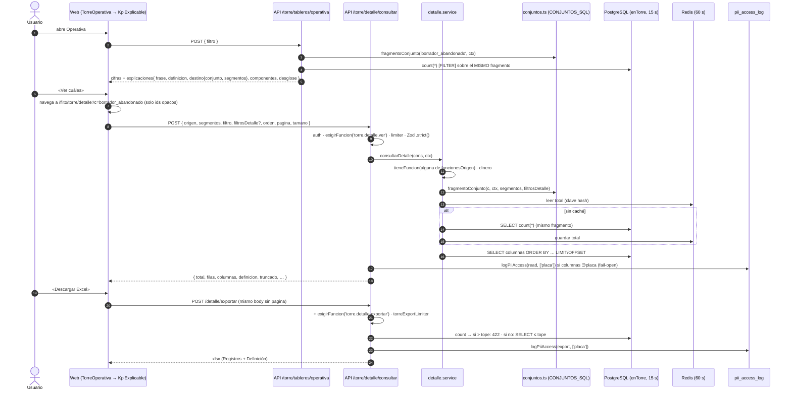

# Diseño — Torre de Control: detalle universal y métricas que se explican (Épica #14590, ampliación)

- **Modo:** full · **ADR:** [ADR-0047](../adr/ADR-0047-flito-torre-conjuntos-cifra-y-detalle-mismo-sql.md) (Propuesto) · extiende ADR-0043 y ADR-0044
- **Módulo:** FLITO `apps/api/src/modules/flito-torre/` (`/api/flito/torre`) + `apps/web/src/pages/torre/`. Lee tablas de módulos FLITO vecinos; **no** habla con los legacy `soat` / `tramites` / `liquidacion` / `pagos` / `liquidaciones`.
- **Trazabilidad:** la Épica #14590 es el único WI, sin Features ni HUs por decisión del humano. Hay un PR `FEATURE/14590-davidchica-<desc>` por bloque y los AC de §13 van en el cuerpo del PR.
- **Plan aprobado (fuente):** `~/.claude/plans/hablemos-sobre-el-desarrollo-wiggly-blum.md`.
- **Gates previos a la UI:** `ux-agent` full (KPI explicable, página Detalle, subvistas y «Para hoy"), maqueta HTML capturada en `docs/ux/` y **«ok» humano antes de `frontend-agent`**.

> **Nota de reconciliación con el prompt.** Los archivos reales se llaman `flito-torre.catalogo.ts`, `flito-torre.comercial.service.ts`, etc., con el prefijo `flito-torre.`. Los números de línea que traía el prompt no coinciden con el árbol actual (`comercial` tiene 177 líneas). Las compañías son `clients.id` **integer** (no uuid), así que el segmento de compañía es `compania:<int>`.

---

## 1. Contexto

Ya están las cuatro pestañas (360°, Comercial, Operativa, Financiera), el Explorador y la ficha de placa. Sus cifras no se explican ni se abren. El objetivo es que cada cifra **diga qué es** (una frase con sujeto, población y base), **explique cómo se calcula** («¿Cómo se calcula?», con la misma definición en todos lados) y **abra sus registros** («Ver cuáles»: una lista filtrable, paginada y exportable dentro de la Torre). Además, la Torre se extiende a SOAT, impuestos, derechos, logística, facturación y equipo.

Invariante central (ADR-0047): **cifra del tablero = `total` del detalle**, porque las dos salen del mismo fragmento `SQL` combinado con el mismo `condicionesTorre()`.

## 2. Alternativas

Están desarrolladas en ADR-0047. En resumen:

| Opción | Pros | Contras | Esfuerzo | Riesgo |
|---|---|---|---|---|
| **1. Registro de conjuntos (elegida)** | La invariante se cumple por construcción, reutiliza el motor y hay una sola definición | Hay que refactorizar los 4 tableros y `contarSinGestion` | L (B1) + M/bloque | Regresión de cifras, que cubren los tests actuales y el test de invariante |
| 2. Endpoint de lista por KPI | Rápido para los 3 ejemplos | Dos SQL por cifra (el defecto actual) y más de 40 rutas | S → L | Deriva silenciosa |
| 3. Tabla de hechos con cron | Lecturas baratas | Datos desfasados (contradice ADR-0043 D2), PII duplicada y un cron más | L+ | Cifras viejas sin aviso |

## 3. Decisión y justificación

Se elige la opción 1. Las piezas ya existen y se reutilizan así:

- `CATALOGO_SQL` + `resolverDef` (`flito-torre.catalogo.ts`) es el patrón de «SQL fijo por clave», y `CONJUNTOS_SQL` lo copia.
- `condicionesTorre` / `condTramites` (`flito-torre.filtro.ts`, `flito-torre.tablero-comun.ts`) siguen siendo el único WHERE de filtro y alcance.
- `claveAgrupacion` (`flito-torre.filtro.ts`) es la expresión del `GROUP BY`. Un segmento se filtra con **esa misma expresión**, así que la celda del Explorador y su detalle coinciden por construcción.
- `enTorre`, `claveCache` / `leerCache` / `guardarCache` (`flito-torre.metricas.service.ts`), `sendExcel` (`shared/utils/excel.ts`), `textoSeguro` (`flito-torre.export.ts`) y `logPiiAccess` (`shared/pii-audit.ts`, el mismo uso que `/placa/buscar`).

**Sin dependencias nuevas.**

Desvío consciente del plan: el plan ponía el constructor «en `catalogo.ts`, junto a `CATALOGO_SQL`». Va en un **archivo nuevo, `flito-torre.conjuntos.ts`**, y los dominios de B3–B5 en `conjuntos/<dominio>.ts`. Con las ~60 entradas de B1–B5, `catalogo.ts` pasaría del tope de 800 líneas (regla 19). Los fragmentos atómicos (`EN_CURSO`, `FACTURADO`, `RADICADO`, `SOPORTE_*`, `BORRADOR_ABANDONADO`…) siguen en `catalogo.ts`, y `conjuntos.ts` los importa.

## 4. Diagrama de secuencia



## 5. Contrato TypeScript (`packages/shared-types/src/flito-torre-detalle.ts`, nuevo)

Va en un archivo aparte porque `flito-torre.ts` ya tiene 492 líneas y B3–B5 lo harían pasar de 800. Se re-exporta desde `src/index.ts`.

```ts
// Entidades con detalle. B1 usa tramite / liquidacion; las demás nacen con su bloque.
export const ENTIDADES_TORRE = ['tramite', 'liquidacion', 'gestion_soat', 'soat_incompleta', 'impuesto', 'derecho',
  'derecho_pendiente', 'traslado', 'acta', 'factura', 'bolsa', 'movimiento_bolsa', 'boleta', 'funcionario'] as const;
export type EntidadTorre = (typeof ENTIDADES_TORRE)[number];

// Dimensiones de segmento: las agrupaciones del motor (D2, misma expresión) + las propias de conjunto.
export const DIMENSIONES_SEGMENTO_TORRE = [...AGRUPACIONES_TORRE, 'nivel', 'faltante', 'tramo_antiguedad', 'severidad'] as const;
export type DimensionSegmentoTorre = (typeof DIMENSIONES_SEGMENTO_TORRE)[number];
export interface SegmentoDetalle { dimension: DimensionSegmentoTorre; valores: (string | null)[] } // ≤ 10 valores; null = «Sin …»

export type ColumnaDetalleId = 'codigo_flit' | 'placa' | 'compania' | 'organismo' | 'tipo_tramite' | 'estado'
  | 'creado_en' | 'aprobado_en' | 'facturado_en' | 'dias_antiguedad' | 'dias_en_estado' | 'faltan_soportes'
  | 'valor' | 'horas_ciclo' | 'aprobado' /* tasa */ | /* B3–B5 añaden: */ 'poliza_ultimos4' | 'vence_el' | 'motivo' | …;
export interface ColumnaDetalle {
  id: ColumnaDetalleId; etiqueta: string;
  tipo: 'texto' | 'fecha' | 'numero' | 'cop' | 'horas' | 'dias' | 'lista' | 'booleano';
  dinero: boolean;      // sin FUNCION_TORRE_DINERO → la API manda null en esa columna
  ordenable: boolean;
}

export interface ConjuntoTorreDef {
  readonly id: string;
  readonly entidad: EntidadTorre;
  readonly etiqueta: string;                  // «Borradores abandonados»
  /** Texto de «¿Cómo se calcula?». ÚNICA fuente: tablero, Detalle, Excel y ayuda lo leen de aquí. */
  readonly definicion: string;
  /** null = foto del momento (ignora el rango); si no, la fecha que lo ancla. */
  readonly fechaBase: FechaBaseTorre | null;
  readonly filtrosIgnorados: readonly (keyof FiltroTorre)[];
  readonly columnas: readonly ColumnaDetalleId[];
  readonly ordenDefecto: { columna: ColumnaDetalleId; dir: 'asc' | 'desc' };
  readonly segmentosAdmitidos: readonly DimensionSegmentoTorre[];
  readonly requiereDinero: boolean;
  /** Operaciones `torre.*` que dan acceso (basta UNA). */
  readonly funcionesOrigen: readonly string[];
  /** Placeholders {umbral} que la API resuelve con `valoresUmbrales()` al servir la definición. */
  readonly umbral?: ClaveUmbralTorre;
}

export const CONJUNTOS_TORRE = [ /* B1, §7 */ ] as const satisfies readonly ConjuntoTorreDef[];
export type ConjuntoTorreId = (typeof CONJUNTOS_TORRE)[number]['id'];
export const CONJUNTOS_TORRE_IDS: readonly [ConjuntoTorreId, ...ConjuntoTorreId[]];

/** Una métrica del Explorador tiene detalle (todas las de B1 lo tienen); entidad = filas del `desde` de la métrica. */
export const DETALLE_METRICA_TORRE: Record<MetricaTorreId, { entidad: EntidadTorre; columnas: readonly ColumnaDetalleId[] }>;

export type OrigenDetalle =
  | { tipo: 'conjunto'; conjunto: ConjuntoTorreId }
  | { tipo: 'metrica'; metrica: MetricaTorreId; fechaBase?: FechaBaseTorre };

export interface FiltrosDetalleTorre {
  placa?: string;                 // SOLO body; 3–7 [A-Z0-9], coincidencia por prefijo
  companiaIds?: number[];         // se suman (AND) al filtro global
  estados?: string[];
}

export interface ConsultaDetalle {
  origen: OrigenDetalle;
  segmentos?: SegmentoDetalle[];  // ≤ 2 (fila y columna de un cruce)
  filtro: FiltroTorre;
  filtrosDetalle?: FiltrosDetalleTorre;
  orden?: { columna: ColumnaDetalleId; dir: 'asc' | 'desc' };
  pagina: number;                 // 1-based
  tamano: 25 | 50 | 100;
}
export type ExportarDetalle = Omit<ConsultaDetalle, 'pagina' | 'tamano'>;

export type ValorCelda = string | number | boolean | string[] | null;
export interface FilaDetalle { id: string; tramiteId: string | null; celdas: Partial<Record<ColumnaDetalleId, ValorCelda>> }

export interface DefinicionCifra { etiqueta: string; definicion: string; fechaBase: FechaBaseTorre | null; campoFecha: string }

export interface ResultadoDetalle {
  origen: OrigenDetalle; segmentos: SegmentoDetalle[];
  definicion: DefinicionCifra;
  total: number;
  /** Métricas de suma: Σ de la columna valor sobre TODO el conjunto (= la celda). null sin dinero. */
  valorTotal: number | null;
  columnas: ColumnaDetalle[];
  filas: FilaDetalle[];
  pagina: number; tamano: number;
  /** total > FILAS_DETALLE_PAGINABLE_MAX: hay registros que no se pueden paginar (sí se cuentan). */
  truncado: boolean;
  filtrosIgnorados: (keyof FiltroTorre)[];
  rango: RangoResuelto | null; dineroVisible: boolean; generadoEn: string;
}

// ── KPI explicable (se añade a cada Tablero*) ──
export type DestinoCifra =
  | { tipo: 'conjunto'; origen: OrigenDetalle; segmentos?: SegmentoDetalle[] }
  | { tipo: 'bloque'; bloque: string }        // ADR-0047 D3: la cifra es una lista de compañías/bolsas ya visible
  | { tipo: 'ninguno' };
export interface ComponenteCifra { etiqueta: string; valor: number; pct?: number | null; destino?: DestinoCifra }
export interface CifraExplicada {
  frase: string;                 // «98 % de los trámites creados en el periodo vienen de 3 compañías: A, B y C»
  definicion: string;            // = CONJUNTOS_TORRE[c].definicion con {umbral} resuelto
  destino: DestinoCifra;
  componentes?: ComponenteCifra[];  // nombres que forman la cifra (Top 3 con %)
  desglose?: ComponenteCifra[];     // lo que la explica (de 12 abandonados, 4 > doble del umbral)
}
```

**DTOs de tablero (`flito-torre.ts`, cambio aditivo).** `TableroComercial`, `TableroOperativo`, `TableroFinanciero` y `TableroEjecutivo` ganan `explicaciones: Partial<Record<ClaveCifra<Tablero>, CifraExplicada>>`, donde la clave son las de `cifras`, y los bloques con filas (radar, sinFacturar, conciliación, benchmark) ganan `destino?: DestinoCifra` por fila. No se quita ni se renombra ningún campo, así que los consumidores actuales no se rompen. Aun así, antes de tocar el tipo hay que hacer un `grep` de los `Tablero*` en `apps/web` (regla 7).

**Topes nuevos (en `TOPES_TORRE`):** `FILAS_DETALLE_PAGINABLE_MAX: 10_000` (`pagina*tamano ≤` esto, para evitar un `OFFSET` profundo; el `total` se cuenta igual), `FILAS_DETALLE_EXPORTAR_MAX: 50_000` (igual que `FILAS_EXPORTAR_MAX`), `VALORES_SEGMENTO_MAX: 10` y `SEGMENTOS_MAX: 2`.

## 6. Contrato de endpoints

Router nuevo `flito-torre.detalle.routes.ts`, montado en `app.ts` **antes** del router general: `app.use('/api/flito/torre/detalle', flitoTorreDetalleRoutes)`, con el mismo patrón que `/tableros`. Se monta sin `conAlcance` (cerrado a todo enlace) y el alcance llega por `alcanceDe(req)`.

| Método y ruta | Guardas (en orden) | Body | 200 | Errores |
|---|---|---|---|---|
| `POST /api/flito/torre/detalle/consultar` | `authMiddleware` · `exigirFuncion('torre.detalle.ver')` · `torreConsultaLimiter` | `ConsultaDetalle` | `ResultadoDetalle`, `Cache-Control: no-store` | 400 `DATOS_INVALIDOS` · 403 `SIN_ORIGEN` (sin ninguna de las `funcionesOrigen`) · 403 `SIN_DINERO` (conjunto o métrica `requiereDinero`) · 503 `TORRE_TIEMPO_AGOTADO` · 500 `TORRE_ERROR` |
| `POST /api/flito/torre/detalle/exportar` | `authMiddleware` · `exigirFuncion('torre.detalle.ver')` · `exigirFuncion('torre.detalle.exportar')` · `torreExportLimiter` | `ExportarDetalle` | xlsx (`sendExcel`): hoja «Registros» y hoja «Definición» (frase, definición, filtros aplicados, segmentos, total, generadoEn); nombre `torre-detalle-<conjunto>-<YYYYMMDD>.xlsx` | los mismos + 422 `DETALLE_EXCEDE_TOPE` si `total > FILAS_DETALLE_EXPORTAR_MAX`, con el mensaje «Acote el periodo o los filtros» |

**Zod** (`flito-torre.esquemas.ts`, reutiliza `filtroTorreSchema`):

```ts
const segmentoSchema = z.object({
  dimension: z.enum(DIMENSIONES_SEGMENTO_TORRE),
  valores: z.array(z.string().trim().min(1).max(40).nullable()).min(1).max(TOPES_TORRE.VALORES_SEGMENTO_MAX),
}).strict();
const origenSchema = z.discriminatedUnion('tipo', [
  z.object({ tipo: z.literal('conjunto'), conjunto: z.enum(CONJUNTOS_TORRE_IDS) }).strict(),
  z.object({ tipo: z.literal('metrica'), metrica: z.enum(METRICAS_TORRE_IDS), fechaBase: z.enum(FECHAS_BASE_TORRE).optional() }).strict(),
]);
const filtrosDetalleSchema = z.object({
  placa: z.string().trim().toUpperCase().regex(/^[A-Z0-9]{3,7}$/).optional(),
  companiaIds: z.array(z.number().int().positive()).max(50).optional(),
  estados: z.array(z.string().trim().min(1).max(60)).max(20).optional(),
}).strict();
const baseDetalle = {
  origen: origenSchema, segmentos: z.array(segmentoSchema).max(TOPES_TORRE.SEGMENTOS_MAX).optional(),
  filtro: filtroTorreSchema, filtrosDetalle: filtrosDetalleSchema.optional(),
  orden: z.object({ columna: z.string().max(40), dir: z.enum(['asc', 'desc']) }).strict().optional(),
};
export const consultaDetalleSchema = z.object({
  ...baseDetalle,
  pagina: z.number().int().min(1).default(1),
  tamano: z.union([z.literal(25), z.literal(50), z.literal(100)]).default(50),
}).strict().superRefine(refinarDetalle);   // segmento ∈ segmentosAdmitidos · orden.columna ∈ columnas ordenables ·
                                           // fechaBase ∈ matriz (esFechaBasePermitida) · pagina*tamano ≤ PAGINABLE_MAX
export const exportarDetalleSchema = z.object(baseDetalle).strict().superRefine(refinarDetalle);
```

El servicio **vuelve** a comprobar cada regla, igual que hace `resolverDef`: lo que queda fuera es `TorreConsultaInvalidaError` y responde 400.

**Orden:** se toma de una lista blanca por entidad (`ORDEN_SQL: Record<ColumnaDetalleId, SQL>`) y siempre se desempata por el id de la entidad, para que la paginación sea estable. Ningún identificador sale del body.

## 7. Conjuntos de B1 (los que ya muestran las 4 pestañas)

Todos los conjuntos se combinan con `condTramites(ctx, rango|null, fecha, ignorar)`. «Foto» significa que el conjunto ignora el rango. Las condiciones listadas son fragmentos de `catalogo.ts`.

| id | Entidad | Base / fecha | Condición (fragmento) | Segmentos | Dinero | funcionesOrigen | Lo usa |
|---|---|---|---|---|---|---|---|
| `soat_sin_gestion` | gestion_soat | foto | `SOAT_SIN_GESTION(horas)` exportado de `flito-tablero` | `compania`, `severidad` (=doble umbral) | no | operativo, ejecutivo | radar |
| `impuesto_sin_gestion` | impuesto | foto | `IMPUESTO_SIN_GESTION(horas)` | ídem | no | operativo, ejecutivo | radar |
| `borrador_abandonado` | tramite | foto | `BORRADOR_ABANDONADO(dias)` (la regla actual, ver §11) | `compania`, `organismo`, `severidad` | no | operativo, ejecutivo | radar, KPI |
| `estancado_ot` | tramite | foto | `ESTANCADO_OT(dias)` (`ULTIMO_CAMBIO_ESTADO`) | `organismo`, `severidad` | no | operativo, ejecutivo | radar |
| `en_curso` | tramite | foto | `EN_CURSO` | `organismo`, `compania`, `flit_estado` | no | operativo, ejecutivo | KPI WIP, carga |
| `tramites_creados` | tramite | creación | — | todas las agrupaciones | no | comercial, operativo, ejecutivo | concentración, embudo[0], benchmark volumen |
| `radicados_cohorte` | tramite | creación | `RADICADO` (sale de `comercial` a `catalogo`) | `compania` | no | comercial | embudo |
| `aprobados_cohorte` | tramite | creación | `APROBADO` | `compania`, `organismo` | no | comercial, operativo | embudo, benchmark |
| `facturados_cohorte` | tramite | creación | `FACTURADO` | `compania` | no | comercial | embudo, KPI conversión |
| `rechazados_cohorte` | tramite | creación | `lower(flit_estado)='rechazado'` | `organismo` | no | operativo | benchmark |
| `entregas_logistica` | liquidacion | aprobación | `APROBADO ∧ valor_logistica>0 ∧ LIQUIDACION_VIGENTE` | `nivel` (`primer_intento`/`con_viajes`) | no | operativo | bloque logística |
| `sin_facturar` | tramite | aprobación | `= resolverDef('sin_facturar')`, la misma métrica del Explorador | `compania` | valor = `L.total` vigente | financiero, ejecutivo | KPI, bloque |
| `soportes_aprobados` | tramite | aprobación | `APROBADO`; segmento `nivel` = `PUNTOS_SOPORTE IN (…)`; columna `faltan_soportes` | `nivel` (0..3), `faltante` (soat/impuesto/derecho), `compania` | no | financiero, ejecutivo | conciliación 3/3 |
| `margen_aprobados` | liquidacion | aprobación | `APROBADO ∧ LIQUIDACION_VIGENTE` | `compania` | **sí** (`requiereDinero`) | financiero | margen por cliente |

`PUNTOS_SOPORTE`, `SOPORTE_SOAT`, `SOPORTE_IMPUESTO`, `SOPORTE_DERECHO`, `RADICADO`, `BORRADOR_ABANDONADO`, `ESTANCADO_OT` y `ULTIMO_CAMBIO_ESTADO` se **mueven** a `catalogo.ts` desde `operativa` / `comercial` / `financiera`, con el mismo SQL de hoy.

**Columnas de la entidad `tramite`:** `codigo_flit` (`id_flit`), `placa` (`plate_complete`), `compania` (nombre por `nombresCompania`), `organismo` (`nombreOrganismo`), `tipo_tramite`, `estado` (`flit_estado`), `creado_en` (`COALESCE(fecha_creacion_flit, created_at)`), `aprobado_en` y `dias_antiguedad`. Cada conjunto puede sumar `dias_en_estado`, `faltan_soportes`, `facturado_en` y `valor` (este último con dinero). **Nunca** salen `flit_raw`, `compania_nit`, nada de `flito_compradores` ni `vehicles` salvo la placa, ni el VIN completo.

**Detalle de métricas del Explorador** (`origen.tipo = 'metrica'`). Usa `resolverDef(metrica, fechaBase)` tal cual: el mismo `desde`, las mismas `fijas` y la misma `fecha`. Cada fila es una fila del `desde`, con un `count(*)` que coincide con la celda:

- **conteo:** las filas.
- **suma:** las filas, con la columna `valor` igual a `def.valor`; `valorTotal = Σ` coincide con la celda.
- **tasa:** el denominador, con la columna `aprobado` (booleano del numerador).
- **tiempo:** las filas con `requiere`, con la columna `horas_ciclo`. Las excluidas no se listan y se declaran en `definicion`.

Un segmento temporal (`mes:2026-10`) usa `claveAgrupacion('mes', dims, fecha) IN (…)`. **«Otros»** del cruce no se abre en v1: la celda se pinta como no pulsable y lleva `aria-disabled`.

**Función del Explorador:** `funcionesOrigen = ['torre.metricas.consultar']`.

## 8. Cómo se refactorizan los tableros (mismo fragmento)

API interna nueva en `flito-torre.conjuntos.ts`:

```ts
interface FragmentoConjunto { desde: SQL; donde: SQL; dims: DimensionesBase; fecha?: FechaBase; entidad: EntidadTorre }
export function fragmentoConjunto(c: ConjuntoTorreId, ctx: ContextoTablero, u: Umbrales,
  segmentos?: SegmentoDetalle[], fd?: FiltrosDetalleTorre): FragmentoConjunto;
/** Varios conjuntos con el MISMO `desde` + base → una consulta con count(*) FILTER (WHERE condición_i). Si no comparten base, una por grupo. */
export function contarConjuntos(q: Ejecutor, ctx: ContextoTablero, u: Umbrales,
  pedidos: { clave: string; conjunto: ConjuntoTorreId; segmentos?: SegmentoDetalle[] }[]): Promise<Record<string, number>>;
export function listarConjunto(q: Ejecutor, f: FragmentoConjunto, columnas, orden, limite, offset): Promise<FilaDetalle[]>;
```

| Servicio | Hoy | Después |
|---|---|---|
| `operativa.calcularRadar` | 4 `count(*) FILTER` escritos a mano y `contarSinGestion` aparte | `contarConjuntos` con `borrador_abandonado`, `borrador_abandonado+severidad:critico`, `estancado_ot` y `estancado_ot+critico`. SOAT e impuesto, por los fragmentos exportados de `flito-tablero`. Sigue costando 1 consulta para trámites y 2 para gestiones. |
| `operativa.carga` / `benchmark` / `logistica` | SQL propio | WIP = `en_curso`. El benchmark **no cambia** de forma (la mediana es un agregado, no un conjunto) y cada fila lleva `destino` a `tramites_creados`/`aprobados_cohorte`/`rechazados_cohorte`/`en_curso` con el segmento del organismo. El conteo de esas columnas usa los mismos fragmentos dentro del `FILTER`. |
| `comercial.concentracion` | `porCompania(count(*))` | `porCompania` sobre `fragmentoConjunto('tramites_creados')`. La explicación lleva `componentes` = Top 3 con su `destino` y el `destino` de la KPI = `tramites_creados` + `compania IN [top3]`. Se corrige la pista de Top 5 en la web. |
| `comercial.embudo` | `FILTER` con `RADICADO`/`FACTURADO` locales | `contarConjuntos` (tramites_creados, radicados_cohorte, aprobados_cohorte, facturados_cohorte): una consulta. |
| `comercial.calcularFuga` | variación en JS | Sin cambio de cálculo. La KPI «Clientes en caída» → `destino: bloque 'fuga'` (D3); cada fila → `tramites_creados` + `compania` con el rango de la ventana. |
| `financiera.calcularSinFacturar` | SQL propio | `fragmentoConjunto('sin_facturar')`, que es `resolverDef('sin_facturar')`. Desde ahí la KPI, el bloque y el Explorador son el mismo SQL. |
| `financiera.conciliacion` | `puntos` local | `PUNTOS_SOPORTE` de `catalogo`; `GROUP BY` puntos sobre `fragmentoConjunto('soportes_aprobados')`; cada nivel → `destino` con `nivel:[n]`; KPI «Soportes completos 3/3» → desglose 3/2/1/0 y «Ver cuáles» = `nivel:['0','1','2']` (los incompletos). |
| `financiera.calcularMargen` | SQL propio | El `WHERE` sale de `fragmentoConjunto('margen_aprobados')`; los LATERAL de costo no cambian. |
| `financiera.calcularBolsas` | severidad en JS | B1: `destino: bloque 'bolsas'`. En B4 la severidad pasa a SQL (`conjunto bolsas_cobertura`). |
| `ejecutivo` | reusa radar/fuga/sin facturar/margen | Hereda los cambios y sus explicaciones. |
| `flito-tablero.contarSinGestion` | condiciones en línea | Exporta `condSoatSinGestion(horas)` / `condImpuestoSinGestion(horas)` (SQL) y los usa. Sigue fuera de `enTorre` como hoy y su firma no cambia. |

Las frases y explicaciones las arma `flito-torre.frases.ts` (funciones puras y testeables) con los números ya calculados, más `CONJUNTOS_TORRE[c].definicion` con `{umbral}` resuelto. La Excel de cada tablero (`tablero-export.ts`) agrega una hoja «Definiciones» con la clave, la frase y la definición.

Ejemplos de frase:

- Concentración: «98 % de los trámites creados en el periodo vienen de 3 compañías: A (61 %), B (25 %) y C (12 %)».
- Borradores: «12 trámites siguen en Borrador más de 5 días después de creados; 4 llevan más de 10».
- Soportes: «De 240 trámites aprobados en el periodo, 180 tienen los 3 soportes; a 60 les falta al menos uno».

## 9. Tratamiento de PII (Ley 1581)

- **¿La placa exige `logPiiAccess`?** **Sí.** La regla 16 obliga a registrar «toda lectura que proyecte columnas personales del titular, cifradas o no», y AGENTS §14 clasifica la placa como cuasi-PII. La placa identifica el vehículo y, por RUNT, a su propietario. La Torre ya lo trata así: `/placa/buscar` y `/placa/sugerencias` registran `logPiiAccess(search, ['placa'])`. Un detalle es una **proyección en lote** de placas, más expuesto que la ficha de una sola, así que no registrarlo sería incoherente.
  - En consultar: `accion: 'read'`; en exportar: `accion: 'export'`. `camposAccedidos: ['placa']`, `resourceTipo` = la tabla de la entidad (`flito_tramite`, `flito_soat`, …) y `motivo: 'Torre de Control: detalle <conjunto>'`.
  - Se registra en **toda petición válida** cuyas columnas incluyan `placa`, aunque traiga 0 filas, igual que en placa.
  - **Fail-open** (`logPiiAccess`, no `OrThrow`). La regla 16 hace fallar abierto a colas y bandejas, y este detalle es una bandeja de lectura. El fallo queda en el log.
- **Qué nunca se muestra:** el nombre y la cédula del titular, cualquier columna de `flito_compradores`, el VIN completo, las direcciones (`flito_impuestos.direccion_*`, `flito_logistica_actas.direccion_entrega`), los nombres de receptor y contacto, `entregado_lat` y las storage keys. En B5 se muestra `users.name` del funcionario (dato interno del empleado, no del titular), nunca `usuario_email`.
- **URL:** la web solo lleva `?c=<conjunto>` o `?m=<metrica>&fb=<fechaBase>` y `&s=<dimension>:<v1>,<v2>` con ids opacos (id de compañía, DIVIPOLA, estado, nivel). El filtro de placa del detalle vive **solo en el estado del componente** y nunca se escribe en la URL ni en `torreFiltros`. El E2E lo comprueba.
- **Logs:** ni la ruta ni el servicio loguean el body ni `filtrosDetalle`. `enTorre` solo loguea el código de Postgres.
- **Redis (D5):** se cachea solo el `total`, con la clave en sha256 vía `claveCache('detalle-total', origen, segmentos, filtro, filtrosDetalle, alcance, dinero, hoy)`. Las filas no se cachean.
- **Retención:** no se crean tablas nuevas con datos personales. Se aplica la retención existente de `pii_access_log`.

## 10. Permisos

En `permisos/arbol/acciones-torre.ts`:

```ts
'accion.torre_detalle.ver':      { lectura: true, operaciones: ['torre.detalle.ver'], predecesores: [] },
'accion.torre_detalle.exportar': { operaciones: ['torre.detalle.exportar'], predecesores: [] },   // NO es lectura
// ITEMS_TORRE_ARBOL += 'pagina.torre_detalle'
```

Reparto (`REPARTO_TORRE`; `admin` lo recibe todo por ADR-0022):

| Rol | `torre_detalle.ver` | `torre_detalle.exportar` |
|---|---|---|
| `financiera` | sí | sí |
| `gerencia_comercial` | sí | sí |
| `gerencia_general` | sí | sí |
| `auditor` | sí | **no** (la auditoría no descarga) |

- `funcionesOrigen` hace que `ver` no alcance para ver conjuntos de un tablero que el rol no tiene. Un `gerencia_comercial` no ve `margen_aprobados` porque no tiene `torre.tablero_financiero.ver`.
- PageSlug `torre_detalle: 'Torre · Detalle'` en `packages/shared-types/src/permissions.ts`, junto a los demás `torre_*`. Entra en `PAGE_GROUPS` y en `ROLE_DEFAULT_PAGES` igual que los otros ítems de la Torre: hay que replicar exactamente lo que hacen `torre_explorador` y sus vecinos.
- **Siembra:** migración nueva `NNNN_flito_torre_detalle_permisos.sql`. El número se asigna al integrar; hoy el siguiente libre es `0306`. Inserta en `permisos_funciones` (el ítem y las 2 acciones, con `ON CONFLICT DO NOTHING`) y en `permisos_rol_funcion` el reparto literal, igual que la 0303. Es idempotente. **No** se modifica la 0303, que ya está aplicada. Dispara `db-review-agent`.
- El test `flito-torre-permisos.test.ts` vigila que el auditor no tenga `exportar`, que el reparto coincida con la migración y que solo `admin` tenga `umbrales.editar`, regla que ya existía.

## 11. Topes, caché, índices y la regla de borrador

- **Topes:** se aplican los de rango (`exigirTopesRango`), `tamano ∈ {25,50,100}`, `pagina*tamano ≤ 10 000` y export `≤ 50 000` (422 si se pasa, nunca un recorte silencioso). El timeout de `enTorre` es de 15 s. Consultar usa `torreConsultaLimiter` y exportar usa `torreExportLimiter`.
- **Caché:** el `total` se guarda 60 s. **Riesgo aceptado:** el tablero también está cacheado 60 s por separado, así que en esa ventana la cifra y el `total` pueden diferir si los datos cambian. El encabezado del detalle muestra `generadoEn`. La invariante se prueba con datos fijos y se refiere al SQL, no al reloj.
- **Índices B1:** **ninguno previsto.** Las bases ya tienen los índices de 0303 y 0304: `fecha_creacion_flit`, `fecha_aprobacion`, `compania_aprobacion`, `flit_estado`, `organismo`, `placa_upper`, `historial_campo_fecha` y la parcial de facturas. El `backend-agent` adjunta en el PR el `EXPLAIN (ANALYZE, BUFFERS)` local de `borrador_abandonado`, `soportes_aprobados+nivel` y `sin_facturar` paginado. Si alguno hace Seq Scan sobre más de 100k filas, el índice va en el mismo PR y pasa por `db-review-agent`.
- **Borrador abandonado, pendiente para B2.** Hoy la Torre usa «creado hace más de N días y sigue en Borrador», y Trámites usa `borrador_5d`, otra regla (`flito-tramites.service.ts`). **Decidido por el humano (2026-11-19):** una sola regla, «más de N días desde la **entrada** al estado Borrador» (último cambio de `flit_estado` en `flito_tramite_historial`, con respaldo en la fecha de creación) y el umbral `dias_borrador_abandonado`. El fragmento `BORRADOR_ABANDONADO` vive en `flito-tramites`, que es el dueño del dato, y la Torre lo importa, con el mismo precedente que `contarSinGestion`. B1 muestra la definición **exacta** que se aplica hoy.

## 12. Bloques de entrega y archivos por bloque

En ADO no hay Features: hay un PR por bloque bajo la Épica #14590. B1 pasa de las ~1500 líneas de producto y mezcla backend de riesgo (rutas nuevas, PII, migración) con UI, así que **se parte en B1a (contrato + backend) y B1b (UI)**, declarado en el cuerpo de ambos PRs.

### B1 — Detalle universal y métricas que se explican

**Paso 0, contract-first (serial, un agente: `backend-agent`). Va en la rama de B1a:**

| Archivo | Acción |
|---|---|
| `packages/shared-types/src/flito-torre-detalle.ts` | crear: tipos de §5, `CONJUNTOS_TORRE` de §7 con sus definiciones y `DETALLE_METRICA_TORRE` |
| `packages/shared-types/src/flito-torre.ts` | modificar: `explicaciones` y `destino?` en los DTO `Tablero*`, y los topes nuevos |
| `packages/shared-types/src/index.ts` | modificar: re-export |
| `packages/shared-types/src/permissions.ts` | modificar: PageSlug `torre_detalle` (+ grupos y defaults como los vecinos) |
| `apps/api/src/modules/flito-torre/flito-torre.detalle.routes.ts` | crear: las 2 rutas con guardas y Zod, que responden 501 hasta el bloque backend |
| `apps/api/src/modules/flito-torre/flito-torre.esquemas.ts` | modificar: `consultaDetalleSchema` / `exportarDetalleSchema` |
| `apps/api/src/app.ts` | modificar: montar `/api/flito/torre/detalle` antes de `/api/flito/torre` |

Gate del paso 0: `npm run build -w packages/shared-types`, `npm run test:shared-types` y un grep de los `Tablero*` en `apps/web`.

**Después, en paralelo y sin archivos compartidos.** Cada agente trabaja en su worktree, con un máximo de 2 agentes y `free -g` antes de lanzar.

**Bloque backend (B1a, `backend-agent`):**

| Archivo | Acción |
|---|---|
| `apps/api/src/modules/flito-torre/flito-torre.catalogo.ts` | modificar: recibe `RADICADO`, `PUNTOS_SOPORTE`, `SOPORTE_*`, `BORRADOR_ABANDONADO`, `ESTANCADO_OT`, `ULTIMO_CAMBIO_ESTADO` |
| `apps/api/src/modules/flito-torre/flito-torre.conjuntos.ts` | crear: `CONJUNTOS_SQL`, `fragmentoConjunto`, `contarConjuntos`, `listarConjunto`, `ORDEN_SQL`, columnas por entidad (RN-TOR-D1..D8 en la cabecera) |
| `apps/api/src/modules/flito-torre/flito-torre.detalle.service.ts` | crear: `consultarDetalle`, `datosExportacion`, comprobación de `funcionesOrigen` y dinero |
| `apps/api/src/modules/flito-torre/flito-torre.detalle-export.ts` | crear: xlsx con `sendExcel` y `textoSeguro` |
| `apps/api/src/modules/flito-torre/flito-torre.frases.ts` | crear: arma las `CifraExplicada` |
| `apps/api/src/modules/flito-torre/flito-torre.detalle.routes.ts` | modificar: cablear el servicio y `logPiiAccess` |
| `apps/api/src/modules/flito-torre/flito-torre.operativa.service.ts` · `.comercial.service.ts` · `.financiera.service.ts` · `.ejecutivo.service.ts` · `.tablero-export.ts` | modificar (§8) |
| `apps/api/src/modules/flito-tablero/flito-tablero.service.ts` | modificar: exporta `condSoatSinGestion` / `condImpuestoSinGestion` |
| `apps/api/src/modules/permisos/arbol/acciones-torre.ts` | modificar (§10) |
| `apps/api/src/db/migrations/NNNN_flito_torre_detalle_permisos.sql` | crear (número al integrar) |
| `contracts/openapi/flito-api.v1.yaml` | regenerar (`npm run contrato:generar`) |
| `apps/api/__tests__/services/flito-torre/flito-torre-detalle.test.ts` | crear: Zod, 401/403, origen, dinero `null`, orden, paginación, PII log |
| `apps/api/__tests__/services/flito-torre/flito-torre-detalle-invariante.test.ts` | crear: por cada conjunto de §7 y 3 métricas del Explorador, la cifra del tablero o celda es igual al `total`, y en las de suma, igual a `valorTotal` |
| `apps/api/__tests__/services/flito-torre/flito-torre-detalle-export.test.ts` | crear: tope 422, `textoSeguro`, auditor 403 |
| `apps/api/__tests__/services/flito-torre/flito-torre-tableros.test.ts` · `flito-torre-permisos.test.ts` · `flito-torre-rutas.test.ts` | modificar |

P1 del bloque: `npm test -w apps/api -- __tests__/services/flito-torre/flito-torre-detalle.test.ts __tests__/services/flito-torre/flito-torre-detalle-invariante.test.ts __tests__/services/flito-torre/flito-torre-detalle-export.test.ts __tests__/services/flito-torre/flito-torre-tableros.test.ts __tests__/services/flito-torre/flito-torre-permisos.test.ts __tests__/services/flito-torre/flito-torre-rutas.test.ts` + el test de `flito-tablero` que cubra `contarSinGestion` + `NODE_OPTIONS=--max-old-space-size=8192 npm run build:api`. Gates: `security-agent` (rutas nuevas, PII) ∥ `db-review-agent` (migración).

**Bloque frontend (B1b, `frontend-agent`, solo tras el «ok» humano a la maqueta del `ux-agent`):**

| Archivo | Acción |
|---|---|
| `apps/web/src/components/torre/KpiExplicable.tsx` | crear: **compone** `components/flit/KpiCard` (no lo modifica) con la frase, «¿Cómo se calcula?» y «Ver cuáles» |
| `apps/web/src/components/torre/ComoSeCalcula.tsx` | crear: popover accesible (botón con `aria-expanded`, Esc cierra, el foco vuelve al disparador) |
| `apps/web/src/components/torre/TablaDetalleTorre.tsx` | crear: `DataTable` + `Paginacion` + `FiltrosPlegables`, con «Abrir trámite» por fila |
| `apps/web/src/lib/torreDetalle.ts` | crear: arma y lee la URL opaca (`c`/`m`/`fb`/`s`) y los destinos |
| `apps/web/src/pages/torre/TorreDetalle.tsx` | crear: la página con sus 4 estados, encabezado con frase y definición, y «Descargar Excel» como primaria |
| `apps/web/src/lib/api.ts` | modificar: `torreDetalleConsultar`, `torreDetalleExportar` |
| `apps/web/src/App.tsx` | modificar: `lazy()` + `ProtectedRoute` + `hasPage('torre_detalle')` |
| `apps/web/src/pages/torre/TorreComercial.tsx` · `TorreOperativa.tsx` · `TorreFinanciera.tsx` · `Torre360.tsx` | modificar: KPIs y filas de bloque con `destino`; corregir la pista Top 3/Top 5; «Ver cola» y «Ver en reporte» con el conjunto |
| `apps/web/src/components/torre/ResultadoExplorador.tsx` · `TablaCruzadaTorre.tsx` | modificar: «Ver registros» por fila o celda (no en «Otros») |
| `apps/web/e2e/tests/torre-detalle.spec.ts` | crear |

«Abrir trámite»: si el usuario tiene la página de Gestión Trámites, abre su detalle por `tramiteId` (uuid; el `frontend-agent` confirma la ruta del modal de ADR-0046). Si no la tiene, abre `FichaPlacaDrawer` de la Torre con la placa en el body (`torre.placa.buscar`). Si no tiene ninguna de las dos, el botón no se muestra.

`PaginaTorre.tsx` y `navEntradas.ts` **no** cambian en B1: el Detalle no es una pestaña.

P1: `npm run typecheck -w apps/web` + `npx playwright test e2e/tests/torre-detalle.spec.ts` (con el entorno arriba). `flit-ayuda-flito`: la Torre no tiene ficha, así que se declara N/A o se crea una (pendiente humano).

**Archivos compartidos entre bloques:** ninguno. El paso 0 es dueño de shared-types, `esquemas`, `app.ts` y el stub de rutas. El backend solo toca `apps/api/**` y `contracts/`. El frontend solo toca `apps/web/**`.

### B2 — Trámites y estados

- **Conjuntos nuevos:** `inventario_estado` (foto, entidad tramite, segmentos `flit_estado` × `tramo_antiguedad` ∈ {0-2, 3-7, 8-15, 16-30, >30} días en el estado actual vía `ULTIMO_CAMBIO_ESTADO`, × `organismo`), `soportes_faltantes` (= `soportes_aprobados` + `faltante`) y `borrador_abandonado` (con la regla unificada, si el humano la aprueba).
- **Métrica nueva del Explorador:** `dias_en_estado` (horas, foto) y la agrupación `tramo_antiguedad`. Agregar una agrupación toca `AGRUPACIONES_TORRE` y `claveAgrupacion`.
- **UI:** `Pestanas` en Operativa (Resumen · Inventario por estado · Soportes · Equipo, este último vacío hasta B5).
- **Archivos:** `shared-types/flito-torre-detalle.ts`, `flito-torre.ts` (agrupación); API `flito-torre.conjuntos.ts`, `flito-torre.catalogo.ts`, `flito-torre.filtro.ts`, `flito-torre.operativa.service.ts` + un servicio nuevo `flito-torre.inventario.service.ts` + la ruta `/tableros/operativa/inventario` en `tableros.routes.ts`. Si se unifica la regla: `flito-tramites/flito-tramites.service.ts` (`borrador_5d`) y sus tests. Web: `TorreOperativa.tsx`, `components/torre/MatrizInventarioTorre.tsx` (nuevo).
- **Índice candidato:** `flito_tramite_historial (tramite_id, campo, created_at DESC)` si el `EXPLAIN` del último cambio por trámite lo pide. Hoy existen `tramite` y `campo_fecha`.

### B3 — Productos: SOAT, impuestos y derechos (área nueva)

**Tablas reales:**

- `src/db/schema/soat.ts`: `flito_soat` (estado, estado_vigencia, vence_el, enviado_en, pagado_en, valor_pagado, proveedor_soat_id, compania_id, organismo_codigo, gestion_operaciones*, numero_poliza → solo los 4 últimos) y `flito_soportes`.
- `flito-soat-incompletas.ts`: `flito_soat_incompletas` (estado, motivo_pendiente, intentos, solicitado_en, resuelta_en, motivo_descarte; tiene `placa` y `vin`).
- `flito-soat-masivo.ts`: `flito_soat_masivo_lotes` y `flito_soat_masivo_filas`. Las filas son PII efímera (ADR-0032): **solo conteos por lote, sin detalle de fila**.
- `flito-impuestos.ts`: `flito_impuestos` (estado, enviado_en, liquidado_en, pagado_en, valor_liquidado, valor_pagado, marcado_por_diferencia, motivo_rechazo, direccion_pendiente_revision → solo como booleano, nunca la dirección) y `flito_impuesto_certificaciones`. También `flito-impuesto-certificacion-directa.ts` y `flito-impuesto-envios-flit2.ts`.
- `flito-derechos.ts`: `flito_derechos_tramite` (valor, fecha_pago, numero_radicado, origen, soporte_id) y `flito_derechos_pendientes` (resuelto, intentos, placa, fecha_pago).

**Conjuntos:**

- SOAT: `soat_por_estado` (segmento estado), `soat_sin_gestion` (B1), `soat_por_vencer` (`vence_el` dentro de N días; necesita el umbral nuevo `dias_soat_por_vencer`, que se siembra con una migración en `flito_torre_umbrales`), `soat_vigencia_no_verificada`, `soat_pagados_periodo` (pago, valor con dinero) e `soat_incompletas_abiertas` (segmento motivo).
- Impuestos: `impuestos_por_estado`, `impuesto_sin_gestion` (B1), `impuestos_rechazados_periodo` (segmento motivo), `impuestos_con_diferencia` (`marcado_por_diferencia`), `impuestos_direccion_pendiente` (solo el conteo y la placa, sin dirección) e `impuestos_pagados_periodo` (= la métrica `impuestos_pagados`).
- Derechos: `derechos_pagados_periodo` (= la métrica), `derechos_sin_soporte` y `derechos_pendientes_sin_resolver`.

**Métricas nuevas del Explorador:** `soat_gestionados` (conteo, por `enviado_en`/`pagado_en`), `soat_pagados_valor` (cop), `impuestos_gestionados` y `derechos_registrados`. La fecha base nueva `envio` exige un ADR que extienda la D5 de ADR-0044, o limitarse a `pago`/`creacion` (**pendiente humano; recomendación: sin fecha base nueva**).

**Permisos y archivos:** PageSlug `torre_productos`, acción y operación `torre.tablero_productos.ver` con su migración de siembra, y `PAGINAS_TORRE` + `navEntradas.ts`. Archivos: `conjuntos/productos.ts`, `flito-torre.productos.service.ts`, la ruta `/tableros/productos` (+ export), `pages/torre/TorreProductos.tsx` (Pestanas SOAT · Impuestos · Derechos) y `App.tsx`.

### B4 — Logística y facturación

**Tablas reales:**

- `flito-logistica-traslados.ts`: `flito_logistica_traslados` (estado, origen, destino, registrado_en, mensajero_id, compania_id), `flito_logistica_traslado_lts`, `flito_logistica_acta_lineas`, `flito_logistica_acta_firmas`, `flito_logistica_recogida_firmantes` y `flito_logistica_motivos_llegada`.
- `flito-logistica.ts`: `flito_logistica_actas` (created_at, entregado_en, motivo_devolucion, proveedor_logistica_id; **se excluyen** direccion_entrega, contacto_nombre, receptor_nombre, entrega_nombre, entregado_lat y las storage keys), `flito_logistica_documentos`, `flito_logistica_documento_eventos`, `flito_logistica_corte_proveedor` y `flito_proveedores_logistica`.
- `flito-logistica-viajes.ts`: `flito_tramite_viajes_logistica`.
- `siigo.ts`: `siigo_facturas` (estado, numero, total_siigo, enviada_en, requiere_revision, error_code), `siigo_factura_tramites`, `siigo_lotes_facturacion`, `siigo_lote_tramites`, `siigo_cola_facturacion` (estado, intentos, desenlace, proximo_intento_at), `siigo_factura_estados_dian`, `siigo_factura_correcciones` y `siigo_factura_envios`.
- `flito-bolsas-unicas.ts`: `flito_bolsas_unicas` (saldo, activa), `flito_bolsas_unicas_movimientos` (tipo, valor, fecha, concepto, tramite_id), `flito_bolsas_unicas_cierres`, `flito_bolsas_unicas_cobertura` y `flito_bolsas_corte`. También `flito-bolsas-documentos.ts`.
- `finanzas.ts`: `flito_liquidaciones`, `flito_liquidacion_eventos`, `flito_organismo_pagos`, `flito_conciliacion_boletas` (estado, total_declarado vs total_cruzado), `flito_conciliacion_lineas` y `flito_excepciones_autogestion`. `liquidaciones`, `liquidacion_items` y `pagos` son **legacy y no se usan**.

**Conjuntos:**

- Logística: `traslados_por_estado`, `traslados_abiertos_mas_de_n` (umbral nuevo `dias_traslado_abierto`), `actas_pendientes_entrega`, `actas_devueltas_periodo` (segmento motivo), `entregas_periodo` (= B1 `entregas_logistica`) y `viajes_adicionales_periodo`.
- Facturación: `sin_facturar` (B1), `facturas_con_error` (`error_code` no nulo o `requiere_revision`), `facturas_rechazadas_dian`, `cola_facturacion_atascada` (pendientes con `proximo_intento_at` vencido o con los intentos agotados) y `facturado_periodo` (cop).
- Bolsas: `bolsas_cobertura` (la severidad pasa a SQL con el mismo LATERAL de consumo y segmento `severidad`), `bolsas_agotadas` y `movimientos_bolsa_periodo` (dinero).
- Conciliación: `boletas_sin_conciliar` y `boletas_con_diferencia`.
- **Cartera: pendiente humano.** No se encontró en FLITO un registro de pago de la factura de Siigo, así que no se puede medir sin una fuente.

**Permisos y archivos:** PageSlug `torre_logistica` y la operación `torre.tablero_logistica.ver`. Financiera gana las Pestanas Resumen · Facturación · Bolsas y cartera. Archivos: `conjuntos/logistica.ts`, `conjuntos/facturacion.ts`, `flito-torre.logistica.service.ts`, `flito-torre.financiera.service.ts` (bolsas a SQL), rutas, `pages/torre/TorreLogistica.tsx`, `TorreFinanciera.tsx`, `PaginaTorre.tsx`, `navEntradas.ts` y `App.tsx`. **Índices candidatos (con `EXPLAIN`):** `flito_logistica_traslados (estado, registrado_en)`, `siigo_facturas (estado) WHERE requiere_revision OR error_code IS NOT NULL` y `siigo_cola_facturacion (estado, proximo_intento_at)`.

### B5 — Operación del equipo

**Tablas reales:**

- `flito_tramite_historial` (usuario_id, campo, created_at).
- `flito-seguimiento.ts`: `flito_estado_historial` (concepto, registro_id, estado_nuevo, usuario_id, created_at; **nunca** `usuario_email`) y `flito_revisiones`.
- Gestiones con autor: `flito_soat.enviado_por_id` / `gestion_operaciones_por_id`, `flito_impuestos.enviado_por_id` / `gestion_operaciones_por_id`, `flito_derechos_tramite.registrado_por_id`, `flito_logistica_traslados.registrado_por_id` y `flito_soat_incompletas.resuelta_por_id`.
- `users` (name).

**Conjuntos (entidad funcionario, segmento `funcionario` = `users.id`):**

- `gestiones_funcionario_periodo`: cambios de estado registrados por el funcionario.
- `carga_funcionario`: gestiones abiertas que tocó por última vez él.
- `fuera_ans_funcionario`: la gestión en la que el funcionario intervino en último lugar supera el ANS de `ANS_OPERATIVO` o el umbral.

Agregar la dimensión `funcionario` a `DIMENSIONES_SEGMENTO_TORRE` **no** la agrega a las agrupaciones del Explorador (la operación del equipo no se abre a todos).

**Permisos y archivos:** la operación `torre.equipo.ver` (decidido por el humano el 2026-11-19: solo `gerencia_general` + `admin`) y `funcionesOrigen = ['torre.equipo.ver']`. Archivos: `conjuntos/equipo.ts`, `flito-torre.equipo.service.ts`, la ruta `/tableros/operativa/equipo`, la Pestana Equipo en `TorreOperativa.tsx` y la siembra. **Índices candidatos:** `flito_estado_historial (usuario_id, created_at)` y `flito_tramite_historial (usuario_id, created_at)`.

### B6 — «Para hoy» y hallazgos en el 360°

- `TableroEjecutivo` gana `paraHoy: FrenteTorre[]` (`{ conjunto, cifra, frase, severidad, accion: 'ver' | 'revisar', destino }`). Se calcula con **una** llamada a `contarConjuntos` sobre una lista fija de conjuntos «accionables» de B1–B5, filtrada por las `funcionesOrigen` que tiene el usuario: nunca se muestra un frente que no podría abrir.
- `hallazgos: string[]`: frases con reglas deterministas, como variaciones frente al periodo anterior o la concentración. **No** se usa un LLM (no hay dependencia nueva ni datos a terceros).
- **Archivos:** `flito-torre.ejecutivo.service.ts`, `flito-torre.frases.ts`, `shared-types/flito-torre.ts` y `pages/torre/Torre360.tsx`.

**Paralelismo entre bloques:** no. B2 a B6 tocan `flito-torre-detalle.ts`, `flito-torre.conjuntos.ts` y `App.tsx`, así que van en serie y en orden B1 → B2 → B3 → B4 → B5 → B6.

## 13. Criterios de aceptación (Gherkin) por bloque

### B1 (B1a backend + B1b UI)

```gherkin
Característica: Detalle universal y métricas que se explican (B1)

  Escenario: AC1 La cifra del tablero coincide con su detalle
    Dado un filtro de la Torre con rango "mes" y datos fijos de prueba
    Cuando consulto el tablero Operativo y luego POST /detalle/consultar con el conjunto "borrador_abandonado" y el mismo filtro
    Entonces el "total" del detalle es igual a "cifras.borradoresAbandonados"
    Y lo mismo se cumple para cada conjunto de B1 y para 3 métricas del Explorador (conteo, suma y tasa)

  Escenario: AC2 La KPI dice qué es
    Dado el tablero Comercial con 3 compañías que concentran el 98 % de los trámites creados
    Cuando lo consulto
    Entonces "explicaciones.concentracionTop3Pct.frase" nombra las 3 compañías con su porcentaje
    Y su "definicion" es la de CONJUNTOS_TORRE para "tramites_creados"
    Y la pista de la tarjeta no menciona el Top 5

  Escenario: AC3 ¿Cómo se calcula? es accesible
    Dado una KPI de cualquiera de las 4 pestañas
    Cuando enfoco «¿Cómo se calcula?» con el teclado y pulso Enter
    Entonces se abre un popover con la definición, Esc lo cierra y el foco vuelve al botón

  Escenario: AC4 Ver cuáles abre los registros
    Dado la KPI «Borradores abandonados» con valor N
    Cuando pulso «Ver cuáles»
    Entonces voy a /flito/torre/detalle con la frase y la definición arriba
    Y la tabla indica N registros con placa, compañía y estado, sin nombre ni cédula del titular

  Escenario: AC5 Soportes 3/3 muestra qué falta
    Dado trámites aprobados en el periodo con 0, 1, 2 y 3 soportes
    Cuando abro «Ver cuáles» de «Soportes completos 3/3»
    Entonces veo solo los incompletos con la columna "Faltan" (SOAT, Impuesto o Derecho)
    Y el total es igual a la suma de los niveles 0, 1 y 2 del bloque de conciliación

  Escenario: AC6 Filtrar, ordenar y paginar
    Dado un detalle con más de 50 registros
    Cuando filtro por compañía, ordeno por "Creado" y paso a la página 2
    Entonces las filas respetan el filtro y el orden, sin repetirse entre páginas

  Escenario: AC7 La placa nunca va en la URL
    Dado el detalle abierto
    Cuando filtro por la placa "ABC123"
    Entonces la URL de la web no contiene "ABC123" y la petición lleva la placa solo en el body POST

  Escenario: AC8 Exportar a Excel
    Dado un usuario con torre.detalle.exportar
    Cuando pulso «Descargar Excel»
    Entonces recibo un xlsx con las hojas «Registros» y «Definición», con las celdas pasadas por textoSeguro y un nombre de archivo sin la placa
    Y si el total supera FILAS_DETALLE_EXPORTAR_MAX la API responde 422 DETALLE_EXCEDE_TOPE

  Escenario: AC9 Permisos
    Dado un usuario sin torre.detalle.ver
    Cuando llamo a POST /detalle/consultar
    Entonces responde 403
    Y un gerencia_comercial que pide "margen_aprobados" recibe 403 SIN_ORIGEN
    Y un auditor puede consultar pero recibe 403 al exportar
    Y sin torre.metricas.dinero las columnas de dinero vienen en null y los conjuntos requiereDinero responden 403

  Escenario: AC10 Habeas Data
    Dado una consulta válida cuyo resultado incluye la columna placa
    Cuando se resuelve (aunque traiga 0 filas)
    Entonces se registra en pii_access_log con accion "read" (o "export"), campo "placa" y el recurso de la entidad
    Y ni el logger ni Redis guardan la placa en claro

  Escenario: AC11 Zod cerrado
    Cuando envío un conjunto, segmento, columna de orden o campo desconocido, o un tamano de 37
    Entonces responde 400 DATOS_INVALIDOS

  Escenario: AC12 El Explorador abre registros
    Dado un resultado del Explorador agrupado por compañía (o un cruce compañía × mes)
    Cuando pulso «Ver registros» en una fila o celda
    Entonces el detalle trae segmentos con esa clave y su total es igual al valor de la celda
    Y la celda «Otros» no se puede pulsar

  Escenario: AC13 Acciones de bloque con contexto
    Cuando pulso «Ver cola» del radar o «Ver en reporte de costos»
    Entonces el destino abre el conjunto correspondiente con los filtros actuales, no la pantalla vacía

  Escenario: AC14 Los 4 estados del detalle
    Entonces el Detalle muestra «cargando», error con «Reintentar», «sin registros para estos filtros» y la tabla con datos
```

### B2

```gherkin
  Escenario: B2-AC1 Matriz estado × antigüedad
    Cuando abro Operativa › Inventario por estado
    Entonces veo una matriz de estados de FLITO por tramos de días en el estado actual
    Y cada celda abre su detalle con un total igual al valor de la celda

  Escenario: B2-AC2 Una sola regla de borrador (si el humano la aprueba)
    Dado un trámite que lleva más de N días en Borrador
    Entonces la Torre y la alerta borrador_5d de Trámites lo cuentan igual, con el umbral dias_borrador_abandonado

  Escenario: B2-AC3 Soportes por faltante
    Cuando abro Operativa › Soportes
    Entonces veo cuántos aprobados no tienen SOAT, impuesto o derecho, y cada cifra abre su lista
```

### B3

```gherkin
  Escenario: B3-AC1 Área Productos
    Dado un usuario con torre.tablero_productos.ver
    Cuando abro Torre › Productos
    Entonces veo las pestañas SOAT, Impuestos y Derechos, con KPIs explicables que abren su detalle
    Y un usuario sin ese permiso no ve la pestaña ni puede llamar a la ruta (403)

  Escenario: B3-AC2 Sin datos personales de más
    Cuando abro cualquier detalle de Productos
    Entonces no aparecen la dirección del impuesto, el VIN completo ni el número de póliza completo (solo sus 4 últimos)

  Escenario: B3-AC3 Explorador con métricas de producto
    Cuando elijo «SOAT gestionados» agrupado por compañía
    Entonces cada fila abre su detalle con un total igual a la fila
```

### B4

```gherkin
  Escenario: B4-AC1 Área Logística
    Cuando abro Torre › Logística
    Entonces veo traslados por estado, actas pendientes y devueltas y entregas en primer intento, y cada cifra abre su lista
    Y ningún detalle muestra dirección de entrega, receptor, contacto ni coordenadas

  Escenario: B4-AC2 Facturación
    Cuando abro Financiera › Facturación
    Entonces veo sin facturar, facturas con error, rechazadas por la DIAN y la cola atascada, con detalle

  Escenario: B4-AC3 Bolsas
    Cuando abro Financiera › Bolsas
    Entonces la cifra de bolsas en rojo es igual al total del detalle "bolsas_cobertura" con segmento severidad crítico
```

### B5

```gherkin
  Escenario: B5-AC1 Equipo restringido
    Dado un usuario sin torre.equipo.ver
    Entonces no ve la pestaña Equipo y la ruta responde 403

  Escenario: B5-AC2 Carga y ANS por funcionario
    Dado un usuario con torre.equipo.ver
    Cuando abro Operativa › Equipo
    Entonces veo por funcionario sus gestiones del periodo, su carga abierta y cuántas están fuera de ANS
    Y cada cifra abre su lista, sin el correo del funcionario
```

### B6

```gherkin
  Escenario: B6-AC1 Para hoy
    Cuando abro el 360°
    Entonces veo una lista de frentes con su cifra, su frase y su acción «Ver» o «Revisar»
    Y solo aparecen los frentes cuyo conjunto el usuario puede abrir
    Y la cifra de cada frente es igual al total de su detalle

  Escenario: B6-AC2 Hallazgos
    Entonces los hallazgos son frases deterministas con los mismos números del tablero y no usan un servicio externo
```

## 14. Notas operativas por agente

- **backend-agent (paso 0 + B1a):** copia el patrón `CATALOGO_SQL` / `resolverDef` (`flito-torre.catalogo.ts`) y la ruta de `/placa/buscar` (`flito-torre.routes.ts`: limiter detrás de la función y `logPiiAccess`). No hay `count(*)` nuevo fuera de `contarConjuntos` para las cifras con destino de conjunto. Primero mueve los fragmentos a `catalogo.ts` y corre `flito-torre-tableros.test.ts` en verde antes de crear conjuntos, para tener una base de no regresión. La migración es de siembra pura (sin DDL), idempotente, aplicada dos veces en local (P6). Corre `npm run contrato:generar`. Adjunta los `EXPLAIN` de §11 en el PR.
- **frontend-agent (B1b):** compone sobre `KpiCard` sin tocarlo, salvo que `ux-agent` decida otra cosa. La URL solo lleva lo de §9. El filtro de placa vive en el estado del componente. Cuida los 4 estados y que «Descargar Excel» sea la única acción primaria. Revisa la a11y del popover. Un grep de `Tablero*` antes de consumir `explicaciones`.
- **security-agent:** checklist de ADR-0047 §Seguridad, diff-scoped sobre las rutas nuevas y la PII de la placa.
- **db-review-agent:** la migración de siembra de B1. Los índices de B2, B4 y B5 si llegan.
- **qa-agent B:** la matriz AC→TC de §13 del bloque. Mutantes candidatos (≤3): `funcionesOrigen` ignorado, dinero sin enmascarar y segmento que no filtra (la invariante debe matarlos).

## 15. Riesgos abiertos y qué falta decidir

| # | Riesgo o decisión | Dueño |
|---|---|---|
| 1 | Aprobar ADR-0047 | Líder Técnico |
| 2 | Regla única de borrador abandonado (§11) | Humano, antes de B2 |
| 3 | «Cartera» sin fuente de pago en FLITO | Humano, antes de B4 |
| 4 | Roles con `torre.equipo.ver` (propuesta: `gerencia_general` + `admin`) | Humano, antes de B5 |
| 5 | Fecha base nueva (`envio`) para productos: requiere un ADR que extienda ADR-0044 D5 (recomendación: no) | Humano, antes de B3 |
| 6 | Umbrales nuevos (`dias_soat_por_vencer`, `dias_traslado_abierto`): migración de semilla y el test de umbrales | backend en B3/B4 |
| 7 | Ficha de ayuda de la Torre: N/A o crearla (`flit-ayuda-flito`) | Humano, en B1b |
| 8 | Desfase de hasta 60 s entre las cachés del tablero y del total (riesgo aceptado, se muestra `generadoEn`) | — |
| 9 | Ruta exacta del detalle de trámite para «Abrir trámite» (ADR-0046) | frontend-agent la confirma |
| 10 | El `OFFSET` hasta 10 000 puede ser lento en conjuntos grandes; si el `EXPLAIN` lo muestra, se pasa a cursor por (orden, id) sin cambiar el contrato público (`pagina` sigue) | backend en B1a |
