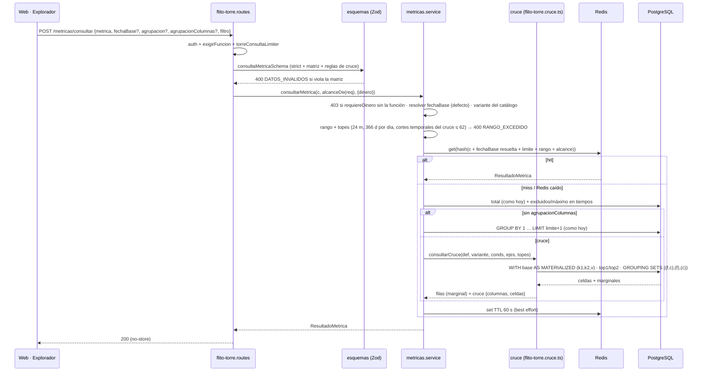

# Diseño full — Explorador flexible de la Torre (Épica #14590)

- **ADR:** [`docs/adr/ADR-0044-flito-torre-explorador-flexible.md`](../adr/ADR-0044-flito-torre-explorador-flexible.md)
  (estado **Propuesto**). Extiende ADR-0043.
- **Módulo:** FLITO `flito-torre` (`/api/flito/torre`). No toca el legacy.
- **Rama / worktree:** `FEATURE/14590-davidchica-torre-explorador-flexible` en
  `/home/david/flit/flito-14590-explorador` (desde `develop` en `a04b0f3c`).
- **Decisiones del humano D1–D9:** cerradas (D5–D9, en la segunda ronda del 2026-11-18). Su texto está en el ADR, § Contexto.
  Q-A (criterio de «liquidación anulada») quedó cerrada con L-β. **No quedan preguntas de producto abiertas.**

## 1. Ejemplo del pedido, traducido al contrato

«Trámites realizados en los últimos 6 meses por compañía (en estado Aprobado, fecha de aprobación
desde junio, agrupar por compañía)»:

```json
{
  "metrica": "tramites",
  "fechaBase": "aprobacion",
  "agrupacion": "compania",
  "filtro": {
    "rango": { "preset": "ultimos_6m" },
    "flitEstados": ["Aprobado"]
  }
}
```

Con hoy = 2026-11-18, el preset se resuelve en la API a `2026-06-01 … 2026-11-18` (D7, RN-TOR-F5).
Sin `flitEstados`, la misma consulta cuenta todo lo **aprobado en el rango**, aunque hoy esté en otro
estado (D3, RN-TOR-M1). Con `"agrupacionColumnas": "mes"` se convierte en la tabla cruzada
compañía × mes, con gráfica por series. Esta consulta entra como pregunta frecuente del
Explorador (D9, P-6 = sí): «Aprobados de los últimos 6 meses por compañía», con el filtro de estado
Aprobado.

## 2. Contrato — `packages/shared-types/src/flito-torre.ts` (cambios)

```ts
// ── Fecha base ──────────────────────────────────────────────────────────────
export const FECHAS_BASE_TORRE = ['creacion', 'aprobacion', 'facturacion', 'pago'] as const;
export type FechaBaseTorre = (typeof FECHAS_BASE_TORRE)[number];

export const ETIQUETAS_FECHA_BASE_TORRE: Record<FechaBaseTorre, string> = {
  creacion: 'Fecha de creación', aprobacion: 'Fecha de aprobación',
  facturacion: 'Fecha de facturación', pago: 'Fecha de pago',
};

/** Hoy vive en la web (`formatoTorre.ETIQUETA_AGRUPACION`); sube aquí porque el Excel cruzado la necesita. */
export const ETIQUETAS_AGRUPACION_TORRE: Record<AgrupacionTorre, string> = { /* mismas cadenas que la web hoy */ };

export const esAgrupacionTemporal = (a: AgrupacionTorre): boolean =>
  (TEMPORALES as readonly AgrupacionTorre[]).includes(a);

// ── MetricaTorreDef: dos campos nuevos (obligatorios: `satisfies` obliga a declararlos en las 11) ──
export interface MetricaTorreDef {
  readonly id: string;
  readonly etiqueta: string;
  readonly unidad: UnidadMetricaTorre;
  readonly agrupacionesPermitidas: readonly AgrupacionTorre[];
  readonly requiereDinero: boolean;
  /** Fechas que pueden anclar la métrica; la PRIMERA es la de defecto. `[]` = foto del momento (sin rango). */
  readonly fechasBase: readonly FechaBaseTorre[];
  /** `false` = id legado: la API lo acepta, el selector «Medir» no lo ofrece. */
  readonly enConstructor: boolean;
}

// METRICAS_TORRE (orden actual + la nueva al principio):
//   tramites                   conteo  TODAS        fechasBase ['creacion','aprobacion','facturacion']   enConstructor true   (NUEVA)
//   tramites_creados           conteo  TODAS        ['creacion']                           false (legado)
//   tramites_aprobados         conteo  TODAS        ['aprobacion']                         false (legado)
//   tiempo_creacion_aprobacion horas   TODAS        ['aprobacion']                         true
//   costo_logistica            cop     TODAS        ['aprobacion','facturacion']           true
//   impuestos_pagados          cop     TODAS        ['pago']                               true
//   derechos_pagados           cop     TODAS        ['pago']                               true
//   ingreso_liquidado          cop     TODAS        ['aprobacion','facturacion']           true
//   wip_activo                 conteo  DIMENSIONES  []                                     true
//   tasa_aprobacion            pct     TODAS        ['creacion']                           true
//   sin_facturar               conteo  DIMENSIONES  ['aprobacion']                         true

export const fechaBasePorDefecto = (m: MetricaTorreId): FechaBaseTorre | null => metricaTorre(m).fechasBase[0] ?? null;
export const esFechaBasePermitida = (m: MetricaTorreId, f: FechaBaseTorre): boolean =>
  metricaTorre(m).fechasBase.includes(f);

// ── Rango: preset nuevo (D7). Se añade a PRESETS_RANGO_TORRE ──────────────────
// export const PRESETS_RANGO_TORRE = ['hoy','ayer','semana','mes','mes_anterior','trimestre','anio','ultimos_6m'] as const;

// ── Topes: se AÑADEN a TOPES_TORRE ──────────────────────────────────────────
//   FILAS_CRUCE_PANTALLA_MAX: 50,        // filas de dimensión antes de «Otros» (pantalla)
//   COLUMNAS_CRUCE_PANTALLA_MAX: 12,     // columnas de dimensión antes de «Otros» (pantalla)
//   FILAS_CRUCE_EXPORTAR_MAX: 2_000,     // cubre los ~1.100 organismos como filas
//   COLUMNAS_CRUCE_EXPORTAR_MAX: 100,
//   CORTES_TEMPORALES_CRUCE_MAX: 62,     // cortes del eje temporal de un cruce (pantalla y Excel)

// ── Consulta v2 (aditiva) ───────────────────────────────────────────────────
export interface ConsultaMetrica {
  metrica: MetricaTorreId;
  /** Agrupación principal (filas). */
  agrupacion?: AgrupacionTorre;
  /** Agrupación secundaria (columnas). Exige `agrupacion`; distinta de ella; no las dos temporales. */
  agrupacionColumnas?: AgrupacionTorre;
  /** Ancla el rango y los cortes temporales. Ausente = `fechaBasePorDefecto(metrica)`. Prohibida en las de foto. */
  fechaBase?: FechaBaseTorre;
  filtro: FiltroTorre;
  /** Simple: ≤ FILAS_PANTALLA_MAX. Cruce: el motor lo acota además a FILAS_CRUCE_PANTALLA_MAX. */
  limite?: number;
}

// ── Resultado (aditivo) ─────────────────────────────────────────────────────
export interface CeldaTorre { valor: number; n: number; mediana?: number; p90?: number }

export interface ColumnaCruceTorre {
  clave: string; etiqueta: string; valor: number; n: number; participacion: number;
  mediana?: number; p90?: number;
  /** Agrega las columnas fuera del top. Siempre la última. */
  esOtros?: true;
}

export interface CruceTorre {
  /** La agrupación de las columnas (= `agrupacionColumnas` de la consulta). */
  agrupacion: AgrupacionTorre;
  columnas: ColumnaCruceTorre[];
  /** `celdas[i][j]` = `filas[i]` × `columnas[j]`. `null` = sin registros (la UI pinta «—», no 0). */
  celdas: (CeldaTorre | null)[][];
  /** Hubo más columnas de dimensión que el tope y se plegaron en «Otros». */
  truncadoColumnas: boolean;
}

export interface ResultadoMetrica {
  // …todo lo actual sin cambios, más:
  filas: { /* …campos actuales… */ esOtros?: true }[];   // en el cruce, `filas` = marginal por fila (incluida «Otros»)
  baseFecha: { campo: string; excluidosSinFecha: number; nBaseSincronizacion: number;
    /** La fecha base aplicada; `null` en las de foto. */
    fechaBase: FechaBaseTorre | null };
  /** Solo si la consulta trae `agrupacionColumnas`. `truncado` pasa a significar «filas plegadas en Otros». */
  cruce?: CruceTorre;
}

// ── Sugerencias de placa ────────────────────────────────────────────────────
export const SUGERENCIAS_PLACA_TORRE = { MIN_CARACTERES: 3, MAX_CARACTERES: 7, MAX_RESULTADOS: 8 } as const;

export interface SugerenciaPlacaTorre {
  /** Normalizada a mayúsculas. */
  placa: string;
  /** Del trámite más reciente de esa placa dentro del alcance (D8). Solo el nombre, sin NIT. Sin conteo de trámites (P-5 = no). */
  compania: string | null;
  /** `flit_estado` crudo de ese mismo trámite (la web lo humaniza). */
  flitEstado: string | null;
}
export interface SugerenciasPlacaTorre {
  sugerencias: SugerenciaPlacaTorre[];
  /** Hay más de `MAX_RESULTADOS` placas que coinciden (pie «Siga escribiendo para acotar» de la spec UX). */
  hayMas: boolean;
}
```

### Zod — `flito-torre.esquemas.ts`

```ts
consultaMetricaSchema = z.object({
  metrica: z.enum(METRICAS_TORRE_IDS),
  agrupacion: z.enum(AGRUPACIONES_TORRE).optional(),
  agrupacionColumnas: z.enum(AGRUPACIONES_TORRE).optional(),
  fechaBase: z.enum(FECHAS_BASE_TORRE).optional(),
  filtro: filtroTorreSchema,
  limite: z.number().int().positive().max(TOPES_TORRE.FILAS_PANTALLA_MAX).optional(),
}).strict()
  .refine(agrupación permitida, { path: ['agrupacion'] })                       // existente
  .refine(!agrupacionColumnas || esAgrupacionPermitida(m, agrupacionColumnas), { path: ['agrupacionColumnas'] })
  .refine(!agrupacionColumnas || !!agrupacion, { message: 'exige una agrupación principal', path: ['agrupacionColumnas'] })
  .refine(agrupacionColumnas !== agrupacion, { message: 'no puede repetir la principal', path: ['agrupacionColumnas'] })
  .refine(!(ambas temporales), { message: 'solo una de las dos agrupaciones puede ser de tiempo', path: ['agrupacionColumnas'] })
  .refine(!fechaBase || esFechaBasePermitida(m, fechaBase), { message: 'esa fecha base no aplica a la métrica', path: ['fechaBase'] });

/** El texto parcial de la placa. La web ya lo manda normalizado (sin espacios ni guiones). */
sugerirPlacaSchema = z.object({
  texto: z.string().trim().regex(/^[A-Za-z0-9]{3,7}$/, 'debe tener de 3 a 7 letras y dígitos'),
}).strict();
```

Los mensajes de Zod **no** repiten el valor recibido. `detalleZod` ya solo concatena la ruta y el
mensaje.

### Ruta nueva — `POST /api/flito/torre/placa/sugerencias`

| Aspecto | Valor |
|---|---|
| Cadena | `authMiddleware` (ya en `router.use`) → `exigirFuncion('torre.placa.buscar')` → `torrePlacaSugerirLimiter` → Zod → `alcanceDe(req)` → `logPiiAccess` → `sugerirPlacas()` |
| Permiso | `torre.placa.buscar`, la **misma** función que la ficha: no hay función ni migración de permisos nuevas. Frontera: el montaje sin `conAlcance` deja fuera a los enlaces ≠ `ninguno` (403), como hoy |
| Body | `{ "texto": "ABC1" }` |
| 200 | `SugerenciasPlacaTorre`, de 0 a 8 elementos más `hayMas`. **Lista vacía = 200 `{ sugerencias: [], hayMas: false }`**, nunca 404. Header `Cache-Control: no-store` |
| 400 | `{ error: 'Datos inválidos: texto debe tener de 3 a 7 letras y dígitos', code: 'DATOS_INVALIDOS' }` |
| 401 / 403 | Lo de siempre (`auth` / `exigirFuncion` / frontera) |
| 429 | `torrePlacaSugerirLimiter`: **60 / min por usuario**, bolsa propia `rl:flito-torre-placa-sugerir:`, `frenoConRastro('flito-torre-placa-sugerir')` (no registra el cuerpo). Es aparte de los 30/min de `placa/buscar`, para que escribir no agote la ficha |
| 500 / 503 | `TorreConsultaError` (`TORRE_ERROR` / `TORRE_TIEMPO_AGOTADO`), mensaje genérico (RN-TOR-M7) |
| PII | `logPiiAccess(req, { resourceTipo: 'flito_tramite', accion: 'search', camposAccedidos: ['placa'], motivo: 'Torre de Control: sugerencias de placa' })` en **toda** petición válida. Es fail-open, como `placa/buscar` |

SQL de referencia (con el query builder o `sql` parametrizado, nunca concatenando):

```sql
SELECT placa, compania, flit_estado FROM (
  SELECT DISTINCT ON (upper(t.plate_complete))
         upper(t.plate_complete) AS placa, c.name AS compania, t.flit_estado,
         (upper(t.plate_complete) LIKE $1 || '%')           AS prefijo,
         COALESCE(t.fecha_creacion_flit, t.created_at)       AS reciente
  FROM flito_tramites t LEFT JOIN clients c ON c.id = t.compania_id
  WHERE upper(t.plate_complete) LIKE '%' || $1 || '%'
    AND (<condicionPorCompania(t.compania_id, alcance)>)
  ORDER BY upper(t.plate_complete), reciente DESC
) s
ORDER BY prefijo DESC, reciente DESC, placa ASC
LIMIT 9;   -- 8 + 1 para calcular `hayMas`
```

`$1` ya viene en mayúsculas y solo admite `[A-Z0-9]`, así que no hay metacaracteres de `LIKE` que
escapar.

### Web — `apps/web/src/lib/torreFiltros.ts` (FiltrosTorre v2)

```ts
export interface FiltrosTorre {
  companiaIds: number[];
  periodo: PeriodoTorre;
  rango: { desde: string; hasta: string } | null;
  organismos: string[];        // DIVIPOLA de 5 dígitos
  departamentos: string[];     // DANE de 2 dígitos
  tiposTramite: string[];
  flitEstados: string[];
}
export const FILTROS_TORRE_INICIALES: FiltrosTorre = {
  companiaIds: [], periodo: 'mes', rango: null, organismos: [], departamentos: [], tiposTramite: [], flitEstados: [],
};
```

Para `normalizarFiltrosTorre`, ver RN-TOR-W1. El archivo **sigue sin importar shared-types en
tiempo de ejecución**, por el presupuesto de bundle del chunk de `/login`: el tope de 200 se escribe
como literal local, con un comentario que apunta al `max(200)` de `filtroTorreSchema`.

## 3. Flujo de una consulta



## 4. Reglas de negocio nuevas

Las numeraciones existentes (M1–M9, F1–F4, X1–X3, P1–P4, U2) **no** se tocan. Las nuevas van en la
cabecera del archivo que las implementa.

| RN | Regla | Archivo |
|---|---|---|
| **RN-TOR-M10** | La fecha base es una **variante declarada** por métrica (`fechasBase`; la primera es la de defecto). Si la consulta no la trae, se usa la de defecto, y el resultado es idéntico al de hoy. Una combinación fuera de la matriz da 400 en Zod y el servicio la vuelve a exigir | `catalogo.ts`, `metricas.service.ts`, `esquemas.ts` |
| **RN-TOR-M11** | Matriz medida × fecha base: la del ADR-0044 §(a) (creación, aprobación, facturación y pago; nada más, D5). Pago = `pagado_en` (impuestos) o `fecha_pago` (derechos, tipo `date`). El tiempo de ciclo solo admite aprobación (D9) | `catalogo.ts` |
| **RN-TOR-M12** | La fecha base ancla **a la vez** el rango y los cortes temporales (`claveAgrupacion` recibe la `FechaBase` de la variante). `baseFecha.campo` y `baseFecha.fechaBase` la declaran. `nBaseSincronizacion` solo aplica con fecha base `creacion` | `metricas.service.ts` |
| **RN-TOR-M13** | `tramites` con fecha base `aprobacion` = `fecha_aprobacion` en el rango, **sin mirar `flit_estado`** (D3, RN-TOR-M1). «Siguen en Aprobado» = el filtro `flitEstados`. `tramites` + `creacion` ≡ `tramites_creados` y `tramites` + `aprobacion` ≡ `tramites_aprobados`: un test lo fija | `catalogo.ts` |
| **RN-TOR-M14** | Facturación = `min(siigo_factura_tramites.created_at)` de las filas con `activo = true` del trámite: la primera factura activa, la misma definición de RN-TOR-P4 y de `FACTURADO`. Se resuelve con la tabla derivada `FACTURACION_TRAMITE` (`INNER JOIN` por `tramite_id`, ADR §(a2)); el rango y `date_trunc` usan `F.facturado_en`. No se usa `flito_liquidaciones.facturado_en` | `catalogo.ts` |
| **RN-TOR-L1** | Toda consulta de la Torre que **sume o lea valores** de `flito_liquidaciones` (Explorador, Comercial, Operativo, Financiero, 360° y sus exportaciones) excluye las liquidaciones de trámites cuyo `flit_estado` es anulado, abortado o revocado, con el fragmento único `LIQUIDACION_VIGENTE` = `COALESCE(lower(flito_tramites.flit_estado), '') NOT IN ('anulado', 'abortado', 'revocado')`. **No** se excluyen «Rechazado» ni las facturas DIAN anuladas (decisión del humano, L-β). Donde la tabla base es el trámite con `LEFT JOIN` a la liquidación, el fragmento acota **solo la suma** (`FILTER (WHERE …)`) y no el conteo de trámites | `catalogo.ts` y los servicios de §4 bis |
| **RN-TOR-F5** | `ultimos_6m` es un preset de la **API**: `{ desde: 1.º del mes (mes actual − 5), hasta: hoy }`, con el `hoy` de Bogotá del servidor (con hoy = 18-nov: del 1-jun al 18-nov). La web manda el preset y ya no calcula ese rango | `filtro.ts` (`resolverRango`) |
| **RN-TOR-C1** | Como máximo 2 agrupaciones. `agrupacionColumnas` exige `agrupacion`, debe ser distinta de ella, ambas tienen que estar permitidas por la métrica y **no** pueden ser las dos temporales | `esquemas.ts`, `cruce.ts` |
| **RN-TOR-C2** | Un eje de dimensión se recorta a top-N por su marginal (`valor DESC`; `n DESC` en tasa y tiempo; desempate por clave ASC), y el resto se pliega en «Los demás (N)» (clave `__otros`, `esOtros: true`, siempre la última; la etiqueta es la del ranking actual y la de la spec UX). Un eje temporal no se recorta: todos sus cortes con registros, en orden cronológico, sin «Otros». Los cortes sin registros no aparecen (igual que hoy en el modo simple) | `cruce.ts` |
| **RN-TOR-C3** | Topes del cruce. Pantalla: 50 filas y 12 columnas de dimensión antes de «Otros». Excel: 2.000 × 100. Eje temporal: ≤ `CORTES_TEMPORALES_CRUCE_MAX` (62) cortes, calculados **antes** de consultar a partir del rango y la agrupación; si se pasa, `RangoTorreExcedidoError` (400, `campo: 'rango'`) con el mensaje «Con dos agrupaciones, el periodo admite hasta 62 cortes por <día/semana>. Elija una agrupación más amplia o acorte el periodo.» | `filtro.ts`, `cruce.ts` |
| **RN-TOR-C4** | Los marginales (filas, columnas y total) se **calculan en SQL** sobre las filas crudas (`GROUPING SETS`); **nunca** se suman celdas. En tiempo y tasa no son aditivos. Una celda sin registros es `null` | `cruce.ts` |
| **RN-TOR-C5** | El cruce comparte con el modo simple el `WHERE` (`condicionesTorre`, RN-TOR-F1), el alcance, el permiso de dinero, el `statement_timeout` y la caché. Va en una **sola** sentencia | `cruce.ts` |
| **RN-TOR-X4** | El Excel del cruce es una hoja: la cabecera es «<principal> / <secundaria>», luego las columnas, «Los demás (N)» si las hay y la columna de cierre; una fila por grupo, «Los demás (N)» si las hay y la fila de cierre al final. El cierre se llama **«Total»** cuando la medida suma (conteo y dinero) y **«General»** en tiempo y tasa, que no son aditivos (textos de la spec UX; antes decía «Otros»/«Total»). En tiempos, la celda es la **mediana en horas** y la cabecera lo dice. Ninguna celda de texto empieza por `=`, `+`, `-` ni `@` (se antepone un apóstrofo). Sin placas (RN-TOR-X1) | `export.ts` |
| **RN-TOR-X5** | Nombre del archivo: `torre-<metrica>-<fechaBase>-<periodo>.xlsx`, con `-cruce` si hay dos agrupaciones. Sin compañías, placas ni NIT (RN-TOR-X2) | `export.ts` |
| **RN-TOR-P5** | Sugerencias: el texto se normaliza a mayúsculas, de 3 a 7 caracteres `[A-Z0-9]`, y se busca en **cualquier parte** de `upper(plate_complete)`. Sale **una sugerencia por placa** (≤ 8 placas distintas) con la compañía y el `flit_estado` de su trámite **más reciente dentro del alcance** (D8), sin conteo de trámites. Primero las que empiezan por el texto y luego por recencia. `hayMas` si había una novena | `placa.service.ts` |
| **RN-TOR-P6** | Sugerencias: el alcance va en el `WHERE` (como RN-TOR-P2); vacío = `200 []`. Sin caché Redis; `logPiiAccess` en toda petición; limiter propio de 60/min. Ni el servicio ni la ruta loguean el texto | `placa.service.ts`, `routes.ts` |
| **RN-TOR-P7** | Web: las sugerencias se piden con debounce de 250 ms y gana la última respuesta. El texto vive solo en memoria (nunca en `sessionStorage` ni en la URL). Elegir una sugerencia = abrir la ficha por `POST /placa/buscar`. Enter sin sugerencia activa = el comportamiento actual (placa completa, ≥ 5) | `BarraFiltrosTorre.tsx`, `SugerenciasPlacaTorre.tsx` |
| **RN-TOR-W1** | `sessionStorage['flito-torre-filtros']` guarda **arreglos**. La lectura acepta también la forma escalar vieja (`companiaId: 5` → `companiaIds: [5]`, `organismo` → `organismos`, …). Cada elemento se valida con el mismo patrón de hoy, se quitan los duplicados, se descarta lo inválido y se cortan a 200. La escritura solo produce la forma nueva | `lib/torreFiltros.ts` |

## 4 bis. Liquidaciones anuladas (D6, L-β): qué cambia

**Esquema:**

- `flito_liquidaciones.estado` solo admite `'liquidado' | 'facturado'` (CHECK de la 0111).
- Una liquidación reversada se **borra**.

Por eso «anulada» se define por el **trámite**: lo eligió el humano (L-β).

```ts
// flito-torre.catalogo.ts
export const ESTADOS_FLIT_ANULADOS = ['anulado', 'abortado', 'revocado'] as const;   // NO 'rechazado'
/** RN-TOR-L1. */
export const LIQUIDACION_VIGENTE = sql`COALESCE(lower(${T.flitEstado}), '') NOT IN ${[...ESTADOS_FLIT_ANULADOS]}`;
```

**Verificación de los valores** (contra el catálogo y la sincronización, no supuestos):

- `'anulado'` **existe**. FLIT 1 y FLIT 2 escriben `flit_estado = 'Anulado'` (`flit2-mapeo.ts`,
  `TEXTO_FLIT`). En `shared-types/src/flito-estados.ts` es `EstadoTramiteFlito.ANULADO = 'anulado'`;
  ojo, ese catálogo es el estado **FLITO** (`flito_tramites.estado`), no el `flit_estado`.
- `'revocado'` **existe**, solo en FLIT 2: `flit_estado = 'Revocado'`, con estado FLITO `anulado`
  (`flit2-mapeo.ts`, AC7). No está en `EstadoTramiteFlito`, porque allí se pliega en `anulado`.
- `'abortado'` **no aparece** en ningún catálogo ni mapeo del código: ni en `EstadoTramiteFlito`,
  ni en `TEXTO_FLIT` de FLIT 2, ni en la sincronización de FLIT 1. Solo figura en la lista propia de
  la Torre `ESTADOS_FLIT_CERRADOS` (`flito-torre.catalogo.ts`). FLIT 1 guarda el texto del reporte
  tal cual, así que podría llegar, pero el código no lo demuestra. **No lo invento:** queda en el
  fragmento porque lo decidió el humano (si nunca llega, la condición es inocua) y se marca como
  **dato por verificar** en DEV y PDN con
  `SELECT lower(flit_estado), count(*) FROM flito_tramites GROUP BY 1`. Si no existe, se puede quitar
  sin cambiar ninguna cifra.
- La comparación se hace en minúsculas (FLIT escribe los valores capitalizados), igual que
  `EN_CURSO`. El `COALESCE(…, '')` es **obligatorio**: sin él, un `flit_estado` nulo da `NULL` y
  la liquidación se excluiría por error.

**Lecturas afectadas** (lista final, sacada del grep de `flitoLiquidaciones` en `modules/flito-torre/`):

| # | Lectura | Archivo | Cómo se aplica | Qué cifra baja |
|---|---|---|---|---|
| 1 | `costo_logistica` y `ingreso_liquidado` (`DESDE_LIQUIDACIONES`, `INNER JOIN`) | `flito-torre.catalogo.ts` → Explorador y su Excel | `LIQUIDACION_VIGENTE` en las `fijas` de la métrica (vale para todas sus fechas base) | Costo e ingreso |
| 2 | `sin_facturar` (`DESDE_TRAMITES_LIQ`, `LEFT JOIN`; conteo de trámites) | `flito-torre.catalogo.ts` | **No** cambia: es un conteo de trámites y no suma la liquidación | Ninguna (ver la Nota) |
| 3 | Concentración por ingreso: `sum(L.total)` sobre `flito_liquidaciones INNER JOIN T` | `flito-torre.comercial.service.ts` (≈ l. 143) | En las condiciones del `porCompania` | `concentracion.ingreso` |
| 4 | Venta cruzada, línea logística: `valor_logistica > 0` sobre `L INNER JOIN T` | `flito-torre.comercial.service.ts` (≈ l. 119) | En la condición del `usoPor` | Uso de la línea logística |
| 5 | Bloque de logística: `valor_logistica > 0` sobre `L INNER JOIN T` | `flito-torre.operativa.service.ts` (≈ l. 114) | En el `donde([...])` | Entregas y primer intento |
| 6 | `calcularSinFacturar`: `count(*)` y `sum(L.total)` sobre `T LEFT JOIN L` | `flito-torre.financiera.service.ts` (≈ l. 65) | Solo en la suma: `sum(L.total) FILTER (WHERE LIQUIDACION_VIGENTE)`; el conteo de trámites no cambia | `sinFacturarValor` / `valorEstimado` |
| 7 | `calcularMargen`: cobrado por servicio y por cliente sobre `L INNER JOIN T` | `flito-torre.financiera.service.ts` (≈ l. 94-99) | En el `WHERE` | Margen por servicio y por cliente, `margenPct` |
| 8 | 360°: `calcularMargen` y `calcularSinFacturar` | `flito-torre.ejecutivo.service.ts` | Sin cambio de código: hereda de 6 y 7 | `financiero.margenPct` y `sinFacturarValor`; los riesgos financieros que dependen de ellos |
| 9 | Excel de tableros | `flito-torre.tablero-export.ts` | Sin cambio si solo serializa los resultados de los servicios (el `backend-agent` lo confirma en una lectura) | Lo mismo que su tablero |
| — | Ficha de placa: logística «Liquidada» | `flito-torre.placa.service.ts` | **Fuera de alcance:** es el estado de un trámite concreto, no una cifra agregada | — |

**Nota (no bloquea):** un trámite aprobado y después anulado sigue contando en `sin_facturar` como
trámite. D6 habla de liquidaciones, no de trámites. Si el humano quiere sacarlo también, es otra
regla; no se cuela en esta.

**Tests existentes que cambian:**

- `flito-torre-metricas.test.ts`: costo e ingreso con un trámite `Anulado` y otro `Revocado` (no
  suman) y uno `Rechazado` (sí suma).
- `flito-torre-tableros.test.ts`: los bloques 3 a 8 con el mismo trío de casos; el 360° hereda.
- `flito-torre-exportar-tablero.test.ts`: solo si fija cifras de dinero.
- `torre-pg.ts`: sembrar los trámites con su liquidación y `flit_estado` `Anulado`, `Revocado`,
  `Rechazado` y `NULL` (el `NULL` **sí** suma: lo exige el `COALESCE`).

## 5. Detalle del cruce para `backend-agent`

- La variante de la fecha base sale del catálogo: `CATALOGO_SQL[m].fechas[fechaBase]`
  (`{ fecha: FechaBase; campoFecha: string; fijas: SQL[]; sync?: SQL }`). Las propiedades `desde`,
  `dims`, `forma`, `valor` y `requiere` siguen siendo de la métrica. La variante `facturacion`
  añade además `desdeExtra: SQL`, con el `INNER JOIN (SELECT tramite_id, min(created_at) AS facturado_en
  FROM siigo_factura_tramites WHERE activo GROUP BY tramite_id) F ON F.tramite_id = T.id`, y su `fecha`
  es `{ expr: F.facturado_en }`. Vale igual sobre `DESDE_TRAMITES` y sobre `DESDE_LIQUIDACIONES`.
  `wip_activo` no tiene variantes.
- `agregados()` se generaliza para que lea las columnas de la CTE (`v` = valor o condición de tasa;
  en conteo no hace falta). En el modo simple se sigue usando sobre la expresión original: la forma
  del modo simple no cambia.
- Esqueleto (una sentencia, con `sql` de Drizzle):

  ```sql
  WITH base AS MATERIALIZED (
    SELECT <k1> AS k1, <k2> AS k2, <v> AS v FROM <desde> WHERE <conds + requiere>
  ),
  top1 AS (SELECT k1 FROM base GROUP BY k1 ORDER BY <orden> LIMIT <R>),   -- se omite si el eje 1 es temporal
  top2 AS (SELECT k2 FROM base GROUP BY k2 ORDER BY <orden> LIMIT <C>),   -- se omite si el eje 2 es temporal
  mapeada AS (
    SELECT CASE WHEN EXISTS (SELECT 1 FROM top1 WHERE top1.k1 IS NOT DISTINCT FROM base.k1) THEN k1 END AS f,
           NOT EXISTS (SELECT 1 FROM top1 WHERE top1.k1 IS NOT DISTINCT FROM base.k1)          AS f_otros,
           …igual para c / c_otros…, v
    FROM base
  )
  SELECT f, f_otros, c, c_otros, GROUPING(f, f_otros, c, c_otros) AS g, count(*)::int AS n, <agregados sobre v>
  FROM mapeada GROUP BY GROUPING SETS ((f, f_otros, c, c_otros), (f, f_otros), (c, c_otros));
  ```

  `IS NOT DISTINCT FROM` hace que «Sin compañía» (clave `NULL`) pueda entrar en el top. En un eje
  temporal, `x_otros` es siempre `false`.
- Las etiquetas salen de `etiquetar()` para cada eje. Hoy es privada en `metricas.service.ts`: se
  exporta.
- La fila o columna plegada se etiqueta `Los demás (N)`, donde N es el número de grupos plegados. Se obtiene con un
  `count(DISTINCT k1)` en `top`, o comparando con el total de claves distintas; la elección queda en
  manos del agente.
- Consultar y exportar comparten el código; los topes llegan por `OpcionesConsulta`, que gana
  `modo?: 'pantalla' | 'exportar'`.
- `enTorre` puede recibir un timeout opcional (`'15s'` por defecto). Las sugerencias usan `'3s'`.
  Es opcional; si se hace, el tope va en `enTorre(fn, { timeout })`.

## 6. Migración — `NNNN_flito_torre_explorador_indices.sql`

El número es el siguiente libre **al integrar**; hoy sería 0304. El SQL va sin `BEGIN`/`COMMIT`
(el runner envuelve), sin `CONCURRENTLY` y sin `unaccent`, y debe ser idempotente.

```sql
-- Sugerencias «contiene» de placa (ADR-0044 §d). Solo si pg_trgm ya está instalada: no se crea la extensión.
DO $torreNNNN$
BEGIN
  IF EXISTS (SELECT 1 FROM pg_extension WHERE extname = 'pg_trgm') THEN
    BEGIN
      EXECUTE 'CREATE INDEX IF NOT EXISTS idx_flito_tramites_placa_trgm
               ON flito_tramites USING gin (upper(plate_complete) gin_trgm_ops)';
    EXCEPTION WHEN undefined_object THEN
      RAISE NOTICE 'NNNN: gin_trgm_ops no visible en el search_path; sugerencias sin índice';
    END;
  ELSE
    RAISE NOTICE 'NNNN: pg_trgm no instalada; sugerencias de placa sin índice (recorrido completo)';
  END IF;
END $torreNNNN$;

-- Fecha de facturación = primera factura activa (RN-TOR-M14): recorrido solo de índice para
-- GROUP BY tramite_id + min(created_at). Acelera también FACTURADO y RN-TOR-P4.
CREATE INDEX IF NOT EXISTS idx_siigo_factura_tramites_activo_creado
  ON siigo_factura_tramites (tramite_id, created_at) WHERE activo;
```

Si se toca `src/db/schema/flito-*.ts`, el índice GIN **no** se declara en Drizzle, porque depende de
la extensión. Queda solo en SQL y el `db-review-agent` lo registra en `derivas-aceptadas.json` si su
chequeo de deriva lo exige. El índice parcial de `siigo_factura_tramites` sí se declara en
`apps/api/src/db/schema/siigo.ts`, junto a `vivoUq`, con `.where(sql\`${t.activo}\`)`, para que no
haya deriva.

El btree de `flito_liquidaciones(liquidado_en)` **sale** del diseño (D5), y con él el cambio a
`schema/finanzas.ts`. Ninguna otra consulta de la Torre filtra ni agrupa por `liquidado_en`: la
comercial, la operativa y la financiera fechan por la aprobación o la creación (comprobado con grep
en `flito-torre.*.service.ts`).

## 7. Archivos por bloque (contract-first)

Los bloques (ii) y (iii) **no comparten ningún archivo** y corren en paralelo, cada uno en su
worktree, cuando cierra (i). Los marcados con ⚠ son compartidos con otras pantallas o módulos.

### (i) Contrato — serial, un solo agente (`backend-agent`)

| Archivo | Acción |
|---|---|
| `packages/shared-types/src/flito-torre.ts` | Modificar: todo lo de §2 de este documento. ⚠ Lo consumen (ii) y (iii), así que **se cierra aquí** y ninguno de los dos lo vuelve a tocar |
| `apps/api/src/modules/flito-torre/flito-torre.esquemas.ts` | Modificar: `consultaMetricaSchema` v2 y `sugerirPlacaSchema` |
| `apps/api/src/modules/flito-torre/flito-torre.routes.ts` | Modificar: la ruta `POST /placa/sugerencias` **completa** (cadena, `logPiiAccess`, `no-store`, `manejar`), que llama a `sugerirPlacas()`. (ii) **no** lo toca |
| `apps/api/src/modules/flito-torre/flito-torre.placa.service.ts` | Modificar: añadir el **stub** `export async function sugerirPlacas(texto: string, alcance: AlcanceResuelto): Promise<SugerenciasPlacaTorre>` → `noImplementado('Sugerencias de placa')` (501). Lo implementa (ii) |
| `apps/api/src/shared/middleware/rateLimiter.ts` | Modificar ⚠ (transversal, solo se añade): `torrePlacaSugerirLimiter` con 60/min y comentario en el bloque de la Torre |
| `apps/api/src/db/migrations/NNNN_flito_torre_explorador_indices.sql` | Crear (§6) |
| `apps/api/src/db/schema/siigo.ts` | Modificar ⚠ (esquema de otro dominio, Siigo): **solo** se añade el índice parcial `(tramite_id, created_at) WHERE activo` de `siigoFacturaTramites` (§6) |
| `apps/api/src/modules/flito-torre/flito-torre.filtro.ts` | Modificar ⚠ (también lo toca (ii), **en serie**): solo el `case 'ultimos_6m'` de `resolverRango` (RN-TOR-F5). Va en (i) porque, al añadir el preset al enum, el `switch` deja de ser exhaustivo y el build falla |
| `contracts/openapi/flito-api.v1.yaml` | Regenerar con `npm run contrato:generar` (no se edita a mano) |
| Verificación | `npm run build -w packages/shared-types`, `npm run test:shared-types`, `NODE_OPTIONS=--max-old-space-size=8192 npm run build:api` y `typecheck -w apps/web`. Este último **fallará** donde la web use los campos nuevos obligatorios de `MetricaTorreDef`; solo si falla, se declara y lo corrige (iii) |

> Los campos obligatorios nuevos de `MetricaTorreDef` (`fechasBase`, `enConstructor`) no rompen la
> web, porque la web solo **lee** `METRICAS_TORRE`. Hay que confirmarlo con el typecheck de (i).

### (ii) Backend — `backend-agent`

| Archivo | Acción |
|---|---|
| `apps/api/src/modules/flito-torre/flito-torre.catalogo.ts` | Modificar: variantes `fechas` por métrica (con `facturacion` y su `FACTURACION_TRAMITE`), métrica `tramites`, `ESTADOS_FLIT_ANULADOS` y `LIQUIDACION_VIGENTE` (RN-TOR-L1); RN-TOR-M10, M11, M13 y M14 |
| `apps/api/src/modules/flito-torre/flito-torre.comercial.service.ts` · `flito-torre.operativa.service.ts` · `flito-torre.financiera.service.ts` | Modificar: `LIQUIDACION_VIGENTE` en las lecturas 3 a 7 de §4 bis. `ejecutivo.service.ts` y `tablero-export.ts` no cambian (heredan) |
| `apps/api/src/modules/flito-torre/flito-torre.filtro.ts` | Modificar (después de (i)): `cortesTemporales(agrupacion, rango)` y `exigirTopesCruce()` (RN-TOR-C3). `claveAgrupacion` no cambia |
| `apps/api/src/modules/flito-torre/flito-torre.metricas.service.ts` | Modificar: resolver la fecha base, la clave de caché con la fecha base resuelta, `baseFecha.fechaBase`, delegar al cruce y exportar `etiquetar` |
| `apps/api/src/modules/flito-torre/flito-torre.cruce.ts` | **Crear**: `consultarCruce()` (RN-TOR-C1, C2, C4 y C5) |
| `apps/api/src/modules/flito-torre/flito-torre.export.ts` | Modificar: hoja cruzada (RN-TOR-X4) y nombre (RN-TOR-X5) |
| `apps/api/src/modules/flito-torre/flito-torre.placa.service.ts` | Modificar: implementar `sugerirPlacas` (RN-TOR-P5 y P6) |
| `apps/api/__tests__/services/flito-torre/flito-torre-metricas.test.ts` | Modificar: fecha base por defecto idéntica a la de hoy; `tramites`+`aprobacion` ≡ `tramites_aprobados`; `facturacion` (primera factura activa manda, una factura inactiva no cuenta, un trámite con dos conceptos cuenta una vez); 400 fuera de la matriz (`tiempo`+`creacion`, `impuestos`+`facturacion`) y en las de foto; preset `ultimos_6m` → 1-jun…18-nov con `hoy` inyectado; liquidaciones de trámites `Anulado` y `Revocado` no suman, la de `Rechazado` sí y la de `NULL` también (RN-TOR-L1) |
| `apps/api/__tests__/services/flito-torre/flito-torre-cruce.test.ts` | **Crear**: dimensión × dimensión con «Otros»; temporal × dimensión sin «Otros»; marginales de tiempo **no** iguales a la suma de celdas (C4); celda `null`; tope de 62 cortes (400); dos temporales (400); alcance aplicado; Excel cruzado |
| `apps/api/__tests__/services/flito-torre/flito-torre-placa-sugerencias.test.ts` | **Crear**: «contiene» en medio de la placa, prefijo primero, ≤ 8 placas distintas, el trámite más reciente manda, fuera de alcance → `[]`, sin campos del comprador |
| `apps/api/__tests__/services/flito-torre/flito-torre-rutas.test.ts` | Modificar: `/placa/sugerencias` con 400 (2 caracteres, guion, campo extra), 403 sin función, 200 vacío, `logPiiAccess` llamado y `no-store`; `/metricas/consultar` con los refine nuevos |
| `apps/api/__tests__/services/flito-torre/torre-pg.ts` | Modificar: sembrar facturas `siigo_factura_tramites` (activas e inactivas), placas para las sugerencias y trámites con liquidación en `Anulado`, `Revocado`, `Rechazado` y `flit_estado` nulo (RN-TOR-L1) |
| `apps/api/__tests__/services/flito-torre/flito-torre-tableros.test.ts` · `flito-torre-exportar-tablero.test.ts` | Modificar: las cifras que bajan por RN-TOR-L1 (§4 bis) y un caso de varias compañías en los bloques (D9, P-4 = sí) |
| P1 | `npm test -w apps/api -- __tests__/services/flito-torre/flito-torre-metricas.test.ts __tests__/services/flito-torre/flito-torre-cruce.test.ts __tests__/services/flito-torre/flito-torre-placa-sugerencias.test.ts __tests__/services/flito-torre/flito-torre-rutas.test.ts __tests__/services/flito-torre/flito-torre-tableros.test.ts __tests__/services/flito-torre/flito-torre-exportar-tablero.test.ts` |

### (iii) Frontend — `frontend-agent` (tras el slim de `ux-agent` con mockup y el «ok» humano)

| Archivo | Acción |
|---|---|
| `apps/web/src/lib/torreFiltros.ts` | Modificar: `FiltrosTorre` v2 y RN-TOR-W1 (sin importar shared-types en ejecución) |
| `apps/web/src/components/torre/formatoTorre.ts` | Modificar: `rangoDe('ultimos_6m')` devuelve `{ preset: 'ultimos_6m' }` y deja de calcular (RN-TOR-F5); `aFiltroTorre` con arreglos; `ETIQUETA_AGRUPACION` pasa a ser un reexport de `ETIQUETAS_AGRUPACION_TORRE`; etiquetas de la fecha base; resumen «3 compañías» |
| `apps/web/src/components/torre/BarraFiltrosTorre.tsx` | Modificar ⚠ (la usan las 5 páginas): selección múltiple en Compañía y en «Más filtros», chips por valor y autocompletado del buscador |
| `apps/web/src/components/flit/FlitComboboxBuscable.tsx` | Modificar ⚠ (**kit compartido**): modo `multiple` **aditivo** (`aria-multiselectable`, casillas y búsqueda), como dicta la spec UX §(multi). Ninguna prop existente cambia. Grep de usos obligatorio |
| `apps/web/src/components/torre/SugerenciasPlacaTorre.tsx` | **Crear**: listbox y hook `useSugerenciasPlaca` (debounce de 250 ms, gana la última, `api.post` a `/flito/torre/placa/sugerencias`). Patrón ARIA y de teclado de `components/flit/FlitComboboxBuscable.tsx` |
| `apps/web/src/components/flit/PanelFiltros.tsx` | Modificar ⚠ (**kit compartido con otras pantallas**): solo props **aditivas** y opcionales para el combobox del input de búsqueda (`role`, `aria-expanded`, `aria-controls`, `aria-activedescendant`, `onKeyDown`, una ranura bajo el input). Sin ellas el comportamiento no cambia. Grep de usos obligatorio |
| `apps/web/src/pages/torre/TorreExplorador.tsx` | Modificar: el constructor «Medir · según [fecha base] · agrupar por · y luego por», con las fechas creación, aprobación, facturación y pago; preguntas frecuentes con `tramites` y arreglos, **más el ejemplo del pedido** (D9: `tramites` · aprobación · `flitEstados: ['Aprobado']` · compañía · `ultimos_6m`). Si pasa de ~300 líneas, extraer el siguiente archivo |
| `apps/web/src/components/torre/ConstructorConsultaTorre.tsx` | Crear (opcional, por tamaño): los selects del constructor |
| `apps/web/src/components/torre/ResultadoExplorador.tsx` | Modificar: el modo cruce (cifra total, tabla cruzada y gráfica por series si hay eje temporal) y la nota «Otros» |
| `apps/web/src/components/torre/TablaCruzadaTorre.tsx` | **Crear**: `DataTable` con `matriz` (ya lo usa `TorreComercial`), columna «Total» y fila «Total»; `null` → «—» |
| `apps/web/src/pages/torre/TorreComercial.tsx` | Modificar: `onExplorar` → `companiaIds: [id]` |
| Otros consumidores de `FiltrosTorre` escalar | Modificar los que salgan del grep (`MoldeTablero.tsx`, `FichaPlacaDrawer.tsx`, `PaginaTorre.tsx`, …) |
| `apps/web/e2e/tests/flito-torre-explorador.spec.ts` | Modificar: el ejemplo del humano (tramites + aprobación + Aprobado + compañía), el cruce compañía × mes, las sugerencias (3 caracteres, elegir → ficha) y los 4 estados |
| `apps/web/e2e/tests/flito-torre-tableros.spec.ts` | Modificar: compañía multi-selección en la barra |
| `apps/web/src/content/ayuda/<ficha de la Torre>` | Delta con `flit-ayuda-flito`, si la ficha existe |
| Verificación | `npm run typecheck -w apps/web`, `npm run build:web`, `npm run check:bundle` (por `torreFiltros.ts`) y los E2E de los 2 specs con el entorno arriba |

## 8. Notas operativas por agente

- **backend-agent (i).** Cierra el contrato entero en un paso. La ruta de sugerencias queda completa
  en (i) y responde 501 hasta (ii), para que (ii) no toque `routes.ts`. Lleva el comentario del
  inventario de guardas (literal `'torre.placa.buscar'`).
- **backend-agent (ii).** Sin barridos: los archivos son los de la tabla. El cruce vive en
  `flito-torre.cruce.ts`. Los tests del cruce comprueban la exactitud de los marginales de tiempo
  contra un `percentile_cont` calculado aparte. No corre mutantes (P2).
- **frontend-agent (iii).** No arranca sin el mockup slim de `ux-agent` aprobado: hay multi-selección,
  combobox y tabla cruzada nuevos. Ningún `fetch` suelto. Las sugerencias y la placa nunca van a
  `sessionStorage`. La tabla cruzada se ve con el scroll del kit en móvil. La gráfica por series
  muestra como máximo las series que admite `SERIE_KIT`; si son más, se ven las primeras más
  «Otros» y la tabla trae todas (lo confirma `ux-agent`).
- **ux-agent (slim).** Decide tres cosas: el control multi-select (Compañía puede tener cientos de
  opciones, así que necesita búsqueda), el combobox del buscador dentro de `PanelFiltros` y la
  composición del constructor (fecha base visible solo cuando la métrica tiene más de una).
- **db-review-agent.** Revisa la migración nueva: el GIN con guarda, el parcial
  `siigo_factura_tramites (tramite_id, created_at) WHERE activo` y la deriva frente al esquema Drizzle
  (`schema/siigo.ts`).
- **security-agent (diff-scoped).** Revisa la ruta nueva con cuasi-PII, el limiter, `logPiiAccess`,
  el `200 []` y que no haya eco del texto en los errores.
- **devops-agent (M1).** Comprueba en DEV y PDN `SELECT extname FROM pg_extension WHERE extname='pg_trgm'`
  y la existencia de `idx_flito_tramites_placa_trgm` después del rollout.

## 9. Riesgos

1. **`pg_trgm` ausente en algún ambiente.** Las sugerencias funcionan, pero sin índice, con un
   recorrido completo de `flito_tramites` por tecla. Mitigan el debounce, el límite de 60/min y el
   chequeo de M1. Si falta en PDN, la decisión es de devops/DBA: instalarla o aceptar la latencia.
2. **Volumen de `pii_access_log`.** Las sugerencias escriben un registro por petición, unos 4 por
   placa tecleada. Es lo que pide D4; cabe vigilar el crecimiento de la tabla.
3. **Enumeración de placas.** Con 3 caracteres y 8 resultados, un usuario interno con alcance amplio
   podría recorrer el espacio de placas. Lo mitigan el límite de 60/min, `logPiiAccess` y la
   frontera (solo enlaces `ninguno`). Es un riesgo residual que acepta o endurece `security-agent`.
4. **Coste del cruce** sobre 24 meses: la CTE materializa una fila por registro del rango. Lo acotan
   el `statement_timeout` de 15 s, los índices de la 0303 y la caché.
5. **El GIN bloquea escrituras** sobre `flito_tramites` mientras se construye, porque el runner va en
   transacción y no hay `CONCURRENTLY`. Son segundos con el volumen actual; en PDN corre con el
   `pg_dump` previo y en la ventana de la promoción.
6. **Barra compartida.** El cambio a arreglos toca las 5 páginas. Los tableros ya aceptan arreglos en
   el backend (D9, P-4 = sí), pero ningún test cubre hoy varias compañías a la vez en sus bloques:
   se añade en (ii).
8. **Las cifras de dinero bajan** en el Explorador y en los tableros al excluir las liquidaciones de
   trámites anulados, abortados o revocados (RN-TOR-L1). Hay que decirlo en el PR y en la sesión de evidencias, para que nadie lo lea como
   una regresión.
9. **Facturación con fecha de alta, no de emisión DIAN.** `siigo_factura_tramites.created_at` es el
   momento en que FLITO asoció la factura, igual que en RN-TOR-P4. Si la factura se emite ante la
   DIAN otro día, la Torre fecha por la asociación. Se acepta para no divergir de la ficha y del
   embudo.
7. **Kit `PanelFiltros`.** Cualquier cambio que no sea aditivo rompe otras pantallas.

## 10. Preguntas: cerradas y abiertas

Cerradas por el humano el 2026-11-18 (ADR, D5–D9):

- P-1 = **no**: el tiempo de ciclo solo se mide por aprobación.
- P-2 = las fechas base son **creación, aprobación, facturación y pago**. Sin liquidación ni
  radicación.
- P-3 = se excluyen las liquidaciones anuladas en toda la Torre.
- Q-A = **L-β**: la liquidación de un trámite con `flit_estado` anulado, abortado o revocado no se
  suma. «Rechazado» sí se suma, y la factura DIAN anulada no aplica (RN-TOR-L1, §4 bis).
- P-4 = **sí**: los tableros reciben varias compañías.
- P-5 = **no**: sin conteo de trámites en las sugerencias. Una por placa.
- P-6 = **sí**: el ejemplo entra como pregunta frecuente.

No quedan preguntas de producto abiertas. Queda un **dato por verificar** (no es una decisión):
que `flit_estado = 'Abortado'` exista en la base. El código no lo produce; ver §4 bis.

## 11. Alineación con la spec UX slim (`docs/ux/flito-torre-explorador-flexible.md`)

En la spec UX, la matriz medida × fecha base la fija este diseño. Estos son los cambios concretos
que `ux-agent` debe hacer en su spec antes del mockup y de `frontend-agent`:

| # | Dónde (spec UX) | Hoy dice | Debe decir |
|---|---|---|---|
| U1 | Constructor, control «Según la fecha de» (tabla de controles y wireframe del select abierto) | creación · radicación · aprobación · facturación · pago | **creación · aprobación · facturación · pago**. Se quita radicación |
| U2 | Mismo control: qué opción va `disabled` en cada medida | Sin matriz | La matriz del ADR §(a): **Trámites** creación●/aprobación/facturación · **Tiempo de creación a aprobación** solo aprobación · **Costo de logística** e **Ingreso liquidado** aprobación●/facturación · **Impuestos** y **Derechos** solo pago · **Tasa de aprobación** solo creación · **Aprobados sin facturar** solo aprobación · **Trámites en curso** sin fecha (el control se oculta o queda «hoy», a criterio de la UX). El wireframe del tiempo queda «creación (no aplica) · ✓aprobación · facturación (no aplica) · pago (no aplica)» |
| U3 | Título del resultado (rótulos por fecha) | «Trámites creados / radicados / aprobados / facturados» | «Trámites creados / aprobados / facturados»; sin «radicados» |
| U4 | Preguntas frecuentes | «Aprobados por compañía · 6 meses» = Trámites · aprobación · Compañía · Últimos 6 meses (sin estado) | El ejemplo del pedido es **literal**: Trámites · aprobación · **Estado = Aprobado** · Compañía · Últimos 6 meses. El rótulo debe dejar claro que siguen en Aprobado (p. ej. «Siguen en Aprobado · por compañía · 6 meses»). Si la UX quiere también la versión sin estado, son dos chips distintos |
| U5 | Columnas del cruce | «Las 12 de más volumen (o las 12 primeras en el tiempo)» | Un eje de dimensión: 12 + «Los demás». Un eje **temporal no se corta**: todos sus cortes, hasta 62, con el scroll del kit. El aviso «Se muestran las 12 columnas…» sale solo con un eje de dimensión |
| U6 | Excel | «Sin cortes de columnas ni de filas» / «El Excel trae todas» | Topes de 2.000 filas × 100 columnas con «Los demás» para el resto. El copy «El Excel trae todas» solo vale bajo esos topes. Propuesta: «El Excel trae el detalle completo» se mantiene y, si el Excel también pliega (raro), su última fila o columna dice «Los demás (N)» |
| U7 | «Últimos 6 meses» | Subtítulo «1 jun – 18 nov 2026» (correcto) | Sin cambio de copy. Nota para la UX: el rango lo resuelve la **API** (preset `ultimos_6m`, RN-TOR-F5), así que la web lo muestra a partir de la respuesta o de la misma regla, sin calcular otra |
| U8 | Sugerencias de placa | Placa + compañía + estado, hasta 8, pie «Hay más coincidencias» | Alineado: una por placa, del trámite más reciente dentro del alcance, **sin conteo de trámites**, `hayMas` para el pie. Endpoint `POST /api/flito/torre/placa/sugerencias`; si la spec lo nombra «sugerir» en algún lugar, se corrige |
| U9 | Aviso «Estado actual + fecha ≠ creación» | Solo cuando la fecha no es creación | Revisar: el filtro de estado acota al estado **de hoy** con **cualquier** fecha base, también con creación. Decide la UX si el aviso aplica siempre que haya filtro de estado |
| U10 | Multi-selección | `FlitComboboxBuscable` modo `multiple` | Alineado |
| U11 | Series de la gráfica | 5 + «Los demás» | Alineado. «Los demás» se dibuja solo en conteo y dinero (son aditivos; se suma en el cliente a partir de `celdas`). En tiempo y tasa no se dibuja |
| U12 | Tableros con varias compañías | «Ganan selección múltiple» | Alineado (P-4 = sí). Las cifras de dinero bajan por RN-TOR-L1 (liquidaciones de trámites anulados, abortados o revocados): no es tema de la UX, pero sí del copy de evidencias |
