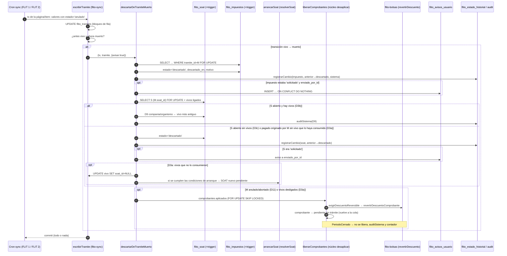
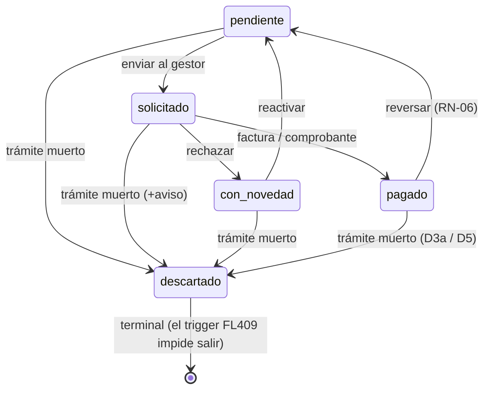

# Diseño full — Un trámite muerto (anulado, abortado o revocado) no existe en FLITO

Épica ADO #14707 · modo EPICA (sin Features ni HUs) · rama `EPICA/14707-davidchica-tramite-anulado-no-existe` ·
2026-11-26 · estado **Propuesto** · ADR: [ADR-0049](../adr/ADR-0049-tramite-muerto-no-existe.md).
Módulos: **FLITO** (`flito-sync`, `flito-soat`, `flito-impuestos`, `flito-comprobantes`, `flito-bolsas`, `flito-tramites`,
`flito-excepciones`, `flito-liquidacion`, `flito-logistica`, `flito-revisiones`, `finanzas-servicios-adicionales`,
`siigo`, `finanzas`, `flito-torre`, `flito-tablero`) y el módulo nuevo `flito-avisos`. **No** toca los legacy `soat`,
`tramites` ni `liquidacion`.

Las alternativas y su justificación están en el ADR. Este documento es el mapa de implementación.

---

## 1. Contexto en una tabla

| Decisión humana | Cómo se cumple |
|---|---|
| D1 muerto = anulado, abortado o revocado; rechazado no | `estado='anulado'` es el único predicado. FLIT 1 mapea `Abortado`/`Revocado` → `anulado` y la 0318 hace el backfill. La sub-vigencia se toma de `flit_estado` |
| D2 frescura | Sin cambios en el cron, el webhook ni la lectura a demanda |
| D3 / D9 SOAT compartido | Orquestador de descarte (§4) con `tramite_origen_id` |
| D4 avance vs salida | Guards (§6) |
| D5 descarte lógico | Enum `descartado`, terminal, con trigger |
| D6 aviso | `flito_avisos_usuario` más la API (§3) |
| D7 / D8 visibles, sin acciones | `vigencia` / `vigenciaTramite` en los DTO, chip en el web y guard |
| D10 placa | Los cruces excluyen muertos y descartados. `vehicles.plate` no se toca |
| D11 liberar | Núcleo de `desaplicar` con `dueno: 'conservar'` |
| D12 | Guard de red en liquidar, Siigo y logística; solo se activa de verdad con un revocado |

---

## 2. Diagrama de secuencia — transición de vivo a muerto (Mermaid)



Estados del SOAT con el valor nuevo (el impuesto es análogo):



---

## 3. Contrato de endpoints

### 3.1 Error nuevo, común a toda acción de avance

```http
409 Conflict
{ "error": "El trámite 1234567 fue anulado en FLIT: en FLITO ya no admite acciones.",
  "code": "TRAMITE_NO_VIGENTE", "vigencia": "anulado" | "abortado" | "revocado" }
```

- Lo emite `TramiteNoVigenteError`. También lo devuelve el `errorHandler` global cuando la base lanza `FL409`, mirando `err.code` o `err.cause.code` porque Drizzle envuelve el error de postgres-js.
- El mensaje lleva el radicado FLIT, que no es PII, y nunca la placa ni el VIN.
- En un SOAT o impuesto `descartado` el texto es «Este SOAT/impuesto se descartó porque su trámite ya no existe en FLITO.».

### 3.2 DTO que ganan un campo (aditivo; ninguno se quita)

| DTO / respuesta | Campo nuevo |
|---|---|
| Listado y detalle de Gestión Trámites (`flito-tramites`) | `vigencia: VigenciaTramite` |
| SOAT e impuesto proyectados en el trámite | `estado` puede valer `'descartado'` |
| Bandeja Siigo (`siigo.bandeja.service.ts`) y documentos de logística (`flito-logistica.consulta.ts`) | `vigenciaTramite: VigenciaTramite` (D8, para el chip «Revocado») |
| Elegibilidad Siigo | motivo nuevo de no elegible `tramite_no_vigente` (si los motivos están enumerados en shared-types, se añade allí) |

### 3.3 API de avisos (módulo nuevo `flito-avisos`, montado en `/api/flito/avisos`)

```http
GET  /api/flito/avisos?soloNoVistos=true      authMiddleware · sin requireRole · solo los de req.user.sub
200 { "avisos": AvisoUsuarioDto[], "noVistos": number }   // como máximo 50, del más reciente al más antiguo

POST /api/flito/avisos/:id/visto              :id = uuid (z.string().guid()) · idempotente
204   (ya visto: también 204)   ·   404 si no existe o es de otro usuario (sin pistas)
```

```ts
// packages/shared-types/src/flito-avisos.ts
export const TIPOS_AVISO_USUARIO = ['solicitud_retirada'] as const;
export interface AvisoUsuarioDto {
  id: string; tipo: (typeof TIPOS_AVISO_USUARIO)[number];
  concepto: 'soat' | 'impuesto'; motivo: 'anulado' | 'abortado' | 'revocado';
  idFlit: string | null;   // radicado FLIT (JOIN a flito_tramites)
  placa: string | null;    // JOIN al leer; NO se persiste en el aviso
  creadoEn: string; vistoEn: string | null;
}
export interface AvisosUsuarioRespuesta { avisos: AvisoUsuarioDto[]; noVistos: number }
```

Copy que arma el web (no el API): «Se retiró la solicitud de {SOAT|impuesto} de la placa {placa} (trámite {idFlit}): el trámite fue {anulado|abortado|revocado} en FLIT.».

El contrato OpenAPI se regenera con `npm run contrato:generar` en el Bloque 2. El CI falla si falta una ruta.

---

## 4. Orquestador de descarte (`flito-sync/descarte-tramite-muerto.ts`)

```ts
export interface ResultadoDescarte {
  impuestos: number; soats: number; soatsHeredados: number; vivosRearrancados: number;
  comprobantesLiberados: number; comprobantesNoLiberados: number; avisos: number;
}
export async function descartarDeTramiteMuerto(
  tx: Tx, tramite: typeof flitoTramites.$inferSelect, o: { avisar: boolean },
): Promise<ResultadoDescarte>;
```

Orden, siempre dentro de la transacción del sync, con un bloqueo por paso:

1. `vigencia = vigenciaTramite(tramite.estado, tramite.flitEstado)`; el motivo es `anulado | abortado | revocado`.
2. **Impuesto** (`descarte-impuesto.ts`): `SELECT … WHERE tramite_id = M FOR UPDATE`. Si no está `descartado`, se marca con historial; si estaba `solicitado` y tiene `enviado_por_id`, se avisa. D11 solo si el motivo no es revocado.
3. **SOAT** (`descarte-soat.ts`): `S` = `M.soat_id`, con `FOR UPDATE`. Se leen los vivos ligados `V` en orden `(created_at, id)`, con el índice `idx_flito_tramites_soat_orden`. Se aplica la tabla de reglas del ADR §3. Para D3a:
   - `UPDATE flito_tramites SET soat_id = NULL WHERE id IN (no consumidores)`, con fila en el historial del trámite.
   - Si el trámite cumple `puedeArrancar(...)` (condición extraída de la línea 230 del sync: asignado, compañía y organismo emparejados, no retenido, compañía activa), se llama a `arrancarSoat(...)`, que es el `resolverSoat` exportado. Ese camino ya excluye `descartado` vía `soatActualDelVin`.
4. **D11** (`flito-comprobantes.liberar-descarte.ts`): se liberan los comprobantes aplicados que alcanza el ADR §5. Los fallos de periodo cerrado se cuentan y no se lanzan.
5. `auditSistema` con un resumen (radicado y conteos; sin VIN ni placa), y el contador entra en `ResultadoSync` / el resultado de FLIT 2.

Es **idempotente**: cada paso actúa solo sobre lo que no está `descartado`, y los avisos usan `ON CONFLICT DO NOTHING`.

---

## 5. Modelo de datos (Drizzle) y migraciones

### 5.1 Drizzle

```ts
// db/schema/soat.ts
export const flitoSoatEstadoEnum = pgEnum('flito_soat_estado', ['pendiente', 'solicitado', 'con_novedad', 'pagado', 'descartado']);
// en flitoSoat:
  /** Épica #14707 (0318): trámite que dio de alta este SOAT. NULL = canal Cliente/masivo. Sin FK: evita el ciclo con flito_tramites.soat_id. */
  tramiteOrigenId: uuid('tramite_origen_id'),
  descartadoEn: timestamp('descartado_en', { withTimezone: true }),
  motivoDescarte: varchar('motivo_descarte', { length: 10 }).$type<'anulado' | 'abortado' | 'revocado'>(),
  /** Trámite muerto que provocó el descarte. Sin FK (mismo motivo). */
  descartadoPorTramiteId: uuid('descartado_por_tramite_id'),
// índices (misma línea única): vinAbiertoUq/vehiculoAbiertoUq con .where(sql`${t.estado} NOT IN ('pagado','descartado')`)
  tramiteOrigenIdx: index('idx_flito_soat_tramite_origen').on(t.tramiteOrigenId).where(sql`${t.tramiteOrigenId} IS NOT NULL`),
  motivoDescarteChk: check('flito_soat_motivo_descarte_chk', sql`${t.motivoDescarte} IS NULL OR ${t.motivoDescarte} IN ('anulado','abortado','revocado')`),
  descarteChk: check('flito_soat_descarte_chk', sql`(${t.estado} = 'descartado') = (${t.descartadoEn} IS NOT NULL AND ${t.motivoDescarte} IS NOT NULL)`),

// db/schema/flito-impuestos.ts
export const flitoImpuestoEstadoEnum = pgEnum('flito_impuesto_estado', ['pendiente', 'solicitado', 'con_novedad', 'pagado', 'descartado']);
  descartadoEn, motivoDescarte (igual que arriba) + los dos CHECK con prefijo flito_impuestos_

// db/schema/flito-avisos.ts (nuevo) — re-exportado desde schema.ts
export const flitoAvisosUsuario = pgTable('flito_avisos_usuario', {
  id: uuid('id').primaryKey().defaultRandom(),
  usuarioId: integer('usuario_id').notNull().references(() => users.id, { onDelete: 'cascade' }),
  tipo: varchar('tipo', { length: 30 }).notNull(),
  concepto: varchar('concepto', { length: 10 }).notNull(),
  registroId: uuid('registro_id').notNull(),
  tramiteId: uuid('tramite_id').references(() => flitoTramites.id),
  motivo: varchar('motivo', { length: 10 }).notNull(),
  creadoEn: timestamp('creado_en', { withTimezone: true }).notNull().defaultNow(),
  vistoEn: timestamp('visto_en', { withTimezone: true }),
}, (t) => ({
  unico: uniqueIndex('uq_flito_avisos_usuario_registro').on(t.usuarioId, t.tipo, t.concepto, t.registroId),
  noVistos: index('idx_flito_avisos_usuario_no_vistos').on(t.usuarioId, t.creadoEn).where(sql`${t.vistoEn} IS NULL`),
  tipoChk: check('flito_avisos_usuario_tipo_chk', sql`${t.tipo} IN ('solicitud_retirada')`),
  conceptoChk: check('flito_avisos_usuario_concepto_chk', sql`${t.concepto} IN ('soat','impuesto')`),
  motivoChk: check('flito_avisos_usuario_motivo_chk', sql`${t.motivo} IN ('anulado','abortado','revocado')`),
}));
```

`varchar` + CHECK y no `pgEnum` en `tipo`, `motivo` y `motivo_descarte`. Es el mismo razonamiento que `flito_soat.origen`: así no se arrastra la trampa 55P04 a futuras ampliaciones.

### 5.2 Migraciones (SQL plano, sin BEGIN/COMMIT — ADR-DB-001)

**`0317_flito_estado_descartado_enum.sql`**: **solo** esto, porque un valor añadido no se puede usar en la misma transacción (precedente 0275):

```sql
ALTER TYPE flito_soat_estado ADD VALUE IF NOT EXISTS 'descartado';
ALTER TYPE flito_impuesto_estado ADD VALUE IF NOT EXISTS 'descartado';
```

**`0318_flito_tramite_muerto_modelo.sql`**: idempotente.

```sql
-- 1. Columnas y CHECK (sin FK a flito_tramites: ciclo con flito_tramites.soat_id)
ALTER TABLE flito_soat
  ADD COLUMN IF NOT EXISTS tramite_origen_id uuid,
  ADD COLUMN IF NOT EXISTS descartado_en timestamptz,
  ADD COLUMN IF NOT EXISTS motivo_descarte varchar(10),
  ADD COLUMN IF NOT EXISTS descartado_por_tramite_id uuid;
ALTER TABLE flito_impuestos
  ADD COLUMN IF NOT EXISTS descartado_en timestamptz,
  ADD COLUMN IF NOT EXISTS motivo_descarte varchar(10);
-- CHECK con DO $$ … IF NOT EXISTS (pg_constraint) … $$ para que sea idempotente (4 constraints)

-- 2. Índices «abierto» excluyen descartado (mismo nombre: el schema Drizzle cuadra)
DROP INDEX IF EXISTS uq_flito_soat_vin_abierto;
CREATE UNIQUE INDEX uq_flito_soat_vin_abierto ON flito_soat (vin) WHERE estado NOT IN ('pagado','descartado');
DROP INDEX IF EXISTS uq_flito_soat_vehiculo_abierto;
CREATE UNIQUE INDEX uq_flito_soat_vehiculo_abierto ON flito_soat (vehiculo_id) WHERE estado NOT IN ('pagado','descartado');
CREATE INDEX IF NOT EXISTS idx_flito_soat_tramite_origen ON flito_soat (tramite_origen_id) WHERE tramite_origen_id IS NOT NULL;

-- 3. Trigger terminal
CREATE OR REPLACE FUNCTION flito_descartado_terminal() RETURNS trigger LANGUAGE plpgsql AS $$
BEGIN
  IF OLD.estado::text = 'descartado' AND NEW.estado::text <> 'descartado' THEN
    RAISE EXCEPTION 'registro descartado: su trámite no existe en FLITO' USING ERRCODE = 'FL409';
  END IF;
  RETURN NEW;
END $$;
DROP TRIGGER IF EXISTS trg_flito_soat_descartado_terminal ON flito_soat;
CREATE TRIGGER trg_flito_soat_descartado_terminal BEFORE UPDATE OF estado ON flito_soat
  FOR EACH ROW EXECUTE FUNCTION flito_descartado_terminal();
DROP TRIGGER IF EXISTS trg_flito_impuestos_descartado_terminal ON flito_impuestos;
CREATE TRIGGER trg_flito_impuestos_descartado_terminal BEFORE UPDATE OF estado ON flito_impuestos
  FOR EACH ROW EXECUTE FUNCTION flito_descartado_terminal();

-- 4. Tabla de avisos (CREATE TABLE IF NOT EXISTS + índices IF NOT EXISTS, como en §5.1)

-- 5. Backfill D1 (FLIT 1): Abortado/Revocado → anulado. ANTES del código nuevo (initContainer).
UPDATE flito_tramites SET estado = 'anulado', updated_at = now()
 WHERE lower(trim(flit_estado)) IN ('abortado','revocado') AND estado IS DISTINCT FROM 'anulado';

-- 6. Backfill del originador: primer trámite ligado por (created_at, id) — la regla de ADR-0041 §13.8
UPDATE flito_soat s SET tramite_origen_id = o.id
  FROM (SELECT DISTINCT ON (soat_id) soat_id, id FROM flito_tramites
         WHERE soat_id IS NOT NULL ORDER BY soat_id, created_at, id) o
 WHERE s.id = o.soat_id AND s.origen = 'tramite' AND s.tramite_origen_id IS NULL;
```

**`0319_flito_tramite_muerto_saneo.sql`**: saneo histórico, una sola vez. Es un `DO $$ … $$` con `RAISE NOTICE` de los conteos (se leen en el log del initContainer) y es idempotente porque solo actúa sobre lo que no está `descartado`. **No avisa, no mueve dinero (no aplica D11) y no desliga vivos (no aplica D3a).**

```sql
-- motivo(t) := CASE lower(trim(t.flit_estado)) WHEN 'abortado' THEN 'abortado' WHEN 'revocado' THEN 'revocado' ELSE 'anulado' END
-- A. Impuestos de muertos → descartado (cualquier estado) + fila en flito_estado_historial (origen 'sistema',
--    motivo 'Saneo Épica 14707: trámite <motivo> en FLIT (histórico, sin aviso)').
--    Patrón CTE: obj (SELECT … FOR UPDATE OF i, guarda estado anterior) → upd (UPDATE … RETURNING id) → INSERT historial.
-- B. SOAT (origen='tramite', estado <> 'descartado') ligados a ≥1 muerto. Tabla temporal _saneo_soat (ON COMMIT DROP)
--    con: anterior, hay_vivo, vivo_mas_antiguo (compania_id, organismo_codigo), muerto_mas_reciente.
--    B1. anterior <> 'pagado' AND NOT hay_vivo → descartado (motivo/descartado_por = muerto más reciente) + historial.
--    B2. anterior =  'pagado' AND NOT hay_vivo AND tramite_origen_id es muerto → descartado + historial.
--    B3. anterior <> 'pagado' AND hay_vivo → D9: compania_id/organismo_codigo ← vivo más antiguo si difieren
--        (organismo solo si el del vivo no es NULL). Rastro: fila en audit_logs con el formato de auditSistema
--        (columnas según shared/audit.ts); si no es limpio en SQL, RAISE NOTICE por id.
--    B4. anterior = 'pagado' AND hay_vivo → NO se toca (histórico conservador; duda 2 del ADR).
-- C. RAISE NOTICE 'saneo 14707: impuestos=% soat_descartados=% soat_heredados=% pagados_compartidos_conservados=%'.
```

Idempotencia (P6): se aplica cada archivo nuevo **dos veces** sobre la BD local ya migrada. En la 0319, la segunda pasada debe dar todos los conteos en 0.

---

## 6. Guards: acciones de avance y de salida

Leyenda del mecanismo:

- **T** = `exigirTramiteVivo(tx, tramiteId)` (`FOR SHARE`, 409).
- **TL** = filtro `TRAMITE_VIVO` en el lote (omite sin 409).
- **E** = el estado de origen ya excluye `descartado` (no hay código nuevo, solo un test).
- **S/I** = `exigirSoatVigente` / `exigirImpuestoVigente` (409).
- **Tr** = trigger `FL409`.

| Acción (avance) | Archivo | Mecanismo |
|---|---|---|
| solicitar SOAT / impuestos / ambos | `flito-tramites/flito-tramites.service.ts:815-868` | TL |
| marcar entregado (compuerta) | `flito-tramites/flito-tramites.service.ts` | TL |
| desbloquear autogestión | `flito-excepciones/flito-excepciones.service.ts:113` | T |
| SOAT enviar al gestor | `flito-soat/flito-soat.service.ts:1526` | E (`pendiente`) |
| SOAT reactivar | `flito-soat.service.ts:1619` | E (`con_novedad`) |
| SOAT cambiar proveedor | `flito-soat.service.ts:1698` | **S** (una línea que reemplaza el `if` de `SOLICITADO`) |
| SOAT asumir en Operaciones / devolver al gestor | `flito-soat.service.ts:1754/1793` | E (`noAdmiteTraspaso`, que se muda a `flito-soat-vigente.ts` y gana el caso `descartado` con su mensaje) |
| SOAT cargar factura / carga masiva | `flito-soat.service.ts:2036/2133` (`buscarEnAdquisicion` exige `solicitado`) | E |
| SOAT documentos (subir) | `flito-soat/flito-soat-documentos.service.ts` | S |
| pago por comprobante (dueño) | `flito-comprobantes/flito-comprobantes.duenos.ts:67-104` | E |
| impuesto enviar / reactivar | `flito-impuestos/flito-impuestos.service.ts:691/820` | E |
| impuesto certificar | `flito-impuestos/certificacion.service.ts`, `flito-impuestos.certificacion-directa.service.ts` | I |
| recibos, fase, reemplazo, recibo de caja | `flito-impuestos/flito-recibos.service.ts`, `flito-recibos.fase.ts`, `flito-recibos.reemplazo.ts` | I |
| dirección / documento-factura | `flito-impuestos/flito-impuestos.direccion.ts`, `flito-impuestos.documento-factura.ts` | I |
| reanalizar + cron de análisis | `flito-impuestos/flito-impuestos.analisis.service.ts`, `flito-impuestos-analisis.cron.ts` | I + filtro `estado <> 'descartado'` en el reclamo |
| envío del comprobante a FLIT 1 / FLIT 2 (colas) | `flito-impuestos.envio-flit1.cola.ts`, `flito-impuestos.envio-flit2.cola.ts` | filtro `estado <> 'descartado'` |
| liquidar | `flito-liquidacion/flito-liquidacion.service.ts:873,1127` | T |
| elegibilidad Siigo | `siigo/facturacion.elegibilidad.service.ts:93` | T → no elegible `tramite_no_vigente` |
| aplicar comprobante | `flito-comprobantes/flito-comprobantes.aplicar.ts:340` (tras `bloquearTramite`) | T |
| resolver revisión | `flito-revisiones/flito-revisiones.service.ts` | T |
| asignar servicio adicional | `finanzas-servicios-adicionales/finanzas-servicios-adicionales.service.ts` (`bloquearTramiteVivo`, que envuelve a `bloquearTramite`) | T |
| logística: agregar a viaje, crear o avanzar traslado, generar o firmar acta, cerrar lote | `flito-logistica/flito-logistica-viajes.service.ts`, `flito-logistica-traslados.service.ts`, `flito-logistica-traslados-ciclo.service.ts`, `flito-logistica.entregas.ts`, `flito-logistica.service.ts` | T (individual) / TL (lote) |

| Acción (salida, permitida) | Nota |
|---|---|
| SOAT/impuesto rechazar, devolver al gestor | Siguen en su estado de origen. Sobre un `descartado` ya fallan por E |
| reversar SOAT/impuesto | **Nunca desde `descartado`**: S en la ruta más Tr. El `z.enum` del destino no incluye `descartado` (`flito-soat.routes.ts:685`, `flito-impuestos.routes.ts:833`) |
| desaplicar / reemplazar comprobante | Con el dueño `descartado`, `revertirDueno` **no hace nada** (ya no responde 409 `dueno_no_reversible`) |
| quitar servicio adicional, quitar de viaje, anular traslado, reversar liquidación | Sin guard |

---

## 7. Lecturas que dejan de contar muertos (Bloque 2)

Lo que filtra `estado='pagado'` o un estado concreto excluye `descartado` sin cambios. Hay que tocar lo que lista «todos», lo que cuenta trámites y lo que cruza por placa:

| Lectura | Archivo | Cambio |
|---|---|---|
| Cola SOAT | `flito-soat/flito-soat.service.ts:495-597` (`condicionesCola`) | `estado <> 'descartado'` sin aumentar las líneas netas (§9) |
| Cola impuestos | `flito-impuestos/flito-impuestos.service.ts:257-329`, `certificacion.service.ts:521` | `Object.values` → `ESTADOS_IMPUESTO_OPERATIVOS` |
| Tablero | `flito-tablero/flito-tablero.service.ts:66-150` | `ESTADOS_*_OPERATIVOS` y `TRAMITE_VIVO` en los conteos de trámites |
| Torre | `flito-torre/flito-torre.catalogo.ts:118-131,210-283`, `flito-torre.equipo-sql.ts:55` | Predicados del módulo compartido (los literales de `equipo-sql` ya los cambió el Bloque 1) |
| Revisiones (candidatos) | `flito-revisiones/flito-revisiones.candidatos.ts` | `TRAMITE_VIVO` |
| Finanzas | `finanzas/finanzas.service.ts:444`, `finanzas.consolidado.ts`, `finanzas.gastos-diarios.ts`, `finanzas.costos-proveedor.ts:72` («ya_contado») | SOAT e impuesto salen solos por `pagado`. En «ya_contado» (primer trámite por SOAT) se excluyen muertos y `descartado`. El derecho de un revocado **sigue sumando** (D8) |
| Siigo bandeja | `siigo/siigo.bandeja.service.ts` | Por facturar: `TRAMITE_VIVO`. Ya facturados: se ven con `vigenciaTramite` |
| Logística por documento | `flito-logistica/flito-logistica.consulta.ts:277`, `flito-logistica.pendientes-firma.ts`, actas, `idsClasificadosDe` | Pendientes: `TRAMITE_VIVO`. Histórico: `vigenciaTramite` |
| Cruces por placa | `flito-impuestos/flito-recibos.service.ts:497` (`buscarCandidato`), `flito-comprobantes/flito-comprobantes.cruce.ts:73,137` | `TRAMITE_VIVO` y `estado <> 'descartado'` |
| Alertas sin gestión | `flito-tramites/flito-tramites.service.ts:548` | `TRAMITE_VIVO` |
| Gestión Trámites (listado y detalle) | `flito-tramites/flito-tramites.service.ts` | Campo `vigencia` (D7: siguen visibles) |

`buscarEnAdquisicion` (`flito-soat.service.ts:2084`) exige `solicitado`, así que ya excluye `descartado`. Su `limit 1` sin `ORDER BY` es una Nota previa: se arregla solo si cabe sin líneas netas nuevas.

---

## 8. Archivos por bloque (3 PRs en serie, cada uno ≤ ~1500 líneas de producto)

La estimación son líneas efectivas de producto, sin tests. Cada bloque debe quedar verde por sí solo (build api, build web, lint).

### Bloque 1 — backend núcleo: modelo, transición, guards y saneo (≈ 1250 líneas)

| Archivo | Acción | ~Líneas |
|---|---|---|
| `apps/api/src/db/migrations/0317_flito_estado_descartado_enum.sql` | crear | 12 |
| `apps/api/src/db/migrations/0318_flito_tramite_muerto_modelo.sql` | crear | 120 |
| `apps/api/src/db/migrations/0319_flito_tramite_muerto_saneo.sql` | crear | 160 |
| `apps/api/src/db/schema/soat.ts` | modificar (enum, 4 columnas, índices, CHECK) | +15 |
| `apps/api/src/db/schema/flito-impuestos.ts` | modificar (enum, 2 columnas, CHECK) | +8 |
| `apps/api/src/db/schema/flito-avisos.ts` | crear | 35 |
| `apps/api/src/db/schema.ts` | modificar (re-export) | +1 |
| `packages/shared-types/src/flito-estados.ts` | modificar (`DESCARTADO`, labels, `TERMINALES`, `OPERATIVOS`) | +20 |
| `packages/shared-types/src/flito-tramite-vigencia.ts` | crear (`VigenciaTramite`, `vigenciaTramite`, `CODIGO_TRAMITE_NO_VIGENTE`, `MOTIVOS_DESCARTE`) | 40 |
| `packages/shared-types/src/index.ts` | modificar (export) | +1 |
| `apps/api/src/shared/tramite-vigente.ts` | crear (`TRAMITE_MUERTO`/`TRAMITE_VIVO`, `exigirTramiteVivo`, `TramiteNoVigenteError`) | 80 |
| `apps/api/src/shared/middleware/errorHandler.ts` | modificar (`TramiteNoVigenteError` y `FL409` → 409) | +12 |
| `apps/api/src/modules/flito-sync/flito-sync.service.ts` | modificar (mapeo D1, gancho en `escribirTramite`, `tramite_origen_id` en `resolverSoat`, exportar `arrancarSoat` y `puedeArrancar`) | +30 |
| `apps/api/src/modules/flito-sync/descarte-tramite-muerto.ts` | crear (orquestador) | 90 |
| `apps/api/src/modules/flito-sync/descarte-soat.ts` | crear (D3, D9 y rearranque) | 170 |
| `apps/api/src/modules/flito-sync/descarte-impuesto.ts` | crear | 70 |
| `apps/api/src/modules/flito-sync/flit2-lectura.service.ts` | modificar (contador del descarte en el resultado, si hace falta) | +5 |
| `apps/api/src/modules/flito-avisos/flito-avisos.escritura.ts` | crear (`registrarAvisoSolicitudRetirada(tx, …)`) | 35 |
| `apps/api/src/modules/flito-comprobantes/flito-comprobantes.desaplicar.ts` | modificar (núcleo exportable con `dueno: 'conservar'`; `revertirDueno` no hace nada con un dueño `descartado`) | +20 |
| `apps/api/src/modules/flito-comprobantes/flito-comprobantes.liberar-descarte.ts` | crear (D11, `SKIP LOCKED`, periodo cerrado contado) | 70 |
| `apps/api/src/modules/flito-soat/flito-soat-actual.ts` | modificar (`SOAT_ABIERTO`, `soatActualDelVin` sin `descartado`) | +10 |
| `apps/api/src/modules/flito-soat/flito-soat-vigente.ts` | crear (`exigirSoatVigente` + `noAdmiteTraspaso` y el validador de motivo, que se mudan) | 45 |
| `apps/api/src/modules/flito-soat/flito-soat.service.ts` | modificar (**neto ≤ 0**, ver §9) | ±0 |
| `apps/api/src/modules/flito-soat/flito-soat-vigencia.service.ts`, `flito-soat-documentos.service.ts` | modificar (`SOAT_ABIERTO`; S) | +6 |
| `apps/api/src/modules/flito-parametrizacion/flito-proveedores-estado.service.ts`, `apps/api/src/modules/clients/clients.service.ts`, `apps/api/src/modules/flito-torre/flito-torre.equipo-sql.ts` | modificar (los literales `<> 'pagado'` → `NOT IN ('pagado','descartado')` / `SOAT_ABIERTO`) | +6 |
| `apps/api/src/modules/flito-impuestos/impuesto-por-vehiculo.ts` | modificar (comentario D5; el filtro ya excluye por estado) | +3 |
| Guards T/I de la §6: `flito-tramites.service.ts`, `flito-excepciones.service.ts`, `flito-liquidacion.service.ts`, `siigo/facturacion.elegibilidad.service.ts`, `flito-comprobantes.aplicar.ts`, `flito-revisiones.service.ts`, `finanzas-servicios-adicionales.service.ts`, los 5 de logística, `flito-impuestos.service.ts`, `certificacion.service.ts`, `flito-impuestos.certificacion-directa.service.ts`, `flito-recibos*.ts` (3), `flito-impuestos.direccion.ts`, `flito-impuestos.documento-factura.ts`, `flito-impuestos.analisis.service.ts`, `flito-impuestos-analisis.cron.ts`, las 2 colas de envío | modificar (de 1 a 4 líneas cada uno) | +110 |
| `apps/web/src/components/flito/soat/ChipEstadoSoat.tsx`, `ImpuestoCola.tsx`, `tramites/CeldasTramite.tsx`, `pages/FlitoTablero.tsx`, `tramites/CabeceraTramites.tsx` | modificar (**solo** la entrada `descartado` de los `Record<>` y `OPERATIVOS` en las opciones, para que `build:web` siga verde) | +10 |

Tests del Bloque 1 (P1, archivos nuevos en `apps/api/src/__tests__/`):
- `descarte-tramite-muerto.test.ts`: D3a, D3b, D3c, D5, D6, D9, D11, idempotencia y revocado sin D11.
- `tramite-vigente.test.ts`: guard, 409 y `FOR SHARE`.
- `flito-sync-mapeo-muerto.test.ts`: D1 en FLIT 1 y FLIT 2, y transición solo de vivo a muerto.
- Uno por familia de guards de la §6, con al menos un 409 por mecanismo T, I, S y Tr.

### Bloque 2 — backend: lecturas y API de avisos (≈ 550 líneas)

| Archivo | Acción | ~Líneas |
|---|---|---|
| `apps/api/src/modules/flito-avisos/flito-avisos.service.ts` | crear (listar los propios, marcar visto, purga) | 90 |
| `apps/api/src/modules/flito-avisos/flito-avisos.routes.ts` | crear (Zod, `authMiddleware`, mapeo de errores) | 60 |
| `apps/api/src/modules/flito-avisos/flito-avisos.cron.ts` | crear (purga diaria 90/180 días; patrón `flito-soat/flito-soat-retencion.cron.ts`) | 30 |
| `apps/api/src/app.ts` | modificar (montar `/api/flito/avisos`) | +2 |
| `apps/api/src/server.ts` | modificar (registrar el cron) | +2 |
| `packages/shared-types/src/flito-avisos.ts` + `index.ts` | crear / modificar | 25 |
| Lecturas de la §7: `flito-soat.service.ts` (neto ≤ 0), `flito-impuestos.service.ts`, `certificacion.service.ts`, `flito-tablero.service.ts`, `flito-torre.catalogo.ts`, `flito-revisiones.candidatos.ts`, `finanzas.service.ts`, `finanzas.consolidado.ts`, `finanzas.gastos-diarios.ts`, `finanzas.costos-proveedor.ts`, `siigo.bandeja.service.ts`, `flito-logistica.consulta.ts`, `flito-logistica.pendientes-firma.ts`, `flito-recibos.service.ts`, `flito-comprobantes.cruce.ts`, `flito-tramites.service.ts` | modificar | +220 |
| DTO con `vigencia` / `vigenciaTramite` (shared-types de Siigo y logística, si están tipados allí) | modificar | +20 |
| `contracts/openapi/flito-api.v1.yaml` | **regenerar** con `npm run contrato:generar` (no se edita a mano) | — |

Tests: `flito-avisos.test.ts` (aislamiento entre usuarios, 404 ajeno, idempotencia de visto, purga) y uno por lectura que demuestre que el muerto no se cuenta (cola, tablero, Torre, bandeja Siigo, cruces).

### Bloque 3 — web (≈ 450 líneas)

Antes, `ux-agent` **slim** para el panel de avisos y el chip y aviso de página del trámite muerto, con maqueta del kit y el «ok» humano.

| Archivo | Acción | ~Líneas |
|---|---|---|
| `apps/web/src/lib/api.ts` | modificar (`avisos.listar`, `avisos.marcarVisto`; el 409 `TRAMITE_NO_VIGENTE` como error tipado) | +25 |
| `apps/web/src/components/flit/AvisosUsuario.tsx` | crear (botón con contador y panel; 4 estados; marcar visto; `aria-label`) | 140 |
| `apps/web/src/components/flit/FlitTopbar.tsx` | modificar (montar `AvisosUsuario`) | +4 |
| `apps/web/src/components/flito/tramites/tiposTramites.ts` | modificar (`vigencia` en `TramiteFila`; `esAccionable` exige `'vigente'`) | +4 |
| `apps/web/src/components/flito/tramites/FilaTramite.tsx` | modificar (chip Anulado/Abortado con el tono `anulado` y Revocado con el tono `revocado`; sin acciones) | +20 |
| `apps/web/src/components/flito/tramites/detalle/ModalDetalleTramite.tsx` | modificar (`InlineAlert` persistente «no existe en FLITO», acciones ocultas, liquidación/factura marcadas «Revocado») | +40 |
| `apps/web/src/components/flito/tramites/CeldasTramite.tsx`, `soat/ChipEstadoSoat.tsx`, `ImpuestoCola.tsx` | modificar (presentación de `descartado`) | +15 |
| `apps/web/src/pages/FlitoSoat.tsx`, `apps/web/src/pages/FlitoImpuestos.tsx` | modificar (copy del 409 en un toast cerrable y refresco de la cola) | +20 |
| `apps/web/src/pages/SiigoOperacion.tsx`, `apps/web/src/pages/FlitoLogistica.tsx` | modificar (chip «Revocado» en el histórico; sin acciones) | +30 |
| `apps/web/src/content/ayuda/…` (fichas de Gestión Trámites, SOAT e Impuestos) | modificar con la skill `flit-ayuda-flito` | +40 |
| `apps/web/e2e/tests/flito-tramite-muerto.spec.ts` | crear (chip, sin acciones, avisos) | — |

---

## 9. Notas operativas por agente

**backend-agent (Bloques 1 y 2)**
- `flito-soat.service.ts` está **en su techo de 1068 líneas**. Antes de añadir nada, muda `noAdmiteTraspaso` y el validador de motivo a `flito-soat-vigente.ts`. Cada guard tiene que ser una línea que **reemplace** el `if` existente. Comprueba con `npm run lint` que el conteo no sube y, si baja, baja la cifra del techo en `eslint.config.mjs` en el mismo PR.
- Comprueba que `descarte-*.ts` no abre un ciclo de imports (`flito-sync` → `flito-comprobantes` → `flito-soat` → ¿`flito-sync`?). Si lo abre, la liberación entra por parámetro desde quien la llama.
- `escribirTramite`: el gancho va **después** del UPDATE y solo cuando `existente` estaba vivo y la fila quedó muerta. Ni en el alta ni con `soloSiCambia` sin cambios.
- `auditSistema` y los logs del descarte: el radicado y los ids. **Nunca** VIN ni placa.
- P6: cada migración nueva se aplica dos veces sobre la BD local. En la 0319 la segunda pasada da conteos en 0. Avisa al humano de que se tocó su BD.
- La 0317 va **sola** (55P04). Si al integrar el siguiente número libre ya no es 0317, se renumeran las tres en orden, porque ninguna está aplicada en ningún ambiente.

**frontend-agent (Bloque 3)**
- El tono `anulado` y `revocado` ya existe en `components/flit/kit/tonos.ts`. No hay HEX nuevos.
- El trámite muerto se señala con un aviso de página persistente (`InlineAlert`), no con un toast. El 409 va en un toast cerrable con copy pulido, nunca el `error` crudo.
- `AvisosUsuario` obtiene los datos por `api.ts` al montar el shell y al recuperar el foco. No hace polling agresivo ni usa websockets. Tiene sus 4 estados.

**Gates**

| Bloque | `db-review-agent` | `security-agent` |
|---|---|---|
| 1 | Sí (esquema y migraciones) | Sí (dinero/bolsa, `errorHandler`, PII en logs) |
| 2 | No (sin esquema) | Sí (rutas nuevas y proyección de placa: confirmar el criterio §8 del ADR sobre `pii_access_log`) |
| 3 | No | No aplica, salvo que el diff toque auth |

`qa-agent` B en cada bloque, con la matriz D1–D12 → TC. Mutantes ≤ 3 en el Bloque 1: la tabla de reglas D3, D11 revocado y el trigger.

**devops-agent:** una M1 al final de la ráfaga. Hay que revisar el `RAISE NOTICE` de la 0319 en el log del initContainer de cada ambiente. En PDN se hace `pg_dump` previo, como siempre.

---

## 10. Riesgos abiertos

Son los mismos 5 puntos del ADR, con su valor por defecto. Hay además dos riesgos técnicos que no dependen del humano:

- **Tiempo de la 0319 en PDN.** No se ha medido. Las tablas tienen pocos miles de filas, `flito_soat` ~7 000, y los índices `idx_flito_tramites_estado` e `idx_flito_tramites_soat_orden` lo cubren, así que se espera que tarde segundos. Si `--dry` en QA muestra otra cosa, se divide en lotes.
- **El archivo huérfano en S3** cuando una carga de factura pierde la carrera contra el descarte (409 por el trigger). Es una Nota; lo cubre la purga existente, si aplica.
