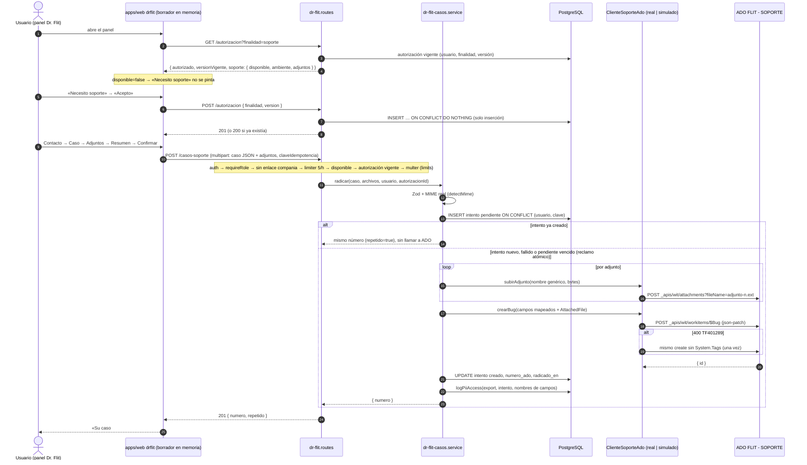

# Diseño — Feature #13695 · Dr. Flit radica casos de soporte en FLIT - SOPORTE

- **Modo:** full (módulo nuevo, dos tablas, contrato nuevo, integración externa, PII hacia un tercero)
- **Fecha:** 2026-10-22 · **Autor:** architecture-agent · **Estado:** Propuesto (lo aprueba el Líder Técnico)
- **Feature:** #13695 (Épica #12757) · **HUs:** #13803 (HU-1), #13804 (HU-2), #13805 (HU-3), #13806 (HU-4), #13807 (HU-5)
- **ADR:** [`docs/adr/ADR-0026-dr-flit-radicacion-sincrona-en-ado-sin-persistir-el-caso.md`](../adr/ADR-0026-dr-flit-radicacion-sincrona-en-ado-sin-persistir-el-caso.md) (Propuesto)
- **Alcance:** `docs/ado-drafts/epic-12756-12757/HUS-F5-13695.md`, con **P9-1 a P9-13 cerradas por el humano el 2026-10-22 con la opción recomendada en todas**. Datos de FLIT - SOPORTE verificados en vivo por el hilo principal (Bug #13713 y definición del tipo Bug).
- **Habla con:** módulo **FLITO nuevo** `flito-dr-flit` (`/api/flito/dr-flit`). No toca ningún módulo legacy. En la web extiende `apps/web/src/components/drflit/` (F3).

---

## Contexto

F3 dejó a Dr. Flit como panel de solo frontend: busca en las fichas de ayuda y, si no hay resultados, no tiene adónde mandar al usuario. F5 añade «Necesito soporte»: el usuario autoriza el tratamiento de sus datos (Ley 1581), llena un caso paso a paso, lo confirma y FLITO crea un **Bug** en el proyecto ADO **FLIT - SOPORTE**. El usuario recibe **solo el número**.

Decisiones de producto ya cerradas que fijan el diseño (P9, opción recomendada):

| P9 | Decisión | Consecuencia técnica |
|---|---|---|
| 1 | Interfaz `ClienteSoporteAdo` con adaptador real y simulado. Simulado **prohibido** con `DEPLOY_ENVIRONMENT=PDN`. Sin PAT → `soporteDisponible=false`. DEV/QA radican en FLIT - SOPORTE con tag extra `FLITO-PRUEBAS` | `superRefine` en `env.ts`; función única `soporteDisponible()` |
| 2 | Mapeo por configuración. Tag `FLITO` creado por un humano; si el create falla por el tag (TF401289), se crea sin tag y se registra | Reintento único **sin `System.Tags`** ante TF401289 |
| 3 | Alta/Media/Baja → `Priority` 1/2/3. `Severity` no se envía | Constante en código |
| 4 | PNG/JPG/PDF, 3 × 5 MB, **un solo POST multipart**, nada en reposo en FLITO | `multer.memoryStorage()`; sin MinIO ni cron de adjuntos |
| 5 | Una autorización por usuario × finalidad × versión; `finalidad` `soporte`/`ia`; revocación fuera de F5 | Tabla de solo inserción, `UNIQUE (usuario, finalidad, versión)` |
| 6 | Borrador en memoria del panel, nunca en `sessionStorage` | Store en módulo JS en la web, vaciado en las salidas de sesión de F3 |
| 7 | `authMiddleware` + `requireRole` (todos los roles de `USER_ROLES` menos `cliente`) y rechazo del enlace de compañía | Ver «Frontera por enlace» abajo |
| 9 | `logPiiAccess` con `accion: 'export'` | Sin tocar `shared/pii-audit.ts` |
| 10 | Intentos: 12 meses con cron diario. Autorizaciones: sin purga en F5 (HU aparte cuando jurídico la valide) | Trigger que impide UPDATE/DELETE/TRUNCATE |
| 11 | Clave de idempotencia (uuid) generada por el cliente | `UNIQUE (usuario_id, clave_idempotencia)` + reclamo atómico |
| 12 | Frecuencia en lista, teléfono opcional, área prellenada por rol, ambiente desde `DEPLOY_ENVIRONMENT` | Enums en `shared-types` |
| 13 | Limitador propio de 5 casos/usuario/hora, configurable | `drflitCasosLimiter` en `rateLimiter.ts` |

**Hallazgo del pre-flight que el borrador no recogía: la frontera por enlace (ADR-0024).** Un montaje sin `conAlcance` queda **cerrado para todo usuario con enlace** (`proveedor`, `organismos_transito`, `compania`). Los públicos de D5 (Corredor SOAT = `proveedor`, Corredor Impuestos = `gestor_impuestos` con enlace a organismos) **tienen enlace**, así que con un montaje «normal» recibirían 403 en todo el módulo. Se resuelve en la Decisión §D3 (abajo).

**`DEPLOY_ENVIRONMENT` no existe hoy en el repo** (verificado: ni en `env.ts` ni en compose/PM2). Se crea en HU-1 y se debe definir en los tres despliegues (pendiente humano).

---

## Alternativas

### Opción 1 — Radicación síncrona en la petición, sin persistir el caso (recomendada)

Un `POST` multipart con el caso y los archivos. El servidor valida, registra un **intento** (solo metadatos), llama a ADO en la misma petición (sube los adjuntos, crea el Bug con las relaciones `AttachedFile` en el mismo json-patch), guarda el número y responde. Si ADO falla, el intento queda `fallido`; el panel reintenta con la misma clave de idempotencia y los mismos datos, que siguen en su memoria.

- **Pros:** cumple D6 al pie de la letra (ni texto ni archivos del caso en reposo en FLITO); el usuario ve el número o el error en el momento; sin worker ni colas; cliente REST propio de ~150 líneas con `fetch`.
- **Contras:** la petición dura lo que tarde ADO (hasta ~4 llamadas con 15 s de timeout cada una en el peor caso); el reintento lo dispara el usuario, no el sistema; residuo de duplicado si se pierde la respuesta del create (se acepta, P9-11).
- **Esfuerzo:** M. **Riesgos:** adjuntos huérfanos en ADO si el create falla después de subirlos (sin PII nueva: son los mismos archivos que el usuario quería enviar; ADO no los expone sin enlace); timeouts largos en el navegador (el cliente de la web tiene 90 s, holgado).

### Opción 2 — Outbox con worker (patrón ADR-0021)

El `POST` guarda el caso completo (cifrado) y los adjuntos (MinIO) en una tabla outbox y responde `202`; un cron lo radica y el panel consulta el número.

- **Pros:** reintentos automáticos; la petición del usuario es corta; patrón ya conocido en el repo.
- **Contras:** **persiste el texto y los archivos del caso en FLITO**, contra D6 y P9-4 (a), con su cifrado, su purga y su revisión de security; el usuario no tiene el número en el momento (el Feature pide devolverlo); polling en el panel; tabla y cron adicionales.
- **Esfuerzo:** L. **Riesgos:** superficie Habeas Data mucho mayor; contradice decisiones ya cerradas por el humano.

### Opción 3 — Opción 1 con el SDK oficial `azure-devops-node-api`

Igual que la 1, pero el cliente ADO es el SDK de Microsoft.

- **Pros:** tipos de los work items y del json-patch ya hechos.
- **Contras:** **dependencia nueva** (más `typed-rest-client` y transitivas) para dos llamadas REST; su manejo de errores e interceptores de logging hacen más difícil garantizar que el PAT y el cuerpo nunca terminen en un log; el modo simulado sigue haciendo falta.
- **Esfuerzo:** M. **Riesgos:** superficie de `security-agent` (SCA) y `dependency-audit` sin beneficio proporcional. No supera la barra de AGENTS.md («la barra para añadir otra es alta»).

---

## Decisión y justificación

**Opción 1.** Es la única compatible con D6 y P9-4/P9-6 tal como las cerró el humano, entrega el número en la misma interacción y no añade dependencias (`fetch` y `AbortSignal.timeout` son nativos de Node; el repo ya usa `multer`, `detectMime`, `logPiiAccess`, `express-rate-limit` y `withLock`). Se descarta reutilizar `shared/upstream.ts` porque **reintenta**: un reintento automático de un create no idempotente es exactamente el duplicado que P9-11 quiere evitar.

Decisiones derivadas:

- **D1 · Orden de las llamadas a ADO:** subir adjuntos → crear el Bug con `System.Title`, campos, tags y relaciones `AttachedFile` en **un solo** json-patch. Si falla una subida, no se crea el Bug (AC5 de HU-3). No hay segundo PATCH para el tag ni para los adjuntos: el create es la única operación que deja un caso visible.
- **D2 · TF401289 (tag inexistente o sin permiso):** si el create responde 400 y el cuerpo trae `TF401289`, se repite **una vez** el create **sin** `System.Tags`. No hay riesgo de duplicado: el primer create fue rechazado entero. El intento queda `creado` con `error_codigo='tag-rechazado'` y un `warn` sin datos del caso.
- **D3 · Frontera por enlace:** el montaje va **sin `conAlcance`** y las rutas del módulo se declaran en `RUTAS_TRANSVERSALES` (`shared/middleware/frontera-enlace.ts`), como Perfil: Dr. Flit es un panel de sesión y sus rutas solo leen o escriben datos **del propio usuario** (su autorización, sus intentos). El enlace `compania` se cierra **dentro del router** con una guarda explícita (`rechazarEnlaceCompania`), además de `requireRole`, para no depender de que hoy solo `cliente` tenga ese enlace. Alternativa descartada: añadir `'drflit'` a `MODULOS_FRONTERA` con `['proveedor','organismos_transito']` — más declarativa, pero cambia un `Record<ModuloFrontera, …>` exhaustivo que consumen `apps/web/src/lib/permissions.ts`, `pages/roles-permisos/modulos.ts` y `arbol.ts`, y el snapshot del centinela; mucho más radio de cambio para tres rutas que no son un módulo de negocio.
- **D4 · Dos migraciones, no una:** `0245` (autorizaciones) en HU-1 y `0246` (intentos) en HU-2. Una migración ya aplicada en cualquier ambiente no se edita; HU-1 se mergea y se aplica en DEV antes de que HU-2 termine de verificar el mapeo real, así que meter la tabla de intentos en `0245` obligaría a acertar su forma antes de tiempo o a una `0247` correctiva. Cada HU deja su esquema junto al código que lo usa y su db-review es pequeño. **Verificar al abrir HU-2** que `0246` siga libre en `origin/develop`; si no, tomar la siguiente.
- **D5 · Versión y texto de la autorización viven en `shared-types`:** `AUTORIZACIONES_DRFLIT.soporte = { version, texto }`. La API valida la versión y guarda el **SHA-256 del texto** junto a la versión (prueba de qué texto exacto se aceptó); la web pinta ese mismo texto. Cambiar el texto sin cambiar la versión lo detecta un test de `shared-types` (hash fijado por versión). HU-1 deja `version` y un texto **provisional marcado como tal**; HU-4 no se cierra sin el texto aprobado por PO/jurídico (P9-5).

---

## Diagrama de secuencia (Mermaid)



---

## Contrato de endpoints

Base: `/api/flito/dr-flit`. Todas con `authMiddleware` + `requireRole(...ROLES_SOPORTE_DRFLIT)` + `rechazarEnlaceCompania`. **Ninguna respuesta lleva URLs, `_links`, ids de adjunto ni mensajes de ADO.** Errores con la forma del repo: `{ error: string, codigo?: string, ...claves hermanas }`.

| Método y ruta | HU | Entrada | 2xx | Errores |
|---|---|---|---|---|
| `GET /autorizacion?finalidad=soporte\|ia` | 1 | query `finalidad` (enum, no es PII) | `200 EstadoAutorizacionDrFlit` | 400 `finalidad-invalida` · 401 · 403 |
| `POST /autorizacion` | 1 | JSON `AceptarAutorizacionDrFlit` | `201` nueva · `200` ya existía — `AutorizacionAceptadaDrFlit` | 400 · 401 · 403 · 409 `version-no-vigente` · 429 (`apiLimiter`) |
| `POST /casos-soporte` | 2 (multipart desde HU-2; archivos desde HU-3) | `multipart/form-data`: parte `caso` = JSON `CasoSoporteDrFlit`; partes `adjuntos` (0..N) | `201` nuevo · `200` repetido — `CasoRadicadoDrFlit` | 400 `campo-invalido` + `campo` · 400 `adjunto-no-permitido` + `archivo` · 401 · 403 `Sin permisos` · 403 `autorizacion-requerida` · 409 `radicacion-en-curso` · 413 `adjunto-demasiado-grande` / `demasiados-adjuntos` · 429 · 503 `soporte-no-disponible` · 502 `ado-error` · 503 `ado-no-disponible` (las dos últimas con `reintentable: true`) |

DTOs (archivo nuevo `packages/shared-types/src/flito-dr-flit.ts`, export en `index.ts`; **aditivo**, no cambia tipos existentes):

```ts
export const FINALIDADES_DRFLIT = ['soporte', 'ia'] as const;
export type FinalidadDrFlit = (typeof FINALIDADES_DRFLIT)[number];
export const AUTORIZACIONES_DRFLIT: Readonly<Record<FinalidadDrFlit, { version: string; texto: string }>>;
export const AMBIENTES_DESPLIEGUE = ['DEV', 'QA', 'PDN'] as const;          // valor de DEPLOY_ENVIRONMENT
export const AREAS_SOPORTE = ['operaciones', 'facturacion', 'corredor_soat', 'corredor_impuestos', 'mensajero_logistica'] as const;
export const FRECUENCIAS_SOPORTE = ['siempre', 'a_veces', 'solo_una_vez'] as const;
export const PRIORIDADES_SOPORTE = ['alta', 'media', 'baja'] as const;
export const AREA_SOPORTE_POR_ROL: Partial<Record<UserRole, AreaSoporte>>; // proveedor→corredor_soat, gestor_impuestos→corredor_impuestos, mensajero→mensajero_logistica, financiera→facturacion
export const ROLES_SIN_SOPORTE_DRFLIT = ['cliente'] as const;
export const ROLES_SOPORTE_DRFLIT: readonly UserRole[];                     // USER_ROLES sin ROLES_SIN_SOPORTE_DRFLIT
export const LIMITES_TITULO_SOPORTE = { min: 3, max: 120 } as const;        // y detalle 10..4000, resultadoEsperado 1..2000, nombre 1..100, telefono ≤ 20

export interface EstadoAutorizacionDrFlit {
  finalidad: FinalidadDrFlit; autorizado: boolean; versionVigente: string; aceptadaEn: string | null; // ISO
  soporte: { disponible: boolean; ambiente: AmbienteDespliegue;
             adjuntos: { maxArchivos: number; maxBytesArchivo: number; tipos: readonly ('image/png' | 'image/jpeg' | 'application/pdf')[] } };
}
export interface AceptarAutorizacionDrFlit { finalidad: FinalidadDrFlit; version: string }
export interface AutorizacionAceptadaDrFlit { finalidad: FinalidadDrFlit; version: string; aceptadaEn: string }
export interface CasoSoporteDrFlit {
  claveIdempotencia: string;                                   // uuid v4 del cliente, se reutiliza al reintentar
  contacto: { nombre: string; correo: string; telefono?: string };
  area: AreaSoporte; titulo: string; detalle: string; resultadoEsperado: string;
  frecuencia: FrecuenciaSoporte; prioridad: PrioridadSoporte;
}                                                              // fecha y ambiente los pone el SERVIDOR; «adjuntos Sí/No» sale del número de archivos
export interface CasoRadicadoDrFlit { numero: number; repetido: boolean }
export type CodigoErrorDrFlit = 'finalidad-invalida' | 'version-no-vigente' | 'campo-invalido' | 'autorizacion-requerida'
  | 'radicacion-en-curso' | 'adjunto-no-permitido' | 'adjunto-demasiado-grande' | 'demasiados-adjuntos'
  | 'soporte-no-disponible' | 'ado-error' | 'ado-no-disponible';
```

Reglas del contrato:
- **400 sin eco del valor** (AC3 de HU-2): los mensajes de Zod se reemplazan por mensajes propios; `invalid_enum_value` de Zod incluye `received` y **no** puede salir tal cual. `campo` es la ruta (`contacto.correo`), nunca el valor.
- `archivo` en el 400 de adjunto es el `originalname` que mandó el propio usuario, solo en la respuesta (AC2 de HU-3); **nunca** en logs.
- Reintento: mismo `claveIdempotencia` → si el intento está `creado`, `200 { numero, repetido: true }` sin llamar a ADO.
- Es `POST` con body porque el caso lleva PII (AGENTS.md §14); el único query param (`finalidad`) es un enum sin PII.

---

## Modelo de datos (Drizzle)

En `apps/api/src/db/schema.ts` (junto a las tablas FLITO; nombres con prefijo `flito_drflit_`).

```ts
// HU #13803 — 0245. Prueba del consentimiento (Ley 1581). SOLO INSERCIÓN: trigger en la migración.
export const flitoDrflitAutorizaciones = pgTable('flito_drflit_autorizaciones', {
  id: serial('id').primaryKey(),
  usuarioId: integer('usuario_id').notNull().references(() => users.id, { onDelete: 'restrict' }),
  finalidad: varchar('finalidad', { length: 20 }).notNull(),          // CHECK IN ('soporte','ia')
  version: varchar('version', { length: 40 }).notNull(),
  textoSha256: char('texto_sha256', { length: 64 }).notNull(),
  aceptadaEn: timestamp('aceptada_en', { withTimezone: true }).notNull().defaultNow(),
  ip: varchar('ip', { length: 45 }),                                   // mismo ancho que consent_ip
  userAgent: varchar('user_agent', { length: 300 }),                   // mismo ancho que consent_user_agent
}, (t) => ({
  uqUsuarioFinalidadVersion: uniqueIndex('uq_flito_drflit_aut_usuario_finalidad_version').on(t.usuarioId, t.finalidad, t.version),
}));

// HU #13804 — 0246. Metadatos del intento de radicación. SIN texto del caso (D6). Purga a 12 meses.
export const flitoDrflitCasosSoporte = pgTable('flito_drflit_casos_soporte', {
  id: serial('id').primaryKey(),                                       // resourceId de logPiiAccess (number)
  usuarioId: integer('usuario_id').notNull().references(() => users.id, { onDelete: 'restrict' }),
  autorizacionId: integer('autorizacion_id').notNull().references(() => flitoDrflitAutorizaciones.id, { onDelete: 'restrict' }),
  claveIdempotencia: uuid('clave_idempotencia').notNull(),
  estado: varchar('estado', { length: 12 }).notNull().default('pendiente'), // CHECK IN ('pendiente','creado','fallido')
  numeroAdo: integer('numero_ado'),                                    // CHECK estado<>'creado' OR numero_ado IS NOT NULL
  ambiente: varchar('ambiente', { length: 3 }).notNull(),              // CHECK IN ('DEV','QA','PDN')
  adjuntosCantidad: smallint('adjuntos_cantidad').notNull().default(0),
  reintentos: smallint('reintentos').notNull().default(0),
  errorCodigo: varchar('error_codigo', { length: 40 }),                // clasificación: timeout|red|ado-4xx|ado-5xx|ado-auth|tag-rechazado|adjunto
  creadoEn: timestamp('creado_en', { withTimezone: true }).notNull().defaultNow(),
  actualizadoEn: timestamp('actualizado_en', { withTimezone: true }).notNull().defaultNow(),
  radicadoEn: timestamp('radicado_en', { withTimezone: true }),
}, (t) => ({
  uqUsuarioClave: uniqueIndex('uq_flito_drflit_casos_usuario_clave').on(t.usuarioId, t.claveIdempotencia),
  ixCreadoEn: index('ix_flito_drflit_casos_creado_en').on(t.creadoEn),
}));
```

Notas del modelo:
- **`ON DELETE RESTRICT` hacia `users` es seguro:** `users.service.ts` declara que nunca hace `DELETE FROM users` (las cuentas se desactivan).
- **La unicidad de la autorización** hace el `POST /autorizacion` idempotente y, de paso, cierra el riesgo de inundar una tabla que nadie puede podar (la versión se valida contra la vigente, así que un usuario tiene como máximo una fila por finalidad y versión publicada).
- **Clave única compuesta `(usuario_id, clave_idempotencia)`** y no global: una clave ajena (otro usuario) no colisiona ni revela que exista un caso.
- **`autorizacion_id`** ata cada envío al consentimiento exacto que lo autorizó (trazabilidad art. 17 sin duplicar datos).
- Sin columnas de área, prioridad, título ni nombres de archivo: D6 dice «solo metadatos».

### Cómo se impide UPDATE/DELETE en autorizaciones

Mismo mecanismo que `pii_access_log` (migración 0059): **trigger `BEFORE UPDATE OR DELETE` que lanza `P0001`**, más un trigger de sentencia `BEFORE TRUNCATE`. `REVOKE` no basta porque la aplicación se conecta como dueña de las tablas. Límite declarado: el dueño puede `DROP TRIGGER`; es el mismo nivel de garantía que ya acepta `pii_access_log`. La purga futura de autorizaciones (P9-10, HU aparte) necesitará una migración que abra una vía controlada (p. ej. `SET LOCAL flito.drflit_purga = 'on'` comprobado en el trigger); **no se adelanta ahora**.

### Migraciones (SQL plano, idempotente)

`apps/api/src/db/migrations/0245_flito_drflit_autorizaciones.sql` (HU-1):

```sql
-- HU #13803 (Feature #13695) — Dr. Flit: autorizaciones de tratamiento de datos (Ley 1581). Solo inserción.
CREATE TABLE IF NOT EXISTS flito_drflit_autorizaciones (
  id            serial PRIMARY KEY,
  usuario_id    integer      NOT NULL REFERENCES users(id) ON DELETE RESTRICT,
  finalidad     varchar(20)  NOT NULL,
  version       varchar(40)  NOT NULL,
  texto_sha256  char(64)     NOT NULL,
  aceptada_en   timestamptz  NOT NULL DEFAULT now(),
  ip            varchar(45),
  user_agent    varchar(300),
  CONSTRAINT ck_flito_drflit_aut_finalidad CHECK (finalidad IN ('soporte','ia')),
  CONSTRAINT ck_flito_drflit_aut_sha CHECK (texto_sha256 ~ '^[0-9a-f]{64}$')
);
CREATE UNIQUE INDEX IF NOT EXISTS uq_flito_drflit_aut_usuario_finalidad_version
  ON flito_drflit_autorizaciones (usuario_id, finalidad, version);

CREATE OR REPLACE FUNCTION flito_drflit_autorizaciones_solo_insercion() RETURNS trigger AS $$
BEGIN
  RAISE EXCEPTION 'flito_drflit_autorizaciones es de solo inserción (Ley 1581)' USING ERRCODE = 'P0001';
END;
$$ LANGUAGE plpgsql;

DROP TRIGGER IF EXISTS tr_flito_drflit_aut_solo_insercion ON flito_drflit_autorizaciones;
CREATE TRIGGER tr_flito_drflit_aut_solo_insercion BEFORE UPDATE OR DELETE ON flito_drflit_autorizaciones
  FOR EACH ROW EXECUTE FUNCTION flito_drflit_autorizaciones_solo_insercion();
DROP TRIGGER IF EXISTS tr_flito_drflit_aut_sin_truncate ON flito_drflit_autorizaciones;
CREATE TRIGGER tr_flito_drflit_aut_sin_truncate BEFORE TRUNCATE ON flito_drflit_autorizaciones
  FOR EACH STATEMENT EXECUTE FUNCTION flito_drflit_autorizaciones_solo_insercion();
```

`apps/api/src/db/migrations/0246_flito_drflit_casos_soporte.sql` (HU-2):

```sql
-- HU #13804 (Feature #13695) — Dr. Flit: intentos de radicación en FLIT - SOPORTE. Solo metadatos (D6), purga a 12 meses.
CREATE TABLE IF NOT EXISTS flito_drflit_casos_soporte (
  id                  serial PRIMARY KEY,
  usuario_id          integer     NOT NULL REFERENCES users(id) ON DELETE RESTRICT,
  autorizacion_id     integer     NOT NULL REFERENCES flito_drflit_autorizaciones(id) ON DELETE RESTRICT,
  clave_idempotencia  uuid        NOT NULL,
  estado              varchar(12) NOT NULL DEFAULT 'pendiente',
  numero_ado          integer,
  ambiente            varchar(3)  NOT NULL,
  adjuntos_cantidad   smallint    NOT NULL DEFAULT 0,
  reintentos          smallint    NOT NULL DEFAULT 0,
  error_codigo        varchar(40),
  creado_en           timestamptz NOT NULL DEFAULT now(),
  actualizado_en      timestamptz NOT NULL DEFAULT now(),
  radicado_en         timestamptz,
  CONSTRAINT ck_flito_drflit_casos_estado   CHECK (estado IN ('pendiente','creado','fallido')),
  CONSTRAINT ck_flito_drflit_casos_numero   CHECK (estado <> 'creado' OR numero_ado IS NOT NULL),
  CONSTRAINT ck_flito_drflit_casos_ambiente CHECK (ambiente IN ('DEV','QA','PDN')),
  CONSTRAINT ck_flito_drflit_casos_adjuntos CHECK (adjuntos_cantidad BETWEEN 0 AND 10)
);
CREATE UNIQUE INDEX IF NOT EXISTS uq_flito_drflit_casos_usuario_clave
  ON flito_drflit_casos_soporte (usuario_id, clave_idempotencia);
CREATE INDEX IF NOT EXISTS ix_flito_drflit_casos_creado_en ON flito_drflit_casos_soporte (creado_en);
CREATE INDEX IF NOT EXISTS ix_flito_drflit_casos_autorizacion ON flito_drflit_casos_soporte (autorizacion_id);
```

Idempotencia: `IF NOT EXISTS`, `CREATE OR REPLACE FUNCTION` y `DROP TRIGGER IF EXISTS` + `CREATE TRIGGER`. Verificación P6: aplicar **cada archivo dos veces** sobre la BD local ya migrada. El índice por `autorizacion_id` existe para que el FK no haga recorrido completo (criterio habitual de db-review).

---

## Comportamiento del servicio

### Idempotencia y reclamo atómico (P9-11)

1. `INSERT … (usuario_id, clave, estado='pendiente', …) ON CONFLICT (usuario_id, clave_idempotencia) DO NOTHING RETURNING id`.
2. Si no insertó, leer la fila:
   - `creado` → `200 { numero, repetido: true }`. No llama a ADO, no consume `logPiiAccess`.
   - `fallido`, o `pendiente` con `actualizado_en < now() - DRFLIT_ADO_PENDIENTE_VENCE_S` → **reclamo atómico**: `UPDATE … SET estado='pendiente', reintentos=reintentos+1, actualizado_en=now(), error_codigo=NULL WHERE id=$1 AND (estado='fallido' OR (estado='pendiente' AND actualizado_en < now() - $vence)) RETURNING id`. Si no devuelve fila, otra petición lo tomó → `409 radicacion-en-curso`.
   - `pendiente` reciente → `409 radicacion-en-curso` (doble clic o dos pestañas).
3. Llamadas a ADO (D1/D2). Éxito → `UPDATE estado='creado', numero_ado, radicado_en=now()`. Fallo → `estado='fallido', error_codigo=<clase>`.
4. `logPiiAccess(req, { resourceTipo: 'drflit_caso_soporte', resourceId: intento.id, accion: 'export', camposAccedidos: [nombres de los campos enviados, p. ej. 'contacto.nombre','contacto.correo','contacto.telefono'?, 'area','titulo','detalle','resultadoEsperado','frecuencia','prioridad', 'adjuntos'?], motivo: 'radicacion-soporte-ado' })` **siempre que se haya llamado a ADO**, con éxito o sin él (en un timeout los datos pueden haber salido). Nunca valores.

Residuo aceptado (P9-11): si ADO creó el Bug y la respuesta se perdió, el intento queda `fallido` (timeout) y el reintento crea un segundo Bug. Mitigación barata: el ReproSteps lleva `Ref. FLITO: DRF-<id del intento>`, así soporte reconoce el duplicado (el id es estable entre reintentos de la misma clave).

### Mapeo a ADO (P9-2, P9-3) — `dr-flit-ado.mapeo.ts` (función pura)

| Operación json-patch (`add`) | Valor |
|---|---|
| `/fields/System.Title` | `[ DR. FLIT FLITO ] {titulo}` (prefijo constante en código, D3) |
| `/fields/{DRFLIT_ADO_CAMPO_DETALLE}` (default `Microsoft.VSTS.TCM.ReproSteps`) | HTML **escapado**: tabla con Área, Nombre, Correo, Teléfono, Fecha del reporte (`America/Bogota`), Ambiente, Frecuencia, Prioridad indicada, Adjuntos (Sí/No + cantidad), Detalle, Resultado esperado, `Ref. FLITO: DRF-<id>`. Saltos de línea → `<br>` después de escapar |
| `/fields/{DRFLIT_ADO_CAMPO_PRIORIDAD}` (default `Microsoft.VSTS.Common.Priority`) | alta→1, media→2, baja→3 |
| `/fields/{DRFLIT_ADO_CAMPO_AMBIENTE}` (default `Custom.Environment`; vacío = no se envía) | `DEV` \| `QA` \| `PDN` (de `DEPLOY_ENVIRONMENT`, nunca de `NODE_ENV`) |
| `/fields/System.Tags` | `DRFLIT_ADO_TAGS` (default `FLITO`) + `; DRFLIT_ADO_TAGS_PRUEBAS` (default `FLITO-PRUEBAS`) si el ambiente es DEV o QA |
| `/fields/System.AreaPath` | solo si `DRFLIT_ADO_AREA_PATH` tiene valor (default vacío: el proyecto) |
| `/relations/-` | `{ rel: 'AttachedFile', url: <url devuelta por la subida>, attributes: { comment: 'Adjunto del caso' } }` por adjunto |

**No se envían** `Microsoft.VSTS.Common.Severity`, `Custom.SolutionArea`, `Custom.AffectedModule` ni `System.AssignedTo`. El área va en ReproSteps. Etiquetas visibles del área/frecuencia/prioridad: tabla de etiquetas en `shared-types` (la misma que pinta la web). Escapado HTML: función local del mapeo (no hay helper exportado en `src/shared`); **todos** los valores del usuario pasan por ella, también el título del ReproSteps.

### `ClienteSoporteAdo` — `dr-flit-ado.client.ts`

```ts
export interface AdjuntoAdo { nombre: string; mime: 'image/png' | 'image/jpeg' | 'application/pdf'; contenido: Buffer }
export interface BugSoporteAdo { operaciones: ReadonlyArray<{ op: 'add'; path: string; value: unknown }> }
export interface ClienteSoporteAdo {
  readonly modo: 'real' | 'simulado';
  subirAdjunto(a: AdjuntoAdo): Promise<{ url: string }>;        // la url NO sale del servicio
  crearBug(b: BugSoporteAdo): Promise<{ numero: number; tagOmitido: boolean }>;
}
export class AdoNoDisponibleError extends Error { readonly clase: 'timeout' | 'red' | 'ado-5xx' | 'ado-429' }   // → 503
export class AdoRechazoError      extends Error { readonly clase: 'ado-4xx' | 'ado-auth' }                    // → 502
export function obtenerClienteSoporteAdo(): ClienteSoporteAdo;   // fábrica por env, memoizada
export function fijarClienteSoporteAdoParaTests(c: ClienteSoporteAdo | null): void;
```

Adaptador **real** (`fetch` nativo, sin SDK, sin `shared/upstream.ts` porque reintenta):
- URL con `new URL()` sobre `DRFLIT_ADO_ORG_URL` y `encodeURIComponent(DRFLIT_ADO_PROJECT)`; `api-version=7.1`.
- `Authorization: Basic base64(':' + PAT)`; `redirect: 'error'`; `signal: AbortSignal.timeout(DRFLIT_ADO_TIMEOUT_MS)`.
- Subida: `POST …/_apis/wit/attachments?fileName=adjunto-<n>.<ext>&api-version=7.1`, `Content-Type: application/octet-stream`. **Nombre genérico**, no el del usuario (minimización: un nombre de archivo suele llevar nombres o cédulas).
- Create: `POST …/_apis/wit/workitems/$Bug?api-version=7.1`, `Content-Type: application/json-patch+json`. De la respuesta solo se lee `id` (entero > 0); si no es JSON o no trae `id`, es `AdoRechazoError('ado-auth')`. ADO responde **203 con la página de inicio de sesión** cuando el PAT es inválido: cualquier respuesta no-JSON o 203 se trata como `ado-auth`.
- TF401289: 400 cuyo cuerpo contiene `TF401289` → un segundo create sin la operación `System.Tags`; `tagOmitido: true`.
- **Nunca** loguea cabeceras, URL completa, cuerpo enviado ni cuerpo recibido. Los mensajes de los errores son fijos (`'ADO no respondió a tiempo'`), sin `cause` con la respuesta. Sin reintentos automáticos.

Adaptador **simulado**: sin red. `subirAdjunto` devuelve `simulado://adjunto/<n>`; `crearBug` devuelve un número en el rango `900000+` (contador de proceso) y valida que las operaciones traigan título y detalle (sirve de contrato en los tests). Prohibido en PDN por `superRefine` (abajo), así que en PDN **no existe**: la API no arranca.

### Disponibilidad (`soporteDisponible`) — `dr-flit.config.ts`

```
ambiente = DEPLOY_ENVIRONMENT ?? (NODE_ENV === 'development' ? 'DEV' : null)
disponible = ambiente !== null && (
    (DRFLIT_ADO_MODO === 'simulado' && ambiente !== 'PDN')
 || (DRFLIT_ADO_MODO === 'real' && DRFLIT_ADO_PAT && DRFLIT_ADO_ORG_URL))
```

Fallo cerrado: en `NODE_ENV=production` sin `DEPLOY_ENVIRONMENT`, el soporte no está disponible (no se adivina el ambiente). `disponible=false` → el `GET` lo informa y el `POST /casos-soporte` responde `503 soporte-no-disponible` antes de leer archivos.

### Límites, limitador y orden de middlewares

`POST /casos-soporte`: `authMiddleware` → `requireRole(...ROLES_SOPORTE_DRFLIT)` → `rechazarEnlaceCompania` → **`drflitCasosLimiter`** → `exigirSoporteDisponible` (503) → `exigirAutorizacionVigente('soporte')` (403 `autorizacion-requerida`, deja `autorizacionId` en `res.locals`) → **multer** → handler. Así nadie sin rol, sin cupo o sin autorización hace que el servidor cargue archivos en memoria.

- `drflitCasosLimiter` (en `shared/middleware/rateLimiter.ts`, mismo molde que `soatClienteLimiter`): `windowMs` 1 h, `max: env.DRFLIT_RADICACIONES_POR_HORA` (5), `keyGenerator: userOrIpKey('drflit-casos:')`, `handler: frenoConRastro('drflit-casos')`, `store: makeStore('rl:drflit-casos:')`, `skipFailedRequests: true` con `requestWasSuccessful: (_, res) => res.statusCode < 400 || res.statusCode >= 500`. Cuenta las radicaciones y los fallos de ADO (que sí llamaron a un tercero); no cuenta los 4xx de validación. Con ADO caído el usuario tiene ~4 reintentos por hora (declarado).
- `POST /autorizacion`: `apiLimiter` global basta (la unicidad impide crecer la tabla).
- multer: `memoryStorage()`, `limits: { files: DRFLIT_ADJUNTOS_MAX, fileSize: DRFLIT_ADJUNTO_MAX_MB·2^20, fields: 1, fieldSize: 64 KiB, parts: DRFLIT_ADJUNTOS_MAX + 1 }`, `fileFilter` que descarta lo obvio por mime declarado/extensión (png, jpg/jpeg, pdf). `LIMIT_FILE_SIZE` → 413 `adjunto-demasiado-grande`; `LIMIT_FILE_COUNT`/`LIMIT_PART_COUNT` → 413 `demasiados-adjuntos`; el error de `fileFilter` → 400 `adjunto-no-permitido`. El MIME **real** se verifica en el servicio con `detectMime` (`modules/pesv/magic-number.js`, como `flito-soat-cliente.service.ts`) antes de crear el intento: un `.png` que no es PNG → 400 y no se crea nada.
- En HU-2 (antes de los adjuntos) la ruta ya es multipart con `limits.files: 0`; HU-3 sube el límite. El contrato no cambia entre HUs.

### Variables de entorno (en `src/config/env.ts`, documentadas en `apps/api/.env.example`)

| Variable | Tipo / default | HU |
|---|---|---|
| `DEPLOY_ENVIRONMENT` | `DEV` \| `QA` \| `PDN`, opcional (vacío = ausente) | 1 |
| `DRFLIT_ADO_MODO` | `real` \| `simulado`, default `real` | 1 |
| `DRFLIT_ADO_PAT` | string opcional, **secreto** (nunca en logs ni en `.env.example` con valor) | 1 |
| `DRFLIT_ADO_ORG_URL` | URL `https://` opcional; host permitido `dev.azure.com` o `*.visualstudio.com` (cierra SSRF por configuración) | 1 |
| `DRFLIT_ADO_PROJECT` | string, default `FLIT - SOPORTE` | 1 |
| `DRFLIT_ADO_TIMEOUT_MS` | entero 1000–30000, default `15000` (por llamada) | 2 |
| `DRFLIT_ADO_PENDIENTE_VENCE_S` | entero ≥ 60, default `120` (un `pendiente` más viejo se puede reclamar) | 2 |
| `DRFLIT_ADO_TIPO` | default `Bug` | 2 |
| `DRFLIT_ADO_CAMPO_DETALLE` | default `Microsoft.VSTS.TCM.ReproSteps` | 2 |
| `DRFLIT_ADO_CAMPO_PRIORIDAD` | default `Microsoft.VSTS.Common.Priority` | 2 |
| `DRFLIT_ADO_CAMPO_AMBIENTE` | default `Custom.Environment`; vacío = no se envía | 2 |
| `DRFLIT_ADO_AREA_PATH` | default vacío (no se envía) | 2 |
| `DRFLIT_ADO_TAGS` / `DRFLIT_ADO_TAGS_PRUEBAS` | defaults `FLITO` / `FLITO-PRUEBAS` | 2 |
| `DRFLIT_RADICACIONES_POR_HORA` | entero 1–60, default `5` | 2 |
| `DRFLIT_PURGA_CRON_ENABLED` | `1` enciende la purga (puerta positiva, como `SOAT_RETENCION_CRON_ENABLED`) | 2 |
| `DRFLIT_ADJUNTOS_MAX` / `DRFLIT_ADJUNTO_MAX_MB` | enteros 0–5 / 1–10, defaults `3` / `5` | 3 |

Los nombres de campo (`DRFLIT_ADO_CAMPO_*`, `DRFLIT_ADO_TIPO`) se validan con `^[A-Za-z][A-Za-z0-9]*(\.[A-Za-z][A-Za-z0-9]*)+$` (y `^[A-Za-z][\w ]*$` el tipo) para que la configuración no inyecte rutas en el json-patch ni en la URL. Los **tipos** de adjunto no son configurables (decisión de seguridad P9-4).

`superRefine` (`env.ts`, junto al de `FLIT2_SYNC_ADAPTER`): (1) `DRFLIT_ADO_MODO=simulado` con `DEPLOY_ENVIRONMENT=PDN` → error; (2) `DRFLIT_ADO_MODO=simulado` con `NODE_ENV=production` y `DEPLOY_ENVIRONMENT` ausente → error (fallo cerrado: un PDN que olvidó la variable tampoco arranca con el simulado). `env.ts` hace `parse` al importar: la API no arranca y el log de Zod nombra la variable.

### Cron de purga — `dr-flit.cron.ts` + `dr-flit-purga.service.ts` (HU-2)

Molde: `modules/flito-soat/flito-soat-retencion.cron.ts` (RN-RET2..4).
- **RN-DRF1** Retención 12 meses (D6): `DELETE FROM flito_drflit_casos_soporte WHERE creado_en < now() - interval '12 months'` en lotes (`LOTE_PURGA = 1000`, `ctid`/`id IN (SELECT … LIMIT)`), dentro de `withLock('drflit-purga', …)`.
- **RN-DRF2** Una vez al día a las 03:00 `America/Bogota`, latido de 10 min; registro en `server.ts` (`startDrflitPurgaCron` / `stopDrflitPurgaCron`).
- **RN-DRF3** Puerta positiva `DRFLIT_PURGA_CRON_ENABLED=1`; sin ella lo dice en el log y no corre.
- Log: solo conteo, día y host. **No** purga autorizaciones (P9-10).

### Logs y auditoría

`loggerFor('flito-dr-flit')`: `intentoId`, `estado`, `errorCodigo`, `adjuntosCantidad`, `duracionMs`, `repetido`, `tagOmitido`. **Nunca**: `req.body`, la parte `caso`, `originalname`, correo, teléfono, URL de ADO, cabeceras, el PAT ni la respuesta de ADO. El handler de errores del router traduce las clases `*Error` del servicio y nunca reenvía `e.message` de un error que no sea propio.

---

## Archivos a crear/modificar

### HU-1 · #13803 — autorización (backend)
| Acción | Archivo |
|---|---|
| crear | `apps/api/src/db/migrations/0245_flito_drflit_autorizaciones.sql` |
| modificar | `apps/api/src/db/schema.ts` (`flitoDrflitAutorizaciones`) |
| modificar | `apps/api/src/config/env.ts` (`DEPLOY_ENVIRONMENT`, `DRFLIT_ADO_MODO`, `DRFLIT_ADO_PAT`, `DRFLIT_ADO_ORG_URL`, `DRFLIT_ADO_PROJECT` + `superRefine`) y `apps/api/.env.example` (sin valores secretos) |
| crear | `apps/api/src/modules/flito-dr-flit/dr-flit.config.ts` (`ambienteDespliegue()`, `soporteDisponible()`, límites expuestos al GET) |
| crear | `apps/api/src/modules/flito-dr-flit/dr-flit.routes.ts` (GET/POST `/autorizacion`, guarda `rechazarEnlaceCompania`; cabecera con RN-DRF) |
| crear | `apps/api/src/modules/flito-dr-flit/dr-flit.service.ts` (autorización: estado, aceptar, `AutorizacionDrFlitError`, hash del texto) |
| modificar | `apps/api/src/app.ts` (`app.use('/api/flito/dr-flit', flitoDrFlitRoutes)` **sin** `conAlcance`, con comentario que remite a D3) |
| modificar | `apps/api/src/shared/middleware/frontera-enlace.ts` (`RUTAS_TRANSVERSALES`: `GET` y `POST /api/flito/dr-flit/autorizacion`, cada una con su `porque`) |
| crear | `packages/shared-types/src/flito-dr-flit.ts` (finalidades, `AUTORIZACIONES_DRFLIT` con texto **provisional**, ambientes, roles, DTOs de autorización) + export en `packages/shared-types/src/index.ts` |
| crear | `packages/shared-types/__tests__/flito-dr-flit.test.ts` (roles sin `cliente`; hash del texto fijado por versión) |
| crear | `apps/api/__tests__/services/flito-dr-flit/autorizacion.test.ts` (AC1–AC7) y `env-dr-flit.test.ts` (refine) |
| modificar | `apps/api/__tests__/services/frontera-por-enlace.test.ts` (lista exacta de transversales) — y correr `frontera-enlace.centinela.test.ts` como afectado |

### HU-2 · #13804 — radicar y devolver el número (backend)
| Acción | Archivo |
|---|---|
| crear | `apps/api/src/db/migrations/0246_flito_drflit_casos_soporte.sql` (verificar número libre) |
| modificar | `apps/api/src/db/schema.ts` (`flitoDrflitCasosSoporte`) |
| modificar | `apps/api/src/config/env.ts` + `.env.example` (variables HU-2) |
| crear | `apps/api/src/modules/flito-dr-flit/dr-flit-casos.service.ts` (idempotencia, reclamo, orquestación, `logPiiAccess`, `CasoSoporteError`) |
| crear | `apps/api/src/modules/flito-dr-flit/dr-flit-ado.client.ts` (interfaz, real, simulado, fábrica, errores) |
| crear | `apps/api/src/modules/flito-dr-flit/dr-flit-ado.mapeo.ts` (función pura + escapado HTML) |
| crear | `apps/api/src/modules/flito-dr-flit/dr-flit.cron.ts` y `dr-flit-purga.service.ts` |
| modificar | `apps/api/src/modules/flito-dr-flit/dr-flit.routes.ts` (`POST /casos-soporte`, middlewares en el orden de arriba, multer con `files: 0`) |
| modificar | `apps/api/src/shared/middleware/rateLimiter.ts` (`drflitCasosLimiter`) |
| modificar | `apps/api/src/shared/middleware/frontera-enlace.ts` (`POST /api/flito/dr-flit/casos-soporte` transversal) + su test de lista |
| modificar | `apps/api/src/server.ts` (arranque/parada del cron) |
| modificar | `packages/shared-types/src/flito-dr-flit.ts` (enums de caso, etiquetas, `CasoSoporteDrFlit`, `CasoRadicadoDrFlit`, códigos de error) |
| crear | `docs/privacy/retencion-flito-dr-flit.md`; modificar `docs/privacy/registro-terceros-destinatarios.md` (Microsoft Azure DevOps como destinatario, finalidad soporte) |
| crear | `apps/api/__tests__/services/flito-dr-flit/casos-soporte.test.ts` (AC1–AC10, cliente simulado/inyectado), `ado-mapeo.test.ts`, `ado-cliente.test.ts` (`fetch` con `vi.stubGlobal`: timeout, 203, TF401289, sin PAT en errores), `purga.test.ts` |

### HU-3 · #13805 — adjuntos (backend)
| Acción | Archivo |
|---|---|
| modificar | `dr-flit.routes.ts` (multer `.array('adjuntos', max)` con `limits` y `fileFilter`; traducción de `MulterError`) |
| modificar | `dr-flit-casos.service.ts` (`detectMime`, nombres genéricos, subida antes del create, `adjuntos_cantidad`) |
| modificar | `dr-flit-ado.client.ts` (`subirAdjunto` real y simulado) |
| modificar | `apps/api/src/config/env.ts` + `.env.example` (`DRFLIT_ADJUNTOS_MAX`, `DRFLIT_ADJUNTO_MAX_MB`), `dr-flit.config.ts` (límites en el GET) |
| crear | `apps/api/__tests__/services/flito-dr-flit/adjuntos.test.ts` (AC1–AC6) |

### HU-4 · #13806 — UI del asistente (frontend)
| Acción | Archivo |
|---|---|
| crear | `apps/web/src/components/drflit/DrFlitSoporte.tsx` (contenedor del asistente, estados cargando/error/listo) |
| crear | `apps/web/src/components/drflit/DrFlitSoporteAutorizacion.tsx`, `DrFlitSoportePasos.tsx` (Contacto, Caso), `DrFlitSoporteResumen.tsx` |
| crear | `apps/web/src/lib/drFlitSoporteBorrador.ts` (store en memoria de módulo; **sin** `sessionStorage`; se vacía en las cuatro salidas de sesión de F3 y al radicar) |
| modificar | `apps/web/src/components/drflit/DrFlitPanel.tsx` (cuarta acción, solo si `soporte.disponible`) |
| modificar | `apps/web/src/components/drflit/DrFlitMensaje.tsx` (segundo botón en `DrFlitSinResultados`; render de `casoRadicado`) |
| modificar | `apps/web/src/lib/drFlitConversacion.ts` (`tipo: 'casoRadicado'` con solo `numero`; sin subir `VERSION_CONVERSACION`) |
| modificar | `apps/web/src/lib/api.ts` (`drFlit.autorizacion`, `drFlit.aceptarAutorizacion`, `drFlit.radicarCaso(FormData)`) |
| modificar | `packages/shared-types/src/flito-dr-flit.ts` (texto **aprobado** + versión definitiva; actualizar el hash del test) |
| crear | `apps/web/e2e/tests/dr-flit-soporte.spec.ts` (API con `DRFLIT_ADO_MODO=simulado`) |

### HU-5 · #13807 — UI de adjuntos (frontend)
| Acción | Archivo |
|---|---|
| crear | `apps/web/src/components/drflit/DrFlitSoporteAdjuntos.tsx` (validación cliente con los límites del GET) |
| modificar | `DrFlitSoporteResumen.tsx`, `drFlitSoporteBorrador.ts` (los `File` viven en el store en memoria), `lib/api.ts` si cambia la firma |
| modificar | `apps/web/e2e/tests/dr-flit-soporte.spec.ts` |

---

## Impacto en shared-types

Archivo **nuevo** `flito-dr-flit.ts` y una línea de export en `index.ts`. No modifica ningún tipo existente, así que el `grep` obligatorio de la regla 7 se limita a confirmar que ningún nombre nuevo choca con un export existente (`grep -rn "FinalidadDrFlit\|AREAS_SOPORTE\|ROLES_SOPORTE_DRFLIT" packages/shared-types/src apps/web/src`). `ROLES_SOPORTE_DRFLIT` se **deriva** de `USER_ROLES` menos `ROLES_SIN_SOPORTE_DRFLIT`: un rol nuevo entra por defecto (riesgo declarado abajo; el test de shared-types fija la lista actual para que un rol nuevo obligue a decidir).

---

## Notas operativas por agente

**backend-agent**
- Presupuesto P8: los archivos de esta sección y el vecino `flito-soat-cliente.routes.ts`/`.service.ts`; nada más.
- Imports relativos con `.js`. Errores propios: `AutorizacionDrFlitError`, `CasoSoporteError`, `AdoNoDisponibleError`, `AdoRechazoError`.
- Tests: **jamás** contra ADO real; inyectar el cliente con `fijarClienteSoporteAdoParaTests` o `vi.stubGlobal('fetch')` para el adaptador real. Asertar que ningún `log.*` recibe correo, título, `originalname` ni el PAT (spy sobre el logger).
- Zod: mensajes propios en todos los campos (sin `received`).
- P1: `npm test -w apps/api -- __tests__/services/flito-dr-flit/<archivos de la HU>.test.ts` + los de frontera tocados en HU-1/HU-2. P6: cada migración dos veces.
- `dr-flit.routes.ts` es el único router del módulo; si se acerca a 400 líneas, partir por recurso (`dr-flit-autorizacion.routes.ts` / `dr-flit-casos.routes.ts`) montados en el mismo prefijo.

**frontend-agent**
- Datos solo vía `lib/api.ts`; `FormData` ya está soportado por `request`. El timeout de 90 s cubre el peor caso del servidor (~60 s).
- El borrador **no** entra en `sessionStorage`, `localStorage`, la conversación ni la búsqueda de Dr. Flit; solo `{ tipo: 'casoRadicado', numero }`.
- `claveIdempotencia` = `crypto.randomUUID()` al entrar al Resumen por primera vez; se conserva en el borrador hasta radicar con éxito; «Corregir» la **regenera** (es otro caso).
- Ambiente y límites de adjuntos salen del `GET /autorizacion`; ambiente no editable: PDN → «Producción», QA → «QA», DEV → «Otro (DEV)».
- Área prellenada con `AREA_SOPORTE_POR_ROL`. Copys de error a partir de `codigo`, nunca del `error` crudo cuando es de ADO.

**security-agent** (HU-1, HU-2, HU-3, HU-4, HU-5): revisar `RUTAS_TRANSVERSALES` + `rechazarEnlaceCompania`, que el PAT no aparezca en logs/errores, la validación de host de `DRFLIT_ADO_ORG_URL`, el escapado HTML del ReproSteps, multer + `detectMime`, y que el borrador web no persista.

**db-review-agent** (HU-1, HU-2): triggers de solo inserción, `RESTRICT` hacia `users`, índices (`creado_en`, `autorizacion_id`), CHECKs.

**devops / humano**: definir `DEPLOY_ENVIRONMENT` en DEV/QA/PDN; PAT por ambiente en el gestor de secretos; `DRFLIT_PURGA_CRON_ENABLED=1` en los tres; aplicar 0245/0246 a mano fuera de local (`db-apply` con `pg_dump` previo en PDN).

---

## Riesgos abiertos y qué falta decidir

| Riesgo | Mitigación | Dueño |
|---|---|---|
| Tags `FLITO` / `FLITO-PRUEBAS` no creados → todos los casos sin tag | D2 (crear sin tag + `error_codigo='tag-rechazado'` + `warn`); contar `tag-rechazado` en la evidencia DEV | Humano: crearlos una vez en FLIT - SOPORTE |
| Duplicado por respuesta perdida del create | Idempotencia + `Ref. FLITO: DRF-<id>` en ReproSteps | Aceptado (P9-11) |
| Adjuntos huérfanos en ADO si el create falla tras subirlos | Nombres genéricos; ADO no los expone sin relación | Aceptado, declarado |
| PAT con más alcance del necesario o compartido entre ambientes | PAT solo «Work Items (Read & Write)», uno para DEV/QA y otro para PDN | Humano (P9-1) |
| `DEPLOY_ENVIRONMENT` ausente en un despliegue | Fallo cerrado: soporte no disponible; simulado impide arrancar | devops |
| Rol nuevo en `USER_ROLES` entra al soporte por defecto | Test de shared-types con la lista fija | tech-lead al crear un rol |
| Centinela de la frontera (`frontera-enlace.centinela.test.ts`) puede marcar 2xx en un prefijo transversal | HU-1 lo corre como test afectado; si sondea la ruta concreta con un usuario `compania` no-`cliente`, la guarda `rechazarEnlaceCompania` lo cierra | backend-agent HU-1 |
| Texto de la autorización sin aprobar | HU-1 con texto provisional marcado; HU-4 no cierra sin el aprobado (P9-5) | PO + jurídico |
| Purga de autorizaciones (P9-10) | Fuera de F5; HU aparte con migración que abra una vía controlada en el trigger | PO + jurídico |
| Petición larga (hasta ~4 × 15 s) | Timeout del cliente web 90 s; el panel muestra «Radicando…» | Aceptado |
