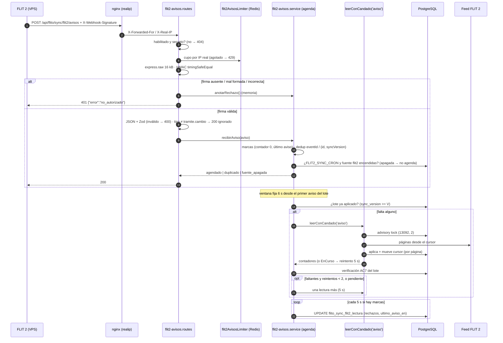

# Diseño full — HU #13632: recibir avisos firmados de FLIT 2 y disparar la lectura

Feature #13613 · Épica #13576 · Módulo FLITO `flito-sync` (habla con FLIT **2**: el feed de `flit2-lectura.service.ts`;
no toca el legacy `soat`/`tramites`). Base `develop` e0dc03fd.
Estado: **Propuesto** (diseño full; sin ADR nuevo, ver «ADR»).

Contrato con FLIT 2 cerrado en la sesión flit-93 (no se rediscute aquí): aviso JSON
`{eventId, tipo:"tramite.cambio", id, syncVersion, fechaUltimoCambio, eliminado, tenantId}`, cabeceras
`X-Webhook-Signature: sha256=<hex>` (HMAC-SHA256 del cuerpo crudo) y `X-Correlation-Id`, una clave por ambiente,
deduplicación por `(id, syncVersion)` y `eventId`, sin marca de envío, reintentos de FLIT 2 a 10 s / 1 min / 10 min
y luego dead-letter.

## Contexto

Hoy FLITO solo se entera de un cambio en FLIT 2 por el cron de 5 min (`flito-sync.cron.ts`,
`correrLecturaFlit2Programada` → `leerConCandado('cron')`). La HU agrega un **disparo**: FLIT 2 avisa, FLITO
responde 200 en milisegundos y agenda la **misma** lectura incremental (`leerConCandado`), sin cambiar su
contrato. El aviso no trae datos del trámite (solo uuids, versión y fecha): **no hay PII en el cuerpo**. El cron
queda como respaldo.

Lo que ya existe y se reutiliza:

| Pieza | Vecino que se calca |
|---|---|
| Webhook público con HMAC sobre el cuerpo **crudo**, `express.raw` antes del `express.json` global | `apps/api/src/modules/firma/webhook.routes.ts` + `app.ts` L199-201 (con una corrección, ver D4) |
| Lectura serializada entre procesos | `leerConCandado` → `conCandadoLectura` (`flit2-candado.ts`, advisory lock `(13092, 2)`) |
| Interruptor por fuente y maestro de entorno | `fuenteHabilitada('flit2')` (`flito-sync-interruptor.service.ts`) + `env.FLIT2_SYNC_CRON` |
| Fila única de estado de la lectura | `flito_sync_flit2_lectura` (id = 1, `flitoSyncFlit2Lectura` en `db/schema/flito-sync.ts`) |
| Limitador con store Redis, llave por IP normalizada y rastro del 429 | `rateLimiter.ts`: `makeStore`, `userOrIpKey`, `frenoConRastro` |
| IP real detrás de los dos saltos | `trust proxy = 1` (`app.ts` L147) + `realip` en `apps/web/nginx.conf.template` (PR #416 / Bug #12953) |
| Flags de entorno con transform explícito (no `z.coerce.boolean`) | `FLIT2_SYNC_CRON`, `FLIT2_ADJUNTOS_ENVIO_HABILITADO` en `config/env.ts` |

Hechos del código que condicionan el diseño:

- `leerConCandado(origen, port?, op?)` devuelve `Flit2LecturaResultado` (**solo contadores**, sin ids) y lanza
  `FuenteApagadaError` (RN-24, antes del candado) o `Flit2LecturaEnCursoError` (candado tomado, no espera).
- `flito_tramites` guarda `id_flit2` (uuid, índice único parcial `uq_flito_tramites_id_flit2`) y `sync_version`
  (bigint); RN-03: con versión guardada ≥ la recibida no se escribe. RN-05: los tombstones nunca se escriben.
- Producción corre `node dist/server.js` (un proceso por contenedor; `ecosystem.config.cjs` tiene una sola app
  sin `instances`). El cluster PM2 o varias réplicas son posibles, no el estado actual: el diseño debe ser
  **correcto** con N procesos y **barato** con 1.
- El `apiLimiter` global (`/api`, 500 / 15 min por IP, ≈0,55/s) se monta en L231, **antes** de todas las rutas.
  Si el aviso pasa por él, una ráfaga legítima de FLIT 2 (actualización masiva) choca con el cupo global antes
  que con el propio.

## Decisiones

### (a) Agrupación y deduplicación con N procesos

**Opción A1 — Memoria por proceso + candado advisory + comprobación en base antes de leer (recomendada).**
Ventana, dedup y lote viven en memoria del proceso que recibe el aviso. Antes de cada lectura se pregunta a
la base si las `(id, syncVersion)` del lote ya están aplicadas (`flito_tramites.sync_version >= V`); si todas lo
están, no se lee.
- Pros: cero tablas y cero escrituras por aviso; el candado ya garantiza que nunca hay dos lecturas a la vez
  (tampoco entre procesos); la comprobación en base convierte en no-op la lectura duplicada de otro proceso o la
  de tras un reinicio (memoria perdida). Con 1 proceso (hoy), es exacta.
- Contras: con N procesos, dos avisos distintos que caen en procesos distintos pueden producir dos lecturas
  **secuenciales** (nunca simultáneas). Son idempotentes (RN-03) y la segunda suele ser una página vacía.
  Un reinicio pierde el lote en memoria: lo recoge el cron (≤ 5 min).
- Esfuerzo: **S**. Riesgos: bajos; el peor caso es una lectura vacía de más.

**Opción A2 — Dedup y ventana en Redis (`SET NX` con TTL + clave de ventana).**
- Pros: una sola ventana por clúster.
- Contras: Redis es opcional en el repo (`makeStore` cae a memoria si no hay); con Redis caído hay que tener
  igual el camino en memoria, así que se escriben dos. Sigue necesitando el candado para la lectura.
- Esfuerzo: **M**. Riesgos: dos caminos de código; fallo de Redis cambia el comportamiento.

**Opción A3 — Bandeja persistente (tabla de avisos con único `(id_flit2, sync_version)` + drenado).**
- Pros: sobrevive a reinicios; dedup exacta entre procesos.
- Contras: una escritura por aviso, tabla con crecimiento y poda, un drenador más (otro timer y candado). El
  cron de 5 min ya cubre el reinicio, así que paga mucho por casi nada.
- Esfuerzo: **L**. Riesgos: superficie de escritura nueva, poda, migración más grande.

**Decisión: A1.** ¿Basta el candado? Para la **corrección** sí: serializa, y `leerIncremental` es idempotente
(guarda optimista del cursor, RN-02; versión, RN-03). Para el **costo** no basta solo: sin la comprobación previa,
cada proceso que tuvo un aviso leería al soltarse el candado. La comprobación en base (una consulta por índice
único, `WHERE id_flit2 = ANY($1)`) es la pieza que cierra eso, y es la misma que usa AC7 (b).

Detalle de la agenda (por proceso, `flit2-avisos.service.ts`):

| Estado | Llega un aviso nuevo (no duplicado) | Vence el temporizador / termina la lectura |
|---|---|---|
| `libre` | entra al lote, arma la ventana **fija** de 6 s desde ese aviso → `ventana` | — |
| `ventana` | entra al lote; no rearma (ventana fija, no deslizante: la latencia queda acotada aunque lleguen avisos sin pausa) | comprobación previa; si todo aplicado → `libre`; si no → `leerConCandado('aviso')` → `leyendo` |
| `leyendo` | entra al lote **siguiente** y marca `pendiente` | verificación AC7 del lote leído (b); si hay `pendiente` o faltantes con reintentos → una sola lectura más; si no → `libre` |

- **AC5:** 5 avisos dentro de la ventana → una lectura. Aviso durante una lectura → `pendiente`, y al terminar
  **exactamente una** lectura más (que también sirve de reintento AC7 si toca: nunca dos).
  La lectura de `pendiente` sale cuando se cumplen los 6 s desde el primer aviso pendiente (si ya pasaron, de
  inmediato): mismo margen para el `StabilityLag` de FLIT 2 que la primera.
- **Dedup (AC6):** dos mapas en memoria con TTL de 15 min: `eventId → vence` y `id → (maxSyncVersion, vence)`.
  Duplicado = `eventId` ya visto, o `syncVersion <= maxSyncVersion` del `id`. Duplicado → 200 sin agendar.
  Una `syncVersion` mayor → agenda. Tope de 10 000 entradas por mapa (expulsión del más viejo, orden de
  inserción de `Map`): solo entran avisos con firma válida, pero el tope evita que un emisor legítimo con un
  error de bucle agote memoria. Tras el TTL, un aviso repetido lo frena la comprobación previa en base.
- **`Flit2LecturaEnCursoError` = pendiente:** el candado lo tiene el cron u otro proceso. Se reintenta cada 5 s
  con la comprobación previa delante (si la otra lectura ya trajo el lote, termina ahí), hasta
  `LIMITE_CRON_MS + 30 s` (lo máximo que otra corrida puede sostener el candado). Agotado → queda para el cron,
  log `info`, sin error.
- **`FuenteApagadaError`** a la hora de leer (se apagó entre la recepción y el disparo) → se descarta el lote,
  log `debug` (calco del cron). Nunca llega al emisor: el 200 ya salió.
- **Otro `Flit2Error`** (sin acceso, rechazado, bloqueado…) → log `warn` con `codigo`, se descarta el lote; el
  cron reintenta en su tick. Cualquier otra excepción → log `error` con `err.name`. La agenda nunca lanza.
- Timers con `unref()`. `detenerAvisosFlit2()` limpia timers y mapas; lo llama `stopFlitSync()` y los tests.

### (b) AC7: cómo saber si el feed «aún no trajo (T, V)»

**Opción B1 — Consultar la base tras la lectura (recomendada).**
`SELECT id_flit2, sync_version FROM flito_tramites WHERE id_flit2 = ANY($lote)`; `(T, V)` está aplicado si
`sync_version >= V`. Los avisos con `eliminado: true` no entran al lote de verificación (RN-05: un tombstone nunca
se escribe; esperar su versión sería esperar algo que no ocurre).
- Pros: `leerConCandado` no cambia; consulta indexada; la misma función sirve para la comprobación previa (a).
  Mide lo que importa: que FLITO **tenga** la versión, venga de esta lectura, del cron o de otro proceso.
- Contras: un ítem que el feed sí trajo pero no se guardó (sin vehículo RN-04, conflicto de radicado RN-03,
  inválido) parece «no traído» y gasta sus 2 reintentos (dos lecturas casi vacías, 5 s y 10 s después) antes de
  quedar para el respaldo, que tampoco lo guardará. Acotado y sin error, tal como pide AC7.
- Esfuerzo: **S**.

**Opción B2 — Observador opcional en `OpcionesLectura` (`alVerItem?(id, version)`).**
- Pros: distingue «el feed lo trajo» de «se guardó»; ahorra los reintentos inútiles de B1.
- Contras: toca `aplicarPagina`/`leerIncremental` (archivo de 682 líneas, tope 800) y el observador ve ítems de
  páginas que luego se revierten (RN-13, rollback por ítem que lanza): habría que diferirlo al commit. Más
  superficie en el corazón de la lectura para ahorrar dos lecturas vacías en un caso raro.
- Esfuerzo: **M**.

**Opción B3 — Ampliar `Flit2LecturaResultado` con las `(id, version)` aplicadas.**
- Contras: cambia el tipo de `@operaciones/shared-types` (lo consume la web: grep obligatorio, regla 7) y rompe
  el «contrato sin cambios» de la HU. Descartada.

**Decisión: B1.** Reintentos: hasta 2, cada uno 5 s después del fin de la lectura anterior, solo con los
faltantes (más lo que haya llegado mientras: se funden, AC5). Tras el segundo, log `info`
`{ faltantes: n }` («queda para el respaldo»), sin ids en el mensaje agregado y sin error.

Único cambio en `flit2-lectura.service.ts`: `OrigenLectura = 'cron' | 'acceso' | 'aviso'` (aditivo; `origen`
solo va al log). La firma y el valor de retorno de `leerConCandado` no cambian; `marcarLecturaIniciada` /
`Terminada` (RN-22) ya cubren cualquier origen, así que el panel muestra `enCurso` también en las lecturas por
aviso.

### (c) Contador de rechazos sin abrir un DoS de escrituras

El riesgo real no es solo el volumen: `rechazos_firma_seguidos` vive en **la fila del cursor**, la misma que
`leerIncremental` bloquea con su `UPDATE … cursor` dentro de la transacción de cada página. Un `UPDATE` por cada
401 compite por ese bloqueo (la propia HU #13237 sacó el interruptor a otra tabla por esta razón).

**Opción C1 — `UPDATE` directo por cada 401, con el limitador delante del HMAC.**
- Pros: trivial; el contador es exacto al instante.
- Contras: hasta `max` escrituras por minuto **por IP** sobre la fila caliente; con muchas IPs, sin techo.
- Esfuerzo: **S**. Riesgo: contención con la lectura bajo ataque distribuido.

**Opción C2 — Acumular en memoria y volcar como mucho cada 5 s (recomendada).**
Estado del proceso: `{ deltaRechazos, reiniciar, ultimoAvisoEn }`. Un 401 suma `deltaRechazos`; una firma válida
pone `reiniciar = true, deltaRechazos = 0`; un cuerpo válido fija `ultimoAvisoEn`. Un temporizador (`unref`) vuelca
con **un** `UPDATE … WHERE id = 1` si hay algo pendiente:
`rechazos_firma_seguidos = CASE WHEN :reiniciar THEN :delta ELSE LEAST(rechazos_firma_seguidos + :delta, 2147483647) END`,
`ultimo_aviso_en = GREATEST(COALESCE(ultimo_aviso_en, :t), :t)`. Si el volcado falla, se conserva lo acumulado
para el siguiente y se loguea `warn` sin valores.
- Pros: techo de **1 escritura / 5 s / proceso** sin importar el tráfico; fuera del camino de la respuesta (el
  200/401 nunca espera a la base por esto); el orden «rechazos → aviso válido → rechazos» se conserva.
- Contras: el contador persistido llega con ≤ 5 s de retraso; con N procesos «seguidos» es aproximado (cada uno
  vuelca su parte). Un crash pierde ≤ 5 s de marcas.
- Esfuerzo: **S**.

**Opción C3 — Columnas en una tabla propia (fuera de la fila del cursor).**
- Pros: elimina la contención de raíz.
- Contras: contradice la nota de la HU (columnas en `flitoSyncFlit2Lectura`) y suma una tabla para dos campos;
  con C2 la contención ya es despreciable.
- Esfuerzo: **S-M**.

**Decisión: C2**, con el limitador **antes** del HMAC (e) y las columnas donde dice la HU. El limitador acota la
CPU del HMAC y los logs; C2 acota la base. Un 429 no suma al contador (no se llegó a mirar la firma).

Semántica de las marcas (técnica, resuelta aquí):
- **Firma válida** (cualquier cuerpo) → contador a 0: la autenticidad del canal quedó probada.
- **Cuerpo válido** (cualquier `tipo`, también duplicados y con la fuente apagada, AC8) → `ultimo_aviso_en`.
- Firma inválida → +1. 404 (deshabilitado) y 429 → no tocan nada.

### (d) Orden de middlewares en `app.ts`

**Opción D1 — Un solo montaje del router de avisos justo antes del `express.json` global (recomendada).**
```
L199  app.use('/api/validacion-identidad/completar', express.json({ limit: '15mb' }));
L200  app.use('/api/webhooks/firma', express.raw({ type: '*/*', limit: '2mb' }));
NUEVO app.use(RUTA_AVISOS_FLIT2, flit2AvisosRoutes);   // PÚBLICA: la confianza es el HMAC (HU #13632)
L201  app.use(express.json({ limit: '5mb' }));
...
L257  app.use('/api/flito/sync/flit2', flit2Routes);   // con authMiddleware — el aviso nunca llega aquí
```
Dentro del router, en este orden: `exigirAvisosHabilitados` (404) → `flit2AvisosLimiter` (429) →
`express.raw({ type: 'application/json', limit: '16kb' })` → `verificarFirma` (401) → parseo + Zod (400) →
`tipo` (200 ignorado) → `recibirAviso` (200). Más un manejador de error **propio** del router (413 por tamaño,
400 por JSON roto del parser) que responde sin `next(err)`.
- Pros: el aviso nunca toca el `apiLimiter` global (la ráfaga legítima de FLIT 2 no se come el cupo de 500/15 min)
  ni el `express.json` global; con el endpoint apagado no se lee ni un byte del cuerpo ni se consulta Redis; el
  limitador va antes de leer el cuerpo. Cumple las dos notas de la HU (antes de `flit2Routes`, `raw` antes del
  `json` global).
- Contras: corre antes del middleware que normaliza `X-Request-Id` (L223). Mitigación: el router no propaga
  errores al `errorHandler` (todo se responde dentro) y loguea solo `X-Correlation-Id` validado como uuid.
- Esfuerzo: **S**.

**Opción D2 — Calco literal del webhook de firma: `raw` en L200 y router junto a `flit2Routes` (L256).**
- Contras: el aviso pasa por el `apiLimiter` global (cupo más estrecho que el propio, un 429 que no es el
  diseñado) y el cuerpo se lee antes de la guarda 404 y del limitador.
- Esfuerzo: **S**.

**Opción D3 — `raw` en L200 y router entre el request-id (L223) y los limitadores (L230).**
- Pros: conserva la normalización de `X-Request-Id` y esquiva el `apiLimiter`.
- Contras: dos puntos de montaje para una ruta; el cuerpo se lee antes de la guarda y del limitador.
- Esfuerzo: **S**.

**Decisión: D1.** Convivencia con el `express.json` global: no lo ve, porque la petición se responde antes. Aun
si un día el router llamara `next()`, `body-parser` salta cuando `req._body` ya es `true` (lo marca
`express.raw`), igual que hoy con `/api/webhooks/firma`. El router **nunca** llama `next()` para su ruta: si lo
hiciera con el endpoint apagado, caería en `flit2Routes` y respondería el 401 del `authMiddleware` en vez del
404 de AC3.

**No copiar del vecino:** `firma/webhook.routes.ts` hace
`Buffer.isBuffer(req.body) ? req.body : Buffer.from(JSON.stringify(req.body ?? {}))`. Re-serializar no
reproduce los bytes firmados. Aquí: cuerpo que no es `Buffer` (p. ej. `Content-Type` distinto de JSON, que
`express.raw` no parsea) → **401** sin evaluar nada más.

### (e) Limitador

Propuesta original (un solo nivel; **reemplazada** por la decisión de dos niveles de más abajo). Nuevo export en `rateLimiter.ts`, reutilizando todas sus piezas:

```ts
flit2AvisosLimiter = rateLimit({
  windowMs: 60_000, max: 120, standardHeaders: true, legacyHeaders: false,
  keyGenerator: userOrIpKey('flit2-avisos:'),          // sin usuario → `flit2-avisos:-<ip /64>`
  handler: frenoConRastro('flit2-avisos'),
  message: { error: 'Demasiadas solicitudes' },
  store: makeStore('rl:flit2-avisos:'),               // compartido entre procesos si hay Redis
});
```

- **IP real (AC9):** `req.ip` ya es la del cliente con `trust proxy = 1` (un salto, dominio de la API) o con el
  `realip` del nginx web (dos saltos, PR #416). No se toca `trust proxy`. AC10 lo comprueba: el `warn` del 429
  (y el log de recepción) debe mostrar la IP del VPS de FLIT, no la del gateway Docker.
- **Cuenta todas las peticiones**, no solo los rechazos: el contrato dice que el anti-replay es dedup + límite.
  120/min por IP es ≈ 2/s; el exceso legítimo es inocuo: FLIT 2 reintenta y, de todos modos, una sola lectura
  trae todos los cambios (el aviso es un timbre, no el dato). Cifra revisable (ver Pendiente humano).
- Llave y store propios: no comparte cupo con ningún otro limitador.

**Decisión de David (reemplaza el límite único de 120/min): dos niveles, ambos por IP real y antes del HMAC.**
El despachador de FLIT 2 (core-notificaciones) manda hasta ~3000 avisos por minuto en operaciones masivas, todos
desde una sola IP; un tope único de 120/min habría rechazado con 429 la mayor parte de una ráfaga legítima. Por eso
se separan las dos funciones del limitador: (1) **tope general** `flit2AvisosLimiter`, que cuenta todas las
peticiones con `FLIT2_AVISOS_LIMITE_MIN` (por defecto **3000**/min), como anti-saturación; y (2) **tope de
fallidos** `flit2AvisosFallidosLimiter`, que solo cuenta las respuestas **401 y 400** con
`FLIT2_AVISOS_LIMITE_FALLIDOS_MIN` (por defecto **120**/min; `skipSuccessfulRequests` + `requestWasSuccessful`):
las 200 (válidos, duplicados, tipo desconocido, fuente apagada) no lo consumen. Excedido cualquiera de los dos,
el 429 sale antes de leer el cuerpo y de verificar la firma, y no toca el contador de rechazos. Los dos cupos son
enteros ≥ 1 validados con Zod en `env.ts`, se leen en cada petición y tienen llave y store propios
(`rl:flit2-avisos:` y `rl:flit2-avisos-fallidos:`).

### Firma (AC2)

- Cabecera: exactamente un valor que case `^sha256=([0-9a-f]{64})$` (hex, insensible a mayúsculas) → si no,
  `mal_formada`; ausente → `ausente`.
- `esperado = createHmac('sha256', env.FLIT2_AVISOS_SECRETO).update(cuerpoCrudo).digest()` (32 bytes) y
  `timingSafeEqual(esperado, Buffer.from(hex, 'hex'))`: tiempo constante sobre buffers de igual longitud por
  construcción.
- 401 con cuerpo fijo `{ "error": "no_autorizado" }`, igual para los tres motivos. Log `warn`
  `{ motivo, ip, correlationId }`: **nunca** cuerpo, cabecera de firma ni secreto.
- Función pura exportada (`verificarFirmaAviso(cuerpo, cabecera, secreto)`) para el test.

### Entorno (AC3)

```ts
// HU #13632: avisos de FLIT 2. APAGADOS por defecto; solo el literal 'true' los enciende (AC3).
FLIT2_AVISOS_HABILITADO: z.string().optional().transform((v) => v === 'true'),
// Clave HMAC compartida con FLIT 2 (una por ambiente, fuera de banda). Nunca se loguea.
FLIT2_AVISOS_SECRETO: z.preprocess(vacioComoAusente, z.string().optional()),
```
- `exigirAvisosHabilitados`: `!HABILITADO || !SECRETO || SECRETO.length < 32` → 404 con el mismo cuerpo que una
  ruta inexistente, sin limitador, sin leer cuerpo, sin agendar. Un secreto corto se trata como ausente (no se
  tumba el arranque: mismo criterio que `FLIT2_ENC_KEY`); al arrancar, un único `warn` «avisos de FLIT 2
  habilitados sin secreto utilizable», sin el valor.
- Solo `'true'` enciende (AC3 literal): a diferencia de los flags vecinos, `'1'` no vale.

## Diagrama de secuencia



## Contrato de endpoints

`POST /api/flito/sync/flit2/avisos` — **público** (sin `authMiddleware`), aprobado por David en la HU; la
excepción queda comentada en `app.ts` y en la cabecera del router. Sin PII en path, query ni cuerpo.

| Petición | |
|---|---|
| `Content-Type` | `application/json` (otro → el cuerpo no se parsea → 401) |
| `X-Webhook-Signature` | `sha256=<64 hex>` sobre los bytes exactos del cuerpo |
| `X-Correlation-Id` | opcional; si es uuid se loguea, si no se ignora; no se devuelve |
| Cuerpo (≤ 16 kB) | `eventId` uuid · `tipo` string 1..64 · `id` uuid · `syncVersion` entero seguro ≥ 0 · `fechaUltimoCambio` ISO-8601 con zona · `eliminado` boolean · `tenantId` opcional, no se valida · campos extra se ignoran |

| Respuesta | Cuándo | Cuerpo |
|---|---|---|
| 404 | `FLIT2_AVISOS_HABILITADO ≠ 'true'` o secreto ausente/corto (AC3) | el genérico de ruta inexistente |
| 429 | cupo por IP agotado (AC9) | `{ "error": "Demasiadas solicitudes" }` + `RateLimit-*` |
| 413 | cuerpo > 16 kB | `{ "error": "aviso_demasiado_grande" }` |
| 401 | firma ausente, mal formada o incorrecta (AC2) | `{ "error": "no_autorizado" }` |
| 400 | firma válida, JSON roto o fuera de esquema (AC4) | `{ "error": "aviso_invalido" }` (sin detalle de Zod) |
| 200 | `tipo ≠ tramite.cambio` (AC4) | `{ "estado": "ignorado" }` |
| 200 | duplicado (AC6) | `{ "estado": "duplicado" }` |
| 200 | maestro o interruptor apagado (AC8) | `{ "estado": "fuente_apagada" }` |
| 200 | aceptado y agendado (AC1) | `{ "estado": "agendado" }` |

El 200 sale antes de cualquier lectura del feed (AC1). Única E/S antes de responder: la consulta del interruptor
(`fuenteHabilitada`, PK de una fila); si falla, se agenda igual (la lectura vuelve a mirarlo, RN-24).

## Modelo de datos (Drizzle)

`apps/api/src/db/schema/flito-sync.ts`, tabla `flitoSyncFlit2Lectura` (dos columnas y un CHECK):

```ts
  // HU #13632 (0244): último aviso válido de FLIT 2 y rechazos de firma seguidos (0 tras una firma válida).
  ultimoAvisoEn: timestamp('ultimo_aviso_en', { withTimezone: true }),
  rechazosFirmaSeguidos: integer('rechazos_firma_seguidos').notNull().default(0),
// en el callback de restricciones:
  rechazosNoNegativo: check('ck_flito_sync_flit2_lectura_rechazos_firma', sql`${t.rechazosFirmaSeguidos} >= 0`),
```

`apps/api/src/db/migrations/0244_flito_sync_flit2_avisos.sql` (a mano, idempotente):

```sql
-- HU #13632: marcas de los avisos firmados de FLIT 2 en la fila de lectura (id = 1, sembrada por la 0215).
ALTER TABLE flito_sync_flit2_lectura ADD COLUMN IF NOT EXISTS ultimo_aviso_en timestamptz;
ALTER TABLE flito_sync_flit2_lectura ADD COLUMN IF NOT EXISTS rechazos_firma_seguidos integer NOT NULL DEFAULT 0;
DO $$ BEGIN
  IF NOT EXISTS (SELECT 1 FROM pg_constraint WHERE conname = 'ck_flito_sync_flit2_lectura_rechazos_firma') THEN
    ALTER TABLE flito_sync_flit2_lectura
      ADD CONSTRAINT ck_flito_sync_flit2_lectura_rechazos_firma CHECK (rechazos_firma_seguidos >= 0);
  END IF;
END $$;
```

Tabla de una fila: el `ADD COLUMN … DEFAULT 0` es instantáneo. Sin índices nuevos: la comprobación del lote usa
`uq_flito_tramites_id_flit2`. No hay PII nueva ni retención que declarar (marca de tiempo y un entero).

## Archivos a crear/modificar

| Archivo | Cambio |
|---|---|
| `apps/api/src/modules/flito-sync/flit2-avisos.routes.ts` | **nuevo**. Cabecera con RN-xx y la excepción de ruta pública. Cadena guarda → limitador → `raw` → firma → Zod → servicio; manejador de error propio (413/400); nunca `next()` |
| `apps/api/src/modules/flito-sync/flit2-avisos.service.ts` | **nuevo**. `verificarFirmaAviso` (pura), `recibirAviso`, `anotarRechazo`, agenda (ventana, dedup, lote, reintentos AC7, EnCurso), `lotePendienteDeAplicar` (consulta B1), volcado de marcas (C2), `detenerAvisosFlit2`. Fábrica con dependencias inyectables (`leer`, `reloj`, `esperar`/timers) para el test. Estimado 250-350 líneas |
| `apps/api/src/modules/flito-sync/flit2-lectura.service.ts` | `OrigenLectura` suma `'aviso'` (1 línea + una línea de RN). Nada más |
| `apps/api/src/modules/flito-sync/flito-sync.cron.ts` | `stopFlitSync()` llama `detenerAvisosFlit2()` (2 líneas). **Ojo:** la HU #13631 (PR #516) también toca este archivo (2 líneas): rebase si se mergea antes |
| `apps/api/src/shared/middleware/rateLimiter.ts` | export `flit2AvisosLimiter` (e) |
| `apps/api/src/config/env.ts` | `FLIT2_AVISOS_HABILITADO`, `FLIT2_AVISOS_SECRETO` (junto a las `FLIT2_*`) |
| `apps/api/src/app.ts` | import + un `app.use` antes de L201 (D1), con comentario |
| `apps/api/src/db/schema/flito-sync.ts` | dos columnas + CHECK |
| `apps/api/src/db/migrations/0244_flito_sync_flit2_avisos.sql` | **nuevo** |
| `apps/api/__tests__/services/flito-sync.flit2-avisos.test.ts` | **nuevo**. Agenda con timers falsos y `leer` inyectado: AC5, AC6, AC7, AC8, EnCurso, marcas C2 |
| `apps/api/__tests__/services/flito-sync.flit2-avisos.routes.test.ts` | **nuevo**. supertest sobre `createApp()`: AC1-AC4, AC9 (429), firma con un byte cambiado, `Content-Type` no JSON, 16 kB, apagado → 404 sin pasar por auth |
| `.env.example` (si lista las `FLIT2_*`) | las dos variables, secreto vacío |

Sin cambios en `packages/shared-types` ni en `apps/web`.

## Impacto en shared-types

Ninguno. `Flit2LecturaResultado` no cambia (B3 descartada). `OrigenLectura` es local al servicio. Si una HU
posterior muestra `ultimo_aviso_en` / `rechazos_firma_seguidos` en el panel de estado, el delta irá en el tipo
del estado de FLIT 2 con su grep en `apps/web` (fuera de esta HU).

## Notas operativas por agente

**backend-agent**
- P1: `npm test -w apps/api -- __tests__/services/flito-sync.flit2-avisos.test.ts __tests__/services/flito-sync.flit2-avisos.routes.test.ts` + `build:api` con el heap (toca `env.ts` y `schema`).
- La agenda es un singleton de módulo: el test usa la fábrica o `detenerAvisosFlit2()` en `afterEach`; nada de
  timers reales colgados (Vitest con `fileParallelism: false`).
- `leerConCandado` se inyecta, no se mockea el módulo entero: AC5 se prueba contando llamadas.
- Logs sin cuerpo ni firma ni secreto. `id` (uuid de FLIT 2) sí puede ir en `debug` (RN-07 ya lo permite);
  el log de «queda para el respaldo» lleva solo el conteo.
- 0244: aplicar **ese** archivo dos veces sobre la BD local (P6) y avisar de que se tocó la BD.
- La 0243 (`permisos_retirar_sync_lanzar`, HU #13631) no toca esta tabla: si #13632 se mergea antes, el runner
  aplica la 0243 después sin conflicto (calcula pendientes por nombre).

**security-agent** (aplica: ruta pública nueva + HMAC + limitador)
- Revisar: tiempo constante, ningún `next()` hacia `flit2Routes`, 404 sin superficie con el endpoint apagado,
  que `FLIT2_AVISOS_SECRETO` no aparezca en logs ni en errores de Zod del arranque.

**db-review-agent** (aplica: `schema.ts` + `migrations/`).

**devops-agent / AC10**
- Por ambiente: `FLIT2_AVISOS_HABILITADO=true` y `FLIT2_AVISOS_SECRETO` (≥ 32 caracteres, el mismo que tenga
  FLIT 2), migración 0244 aplicada **a mano** antes de encender (prod sin job `migrate`).
- Confirmar por qué host entra FLIT 2 (dominio de la API, un salto; o el web, dos saltos con `realip`) y que el
  log muestra la IP del VPS. Aviso de prueba firmado desde el VPS → 200 y una lectura con `origen: 'aviso'` en el
  log; uno con firma alterada → 401 y `rechazos_firma_seguidos = 1` tras ≤ 5 s.

**frontend-agent**: no aplica.

## ADR

No se crea. El precedente de webhook público con HMAC sobre cuerpo crudo ya existe (`/api/webhooks/firma`); la
excepción de ruta pública está aprobada en la HU y queda documentada aquí y en el código. Las decisiones
(a)-(e) son locales a `flito-sync` y no cambian ningún ADR aceptado.

## Riesgos abiertos

1. **Codificación de la clave HMAC:** confirmado con FLIT 2 (en su código): bytes UTF-8 del string tal cual, sin
   decodificar y **sin trim**; firma `sha256=<64 hex en minúsculas>` sobre los bytes exactos del cuerpo, con
   `Content-Type: application/json; charset=utf-8`. Queda en una sola función (`claveHmac`).
2. **Reinicio con lote en memoria:** se pierde; el cron lo recoge en ≤ 5 min. Aceptado (A1).
3. **N procesos:** lecturas secuenciales de más, idempotentes; contador «seguidos» aproximado. Hoy hay 1 proceso.
4. **Ítems que el feed trae pero no se guardan** (sin vehículo, conflicto): gastan 2 reintentos inútiles (B1).
5. **Ráfaga de FLIT 2 > 3000/min** (tope general): 429 a parte de los avisos, que tras sus reintentos terminan en
   el dead-letter de FLIT 2 aunque FLITO sí leyó el cambio. Ruido operativo en FLIT 2, no pérdida de datos.
6. **Conflicto de rebase** con la HU #13631 en `flito-sync.cron.ts` (2 líneas cada una).

## Pendiente humano

Ver HANDOFF.
