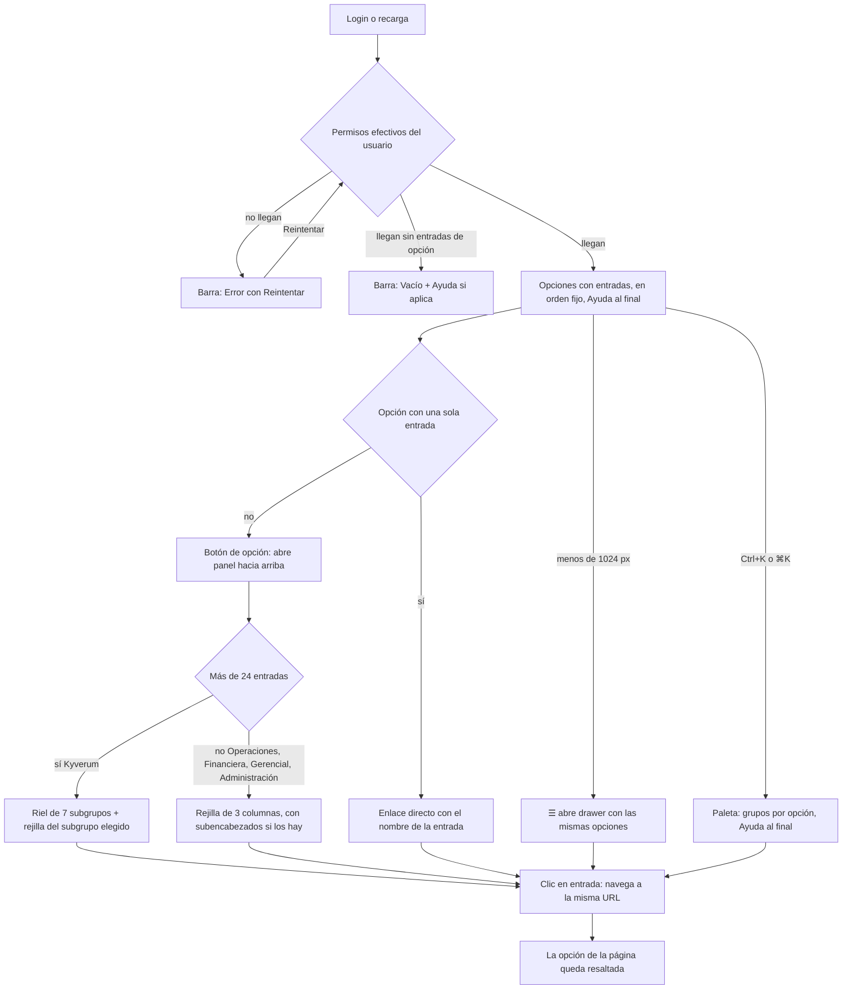

# UX — Menú de FLITO por áreas de la empresa (Épica #14678)

- **Modo:** full (navegación transversal: cambia el agrupamiento de todo el shell).
- **Estado:** **APROBADO por el humano el 24-nov** («Está perfecto»). Incorpora la revisión de Andrés (PO) y el movimiento. Pendientes: dos puntos abiertos sin respuesta de Andrés (§Pendiente).
- **Maqueta de referencia:** `docs/ux/mockups/epica-14678-menu-por-areas.html` (interactiva; no se importa en `apps/web`).
- **Capturas:** `docs/ux/mockups/epica-14678-menu-por-areas-*.png` (lista en §Maqueta).
- **Trazabilidad:** la Épica #14678 no tiene Features ni HUs. Este documento no abre rama ni PR. Ver `docs/arquitectura/epica-14678-menu-por-areas.md` §10.
- **Contexto (no reescrito):** `docs/arquitectura/epica-14678-menu-por-areas.md`, `docs/adr/ADR-0048-navegacion-por-areas.md` (Propuesto), `docs/ux/_principios-flito.md`, `docs/ux/shell-tema-y-responsive.md`, `docs/ux/rediseno-2026/README.md`.
- **Base de código:** el dock real es una **barra inferior flotante** (`FlitNavBar.tsx`). Sus paneles se abren **hacia arriba** (clase `flit-panel-up`).

---

## Contexto y roles

**Qué vino a hacer quien abre el menú:** llegar a la página de su trabajo sin buscarla. Es navegación, no una pantalla de datos.

**Qué es y qué no es el dock:**

- Son **8 áreas de la empresa** de la Épica. Cinco de ellas (Comercial, Diseño, Tecnología, Infraestructura, Producto) están **ocultas** hasta que tengan entradas.
- **Kyverum** y **Administración** **no son áreas de la empresa**. Son **opciones del menú pedidas por el PO**, además de las ocho áreas. Kyverum agrupa los módulos legacy; Administración agrupa la configuración.

| Público | Qué ve | Listón |
|---|---|---|
| Operador interno (`admin`, `financiera`, `proveedor`…) | Las opciones con entradas que su cuadro de permisos le concede | Densidad justificada: cada entrada responde a un trabajo |
| Canal Cliente (`cliente`) | Muy pocas entradas (p. ej. SOAT solicitud) | Sin jerga interna (§Pendiente) |

**Qué no es esta pantalla:** no es una pantalla nueva, no cambia rutas, no cambia qué ve cada rol (criterio del ADR: pérdidas = ganancias = 0), no cambia el mecanismo de la paleta.

**Cambio de densidad, dicho:**

- Dock del admin: hoy **12 botones**. Con el diseño final, **6** (Operaciones, Financiera, Gerencial, Kyverum, Administración, Ayuda). **Mejora.**
- Kyverum concentra **43 entradas**, y su riel de 7 subgrupos evita el scroll (PESV, el mayor, ocupa 503 px de alto). Operaciones baja a **11** entradas en rejilla plana. **Mejora frente a la versión anterior.**

---

## Qué se ve / qué se calla

| Nivel | Qué | Dónde vive |
|---|---|---|
| **Siempre visible** | Las opciones con entradas, en el orden fijo; Ayuda al final; la opción de la página actual resaltada | Barra inferior (escritorio) o ☰ (móvil) |
| **Un clic** | Las entradas de cada opción, con sus subgrupos si los tiene | Panel hacia arriba / drawer |
| **No está** | Áreas sin entradas (Comercial, Diseño, Tecnología, Infraestructura, Producto); nombres internos de permiso (`menu.*`, `pagina.*`); los 12 grupos viejos como botones; iconos nuevos; contadores en la barra; buscador dentro del panel (la paleta ya busca) | — |

**Una acción primaria:** el menú no tiene CTA. La única acción con peso es la entrada que el usuario elige.

---

## Flujo de usuario (Mermaid)



---

## Mapa final del dock

Orden fijo del dock: **Operaciones · Financiera · Gerencial · Kyverum · Administración · Ayuda**. Las áreas ocultas (Comercial, Diseño, Tecnología, Infraestructura, Producto) ocupan su lugar del orden de áreas, entre Financiera y Gerencial, cuando tengan entradas.

| Opción | Entradas | Contenido | Presentación |
|---|---|---|---|
| **Operaciones** | 11 | Vehículos · Clientes y proveedores · Gestión Trámites · Derechos · Revisiones OCR · Bitácora · Comparendos · Logística · Mi ruta · SOAT · Impuestos | Rejilla plana, sin subencabezados |
| **Financiera** | 10 | Las 7 de finanzas (Reporte de costos, Gastos diarios, Bolsas, Tarifas, Servicios adicionales, Comprobantes, Conciliación) + Facturación electrónica · Parametrización · Facturación electrónica · Operación · Integración con Siigo | Rejilla plana |
| **Gerencial** | 9 | Tablero (primero, sin subencabezado) + subencabezado **Torre de Control** (Resumen 360°, Comercial, Operativa, Productos, Logística, Financiera, Explorador, Umbrales y alertas) | Rejilla con subencabezado |
| **Kyverum** | 43 | Riel de 7 subgrupos: **Tránsito** (Bandeja de trámites) 1 · **Flota** 1 · **Mantenimiento** 3 · **PESV** 25 · **RNDC** 5 (incl. Credenciales RNDC) · **LAFT** 7 · **Trámites** (Trámite Digital) 1 | Riel (más de 24 entradas) |
| **Administración** | 7 | Log accesos PII · Usuarios · Roles y permisos · Google Drive · Privacidad y datos · Rendimiento · Organismos STT | Rejilla plana |
| **Ayuda** | 1 | Ayuda FLITO | Enlace directo, último |

**Recuento:** 11 + 10 + 9 + 43 + 7 + 1 = **81 entradas**. Ninguna ruta cambia.

**Glifos** (existentes en el kit, sin iconos nuevos): Operaciones = `tramites`, Financiera = `pesos`, Gerencial = `reportes`, Kyverum = `archivo` (propuesto como glifo existente; confirmar en PR2), Administración = `ajustes` (el de hoy).

**Decisiones que quedan aprobadas:** todo Siigo va a Financiera; Umbrales y alertas va a Gerencial; Clientes y proveedores va a Operaciones. No se reabren.

---

## 1. Barra inferior (escritorio) — caso 1

### Wireframe · 1366 × 768 · admin · reposo

```
┌─ barra superior (FlitTopbar) ────────────────────────────────────────────────────────────┐
│ FLITO                        [ Buscar en la plataforma…                  Ctrl+K ]   Tema   Usuario ▾ │
└──────────────────────────────────────────────────────────────────────────────────────────┘

        ┌─ dock · barra inferior flotante · nav «Navegación principal» · 36 px ──────────────┐
        │ [ Operaciones ]  [ Financiera ]  [ Gerencial ]  [ Kyverum ]  [ Administración ]  [ Ayuda ] │
        └─────────────────────────────────────────────────────────────────────────────────────┘
```

- **Seis botones en una fila**, medidos: **893 px** a 1366 px de ancho y **783 px** a 1024 px. Ninguno se corta, sin scroll.
- A 1280 px o menos, el kit oculta las flechas de desplazamiento del dock (medido en la maqueta). Como el dock cabe, no hacen falta.
- Ayuda es enlace directo (una entrada) y siempre el último.
- Cada panel se despliega **hacia arriba**, sobre la barra. Las opciones de la derecha alinean su panel por la derecha para no salirse de la pantalla.
- Desplazamiento lateral del panel con `--dock-desp` (margen 12 px), igual que hoy.

### Estado activo

Con una página de Kyverum abierta, el botón Kyverum queda resaltado (captura `activa-claro`). Se resalta la opción; la entrada se marca dentro del panel.

---

## 2. Paneles

Todos los paneles tienen **ancho `min(880 px, 100 vw − 64 px)`** y **altura medida** (sin scroll, a 1366 × 768 y 1024 × 768):

| Panel | Forma | Altura medida | Captura |
|---|---|---|---|
| Operaciones | Rejilla plana de 3 columnas (11 entradas) | 266 px | `operaciones-claro` |
| Financiera | Rejilla plana de 3 columnas (10 entradas) | 269 px | `financiera-claro` |
| Gerencial | Rejilla con subencabezado a lo ancho (9 entradas) | 296 px | `gerencial-claro` |
| Kyverum | Riel de 7 subgrupos + rejilla del subgrupo elegido | 380 px | `kyverum-claro` |
| Kyverum · PESV | Riel con PESV elegido (25 entradas) | **503 px** | `kyverum-pesv-claro` |
| Administración | Rejilla plana de 3 columnas (7 entradas) | 220 px | `administracion-claro` |

### Wireframe · Operaciones · rejilla plana

```
  ┌─ panel #flit-navbar-panel-operaciones · 3 col · 266 px ────────────────────────────────┐
  │ Vehículos                 Clientes y proveedores        Gestión Trámites              │
  │ Derechos                  Revisiones OCR                Bitácora                     │
  │ Comparendos               Logística                     Mi ruta                      │
  │ SOAT                      Impuestos                                                  │
  └──────────────────────────────────────────────────────────────────────────────────────────┘
  [ Operaciones ▴ ]  [ Financiera ]  [ Gerencial ]  [ Kyverum ]  [ Administración ]  [ Ayuda ]
```

### Wireframe · Kyverum · riel de subgrupos · PESV elegido

```
  ┌─ panel #flit-navbar-panel-kyverum · riel 196 px + rejilla 3 col · 503 px ──────────────┐
  │ ┌─ riel · tablist vertical ─────┐ ┌─ tabpanel · PESV ──────────────────────────────┐ │
  │ │   Tránsito                  1 │ │ PESV · Inicio          Conductores             │ │
  │ │   Flota                     1 │ │ Capacitaciones         Incidentes              │ │
  │ │   Mantenimiento             3 │ │ Siniestralidad         Checklists              │ │
  │ │ ▌ PESV                     25 │ │ Alcoholimetría         Emergencias             │ │
  │ │   RNDC                      5 │ │ Indicadores de operación Política               │ │
  │ │   LAFT                      7 │ │ Comité                 Plan                   │ │
  │ │   Trámites                  1 │ │ Diagnóstico            Tablero                │ │
  │ │                               │ │ Reportar incidente     Auditorías             │ │
  │ │                               │ │ Comunicaciones         Contratistas           │ │
  │ │                               │ │ Jornadas               Mi jornada             │ │
  │ │                               │ │ Rutas                  Pernocta               │ │
  │ │                               │ │ RACI                   Normativa              │ │
  │ │                               │ │ Retención              …                      │ │
  │ └───────────────────────────────┘ └───────────────────────────────────────────────┘ │
  └────────────────────────────────────────────────────────────────────────────────────────┘
  [ Operaciones ]  [ Financiera ]  [ Gerencial ]  [ Kyverum ▴ ]  [ Administración ]  [ Ayuda ]
```

- Subgrupos del riel: **Tránsito · Flota · Mantenimiento · PESV · RNDC · LAFT · Trámites**, en ese orden.
- **Al abrir sin página activa**, el riel arranca en el **primer subgrupo** (Tránsito). **Con página activa**, arranca en el **subgrupo de esa página** (p. ej. `/pesv/conductores` abre PESV).
- Cada subgrupo es `role="tab"` con su cantidad. Clic, o ↑/↓ con selección automática al mover el foco; Inicio/Fin.
- La rejilla de la derecha es `role="tabpanel"` y muestra solo las entradas del subgrupo elegido.

### Wireframe · Gerencial · subencabezado

```
  ┌─ panel #flit-navbar-panel-gerencial · 3 col · 296 px ─────────────────────────────────┐
  │ Tablero                                                                                │
  │ ────────────────────────────────────────────────────────────────────────────────────  │
  │ Torre de Control                                                                       │
  │   Resumen 360°                  Comercial                  Operativa                   │
  │   Productos                     Logística                  Financiera                  │
  │   Explorador                    Umbrales y alertas                                     │
  └────────────────────────────────────────────────────────────────────────────────────────┘
  [ Operaciones ]  [ Financiera ]  [ Gerencial ▴ ]  [ Kyverum ]  [ Administración ]  [ Ayuda ]
```

- **Tablero** va primero, sin subencabezado. Es la página de inicio (`/`) y la primera entrada de `NAV_ENTRADAS`.
- Los nombres «Comercial», «Logística» y «Financiera» de Torre coinciden con nombres de otras opciones o áreas. El subencabezado «Torre de Control» los desambigua en el panel, y la paleta lo hace con su subtítulo (§Paleta).

### Wireframe · Financiera · Administración

Financiera y Administración usan la misma rejilla plana. El orden de cada una es el de `NAV_ENTRADAS`; no se reordena el array porque `rutaInicio` depende de él.

---

## 3. Drawer móvil · < 1024 px

```
┌─ barra · 390 px ──────────────────────────────────────────────────┐
│ [☰]  FLITO                                              Usuario ▾  │  ☰ aria-label «Abrir menú de navegación»
└───────────────────────────────────────────────────────────────────┘
┌─ drawer · role=dialog · aria-label «Menú de navegación» · mín(88 vw, 360 px) ──────┐
│ Menú de navegación                                             [ Cerrar menú ]      │
│ ──────────────────────────────────────────────────────────────────────────────────  │
│ [ ▾ Operaciones · 11 ]                                  aria-expanded=true          │
│     Vehículos · Clientes y proveedores · Gestión Trámites · …                      │
│ [ ▸ Financiera · 10 ]                                   aria-expanded=false         │
│ [ ▾ Gerencial · 9 ]                                     aria-expanded=true          │
│     Tablero                                                                         │
│     [ ▸ Torre de Control · 8 ]                          aria-expanded=false         │
│ [ ▾ Kyverum · 43 ]                                      aria-expanded=true          │
│     [ ▸ Tránsito · 1 ]                                                              │
│     [ ▸ Flota · 1 ]                                                                 │
│     [ ▸ Mantenimiento · 3 ]                                                         │
│     [ ▾ PESV · 25 ]                                     abierto: página actual      │
│         PESV · Inicio                                                               │
│         Conductores                                                                 │
│         …                                                                           │
│     [ ▸ RNDC · 5 ]                                                                  │
│     [ ▸ LAFT · 7 ]                                                                  │
│     [ ▸ Trámites · 1 ]                                                              │
│ [ ▸ Administración · 7 ]                                aria-expanded=false         │
│ ──────────────────────────────────────────────────────────────────────────────────  │
│   Ayuda                                                                             │
└────────────────────────────────────────────────────────────────────────────────────┘
```

- **Opciones:** acordeón. **Varias abiertas a la vez**, como `FlitSidebar`. Se abre por defecto la de la página actual.
- **Subgrupos plegables** cuando la opción los tiene (Kyverum: 7; Gerencial: Torre de Control). Cada uno muestra su cantidad. Se abre el de la página actual.
- Operaciones, Financiera y Administración van en lista plana dentro de su acordeón.
- Filas de 44 px (objetivo táctil). Sin scroll horizontal. Sin botón primario: es navegación.

---

## 4. Estados (caso 5)

Los estados de error y vacío van **dentro de la cápsula del dock, sin caja propia**. Se descartó el `InlineAlert` cuadrado porque rompe la silueta ovalada de la barra.

| Estado | Dentro de la barra inferior | Drawer (< 1024) | Paleta (Ctrl+K) |
|---|---|---|---|
| **Cargando** | Tres pastillas de esqueleto de 36 px, `data-kit="esqueleto"`, `role="status"`, `aria-label="Cargando menú"`. Captura `cargando-claro`. | Cinco filas de esqueleto de 44 px. | Abre con lo que haya. |
| **Error + reintento** | Ícono de aviso-error + **«No se pudo cargar el menú.»** + botón **«Reintentar»** con la forma de `dock__item` (glifo de reintento que gira una vez al pulsar, texto `--color-action`). Sin opciones. Captura `error-claro` y `error-oscuro`. | Mismo mensaje y botón arriba del drawer. | Sin entradas; el mismo mensaje y «Reintentar». |
| **Vacío (ninguna opción visible)** | Ícono de aviso-info + **«Sin módulos asignados. Pedir acceso al administrador de FLITO.»** + Ayuda al lado, si el usuario la tiene. Sin botón: el siguiente paso es externo. Captura `vacio-claro`. | Mismo texto arriba; Ayuda al final. | Copy de búsqueda vacía (§Paleta). |
| **Lleno** | Seis botones (o los que correspondan) en una fila, con la opción activa resaltada. Captura `reposo-claro`. | Acordeones; Ayuda al final. | Entradas agrupadas por opción (§Paleta). |

**Notificaciones:** ningún estado del menú usa toast. Error y vacío son persistentes, así que van en el lugar donde pasa el problema: la propia barra. Navegar no notifica. Sin error crudo: nunca `e.message` ni códigos.

**Vacío y página de inicio:** si no hay ninguna entrada, la página de inicio sigue siendo la pantalla de acceso denegado existente. Su texto no cambia en esta épica.

---

## 5. Paleta de comandos (caso 7)

Copy real de `CommandPalette.tsx`:

- Título: **«Buscar en la plataforma»**.
- Placeholder: **«Buscar o ir a…»**.
- Vacío: **«No encontramos nada con «…». Prueba con el nombre de un módulo.»**

**Grupos por opción:** Operaciones, Financiera, Gerencial, Kyverum, Administración, y **Ayuda al final**. Las 81 entradas están disponibles.

**Sin consulta:** el subtítulo de cada fila es su **subgrupo** (p. ej. «RNDC», «Torre de Control»). Si la opción no tiene subgrupos, la fila no lleva subtítulo. Captura `paleta-claro`.

**Con consulta:** cada fila muestra **«Opción · subgrupo»** (p. ej. «Kyverum · RNDC»), o solo la opción si no tiene subgrupo (p. ej. «Operaciones»). Captura `paleta-consulta-claro`.

Las palabras clave (`keywords`) no cambian.

---

## 6. Permisos limitados (caso 4)

**Reglas:**

- Una opción **aparece** si el usuario tiene al menos una entrada visible (permiso de página, y `funcion` cuando la entrada la pide, como hoy). Kyverum y Administración siguen la misma regla.
- Una opción **desaparece** si no tiene ninguna. Nunca se muestra deshabilitada ni con candado.
- **Opción con una sola entrada visible → enlace directo con el nombre de la entrada**, como hoy con «General → Tablero». El nombre de la opción no aparece (captura `una-entrada-claro`).
- Opción con dos o más entradas → botón con el nombre de la opción y panel.
- Ayuda sigue su regla propia (`puedeVerAyudaFlito`), sin cambio.
- Un deep link a una página sin permiso sigue en la pantalla de acceso denegado existente.

**Ejemplos:**

| Usuario | Lo que ve | Captura |
|---|---|---|
| `admin` | Operaciones · Financiera · Gerencial · Kyverum · Administración · Ayuda | `reposo-claro` |
| Rol con solo Financiera | Financiera y Ayuda; el resto de opciones desaparece | `limitado-claro` |
| Opción con una entrada | Enlace directo con el nombre de la entrada | `una-entrada-claro` |
| `cliente` con una sola entrada (p. ej. SOAT) | Enlace directo, sin nombre de opción | — (no capturado; ver §Pendiente) |

**Criterio de QA por rol:** para cada rol, el conjunto de rutas (`to`) visibles tras el cambio es **idéntico** al de hoy. Solo cambia la agrupación.

---

## 7. Responsive

- **≥ 1024 px:** barra inferior en una fila (seis botones, 783 px a 1024). Los paneles se abren hacia arriba. Kyverum: riel de 196 px + rejilla de 3 columnas. Resto: rejilla de 3 columnas. Ancho del panel `min(880 px, 100 vw − 64 px)`.
- **≤ 1280 px:** el kit oculta las flechas de desplazamiento del dock (medido). El dock cabe; no se necesitan.
- **< 1024 px** (`useDesdeLg`): sin barra inferior. ☰ en la barra superior abre el drawer (`mín(88 vw, 360 px)`); opciones en acordeón con varias abiertas; subgrupos plegables.
- **360–390 px:** filas de 44 px; sin desborde horizontal.
- **Sin iconos nuevos en ningún ancho.**
- **Desborde del dock:** no hay regla de «Más» en el diseño aprobado. A 1024 px la fila de seis botones cabe. Si aparecen más opciones, la regla queda pendiente de PR2 (§Decisiones).

---

## 8. Movimiento (sección aprobada)

**Regla:** el movimiento es sutil y tiene propósito: orienta, no adorna. Usa **solo tokens del kit**: `--motion-fast` 120 ms, `--motion-base` 180 ms, `--ease` `cubic-bezier(0.2, 0, 0, 1)`. Todo se apaga con `prefers-reduced-motion`.

| Elemento | Movimiento | Duración | Con `prefers-reduced-motion` |
|---|---|---|---|
| **Entrada del dock** al cargar | opacity 0→1 + translateY 12 px → 0 | 240 ms | Sin movimiento; visible al instante |
| **Indicador** del dock (píldora `--kit-hover`) | Se desliza (transform + width) al botón abierto; se desvanece al cerrar. La primera aparición no se desliza | `--motion-base` (180 ms) | Sin desliz; cambio instantáneo |
| **Apertura del panel** | Keyframe `flit-panel-up` (existente en `apps/web/src/index.css`, según la maqueta) | — | Visible al instante |
| **Cierre del panel** | Fundido `panel-salir` antes de ocultarse | `--motion-fast` (120 ms) | Oculto al instante |
| **Entradas del panel** | Escalonadas: opacity + translateY 4 px → 0 (`entrada-suave`), retraso de 14 ms × índice, tope en 12 | `--motion-base` (180 ms) | Sin movimiento |
| **Riel de subgrupos** | Barra azul de 3 px (`--color-action`) que se desliza en vertical hasta el subgrupo elegido (reemplaza la barra fija). Las entradas del subgrupo nuevo entran escalonadas | `--motion-base` (180 ms) | Barra en su sitio; sin desliz |
| **Hover de entrada** | Disco del ícono → `--color-accent-soft` y `scale(1.06)`; nombre → `--color-action` | `--motion-fast` (120 ms) | Sin escala; cambio de color instantáneo |
| **Drawer** | Entra desde la izquierda (translateX −16 px → 0) con velo en fundido | 240 ms | Sin movimiento |
| **Acordeones del drawer** | Altura animada con `grid-template-rows` 0fr → 1fr. Cerrado = `visibility: hidden` (fuera de Tab y del árbol de accesibilidad) | `--motion-base` (180 ms) | Sin animación |
| **Buscador (paleta)** | Velo en fundido; modal con translateY 8 px y `scale(.985)` → normal. Resultados escalonados (12 ms, tope 12) | `--motion-base` (180 ms) | Sin movimiento |
| **Estados** | Aviso con fundido. «Reintentar» gira su ícono una vez (`kit-girar`) al pulsar | 600 ms (girar) | Sin giro |

**Duraciones fuera de token:** 240 ms (entrada del dock y del drawer) y 600 ms (giro de «Reintentar») no son tokens del kit. Se mantienen tal como se aprobaron en la maqueta. Recomendación para PR2: pasarlas a `--motion-base` (180 ms) o declarar su valor propio en el kit. Ver §Decisiones.

**Comportamiento:** clic abre y cierra; **un solo panel abierto a la vez** (en la barra); Esc cierra y devuelve el foco al botón; clic fuera cierra. En el drawer, varias opciones pueden estar abiertas.

---

## 9. Interacción y feedback

| Control | Hover | Foco | Acción | Notificación |
|---|---|---|---|---|
| Botón de opción (barra) | Fondo `--kit-hover` | Anillo 2 px `--color-action` | Abre/cierra su panel | Ninguna |
| Subgrupo del riel | Fondo `--kit-hover` | Anillo 2 px `--color-action` | Muestra su rejilla | Ninguna |
| Entrada (panel, drawer, paleta) | Disco `--color-accent-soft` + nombre `--color-action` | Anillo 2 px `--color-action` | Navega; la opción queda resaltada | Ninguna |
| Subgrupo plegable (drawer) | Fondo `--kit-hover` | Anillo 2 px | Abre/cierra | Ninguna |
| ☰ y «Cerrar menú» | Fondo `--kit-hover` | Anillo 2 px | Abre/cierra el drawer | Ninguna |
| «Reintentar» | Relleno más oscuro del kit | Anillo 2 px | Vuelve a pedir permisos | Éxito: el menú aparece, sin toast. Fallo: el mensaje sigue |

---

## 10. Accesibilidad

### Barra inferior

- Contenedor `<nav aria-label="Navegación principal">`.
- Cada botón de opción: texto visible con el nombre de la opción (es su nombre accesible), `aria-expanded` y `aria-controls="flit-navbar-panel-<opción>"`. El indicador de flecha es decorativo (`aria-hidden`).
- Panel: `id="flit-navbar-panel-<opción>"`, oculto cuando está cerrado.
- Abrir: clic o Enter/Espacio. **No se abre al pasar el puntero.** Clic fuera o Esc cierran; Esc devuelve el foco al botón. Solo un panel abierto a la vez.
- Entradas: `<a>`; la de la página actual lleva `aria-current="page"`.
- Opción con una sola entrada: es un enlace y su nombre accesible es el de la entrada.

### Riel de subgrupos (Kyverum)

- `role="tablist"` con `aria-orientation="vertical"`. Cada subgrupo es `role="tab"` con `aria-selected` y `aria-controls` hacia su panel.
- Roving tabindex: solo el subgrupo seleccionado entra en el orden de Tab. ↑/↓ cambian, Inicio/Fin van al primero y al último.
- La rejilla es `role="tabpanel"` con `aria-labelledby` apuntando a su subgrupo.

### Drawer

- ☰ en la barra superior: `aria-label="Abrir menú de navegación"` y `aria-expanded`.
- Contenedor `role="dialog" aria-modal="true" aria-label="Menú de navegación"`.
- Al abrir, el foco entra en «Cerrar menú». Tab queda atrapado dentro. Esc cierra y el foco vuelve al ☰.
- Acordeones y subgrupos plegables: botón con `aria-expanded` y `aria-controls`.
- El contenido cerrado usa `visibility: hidden`: no entra en Tab ni en el árbol de accesibilidad (verificado en la maqueta).

### Estados

- Error: `role="alert"` en el mensaje, porque aparece al cargar.
- Cargando: `role="status"` y `aria-busy="true"` en el esqueleto.

### Movimiento

- Con `prefers-reduced-motion`, ningún elemento se anima y los paneles aparecen al instante (verificado en la maqueta; QA lo repite en PR2).

### Foco y contraste

- Foco visible en todo control: anillo de 2 px `--color-action` (claro `#1D53FF`, oscuro `#8FB0FF`). No se quita el `outline`.
- Hover sutil: fondo `--kit-hover` (claro `#E1EBFB`, oscuro `#22385E`).
- Opción activa: texto `--color-action` sobre `--color-accent-soft`, más barra inferior de 2 px `--color-action`.

**Ratios calculados a mano por luminancia WCAG desde los hex de `rediseno-2026` §2.1. No están medidos:** los mide `check:contraste` en la maqueta y en PR2.

| Par | Claro | Oscuro | Exigido |
|---|---|---|---|
| Texto primario `#162744` / `#E6F0FF` sobre superficie elevada (`#FFFFFF` / `#162744`) | 14,9:1 | 13,0:1 | ≥ 4,5 |
| Subgrupo `--color-text-tertiary` (`#546B7D` / `#A9B8D4`) sobre fondo de página o tarjeta | 5,6:1 sobre blanco · 4,8:1 sobre `#E6F0FF` | 8,7:1 sobre `#0D1A30` · 5,8:1 sobre `#22385E` | ≥ 4,5 |
| Opción activa `--color-action` (`#1D53FF` / `#8FB0FF`) sobre `--kit-hover` | 4,7:1 | 5,5:1 | ≥ 4,5 |
| Hover de entrada: nombre `--color-action` sobre superficie elevada | 5,6:1 | 6,7:1 (sobre `#162744`) | ≥ 4,5 |
| Texto primario sobre `--kit-hover` (hover de fondo) | 12,4:1 | 10,2:1 | ≥ 4,5 |
| Texto blanco sobre relleno `#1D53FF` (si el botón «Reintentar» usa relleno) | 5,6:1 | mismo relleno | ≥ 4,5 |
| Anillo de foco `#1D53FF` / `#8FB0FF` sobre superficie | 5,6:1 sobre blanco | 8,1:1 sobre `#0D1A30` | ≥ 3 |
| Error `#C10000` / `#FF6B6B` (solo el mensaje de error) | 6,4:1 sobre blanco | 5,4:1 sobre `#162744` | ≥ 4,5 |
| **Opción activa: `--color-accent-soft`** | **no medido** | **no medido** | ≥ 4,5 (pendiente de medir) |

**Separadores:** las líneas entre bloques usan `--color-border`. Según la exención de `shell-tema-y-responsive.md`, no se exige 3:1, pero ningún dato ni estado depende solo de la línea: el subgrupo es texto.

**Tamaños:** barra de 36 px de alto (un solo alto de control). Filas del drawer y del panel de 44 px. Ningún control por debajo de 24 px.

---

## 11. Deep links y URLs

**Confirmado: ninguna URL cambia.** La columna «Ruta» de la matriz es el campo `to` de `navEntradas.ts`, sin cambios en las 81 filas. Lo que cambia es la opción resaltada, el subgrupo del riel y el grupo de la paleta:

| Ejemplo | Qué pasa |
|---|---|
| `/pesv/conductores` | Resalta **Kyverum**; el riel arranca en **PESV**. El panel **no** se abre solo |
| `/flito/torre/comercial` | Resalta **Gerencial** (antes Torre) |
| `/privacy/log-pii` | Resalta **Administración** |
| `/transito/organismos` | Resalta **Administración** (Organismos STT, movido desde Tránsito). La URL no cambia |
| `/siigo/credenciales` | Resalta **Financiera** (Integración con Siigo) |
| `/transito` | Resalta **Kyverum**, subgrupo Tránsito |

| Qué cambia | Qué no cambia |
|---|---|
| La opción resaltada que devuelve `activeSectionForPath` | Ninguna ruta |
| El subgrupo del riel y el grupo de la paleta | Los `keywords` de búsqueda |
| El botón de la barra o del drawer donde aparece la entrada | El orden del array `NAV_ENTRADAS` (lo usa `rutaInicio`) |
| — | La pantalla de acceso denegado para un deep link sin permiso |

---

## 12. Decisiones y descartes

| Tema | Decisión | Por qué |
|---|---|---|
| **Barra inferior flotante** | Aprobada | Es el dock real de `FlitNavBar.tsx` |
| **Seis botones en una fila** | Aprobada | 893 px a 1366 y 783 px a 1024: sin scroll ni corte |
| **Kyverum como opción del menú** | Aprobada | Pedido del PO para los módulos legacy; no es área de la empresa |
| **Administración como opción** | Aprobada | Ya no es subgrupo; es opción propia (Organismos STT incluido, movido por Andrés) |
| **Riel de subgrupos para > 24 entradas** | Aprobada | Kyverum (43): PESV ocupa 503 px sin scroll |
| **Rejilla plana para ≤ 24 entradas** | Aprobada | Operaciones, Financiera, Administración; Gerencial con subencabezado |
| **Columnas CSS con scroll** | Descartado | Desbordaban en horizontal por el `max-height` del kit en `.dock__secciones` |
| **InlineAlert cuadrado para error y vacío** | Descartado | Rompe la silueta ovalada de la barra |
| **Ayuda en un desborde «Más»** | No. Ayuda siempre visible y última | Es utilidad, no opción de la empresa |
| **Regla de pliegue «Más»** | Sin decidir | No hace falta con seis botones que caben a 1024. Si aparecen más, se decide en PR2 |
| **Barra solo iconos** | Descartado | `rediseno-2026` dice «sin modo solo-íconos». `shell-tema-y-responsive.md` (26 ago) pide iconos bajo ~1440 px. Tomo el primero como vigente y conservo «una fila siempre» del segundo. Confirmar en PR2 |
| **Subgrupos en el árbol de permisos** | Descartado (ADR-0048, decisión 6) | Rompe elemento → ítem → acción |
| **Buscador dentro del panel** | Descartado | Patrón nuevo para lo que la paleta ya hace |
| **Icono nuevo por opción** | Descartado | Se reutilizan glifos existentes (§Mapa final) |
| **Contadores en la barra** | Descartado | Adorno. Las cantidades van en subgrupos del riel y del drawer |
| **Apertura de paneles al pasar el puntero** | Descartado | Paneles que aparecen solos; accesibilidad |
| **Áreas vacías visibles** | Descartado | Se ocultan (pedido) |
| **Ayuda in-app (`GRUPOS_ORDEN`)** | No se decide aquí | Taxonomía independiente del menú. Riesgo R9 de la arquitectura. Va a PR3 |
| **Dr. Flit** | Fuera de la matriz | No es entrada de `NAV_ENTRADAS` |
| **Copy del backend «Administración › Integración con Siigo»** | Se anota, no se cambia | Los `siigo.*.service.ts` citan esa ruta. Integración con Siigo está en Financiera. Ajustar en PR2 o en su ticket |
| **Escala 1,06 en el disco del ícono (hover) y en la entrada escalonada** | Aprobada por el humano, registrada como excepción | `_principios-flito.md` prohíbe las escalas como adorno. Se aplica porque el humano la aprobó explícitamente. No es precedente para otros controles |
| **Duraciones 240 ms y 600 ms** | Aprobadas tal cual, fuera de token | Ver §Movimiento. Pasarlas a `--motion-base` o declararlas en el kit en PR2 |
| **Acordeones del drawer abiertos a la vez** | Aprobada | Igual que `FlitSidebar` |

---

## Notas de diseño

- **Colisión de rótulos:** las entradas de Torre «Comercial», «Logística» y «Financiera» coinciden con nombres de otras opciones o de áreas ocultas. El subencabezado «Torre de Control» desambigua en el panel y la paleta lo hace con su subtítulo.
- **Glifos:** todos existentes en el kit. Kyverum = `archivo` es la elección propuesta; confirmar en PR2.
- **Discrepancia de la maqueta:** su nota de glifos cita `ICONO_SECCION` con Gestión, Finanzas y Torre. El marcado real usa `#g-tramites`, `#g-pesos` y `#g-reportes`. Este documento sigue el marcado. Corregir la nota si se reedita la maqueta (no la toco aquí).

---

## Notas para QA

1. Barra inferior a 1366 × 768 y 1024 × 768: seis botones en una fila, sin scroll, sin nombres cortados.
2. Kyverum: riel de siete subgrupos; PESV ocupa 503 px sin scroll; sin página activa arranca en Tránsito; con `/pesv/conductores` arranca en PESV; ↑/↓, Inicio/Fin y clic cambian el subgrupo.
3. Operaciones 266 px, Financiera 269 px, Gerencial 296 px, Administración 220 px: sin scroll. Tablero es la primera línea de Gerencial.
4. Por rol, antes y después: el conjunto de rutas visibles es idéntico.
5. Opción con una sola entrada: enlace directo con el nombre de la entrada (`una-entrada-claro`).
6. Rol solo con Financiera: ve Financiera y Ayuda; el resto de opciones desaparece (`limitado-claro`).
7. Estados dentro de la cápsula: error con «Reintentar» (el ícono gira una vez), vacío con Ayuda al lado, cargando con tres pastillas. Ninguno con caja cuadrada.
8. Drawer < 1024 px: varias opciones abiertas a la vez; subgrupos plegables con cantidad; abre el de la página actual; Ayuda al final; Esc cierra; el foco vuelve al ☰; el contenido cerrado no entra en Tab.
9. Movimiento: con `prefers-reduced-motion` no hay animación y los paneles aparecen al instante.
10. Paleta: 81 entradas en grupos por opción; Ayuda al final; copy vacío «No encontramos nada con «…». Prueba con el nombre de un módulo.»; con consulta, «Opción · subgrupo».
11. Claro y oscuro: `check:contraste` verde en los dos temas, con `--color-accent-soft` medido (hoy no medido).

---

## Pendiente

Sin respuesta de Andrés; no se dan por aprobados:

- **Nombre interno «Operaciones» para el canal Cliente.** Un cliente con dos o más entradas en Operaciones vería el nombre de una organización interna.
- **Logo de la barra → Tablero.** Tablero es la primera línea de Gerencial, y volver a él desde otra página cuesta dos clics. No está decidido si la marca FLITO de la barra vuelve a Tablero (no verificado en el código de la barra).

---

## Maqueta y capturas

- **Maqueta de referencia (interactiva):** `docs/ux/mockups/epica-14678-menu-por-areas.html`.
- **Capturas** (`docs/ux/mockups/`):
  - Barra y estados: `epica-14678-menu-por-areas-reposo-claro.png`, `…-reposo-1024-claro.png`, `…-activa-claro.png`, `…-cargando-claro.png`, `…-error-claro.png`, `…-error-oscuro.png`, `…-vacio-claro.png`
  - Paneles: `…-operaciones-claro.png`, `…-financiera-claro.png`, `…-gerencial-claro.png`, `…-gerencial-oscuro.png`, `…-kyverum-claro.png`, `…-kyverum-pesv-claro.png`, `…-kyverum-pesv-oscuro.png`, `…-administracion-claro.png`
  - Permisos: `…-limitado-claro.png` (rol solo Financiera), `…-una-entrada-claro.png`
  - Paleta: `…-paleta-claro.png`, `…-paleta-consulta-claro.png`
  - Drawer: `…-drawer-movil-claro.png` (390 px)
- **Formato de captura del contrato:** 1366 × 768 y 375 × 812. Las de 1024 y 390 son comprobaciones adicionales.

---

## HANDOFF

```
HANDOFF
  Modo: full
  Resultado: CON-OBSERVACIONES
  Entrega: docs/ux/epica-14678-menu-por-areas.md
  Oficio: primaria única (no aplica: navegación, sin CTA) | jerarquía dicha | vacío con siguiente paso | responsive dicho | feedback dicho | notificación elegida (estados persistentes dentro de la barra, sin toast) | movimiento con propósito, con reduced-motion
  Densidad: mejora en la barra (12 botones a 6); Kyverum (43) con riel y sin scroll; Operaciones baja a 11 entradas
  Pantallas: barra inferior, cinco paneles (Operaciones, Financiera, Gerencial, Kyverum y Kyverum·PESV, Administración), drawer móvil, paleta, estados dentro de la barra | Requerimientos nuevos de datos: ninguno
  Reconocimiento: 1 llamada en esta actualización (Glob de capturas). No se releyeron los documentos de contexto ni navEntradas.ts ni la maqueta.
  Aprobación humana: diseño final aprobado el 24-nov («Está perfecto»)
  Abiertos sin respuesta de Andrés: nombre interno «Operaciones» para el canal Cliente · logo de la barra → Tablero
  Movimiento: duraciones 240 ms (dock, drawer) y 600 ms (giro de Reintentar) fuera de token; decidir en PR2 si pasan a --motion-base o se declaran en el kit
  Excepción de principios: escala 1,06 en el disco del ícono y entradas escalonadas. El oficio la prohíbe como adorno; aprobada por el humano, sin precedente
  Contraste: --color-accent-soft no medido (gate pendiente)
  Verificar en PR2: existencia de tokens --motion-fast, --motion-base, --ease y del keyframe flit-panel-up en el kit; glifo archivo para Kyverum
  Discrepancia de maqueta: nota de glifos cita ICONO_SECCION; el marcado usa tramites/pesos/reportes (el documento sigue el marcado)
  Mockup: aprobado (docs/ux/mockups/epica-14678-menu-por-areas.html) | 20 capturas listadas en el documento
  Siguiente: frontend-agent (PR2) con barra inferior, paneles, riel, movimiento y estados, tras resolver los dos abiertos; tech-lead-agent crea Feature y HUs bajo la Épica antes de cualquier PR
```

---

## Lista de cambios frente a la versión anterior

1. Mapa final del dock: Operaciones (11, plana) · Financiera (10) · Gerencial (9) · Kyverum (43, riel de 7 subgrupos) · Administración (7, opción propia) · Ayuda (1). Total 81; ninguna ruta cambia.
2. Kyverum y Administración se describen como opciones del menú pedidas por el PO, no como áreas de la empresa.
3. Se eliminan las propuestas P1–P8: Andrés las revisó, y lo que no cambió se da por aprobado.
4. Se añade la sección de movimiento, con tokens del kit y reduced-motion. Se declaran las duraciones fuera de token (240 ms, 600 ms).
5. Medidas actualizadas: dock de seis botones (893 px / 783 px) y alturas de paneles (266, 269, 296, 380, 503 y 220 px), sin scroll.
6. Drawer: varias opciones abiertas a la vez, como `FlitSidebar`; Kyverum y Gerencial con subgrupos plegables.
7. Paleta: grupos por opción, incluido Kyverum y Administración; subtítulo por subgrupo o «Opción · subgrupo».
8. Accesibilidad: roles del riel, `visibility: hidden` en el drawer, reduced-motion, contraste actualizado.
9. Deep links: ejemplos nuevos, como `/pesv/conductores` (resalta Kyverum) y `/transito/organismos` (resalta Administración).
10. Lista de capturas actualizada a los 20 PNG reales.
11. Se registra la excepción de la escala 1,06 frente al oficio, por aprobación explícita del humano.
