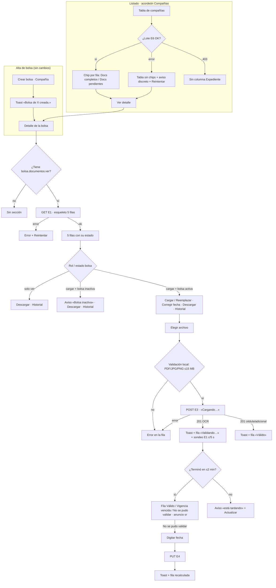

# UX: expediente documental de la compañía (HU #13892) y chip del listado (HU #13893)

Feature #13888 · Épica #13407 · Módulo **FLITO** `flito-bolsas-documentos` (`/api/flito/bolsas-documentos`, ADR-0028).
No es el legacy `soat`/`liquidacion`.
Modo **full**: no hay ruta ni `PageSlug` nuevos, pero son dos piezas nuevas, la sección y el chip, y no hay spec previa en `docs/ux/`.

**Base:** `docs/ux/flito-bolsas.md` (HU #13901, rama `HU/13901-davidchica-bolsa-compania-crear-inactivar-ui`). Esa spec reserva los dos puntos de montaje (su AC8) y aquí no se rediseña:
- `BolsaDetalleCompania.tsx` → `{/* #13407: <ExpedienteDocumental companiaId={bolsa.companiaId} /> */}`, al final de `RegionDesplazable`.
- `BolsasTablero.tsx` → celda `{/* #13407: <ChipExpediente companiaId={fila.companiaId} /> */}` de `TablaCompanias`.

**Análogas del mismo público (operador interno):**
1. `docs/ux/flito-soat-documentos-adicionales-detalle-cargar-eliminar.md` + `components/flito/soat/DocumentosAdicionalesLista.tsx`: sección de documentos **dentro de un modal de detalle**. De ahí salen el editor en línea (sin modal sobre modal), `BOTON_ICONO` para descargar, la descarga como blob con toast de error y «Reintentar», y el `Esc` con `stopPropagation`.
2. `components/flito/soat/DetalleSoat.tsx` («Cargar factura»): **un solo archivo** con `<label>` y un `input type=file` `sr-only`, con el foco visible por `has-[input:focus-visible]`. Es el mismo patrón que aquí: una carga por documento, sin selector múltiple.

**Tratamiento:** **tú**, igual que el detalle de bolsa vecino («No pudimos cargar la bolsa. Intenta de nuevo.», «Reactiva la bolsa primero.»).

---

## Contexto y roles

**Quién la usa:** personal FLIT, Financiera o Admin, con las funciones `bolsas.documentos.ver` / `bolsas.documentos.cargar`. Ningún rol las trae por seed: se conceden en el panel de roles.
**Nunca el canal Cliente:** las rutas llevan `soloSinEnlace`, y la proyección Cliente de `flito-bolsas.md` no tiene el bloque #13407.

**Qué vino a hacer, en cada visita:**

| Superficie | El trabajo de esa visita |
|---|---|
| Listado (chip) | Barrer las compañías y ver **cuáles tienen papeles por poner al día**, sin abrir una por una |
| Detalle (sección) | Ver **qué documento falta o está mal** y arreglarlo: cargar o reemplazar el archivo, o digitar la fecha que el OCR no leyó. A veces, descargar uno para enviarlo o revisarlo |

**Qué no es:**
- No es un gestor documental: no hay borrar, ni renombrar, ni varios archivos por tipo, ni comentarios.
- No es la ficha de la compañía en `clients`.
- No tiene página propia ni `PageSlug`.
- No cambia nada del dinero de la bolsa.

---

## Decisión: ¿el expediente va en la creación? (AC2 de #13892)

**Recomendación: no se toca el formulario. El AC2 se cumple con la sección en el detalle que se abre solo justo después de crear.**

Por qué:
1. **Ya ocurre así.** En `FlitoBolsas.tsx`, `onGuardada` cierra el alta y llama a `setDetalle({ entrada: { bolsaId: b.id } })`. Después de «Crear bolsa», el operador cae en el detalle de esa bolsa y ahí está el expediente. Para él es un solo flujo, sin pasos extra.
2. **El formulario no tiene hueco.** `flito-bolsas.md` lo declara («Sin sección de documentos: el formulario **no** tiene hueco para documentos»). La carga necesita la bolsa existente, porque E3 responde 409 sin ella, y el OCR es asíncrono. Meter 5 cargas en el alta obligaría a un wizard de dos pasos, o a subir archivos de una bolsa que todavía no existe, y a rehacer la pantalla de otra sesión (flito-df).
3. **Una bolsa recién creada no tiene movimientos.** El detalle es corto, así que la sección se ve sin desplazarse de más. No hace falta llevar el foco ni el scroll hasta ella.
4. **La primaria del alta sigue siendo una sola** («Crear bolsa»). Los documentos no compiten con ella.

**Cómo debe redactarlo el QA del AC2:** «Al crear una bolsa de compañía, el detalle que se abre muestra el expediente con los 5 documentos en Pendiente y, con `.cargar`, la acción Cargar en cada uno».
Si el PO exige leer «en la creación» al pie de la letra, esa decisión es suya (ver Decisiones y descartes). Esta spec no la implementa.

---

## Qué se ve / qué se calla

### Dos disposiciones consideradas para la sección

| | **A · Lista de 5 filas (elegida)** | B · Rejilla de 5 tarjetas |
|---|---|---|
| Forma | Una `FlitCard` con encabezado y resumen; debajo, una fila por documento: nombre · chip de estado · una línea de detalle · acciones | Cinco tarjetas en `sm:grid-cols-2 lg:grid-cols-3`, cada una con su chip y sus botones |
| Barrido | Vertical, en la misma columna que el extracto y los movimientos del detalle | En zigzag. 5 tarjetas dejan una fila coja |
| Editor en línea (fecha, historial) | Se abre bajo la fila, a todo el ancho | Se abre dentro de una tarjeta de un tercio de ancho y queda apretado |
| Móvil | Las filas ya apilan | Igual que A, pero con más bordes y sombras |

**Se elige A.** Son cinco elementos de la misma naturaleza. Lo que el operador busca es **cuál no está en verde**, y eso se lee mejor en una columna que en una rejilla. El detalle de bolsa ya es una pila vertical de bloques (extracto → acciones → movimientos), así que una rejilla de tarjetas sería un patrón distinto metido al final del mismo modal.

### Jerarquía

1. **Siempre visible:**
   - el **estado del expediente**, con el mismo chip que el listado («Docs completos» / «Docs pendientes») y «{n} de 4 principales válidos»;
   - por documento: **nombre**, **chip de estado** y **la línea que explica el estado**, con la fecha de expedición y su vencimiento, o el motivo;
   - la acción de esa fila, **Cargar** o **Reemplazar**, solo con `.cargar` y la bolsa activa.
2. **A un clic:**
   - el **historial de versiones**, en un desplegable en línea;
   - el **editor de fecha** (también en línea);
   - la **descarga**, con un botón de icono.
3. **No está:**
   - el nombre original del archivo (no se guarda, D7) ni el tamaño;
   - el detalle del OCR (intentos, «leído/sin_fecha/fallido») y el «origen OCR» como dato, que solo aparece si la fecha es **manual** («digitada por…»);
   - cualquier PII de la cédula (es un archivo, no se muestra contenido).

### Una primaria

**Esta sección no añade primaria.** El detalle ya tiene la suya: la acción de dinero de `BolsaAcciones` con la bolsa activa, o «Reactivar bolsa» con la inactiva. Todo lo de aquí es secundario: `flitBtnSecondarySm`, `flitBtnSecondarySmToggle` para el historial y `BOTON_ICONO` para descargar. Dentro del editor de fecha, «Guardar fecha» manda por **posición** (último a la derecha) y no por peso, igual que en la análoga SOAT.

### Densidad

- Detalle: +1 bloque al final (ya reservado). Cada fila tiene **como máximo 3 controles** (Cargar/Reemplazar · ⬇ · Historial) más el enlace «Corregir» junto a la fecha.
- Listado: +1 columna estrecha, ya reservada. **Aliviada respecto a un rótulo largo:** la cabecera visible es «Expediente» (ver Chip).

---

## Flujo de usuario



---

## Pantalla 1: sección «Documentos» (`<ExpedienteDocumental />`)

> **Título decidido por David 2026-10-24: Documentos.** El título visible de la sección (h3 y nombre de la región) es «Documentos», literal del AC1 de #13892, y no «Expediente documental». El componente y sus archivos conservan el nombre `ExpedienteDocumental`. La cabecera de la columna del listado (#13893) no cambia con esta decisión.

**Props recomendadas:** `companiaId: number` y **`activa: boolean`**. `ContenidoBolsa` ya tiene `bolsa.activa`; si se pasa, la sección no hace una petición más ni adivina el 409. La línea de montaje queda así: `<ExpedienteDocumental companiaId={companiaId} activa={bolsa.activa} />`. Va a la carpeta del ADR: `components/flito-bolsas-documentos/`.

### Wireframe: escritorio (≥ `lg`), lleno, con `.cargar` y la bolsa activa

```
║ [ Movimientos — sin cambio ]                                                         ║
║                                                                                      ║
║ ┌──────────────────────────────────────────────────────────────────────────────────┐ ║
║ │ Documentos                                    ● Docs pendientes · 2 de 4 válidos │ ║
║ │ Documentos de vinculación de la compañía. Vencen 30 días después de expedidos.   │ ║
║ │ ──────────────────────────────────────────────────────────────────────────────── │ ║
║ │ Cámara de Comercio                ● Válido                                       │ ║
║ │ Expedida el 10 oct 2026 · vigente hasta el 9 nov 2026  [Corregir]                │ ║
║ │                                          [ ⬆ Reemplazar ]  [⬇]  [ Historial ▾ ]  │ ║
║ │ ──────────────────────────────────────────────────────────────────────────────── │ ║
║ │ RUT                               ● Vigencia vencida                             │ ║
║ │ Expedido el 2 sep 2026 · venció el 2 oct 2026. Carga uno expedido hace menos     │ ║
║ │ de 30 días.  [Corregir]                                                          │ ║
║ │                                          [ ⬆ Reemplazar ]  [⬇]  [ Historial ▾ ]  │ ║
║ │ ──────────────────────────────────────────────────────────────────────────────── │ ║
║ │ Cédula del representante legal    ● Válido                                       │ ║
║ │ Cargada por Ana Pérez el 12 oct 2026, 14:32                                      │ ║
║ │                                          [ ⬆ Reemplazar ]  [⬇]  [ Historial ▾ ]  │ ║
║ │ ──────────────────────────────────────────────────────────────────────────────── │ ║
║ │ Certificado bancario              ● Validando…                                   │ ║
║ │ Cargado por Ana Pérez hace un momento · leyendo la fecha de expedición.          │ ║
║ │                                          [ ⬆ Reemplazar ]  [⬇]  [ Historial ▾ ]  │ ║
║ │ ──────────────────────────────────────────────────────────────────────────────── │ ║
║ │ Documento adicional (opcional)    ● Pendiente                                    │ ║
║ │ Sin cargar.                                                                      │ ║
║ │                                                               [ ⬆ Cargar ]       │ ║
║ └──────────────────────────────────────────────────────────────────────────────────┘ ║
╚══════════════════════════════════════════════════════════════════════════════════════╝
```

Disposición de cada fila: en ≥ `sm` es una rejilla `grid-cols-[1fr_auto]`. Nombre + chip y la línea de detalle van a la izquierda; las acciones, a la derecha y alineadas arriba. El dibujo las pone debajo solo para que quepa en ASCII. Las filas se separan con un borde `--flit-border-soft`, sin tarjetas internas.

### Wireframe: historial desplegado (bajo la fila)

```
║ │ RUT                               ● Vigencia vencida                             │
║ │ Expedido el 2 sep 2026 · venció el 2 oct 2026. …   [ ⬆ Reemplazar ] [⬇] [Historial ▴]│
║ │ ┌ Historial del RUT ───────────────────────────────────────────────────────────┐ │
║ │ │ Versión 3 · vigente                                                      [⬇] │ │
║ │ │ Cargada por Ana Pérez el 2 oct 2026, 09:10 · expedido el 2 sep 2026          │ │
║ │ │ Versión 2 · reemplazada el 2 oct 2026                                    [⬇] │ │
║ │ │ Cargada por Luis Gómez el 1 ago 2026, 16:40 · expedido el 28 jul 2026        │ │
║ │ │   (fecha digitada por Luis Gómez el 1 ago 2026)                              │ │
║ │ │ Versión 1 · reemplazada el 1 ago 2026                                        │ │
║ │ │ Cargada por Luis Gómez el 3 mar 2026, 11:05 · archivo eliminado por          │ │
║ │ │ retención                                                                    │ │
║ │ └──────────────────────────────────────────────────────────────────────────────┘ │
```

- Contenedor `rounded-lg border` `--flit-border-input` (el de la análoga), `aria-labelledby` hacia «Historial del {documento}».
- Orden: de la más reciente a la más antigua, que es lo que trae E2.
- Las versiones purgadas (`archivoDisponible:false`) **no** tienen ⬇ y dicen «archivo eliminado por retención».
- Solo hay un historial abierto a la vez. Abrir otro cierra el anterior.

### Wireframe: editor de fecha en línea (sustituye la línea de detalle de esa fila)

```
║ │ Certificado bancario              ● No se pudo validar                           │
║ │ ┌──────────────────────────────────────────────────────────────────────────────┐ │
║ │ │ Fecha de expedición                                                          │ │
║ │ │ [ 2026-10-20  📅 ]                                                           │ │
║ │ │ Queda registrado que la digitaste tú. Vence 30 días después.                 │ │
║ │ │                                          [ Cancelar ]  [ Guardar fecha ]     │ │
║ │ └──────────────────────────────────────────────────────────────────────────────┘ │
```

### Wireframe: bolsa inactiva (cualquier rol)

```
║ │ Documentos                                    ● Docs pendientes · 3 de 4 válidos │
║ │ Documentos de vinculación de la compañía. Vencen 30 días después de expedidos.   │
║ │ ┌ ⓘ La bolsa está inactiva: puedes consultar y descargar los documentos, pero  ┐ │
║ │ │   no cargarlos ni cambiar fechas. Reactiva la bolsa para actualizarlos.      │ │
║ │ └──────────────────────────────────────────────────────────────────────────────┘ │
║ │ RUT                               ● Vigencia vencida                             │
║ │ Expedido el 2 sep 2026 · venció el 2 oct 2026.                [⬇] [Historial ▾]  │
```

- Aviso con `role="status"`, la misma forma que `aviso-inactiva` del detalle: borde `--flit-border-soft`, fondo `--flit-bg-app` y tinta `--flit-text-secondary`. **No es rojo ni `role="alert"`**: no es un error, es una regla.
- Sin `bolsas.bolsa.inactivar`, la última frase es: «Para actualizarlos, alguien con permiso tiene que reactivar la bolsa primero.» Calca el aviso vecino.
- **No se pintan** «Cargar», «Reemplazar» ni «Corregir»: no están en el DOM, tampoco deshabilitados. La línea de «Vigencia vencida» pierde la frase «Carga uno…».

### Wireframe: móvil (360–390 px)

```
┌ Documentos ──────────────────────────┐
│ ● Docs pendientes                    │
│ 2 de 4 principales válidos           │
│ Documentos de vinculación de la      │
│ compañía. Vencen 30 días después de  │
│ expedidos.                           │
│ ──────────────────────────────────── │
│ Cámara de Comercio                   │
│ ● Válido                             │
│ Expedida el 10 oct 2026 · vigente    │
│ hasta el 9 nov 2026  [Corregir]      │
│ [ ⬆ Reemplazar ] [⬇] [ Historial ▾ ] │
│ ──────────────────────────────────── │
│ RUT                                  │
│ ● Vigencia vencida                   │
│ …                                    │
└──────────────────────────────────────┘
```

### Estados (4) + los de la fila

| Estado de la sección | Qué se ve | Copy |
|---|---|---|
| **Cargando** (E1 en vuelo) | Encabezado real («Documentos») + esqueleto de **5 filas**: barra de nombre, barra de chip, barra de detalle, fondo `--flit-bg-app`, como `EsqueletoBolsa`. `role="status"` `aria-label` | «Cargando el expediente» (sr) |
| **Error** (red, 5xx) | Solo la sección. El resto del detalle sigue usable. `role="alert"` `--flit-danger-ink` + «Reintentar» (`flitBtnSecondarySm`, relee E1) | «No pudimos cargar los documentos de la compañía. Intenta de nuevo.» |
| Error **404** (compañía inexistente) | Igual, sin Reintentar | «No encontramos la compañía de esta bolsa. Cierra el detalle y vuelve a abrirlo.» |
| Error **403** | **La sección no se pinta** (es lo mismo que no tener `.ver`) | — |
| **Vacío** (los 5 en `pendiente`) | Las 5 filas en Pendiente (el vacío también muestra qué falta) + una línea bajo el subtítulo | `.cargar` + activa: «Todavía no hay documentos. Carga los cuatro principales para dejar el expediente completo.» · Solo `.ver`: «Todavía no hay documentos. Alguien con permiso de carga tiene que subirlos.» · Inactiva: «Todavía no hay documentos. Reactiva la bolsa para cargarlos.» |
| **Lleno** | Wireframe de arriba | — |

**Resumen del encabezado:** el chip es el mismo componente que el del listado (§ Chip). Al lado, «{n} de 4 principales válidos», en `--flit-text-secondary`. Si `completo`, el texto es «Los 4 principales están válidos». El adicional nunca cuenta.

**Estado por documento** (chip `StatusChip` + línea de detalle `text-xs` `--flit-text-secondary`):

| Estado DTO | Chip (tono · texto) | Línea de detalle |
|---|---|---|
| `pendiente` | `neutral` · «Pendiente» | «Sin cargar.» En el adicional, el nombre ya dice «(opcional)» |
| `validando` | `active` · «Validando…» | «Cargado por {nombre} el {fechaHora} · leyendo la fecha de expedición.» |
| `valido` (con vigencia) | `success` · «Válido» | «Expedido el {fecha} · vigente hasta el {venceEl}» + «[Corregir]». Si la fecha es manual, una segunda línea: «Fecha digitada por {por} el {en}.» |
| `valido` (cédula / adicional) | `success` · «Válido» | «Cargada por {nombre} el {fechaHora}» (concuerda con el género del documento: «Cargada» para cédula, «Cargado» para documento) |
| `vencido` | `warning` · «Vigencia vencida» | «Expedido el {fecha} · venció el {venceEl}.» + con `.cargar` y activa: « Carga uno expedido hace menos de 30 días.» + «[Corregir]» |
| `no_validado` | `warning` · «No se pudo validar» | con `.cargar` y activa: «No pudimos leer la fecha de expedición. Digítala o carga un archivo más legible.» + «[Digitar fecha]» · sin esas condiciones: «No pudimos leer la fecha de expedición.» |

- El género del nombre manda en «Expedida/Expedido»: Cámara de Comercio y Cédula → femenino; RUT y Certificado → masculino. Se resuelve con un mapa de etiquetas por tipo en `lib`, sin lógica dispersa.
- Etiquetas: «Cámara de Comercio», «RUT», «Cédula del representante legal», «Certificado bancario», «Documento adicional (opcional)».
- Fechas con el formateo del módulo (`fechaDia` / `fechaHora` de `lib/bolsas`). `venceEl` viene del API: **no se calcula en el front** (D2).
- `Vigencia vencida` y `No se pudo validar` comparten el tono `warning` (es el naranja del chip del listado). El color nunca es la única señal: el texto los distingue.

### Acciones y validaciones

**Cargar / Reemplazar** (`.cargar` + `activa`):
- Patrón de `DetalleSoat` «Cargar factura»: un `<label class={flitBtnSecondarySm + has-[input:focus-visible]:outline…}>`, con icono `Upload` y el texto «Cargar» (si `pendiente`) o «Reemplazar» (si hay vigente). Dentro, `<input type="file" class="sr-only" accept=".pdf,.jpg,.jpeg,.png,application/pdf,image/jpeg,image/png">`, **sin** `multiple`.
- `aria-label` del input: «Cargar {documento}» / «Reemplazar {documento}».
- **Sin confirmación al reemplazar:** la versión anterior no se pierde, queda en el historial. El toast lo dice.
- Validación local antes del POST, con el error en la fila (`role="alert"`, `--flit-danger-ink`, bajo la línea de detalle). El error se borra al elegir otro archivo:
  - formato: «Ese formato no se acepta. Usa PDF, JPG o PNG.»
  - tamaño: «El archivo pesa {x} MB. El máximo es 15 MB.» (`TAMANO_MAX_DOCUMENTO_BOLSA`, sin literal).
- Ocupado: candado por `ref`. El botón pasa a «Cargando…» con `aria-busy` y el input `disabled`. **Solo esa fila** queda ocupada: las demás se pueden usar, y cada tipo admite su propia carga.
- Envío: `cargarDocumentoBolsa(companiaId, tipo, archivo)` en `lib/api.ts` (multipart, campo `archivo`).

| Resultado E3 | Qué pasa | Notificación (copy) |
|---|---|---|
| 201, tipo con OCR (primera carga) | La fila toma el DTO (`validando`) sin releer. Arranca el sondeo | Toast éxito: «{Documento} cargado. Estamos leyendo la fecha de expedición.» («cargada» si el nombre es femenino) |
| 201, tipo con OCR (reemplazo) | Igual | Toast: «{Documento} reemplazado. La versión anterior queda en el historial; estamos leyendo la fecha de expedición.» |
| 201, cédula / adicional | Fila en `valido` | Toast: «{Documento} cargado.» / «{Documento} reemplazado. La versión anterior queda en el historial.» |
| 400 (MIME real o tamaño) | Fila con error | En línea: «El archivo no es un PDF, JPG o PNG válido, o pesa más de 15 MB.» |
| 409 bolsa inactiva o sin bolsa (carrera) | Se llama a `onRefrescar` del detalle (la bolsa ya llega inactiva y aparece el aviso) | Toast informativo: «La bolsa se inactivó mientras cargabas. Reactívala para cargar documentos.» |
| 409 carga concurrente | Se relee E1 | En línea: «Alguien cargó este documento al mismo tiempo. Revisa la versión vigente e intenta de nuevo si hace falta.» |
| 429 | Fila con error + «Reintentar» | En línea: «Hiciste muchas cargas seguidas. Espera unos minutos e intenta de nuevo.» |
| 403 | Fila con error, sin Reintentar | En línea: «Ya no tienes permiso para cargar documentos.» |
| Red / 5xx / timeout | Fila con error + «Reintentar», que reenvía **el mismo archivo** guardado en memoria hasta que se elija otro | En línea: «No pudimos cargar el archivo. Intenta de nuevo.» |

El foco **se queda** en el control Cargar/Reemplazar de la fila.

**Validando y sondeo** (ADR §8):
- Mientras algún documento esté en `validando`, se relee E1 **cada 5 s en silencio**: sin esqueleto, la sección vieja sigue visible.
- El sondeo se detiene cuando ninguno está en `validando`, al desmontar (cierre del modal) o a los **2 min** desde que empezó.
- Cuando una fila sale de `validando`, una región `aria-live="polite"` `sr-only` de la sección anuncia «{Documento}: {estado}.». **No hay toast:** es un cambio de estado que se queda a la vista.
- Si se llega al tope con alguno aún validando, aparece un aviso en la sección (`role="status"`, el mismo estilo neutro que el de la bolsa inactiva) con «Actualizar» (`flitBtnSecondarySm`, icono `RotateCw`):
  > «La lectura de la fecha está tardando más de lo normal. Puedes seguir trabajando y actualizar en un rato.»

  «Actualizar» hace una lectura de E1. Si sigue validando, el aviso se queda. El aviso desaparece solo cuando ya no queda ninguno validando.
- Si un sondeo falla, se ignora y se sigue. Con 3 fallos seguidos se detiene y se muestra el mismo aviso. La sección **no** pasa a error.
- El cron de rescate del backend termina en `no_validado` como mucho a los ~15 min. La UI no lo modela.

**Digitar / Corregir fecha** (`.cargar` + `activa` + tipo con vigencia + hay vigente):
- Botón de texto pequeño junto a la fecha (`flitBtnSecondarySm`):
  - «Corregir» (si hay fecha), `aria-label` «Corregir la fecha de expedición de {documento}»;
  - «Digitar fecha» (si `no_validado`).
  - En `validando` **no** se ofrece: hay que esperar al OCR o al tope. Si el OCR tarda, se usa «Actualizar».
- Abre el editor en línea, que sustituye la línea de detalle de la fila. Una sola edición abierta a la vez.
- `<label>` «Fecha de expedición» + `<input type="date">` (`flitInp`), con `max` = hoy en Bogotá y precargado con la fecha actual si la hay. Ayuda (`aria-describedby`): «Queda registrado que la digitaste tú. Vence 30 días después.»
- Validación en línea, debajo del campo:
  - vacía: «Escribe la fecha de expedición.»
  - futura: «La fecha no puede ser posterior a hoy.»
- Botones «Cancelar» y «Guardar fecha» (este último pasa a «Guardando…» con `aria-busy`). `Esc` = Cancelar, con `stopPropagation` para no cerrar el modal. Al cerrar, el foco vuelve a «Corregir» / «Digitar fecha».

| Resultado E4 | Qué pasa | Notificación |
|---|---|---|
| 200 | La fila toma el DTO: estado recalculado y «Fecha digitada por…» | Toast éxito: «Fecha de expedición guardada.» |
| 400 | Editor abierto | En línea: «Revisa la fecha: no puede ser posterior a hoy.» |
| 409 no vigente | Se cierra el editor y se relee E1 | Toast informativo: «Este documento se reemplazó mientras editabas. Revisa la versión vigente.» |
| 409 bolsa inactiva | `onRefrescar` del detalle | Toast informativo: «La bolsa se inactivó. Reactívala para cambiar fechas.» |
| Red / 5xx / 429 / 403 | Editor abierto con lo escrito | En línea (`role="alert"`): «No pudimos guardar la fecha. Intenta de nuevo.» / «Hiciste muchos cambios seguidos. Espera unos minutos e intenta de nuevo.» / «Ya no tienes permiso para cambiar fechas.» (sin reintento) |

**Descargar** (`.ver`; también con la bolsa inactiva):
- `BOTON_ICONO` de la análoga (40×40, `Download`, velo `--flit-bg-hover`, `flit-focus`). `aria-label` y `title`: «Descargar {documento} (versión {n})».
- Se baja como blob por `lib/api.ts` (`descargarDocumentoBolsa`), con el nombre que manda el API. No se usan `/api/files` ni URLs firmadas (D6).
- Mientras baja, el icono queda `disabled` con `aria-busy`.
- Error: toast de error cerrable con «Reintentar», como el `toastError` de la análoga.
  - Red/5xx: «No pudimos descargar {documento}. Intenta de nuevo.»
  - 404: «Ese archivo ya no está disponible.» (sin reintento)
- Solo existe si hay vigente. En el historial, en cada versión con `archivoDisponible`.

**Historial** (`.ver`, solo si hay vigente):
- `flitBtnSecondarySmToggle` «Historial», con chevron. `aria-expanded` y `aria-controls`; `aria-label` «Ver el historial de {documento}».
- Lee E2 al abrir, cada vez, sin caché. Así ve el reemplazo que se acaba de hacer.

| Estado del historial | Copy |
|---|---|
| Cargando | 2 barras de esqueleto + `role="status"` «Cargando versiones» (sr) |
| Error | «No pudimos cargar el historial. Intenta de nuevo.» + «Reintentar» |
| Vacío (no debería darse: el botón solo existe con vigente) | «Este documento todavía no tiene versiones.» |
| Lleno | Wireframe. Por versión: «Versión {n} · vigente» / «Versión {n} · reemplazada el {fecha}»; «Cargada por {nombre} el {fechaHora}»; si tiene fecha: « · expedido el {fecha}»; si es manual: «(fecha digitada por {por} el {en})»; si está purgada: « · archivo eliminado por retención» |

### Permiso y comportamiento por rol

| Condición | Qué se ve |
|---|---|
| Sin `bolsas.documentos.ver` | **No hay sección** (no se monta, no se llama E1) |
| `.ver` sin `.cargar` | Estados, resumen, ⬇, Historial. **Sin** Cargar, Reemplazar, Corregir ni Digitar fecha (no están en el DOM) |
| `.ver` + `.cargar`, bolsa activa | Todo |
| `.ver` + `.cargar`, bolsa inactiva | Como «solo ver» + aviso de bolsa inactiva |
| `.cargar` sin `.ver` | No hay sección: E1 exige `.ver` y la acción del árbol (ADR-0025) ya trae `.ver` de apoyo |
| Detalle `sin-bolsa` / `no-existe` / `error` | No hay sección (solo se monta en `ContenidoBolsa`) |
| Canal Cliente / enlace `compania` | Nunca (`soloSinEnlace` + la proyección Cliente no la monta) |

`PageSlug`: el existente, `flito_bolsas`. Funciones: `hasFuncion('bolsas.documentos.ver')` / `hasFuncion('bolsas.documentos.cargar')`, como constantes junto a las de la bolsa.

### Datos

| Necesidad | Endpoint (ADR-0028 §5) | Estado |
|---|---|---|
| Expediente | E1 `GET /companias/:id` → `ExpedienteCompaniaDto` | Existe (#13889) |
| Historial | E2 `GET /companias/:id/tipos/:tipo/historial` | Existe |
| Cargar / reemplazar | E3 `POST /companias/:id/tipos/:tipo` (multipart `archivo`) | Existe |
| Descargar | E5 `GET /documentos/:id/archivo` (blob) | Existe |
| Fecha | E4 `PUT /documentos/:id/fecha-expedicion` `{ fecha }` | #13890 |
| Chip | E6 `POST /estado-lote` `{ companiaIds }` | Nuevo en #13893 |

**No hace falta ningún dato nuevo.** Solo hay un supuesto que tiene que verificar el frontend:
- `DocumentoBolsaVersionDto` trae `cargadoPor`, `cargadoEn`, `reemplazadoEn`, `fechaManual` y `archivoDisponible`. Con eso basta para el historial.

PII: ningún dato va en la URL del router. El `companiaId` y los uuid van en el path del **API**, que es lo permitido. La cédula solo se descarga, con `logPiiAccess` del lado del servidor.

---

## Pantalla 2: chip en la tabla de Compañías (`<ChipExpediente />`)

### Cabecera de la columna

Se monta en la celda reservada de `TablaCompanias`. **La cabecera pasa a visible: «Expediente»** (`FlitTh estrecha`). Así lo pide `flito-bolsas.md` («La #13407 pone el rótulo visible al montarla»). Una palabra no ensancha la tabla, y deja claro de qué es el chip. El rótulo completo «Expediente documental» queda como `sr-only` añadido («Expediente <span class=sr-only>documental</span>»).

**Sin `.ver` o con E6 en 403:** la columna **entera** desaparece, cabecera y celdas, para que no quede una columna fantasma. Por eso `TablaCompanias` necesita saber si se ve: una prop booleana o `hasFuncion` dentro.

### Arquitectura de datos (lote)

`ChipExpediente companiaId` **no pide por fila**. El lote vive en `TablaCompanias`, o en un hook `useEstadoExpedientes(companiaIds)`:
- Una llamada E6 con los `companiaId` de las filas visibles, en trozos de `TOPE_ESTADO_LOTE_BOLSAS` (200) si hay más.
- Se pide otra vez cuando cambia el conjunto de filas (búsqueda, filtro de estado) o el `nonce` del tablero. Por ejemplo, al cerrar un detalle donde se cargó un documento, `onCambio` relee el listado y con él el lote.
- `ChipExpediente` recibe el estado ya resuelto, o lo lee del contexto por `companiaId`. La firma `companiaId` del comentario reservado se mantiene.

### Wireframe: escritorio

```
▼ Compañías (14) · Saldo que cada compañía tiene precargado con FLIT.
  ┌────────────────────────┬──────────┬──────────────┬────────────────┬──────────────────┬──────────────┐
  │ Compañía               │ Estado   │        Saldo │ Nivel          │ Expediente       │              │
  ├────────────────────────┼──────────┼──────────────┼────────────────┼──────────────────┼──────────────┤
  │ Transportes Andinos    │ ● Activa │  $ 4.250.000 │ ● Normal       │ ● Docs completos │ [Ver detalle]│
  │ Rentacar Norte         │ ● Inactiva│   −$ 85.000 │ ● Bolsa agotada│ ● Docs pendientes│ [Ver detalle]│
  │ Logística del Valle    │ ● Activa │    $ 920.000 │ ● Saldo bajo   │ ░░░░             │ [Ver detalle]│ ← cargando
  └────────────────────────┴──────────┴──────────────┴────────────────┴──────────────────┴──────────────┘
```

### Wireframe: error del lote

```
▼ Compañías (14) · …
  [ Alertas de saldo — sin cambio ]
  ⓘ No pudimos cargar el estado de los documentos.  [ Reintentar ]
  ┌────────────────────────┬──────────┬──────────────┬────────────────┬────────────┬──────────────┐
  │ Compañía               │ Estado   │        Saldo │ Nivel          │ Expediente │              │
  │ Transportes Andinos    │ ● Activa │  $ 4.250.000 │ ● Normal       │ —          │ [Ver detalle]│
```

### Wireframe: móvil

La tabla mantiene el scroll horizontal del kit (`FlitTable`), sin desborde de página. El chip va en una sola línea (`whitespace-nowrap`). El aviso de error del lote envuelve (`flex-wrap`), con «Reintentar» debajo del texto si no cabe.

### Estados (4)

| Estado | Celda | Fuera de la celda |
|---|---|---|
| **Cargando** (E6 en vuelo) | Barra de esqueleto de ancho de chip (`h-5 w-28 rounded-full`, `--flit-bg-app`), `aria-hidden` | Nada. La tabla ya se ve: **el lote no bloquea la tabla** |
| **Error** (red / 5xx) | «—» en `--flit-text-muted`, con `aria-label` «Sin dato» | Un aviso discreto **una sola vez**, sobre la tabla y bajo las alertas de saldo: `role="status"`, `text-xs`, tinta `--flit-text-secondary`, sin rojo. Dice «No pudimos cargar el estado de los documentos.» + «Reintentar» (`flitBtnSecondarySm`), que repite solo E6 |
| **Error 403** | Sin columna | Sin aviso |
| **Vacío** (sin filas) | No hay tabla. Rige el vacío del listado (`flito-bolsas.md`) | — |
| **Lleno** | `completo` → `StatusChip tone="success"` «Docs completos» · si no → `tone="warning"` «Docs pendientes» | — |

- Compañía que **no** vino en la respuesta del lote (no debería pasar): «—».
- Bolsas de tránsito: el acordeón Tránsitos no lleva esta columna, hoy ni cuando la HU-G (#13908) lo pase a tabla.
- **El chip no es interactivo.** No es botón ni tiene hover: es un dato, como «Nivel». Para actuar está «Ver detalle», en la misma fila. El tono `warning` cubre todo lo que no es completo: falta uno, vencido, no se pudo validar o validando. No se intenta distinguir esos casos en el listado: el porqué está en el detalle.
- `title` del chip «Docs pendientes»: «Revisa el expediente en el detalle de la bolsa.» No es crítico, porque el texto ya basta.

---

## Responsive (<`lg`)

- **Sección del detalle:**
  - en ≥ `sm`, cada fila es una rejilla `[1fr_auto]`; en `<sm` se apila: nombre → chip → línea de detalle → acciones (`flex flex-wrap gap-2`);
  - el encabezado (título + chip de resumen) es `flex-wrap`: el resumen baja bajo el título;
  - el editor de fecha y el historial ocupan el ancho de la sección; en `<sm`, «Cancelar» y «Guardar fecha» van a `w-full`, con «Guardar fecha» encima;
  - en el historial, el ⬇ de cada versión baja bajo su texto si no cabe;
  - sin scroll horizontal del modal (AC9 de la base): `break-words` en nombres de usuario largos;
  - área de toque mínima de 40 px en el ⬇, que es la de `BOTON_ICONO`. Los `Sm` (h-7) pueden quedarse en h-7 porque están separados por `gap-2`, igual que en la análoga.
- **Chip:** la tabla tiene scroll horizontal (`FlitTable`); el aviso de error del lote envuelve.

## Interacción y notificaciones

**Feedback (hover sutil + foco) en todo lo nuevo:**
- Cargar/Reemplazar (`<label>` como botón): `HOVER_SECUNDARIO` de `flitBtnSecondarySm` + el anillo `has-[input:focus-visible]:outline…` de `DetalleSoat`. **Sin esto el control queda sin foco visible:** es bloqueante.
- Corregir / Digitar fecha, Historial (toggle), Reintentar, Actualizar, Cancelar, Guardar fecha: clases del kit (`flitBtnSecondarySm` / `flitBtnSecondarySmToggle`) + `flit-focus`.
- ⬇: velo `--flit-bg-hover`, `transition-colors`, `flit-focus`.
- `disabled` y `aria-busy` distinguibles con la opacidad del kit y `cursor-not-allowed`.
- El chip **no** tiene hover, porque no es interactivo.
- Sin animaciones, barras de progreso, spinners nuevos, sombras ni colores fuera de los tokens. «Validando…» es texto con un chip `active`, no una animación. Hay que revisarlo en los dos temas: todos los tonos de `StatusChip` tienen par oscuro. **No** se usan los HEX de la Épica: `#70CF3A`→`success`, `#F05A35`→`warning`, `#4F74C9`→`active`, `#59677D`→`draft`/`neutral`.

**Notificaciones (resumen):**

| Acción | Patrón |
|---|---|
| Carga o reemplazo OK | **Toast** de éxito cerrable (~4 s) |
| Carga con error | **En la fila** (`role="alert"`), sin toast |
| OCR termina | Cambio de chip + anuncio `aria-live` `sr-only`, sin toast |
| OCR tarda más de 2 min | **Aviso en la sección** (`role="status"`) + Actualizar |
| Fecha guardada | **Toast** de éxito |
| Error de fecha | En el editor (`role="alert"`) |
| Descarga con error | **Toast** de error cerrable (≥6 s) con Reintentar |
| Bolsa inactiva | **Aviso persistente** en la sección (neutro) |
| 409 por carrera (inactivada o reemplazada) | **Toast** informativo + refresco |
| Lote del chip con error | **Aviso discreto** sobre la tabla + Reintentar |

Nunca se muestran `e.message`, `{ error }` crudo, códigos HTTP ni el `ocr_estado`.

## Accesibilidad

- La sección es un `<section aria-labelledby>`, con el título `<h3>` «Documentos» (decidido por David 2026-10-24), que sigue la jerarquía del detalle. Los documentos van en una `<ul>` de 5 `<li>`, y el nombre de cada uno es un `<h4 class="text-sm">`, para poder navegar por encabezados.
- Cada control nombra su documento: «Cargar Cámara de Comercio», «Reemplazar RUT», «Descargar RUT (versión 3)», «Ver el historial de RUT», «Corregir la fecha de expedición de RUT». Así no hay cinco botones idénticos para el lector de pantalla.
- El input de archivo es `sr-only` (no `hidden`) dentro de su `<label>`, para que se alcance con el teclado. El input de fecha tiene `<label>` + `aria-describedby` de ayuda y de error, y `aria-invalid` cuando hay error.
- La región `aria-live="polite"` para los cambios del sondeo es única por sección. No se anuncia cada sondeo, solo los cambios de estado.
- Foco:
  - tras cargar, se queda en Cargar/Reemplazar;
  - tras guardar o cancelar la fecha, vuelve a «Corregir» / «Digitar fecha»;
  - al cerrar el historial, se queda en el toggle;
  - `Esc` en el editor y en el historial cierra solo eso (`stopPropagation`) y no el modal.
- Contraste: tintas `--flit-text-secondary` / `--flit-danger-ink` y tonos de `StatusChip`, todos ≥ 4.5:1 en claro y oscuro (`check:contraste`).
- Chip del listado: el estado se dice con texto, no solo con color. La cabecera visible «Expediente» + `sr-only` «documental».

## Notas para QA

1. **AC2 (creación):** crear una bolsa de compañía → el detalle se abre solo con el expediente al final, los 5 en «Pendiente», el resumen «Docs pendientes · 0 de 4…» y el vacío «Todavía no hay documentos. Carga los cuatro principales…». En el formulario de alta **no** hay documentos.
2. **4 estados de la sección:** esqueleto de 5 filas. Forzar un 500 en E1 → «No pudimos cargar los documentos de la compañía. Intenta de nuevo.» + Reintentar, con el resto del detalle usable. Vacío según el rol (3 copys). Lleno.
3. **Carga:** `.xlsx` y PDF de 16 MB → error en la fila sin petición. PDF válido de Cámara → toast «…Estamos leyendo la fecha de expedición.», chip «Validando…» y una petición E1 cada 5 s (contar en la red) hasta que cambia. Cédula → «Válido» directo, sin sondeo.
4. **Tope de 2 min:** mockear E1 siempre en `validando` → a los 2 min deja de sondear y aparece el aviso «La lectura de la fecha está tardando…» + Actualizar (una petición por clic). Cerrar el modal detiene el sondeo.
5. **Estados por documento:** fecha de hace 30 días → «Válido» (el día 30 es inclusivo, lo da el API). Hace 31 días → «Vigencia vencida» con «venció el…». Sin fecha → «No se pudo validar» + «Digitar fecha». Cédula y adicional nunca muestran fecha.
6. **Fecha:** fecha futura → error en línea sin PUT. Guardar → toast «Fecha de expedición guardada.», chip recalculado y «Fecha digitada por {tú} el…». `Esc` cierra el editor y no el modal. «Corregir» no aparece en `validando`.
7. **Permisos:** solo `.ver` → `toHaveCount(0)` en Cargar/Reemplazar/Corregir/Digitar, y ⬇ e Historial presentes. Sin `.ver` → sin sección en el detalle y sin columna «Expediente» en el listado.
8. **Bolsa inactiva:** aviso neutro (`role="status"`, no `alert`), sin controles de carga ni fecha, descarga e historial funcionan. Forzar un 409 de E3 por carrera → toast «La bolsa se inactivó mientras cargabas…», nunca el error crudo.
9. **Historial y descarga:** reemplazar → en el Historial aparece la versión nueva «vigente» y la anterior «reemplazada el…». Una versión purgada no tiene ⬇. La descarga baja un blob (no se navega a `/api/files`). Si la descarga falla → toast con Reintentar.
10. **Chip:** lote OK → «Docs completos» solo si los 4 principales son válidos; uno en validando → «Docs pendientes». E6 con 500 → tabla completa con «—» + aviso «No pudimos cargar el estado de los documentos.» + Reintentar. **Una** petición E6 por carga del listado, no una por fila, y con el body `{companiaIds}`. A 375 px, sin scroll horizontal del modal y con la tabla en su propio scroll. Revisar los dos temas. `page.url()` no cambia en ningún flujo.

## Decisiones y descartes

| Decisión | Descarte |
|---|---|
| Expediente en el detalle que se abre tras crear (AC2) | Bloque de documentos en el formulario de alta: el formulario no tiene hueco, la carga necesita la bolsa existente (409) y la pantalla es de flito-df. Si el PO lo exige literal, hace falta una HU sobre `BolsaForm`, y esta spec no la cubre |
| Lista de 5 filas (A) | Rejilla de tarjetas (B): ver «Qué se ve» |
| Ninguna primaria en la sección | `flitBtnPrimary` en Cargar: compite con la primaria del detalle (dinero / Reactivar) |
| Reemplazo sin confirmación | Confirmación «¿Reemplazar?»: la versión anterior se conserva en el historial, así que no hay pérdida que confirmar |
| Historial y fecha en línea | Modal: el detalle ya es un `FlitModal full` (modal sobre modal, con foco y `Esc` frágiles; la análoga SOAT lo descartó por lo mismo) |
| Error de carga en la fila | Toast de error: la fila ya dice qué falló, junto al archivo que hay que corregir |
| OCR terminado con anuncio `sr-only` | Toast al terminar: es estado que se queda a la vista, y además llega a destiempo de la acción |
| Prop `activa` en la sección | Descubrir lo inactivo por el 409: el usuario vería el control y fallaría al usarlo |
| Chip no interactivo | Chip como botón que abre el detalle con scroll hasta el expediente: duplica «Ver detalle» y añade un patrón nuevo. **Riesgo conocido:** en una bolsa con muchos movimientos, el expediente queda al final de la región. Si Financiera lo reporta, la mejora es un salto «Ir al expediente» en el detalle (pregunta al PO, no se cuela aquí) |
| Cabecera visible «Expediente» | Solo `sr-only`: era el estado de «reservada vacía»; con datos, una columna sin rótulo visible obliga a adivinar |
| Un tono `warning` para todo lo no completo en el chip | Tonos distintos por causa en el listado: el listado decide «abro o no»; el porqué está en el detalle |
| `Vigencia vencida` y `No se pudo validar` en `warning` | `danger`: no es un fallo del sistema y el rojo alarmaría en una lista de consulta |
| Cero animaciones, spinners nuevos, ilustraciones, sombras o HEX de la Épica | — |

## Oficio

| Pregunta | Respuesta |
|---|---|
| ¿Qué vino a hacer? | Listado: ver qué compañías tienen papeles por poner al día. Detalle: ver qué documento falla y arreglarlo |
| ¿Qué se ve primero? ¿Qué se calla? | El resumen del expediente y el estado de cada documento con su porqué. Se callan el historial y el editor (a un clic), el nombre de archivo, el detalle del OCR y el contenido |
| ¿Única primaria? | Ninguna nueva: se mantiene la del detalle. Todo lo de aquí es secundario |
| ¿Vacío y error con siguiente paso? | Vacío según el rol (cargar / pedir a quien tenga permiso / reactivar). Errores con Reintentar o con qué hacer |
| ¿Efectos o patrón nuevo? | Ninguno: `StatusChip`, `FlitCard`, `FlitTable`, botones `Sm`, `BOTON_ICONO`, label-input de `DetalleSoat`, editor en línea de la análoga SOAT |
| ¿Móvil? | Filas apiladas, acciones envueltas, botones del editor a ancho completo, la tabla en su scroll |
| ¿Feedback? | Hover y foco del kit en todo lo interactivo; el `<label>` de carga con el anillo `has-[input:focus-visible]` |
| ¿Notificación? | Toast para cargas, fechas y descargas fallidas; en línea para los errores de carga y de fecha; aviso en la sección para la bolsa inactiva y el OCR lento |

### Notas para el frontend-agent

- **Archivos:**
  - `components/flito-bolsas-documentos/ExpedienteDocumental.tsx`, con `FilaDocumento`, `HistorialDocumento` y `EditorFechaExpedicion` como subcomponentes en archivos propios (cada uno ≤ 800 líneas);
  - `ChipExpediente.tsx` + `useEstadoExpedientes.ts`;
  - funciones en `lib/api.ts` (ADR §11);
  - etiquetas y géneros por tipo en un `lib/bolsasDocumentos.ts`.
- **Montaje** (rama de #13901 / PR #578, ya mergeada o en cadena): sustituir los dos comentarios `#13407`. En la tabla, además: cabecera visible «Expediente» y la columna condicionada a `.ver`.
- **Verificar** que `fechaDia`/`fechaHora` aceptan `yyyy-mm-dd` sin desfase de zona (Bogotá).
- **Worktree:** existe `/home/david/flit/flito-wt-13892` para esta HU. Esta spec vive en `docs/ux/` del repo principal; hay que llevarla a la rama de la HU con el resto del trabajo.
