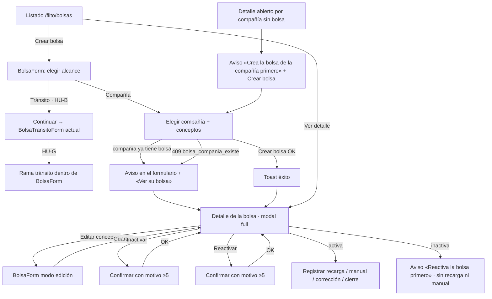
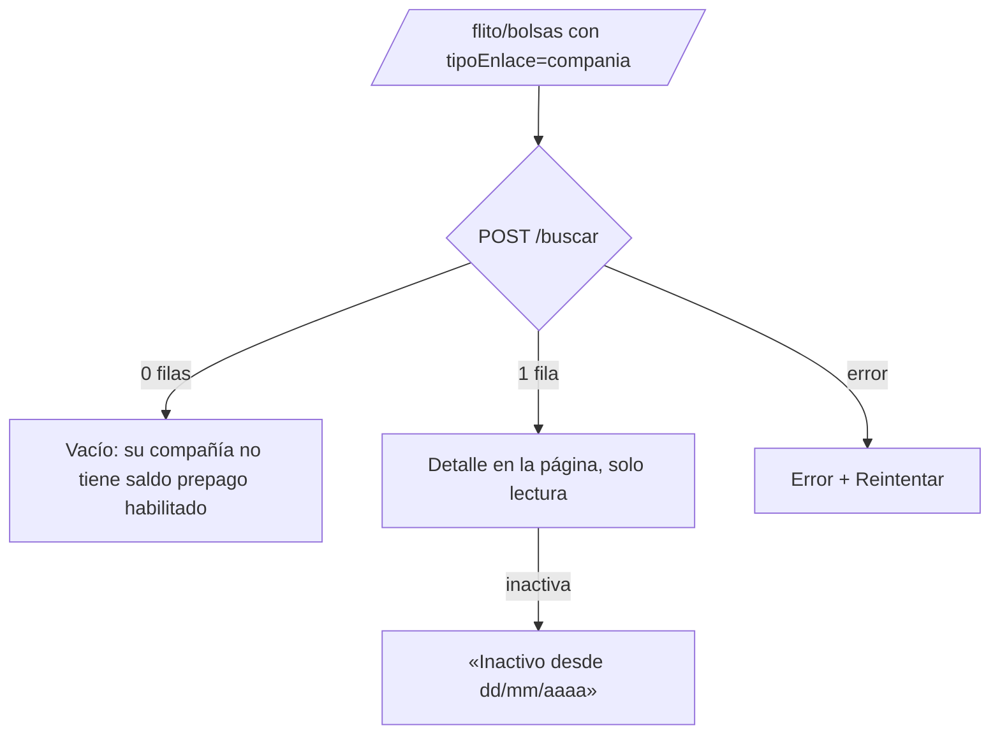

# UX — Bolsas: crear, editar, inactivar y reactivar la bolsa de una compañía (HU #13901)

- **Modo:** full · **Feature:** #13886 · **Épica:** #13412 · **Producto:** FLITO, módulo `flito-bolsas` (`/api/flito/bolsas`, no el legacy).
- **Fuentes:** `docs/arquitectura/feature-13886-13887-bolsa-unica.md` (HU-B, contratos (a)–(e)), ADR-0029 §D15, contrato API de la HU #13900 (PR #573) y tipos en `packages/shared-types/src/flito-bolsas.ts`.
- **Pantallas que toca:** `pages/FlitoBolsas.tsx` (el listado), el nuevo `components/flito/BolsaForm.tsx` (formulario único), el nuevo `components/flito/BolsaDetalleCompania.tsx` (detalle), `BolsaAcciones.tsx` y `BolsaMovimientos.tsx` (deltas). Se retira `BolsaAbrirCliente.tsx`. `BolsaTransitoForm.tsx` sigue vivo hasta la HU-G (#13908).

---

## Contexto y roles

| Público | Qué vino a hacer en esta visita | Tratamiento |
|---|---|---|
| **Financiera / admin** (funciones `bolsas.*`, sin enlace) | Encontrar la bolsa de una compañía, ver cuánto saldo tiene y en qué estado está, y **dar de alta, ajustar los conceptos, inactivar o reactivar** esa bolsa. Cargar plata sigue siendo el trabajo del detalle | **tú**, como el resto de la pantalla de Bolsas |
| **Cliente** (`tipoEnlace === 'compania'`) | Ver **su** saldo prepago, si está activo y en qué se ha ido | **usted**; sin jerga interna, sin quién ni motivo de la inactivación |

**Qué no es esta pantalla:**
- No es la rama de tránsito del formulario: la completa la HU-G (#13908). Aquí solo queda el sitio donde se va a montar.
- No es la gestión documental: la #13407 se monta en dos puntos que esta HU deja reservados (AC8).
- No cambia las reglas de dinero (recarga, movimiento manual, corrección, cierre). Lo único que cambia es **cuándo se pueden usar** (bolsa inexistente o inactiva, AC6).

---

## Qué se ve / qué se calla

### Dos disposiciones consideradas para el listado

**A — Cabecera + KPIs + dos acordeones (Compañías, Tránsito), cada uno con una tabla corta.** *(recomendada)*
Se conserva el esqueleto de la pantalla actual (KPIs arriba, acordeones abiertos de entrada) y cambia lo que hay dentro del acordeón Compañías: la rejilla de tarjetas pasa a ser una `FlitTable` con una fila por bolsa. El acordeón ya dice el alcance, así que no hace falta una columna «Alcance».

**B — Cabecera + barra de filtros (con Alcance) + una sola tabla mezclada.**
Una tabla con columna «Alcance» y filtro segmentado Todas / Compañías / Tránsito.

**Se elige A**, por tres razones ancladas en los principios:
1. **El nivel no se mide igual en los dos alcances** (`NivelRiesgoBolsa` frente a `NivelBolsaTransito`), y la celda de expediente (#13407) **solo existe en compañía**. Mezclarlos en una tabla obliga a columnas que en la mitad de las filas están vacías o significan otra cosa.
2. **No hay que reaprender nada:** Financiera ya lee la pantalla como «arriba los números, debajo clientes y tránsitos». Cambia el contenido del acordeón, no el mapa.
3. **La HU-G solo reemplaza el cuerpo del acordeón Tránsito** por la misma tabla, sin rediseñar la página.

AC1 pide ver el alcance en la lista: en A lo dice el título del acordeón, y además cada fila lleva el `alcance` en su `aria-label`.

### Jerarquía

**Qué se ve primero (operador):** la fila de la compañía con su **estado** (Activa/Inactiva) y su **saldo**. En una frase: «qué bolsas hay, cuáles están vivas y cuánto tienen».

| Nivel | Listado | Detalle |
|---|---|---|
| **Siempre visible** | Nombre, Estado, Saldo, Nivel; «Crear bolsa» en la cabecera | Saldo, Estado (+ Nivel), conceptos que descuenta, aviso de inactiva o de autogestión si aplica, la acción de la visita (recargar, o reactivar si está inactiva) |
| **A un clic** | Conceptos, última entrada, movimientos, cierres → **detalle** | Libro completo, filtros del libro, historial de cierres, motivo de la inactivación (dentro del bloque de estado) |
| **No está** | Entradas y salidas del periodo por fila (eran de la tarjeta y no responden a esta visita: siguen en el extracto del detalle); NIT y conceptos en la fila | Para el Cliente: quién inactivó, motivo, «Usuario» de cada movimiento, acciones de dinero, enlace a Parametrización |

**Densidad.** La pantalla **se alivia**:
- El selector de periodo se va de la página al detalle, que es el único sitio donde hoy importa (extracto, cierre y libro).
- La rejilla de tarjetas, con `bg-white` suelto (drift de tema oscuro), pasa a tabla.
- Las dos primarias de los acordeones («Abrir bolsa» y «Crear bolsa») se funden en **una** primaria de cabecera.

---

## Flujo de usuario (Mermaid)

### Financiera / admin



### Cliente (usuario con enlace de compañía)



---

## Pantalla 1 — Listado (`FlitoBolsas.tsx`, operador)

### Wireframe (≥ lg)

```
┌──────────────────────────────────────────────────────────────────────────────┐
│ Bolsas                                                       [ + Crear bolsa ]│  ← PageHeaderCard, única primaria
│ El saldo que cada cliente tiene precargado y el que FLIT mantiene en las     │
│ secretarías.                                                                 │
└──────────────────────────────────────────────────────────────────────────────┘
┌ Saldo total ─────────┐┌ Bolsas en riesgo ────┐┌ Conciliación pendiente ─┐     ← KpiCard ×3, sin cambio
│ $ 182.400.000        ││ 3  (Requiere atención)││ 5  (Revisar)            │
└──────────────────────┘└──────────────────────┘└─────────────────────────┘
┌──────────────────────────────────────────────────────────────────────────────┐
│ Buscar  [ Compañía, bolsa o NIT…              ]   Estado ( Todas|Activas|Inactivas )
└──────────────────────────────────────────────────────────────────────────────┘
▼ Compañías (24) · Saldo que cada compañía tiene precargado con FLIT.            ← FlitAcordeon, SIN botón propio
  [Alertas de saldo (n) — bloque actual, sin cambio]
  ┌────────────────────────┬──────────┬──────────────┬───────────────┬─────┬──────────────┐
  │ Compañía               │ Estado   │        Saldo │ Nivel         │     │              │
  ├────────────────────────┼──────────┼──────────────┼───────────────┼─────┼──────────────┤
  │ Transportes Andinos    │ ● Activa │  $ 4.250.000 │ ● Normal      │ ░░  │ [Ver detalle]│
  │ Logística del Valle    │ ● Activa │   $ 310.000  │ ● Saldo bajo  │ ░░  │ [Ver detalle]│
  │ Rentacar Norte         │ ● Inactiva│ −$ 85.000   │ ● Bolsa agotada│ ░░ │ [Ver detalle]│
  └────────────────────────┴──────────┴──────────────┴───────────────┴─────┴──────────────┘
     ░░ = celda reservada #13407 (ChipExpediente). Hoy vacía; cabecera solo sr-only.
▼ Tránsitos (6) · Saldo que FLIT precarga para pagar ante las secretarías…       ← contenido ACTUAL hasta HU-G
  [tarjetas de tránsito actuales — sin cambio en esta HU, sin botón «Crear bolsa» propio]
```

**Columnas de Compañías:**

| Columna | Contenido | Nota |
|---|---|---|
| **Compañía** | `nombre` | Texto, `truncate` con `title` |
| **Estado** | `StatusChip` «Activa» (`success`) / «Inactiva» (`draft`) | |
| **Saldo** | `pesos(saldo)`, alineado a la derecha y `tabular-nums` | Negativo en `--flit-danger-ink` con signo «−» (no solo color) |
| **Nivel** | `StatusChip tone={TONO_NIVEL[nivel]}` con `NIVEL_RIESGO_BOLSA_LABEL` | Igual que en el tablero actual |
| *(reservada)* | `<td>{/* #13407: <ChipExpediente companiaId={fila.companiaId} /> */}</td>` | Cabecera `<FlitTh><span className="sr-only">Expediente documental</span></FlitTh>`, para que una columna en blanco no parezca un dato que falta. La #13407 pone el rótulo visible al montarla |
| *(acción)* | `flitBtnSecondarySm` «Ver detalle», con `aria-label="Ver el detalle de la bolsa de <nombre> (compañía)"` | Abre el modal |

**Orden:** el que devuelve `/buscar`, como hoy con `/riesgo` («el orden no lo pone esta pantalla»). Si el servidor no ordena por nivel (peor a mejor) y luego por nombre, se pide a backend; la web no reordena.

### Estados (4)

| Estado | Qué se pinta |
|---|---|
| **Cargando** | `PageContentSkeleton` con la forma de la página (3 KPI y 5 filas de tabla). No se pinta un spinner genérico |
| **Error** | `FlitCard`: «No pudimos cargar las bolsas. Revisa tu conexión e intenta de nuevo.» + `flitBtnSecondary` **Reintentar**. Si es un 403: «No tienes permiso para ver el listado de bolsas. Pídeselo a un administrador.» (sin Reintentar). **Nunca** `errorMessage(e)` crudo |
| **Vacío — no hay ninguna bolsa** | `FlitEmpty`: «Todavía no hay bolsas. Crea la primera y elige si es de una compañía o de tránsito.» + botón **Crear bolsa** (`flitBtnSecondary`: la primaria ya está en la cabecera). Sin `bolsas.bolsa.crear`: «Todavía no hay bolsas. Pídele a Financiera que cree la primera.» sin botón |
| **Vacío — acordeón Compañías sin filas** (Tránsito sí tiene) | «Ninguna compañía tiene bolsa todavía. Pulsa «Crear bolsa» y elige Compañía.» |
| **Vacío — por filtro** | «Ninguna bolsa coincide con «{texto}»{ en las activas}.» + **Limpiar filtros**; si el estado es «Activas», también «Ver también las inactivas» (lo cambia a «Todas») |
| **Lleno** | Tabla de arriba. El contador del acordeón es el de las filas filtradas |

### Acciones y validaciones

- **Crear bolsa** (cabecera, primaria única): abre `BolsaForm` en modo alta.
- **Buscar:** `input` con `<label>` «Buscar», que hace `POST /buscar` con `{ texto }` **en el body**, con debounce de unos 300 ms y solo si hay ≥ 2 caracteres o el campo está vacío. **No** se refleja en la URL ni en `useSearchParams` (Ley 1581: NIT y nombre nunca van en la URL).
- **Estado:** `FiltroSegmentado` (kit) con Todas · Activas · Inactivas; viaja como `activa: true|false|undefined`. Por defecto **Todas**: con «Activas» la columna Estado sería siempre igual y no diría nada.
- Se hace **una** llamada a `/buscar` sin `alcance`, y las filas se reparten por `alcance` entre los dos acordeones. Las de `transito` **no** se pintan en esta HU: el acordeón Tránsito sigue leyendo su fuente actual hasta la HU-G.
- Los KPIs y las alertas siguen llamando a sus endpoints de hoy (`/consolidado`, `/alertas`). «Ver detalle» de una alerta abre el detalle **por compañía** (ver Pantalla 3, entrada por `companiaId`).

### Permiso y comportamiento por rol

- Ruta y slug **existentes**: `/flito/bolsas`, `PageSlug` `flito_bolsas`, con la guarda `hasFuncion('bolsas.bolsa.ver')` (ya está). La tabla necesita además `bolsas.bolsa.listar` (nueva, HU #13900); sin ella, `/buscar` devuelve 403 y se pinta el error de permiso.
- «Crear bolsa» (cabecera y vacío): visible si `hasFuncion('bolsas.bolsa.crear') || hasFuncion('bolsas.transito.crear')`. Si no, el botón **no se pinta** (AC7: se oculta, no se deshabilita).
- `tipoEnlace === 'compania'` → no se pinta esta pantalla, sino la **Pantalla 4** (proyección Cliente).

### Datos

- `POST /api/flito/bolsas/buscar` `BuscarBolsasDto` → `BolsaResumenDto[]` (existe).
- `GET /flito/bolsas/consolidado`, `/alertas` y `/transito` (existen; sin cambio en esta HU).
- `GET /clients` deja de cargarse en la página: solo lo necesita el formulario.

---

## Pantalla 2 — Formulario único (`BolsaForm.tsx`, alta y edición)

`FlitModal wide`. Un formulario de una sola página, **no un wizard**: el alcance es el primer bloque y el resto aparece debajo según lo elegido.

### Wireframe — alta, rama Compañía

```
┌ Crear bolsa ─────────────────────────────────────────────── ✕ ┐
│ ¿De quién es la bolsa?                                         │  ← fieldset + legend
│ ┌────────────────────────────┐ ┌────────────────────────────┐ │
│ │ (●) Compañía               │ │ ( ) Tránsito               │ │  ← radios como tarjeta clicable
│ │ Saldo prepago de un        │ │ Saldo que FLIT precarga    │ │
│ │ cliente.                   │ │ para pagar en secretarías. │ │
│ └────────────────────────────┘ └────────────────────────────┘ │
│                                                                │
│ Compañía *                                                     │
│ [ Elige una compañía…                                    ▾ ]   │
│                                                                │
│ ┌ (aviso AC3, solo si la compañía ya tiene bolsa) ──────────┐ │
│ │ ⓘ Esta compañía ya tiene bolsa (inactiva).  Ver su bolsa → │ │  role="alert"
│ └────────────────────────────────────────────────────────────┘ │
│                                                                │
│ ¿Qué conceptos descuenta? *                                    │  ← fieldset
│ [■] SOAT  · Autogestionado     [ ] Impuesto                    │
│ [■] Derecho de tránsito        [ ] Trámite digital             │
│ [ ] Logística · Autogestionado [ ] Servicios adicionales       │
│ ┌──────────────────────────────────────────────────────────┐   │
│ │ ⓘ Esta compañía gestiona su SOAT y su logística por su   │   │  role="note"
│ │ cuenta: no llegarán movimientos a la bolsa por esos      │   │
│ │ conceptos salvo excepciones. Cambiarlo en Clientes y     │   │
│ │ proveedores →                                            │   │
│ └──────────────────────────────────────────────────────────┘   │
│                                                                │
│                               [ Cancelar ]  [ Crear bolsa ]    │  ← una primaria
└────────────────────────────────────────────────────────────────┘
```

### Wireframe — alta, rama Tránsito (transición HU-B → HU-G)

```
│ ( ) Compañía                    (●) Tránsito                   │
│                                                                │
│ Las bolsas de tránsito se crean, por ahora, con su formulario  │  role="note"
│ propio: nombre, secretarías y cobros.                          │
│                                                                │
│                               [ Cancelar ]  [ Continuar ]      │
```

- **Continuar** cierra `BolsaForm` y abre el `BolsaTransitoForm` actual. Al terminar, refresca la página como hoy.
- **Contrato para la HU-G:** `BolsaForm` tiene un `switch (alcance)` con dos ramas, y la de tránsito es hoy un componente `RamaTransitoProvisional` (la nota de arriba y el `onContinuar`). La HU-G solo cambia esa rama por los campos nombre, secretarías y conceptos, y el pie pasa de «Continuar» a «Crear bolsa». Ni el bloque de alcance ni el pie ni la validación común se tocan.
- La opción Tránsito solo se ofrece con `bolsas.transito.crear`, y Compañía solo con `bolsas.bolsa.crear`. Si el usuario solo tiene una de las dos, el bloque de alcance se pinta como texto fijo («Bolsa de compañía») y no como un radio con una sola opción.

### Wireframe — edición (solo compañía en esta HU)

```
┌ Editar la bolsa de Transportes Andinos ──────────────────── ✕ ┐
│ Alcance   Compañía · Transportes Andinos                       │  ← texto, no editable
│ ¿Qué conceptos descuenta? *   (misma rejilla y aviso que alta) │
│                          [ Cancelar ]  [ Guardar cambios ]     │
└────────────────────────────────────────────────────────────────┘
```

### Estados (4) del formulario

| Estado | Qué se pinta |
|---|---|
| **Cargando** | Al abrir: `GET /clients` y `POST /buscar {alcance:'compania'}`, que da el mapa `companiaId → {bolsaId, activa}`. El selector de compañía queda `disabled` con «Cargando compañías…». Al elegir compañía: `GET /compania/:id/estado`, y la rejilla de conceptos muestra «Consultando la autogestión de la compañía…» sin bloquear las casillas |
| **Error** | Lista de compañías: «No pudimos cargar las compañías.» + **Reintentar**, en línea; el primario queda deshabilitado. Estado de autogestión: «No pudimos consultar la autogestión de esta compañía.» + **Reintentar** en línea; **no** bloquea crear, porque el aviso es informativo y lo decide D15 |
| **Vacío** | No hay compañías (`/clients` vacío): «No hay compañías registradas. Créala primero en Clientes y proveedores.» (enlace si `hasPage('clients')`) |
| **Lleno** | El formulario de arriba |

### Acciones y validaciones

| Regla | Comportamiento |
|---|---|
| Compañía obligatoria | El primario está deshabilitado mientras no haya compañía |
| ≥ 1 concepto | Primario deshabilitado; al tocar y dejar vacío, debajo del fieldset aparece «Marca al menos un concepto.» (`aria-describedby`) |
| Conceptos ofrecidos | Los 6 de `CONCEPTOS_BOLSA_COMPANIA` con `CONCEPTO_BOLSA_LABEL`. **GMF no aparece** |
| Selección inicial | **Ninguno marcado.** Qué se descuenta de la plata de un cliente es una decisión explícita, no un valor por defecto |
| La compañía ya tiene bolsa (AC3, preventivo) | Al elegirla, si está en el mapa de `/buscar`: aviso `role="alert"` **«Esta compañía ya tiene bolsa.»** o **«Esta compañía ya tiene bolsa (inactiva).»** + enlace **«Ver su bolsa»**, que cierra el formulario y abre el detalle con ese `bolsaId`. El primario queda deshabilitado. Sigue habiendo opciones: elegir otra compañía |
| 409 `bolsa_compania_existe` (carrera) | Mismo aviso, con el `bolsaId` y el `activa` del cuerpo del 409. **Nunca** el error crudo |
| 404 compañía | En línea: «Esa compañía ya no existe. Elige otra.» |
| 400 `datos_invalidos` | En línea: «Revisa los conceptos marcados e intenta de nuevo.» |
| Otro error | `role="alert"` en el modal: «No pudimos crear la bolsa. Intenta de nuevo.» |
| Enviando | Primario «Creando…» (edición: «Guardando…») y `disabled`; ✕ y Cancelar siguen activos |
| Éxito (alta, AC2) | **Toast** de éxito cerrable: «Bolsa de {compañía} creada.» Se cierra el formulario, se refresca el listado y **se abre el detalle** de la bolsa nueva (`id` de la respuesta 201) |
| Edición: sin cambios | «Guardar cambios» deshabilitado si el conjunto de conceptos no cambió |
| Edición: 409 `bolsa_inactiva` | En línea: «Reactiva la bolsa primero para cambiar sus conceptos.» (no debería verse: «Editar» se oculta con la bolsa inactiva) |
| Éxito (edición) | Toast: «Conceptos de la bolsa actualizados.» Se cierra y se refrescan el detalle y el listado |
| Sin sección de documentos | El formulario **no** tiene hueco para documentos (contrato (a)/(b)) |

**Autogestión (AC10, D15):**
- Cada concepto incluido en `conceptosAutogestionados` lleva al lado de su etiqueta un `StatusChip tone="neutral"` **«Autogestionado»**. La casilla **sigue siendo marcable**.
- Debajo de la rejilla va **un solo aviso** (`role="note"`, no `alert`: no es un error), redactado con los conceptos autogestionados:
  - Uno: «Esta compañía gestiona **su SOAT** por su cuenta: no llegarán movimientos a la bolsa salvo excepciones.»
  - Varios: «Esta compañía gestiona **su SOAT y su logística** por su cuenta: no llegarán movimientos a la bolsa por esos conceptos salvo excepciones.»
  - Nombres en el aviso: «su SOAT», «sus impuestos», «su logística» (los únicos tres autogestionables en compañía).
- **Enlace a Parametrización:** «Cambiarlo en Clientes y proveedores» → `/clients` (`PageSlug` `clients`, donde vive la autogestión). Solo si `hasPage(user, 'clients')`; si no, el texto queda sin enlace: «Lo cambia Operaciones en Clientes y proveedores.»
- El aviso se pinta aunque el concepto **no** esté marcado, porque informa la decisión antes de tomarla.

### Permiso y comportamiento por rol

- Alta: `bolsas.bolsa.crear` (Compañía) y `bolsas.transito.crear` (Tránsito). Edición: `bolsas.bolsa.editar`. Sin esos permisos el formulario no se ofrece, porque sus disparadores se ocultan.

### Datos

- `GET /clients` (existe) · `POST /buscar {alcance:'compania'}` (existe) · `GET /compania/:companiaId/estado` → `EstadoBolsaCompaniaConAutogestionDto` (existe).
- `POST /` `CrearBolsaDto` → 201 `BolsaDetalleDto` · `PATCH /bolsa/:bolsaId` `EditarBolsaDto` (existen).
- **Ningún endpoint nuevo.** `/estado` no trae `bolsaId`; el enlace «Ver su bolsa» lo saca del mapa de `/buscar` o del cuerpo del 409.

---

## Pantalla 3 — Detalle de la bolsa de compañía (`BolsaDetalleCompania.tsx`, operador)

`FlitModal full` con el nombre de la compañía como título. Sustituye a `ModalDetalleCliente`.

### Entradas al detalle

| Desde | Con qué | Resolución |
|---|---|---|
| Fila del listado, éxito del alta, «Ver su bolsa» | `bolsaId` | `GET /bolsa/:bolsaId` |
| Alerta de saldo, u otros módulos que solo conocen la compañía | `companiaId` | Se busca en el mapa de `/buscar`; si no está, `GET /compania/:id/estado`. Con `existe:false` se pinta el **aviso de compañía sin bolsa** (AC6) |

### Wireframe — bolsa activa

```
┌ Transportes Andinos ─────────────────────────────────────────────────── ✕ ┐  ← cabecera fija (no se desplaza)
│ ╔ región desplazable (AC9) ══════════════════════════════════════════════╗│
│ ║ ┌ Bolsa ─────────────────────────────────────────────────────────────┐ ║│
│ ║ │ ● Activa   ● Normal                [Editar conceptos] [Inactivar]  │ ║│  ← secundarios
│ ║ │ $ 4.250.000                                                        │ ║│
│ ║ │ 62 % de la última entrada ($ 6.800.000 el 2/10/2026).              │ ║│
│ ║ │ Descuenta: SOAT · Autogestionado, Derecho de tránsito, Impuesto    │ ║│
│ ║ │ ⓘ Esta compañía gestiona su SOAT por su cuenta: … Cambiarlo en … → │ ║│  ← solo si un concepto MARCADO es autogestionado
│ ║ └────────────────────────────────────────────────────────────────────┘ ║│
│ ║ Periodo contable [ octubre de 2026 ▾ ]   [ ] Ver el libro completo     ║│
│ ║ [ BolsaExtracto — sin cambio ]                                         ║│
│ ║ [ Registrar una recarga ] [Movimiento manual] [Corregir…] [Cerrar oct] ║│  ← BolsaAcciones: la ÚNICA primaria
│ ║ [ Periodos cerrados — sin cambio ]                                     ║│
│ ║ [ Movimientos — con reversión enlazada ]                               ║│
│ ║ {/* #13407: <ExpedienteDocumental companiaId={bolsa.companiaId} /> */} ║│  ← bloque reservado, al final, fuera de las secciones
│ ╚════════════════════════════════════════════════════════════════════════╝│
└───────────────────────────────────────────────────────────────────────────┘
```

### Wireframe — bolsa inactiva

```
│ ║ ┌ Bolsa ─────────────────────────────────────────────────────────────┐ ║
│ ║ │ ● Inactiva  ● Saldo bajo                       [ Reactivar bolsa ] │ ║  ← primaria de este estado
│ ║ │ $ 310.000                                                          │ ║
│ ║ │ ┌──────────────────────────────────────────────────────────────┐   │ ║
│ ║ │ │ Inactiva desde el 12/10/2026 3:40 p. m. por Ana Pérez.        │   │ ║  role="status"
│ ║ │ │ Motivo: «Cliente suspendido por cartera».                     │   │ ║
│ ║ │ │ No recibe descuentos, recargas ni movimientos manuales.       │   │ ║
│ ║ │ │ Reactiva la bolsa primero.                                    │   │ ║
│ ║ │ └──────────────────────────────────────────────────────────────┘   │ ║
│ ║ │ Descuenta: SOAT, Derecho de tránsito                               │ ║
│ ║ └────────────────────────────────────────────────────────────────────┘ ║
│ ║ Periodo … · Extracto …                                                 ║
│ ║ [Cerrar octubre de 2026]                       ← solo cierre (Q7)      ║
│ ║ Movimientos …                                                          ║
```

### Wireframe — compañía sin bolsa (AC6)

```
┌ Rentacar Norte ──────────────────────────────────────────── ✕ ┐
│ ┌──────────────────────────────────────────────────────────┐  │
│ │ Rentacar Norte no tiene bolsa.                            │  │  role="status"
│ │ Crea la bolsa de la compañía primero: después podrás     │  │
│ │ registrar recargas y sus trámites descontarán de ella.   │  │
│ │                                         [ Crear bolsa ]  │  │  ← primaria; abre BolsaForm con Compañía y esta compañía ya elegidas
│ └──────────────────────────────────────────────────────────┘  │
└────────────────────────────────────────────────────────────────┘
```

### Estados (4)

| Estado | Qué se pinta |
|---|---|
| **Cargando** | Esqueleto de la tarjeta Bolsa (chips, saldo, línea de conceptos) y del extracto. La cabecera del modal ya muestra el nombre que se conoce (fila o alerta) |
| **Error** | `FlitCard` dentro del modal: «No pudimos cargar la bolsa. Intenta de nuevo.» + **Reintentar**. Un 404: «Esta bolsa ya no existe o no tienes acceso a ella.» + **Volver al listado** (cierra el modal). Sin mensaje crudo |
| **Vacío** | Compañía sin bolsa: el wireframe de arriba. Sin `bolsas.bolsa.crear`: el mismo texto, cambiando la segunda frase por «Pídele a Financiera que la cree.», y sin botón. Libro sin movimientos: el vacío actual de `BolsaMovimientos`, con siguiente paso: «Esta bolsa no tiene movimientos en octubre de 2026. Marca «Ver el libro completo» para ver los demás periodos.» |
| **Lleno** | Wireframes de bolsa activa y de bolsa inactiva |

### Acciones, validaciones y la única primaria

| Estado de la bolsa | Primaria | Secundarias |
|---|---|---|
| **Activa** | «Registrar una recarga» (`BolsaAcciones`, sin cambio) | «Editar conceptos», «Inactivar» (en la tarjeta Bolsa) · manual · corrección · cierre |
| **Inactiva** | «Reactivar bolsa» (en la tarjeta Bolsa) | Cierre del periodo. **Recarga, movimiento manual y corrección no se pintan** (AC6/Q7); el aviso de estado dice por qué |
| **Sin bolsa** | «Crear bolsa» | — |

- Si la primaria del estado no se puede usar por permiso, no hay primaria: el aviso lo dice. Ejemplo para una bolsa inactiva sin `bolsas.bolsa.inactivar`: «Reactiva la bolsa primero» pasa a «Para recargarla, alguien con permiso tiene que reactivarla primero.».
- **Recarga con 409 `bolsa_inexistente`** (carrera, o un acceso por compañía): en el modal de recarga, `role="alert"` con «Crea la bolsa de la compañía primero.» + botón **Crear bolsa** (cierra la recarga y abre `BolsaForm` con la compañía ya elegida). El valor tecleado se pierde a propósito: sin bolsa no hay dónde asentarlo.
- **Recarga, manual o corrección con 409 `bolsa_inactiva`:** `role="alert"` en el modal: «Reactiva la bolsa primero.» El modal **no** se cierra y el detalle se refresca por debajo para que la tarjeta pase a Inactiva.
- **`BolsaAcciones`** gana dos props: `activa: boolean` (oculta recarga, manual y corrección cuando es `false`) y los permisos que ya resuelve el padre. No cambia nada más de ese componente.

**Periodo:** el selector «Periodo contable» y la casilla «Ver el libro completo» se mudan de la página a la cabecera del contenido del detalle, encima del extracto. El texto que hoy explica qué cifras son del periodo pasa a ser la `ayuda` del selector.

**Conceptos y autogestión (AC10, detalle):**
- «Descuenta:» con la lista de `CONCEPTO_BOLSA_LABEL` de `conceptos`. Los que estén **también** en `conceptosAutogestionados` llevan el chip «Autogestionado».
- El aviso de autogestión (mismo copy y mismo enlace que en el formulario) se pinta **solo si algún concepto marcado está autogestionado**. Es el caso «la autogestión cambió después de crear la bolsa». Un autogestionado no marcado no interesa en el detalle.

**Movimientos — reversión enlazada (AC4):**
- Fila con `revierteMovimientoId`: bajo el concepto, un enlace `button` «Revierte el movimiento del {fecha}» (`flit-focus`, subrayado, `--flit-blue-text`). Al pulsarlo:
  1. Si el original está en la lista cargada: se desplaza hasta él dentro de la región del detalle (`scrollIntoView({ block: 'center' })`, sin `behavior: 'smooth'`), se pinta con `FlitTr marcada` y recibe el foco (`tabIndex={-1}`). La marca dura hasta el siguiente clic en otro enlace o hasta un cambio de filtro.
  2. Si no está (otro periodo, o lo esconde un filtro): se activa «Ver el libro completo», se limpian los filtros del libro y, al cargar, se hace el paso 1.
  3. Si tampoco aparece en el libro completo: texto en línea «No encontramos el movimiento original.» y no se navega a ningún sitio.
- Fila original que **ya fue revertida** (algún movimiento cargado la apunta): texto `--flit-text-muted` «Revertido el {fecha}», con el mismo enlace a la inversa. Se calcula en el cliente sobre la lista cargada; si la reversión cae fuera del periodo, no se muestra (no se afirma lo que no se ve).
- Origen `comprobante` (cuando exista en `OrigenMovimientoBolsa`, HU-C): etiqueta «Comprobante», tono `active`. Una reversión lleva además el texto «Reversión» junto al chip de origen.

**Inactivar / Reactivar (AC5)** — `FlitModal` compacto:

```
┌ Inactivar la bolsa de Transportes Andinos ───────────── ✕ ┐
│ Mientras esté inactiva no recibe descuentos, recargas ni   │
│ movimientos manuales. Lo ya asentado no cambia y puedes    │
│ reactivarla cuando quieras.                                │
│                                                            │
│ Motivo *                                                   │
│ [ textarea, 3 filas, maxLength 1000                     ]  │
│ Mínimo 5 caracteres.                          (3/5)        │  ← ayuda + contador, aria-describedby
│                                                            │
│                       [ Cancelar ]  [ Inactivar bolsa ]    │  ← deshabilitado mientras motivo.trim() < 5
└────────────────────────────────────────────────────────────┘
```

- **Reactivar:** título «Reactivar la bolsa de {X}». Texto: «Vuelve a recibir descuentos, recargas y movimientos manuales desde ahora. Lo que se aplicó mientras estuvo inactiva no se descuenta.» Mismo campo de motivo; botón **Reactivar bolsa**.
- El confirmar queda `disabled` mientras `motivo.trim().length < 5` (AC5), y el contador dice cuánto falta. El error «Escribe un motivo de al menos 5 caracteres.» solo aparece al perder el foco con texto corto, no mientras se teclea.
- Enviando: «Inactivando…» / «Reactivando…»; `cierreBloqueado` del `FlitModal` mientras dura, para que el desenlace tenga dónde pintarse.
- Éxito: **toast** «Bolsa inactivada.» / «Bolsa reactivada.». Se cierra el modal y se refrescan el detalle y el listado. El estado nuevo lo cuenta la tarjeta, no el toast.
- 409 `ya_inactiva` / `ya_activa`: se cierra y se refresca, con el toast informativo «La bolsa ya estaba inactiva; actualizamos la vista.» (o «…activa…»).
- Otro error: `role="alert"` en el modal: «No pudimos inactivar la bolsa. Intenta de nuevo.» (o «reactivar»). El motivo tecleado se conserva.

### Scroll del detalle (AC9) — patrón

**Causa:** `FlitModal full` deja el diálogo en `overflow-hidden` y el cuerpo en `min-h-0 flex-1` **sin** `overflow`, porque delega el scroll en el hijo. `ModalDetalleCliente` pasa un `div` sin `overflow`, así que lo que no cabe se corta.

**Patrón (sin tocar `FlitModal`, que usan unos 90 archivos):** el hijo es el que desplaza.

```tsx
<div
  role="region"
  aria-label={`Detalle de la bolsa de ${nombre}`}
  tabIndex={0}                                  // la rueda y el gesto no lo necesitan; las teclas (↑↓, Re/Av Pág, Inicio/Fin) sí
  className="flit-focus h-full min-h-0 overflow-y-auto overflow-x-hidden overscroll-contain -mx-6 px-6"
>
  <div className="space-y-4 pb-2">…secciones…</div>
</div>
```

- `h-full min-h-0 overflow-y-auto` es el scroll vertical dentro del cuerpo. La **cabecera del modal (título y ✕) queda fuera de la región**, así que siempre se ve.
- `overflow-x-hidden` evita el scroll horizontal de la página. Las tablas (movimientos, cierres, desgloses) siguen usando el scroll horizontal **propio** de `FlitTable`. Todo hijo `flex` lleva `min-w-0` para que una tabla ancha no empuje el contenedor.
- `overscroll-contain` impide que, al llegar al final, el gesto táctil desplace la página que está debajo del velo.
- `-mx-6 px-6` lleva la barra de desplazamiento al borde del panel sin perder el margen interior.
- En móvil el diálogo mide `calc(100dvh - 3rem)` (`dvh`, sin el salto de la barra del navegador), así que la región también.
- **Tránsito:** el detalle de tránsito (`BolsaTransitoDetalle` dentro de `FlitModal full`) tiene el mismo defecto. Basta con envolverlo con el mismo `div` en `FlitoBolsas.tsx` (una línea), sin rediseñarlo. Es el mismo AC9 en el mismo modal.

### Permiso y comportamiento por rol

| Control | Función | Sin ella |
|---|---|---|
| «Editar conceptos» | `bolsas.bolsa.editar` | No se pinta; tampoco con la bolsa inactiva |
| «Inactivar» / «Reactivar bolsa» | `bolsas.bolsa.inactivar` | No se pinta |
| «Crear bolsa» (sin bolsa) | `bolsas.bolsa.crear` | No se pinta y el aviso cambia el copy |
| Recarga / manual / corrección / cierre | las de hoy (`bolsas.recarga.registrar`, etc.) | Igual que hoy |

### Datos

`GET /bolsa/:bolsaId` → `BolsaDetalleDto`. El extracto, los movimientos y los cierres siguen por `/:companiaId/…`, porque `bolsa.companiaId` no es nulo en compañía y esas rutas se conservan según el diseño. Inactivar y reactivar van por `POST /bolsa/:bolsaId/inactivar|reactivar` `{ motivo }`, y el estado por `GET /compania/:id/estado`. **Sin endpoints nuevos.**

---

## Pantalla 4 — Proyección Cliente (`FlitoBolsas.tsx` con `tipoEnlace === 'compania'`)

Misma ruta, otra composición: **sin** KPIs, acordeones, buscador ni «Crear bolsa». Una lista de una sola fila es ruido, así que la bolsa se pinta **directamente en la página**, no en un modal.

```
┌──────────────────────────────────────────────────────────────┐
│ Saldo prepago                                                │  ← PageHeaderCard
│ El saldo que su compañía tiene precargado y en qué se usa.   │
└──────────────────────────────────────────────────────────────┘
┌──────────────────────────────────────────────────────────────┐
│ ● Activo                                                     │
│ $ 4.250.000                                                  │
│ Se descuenta de este saldo: SOAT, Derecho de tránsito.       │
│ ⓘ Su compañía gestiona el SOAT por su cuenta: este saldo no  │  ← sin enlace
│ se descuenta por ese concepto, salvo excepciones.            │
└──────────────────────────────────────────────────────────────┘
 Periodo contable [ octubre de 2026 ▾ ]
 [ Movimientos — sin columna «Usuario»; sin acciones ]
```

- **Inactiva:** el chip pasa a «Inactivo» (`draft`) y el aviso (`role="status"`) dice: «Este saldo está inactivo desde el 12/10/2026. Mientras tanto no se descuentan trámites de él. Si tiene dudas, comuníquese con su contacto comercial.» **Sin** quién ni motivo: llegan en `null` (D15, Habeas Data) y la UI no inventa un hueco para ellos.
- No se pinta el nivel de riesgo: «Saldo crítico» es lenguaje de cobranza interna. El saldo y el estado bastan.
- **Estados:**
  - Cargando: esqueleto de la tarjeta.
  - Error: «No pudimos cargar su saldo. Intente de nuevo.» + **Reintentar**.
  - Vacío (`/buscar` → 0 filas): «Su compañía todavía no tiene saldo prepago habilitado. Si lo necesita, comuníquese con su contacto comercial.»
  - Lleno: el de arriba.
- **Sin** «Editar», «Inactivar», acciones de dinero, exportar CSV, enlace a Parametrización ni bloque #13407 (salvo que la #13407 decida otra cosa para el Cliente).
- **Permiso:** la proyección existe en la web, pero **llegar a ella** depende de que el rol del Cliente tenga el `PageSlug` `flito_bolsas` y las funciones `bolsas.bolsa.ver`/`listar` (migración de permisos 0252). Esta spec no lo asume: ver Notas para el frontend.

---

## Responsive (< lg)

- **Listado:** la cabecera apila «Crear bolsa» bajo el título. Los KPIs pasan a 1 columna y a 2 desde `sm` (como hoy). La barra de filtros envuelve (`flex-wrap`), con el buscador a `w-full` por debajo de `sm` y el segmentado en su propia línea. La tabla usa el scroll horizontal de `FlitTable`, con «Compañía» como primera columna; ninguna columna con `min-w` fijo.
- **Formulario:** las dos tarjetas de alcance se apilan (`grid-cols-1 sm:grid-cols-2`). La rejilla de conceptos va a `grid-cols-1 sm:grid-cols-2`. El pie envuelve con el primario a la derecha.
- **Detalle:** desplazable hasta el final con gesto táctil (AC9). La tarjeta Bolsa apila chips, saldo y acciones; las acciones envuelven. El selector de periodo y la casilla del libro van en dos líneas. Las tablas, con su scroll propio y sin scroll horizontal del modal.
- **Inactivar/Reactivar:** el modal compacto ocupa el ancho con `p-4` (patrón de `FlitModal`); el textarea, a ancho completo.
- **Cliente:** una columna; la tabla de movimientos, con el scroll de `FlitTable`.

## Interacción y notificaciones

**Feedback de controles (hover sutil + foco del kit):**
- Botones: `flitBtnPrimary` / `flitBtnSecondary` / `flitBtnSecondarySm` ya traen hover, `active`, `disabled` y `flit-focus`.
- Filas: `FlitTr` ya trae hover (`--flit-bg-app`). La fila **no** es clicable entera; la acción es «Ver detalle».
- **Tarjetas de alcance (radio):** el kit no tiene este control, así que se compone. `<label>` envolviendo un `<input type="radio">` visible, borde `--flit-border-soft`, `hover:bg-[var(--flit-bg-hover)] transition-colors`; la seleccionada lleva borde `--flit-blue-text` y fondo `--flit-bg-app`; foco con `flit-focus` sobre el input (`focus-visible` del label con `has-[:focus-visible]`). Sin sombras ni escalas.
- **Casillas de concepto:** `<label>` clicable completo, con `hover:bg-[var(--flit-bg-hover)]` y la casilla nativa con foco visible.
- **Enlaces** («Ver su bolsa», «Cambiarlo en Clientes y proveedores», «Revierte el movimiento del…»): subrayado, `--flit-blue-text`, hover con `--flit-blue-ink` y `flit-focus`.
- **Región desplazable del detalle:** `flit-focus` (anillo visible al tabular a ella).

**Toast frente a aviso de página:**

| Acción / situación | Patrón | Copy |
|---|---|---|
| Crear bolsa OK | Toast éxito, cerrable, unos 4 s | «Bolsa de {compañía} creada.» |
| Editar conceptos OK | Toast éxito | «Conceptos de la bolsa actualizados.» |
| Inactivar / reactivar OK | Toast éxito | «Bolsa inactivada.» / «Bolsa reactivada.» |
| Ya estaba en ese estado (409) | Toast informativo | «La bolsa ya estaba inactiva; actualizamos la vista.» |
| Compañía ya tiene bolsa (AC3) | **Aviso en el formulario** (`role="alert"`) | «Esta compañía ya tiene bolsa (inactiva).» + «Ver su bolsa» |
| Bolsa inactiva (AC6) | **Aviso de página** en el detalle (`role="status"`) | «… Reactiva la bolsa primero.» |
| Compañía sin bolsa (AC6) | **Aviso de página** en el detalle | «Crea la bolsa de la compañía primero …» + «Crear bolsa» |
| 409 en recarga / manual / corrección | `role="alert"` **en el modal** de esa acción | «Crea la bolsa de la compañía primero.» / «Reactiva la bolsa primero.» |
| Autogestión | Nota (`role="note"`) en el formulario y en el detalle | Ver Pantalla 2 |
| Errores de carga | Estado de error con Reintentar | Nunca `errorMessage(e)` crudo |

El toast es el del kit (`ToastFlito` / `react-hot-toast` como ya usa `BolsaAcciones`), **cerrable**. Un solo toast por acción.

### Colores — los HEX de la Épica, traducidos a tokens

| HEX de la Épica | Significado | Token | Uso en esta HU |
|---|---|---|---|
| `#70CF3A` | OK | `--flit-success` (tinta `--flit-success-ink`) | `StatusChip tone="success"`: «Activa», nivel «Normal» |
| `#F05A35` | Insuficiente | `--flit-warning` (tinta `--flit-warning-ink`) | `tone="warning"`: nivel «Saldo bajo» (lo que ya pinta `TONO_NIVEL`) |
| `#4F74C9` | Procesando | `--flit-info` / `--flit-blue` | `tone="active"`. **No hay estado «procesando» en esta HU**; se reserva para la #13407 |
| `#59677D` | Inactiva | `--flit-draft` (chip: `--flit-chip-draft-*`, con par oscuro) | `tone="draft"`: «Inactiva» |

- «Crítico» y «Agotada» siguen en `tone="danger"` (`TONO_NIVEL` no cambia), y el saldo negativo va en `--flit-danger-ink`.
- Los avisos usan el patrón de la tarjeta «todavía no tiene bolsa» de hoy: borde `--flit-border-soft`, fondo `--flit-bg-app`, texto `--flit-text-secondary` e icono `Info` de lucide `aria-hidden`.
- **Cero HEX sueltos, cero `bg-white`.** Se revisa en claro y en oscuro.

## Accesibilidad

- Cada input con `<label>` asociado: «Buscar», «Compañía *», «Motivo *», «Periodo contable». El alcance y los conceptos van en `fieldset` + `legend` («¿De quién es la bolsa?», «¿Qué conceptos descuenta?»).
- El primario deshabilitado de inactivar/reactivar lleva `aria-describedby` con la ayuda «Mínimo 5 caracteres.» y el contador, para que se entienda por qué no se puede pulsar.
- AC3 en `role="alert"` (aparece por una acción del usuario). Estado inactivo y compañía sin bolsa en `role="status"`. Autogestión en `role="note"`.
- `StatusChip` lleva texto; el color nunca es la única señal (saldo negativo con «−»).
- Columna reservada con cabecera `sr-only` «Expediente documental»; «Ver detalle» con `aria-label` que nombra la compañía y el alcance.
- Región desplazable del detalle: `role="region"` + `aria-label` + `tabIndex=0` + foco visible (AC9). Foco al abrir: el del `FlitModal` (el diálogo). Al cerrar inactivar/reactivar, el foco vuelve al botón que lo abrió o, si este cambió (Inactivar → Reactivar), al título de la tarjeta Bolsa (`restoreFocusRef`).
- Enlace de reversión: tras navegar, el foco queda en la fila original (`tabIndex=-1`) y se anuncia, porque la fila contiene fecha y valor.
- Contraste ≥ 4.5:1 con las tintas `*-ink` y los tokens de chip (medidos en `check:contraste`).

## Notas para QA

1. **AC1:** listado con los 4 estados: esqueleto; error + Reintentar (forzar 500), sin texto crudo; vacío total con «Crear bolsa»; lleno con Nombre, Estado, Saldo y Nivel bajo el acordeón Compañías. Buscar por nombre y por NIT: la petición es `POST /buscar` con el texto en el **body** y la URL de la página no cambia.
2. **AC2:** crear eligiendo Compañía. GMF no aparece y no hay sección de documentos. Toast cerrable y el detalle de la bolsa nueva se abre solo.
3. **AC3:** elegir una compañía con bolsa inactiva muestra «Esta compañía ya tiene bolsa (inactiva).» + «Ver su bolsa», que abre esa bolsa. Forzar la carrera (crear la bolsa en otra pestaña): el 409 muestra el mismo aviso, no el error crudo.
4. **AC4:** detalle con saldo, conceptos y estado. Inactiva: quién, cuándo y motivo para el operador; **solo cuándo** para el Cliente. Una reversión lleva a su original (otro periodo incluido) y lo marca.
5. **AC5:** el confirmar sigue deshabilitado con 4 caracteres (también con 5 espacios + 4 letras) y se habilita con 5. Un 409 `ya_inactiva` refresca sin romper.
6. **AC6:** el detalle por compañía sin bolsa muestra el aviso con «Crear bolsa», que abre el formulario con la compañía ya elegida. Con la bolsa inactiva no se ven recarga, manual ni corrección, se ve el aviso «Reactiva la bolsa primero» y el cierre sigue disponible.
7. **AC7:** con un usuario sin `crear` / `editar` / `inactivar`, cada botón **no existe** en el DOM (no está deshabilitado).
8. **AC8:** comentario `#13407: <ChipExpediente …>` en la celda de cada fila de compañía y `#13407: <ExpedienteDocumental …>` al final del detalle de compañía. El detalle de tránsito no tiene ninguno.
9. **AC9:** a 1440 px y a 375 px, en un detalle con más de 50 movimientos: se llega al final con la rueda, con el teclado (Tab hasta la región, Av Pág / Fin) y con el gesto táctil. El título y la ✕ siguen visibles y no hay scroll horizontal del modal. Repetir con el detalle de tránsito.
10. **AC10:** con una compañía con `soat_autogestionable`, en el formulario sale el chip «Autogestionado», el SOAT se puede marcar y aparecen el aviso y el enlace a Clientes y proveedores (sin enlace si no hay acceso a `clients`). Cambiar la autogestión después de crear la bolsa: el detalle muestra el aviso. Revisar todo en tema oscuro.

## Decisiones y descartes

- **Disposición A (acordeones + tabla corta)** frente a **B (tabla mezclada con columna Alcance):** ver «Qué se ve». Se descarta B porque mezcla escalas de nivel distintas y deja la celda de expediente vacía en la mitad de las filas.
- **Una primaria en la cabecera** («Crear bolsa») en lugar de los dos botones primarios de los acordeones de hoy: el formulario único ya pregunta el alcance, así que dos entradas eran dos primarias compitiendo.
- **Las tarjetas pasan a tabla:** con 20 o más compañías, una tabla se barre en vertical, y además deja la celda que pide AC8. Se pierden entradas y salidas del periodo por fila; siguen en el extracto del detalle, donde se consultan.
- **El selector de periodo se muda al detalle:** en la página ya no afectaba a nada visible.
- **El bloque «Alertas de saldo» se conserva sin cambio:** no es de esta HU. Duplica en parte la columna Nivel; si el PO quiere retirarlo, que sea en otra HU (pregunta abierta, no bloqueante).
- **Sin selección inicial de conceptos:** descontar dinero de un cliente debe ser una decisión explícita.
- **AC3 preventivo, además del 409:** el formulario ya conoce las compañías con bolsa (`/buscar`), así que avisar al elegir ahorra rellenar los conceptos para nada. El 409 queda como red de seguridad. No hace falta endpoint nuevo (`/estado` no trae `bolsaId`).
- **Tránsito con «Continuar»** y no saltando de modal al pulsar el radio: cambiar de diálogo sin una acción explícita desorienta. La rama provisional es un componente aislado que la HU-G sustituye.
- **AC9 sin tocar `FlitModal`:** el contrato del kit ya dice que, con `full`, desplaza el hijo. Cambiarlo afectaría a unos 90 consumidores. Se corrige en el consumidor, y la misma línea arregla tránsito.
- **Cliente sin nivel de riesgo** y con «saldo prepago» en lugar de «bolsa» en títulos: es jerga interna. El estado se nombra en masculino («Activo/Inactivo») porque concuerda con «saldo».
- **Sin animaciones:** la navegación a la fila revertida es instantánea (`scrollIntoView` sin `smooth`) y la marca es el estado `marcada` de `FlitTr`, que ya existe. No hay patrón visual nuevo salvo la tarjeta de radio de alcance, que el kit no cubre y se compone con tokens.
- **Tuteo** en todas las superficies de operador (como la pantalla actual y el copy de los AC); **usted** en la proyección Cliente.

## Notas para el frontend-agent

1. **Crear** `BolsaForm.tsx` (alta y edición, con un `switch (alcance)` y la `RamaTransitoProvisional`) y `BolsaDetalleCompania.tsx` (con la región desplazable del AC9 y el bloque reservado #13407).
2. **Modificar** `FlitoBolsas.tsx`: proyección Cliente por `tipoEnlace`, cabecera con «Crear bolsa», barra de filtros, el selector de periodo fuera, `/buscar` y el envoltorio de scroll del detalle de tránsito. **Modificar** `BolsasTablero.tsx`: tabla en Compañías, sin los botones de los acordeones, sin `TarjetaBolsa`.
3. **Modificar** `BolsaAcciones.tsx` (prop `activa`; manejo de los 409 `bolsa_inexistente` y `bolsa_inactiva` en el modal) y `BolsaMovimientos.tsx` (enlace de reversión, «Revertido el…», prop para ocultar «Usuario» en el Cliente).
4. **Retirar** `BolsaAbrirCliente.tsx`. `BolsaTransitoForm.tsx` sigue vivo (lo abre «Continuar»).
5. Datos solo vía `src/lib/api.ts`; los errores pasan por un mapa `codigo → copy`, nunca `errorMessage(e)` en pantalla.
6. **Confirmar con el hilo** (no bloquea la implementación): si el rol del Cliente tiene `flito_bolsas` + `bolsas.bolsa.ver`/`listar` en la migración de permisos de la HU #13900. Si no lo tiene, la proyección queda lista e inalcanzable, y se declara en el PR.
7. Delta de ayuda (`flit-ayuda-flito`) para `flito_bolsas.md`: alta manual, inactivar/reactivar y autogestión.
