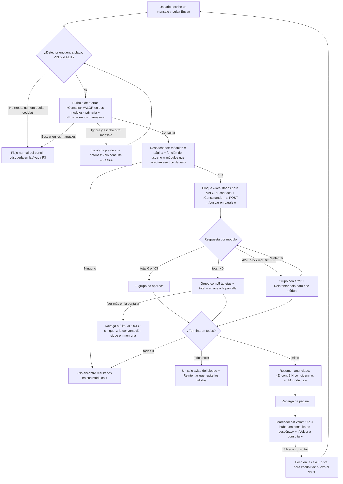

# Anexo F6 — Consultas de gestión en Dr. Flit, sin IA (Feature #13834 · HU #13836, #13837, #13838)

> Continúa `docs/ux/flito-dr-flit.md` (F3 y anexo F5). Mismo panel, mismo público, mismo tratamiento (**usted**).
> Fuente de AC: borrador `HUS-F6-13834.md` (G1 trámites + detector + despachador, G2 SOAT, G3 impuestos y
> derechos) y la tabla P9 de `CAMBIO-F4-13696.md`. Decisiones humanas del 2026-10-22: **P9-A** un módulo con 0
> resultados se oculta, y con id FLIT no se consulta SOAT; **P9-C** la búsqueda por cédula o nombre no se expone en
> F6 (es de F4); **P9-D** «Ver más en la pantalla» abre la cola sin filtro.
> Kit y tokens: los de F3/F5 (`flitBtnPrimary`, `flitBtnSecondarySm`, `StatusChip`, burbujas de `DrFlitMensaje`).
> **Patrón visual nuevo: ninguno.**

## F6.1 Contexto y roles

- **Quién:** operador interno de FLITO con al menos una de las colas `flito_tramites`, `flito_soat`,
  `flito_impuestos`, `flito_derechos` (página) **y** su función `*.cola.ver`. El rol `cliente` no ve Dr. Flit
  (P9-7 de F5), así que esta superficie **no** es canal Cliente.
- **Qué vino a hacer:** saber «en qué va» un vehículo (placa, VIN o id FLIT) sin dejar la pantalla en la que
  trabaja. Es una **consulta de estado**, no una operación: ninguna tarjeta tiene acciones de negocio.
- **Qué no es:** un buscador por persona (cédula y nombre son de F4, P9-C), un reemplazo de las colas (cinco
  tarjetas como mucho por módulo; el resto está en la pantalla) ni una función de IA (no envía nada al servicio
  de IA ni descuenta cupo, G1 AC10).

## F6.2 Qué se ve / qué se calla

| Nivel | Qué |
|---|---|
| **Primero** | Por cada módulo con coincidencias: su nombre, el total y, en cada tarjeta, el **identificador** del vehículo/trámite y su **estado** (el mismo chip de la cola) |
| **Segundo (dentro de la tarjeta)** | Dos o tres datos de la fila de la cola que responden «en qué va»: tipo de trámite, fechas, valor u organismo según el módulo (F6.6) |
| **A un clic** | Todo lo demás de la fila, en la pantalla del módulo («Ver más en la pantalla»), que se abre **sin filtro** (P9-D) |
| **No está** | Comprador/propietario (nombre, documento, correo), «Gestiona» (proveedor), VIN como línea extra, soportes, PDF, logística, acciones de la fila (desbloquear, solicitar, descargar). Módulos con 0 resultados (P9-A). Módulos que el usuario no tiene (G1 AC7) |

En una frase: **lo primero que se ve es, por módulo, qué placa y en qué estado está.**

### Dos disposiciones evaluadas

| | A · Grupos por módulo dentro de la conversación (**elegida**) | B · Pestañas por módulo en una vista que toma el cuerpo del panel (como el asistente de F5) |
|---|---|---|
| Lectura | Se ve todo de un vistazo: cuatro grupos de ≤ 5 tarjetas caben con scroll del log | Esconde tres de los cuatro módulos detrás de pestañas; el usuario tiene que abrirlas para saber si hay algo |
| Contexto | El resultado queda junto a la pregunta que lo produjo | Saca al usuario de la conversación por una consulta de lectura |
| Densidad en 368 px | Tarjeta apilada de 3–4 líneas; sin columnas | Pestañas de 4 nombres no caben a 320 px sin envolver |
| Principios | Una idea dominante (el estado), cero controles nuevos | Patrón nuevo (pestañas dentro de un panel) para un caso que no lo pide |

Se elige **A**. B se justificaba en F5 porque eran 12 campos a llenar; aquí son datos a leer.

## F6.3 Flujo de usuario



**Tabla del despachador (por tipo de valor detectado; además, página + función del usuario):**

| Valor | Trámites | SOAT | Impuestos | Derechos |
|---|---|---|---|---|
| Placa (carro o moto) | sí | sí | sí | sí |
| VIN | sí | sí | sí | **no** (G3 AC3) |
| id FLIT | sí | **no** (P9-A) | sí | sí |

Orden fijo de los grupos (el del ciclo del trámite): **Trámites, SOAT, Impuestos, Derechos**. No se reordenan
por cuál responde primero.

**Si el usuario ignora la oferta:** no se consulta nada (G1 AC1). La oferta se queda en la conversación con sus
dos botones mientras sea el último turno de Dr. Flit. Al enviar otro mensaje, los botones desaparecen y la
burbuja queda como «No consulté ABC123.» (texto atenuado, sin controles), para que no haya dos ofertas vivas
ni una primaria vieja a mitad del historial. Una sola oferta activa a la vez.

**Varios valores en un mensaje:** se ofrece el **primero** en orden de lectura. Para consultar otro, se escribe
en un mensaje aparte. (Sin selector: una primaria.)

## F6.4 Wireframes — panel lg+ (400 px; cuerpo útil 368 px)

### A · Oferta

```
├───────────────────────────────────┤
│              ┌──────────────────┐ │
│              │ ¿en qué va       │ │   ← burbuja del usuario
│              │ ABC123?          │ │
│              └──────────────────┘ │
│ ┌───────────────────────────────┐ │
│ │ Encontré la placa ABC123.     │ │   ← burbuja Dr. Flit
│ │ ¿Quiere ver en qué va?        │ │
│ │ [Consultar ABC123 en sus     ]│ │   ← flitBtnPrimary (única primaria)
│ │ [módulos                     ]│ │      el texto envuelve, el botón no desborda
│ │ [Buscar en los manuales]      │ │   ← flitBtnSecondarySm
│ └───────────────────────────────┘ │
├───────────────────────────────────┤
│ Escriba su pregunta               │
│ ┌─────────────────────┐ [Enviar]  │
```

«placa» cambia por «el VIN» o «el id FLIT» según lo detectado (F6.11).

### B · Cargando (los cuatro módulos en vuelo; el foco está en el título)

```
│ ┌───────────────────────────────┐ │
│ │ Resultados para ABC123        │ │   ← h3, tabIndex -1, recibe el foco
│ │ Consultando sus módulos…      │ │   ← texto del estado (anunciado)
│ │                               │ │
│ │ Trámites                      │ │   ← h4 de cada módulo en vuelo
│ │ ▒▒▒▒▒▒▒▒▒▒▒▒▒▒▒▒▒▒▒▒▒         │ │   ← una tarjeta-esqueleto (2 líneas)
│ │ ▒▒▒▒▒▒▒▒▒▒▒▒                  │ │
│ │ SOAT                          │ │
│ │ ▒▒▒▒▒▒▒▒▒▒▒▒▒▒▒▒▒▒▒▒▒         │ │
│ │ Impuestos …   Derechos …      │ │   (igual, apilados)
│ └───────────────────────────────┘ │
```

Cada grupo se pinta en cuanto responde su módulo, en su lugar del orden fijo. Si responde 0, su esqueleto
desaparece (solo se mueve una línea; no se reordena nada).

### C · Lleno (con un módulo en error)

```
│ ┌───────────────────────────────┐ │
│ │ Resultados para ABC123        │ │   ← h3
│ │ Encontré 13 coincidencias en  │ │   ← resumen (se anuncia al terminar)
│ │ 2 módulos. Las pantallas se   │ │
│ │ abren sin filtro: allí busque │ │
│ │ de nuevo ABC123.              │ │
│ │                               │ │
│ │ Trámites             12 en total│   ← h4 + total (text-flit-secondary)
│ │ ┌───────────────────────────┐ │ │
│ │ │ ABC123 · <id FLIT>        │ │ │   ← título: placa (semibold) · id FLIT (muted, tabular)
│ │ │ [En trámite]              │ │ │   ← StatusChip de la cola
│ │ │ Trámite   Traspaso        │ │ │   ← dl: dt muted / dd
│ │ │ Empresa   Autos del Sur   │ │ │
│ │ │ Creado    14 oct 2026     │ │ │
│ │ ├───────────────────────────┤ │ │
│ │ │ ABC123 · <id FLIT>        │ │ │
│ │ │ [Entregado]               │ │ │
│ │ │ …                         │ │ │
│ │ ├───────────────────────────┤ │ │
│ │ │ … hasta 5 tarjetas        │ │ │
│ │ └───────────────────────────┘ │ │
│ │ Mostrando 5 de 12.            │ │
│ │ Ver más en la pantalla →      │ │   ← enlace (Link a /flito/tramites)
│ │                               │ │
│ │ SOAT                1 en total│ │
│ │ ┌───────────────────────────┐ │ │
│ │ │ ABC123          [Pagado]  │ │ │   ← chip a la derecha si cabe; si no, envuelve
│ │ │ Compañía   Autos del Sur  │ │ │
│ │ │ Solicitado 02 oct 2026    │ │ │
│ │ │ Pagado     03 oct 2026    │ │ │
│ │ └───────────────────────────┘ │ │
│ │ Abrir la pantalla de SOAT →   │ │   ← total ≤ 5: no hay «más», solo la pantalla
│ │                               │ │
│ │ Impuestos                     │ │
│ │ (!) No pude consultar         │ │   ← --flit-danger-text, icono AlertCircle de F3
│ │     Impuestos.                │ │
│ │ [Reintentar]                  │ │   ← flitBtnSecondarySm; repite solo Impuestos
│ └───────────────────────────────┘ │
```

Derechos no aparece: respondió 0 (P9-A).

Contenedor de las tarjetas: el mismo de la lista de resultados de la Ayuda de F3 (borde `border-flit-soft`,
`rounded-flit`, filas separadas por `divide-y` con el mismo token). Las tarjetas **no** son clicables (F6.7):
sin hover, sin cursor de mano.

### D · Vacío global

```
│ ┌───────────────────────────────┐ │
│ │ Resultados para ABC123        │ │
│ │ No encontré resultados en sus │ │
│ │ módulos.                      │ │
│ │ Revise que ABC123 esté bien   │ │   ← siguiente paso
│ │ escrito o búsquelo en la      │ │
│ │ pantalla del módulo.          │ │
│ └───────────────────────────────┘ │
```

Mismo texto si el usuario no tiene ningún módulo de consulta para ese valor (G1 AC7); en ese caso no sale
ninguna petición.

### E · Error global (todos los módulos fallaron)

```
│ ┌───────────────────────────────┐ │
│ │ Resultados para ABC123        │ │
│ │ (!) No pude consultar sus     │ │   ← role="alert", --flit-danger-text
│ │     módulos. Revise su        │ │
│ │     conexión e intente de     │ │
│ │     nuevo.                    │ │
│ │ [Reintentar]                  │ │   ← repite todos los fallidos
│ └───────────────────────────────┘ │
```

Si **todos** fallaron por 429, el texto es el del límite: «Hizo muchas consultas seguidas; intente en un
momento.» Un solo aviso, no cuatro iguales.

### F · Tras recargar la página

```
│ ┌───────────────────────────────┐ │
│ │ Aquí hubo una consulta de     │ │   ← burbuja Dr. Flit, texto text-flit-secondary
│ │ gestión. Por seguridad, sus   │ │
│ │ resultados no se guardan en   │ │
│ │ el navegador.                 │ │
│ │ [Volver a consultar]          │ │   ← flitBtnSecondarySm
│ └───────────────────────────────┘ │
├───────────────────────────────────┤
│ Escriba la placa, el VIN o el id  │   ← pista (solo tras pulsar «Volver a consultar»)
│ FLIT que quiere consultar.        │
│ ┌─────────────────────┐ [Enviar]  │   ← recibe el foco
```

El marcador reemplaza el turno **entero** (la burbuja del usuario con el valor, la oferta y el resultado). No
muestra ni la placa ni los módulos.

## F6.5 Wireframe — móvil 375 px (panel a ancho completo; cuerpo útil ≈ 343 px)

```
┌─────────────────────────────────┐
│ Dr. Flit     [Terminar chat] [✕]│
│ Le respondo con la Ayuda FLITO. │
├─────────────────────────────────┤
│ ┌─────────────────────────────┐ │
│ │ Resultados para ABC123      │ │
│ │ Encontré 13 coincidencias   │ │
│ │ en 2 módulos. Las pantallas │ │
│ │ se abren sin filtro: allí   │ │
│ │ busque de nuevo ABC123.     │ │
│ │                             │ │
│ │ Trámites                    │ │   ← h4 y total envuelven: el total baja
│ │ 12 en total                 │ │      a su línea si no cabe (flex-wrap)
│ │ ┌─────────────────────────┐ │ │
│ │ │ ABC123 · <id FLIT>      │ │ │   ← el id envuelve con break-words
│ │ │ [En trámite]            │ │ │
│ │ │ Trámite  Traspaso       │ │ │   ← dl sigue en 2 columnas (dt 6rem)
│ │ │ Empresa  Autos del Sur  │ │ │
│ │ │ Creado   14 oct 2026    │ │ │
│ │ ├─────────────────────────┤ │ │
│ │ │ …                       │ │ │
│ │ └─────────────────────────┘ │ │
│ │ Mostrando 5 de 12.          │ │
│ │ Ver más en la pantalla →    │ │
│ └─────────────────────────────┘ │
├─────────────────────────────────┤
│ Escriba su pregunta             │
│ ┌──────────────────┐ [Enviar]   │
└─────────────────────────────────┘
```

## F6.6 Campos de cada tarjeta (subconjunto verificado de la fila de su cola, P9-1)

Regla común: cada tarjeta = **título** (identificador) + **chip de estado** (si la fila lo tiene) + **hasta 3
filas `dt/dd`**. Máximo 5 datos. Los rótulos `dt` son los de la cabecera de la cola (o el dato de su celda), para
que el usuario reconozca lo mismo al abrir la pantalla. Si un dato viene vacío: «—», como en la cola. Una columna
que la cola oculta para ese usuario (p. ej. `conCompania` en SOAT) también se oculta en la tarjeta.

| Módulo | Cola verificada (tabla principal y sus columnas) | Título | Estado (chip) | Filas `dt / dd` | Se calla |
|---|---|---|---|---|---|
| **Trámites** | `FlitoTramites.tsx` (única tabla de la cola, ~l. 483): Trámite (id FLIT + tipo + estado), Fuente, Creado, Aprobado, Vehículo (placa, marca/línea, VIN, factura), Comprador, Correo, Empresa gestora, Tránsito, Ciudad, SOAT, Impuestos, Logística, Derechos de tránsito, Soportes | Placa · id FLIT (de las columnas Vehículo y Trámite). Sin placa: solo el id FLIT | `StatusChip` con `f.estado` y el mismo tono de la cola (`active` si asignado, `neutral` si no). Solo ese chip: «Listo para entregar» no entra | **Trámite**: tipo de trámite · **Empresa**: empresa gestora (nombre) · **Creado**: fecha de creación | Comprador y su documento, correo, VIN, factura, tránsito, ciudad, sub-estados de SOAT/impuestos/logística/derechos, soportes, acciones (desbloquear, crear empresa) |
| **SOAT** | `components/flito/soat/TablaColaSoat.tsx` (`label="Pólizas SOAT"`): Vehículo, Estado, Compañía (si `conCompania`), Gestiona, Solicitado, Pagado, Valor | Placa (de Vehículo). Sin placa: el VIN | `ChipEstadoSoat` (el de la fila) | **Compañía** (solo si la cola la muestra a ese usuario) · **Solicitado**: fecha · **Pagado**: fecha o «—» | Gestiona, Valor, vigencia, «sin gestión», marca/cilindraje/carrocería, comprobante, «Ver» |
| **Impuestos** | `FlitoImpuestos.tsx` (~l. 562): Trámite, Vehículo, Fechas (`ENCABEZADOS_COMUNES`), Compañía, Organismo, Gestiona, Estado, Solicitado, Fecha pago, Liquidado, Pagado | Placa · id FLIT (columnas Vehículo y Trámite) | El chip de la columna Estado de esa cola (mismo componente y tono) | **Organismo** · **Liquidado**: valor, formato de la cola · **Fecha pago** | Compañía, Gestiona, Solicitado, Pagado, fechas comunes |
| **Derechos** | `FlitoDerechos.tsx`, pestaña «Registrados» (~l. 559). **Corrección al borrador:** la tabla de la l. 503 (Archivo, Placa, Trámite, Valor, Detalle) es el **resultado de una carga**, no la cola. Columnas reales: Trámite, Vehículo, Fechas, Empresa, Organismo, Concepto del recibo, Valor, Fecha de pago, Origen, Soporte, Documentos | Placa · id FLIT (Vehículo y Trámite) | La cola **no tiene** columna de estado. Único chip: `StatusChip tone="warning"` «Con advertencia», solo si la fila lo trae | **Concepto**: concepto del recibo · **Valor** · **Fecha de pago** | Empresa, Organismo, Origen, Soporte (PDF), Documentos, fechas comunes |

El título de la tarjeta repite la placa aunque se haya buscado por ella: con varios trámites del mismo vehículo,
lo que diferencia una tarjeta de otra es el id FLIT y el estado, y por VIN el usuario no siempre sabe la placa.

## F6.7 Enlaces (P9-6, P9-D)

Verificado en el código: ninguna de las cuatro pantallas lee un id de registro desde la URL. Las rutas son
`/flito/tramites`, `/flito/soat`, `/flito/impuestos` y `/flito/derechos`, sin parámetro; `FlitoTramites` solo lee
`?alerta=` y las otras tres no leen ninguno. Por eso:

- **Las tarjetas no son enlaces.** Cinco enlaces idénticos a la misma cola sin filtro serían ruido y, al
  tabular, cinco paradas que llevan al mismo sitio. AC6 de G1 («su enlace no lleva la placa…») se cumple con
  el enlace del grupo, que no lleva nada en la URL.
- **Un enlace por grupo**, al pie: «Ver más en la pantalla» si `total > 5`; «Abrir la pantalla de <Módulo>» si
  `total ≤ 5`. Los dos son `Link` de react-router a la ruta **sin query**: ni placa, ni VIN, ni id FLIT, ni
  documento (regla 14).
- El aviso «Las pantallas se abren sin filtro: allí busque de nuevo ABC123.» va **una vez**, en el resumen del
  bloque, no en cada grupo (P9-D acepta la fricción; esto la dice).
- Al seguir el enlace, la conversación y las tarjetas siguen **en memoria** (el panel vive en el shell). En lg+
  el panel sigue abierto; en <lg se cierra para dejar ver la cola (el panel la tapa entera) y al reabrirlo las
  tarjetas siguen ahí. Si F3 ya define otro comportamiento para «Abrir la ficha →», se calca ese.
- Si más adelante una pantalla acepta un id opaco (`?id=<uuid>`), la tarjeta de **ese** módulo pasa a ser
  enlace. Hoy no aplica a ninguna.

## F6.8 Estados (4), por grupo y global

| Estado | Grupo (un módulo) | Bloque (global) |
|---|---|---|
| **Cargando** | `h4` del módulo + una tarjeta-esqueleto de dos líneas (el esqueleto que ya use el kit, sin animación nueva) | Texto «Consultando sus módulos…» bajo el título, en `role="status"` |
| **Error** | `(!) No pude consultar <Módulo>.` + **Reintentar** (solo ese módulo, G2 AC7). Con 429: «Hizo muchas consultas seguidas; intente en un momento.» + Reintentar. Nunca el mensaje del API | Solo si **todos** los consultados fallaron: un aviso `role="alert"` «No pude consultar sus módulos. Revise su conexión e intente de nuevo.» (o el texto del 429 si todos fueron 429) + **Reintentar** que repite los fallidos |
| **Vacío** | No existe: un módulo con 0 se oculta (P9-A). Un 403 (le quitaron la función entre la carga del menú y la consulta) también oculta el grupo, sin aviso | Si todos dieron 0 (o 0 + 403), o no hay módulos aplicables: «No encontré resultados en sus módulos.» + «Revise que <valor> esté bien escrito o búsquelo en la pantalla del módulo.» |
| **Lleno** | Hasta 5 tarjetas, «<N> en total», «Mostrando 5 de N.» si N > 5, y el enlace del grupo | Título + resumen «Encontré <N> coincidencias en <M> módulos.» (o «en 1 módulo») + aviso de pantallas sin filtro |

Casos mixtos: un grupo en error y los demás en 0 → se ve el título, el resumen «No encontré coincidencias en los
módulos que respondieron.» y el grupo en error con su Reintentar (no se dice «No encontré resultados en sus
módulos», porque falta uno).

Timeout del cliente (`lib/api.ts`, 90 s) = error del grupo, mismo copy.

**Recarga (F6.4 F):** las tarjetas **no** se restauran (P9-5, G1 AC8).

## F6.9 Recarga y almacenamiento — decisión

**Decisión:** el turno de gestión se guarda en `sessionStorage` como un **marcador sin datos** (`{ tipo:
'gestion-marcador' }` o equivalente; sin valor, sin módulos, sin totales). Lo que vive en memoria (el valor, las
tarjetas, los errores) dura mientras no se recargue la página: sobrevive a cambiar de pantalla y a cerrar y abrir
el panel, como el borrador de F5.

- Tras recargar, el marcador dice «Aquí hubo una consulta de gestión. Por seguridad, sus resultados no se guardan
  en el navegador.» y ofrece **«Volver a consultar»**. Al pulsarlo: foco en la caja de texto y la pista «Escriba la
  placa, el VIN o el id FLIT que quiere consultar.» encima de ella (desaparece al enviar). No hay valor que
  reponer: la memoria se perdió con la recarga y el almacén nunca lo tuvo.
- **El mensaje del usuario que contenía el valor también se sustituye** en el almacén (G1 AC8: «no contiene
  placas, VIN…»). Esto incluye la oferta **ignorada** o resuelta con «Buscar en los manuales»: cualquier mensaje
  en el que el detector encontró un valor se guarda como marcador, nunca en claro. Para la oferta ignorada el
  marcador es el mismo texto, sin botón de repetir: «Aquí hubo un mensaje con una placa, un VIN o un id FLIT; no se
  guarda en el navegador.» (sin «Volver a consultar», porque no hubo consulta).
- «Terminar chat» borra también lo que está en memoria.

**Por qué no** «mantener el valor solo en memoria y repetir con un clic tras recargar»: tras una recarga la
memoria no existe; prometer repetir con el valor obligaría a guardarlo en algún lado del navegador, que es justo
lo que P9-5 prohíbe. **Por qué no** mostrar «Consulta de ABC123»: sería la placa en el almacén.

## F6.10 Acciones, validaciones, permiso y datos

**Primaria por superficie:** en la oferta, «Consultar <valor> en sus módulos» (única). En el bloque de resultados
**no hay primaria**: Reintentar y los enlaces son secundarios; la primaria del panel sigue siendo Enviar. En el
marcador, «Volver a consultar» es secundaria (`flitBtnSecondarySm`).

| Acción | Efecto | Validación / regla |
|---|---|---|
| Enviar un mensaje | El detector (puro, `lib/drFlitGestion.ts`) busca placa de carro, placa de moto, VIN (17, sin I/O/Q) o id FLIT | Un número suelto, una cédula o un nombre **no** disparan nada (G1 AC2, P9-C). Formato de id FLIT: P9-B (técnico) |
| Consultar <valor> | Quita los botones de la oferta, inserta el bloque, foco al título, lanza los `POST /api/flito/<modulo>/buscar` en paralelo con `{ valor }` en el cuerpo | Módulos según la tabla del despachador y `hasPage` + función (F6.3). Ningún módulo → vacío global sin petición |
| Buscar en los manuales | Corre el flujo de Ayuda de F3 con el texto del mensaje | Sin petición de gestión |
| Reintentar (grupo) | Repite el `POST` de ese módulo; su grupo vuelve a «cargando» | Los demás grupos no se tocan |
| Reintentar (global) | Repite los módulos que fallaron | — |
| Ver más / Abrir la pantalla | Navega a `/flito/<modulo>` sin query | F6.7 |
| Volver a consultar | Foco en la caja + pista | No envía nada solo |

Doble clic en «Consultar»: los botones se retiran al primer clic, no hay segunda tanda. Un mensaje nuevo mientras
carga: se permite; el bloque sigue llenándose en su sitio.

**Permiso/slug:** ninguno nuevo; no es una ruta. Visibilidad de cada grupo = `hasPage('flito_<modulo>')` **y**
función `<modulo>.cola.ver`; el servidor vuelve a exigir la función y aplica el alcance de la cola (G1 AC3–4, G2
AC1–2, G3 AC1–2).

**Datos:** `POST /api/flito/{tramites|soat|impuestos|derechos}/buscar`, cuerpo `{ valor }`, respuesta
`ResultadoGestion<T> = { total, items: T[] }` con `pageSize 5`. **Requerimiento para architecture/backend:** el
tipo de la tarjeta de cada módulo (`T`) trae **solo** los campos de F6.6 (más el `id` interno para la `key`), no la
fila entera: si la fila completa viaja al navegador, viajan comprador y documento sin necesidad (regla 14, DTO
mínimo). Para SOAT, la respuesta debe indicar si la compañía se muestra a ese usuario (o no mandarla cuando la cola
no la muestra).

## F6.11 Copy exacto (usted)

| Dónde | Texto |
|---|---|
| Oferta, placa | «Encontré la placa {valor}. ¿Quiere ver en qué va?» |
| Oferta, VIN | «Encontré el VIN {valor}. ¿Quiere ver en qué va?» |
| Oferta, id FLIT | «Encontré el id FLIT {valor}. ¿Quiere ver en qué va?» |
| Primaria de la oferta | «Consultar {valor} en sus módulos» |
| Secundaria de la oferta | «Buscar en los manuales» |
| Oferta ignorada | «No consulté {valor}.» |
| Título del bloque | «Resultados para {valor}» |
| Cargando | «Consultando sus módulos…» |
| Resumen lleno | «Encontré {N} coincidencias en {M} módulos.» / «Encontré 1 coincidencia en 1 módulo.» + «Las pantallas se abren sin filtro: allí busque de nuevo {valor}.» |
| Resumen mixto (hay error y el resto 0) | «No encontré coincidencias en los módulos que respondieron.» |
| Nombre de grupo | «Trámites», «SOAT», «Impuestos», «Derechos» (los del menú) |
| Total | «{N} en total» |
| Recorte | «Mostrando 5 de {N}.» |
| Enlace del grupo | «Ver más en la pantalla» (N > 5) · «Abrir la pantalla de {Módulo}» (N ≤ 5) |
| Error de grupo | «No pude consultar {Módulo}.» |
| Error 429 (grupo o global) | «Hizo muchas consultas seguidas; intente en un momento.» |
| Error global | «No pude consultar sus módulos. Revise su conexión e intente de nuevo.» |
| Botón de error | «Reintentar» |
| Vacío global | «No encontré resultados en sus módulos.» + «Revise que {valor} esté bien escrito o búsquelo en la pantalla del módulo.» |
| Marcador tras recargar | «Aquí hubo una consulta de gestión. Por seguridad, sus resultados no se guardan en el navegador.» |
| Botón del marcador | «Volver a consultar» |
| Marcador de mensaje sin consulta | «Aquí hubo un mensaje con una placa, un VIN o un id FLIT; no se guarda en el navegador.» |
| Pista sobre la caja | «Escriba la placa, el VIN o el id FLIT que quiere consultar.» |

**Desviación de literal:** G1 AC8 dice «Vuelve a consultar» (tuteo). El panel trata de **usted**; el botón dice
«Volver a consultar» (infinitivo, como «Volver al chat» de F5). QA debe esperar este literal; conviene ajustar el
AC al publicar la HU.

Valores de estado, fechas y pesos: los mismos formateadores y etiquetas de cada cola (`fecha`, `pesos`,
`ESTADO_*_LABEL`). No se inventan etiquetas.

## F6.12 Responsive (<lg)

- Panel a ancho completo (geometría de F3). El bloque y los grupos son una sola columna; nada lleva `min-w`.
- Cabecera de grupo (`h4` + total) con `flex-wrap`: a 375 px el total baja a su línea si no cabe.
- Título de tarjeta: placa e id FLIT envuelven con `break-words`; el chip baja bajo el título si no cabe a la derecha.
- `dl` en dos columnas (`dt` ≈ 6rem) también a 375 y 320 px; el `dd` envuelve.
- La primaria de la oferta envuelve su texto (no trunca, no desborda).
- Al seguir el enlace de un grupo en <lg, el panel se cierra (F6.7).

## F6.13 Feedback de controles y notificaciones

| Control | Hover | Foco | Otros |
|---|---|---|---|
| «Consultar {valor} en sus módulos» | Velo de pulsación de `flitBtnPrimary` | `flit-focus` | Se retira al primer clic |
| «Buscar en los manuales», «Reintentar», «Volver a consultar» | `HOVER_SECUNDARIO` (`flitBtnSecondarySm`) | `flit-focus` | Reintentar con `aria-disabled` mientras su grupo carga |
| «Ver más en la pantalla» / «Abrir la pantalla de …» | El enlace de F3 («Abrir la ficha →»): `text-flit-blue-text` + subrayado en hover, `transition-colors` | `flit-focus` | La flecha es `aria-hidden` |
| Tarjeta | **Ninguno**: no es interactiva y no debe parecerlo | — | Sin cursor de mano |

**Notificaciones: sin toasts** (decisión de F3 y F5). El resultado es un turno de la conversación; el error es un
aviso dentro del bloque, junto a su Reintentar. Un toast saldría encima del panel y repetiría lo que ya se ve.
Sin animaciones al aparecer los grupos: se pintan en seco.

## F6.14 Accesibilidad

- Bloque de resultados: `<section aria-labelledby>` al `h3` «Resultados para {valor}» (`tabIndex={-1}`). Cada grupo:
  `<section aria-labelledby>` a su `h4`. Tarjetas: `<ul aria-label="{Módulo} encontrados">` con un `<li>` por
  tarjeta; dentro, el título en texto, el chip y un `<dl>` con `dt`/`dd` visibles.
- **Foco:** al pulsar «Consultar» el botón desaparece, así que el foco va al `h3` del bloque (ya en «cargando»).
  Al terminar, el foco **no** se mueve (el usuario puede estar leyendo). Tras un Reintentar de grupo, el foco va al
  `h4` de ese grupo cuando responde; si responde 0 y el grupo desaparece, al `h3`. Tras «Volver a consultar», a la caja.
- **Anuncios (`aria-live`)**: solo dos frases por consulta, en la región `role="status"` del panel (la de F3; si
  no existe, una `sr-only` `aria-live="polite"`): «Consultando sus módulos…» al empezar y el resumen al terminar
  (o el vacío). El error global va en `role="alert"`; el error de un grupo, en texto del grupo (lo anuncia el
  resumen: «…No pude consultar Impuestos.» se añade al final del resumen si hay grupos en error). **Las tarjetas
  no se leen solas:** el cuerpo del bloque va fuera del anuncio del `role="log"` (o con `aria-live="off"` en su
  contenedor) para que el lector no dicte 20 tarjetas. Verificar con NVDA y VoiceOver.
- **Teclado:** paradas de tabulación del bloque = enlaces de grupo y Reintentar, en el orden visual; las tarjetas
  no son paradas (no hay nada que operar). Sin `tabIndex` positivos. Esc mantiene el comportamiento del panel.
- Enlaces con nombre distinguible: `aria-label="Ver más {módulo} en la pantalla de {Módulo}"` cuando hay varios
  «Ver más en la pantalla» en el mismo bloque (WCAG 2.4.4).
- El chip lleva su texto (no solo color). Fechas con `tabular-nums`.
- **Tema oscuro:** solo tokens con par oscuro. Error: `--flit-danger-text` (tiene par oscuro en
  `flit-tokens.css`; `--flit-danger-ink` **no** lo tiene y daría poco contraste en oscuro). Rótulos `dt` y textos
  atenuados: `text-flit-secondary`; borde de la lista: `border-flit-soft`; enlaces: `text-flit-blue-text`.
  **Ningún token nuevo.** Revisión visual en los dos temas.

## F6.15 Notas para QA (≤ 10)

1. «1032456789», «hola» o un nombre: no hay oferta; el mensaje sigue a la Ayuda. «ABC123», «ABC12D», un VIN de 17 y
   un id FLIT: oferta con el texto de su tipo. Dos placas en un mensaje: se ofrece la primera.
2. Hasta el clic en «Consultar» no sale ningún `POST …/buscar` (`route` de Playwright). Al pulsar, los `POST` llevan
   `{ valor }` en el cuerpo y la URL no lleva el valor.
3. Despachador: VIN → sin `POST` a derechos; id FLIT → sin `POST` a SOAT; usuario sin `flito_impuestos` o sin
   `impuestos.cola.ver` → sin `POST` a impuestos y sin grupo.
4. 12 trámites: 5 tarjetas, «12 en total», «Mostrando 5 de 12.», «Ver más en la pantalla» con `href` exactamente
   `/flito/tramites`. 3 SOAT: 3 tarjetas y «Abrir la pantalla de SOAT».
5. Cada tarjeta trae solo los campos de F6.6; el DOM del panel no contiene el documento ni el nombre del comprador.
6. SOAT responde 500 y trámites 200: trámites normal, SOAT con «No pude consultar SOAT.» y Reintentar; Reintentar
   llama solo a SOAT. 429 en un grupo: texto del límite. Todo en 429: un solo aviso.
7. Todos en 0: «No encontré resultados en sus módulos.»; un módulo en 0 y otro con datos: el de 0 no aparece.
8. Recargar: no hay tarjetas, aparece el marcador con «Volver a consultar»; `sessionStorage` no contiene la placa,
   el VIN, el id FLIT ni ningún campo de tarjeta, tampoco el mensaje del usuario ni una oferta ignorada.
9. Navegar a otra pantalla y volver a abrir el panel (sin recargar): las tarjetas siguen. «Terminar chat» las borra.
10. Teclado y lector: foco al título tras «Consultar»; tabulación solo por enlaces y Reintentar; el lector anuncia
    «Consultando sus módulos…» y el resumen, no las tarjetas. 375 × 812 y 320 × 640, claro y oscuro: sin scroll
    horizontal, error legible en oscuro, foco visible en todos los controles.

## F6.16 Decisiones y descartes

| Decisión | Por qué | Descartado |
|---|---|---|
| Grupos dentro de la conversación | Datos a leer, de un vistazo; el resultado queda junto a la pregunta | Vista con pestañas que toma el panel (F6.2 B) |
| Tarjetas no clicables; un enlace por grupo | Ninguna cola acepta id en la URL: cinco enlaces iguales a la cola sin filtro serían ruido | Enlace por tarjeta a la cola sin filtro; enlace con placa en query (regla 14) |
| Oferta con «Buscar en los manuales» como secundaria | Quien escribe «¿cómo hago traspaso de ABC123?» quería la Ayuda; sin esta salida, la placa le roba la respuesta | Correr la Ayuda y la oferta a la vez (dos respuestas por mensaje); solo la oferta |
| Una sola oferta viva | Una primaria en la conversación | Ofertas viejas con su botón activo |
| Primer valor del mensaje | Una primaria, sin selector | Chips para elegir entre varios valores |
| Grupos en orden fijo, que se pintan al responder | No bloquear todo por el módulo más lento; no reordenar | Esperar a todos (`allSettled`); ordenar por llegada |
| Error global único cuando todos fallan | Cuatro avisos iguales son ruido | Un error por grupo siempre |
| 403 de un módulo oculta el grupo | Equivale a «sin permiso» (G1 AC7) | Aviso «No tiene acceso…» |
| Marcador sin valor; también para el mensaje del usuario | G1 AC8 / P9-5: el almacén no puede tener placas | Guardar el valor «solo para repetir»; guardar el mensaje del usuario en claro |
| «Volver a consultar» (usted) | Un solo tratamiento en el panel | «Vuelve a consultar» literal del AC |
| `--flit-danger-text` para errores | Tiene par oscuro | `--flit-danger-ink` (F5 lo usa; sin par oscuro: deuda de F5, fuera de este alcance) |
| Sin toast, sin animación, sin icono por módulo | Coherencia con F3/F5 y con los principios | Iconos de módulo, contador animado, resaltado del valor |

## F6.17 Oficio (respuestas)

| Pregunta | Respuesta |
|---|---|
| ¿Qué vino a hacer? | Saber en qué va un vehículo en sus módulos sin dejar la pantalla en la que trabaja |
| ¿Qué se ve primero? ¿Qué se calla? | Por módulo, la placa y su estado. Se callan comprador, documento, correo, proveedor, soportes y acciones; lo demás está en la pantalla |
| ¿Única primaria? | En la oferta, «Consultar {valor} en sus módulos». El bloque de resultados no tiene primaria |
| ¿Vacío y error con siguiente paso? | Vacío: revisar el valor o buscar en la pantalla. Error: Reintentar por módulo o global; 429 dice esperar |
| ¿Efectos o patrón nuevo? | Ninguno: burbujas, lista y chips de F3 y de las colas |
| ¿Móvil? | F6.12: una columna, envolturas a 375/320, el panel se cierra al seguir un enlace |
| ¿Feedback? | F6.13: todos los controles con hover y foco; la tarjeta no es control y no lo aparenta |
| ¿Notificación? | Sin toast: el resultado es un turno; los errores, avisos en el bloque junto a Reintentar |

## Decisiones humanas de cierre (2026-10-22, David Chica)

- **Id FLIT:** FLIT 1 `FLIT-0132456`, FLIT 2 `FT2-0000180` — sí dispara la oferta.
- **Usuario sin ningún módulo de consulta:** **no** se ofrece la consulta (sustituye la pregunta abierta 2 de este anexo).
- **Recarga:** marcador sin valor + «Volver a consultar» (como F6 decide).
- **Límite:** 40 peticiones por minuto por usuario.
