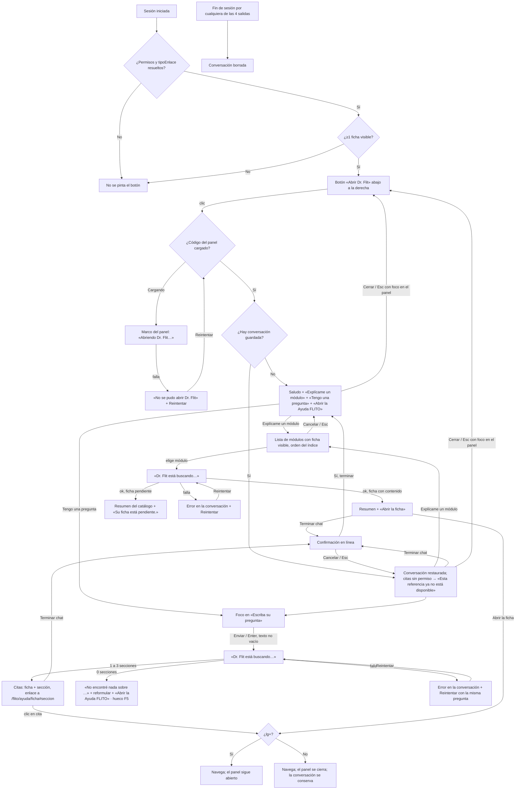

# UX — Dr. Flit: panel lateral sin IA (Feature #13694 · Épica #12757)

> Modo **full**. Superficie global nueva en el shell de `apps/web`: botón flotante + panel lateral no modal.
> Fuente de alcance: `docs/ado-drafts/epic-12756-12757/HUS-F3-13694.md` (HU-1 a HU-4 y «Decisiones P9 cerradas
> (2026-10-21)», que esta spec **no reabre**). Oficio: `docs/ux/_principios-flito.md`. Ayuda existente:
> `docs/ux/flito-ayuda.md`. Sin backend: todo sale de las fichas `.md` del bundle, filtradas en el cliente.
> Habla con la **Ayuda FLITO** (`/flito/ayuda`, módulo web sin API), no con ningún módulo `flito-*` del API.

---

## Contexto y roles

**Qué vino a hacer quien abre Dr. Flit:** resolver una duda sobre FLITO **sin salir de la pantalla en la que
trabaja**: que le expliquen un módulo o que le señalen la sección del manual que responde su pregunta, y llegar
ahí en un clic.

**Público:** operador interno con al menos una ficha de Ayuda visible (`admin`, `financiera`, `proveedor`, …: la
misma regla que gobierna el menú de la Ayuda, `puedeVerAyudaFlito(user)`). El usuario con enlace de cliente
**no** ve a Dr. Flit (D2). Tono: **usted**, como la Ayuda. Dr. Flit habla en primera persona del singular.

**Qué no es esta superficie:**
- No es un chat con IA (F4), ni radica casos de soporte (F5 #13695), ni ejecuta acciones de negocio.
- No es un segundo índice de la Ayuda: no lista fichas por defecto ni repite la búsqueda de `/flito/ayuda`.
- No es un modal: no bloquea la pantalla de fondo, no atrapa el foco y no oscurece nada.

**Dónde vive:** montado en `Layout.tsx` **fuera** del `div` con `key={location.pathname}` (así sobrevive a la
navegación, HU-1 AC6), con el panel en `lazy()` (HU-1 AC8). El botón es eager y diminuto; el panel y las fichas,
diferidos. Detalle de frontera en el slim de arquitectura (`docs/diseno/feature-13694-dr-flit-slim.md`).

---

## Qué se ve / qué se calla

**Qué se ve primero (una frase):** en el panel, **la conversación y la caja para preguntar**; con la conversación
vacía, el saludo con los dos caminos.

| Nivel | Qué |
|---|---|
| **Siempre visible** (panel abierto) | Cabecera «Dr. Flit» + «Cerrar»; la conversación; la caja «Escriba su pregunta» + **Enviar** (HU-3); «Explícame un módulo» como acceso permanente sobre la caja (HU-2) |
| **A un clic** | La lista de módulos (solo al pedirla); la ficha completa (enlace); la confirmación de «Terminar chat» |
| **No está** | Fichas sin permiso (ni en lista, ni en citas, ni descargadas); el cuerpo de la ficha dentro del panel (se cita, no se copia); puntuaciones de relevancia; «resultados 3 de 12»; nombres de archivo `.md`; claves técnicas (`flito_tramites`) como texto; botón de soporte (F5) |

**Una primaria:** **Enviar** (`flitBtnPrimary`). Todo lo demás es secundario (`flitBtnSecondarySm`) o enlace.
Antes de HU-3 (sin caja de pregunta) el panel **no tiene primaria**: el saludo ofrece caminos, ninguno pesa más.
Es intencional: en HU-1 el panel solo informa y enlaza a la Ayuda.

### Dos disposiciones evaluadas (lg+)

| | **A · Panel flotante superpuesto (recomendada)** | B · Panel que empuja el contenido |
|---|---|---|
| Qué es | Tarjeta fija a la derecha, bajo el topbar y sobre el botón; el contenido de la página sigue debajo, a su ancho | Columna de 400 px que encoge `main` mientras está abierta |
| A favor | No toca el layout de ninguna página; mismo lenguaje que el dock (tarjeta flotante del kit); se cierra y la pantalla está **idéntica** | No tapa ninguna columna |
| En contra | Tapa ~400 px de la derecha de la página (columnas de acción de algunas tablas) | Reflujo de **todas** las pantallas al abrir/cerrar (tablas, KPIs, wizards); el dock tendría que re-centrarse y re-medir; es el «efecto de layout» que los principios evitan; riesgo de regresión fuera del alcance de F3 |
| Decisión | **Elegida.** Quien necesita la columna tapada cierra el panel (Esc) y la conversación sigue ahí; las tablas del kit siguen desplazables y usables con el panel abierto (HU-1 AC3) | Descartada para F3 |

---

## Flujo de usuario (Mermaid)



Rol único: todos los usuarios con ≥1 ficha siguen el mismo flujo; lo único que cambia por rol es **qué módulos y
qué citas** aparecen (filtro de permisos de F1). No hay ramas de UI por rol.

---

## Pantalla 1 — Botón flotante (FAB) «Abrir Dr. Flit»

### Wireframe — lg+ (con el dock)

```
┌──────────────────────────────────────────────────────────────────────────────────────┐
│ [≡ FLITO]  Topbar                                        [Buscar ⌘K]  [tema] [usuario] │
├──────────────────────────────────────────────────────────────────────────────────────┤
│                                                                                        │
│   Contenido de la página (tabla, filtros, acciones…)                                   │
│                                                                                        │
│                                                                                        │
│      ┌──────────────────────────────────────────────────────────────┐                  │
│ 80px │ (●)Inicio (●)Gestión ▾ (●)Finanzas ▾ (●)Admin ▾ … dock       │ 80px      ( ? ) │
│      └──────────────────────────────────────────────────────────────┘            48px │
└───────────────────────────────────────────────────────────────── 20px del borde ─────┘
       ↑ reserva lateral simétrica del contenedor del dock cuando el botón existe
```

### Wireframe — <lg (sin dock; navegación en drawer)

```
┌───────────────────────────────┐
│ [≡]  FLITO          [👤]       │  topbar
├───────────────────────────────┤
│ Contenido de la página         │
│ …                              │
│ …                              │
│ (relleno inferior de 5rem      │
│  para que el último bloque     │
│  no quede bajo el botón)       │
│                        ( ? )   │  16px + área segura
└───────────────────────────────┘
```

### Especificación

| Aspecto | lg+ | <lg |
|---|---|---|
| Posición | `fixed`, `right: 1.5rem`, `bottom: 1.25rem` (misma línea base que el dock, `pb-5`) | `fixed`, `right: 1rem`, `bottom: calc(1rem + env(safe-area-inset-bottom))` |
| Tamaño | Círculo 48 × 48 px (`h-12 w-12 rounded-full`) | Igual |
| Superficie | Familia del dock: `bg-flit-card`, borde `border-flit-soft`, sombra `var(--flit-shadow-card)`. **No** gradiente: el gradiente es la primaria de la página y el botón no debe competir con ella | Igual |
| Icono | lucide `MessageCircleQuestion` (set ya en uso), 22 px, color `var(--flit-blue-text)`; `aria-hidden` | Igual |
| Nombre accesible | `aria-label="Abrir Dr. Flit"` + `title="Abrir Dr. Flit"` (tooltip nativo para quien ve solo el icono) | Igual |
| Estado abierto | `aria-expanded="true"`, `aria-controls` = id del panel; fondo `bg-flit-app` + icono `text-flit-ink` (velo «activo» del kit, con par oscuro) | El botón se **oculta** mientras el panel está abierto (el panel lo cubre a ancho completo); reaparece al cerrar y recibe el foco |
| Clic con el panel abierto (lg+) | **No cierra**: lleva el foco al panel. El nombre sigue siendo «Abrir Dr. Flit» y cerrar es «Cerrar»/Esc. Así el nombre nunca miente | — |
| Hover | Velo `hover:bg-[var(--flit-bg-hover)]` + `transition-colors` (≤ `--flit-duration-base`) | Igual (táctil: `active`) |
| Foco | `flit-focus` | Igual |
| Capa | `z-30` (la del dock) | `z-30` |

**Convivencia con el dock (P9-3, HU-1 AC7):** cuando el botón existe, el contenedor del dock (`FlitNavBar`, hoy
`px-4`) pasa a una reserva **simétrica** `lg:px-20` (16 px de margen + 48 px de botón + 16 px de aire). Simétrica
para que el dock siga centrado en la pantalla. La medida de ancho del dock ya descuenta el padding del contenedor
(`medir()` lee `paddingLeft/Right`), así que el condensado a iconos entra solo donde ya no cabe. Consecuencia
declarada: un `admin` (fila de 1381 px) ve el dock en iconos por debajo de ~1541 px en lugar de ~1397 px; a 1440 px
pasa a iconos. Es el coste de P9-3 y es el mecanismo existente de HU #11900, no un patrón nuevo.
Sin botón (usuario sin fichas), el dock queda exactamente como hoy.

**Contenido bajo el botón en <lg:** `main` recibe `pb-20` en <lg cuando el botón existe, para que el último
bloque de la página pueda desplazarse por encima del botón. En lg+ ya existe el relleno inferior del dock.

**Barras de acción fijas al pie en <lg:** si una página tiene una barra `fixed`/`sticky bottom-0` en <lg (p. ej.,
pie de un wizard con «Siguiente» a la derecha), el botón no puede tapar su primaria. Requisito para HU-1:
`frontend-agent` inventaría esas páginas; si existen, el botón se eleva sobre la barra con una variable de shell
(`--flit-fab-offset`, que la página fija) en vez de esconderse. Si no existen, se declara en el PR y no se añade nada.

**Visibilidad (HU-1 AC1/AC2):** el botón **no se renderiza** (ni oculto, ni con opacidad 0) hasta que los permisos
de la sesión y `tipoEnlace` estén resueltos *y* `puedeVerAyudaFlito(user)` sea verdadero. Fail-closed: sin
parpadeo para nadie. Si un refresco de permisos (`useRefrescoPermisos`) deja al usuario sin fichas, el botón y el
panel se desmontan (la conversación se conserva en `sessionStorage` hasta el fin de sesión, sin mostrarse).

Aparece también en `/flito/ayuda` y sus fichas.

---

## Pantalla 2 — Panel «Dr. Flit»

### Wireframe — lg+ (panel abierto, conversación llena, con el dock)

```
┌──────────────────────────────────────────────────────────────────────────────────────┐
│ Topbar                                                                                 │
├──────────────────────────────────────────────────────────────┬─────────────────────┬─┤
│                                                              │ Dr. Flit        [Terminar chat] [✕]│
│  Contenido de la página (usable: scroll, clics, foco)        │ Le respondo con la Ayuda FLITO.   │
│  ┌────────────────────────────────────────────────┐          ├───────────────────────────────────┤
│  │ Tabla …                                        │          │                ┌───────────────┐  │
│  │ …                                              │          │                │ Explíqueme    │  │
│  │ …                                              │          │                │ Gestión       │  │
│  └────────────────────────────────────────────────┘          │                │ Trámites      │  │
│                                                              │                └───────────────┘  │
│                                                              │ ┌───────────────────────────────┐ │
│                                                              │ │ Gestión Trámites              │ │
│                                                              │ │ Radique y siga los trámites   │ │
│                                                              │ │ de tránsito de su flota…      │ │
│                                                              │ │ Abrir la ficha →              │ │
│                                                              │ └───────────────────────────────┘ │
│                                                              │          ┌──────────────────────┐ │
│                                                              │          │ ¿cómo se entra a     │ │
│                                                              │          │ trámites?            │ │
│                                                              │          └──────────────────────┘ │
│                                                              │ ┌───────────────────────────────┐ │
│                                                              │ │ Esto es lo que encontré en    │ │
│                                                              │ │ sus manuales:                 │ │
│                                                              │ │ ┌───────────────────────────┐ │ │
│                                                              │ │ │ Gestión Trámites          │ │ │
│                                                              │ │ │ Cómo se entra           → │ │ │
│                                                              │ │ ├───────────────────────────┤ │ │
│                                                              │ │ │ Gestión Trámites          │ │ │
│                                                              │ │ │ Pasos                   → │ │ │
│                                                              │ │ └───────────────────────────┘ │ │
│                                                              │ └───────────────────────────────┘ │
│                                                              ├───────────────────────────────────┤
│                                                              │ [Explícame un módulo]             │
│                                                              │ Escriba su pregunta               │
│                                                              │ ┌─────────────────────┐ [Enviar]  │
│                                                              │ │                     │           │
│                                                              │ └─────────────────────┘           │
│                                                              └───────────────────────────────────┘
│      ┌────────────────── dock ──────────────────┐                                       ( ? )  │
└──────────────────────────────────────────────────────────────────────────────────────────────┘
```

Geometría lg+: `fixed`, `right: 1.5rem`, `top: calc(var(--flit-topbar-height) + 1rem)`, `bottom: 5.5rem` (deja el
botón a la vista debajo, HU-1 AC6), ancho `25rem` (400 px), `rounded-flit-lg`, borde `border-flit-soft`,
`bg-flit-card`, sombra `var(--flit-shadow-modal)` (la misma de los paneles del dock; no se crea sombra nueva).
Capa `z-20`: **debajo** del topbar y del dock (`z-30`), de sus paneles, de los modales de página (`z-50`), del
drawer (`z-50`), de la paleta ⌘K (`z-[100]`) y de los toasts (arriba a la derecha, por encima de todo). Un
menú del dock que se abra hacia arriba pasa por encima del panel: es lo que el usuario acaba de pedir.

Por dentro, tres franjas: cabecera fija, conversación con scroll propio, pie fijo con la caja. La página de
fondo **no** se bloquea ni pierde su scroll.

### Wireframe — <lg (panel abierto, a ancho completo, no modal)

```
┌───────────────────────────────┐
│ [≡]  FLITO          [👤]       │  topbar (sigue visible y usable)
├───────────────────────────────┤
│ Dr. Flit   [Terminar chat] [✕]│  ✕ = «Cerrar», siempre visible
│ Le respondo con la Ayuda FLITO.│
├───────────────────────────────┤
│ ┌───────────────────────────┐ │
│ │ Hola, soy Dr. Flit. Le    │ │
│ │ ayudo a encontrar         │ │
│ │ respuestas en los         │ │
│ │ manuales de los módulos   │ │
│ │ que usted usa.            │ │
│ │ ¿Por dónde empezamos?     │ │
│ │ [Explícame un módulo]     │ │
│ │ [Tengo una pregunta]      │ │
│ │ Abrir la Ayuda FLITO →    │ │
│ └───────────────────────────┘ │
│                               │
├───────────────────────────────┤
│ Escriba su pregunta           │
│ ┌───────────────────┐[Enviar] │
│ └───────────────────┘         │
│ (área segura inferior)        │
└───────────────────────────────┘
```

Geometría <lg: `fixed`, `left: 0; right: 0`, `top: var(--flit-topbar-height)`, `bottom: 0`, sin radio, borde
superior `border-flit-soft`, `bg-flit-card`; el pie suma `padding-bottom: env(safe-area-inset-bottom)`. Sin
scroll horizontal (todo `min-w-0`, textos largos con `break-words`). El input usa `text-base` (16 px) para que iOS
no haga zoom al enfocarlo. «Terminar chat» y «Cerrar» caben en 360 px; si no caben, «Terminar chat» baja a una
segunda línea de la cabecera (la cabecera envuelve, `flex-wrap`), «Cerrar» nunca se esconde.

### Wireframe — saludo (lg+, sin conversación)

```
┌───────────────────────────────────┐
│ Dr. Flit                       [✕]│   ← sin «Terminar chat» (no hay nada que terminar)
│ Le respondo con la Ayuda FLITO.   │
├───────────────────────────────────┤
│ ┌───────────────────────────────┐ │
│ │ Hola, soy Dr. Flit. Le ayudo  │ │
│ │ a encontrar respuestas en los │ │
│ │ manuales de los módulos que   │ │
│ │ usted usa.                    │ │
│ │ ¿Por dónde empezamos?         │ │   ← HU-2/HU-3
│ │ [Explícame un módulo]         │ │   ← HU-2
│ │ [Tengo una pregunta]          │ │   ← HU-3 (lleva el foco a la caja)
│ │ Abrir la Ayuda FLITO →        │ │   ← HU-1
│ └───────────────────────────────┘ │
│                                   │
├───────────────────────────────────┤
│ Escriba su pregunta               │   ← HU-3
│ ┌─────────────────────┐ [Enviar]  │
│ └─────────────────────┘           │
└───────────────────────────────────┘
```

**Por eslabón** (cadena apilada): HU-1 entrega cabecera + saludo (solo la primera frase) + «Abrir la Ayuda FLITO»;
HU-2 añade «¿Por dónde empezamos?», el botón «Explícame un módulo» (en el saludo y en el pie) y la lista; HU-3
añade «Tengo una pregunta», la caja y Enviar; HU-4 añade «Terminar chat» y la restauración.

### Wireframe — lista de módulos («Explícame un módulo»)

```
├───────────────────────────────────┤
│ … conversación previa …           │
│ ┌───────────────────────────────┐ │
│ │ ¿Qué módulo quiere conocer?   │ │
│ │                    [Cancelar] │ │
│ │ GESTIÓN                       │ │  ← rótulo de grupo del índice (texto, no botón)
│ │ [ Gestión Trámites          ] │ │  ← un botón por módulo, ancho completo
│ │ [ SOAT                      ] │ │
│ │ FINANZAS                      │ │
│ │ [ Conciliación              ] │ │
│ │ [ Facturación  Ficha pendiente]│ │  ← StatusChip neutro, mismo rótulo que la Ayuda
│ └───────────────────────────────┘ │
├───────────────────────────────────┤
```

La lista aparece como **paso transitorio al final de la conversación** (no es un mensaje: no se guarda en
`sessionStorage`). Al elegir, desaparece y quedan dos mensajes: el del usuario («Explíqueme Gestión Trámites») y
la respuesta. «Cancelar» o Esc la quitan sin dejar rastro. Orden y grupos = índice de la Ayuda
(`capitulosEnOrdenDeIndice(user)`), con los rótulos de grupo solo si el usuario ve módulos de más de un grupo.
Con la lista abierta, el botón «Explícame un módulo» del pie queda `aria-expanded="true"` y otro clic la cierra.

### Wireframe — sin resultados (y el hueco de «Necesito soporte»)

```
│ ┌───────────────────────────────┐ │
│ │ No encontré nada sobre        │ │
│ │ "xyzzy" en sus manuales.      │ │
│ │ Pruebe con otras palabras,    │ │
│ │ por ejemplo el nombre del     │ │
│ │ módulo o de la pantalla.      │ │
│ │ [Abrir la Ayuda FLITO] ░░░░░░ │ │  ← fila de acciones: hoy un solo botón
│ └───────────────────────────────┘ │       ░ = lugar reservado para F5 «Necesito soporte»
```

**Hueco de F5:** la fila de acciones del mensaje de «sin resultados» es un contenedor `flex flex-wrap gap-2` con
**un** hijo en F3 («Abrir la Ayuda FLITO», `flitBtnSecondarySm`). F5 (#13695) añadirá «Necesito soporte» como
**segundo** hijo de esa misma fila, también secundario. En F3 no se pinta nada en ese lugar: ni botón
deshabilitado, ni «Próximamente», ni espacio vacío reservado visualmente (P9-2a). La fila envuelve en <lg.

### Estados (4) por camino

#### Panel (HU-1)

| Estado | Qué se ve | Copy (usted) | Control |
|---|---|---|---|
| **Cargando** (chunk `lazy` del panel) | Marco del panel ya en su sitio (lo pinta el código eager): cabecera «Dr. Flit» + «Cerrar» y, en el cuerpo, una línea de texto | «Abriendo Dr. Flit…» (`role="status"`) | «Cerrar» funciona |
| **Error** (falla la carga del chunk) | Mismo marco; aviso en el cuerpo | **«No se pudo abrir Dr. Flit.»** / «Revise su conexión e intente de nuevo.» | **Reintentar** (`flitBtnSecondary`; única acción del cuerpo). Al tener éxito, muestra el saludo. Nota técnica: `React.lazy` cachea la promesa rechazada; el reintento necesita un `lazy()` nuevo (lo fija el slim de arquitectura) |
| **Vacío** | Saludo (no hay conversación) | Ver «Copy» | «Abrir la Ayuda FLITO» (+ caminos según eslabón) |
| **Lleno** | Conversación restaurada o en curso, desplazada al último mensaje | — | — |

#### «Explícame un módulo» (HU-2)

| Estado | Qué se ve | Copy | Control |
|---|---|---|---|
| **Cargando** (la ficha elegida se descarga/parsea) | Burbuja de Dr. Flit con una línea de texto, sin spinner | «Dr. Flit está buscando…» (anunciado por el `aria-live` de la conversación) | Enviar y «Explícame un módulo» deshabilitados hasta la respuesta |
| **Error** | Burbuja de Dr. Flit, texto `text-flit-ink` con icono `AlertCircle` en `var(--flit-danger-ink)` | «No pude cargar la ficha de Gestión Trámites.» / «Revise su conexión e intente de nuevo.» | **Reintentar** (`flitBtnSecondarySm`) en la burbuja; repite la misma elección sin duplicar el mensaje del usuario. El panel no se cierra |
| **Vacío** | No ocurre en la práctica (sin fichas no hay botón). Defensivo, si un refresco de permisos deja la lista vacía con el panel abierto: el panel se desmonta con el botón (ver Visibilidad) | — | — |
| **Lleno** | Respuesta: nombre del módulo en negrita, resumen del encabezado de la ficha, enlace **«Abrir la ficha»** (`/flito/ayuda/<clave>`). Ficha pendiente: resumen del catálogo + chip neutro «Ficha pendiente» + «Su ficha está pendiente.» y **sin** enlace (la página pendiente no añade nada al resumen) | — | Enlace |

#### «Tengo una pregunta» (HU-3)

| Estado | Qué se ve | Copy | Control |
|---|---|---|---|
| **Cargando** (primera pregunta de la sesión: carga de las fichas visibles) | Mensaje del usuario + burbuja de Dr. Flit con una línea | «Dr. Flit está buscando…» | Enviar deshabilitado hasta la respuesta; la caja sigue editable |
| **Error** | Burbuja de Dr. Flit con icono de alerta | «No pude revisar sus manuales en este momento.» / «Revise su conexión e intente de nuevo.» | **Reintentar** reenvía **la misma pregunta** (HU-3 AC8) sin duplicar el mensaje del usuario |
| **Vacío** (sin coincidencias) | Ver wireframe «sin resultados» | «No encontré nada sobre "xyzzy" en sus manuales.» / «Pruebe con otras palabras, por ejemplo el nombre del módulo o de la pantalla.» | «Abrir la Ayuda FLITO» → `/flito/ayuda` **sin** la pregunta en la URL (regla 14). En la cita del texto, la pregunta se recorta a 60 caracteres con «…» |
| **Lleno** | «Esto es lo que encontré en sus manuales:» + 1 a 3 citas. Cada cita es **un enlace** de dos líneas: título de la ficha (pequeño, `text-flit-muted`) y título de la sección (`text-flit-ink`, peso medio) + flecha `aria-hidden`. Destino `/flito/ayuda/<clave>#<ancla>` con el ancla que pinta `parseMarkdown` | — | Enlaces |

#### Conversación restaurada y «Terminar chat» (HU-4)

| Situación | Qué se ve | Copy |
|---|---|---|
| Restaurando (las citas necesitan los títulos de sección, que salen de las fichas) | Mensajes del usuario de inmediato; en cada respuesta pendiente, la línea «Dr. Flit está buscando…» | — |
| Falla la carga al restaurar | Burbuja de error al final de la conversación | «No pude recuperar las referencias de esta conversación.» / «Revise su conexión e intente de nuevo.» + **Reintentar** |
| Cita a ficha sin permiso o ancla inexistente | En el lugar de la cita, texto `text-flit-muted`, sin título ni enlace | «Esta referencia ya no está disponible» |
| Almacenamiento corrupto, de otra versión o bloqueado | Saludo (o la conversación en memoria), sin error visible | — |

### Acciones y validaciones

| Acción | Dónde | Resultado | Feedback |
|---|---|---|---|
| Abrir | Botón flotante | Panel abierto, foco dentro (ver Accesibilidad) | El propio panel |
| Cerrar | «Cerrar» (✕, `aria-label="Cerrar"`) o Esc con el foco en el panel | Panel cerrado, foco al botón «Abrir Dr. Flit», página intacta | — |
| Explícame un módulo | Botón en el saludo y en el pie | Lista transitoria al final de la conversación | — |
| Elegir módulo | Botón de la lista | Mensaje del usuario + respuesta | Anuncio en el `aria-live` |
| Tengo una pregunta | Botón en el saludo | Mueve el foco a «Escriba su pregunta» (no añade mensaje) | Foco |
| Enviar | Botón **Enviar** (primaria) o Enter en la caja | Mensaje del usuario + respuesta; la caja se vacía | Anuncio en el `aria-live` |
| Validación de la caja | — | Vacía o solo espacios: Enviar deshabilitado y Enter no hace nada. `maxLength=300`; contador «N/300» visible solo desde 250 caracteres (`aria-live="polite"` solo al llegar a 300: «Llegó al máximo de 300 caracteres.») | En línea, bajo la caja |
| Abrir una cita / «Abrir la ficha» / «Abrir la Ayuda FLITO» | Enlaces | Navegación SPA. **lg+:** el panel sigue abierto. **<lg:** el panel se cierra para que se vea la página; la conversación se conserva; el foco lo gestiona la página de destino (no se devuelve al botón, porque el usuario eligió irse) | La página destino |
| Terminar chat | `flitBtnSecondarySm` en la cabecera, solo con ≥1 mensaje | Confirmación **en línea** bajo la cabecera (no modal): «¿Terminar el chat?» / «Se borrará esta conversación y no podrá recuperarla.» + **«Sí, terminar»** (`flitBtnSecondarySm` con texto `var(--flit-danger-ink)`) + «Cancelar». Foco a «Cancelar» al abrirla (la opción segura). Esc = Cancelar | Al confirmar: vuelve el saludo y el `aria-live` anuncia «Conversación terminada.»; foco al encabezado «Dr. Flit». Sin toast |
| Volver al final | Al llegar un mensaje nuevo o al abrir el panel | La conversación se desplaza al último mensaje (sin desplazamiento animado; instantáneo) | — |

**Precedencia de Esc:** el manejador vive en el **elemento del panel**, no en `window`. Con un diálogo de página
abierto el foco está atrapado en ese diálogo, así que Esc lo cierra a él y no al panel (HU-1 AC4). Dentro del
panel, Esc cierra primero lo transitorio (confirmación de «Terminar chat» o lista de módulos) y, si no hay nada
transitorio, el panel.

### Permiso y comportamiento por rol

- **Sin `PageSlug` nuevo:** no es una página ni una ruta. La visibilidad es `puedeVerAyudaFlito(user)` (≥1 ficha
  visible, exclusión por `tipoEnlace`), con `tipoEnlace` **resuelto** como condición previa (fail-closed). Nunca
  `hasPage` (ciclo de imports documentado en `lib/ayudaFlito.ts`).
- Roles: cualquiera de `USER_ROLES` con ≥1 ficha visible ve el botón; el usuario con enlace de cliente, no.
- Lo que cambia por rol es solo el contenido: módulos de la lista, citas posibles y fichas descargadas (solo las
  visibles; la de credenciales de Siigo, por ejemplo, ni se descarga para `financiera`).
- No hay copy por rol («usted es proveedor»): Dr. Flit habla de módulos, no de roles.

### Datos (endpoint / requerimiento nuevo)

**Ningún endpoint.** Todo en cliente, sobre funciones de F1 y una nueva pura:

| Dato | Fuente |
|---|---|
| Mostrar el botón | `puedeVerAyudaFlito(user)` + `tipoEnlace` resuelto (`lib/auth.tsx`) |
| Lista de módulos | `capitulosEnOrdenDeIndice(user)` (orden y grupos del índice) |
| Resumen de un módulo | `resumenDeEntrada(entrada, ficha)` / `resumenPendiente` del catálogo |
| Citas | `buscarSecciones(fichasVisibles, consulta, 3)` (nueva, HU-3; nombre lo fija el slim) sobre la salida de `parseMarkdown` |
| Carga de fichas | `leerFichasParseadas(clavesVisibles)` (solo las visibles) |
| Conversación | `sessionStorage` versionado (HU-4): mensajes del usuario + referencias `{clave, ancla}`; nunca resúmenes ni cuerpos |

Requerimientos nuevos de datos: **ninguno** de backend. Para `architecture-agent` (slim, ya previsto): frontera
eager/lazy (el **marco** del panel y sus estados cargando/error son eager; el contenido es lazy) y reintento de un
`lazy()` rechazado.

---

## Copy (español, usted, sin tecnicismos)

| Lugar | Texto |
|---|---|
| Botón flotante (nombre y tooltip) | Abrir Dr. Flit |
| Cabecera | **Dr. Flit** · subtítulo: Le respondo con la Ayuda FLITO. |
| Saludo | Hola, soy Dr. Flit. Le ayudo a encontrar respuestas en los manuales de los módulos que usted usa. |
| Saludo (HU-2+) | ¿Por dónde empezamos? · [Explícame un módulo] · [Tengo una pregunta] |
| Enlace del saludo | Abrir la Ayuda FLITO |
| Lista | ¿Qué módulo quiere conocer? · [Cancelar] |
| Mensaje del usuario al elegir | Explíqueme Gestión Trámites |
| Respuesta (módulo) | **Gestión Trámites** · <resumen> · Abrir la ficha |
| Respuesta (pendiente) | **Facturación** · <resumen del catálogo> · Su ficha está pendiente. |
| Respuesta (pregunta) | Esto es lo que encontré en sus manuales: |
| Sin resultados | No encontré nada sobre "<pregunta>" en sus manuales. · Pruebe con otras palabras, por ejemplo el nombre del módulo o de la pantalla. · [Abrir la Ayuda FLITO] |
| Buscando | Dr. Flit está buscando… |
| Error panel | No se pudo abrir Dr. Flit. · Revise su conexión e intente de nuevo. · [Reintentar] |
| Error módulo | No pude cargar la ficha de <módulo>. · Revise su conexión e intente de nuevo. · [Reintentar] |
| Error pregunta | No pude revisar sus manuales en este momento. · Revise su conexión e intente de nuevo. · [Reintentar] |
| Error restauración | No pude recuperar las referencias de esta conversación. · Revise su conexión e intente de nuevo. · [Reintentar] |
| Referencia caída | Esta referencia ya no está disponible |
| Caja | Rótulo visible: Escriba su pregunta · sin placeholder que repita el rótulo · botón: Enviar |
| Tope | N/300 · Llegó al máximo de 300 caracteres. |
| Terminar | [Terminar chat] · ¿Terminar el chat? · Se borrará esta conversación y no podrá recuperarla. · [Sí, terminar] [Cancelar] · (anuncio) Conversación terminada. |

Glosario: «módulo», «ficha», «Ayuda FLITO», «manuales» (como en el Feature). Prohibido en copy: «chunk»,
«sessionStorage», «sección no encontrada», «0 resultados», «error 404», `e.message`.

---

## Responsive (<lg) — una línea por pieza

- **Botón:** abajo a la derecha con área segura; `main` gana `pb-20` para no esconder el final de la página; se
  oculta mientras el panel está abierto y vuelve con el foco al cerrarlo.
- **Panel:** a ancho completo bajo el topbar, sin radio ni scroll horizontal, no modal (sin trampa de foco, sin
  `aria-modal`, sin bloquear el scroll de fondo); «Cerrar» siempre visible; la cabecera envuelve.
- **Lista de módulos y citas:** una columna, botones/enlaces a ancho completo, objetivos táctiles ≥ 44 px de alto.
- **Fila de acciones de «sin resultados»:** envuelve (`flex-wrap`), así cabrá el botón de F5.
- **Navegar desde el panel** (cita, ficha, Ayuda): cierra el panel; la conversación se conserva.
- **Caja:** 16 px de fuente; Enviar a su derecha; si no cabe (≤ 340 px), Enviar baja bajo la caja a ancho completo.

---

## Interacción y notificaciones

**Feedback de controles (ninguno plano):**

| Control | Hover | Foco | Otros |
|---|---|---|---|
| Botón flotante | velo `--flit-bg-hover` | `flit-focus` | abierto: `bg-flit-app` |
| Cerrar (✕) | velo `--flit-bg-hover`, como el ✕ de `ToastFlito` | `flit-focus` | 32 × 32 px (44 en <lg) |
| Terminar chat / Cancelar / Sí, terminar / Reintentar / Abrir la Ayuda FLITO / Explícame un módulo / Tengo una pregunta | `HOVER_SECUNDARIO` del kit (`flitBtnSecondarySm`) | `flit-focus` | `disabled` del kit mientras Dr. Flit busca |
| Botón de módulo en la lista | velo `--flit-bg-hover` + texto `text-flit-ink` | `flit-focus` | — |
| Cita (enlace de dos líneas) | velo `--flit-bg-hover` sobre la tarjeta de la cita + subrayado del título de sección | `flit-focus` | — |
| «Abrir la ficha» | subrayado + `text-flit-ink` | `flit-focus` | color `var(--flit-blue-text)` |
| Enviar | `flitBtnPrimary` (velo de pulsación del kit) | `flit-focus` | `DESHABILITADO_PRIMARIO` con caja vacía o buscando |
| Caja | borde `flitInp` | `flit-focus` / anillo del input del kit | — |

`transition-colors` ≤ `--flit-duration-base`. Sin aparición deslizante del panel, sin rebote del botón, sin
«escribiendo…» animado, sin avatar ilustrado: el panel aparece y desaparece en seco (respeta
`prefers-reduced-motion` por construcción).

**Notificaciones: Dr. Flit no usa toasts.** Todo resultado ocurre **dentro del panel**, que es el contexto que el
usuario está mirando: respuestas, errores con Reintentar y la confirmación de «Terminar chat» son mensajes en la
conversación o avisos en línea, anunciados por la región `aria-live`. Un toast duplicaría lo que ya se ve, y los
toasts salen arriba a la derecha, justo encima del panel. Ningún texto muestra el error crudo.

---

## Accesibilidad

| Pieza | Rol / nombre | Nota |
|---|---|---|
| Panel | `<aside aria-labelledby="drflit-titulo">` → landmark `complementary` con nombre **«Dr. Flit»** (encabezado `<h2 id="drflit-titulo" tabIndex={-1}>Dr. Flit</h2>`) | **No** `role="dialog"` ni `aria-modal`: es no modal y persiste al navegar. Sin trampa de foco, sin `inert` en el fondo |
| Botón flotante | `<button aria-label="Abrir Dr. Flit" aria-expanded aria-controls>` | El nombre no cambia con el estado |
| Foco al abrir | A la caja «Escriba su pregunta» si existe (HU-3+); si no, al encabezado «Dr. Flit». Al entrar en el landmark, el lector anuncia «Dr. Flit, complementario» | — |
| Foco al cerrar | Siempre al botón «Abrir Dr. Flit» (Cerrar o Esc) | En <lg, por navegación, lo gestiona la página destino |
| Conversación | `<div role="log" aria-live="polite" aria-relevant="additions">`; cada mensaje con prefijo `sr-only` «Usted:» / «Dr. Flit:» | La respuesta se anuncia **sin mover el foco** (HU-2 AC5) |
| Buscando | Texto dentro del `log` (se anuncia una vez) | No `aria-busy` en todo el panel |
| Error | Dentro del `log`; Reintentar es un `<button>` con texto | No `role="alert"` además (doble anuncio) |
| Lista de módulos | `<ul>` de `<button>` con el nombre como texto (HU-2 AC5); rótulos de grupo como `<p>` / encabezado de lista, no botones; el chip «Ficha pendiente» dentro del nombre accesible del botón | El botón del pie: `aria-expanded` según la lista |
| Citas | `<ul>` de `<a>`; el texto del enlace contiene ficha y sección («Gestión Trámites, Cómo se entra»), la flecha `aria-hidden` | HU-3 AC9 |
| «Abrir la ficha» | Texto visible «Abrir la ficha» + `sr-only` « de Gestión Trámites» | Varios en la conversación no quedan con el mismo nombre |
| Caja | `<label for>` visible «Escriba su pregunta»; Enter envía; `maxLength=300`; contador ligado con `aria-describedby` | HU-3 AC9 |
| Confirmación | Grupo con `role="group" aria-labelledby` (la pregunta) | Foco a «Cancelar»; Esc = Cancelar |
| Contraste | Texto con `text-flit-ink`/`text-flit-secondary`/`text-flit-muted` sobre `bg-flit-card` y `bg-flit-app` (≥ 4.5:1 en los dos temas, ya verificados por `check:contraste`); icono del botón `--flit-blue-text` sobre `bg-flit-card` ≥ 3:1 (gráfico) en claro y oscuro; error con `--flit-danger-ink` | **Ningún token nuevo**. Burbuja del usuario: `bg-flit-app` + `text-flit-ink`; de Dr. Flit: `bg-flit-card` + borde `border-flit-soft` |
| Tema oscuro | Solo tokens `--flit-*` con par oscuro; prohibido `bg-white`, `slate-*`, `red-*` | Verificación visual en ambos temas |
| Orden de tabulación | Cabecera (Terminar chat, Cerrar) → conversación (enlaces y botones de los mensajes) → pie (Explícame un módulo, caja, Enviar). El panel va en el DOM **después** de `main` | Sin `tabIndex` positivos |

---

## Notas para QA

1. **Visibilidad fail-closed:** con `/permisos/mios` retenido (Playwright `route` con demora) el botón no aparece
   para nadie; con enlace de cliente no aparece nunca (HU-1 AC2). Con `financiera`, sí, también en `/flito/ayuda`.
2. **Dock (lg+):** a 1920, 1440 y 1100 px con `admin`, el rectángulo del botón no interseca el del dock (expandido
   ni condensado) y el dock sigue en una fila. Con un usuario sin botón, el dock no cambia.
3. **No modal:** con el panel abierto se puede desplazar y pulsar la tabla de fondo; Tab desde Enviar sale del
   panel; no hay `aria-modal`.
4. **Esc:** con un `FlitModal` abierto encima, Esc cierra el modal y el panel sigue abierto; con el foco en el
   panel, Esc cierra (o primero la confirmación/lista) y el foco vuelve a «Abrir Dr. Flit».
5. **Navegación:** lg+ el panel sigue abierto al cambiar de módulo desde el dock y al pulsar una cita; <lg una cita
   cierra el panel y la ficha queda en la sección del ancla (incluido sufijo `-2`).
6. **Cargando/error:** demorar y luego abortar el chunk del panel → «Abriendo Dr. Flit…» → error → Reintentar →
   saludo. Abortar la ficha / las fichas → error en la conversación → Reintentar sin duplicar el mensaje.
7. **Sin resultados:** «xyzzy» → copy literal, un solo botón «Abrir la Ayuda FLITO», URL resultante `/flito/ayuda`
   sin query ni hash con la pregunta; sin botón de soporte.
8. **Móvil 360 × 740:** panel a ancho completo, sin scroll horizontal, «Cerrar» visible, botón flotante oculto con
   el panel abierto; última fila de una página larga alcanzable sobre el botón; páginas con barra fija al pie
   (inventario de HU-1) sin la primaria tapada.
9. **Tema oscuro:** botón, burbujas, citas, error y confirmación legibles; sin superficies blancas.
10. **Terminar chat:** solo aparece con mensajes; confirmación en línea con foco en «Cancelar»; al confirmar vuelve
    el saludo y se anuncia «Conversación terminada.»; ningún toast en todo el flujo.

---

## Decisiones y descartes

| Decisión | Por qué | Descartado |
|---|---|---|
| Panel flotante superpuesto (disposición A) | No toca el layout de ninguna página; se cierra y la pantalla está idéntica | Panel que empuja el contenido (B): reflujo global y re-centrado del dock, fuera del alcance de F3 |
| Botón circular de icono, superficie de tarjeta | Familia del dock; no compite con la primaria (gradiente) de cada página | Píldora con texto «Dr. Flit» (más ancho que reservar al dock); gradiente de marca (segunda primaria en cada pantalla); insignia o pulso de «nuevo» (adorno) |
| Reserva simétrica `lg:px-20` en el contenedor del dock | Dock centrado y mecanismo de condensado existente; P9-3 «fuera del ancho del dock» | Reserva solo a la derecha (descentra el dock); subir el botón por encima del dock (rompe «alineado con la línea del dock» de P9-3) |
| ~~El botón no cierra el panel; solo «Cerrar»/Esc~~ **Revisado 2026-10-22 (pedido de David, HU #13764):** el botón conmuta (estado en `aria-expanded` + `aria-controls`; el `title` alterna «Cerrar Dr. Flit»; el `aria-label` sigue «Abrir Dr. Flit» para no chocar con los «Cerrar» de la página) y un clic fuera del panel lo cierra (sin overlay; el clic también hace su acción, incluido el menú; el foco se queda donde se hizo clic). La conversación se conserva en la sesión | Paridad con FLIT 2 | Cerrar solo con «Cerrar»/Esc |
| Avatar oficial (2026-10-22): robot saludando en el botón (64 px), cabeza en la cabecera (40 px) y en los mensajes (32 px), decorativos (`alt=""`), en `public/assets/dr-flit/*.webp` vía `DR_FLIT_ASSETS` | Mismos recursos y usos que FLIT 2, optimizados a WebP | Ícono genérico de F3; PNG sin optimizar |
| `<aside>` complementario, no `dialog` | Es no modal y persiste al navegar | `role="dialog" aria-modal="false"` (los lectores lo tratan como algo que hay que cerrar) |
| Lista de módulos transitoria, no mensaje | No ensucia la conversación ni el almacenamiento con 18 botones | Lista fija en el saludo (satura el panel con cada apertura); combobox (patrón más pesado para ≤ 18 opciones) |
| «Tengo una pregunta» solo enfoca la caja | El camino es explícito para quien llega por primera vez, sin pantalla intermedia | Paso separado con su propia vista |
| Ficha pendiente sin enlace | La página pendiente no añade nada al resumen | Enlace a una ficha vacía |
| Sin toasts | Todo resultado ya está en el panel y los toasts saldrían encima de él | Toast «Chat terminado» |
| Confirmación en línea de «Terminar chat» | Acción destructiva sin modal sobre un panel no modal | `FlitModal` de confirmación (modal sobre no modal); terminar sin confirmar |
| Hueco de F5 = segundo hijo de la fila de «sin resultados» | P9-2a | Botón deshabilitado «Próximamente»; espacio vacío reservado visualmente |
| Sin animación de apertura ni «escribiendo…» | Principios: sin efectos vistosos | Deslizamiento lateral, puntos animados, avatar ilustrado |
| No mostrar el cuerpo de la ficha en el panel | El panel cita y enlaza; leer es trabajo de la ficha | Acordeón con la sección completa dentro del panel (duplica la ficha, densidad) |
