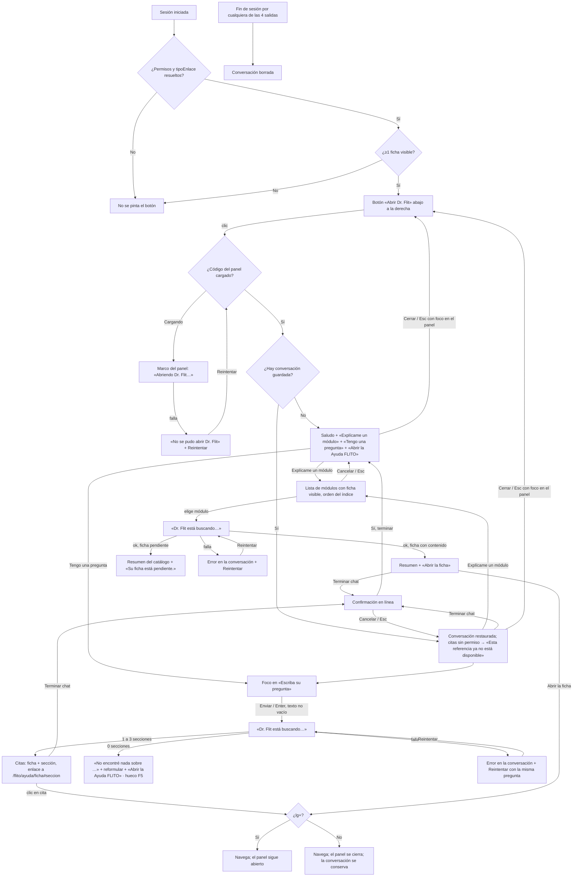

# UX — Dr. Flit: panel lateral sin IA (Feature #13694 · Épica #12757)

> Modo **full**. Superficie global nueva en el shell de `apps/web`: botón flotante + panel lateral no modal.
> Fuente de alcance: `docs/ado-drafts/epic-12756-12757/HUS-F3-13694.md` (HU-1 a HU-4 y «Decisiones P9 cerradas
> (2026-10-21)», que esta spec **no reabre**). Oficio: `docs/ux/_principios-flito.md`. Ayuda existente:
> `docs/ux/flito-ayuda.md`. Sin backend: todo sale de las fichas `.md` del bundle, filtradas en el cliente.
> Habla con la **Ayuda FLITO** (`/flito/ayuda`, módulo web sin API), no con ningún módulo `flito-*` del API.

---

## Contexto y roles

**Qué vino a hacer quien abre Dr. Flit:** resolver una duda sobre FLITO **sin salir de la pantalla en la que
trabaja**: que le expliquen un módulo o que le señalen la sección del manual que responde su pregunta, y llegar
ahí en un clic.

**Público:** operador interno con al menos una ficha de Ayuda visible (`admin`, `financiera`, `proveedor`, …: la
misma regla que gobierna el menú de la Ayuda, `puedeVerAyudaFlito(user)`). El usuario con enlace de cliente
**no** ve a Dr. Flit (D2). Tono: **usted**, como la Ayuda. Dr. Flit habla en primera persona del singular.

**Qué no es esta superficie:**
- No es un chat con IA (F4), ni radica casos de soporte (F5 #13695), ni ejecuta acciones de negocio.
- No es un segundo índice de la Ayuda: no lista fichas por defecto ni repite la búsqueda de `/flito/ayuda`.
- No es un modal: no bloquea la pantalla de fondo, no atrapa el foco y no oscurece nada.

**Dónde vive:** montado en `Layout.tsx` **fuera** del `div` con `key={location.pathname}` (así sobrevive a la
navegación, HU-1 AC6), con el panel en `lazy()` (HU-1 AC8). El botón es eager y diminuto; el panel y las fichas,
diferidos. Detalle de frontera en el slim de arquitectura (`docs/diseno/feature-13694-dr-flit-slim.md`).

---

## Qué se ve / qué se calla

**Qué se ve primero (una frase):** en el panel, **la conversación y la caja para preguntar**; con la conversación
vacía, el saludo con los dos caminos.

| Nivel | Qué |
|---|---|
| **Siempre visible** (panel abierto) | Cabecera «Dr. Flit» + «Cerrar»; la conversación; la caja «Escriba su pregunta» + **Enviar** (HU-3); «Explícame un módulo» como acceso permanente sobre la caja (HU-2) |
| **A un clic** | La lista de módulos (solo al pedirla); la ficha completa (enlace); la confirmación de «Terminar chat» |
| **No está** | Fichas sin permiso (ni en lista, ni en citas, ni descargadas); el cuerpo de la ficha dentro del panel (se cita, no se copia); puntuaciones de relevancia; «resultados 3 de 12»; nombres de archivo `.md`; claves técnicas (`flito_tramites`) como texto; botón de soporte (F5) |

**Una primaria:** **Enviar** (`flitBtnPrimary`). Todo lo demás es secundario (`flitBtnSecondarySm`) o enlace.
Antes de HU-3 (sin caja de pregunta) el panel **no tiene primaria**: el saludo ofrece caminos, ninguno pesa más.
Es intencional: en HU-1 el panel solo informa y enlaza a la Ayuda.

### Dos disposiciones evaluadas (lg+)

| | **A · Panel flotante superpuesto (recomendada)** | B · Panel que empuja el contenido |
|---|---|---|
| Qué es | Tarjeta fija a la derecha, bajo el topbar y sobre el botón; el contenido de la página sigue debajo, a su ancho | Columna de 400 px que encoge `main` mientras está abierta |
| A favor | No toca el layout de ninguna página; mismo lenguaje que el dock (tarjeta flotante del kit); se cierra y la pantalla está **idéntica** | No tapa ninguna columna |
| En contra | Tapa ~400 px de la derecha de la página (columnas de acción de algunas tablas) | Reflujo de **todas** las pantallas al abrir/cerrar (tablas, KPIs, wizards); el dock tendría que re-centrarse y re-medir; es el «efecto de layout» que los principios evitan; riesgo de regresión fuera del alcance de F3 |
| Decisión | **Elegida.** Quien necesita la columna tapada cierra el panel (Esc) y la conversación sigue ahí; las tablas del kit siguen desplazables y usables con el panel abierto (HU-1 AC3) | Descartada para F3 |

---

## Flujo de usuario (Mermaid)



Rol único: todos los usuarios con ≥1 ficha siguen el mismo flujo; lo único que cambia por rol es **qué módulos y
qué citas** aparecen (filtro de permisos de F1). No hay ramas de UI por rol.

---

## Pantalla 1 — Botón flotante (FAB) «Abrir Dr. Flit»

### Wireframe — lg+ (con el dock)

```
┌──────────────────────────────────────────────────────────────────────────────────────┐
│ [≡ FLITO]  Topbar                                        [Buscar ⌘K]  [tema] [usuario] │
├──────────────────────────────────────────────────────────────────────────────────────┤
│                                                                                        │
│   Contenido de la página (tabla, filtros, acciones…)                                   │
│                                                                                        │
│                                                                                        │
│      ┌──────────────────────────────────────────────────────────────┐                  │
│ 80px │ (●)Inicio (●)Gestión ▾ (●)Finanzas ▾ (●)Admin ▾ … dock       │ 80px      ( ? ) │
│      └──────────────────────────────────────────────────────────────┘            48px │
└───────────────────────────────────────────────────────────────── 20px del borde ─────┘
       ↑ reserva lateral simétrica del contenedor del dock cuando el botón existe
```

### Wireframe — <lg (sin dock; navegación en drawer)

```
┌───────────────────────────────┐
│ [≡]  FLITO          [👤]       │  topbar
├───────────────────────────────┤
│ Contenido de la página         │
│ …                              │
│ …                              │
│ (relleno inferior de 5rem      │
│  para que el último bloque     │
│  no quede bajo el botón)       │
│                        ( ? )   │  16px + área segura
└───────────────────────────────┘
```

### Especificación

| Aspecto | lg+ | <lg |
|---|---|---|
| Posición | `fixed`, `right: 1.5rem`, `bottom: 1.25rem` (misma línea base que el dock, `pb-5`) | `fixed`, `right: 1rem`, `bottom: calc(1rem + env(safe-area-inset-bottom))` |
| Tamaño | Círculo 48 × 48 px (`h-12 w-12 rounded-full`) | Igual |
| Superficie | Familia del dock: `bg-flit-card`, borde `border-flit-soft`, sombra `var(--flit-shadow-card)`. **No** gradiente: el gradiente es la primaria de la página y el botón no debe competir con ella | Igual |
| Icono | lucide `MessageCircleQuestion` (set ya en uso), 22 px, color `var(--flit-blue-text)`; `aria-hidden` | Igual |
| Nombre accesible | `aria-label="Abrir Dr. Flit"` + `title="Abrir Dr. Flit"` (tooltip nativo para quien ve solo el icono) | Igual |
| Estado abierto | `aria-expanded="true"`, `aria-controls` = id del panel; fondo `bg-flit-app` + icono `text-flit-ink` (velo «activo» del kit, con par oscuro) | El botón se **oculta** mientras el panel está abierto (el panel lo cubre a ancho completo); reaparece al cerrar y recibe el foco |
| Clic con el panel abierto (lg+) | **No cierra**: lleva el foco al panel. El nombre sigue siendo «Abrir Dr. Flit» y cerrar es «Cerrar»/Esc. Así el nombre nunca miente | — |
| Hover | Velo `hover:bg-[var(--flit-bg-hover)]` + `transition-colors` (≤ `--flit-duration-base`) | Igual (táctil: `active`) |
| Foco | `flit-focus` | Igual |
| Capa | `z-30` (la del dock) | `z-30` |

**Convivencia con el dock (P9-3, HU-1 AC7):** cuando el botón existe, el contenedor del dock (`FlitNavBar`, hoy
`px-4`) pasa a una reserva **simétrica** `lg:px-20` (16 px de margen + 48 px de botón + 16 px de aire). Simétrica
para que el dock siga centrado en la pantalla. La medida de ancho del dock ya descuenta el padding del contenedor
(`medir()` lee `paddingLeft/Right`), así que el condensado a iconos entra solo donde ya no cabe. Consecuencia
declarada: un `admin` (fila de 1381 px) ve el dock en iconos por debajo de ~1541 px en lugar de ~1397 px; a 1440 px
pasa a iconos. Es el coste de P9-3 y es el mecanismo existente de HU #11900, no un patrón nuevo.
Sin botón (usuario sin fichas), el dock queda exactamente como hoy.

**Contenido bajo el botón en <lg:** `main` recibe `pb-20` en <lg cuando el botón existe, para que el último
bloque de la página pueda desplazarse por encima del botón. En lg+ ya existe el relleno inferior del dock.

**Barras de acción fijas al pie en <lg:** si una página tiene una barra `fixed`/`sticky bottom-0` en <lg (p. ej.,
pie de un wizard con «Siguiente» a la derecha), el botón no puede tapar su primaria. Requisito para HU-1:
`frontend-agent` inventaría esas páginas; si existen, el botón se eleva sobre la barra con una variable de shell
(`--flit-fab-offset`, que la página fija) en vez de esconderse. Si no existen, se declara en el PR y no se añade nada.

**Visibilidad (HU-1 AC1/AC2):** el botón **no se renderiza** (ni oculto, ni con opacidad 0) hasta que los permisos
de la sesión y `tipoEnlace` estén resueltos *y* `puedeVerAyudaFlito(user)` sea verdadero. Fail-closed: sin
parpadeo para nadie. Si un refresco de permisos (`useRefrescoPermisos`) deja al usuario sin fichas, el botón y el
panel se desmontan (la conversación se conserva en `sessionStorage` hasta el fin de sesión, sin mostrarse).

Aparece también en `/flito/ayuda` y sus fichas.

---

## Pantalla 2 — Panel «Dr. Flit»

### Wireframe — lg+ (panel abierto, conversación llena, con el dock)

```
┌──────────────────────────────────────────────────────────────────────────────────────┐
│ Topbar                                                                                 │
├──────────────────────────────────────────────────────────────┬─────────────────────┬─┤
│                                                              │ Dr. Flit        [Terminar chat] [✕]│
│  Contenido de la página (usable: scroll, clics, foco)        │ Le respondo con la Ayuda FLITO.   │
│  ┌────────────────────────────────────────────────┐          ├───────────────────────────────────┤
│  │ Tabla …                                        │          │                ┌───────────────┐  │
│  │ …                                              │          │                │ Explíqueme    │  │
│  │ …                                              │          │                │ Gestión       │  │
│  └────────────────────────────────────────────────┘          │                │ Trámites      │  │
│                                                              │                └───────────────┘  │
│                                                              │ ┌───────────────────────────────┐ │
│                                                              │ │ Gestión Trámites              │ │
│                                                              │ │ Radique y siga los trámites   │ │
│                                                              │ │ de tránsito de su flota…      │ │
│                                                              │ │ Abrir la ficha →              │ │
│                                                              │ └───────────────────────────────┘ │
│                                                              │          ┌──────────────────────┐ │
│                                                              │          │ ¿cómo se entra a     │ │
│                                                              │          │ trámites?            │ │
│                                                              │          └──────────────────────┘ │
│                                                              │ ┌───────────────────────────────┐ │
│                                                              │ │ Esto es lo que encontré en    │ │
│                                                              │ │ sus manuales:                 │ │
│                                                              │ │ ┌───────────────────────────┐ │ │
│                                                              │ │ │ Gestión Trámites          │ │ │
│                                                              │ │ │ Cómo se entra           → │ │ │
│                                                              │ │ ├───────────────────────────┤ │ │
│                                                              │ │ │ Gestión Trámites          │ │ │
│                                                              │ │ │ Pasos                   → │ │ │
│                                                              │ │ └───────────────────────────┘ │ │
│                                                              │ └───────────────────────────────┘ │
│                                                              ├───────────────────────────────────┤
│                                                              │ [Explícame un módulo]             │
│                                                              │ Escriba su pregunta               │
│                                                              │ ┌─────────────────────┐ [Enviar]  │
│                                                              │ │                     │           │
│                                                              │ └─────────────────────┘           │
│                                                              └───────────────────────────────────┘
│      ┌────────────────── dock ──────────────────┐                                       ( ? )  │
└──────────────────────────────────────────────────────────────────────────────────────────────┘
```

Geometría lg+: `fixed`, `right: 1.5rem`, `top: calc(var(--flit-topbar-height) + 1rem)`, `bottom: 5.5rem` (deja el
botón a la vista debajo, HU-1 AC6), ancho `25rem` (400 px), `rounded-flit-lg`, borde `border-flit-soft`,
`bg-flit-card`, sombra `var(--flit-shadow-modal)` (la misma de los paneles del dock; no se crea sombra nueva).
Capa `z-20`: **debajo** del topbar y del dock (`z-30`), de sus paneles, de los modales de página (`z-50`), del
drawer (`z-50`), de la paleta ⌘K (`z-[100]`) y de los toasts (arriba a la derecha, por encima de todo). Un
menú del dock que se abra hacia arriba pasa por encima del panel: es lo que el usuario acaba de pedir.

Por dentro, tres franjas: cabecera fija, conversación con scroll propio, pie fijo con la caja. La página de
fondo **no** se bloquea ni pierde su scroll.

### Wireframe — <lg (panel abierto, a ancho completo, no modal)

```
┌───────────────────────────────┐
│ [≡]  FLITO          [👤]       │  topbar (sigue visible y usable)
├───────────────────────────────┤
│ Dr. Flit   [Terminar chat] [✕]│  ✕ = «Cerrar», siempre visible
│ Le respondo con la Ayuda FLITO.│
├───────────────────────────────┤
│ ┌───────────────────────────┐ │
│ │ Hola, soy Dr. Flit. Le    │ │
│ │ ayudo a encontrar         │ │
│ │ respuestas en los         │ │
│ │ manuales de los módulos   │ │
│ │ que usted usa.            │ │
│ │ ¿Por dónde empezamos?     │ │
│ │ [Explícame un módulo]     │ │
│ │ [Tengo una pregunta]      │ │
│ │ Abrir la Ayuda FLITO →    │ │
│ └───────────────────────────┘ │
│                               │
├───────────────────────────────┤
│ Escriba su pregunta           │
│ ┌───────────────────┐[Enviar] │
│ └───────────────────┘         │
│ (área segura inferior)        │
└───────────────────────────────┘
```

Geometría <lg: `fixed`, `left: 0; right: 0`, `top: var(--flit-topbar-height)`, `bottom: 0`, sin radio, borde
superior `border-flit-soft`, `bg-flit-card`; el pie suma `padding-bottom: env(safe-area-inset-bottom)`. Sin
scroll horizontal (todo `min-w-0`, textos largos con `break-words`). El input usa `text-base` (16 px) para que iOS
no haga zoom al enfocarlo. «Terminar chat» y «Cerrar» caben en 360 px; si no caben, «Terminar chat» baja a una
segunda línea de la cabecera (la cabecera envuelve, `flex-wrap`), «Cerrar» nunca se esconde.

### Wireframe — saludo (lg+, sin conversación)

```
┌───────────────────────────────────┐
│ Dr. Flit                       [✕]│   ← sin «Terminar chat» (no hay nada que terminar)
│ Le respondo con la Ayuda FLITO.   │
├───────────────────────────────────┤
│ ┌───────────────────────────────┐ │
│ │ Hola, soy Dr. Flit. Le ayudo  │ │
│ │ a encontrar respuestas en los │ │
│ │ manuales de los módulos que   │ │
│ │ usted usa.                    │ │
│ │ ¿Por dónde empezamos?         │ │   ← HU-2/HU-3
│ │ [Explícame un módulo]         │ │   ← HU-2
│ │ [Tengo una pregunta]          │ │   ← HU-3 (lleva el foco a la caja)
│ │ Abrir la Ayuda FLITO →        │ │   ← HU-1
│ └───────────────────────────────┘ │
│                                   │
├───────────────────────────────────┤
│ Escriba su pregunta               │   ← HU-3
│ ┌─────────────────────┐ [Enviar]  │
│ └─────────────────────┘           │
└───────────────────────────────────┘
```

**Por eslabón** (cadena apilada): HU-1 entrega cabecera + saludo (solo la primera frase) + «Abrir la Ayuda FLITO»;
HU-2 añade «¿Por dónde empezamos?», el botón «Explícame un módulo» (en el saludo y en el pie) y la lista; HU-3
añade «Tengo una pregunta», la caja y Enviar; HU-4 añade «Terminar chat» y la restauración.

### Wireframe — lista de módulos («Explícame un módulo»)

```
├───────────────────────────────────┤
│ … conversación previa …           │
│ ┌───────────────────────────────┐ │
│ │ ¿Qué módulo quiere conocer?   │ │
│ │                    [Cancelar] │ │
│ │ GESTIÓN                       │ │  ← rótulo de grupo del índice (texto, no botón)
│ │ [ Gestión Trámites          ] │ │  ← un botón por módulo, ancho completo
│ │ [ SOAT                      ] │ │
│ │ FINANZAS                      │ │
│ │ [ Conciliación              ] │ │
│ │ [ Facturación  Ficha pendiente]│ │  ← StatusChip neutro, mismo rótulo que la Ayuda
│ └───────────────────────────────┘ │
├───────────────────────────────────┤
```

La lista aparece como **paso transitorio al final de la conversación** (no es un mensaje: no se guarda en
`sessionStorage`). Al elegir, desaparece y quedan dos mensajes: el del usuario («Explíqueme Gestión Trámites») y
la respuesta. «Cancelar» o Esc la quitan sin dejar rastro. Orden y grupos = índice de la Ayuda
(`capitulosEnOrdenDeIndice(user)`), con los rótulos de grupo solo si el usuario ve módulos de más de un grupo.
Con la lista abierta, el botón «Explícame un módulo» del pie queda `aria-expanded="true"` y otro clic la cierra.

### Wireframe — sin resultados (y el hueco de «Necesito soporte»)

```
│ ┌───────────────────────────────┐ │
│ │ No encontré nada sobre        │ │
│ │ "xyzzy" en sus manuales.      │ │
│ │ Pruebe con otras palabras,    │ │
│ │ por ejemplo el nombre del     │ │
│ │ módulo o de la pantalla.      │ │
│ │ [Abrir la Ayuda FLITO] ░░░░░░ │ │  ← fila de acciones: hoy un solo botón
│ └───────────────────────────────┘ │       ░ = lugar reservado para F5 «Necesito soporte»
```

**Hueco de F5:** la fila de acciones del mensaje de «sin resultados» es un contenedor `flex flex-wrap gap-2` con
**un** hijo en F3 («Abrir la Ayuda FLITO», `flitBtnSecondarySm`). F5 (#13695) añadirá «Necesito soporte» como
**segundo** hijo de esa misma fila, también secundario. En F3 no se pinta nada en ese lugar: ni botón
deshabilitado, ni «Próximamente», ni espacio vacío reservado visualmente (P9-2a). La fila envuelve en <lg.

### Estados (4) por camino

#### Panel (HU-1)

| Estado | Qué se ve | Copy (usted) | Control |
|---|---|---|---|
| **Cargando** (chunk `lazy` del panel) | Marco del panel ya en su sitio (lo pinta el código eager): cabecera «Dr. Flit» + «Cerrar» y, en el cuerpo, una línea de texto | «Abriendo Dr. Flit…» (`role="status"`) | «Cerrar» funciona |
| **Error** (falla la carga del chunk) | Mismo marco; aviso en el cuerpo | **«No se pudo abrir Dr. Flit.»** / «Revise su conexión e intente de nuevo.» | **Reintentar** (`flitBtnSecondary`; única acción del cuerpo). Al tener éxito, muestra el saludo. Nota técnica: `React.lazy` cachea la promesa rechazada; el reintento necesita un `lazy()` nuevo (lo fija el slim de arquitectura) |
| **Vacío** | Saludo (no hay conversación) | Ver «Copy» | «Abrir la Ayuda FLITO» (+ caminos según eslabón) |
| **Lleno** | Conversación restaurada o en curso, desplazada al último mensaje | — | — |

#### «Explícame un módulo» (HU-2)

| Estado | Qué se ve | Copy | Control |
|---|---|---|---|
| **Cargando** (la ficha elegida se descarga/parsea) | Burbuja de Dr. Flit con una línea de texto, sin spinner | «Dr. Flit está buscando…» (anunciado por el `aria-live` de la conversación) | Enviar y «Explícame un módulo» deshabilitados hasta la respuesta |
| **Error** | Burbuja de Dr. Flit, texto `text-flit-ink` con icono `AlertCircle` en `var(--flit-danger-ink)` | «No pude cargar la ficha de Gestión Trámites.» / «Revise su conexión e intente de nuevo.» | **Reintentar** (`flitBtnSecondarySm`) en la burbuja; repite la misma elección sin duplicar el mensaje del usuario. El panel no se cierra |
| **Vacío** | No ocurre en la práctica (sin fichas no hay botón). Defensivo, si un refresco de permisos deja la lista vacía con el panel abierto: el panel se desmonta con el botón (ver Visibilidad) | — | — |
| **Lleno** | Respuesta: nombre del módulo en negrita, resumen del encabezado de la ficha, enlace **«Abrir la ficha»** (`/flito/ayuda/<clave>`). Ficha pendiente: resumen del catálogo + chip neutro «Ficha pendiente» + «Su ficha está pendiente.» y **sin** enlace (la página pendiente no añade nada al resumen) | — | Enlace |

#### «Tengo una pregunta» (HU-3)

| Estado | Qué se ve | Copy | Control |
|---|---|---|---|
| **Cargando** (primera pregunta de la sesión: carga de las fichas visibles) | Mensaje del usuario + burbuja de Dr. Flit con una línea | «Dr. Flit está buscando…» | Enviar deshabilitado hasta la respuesta; la caja sigue editable |
| **Error** | Burbuja de Dr. Flit con icono de alerta | «No pude revisar sus manuales en este momento.» / «Revise su conexión e intente de nuevo.» | **Reintentar** reenvía **la misma pregunta** (HU-3 AC8) sin duplicar el mensaje del usuario |
| **Vacío** (sin coincidencias) | Ver wireframe «sin resultados» | «No encontré nada sobre "xyzzy" en sus manuales.» / «Pruebe con otras palabras, por ejemplo el nombre del módulo o de la pantalla.» | «Abrir la Ayuda FLITO» → `/flito/ayuda` **sin** la pregunta en la URL (regla 14). En la cita del texto, la pregunta se recorta a 60 caracteres con «…» |
| **Lleno** | «Esto es lo que encontré en sus manuales:» + 1 a 3 citas. Cada cita es **un enlace** de dos líneas: título de la ficha (pequeño, `text-flit-muted`) y título de la sección (`text-flit-ink`, peso medio) + flecha `aria-hidden`. Destino `/flito/ayuda/<clave>#<ancla>` con el ancla que pinta `parseMarkdown` | — | Enlaces |

#### Conversación restaurada y «Terminar chat» (HU-4)

| Situación | Qué se ve | Copy |
|---|---|---|
| Restaurando (las citas necesitan los títulos de sección, que salen de las fichas) | Mensajes del usuario de inmediato; en cada respuesta pendiente, la línea «Dr. Flit está buscando…» | — |
| Falla la carga al restaurar | Burbuja de error al final de la conversación | «No pude recuperar las referencias de esta conversación.» / «Revise su conexión e intente de nuevo.» + **Reintentar** |
| Cita a ficha sin permiso o ancla inexistente | En el lugar de la cita, texto `text-flit-muted`, sin título ni enlace | «Esta referencia ya no está disponible» |
| Almacenamiento corrupto, de otra versión o bloqueado | Saludo (o la conversación en memoria), sin error visible | — |

### Acciones y validaciones

| Acción | Dónde | Resultado | Feedback |
|---|---|---|---|
| Abrir | Botón flotante | Panel abierto, foco dentro (ver Accesibilidad) | El propio panel |
| Cerrar | «Cerrar» (✕, `aria-label="Cerrar"`) o Esc con el foco en el panel | Panel cerrado, foco al botón «Abrir Dr. Flit», página intacta | — |
| Explícame un módulo | Botón en el saludo y en el pie | Lista transitoria al final de la conversación | — |
| Elegir módulo | Botón de la lista | Mensaje del usuario + respuesta | Anuncio en el `aria-live` |
| Tengo una pregunta | Botón en el saludo | Mueve el foco a «Escriba su pregunta» (no añade mensaje) | Foco |
| Enviar | Botón **Enviar** (primaria) o Enter en la caja | Mensaje del usuario + respuesta; la caja se vacía | Anuncio en el `aria-live` |
| Validación de la caja | — | Vacía o solo espacios: Enviar deshabilitado y Enter no hace nada. `maxLength=300`; contador «N/300» visible solo desde 250 caracteres (`aria-live="polite"` solo al llegar a 300: «Llegó al máximo de 300 caracteres.») | En línea, bajo la caja |
| Abrir una cita / «Abrir la ficha» / «Abrir la Ayuda FLITO» | Enlaces | Navegación SPA. **lg+:** el panel sigue abierto. **<lg:** el panel se cierra para que se vea la página; la conversación se conserva; el foco lo gestiona la página de destino (no se devuelve al botón, porque el usuario eligió irse) | La página destino |
| Terminar chat | `flitBtnSecondarySm` en la cabecera, solo con ≥1 mensaje | Confirmación **en línea** bajo la cabecera (no modal): «¿Terminar el chat?» / «Se borrará esta conversación y no podrá recuperarla.» + **«Sí, terminar»** (`flitBtnSecondarySm` con texto `var(--flit-danger-ink)`) + «Cancelar». Foco a «Cancelar» al abrirla (la opción segura). Esc = Cancelar | Al confirmar: vuelve el saludo y el `aria-live` anuncia «Conversación terminada.»; foco al encabezado «Dr. Flit». Sin toast |
| Volver al final | Al llegar un mensaje nuevo o al abrir el panel | La conversación se desplaza al último mensaje (sin desplazamiento animado; instantáneo) | — |

**Precedencia de Esc:** el manejador vive en el **elemento del panel**, no en `window`. Con un diálogo de página
abierto el foco está atrapado en ese diálogo, así que Esc lo cierra a él y no al panel (HU-1 AC4). Dentro del
panel, Esc cierra primero lo transitorio (confirmación de «Terminar chat» o lista de módulos) y, si no hay nada
transitorio, el panel.

### Permiso y comportamiento por rol

- **Sin `PageSlug` nuevo:** no es una página ni una ruta. La visibilidad es `puedeVerAyudaFlito(user)` (≥1 ficha
  visible, exclusión por `tipoEnlace`), con `tipoEnlace` **resuelto** como condición previa (fail-closed). Nunca
  `hasPage` (ciclo de imports documentado en `lib/ayudaFlito.ts`).
- Roles: cualquiera de `USER_ROLES` con ≥1 ficha visible ve el botón; el usuario con enlace de cliente, no.
- Lo que cambia por rol es solo el contenido: módulos de la lista, citas posibles y fichas descargadas (solo las
  visibles; la de credenciales de Siigo, por ejemplo, ni se descarga para `financiera`).
- No hay copy por rol («usted es proveedor»): Dr. Flit habla de módulos, no de roles.

### Datos (endpoint / requerimiento nuevo)

**Ningún endpoint.** Todo en cliente, sobre funciones de F1 y una nueva pura:

| Dato | Fuente |
|---|---|
| Mostrar el botón | `puedeVerAyudaFlito(user)` + `tipoEnlace` resuelto (`lib/auth.tsx`) |
| Lista de módulos | `capitulosEnOrdenDeIndice(user)` (orden y grupos del índice) |
| Resumen de un módulo | `resumenDeEntrada(entrada, ficha)` / `resumenPendiente` del catálogo |
| Citas | `buscarSecciones(fichasVisibles, consulta, 3)` (nueva, HU-3; nombre lo fija el slim) sobre la salida de `parseMarkdown` |
| Carga de fichas | `leerFichasParseadas(clavesVisibles)` (solo las visibles) |
| Conversación | `sessionStorage` versionado (HU-4): mensajes del usuario + referencias `{clave, ancla}`; nunca resúmenes ni cuerpos |

Requerimientos nuevos de datos: **ninguno** de backend. Para `architecture-agent` (slim, ya previsto): frontera
eager/lazy (el **marco** del panel y sus estados cargando/error son eager; el contenido es lazy) y reintento de un
`lazy()` rechazado.

---

## Copy (español, usted, sin tecnicismos)

| Lugar | Texto |
|---|---|
| Botón flotante (nombre y tooltip) | Abrir Dr. Flit |
| Cabecera | **Dr. Flit** · subtítulo: Le respondo con la Ayuda FLITO. |
| Saludo | Hola, soy Dr. Flit. Le ayudo a encontrar respuestas en los manuales de los módulos que usted usa. |
| Saludo (HU-2+) | ¿Por dónde empezamos? · [Explícame un módulo] · [Tengo una pregunta] |
| Enlace del saludo | Abrir la Ayuda FLITO |
| Lista | ¿Qué módulo quiere conocer? · [Cancelar] |
| Mensaje del usuario al elegir | Explíqueme Gestión Trámites |
| Respuesta (módulo) | **Gestión Trámites** · <resumen> · Abrir la ficha |
| Respuesta (pendiente) | **Facturación** · <resumen del catálogo> · Su ficha está pendiente. |
| Respuesta (pregunta) | Esto es lo que encontré en sus manuales: |
| Sin resultados | No encontré nada sobre "<pregunta>" en sus manuales. · Pruebe con otras palabras, por ejemplo el nombre del módulo o de la pantalla. · [Abrir la Ayuda FLITO] |
| Buscando | Dr. Flit está buscando… |
| Error panel | No se pudo abrir Dr. Flit. · Revise su conexión e intente de nuevo. · [Reintentar] |
| Error módulo | No pude cargar la ficha de <módulo>. · Revise su conexión e intente de nuevo. · [Reintentar] |
| Error pregunta | No pude revisar sus manuales en este momento. · Revise su conexión e intente de nuevo. · [Reintentar] |
| Error restauración | No pude recuperar las referencias de esta conversación. · Revise su conexión e intente de nuevo. · [Reintentar] |
| Referencia caída | Esta referencia ya no está disponible |
| Caja | Rótulo visible: Escriba su pregunta · sin placeholder que repita el rótulo · botón: Enviar |
| Tope | N/300 · Llegó al máximo de 300 caracteres. |
| Terminar | [Terminar chat] · ¿Terminar el chat? · Se borrará esta conversación y no podrá recuperarla. · [Sí, terminar] [Cancelar] · (anuncio) Conversación terminada. |

Glosario: «módulo», «ficha», «Ayuda FLITO», «manuales» (como en el Feature). Prohibido en copy: «chunk»,
«sessionStorage», «sección no encontrada», «0 resultados», «error 404», `e.message`.

---

## Responsive (<lg) — una línea por pieza

- **Botón:** abajo a la derecha con área segura; `main` gana `pb-20` para no esconder el final de la página; se
  oculta mientras el panel está abierto y vuelve con el foco al cerrarlo.
- **Panel:** a ancho completo bajo el topbar, sin radio ni scroll horizontal, no modal (sin trampa de foco, sin
  `aria-modal`, sin bloquear el scroll de fondo); «Cerrar» siempre visible; la cabecera envuelve.
- **Lista de módulos y citas:** una columna, botones/enlaces a ancho completo, objetivos táctiles ≥ 44 px de alto.
- **Fila de acciones de «sin resultados»:** envuelve (`flex-wrap`), así cabrá el botón de F5.
- **Navegar desde el panel** (cita, ficha, Ayuda): cierra el panel; la conversación se conserva.
- **Caja:** 16 px de fuente; Enviar a su derecha; si no cabe (≤ 340 px), Enviar baja bajo la caja a ancho completo.

---

## Interacción y notificaciones

**Feedback de controles (ninguno plano):**

| Control | Hover | Foco | Otros |
|---|---|---|---|
| Botón flotante | velo `--flit-bg-hover` | `flit-focus` | abierto: `bg-flit-app` |
| Cerrar (✕) | velo `--flit-bg-hover`, como el ✕ de `ToastFlito` | `flit-focus` | 32 × 32 px (44 en <lg) |
| Terminar chat / Cancelar / Sí, terminar / Reintentar / Abrir la Ayuda FLITO / Explícame un módulo / Tengo una pregunta | `HOVER_SECUNDARIO` del kit (`flitBtnSecondarySm`) | `flit-focus` | `disabled` del kit mientras Dr. Flit busca |
| Botón de módulo en la lista | velo `--flit-bg-hover` + texto `text-flit-ink` | `flit-focus` | — |
| Cita (enlace de dos líneas) | velo `--flit-bg-hover` sobre la tarjeta de la cita + subrayado del título de sección | `flit-focus` | — |
| «Abrir la ficha» | subrayado + `text-flit-ink` | `flit-focus` | color `var(--flit-blue-text)` |
| Enviar | `flitBtnPrimary` (velo de pulsación del kit) | `flit-focus` | `DESHABILITADO_PRIMARIO` con caja vacía o buscando |
| Caja | borde `flitInp` | `flit-focus` / anillo del input del kit | — |

`transition-colors` ≤ `--flit-duration-base`. Sin aparición deslizante del panel, sin rebote del botón, sin
«escribiendo…» animado, sin avatar ilustrado: el panel aparece y desaparece en seco (respeta
`prefers-reduced-motion` por construcción).

**Notificaciones: Dr. Flit no usa toasts.** Todo resultado ocurre **dentro del panel**, que es el contexto que el
usuario está mirando: respuestas, errores con Reintentar y la confirmación de «Terminar chat» son mensajes en la
conversación o avisos en línea, anunciados por la región `aria-live`. Un toast duplicaría lo que ya se ve, y los
toasts salen arriba a la derecha, justo encima del panel. Ningún texto muestra el error crudo.

---

## Accesibilidad

| Pieza | Rol / nombre | Nota |
|---|---|---|
| Panel | `<aside aria-labelledby="drflit-titulo">` → landmark `complementary` con nombre **«Dr. Flit»** (encabezado `<h2 id="drflit-titulo" tabIndex={-1}>Dr. Flit</h2>`) | **No** `role="dialog"` ni `aria-modal`: es no modal y persiste al navegar. Sin trampa de foco, sin `inert` en el fondo |
| Botón flotante | `<button aria-label="Abrir Dr. Flit" aria-expanded aria-controls>` | El nombre no cambia con el estado |
| Foco al abrir | A la caja «Escriba su pregunta» si existe (HU-3+); si no, al encabezado «Dr. Flit». Al entrar en el landmark, el lector anuncia «Dr. Flit, complementario» | — |
| Foco al cerrar | Siempre al botón «Abrir Dr. Flit» (Cerrar o Esc) | En <lg, por navegación, lo gestiona la página destino |
| Conversación | `<div role="log" aria-live="polite" aria-relevant="additions">`; cada mensaje con prefijo `sr-only` «Usted:» / «Dr. Flit:» | La respuesta se anuncia **sin mover el foco** (HU-2 AC5) |
| Buscando | Texto dentro del `log` (se anuncia una vez) | No `aria-busy` en todo el panel |
| Error | Dentro del `log`; Reintentar es un `<button>` con texto | No `role="alert"` además (doble anuncio) |
| Lista de módulos | `<ul>` de `<button>` con el nombre como texto (HU-2 AC5); rótulos de grupo como `<p>` / encabezado de lista, no botones; el chip «Ficha pendiente» dentro del nombre accesible del botón | El botón del pie: `aria-expanded` según la lista |
| Citas | `<ul>` de `<a>`; el texto del enlace contiene ficha y sección («Gestión Trámites, Cómo se entra»), la flecha `aria-hidden` | HU-3 AC9 |
| «Abrir la ficha» | Texto visible «Abrir la ficha» + `sr-only` « de Gestión Trámites» | Varios en la conversación no quedan con el mismo nombre |
| Caja | `<label for>` visible «Escriba su pregunta»; Enter envía; `maxLength=300`; contador ligado con `aria-describedby` | HU-3 AC9 |
| Confirmación | Grupo con `role="group" aria-labelledby` (la pregunta) | Foco a «Cancelar»; Esc = Cancelar |
| Contraste | Texto con `text-flit-ink`/`text-flit-secondary`/`text-flit-muted` sobre `bg-flit-card` y `bg-flit-app` (≥ 4.5:1 en los dos temas, ya verificados por `check:contraste`); icono del botón `--flit-blue-text` sobre `bg-flit-card` ≥ 3:1 (gráfico) en claro y oscuro; error con `--flit-danger-ink` | **Ningún token nuevo**. Burbuja del usuario: `bg-flit-app` + `text-flit-ink`; de Dr. Flit: `bg-flit-card` + borde `border-flit-soft` |
| Tema oscuro | Solo tokens `--flit-*` con par oscuro; prohibido `bg-white`, `slate-*`, `red-*` | Verificación visual en ambos temas |
| Orden de tabulación | Cabecera (Terminar chat, Cerrar) → conversación (enlaces y botones de los mensajes) → pie (Explícame un módulo, caja, Enviar). El panel va en el DOM **después** de `main` | Sin `tabIndex` positivos |

---

## Notas para QA

1. **Visibilidad fail-closed:** con `/permisos/mios` retenido (Playwright `route` con demora) el botón no aparece
   para nadie; con enlace de cliente no aparece nunca (HU-1 AC2). Con `financiera`, sí, también en `/flito/ayuda`.
2. **Dock (lg+):** a 1920, 1440 y 1100 px con `admin`, el rectángulo del botón no interseca el del dock (expandido
   ni condensado) y el dock sigue en una fila. Con un usuario sin botón, el dock no cambia.
3. **No modal:** con el panel abierto se puede desplazar y pulsar la tabla de fondo; Tab desde Enviar sale del
   panel; no hay `aria-modal`.
4. **Esc:** con un `FlitModal` abierto encima, Esc cierra el modal y el panel sigue abierto; con el foco en el
   panel, Esc cierra (o primero la confirmación/lista) y el foco vuelve a «Abrir Dr. Flit».
5. **Navegación:** lg+ el panel sigue abierto al cambiar de módulo desde el dock y al pulsar una cita; <lg una cita
   cierra el panel y la ficha queda en la sección del ancla (incluido sufijo `-2`).
6. **Cargando/error:** demorar y luego abortar el chunk del panel → «Abriendo Dr. Flit…» → error → Reintentar →
   saludo. Abortar la ficha / las fichas → error en la conversación → Reintentar sin duplicar el mensaje.
7. **Sin resultados:** «xyzzy» → copy literal, un solo botón «Abrir la Ayuda FLITO», URL resultante `/flito/ayuda`
   sin query ni hash con la pregunta; sin botón de soporte.
8. **Móvil 360 × 740:** panel a ancho completo, sin scroll horizontal, «Cerrar» visible, botón flotante oculto con
   el panel abierto; última fila de una página larga alcanzable sobre el botón; páginas con barra fija al pie
   (inventario de HU-1) sin la primaria tapada.
9. **Tema oscuro:** botón, burbujas, citas, error y confirmación legibles; sin superficies blancas.
10. **Terminar chat:** solo aparece con mensajes; confirmación en línea con foco en «Cancelar»; al confirmar vuelve
    el saludo y se anuncia «Conversación terminada.»; ningún toast en todo el flujo.

---

## Decisiones y descartes

| Decisión | Por qué | Descartado |
|---|---|---|
| Panel flotante superpuesto (disposición A) | No toca el layout de ninguna página; se cierra y la pantalla está idéntica | Panel que empuja el contenido (B): reflujo global y re-centrado del dock, fuera del alcance de F3 |
| Botón circular de icono, superficie de tarjeta | Familia del dock; no compite con la primaria (gradiente) de cada página | Píldora con texto «Dr. Flit» (más ancho que reservar al dock); gradiente de marca (segunda primaria en cada pantalla); insignia o pulso de «nuevo» (adorno) |
| Reserva simétrica `lg:px-20` en el contenedor del dock | Dock centrado y mecanismo de condensado existente; P9-3 «fuera del ancho del dock» | Reserva solo a la derecha (descentra el dock); subir el botón por encima del dock (rompe «alineado con la línea del dock» de P9-3) |
| ~~El botón no cierra el panel; solo «Cerrar»/Esc~~ **Revisado 2026-10-22 (pedido de David, HU #13764):** el botón conmuta (estado en `aria-expanded` + `aria-controls`; el `title` alterna «Cerrar Dr. Flit»; el `aria-label` sigue «Abrir Dr. Flit» para no chocar con los «Cerrar» de la página) y un clic fuera del panel lo cierra (sin overlay; el clic también hace su acción, incluido el menú; el foco se queda donde se hizo clic). La conversación se conserva en la sesión | Paridad con FLIT 2 | Cerrar solo con «Cerrar»/Esc |
| Avatar oficial (2026-10-22): robot saludando en el botón (64 px), cabeza en la cabecera (40 px) y en los mensajes (32 px), decorativos (`alt=""`), en `public/assets/dr-flit/*.webp` vía `DR_FLIT_ASSETS` | Mismos recursos y usos que FLIT 2, optimizados a WebP | Ícono genérico de F3; PNG sin optimizar |
| `<aside>` complementario, no `dialog` | Es no modal y persiste al navegar | `role="dialog" aria-modal="false"` (los lectores lo tratan como algo que hay que cerrar) |
| Lista de módulos transitoria, no mensaje | No ensucia la conversación ni el almacenamiento con 18 botones | Lista fija en el saludo (satura el panel con cada apertura); combobox (patrón más pesado para ≤ 18 opciones) |
| «Tengo una pregunta» solo enfoca la caja | El camino es explícito para quien llega por primera vez, sin pantalla intermedia | Paso separado con su propia vista |
| Ficha pendiente sin enlace | La página pendiente no añade nada al resumen | Enlace a una ficha vacía |
| Sin toasts | Todo resultado ya está en el panel y los toasts saldrían encima de él | Toast «Chat terminado» |
| Confirmación en línea de «Terminar chat» | Acción destructiva sin modal sobre un panel no modal | `FlitModal` de confirmación (modal sobre no modal); terminar sin confirmar |
| Hueco de F5 = segundo hijo de la fila de «sin resultados» | P9-2a | Botón deshabilitado «Próximamente»; espacio vacío reservado visualmente |
| Sin animación de apertura ni «escribiendo…» | Principios: sin efectos vistosos | Deslizamiento lateral, puntos animados, avatar ilustrado |
| No mostrar el cuerpo de la ficha en el panel | El panel cita y enlaza; leer es trabajo de la ficha | Acordeón con la sección completa dentro del panel (duplica la ficha, densidad) |

---
---

# Anexo F5 — «Necesito soporte»: radicar un caso desde Dr. Flit (Feature #13695 · HU #13806, HU #13807)

> Modo **slim**. Extiende el panel de F3 (todo lo anterior sigue vigente y **no** se reescribe). Alcance:
> `docs/ado-drafts/epic-12756-12757/HUS-F5-13695.md` §1, HU-4 (#13806) y HU-5 (#13807). La ronda P9 está cerrada como
> «todo lo recomendado» y este anexo **no la reabre**. Habla con el módulo **nuevo** `flito-dr-flit`
> (`/api/flito/dr-flit`), no con ningún módulo legacy. El contrato definitivo lo fija `architecture-agent` full
> (`docs/diseno/feature-13695-dr-flit-soporte.md`, que **aún no existe** en este worktree). Aquí se nombra lo que
> la UI necesita y, al final, los requerimientos de datos.
>
> Público: el mismo de F3, operador interno (`financiera`, `proveedor`, `gestor_impuestos`, `mensajero`, `admin`).
> El usuario con enlace de cliente no ve a Dr. Flit. Tono: **usted**, igual que el resto del panel. Dr. Flit
> habla en primera persona del singular.

## F5.1 Superficie tocada

| Pieza | Cambio |
|---|---|
| Saludo (`DrFlitPanel.tsx`) | Cuarta acción: **«Necesito soporte»** (`flitBtnSecondarySm`), al final de la fila, después de «Abrir la Ayuda FLITO» |
| «Sin resultados» (`DrFlitSinResultados`) | Segundo hijo de la fila de acciones: **«Necesito soporte»** (`flitBtnSecondarySm`). Ocupa el lugar que F3 reservó |
| Cuerpo del panel | Nuevo **modo «soporte»**: mientras está activo, el asistente **sustituye** la conversación y el pie (la caja de pregunta). El marco no cambia (título «Dr. Flit», subtítulo y «Cerrar») |
| Cabecera | «Terminar chat» se **oculta** mientras el asistente está a la vista (terminar a mitad del caso confunde). Vuelve al regresar al chat |
| Conversación | Un mensaje nuevo de Dr. Flit, `casoRadicado`, con **solo** el número del caso |
| Confirmación de «Terminar chat» | Si hay un borrador de caso, la segunda línea cambia (ver Copy) |

**No cambian:** el botón flotante, la geometría del marco (400 px en lg+, ancho completo por debajo de lg),
«Explícame un módulo», la caja de pregunta, las citas ni los estados de F3.

## F5.2 Delta de claridad (qué se ve / qué se calla)

**Qué vino a hacer:** el usuario no encontró la respuesta en los manuales y quiere **dejar su problema en manos
de soporte sin salir de FLITO**, con un número para referirse a él.

**Qué se ve primero:** en cada paso, **el bloque de campos de ese paso y una sola primaria abajo**. En el resumen,
lo que se va a enviar. Tras radicar, «Su caso #N quedó radicado» en la conversación.

| Nivel | Qué |
|---|---|
| **Siempre visible** (asistente abierto) | Rótulo «Necesito soporte» + «Volver al chat»; «Paso N de 4» y el nombre del paso; los campos de **ese** paso; la primaria del paso en el pie |
| **A un paso** | Los demás campos (en sus pasos); fecha y ambiente (solo en el resumen, sin editar) |
| **No está** | Enlaces a Azure DevOps, el nombre del proyecto de soporte, el tag, la severidad, «asignado a», la clave de idempotencia, el rol del usuario, el error crudo del API, contadores técnicos. «Azure DevOps» solo aparece en el texto de la autorización, porque la Ley 1581 obliga a nombrar al tercero |

**Densidad:** el saludo pasa de 3 a 4 acciones. Es la única carga añadida a una superficie existente, y el saludo
envuelve. El formulario no se mete en la conversación: tiene su propia vista, un paso cada vez. **Densidad del
panel: sin cambio en el chat; el asistente se reparte en 4 pasos para no apilar 12 campos.**

**Disposición elegida:** el asistente **toma el cuerpo del panel** (sustituye la conversación y el pie mientras
dura). La conversación no se pierde: «Volver al chat» la muestra tal cual. Las alternativas descartadas están
en F5.16.

## F5.3 Flujo (resumen)

```
[Necesito soporte] (saludo o «sin resultados»)
   └─ ¿estado de soporte conocido?  no → «Preparando su caso…» → error: Reintentar | no disponible: Volver al chat
        └─ ¿autorizado (versión vigente)?  no → Autorización → [Ahora no] → chat (nada se radica)
                                                            → [Acepto] → registrado → ↓
             └─ ¿hay borrador?  sí → se retoma en el paso donde quedó
                                no → Paso 1 Contacto → Paso 2 Caso → Paso 3 Archivos → Paso 4 Resumen
                                       [Confirmar] → Radicando… → éxito: chat + «Su caso #N quedó radicado»
                                                                → error: aviso + [Reintentar] (nada se pierde)
```

## F5.4 Wireframes (panel en lg+, 400 px; el cuerpo útil mide 368 px)

### A · Entradas

```
Saludo                                   «Sin resultados»
┌───────────────────────────────┐        ┌───────────────────────────────┐
│ Hola, soy Dr. Flit. Le ayudo  │        │ No encontré nada sobre        │
│ a encontrar respuestas en los │        │ "xyzzy" en sus manuales.      │
│ manuales de los módulos que   │        │ Pruebe con otras palabras,    │
│ usted usa.                    │        │ por ejemplo el nombre del     │
│ ¿Por dónde empezamos?         │        │ módulo o de la pantalla.      │
│ [Explícame un módulo]         │        │ [Abrir la Ayuda FLITO]        │
│ [Tengo una pregunta]          │        │ [Necesito soporte]            │  ← 2.º hijo; envuelve
│ Abrir la Ayuda FLITO →        │        └───────────────────────────────┘
│ [Necesito soporte]            │  ← 4.ª acción, la última
└───────────────────────────────┘
```

Con `soporteDisponible=false`, «Necesito soporte» **no se renderiza** en ninguno de los dos sitios (ni
deshabilitado ni con «No disponible»).

### B · Preparando / error / no disponible (cuerpo del panel)

```
┌───────────────────────────────────┐   ┌───────────────────────────────────┐
│ Dr. Flit                       [✕]│   │ Dr. Flit                       [✕]│
│ Le respondo con la Ayuda FLITO.   │   │ Le respondo con la Ayuda FLITO.   │
├───────────────────────────────────┤   ├───────────────────────────────────┤
│ Necesito soporte [Volver al chat] │   │ Necesito soporte [Volver al chat] │
│                                   │   │                                   │
│ Preparando su caso…               │   │ ⚠ No pude conectar con el         │
│                                   │   │   servicio de soporte.            │
│                                   │   │   Revise su conexión e intente    │
│                                   │   │   de nuevo.                       │
│                                   │   │   [Reintentar]                    │
└───────────────────────────────────┘   └───────────────────────────────────┘
No disponible (el servidor responde soporteDisponible=false al pulsar):
│ El soporte desde Dr. Flit no está disponible en este momento.         │
│ Puede seguir consultando la Ayuda FLITO.        [Volver al chat]      │
```

### C · Autorización (Ley 1581)

```
┌───────────────────────────────────┐
│ Dr. Flit                       [✕]│
│ Le respondo con la Ayuda FLITO.   │
├───────────────────────────────────┤
│ Necesito soporte [Volver al chat] │
│ Antes de radicar su caso          │  ← h3 (recibe el foco)
│                                   │
│ (TEXTO PROVISIONAL, ver Copy)     │
│ Para radicar su caso, FLITO       │
│ enviará al equipo de soporte, en  │
│ la plataforma Azure DevOps de     │
│ Microsoft, los datos que usted    │
│ registre: …                       │
│ …                                 │  ← el cuerpo hace scroll; sin caja con scroll propio
├───────────────────────────────────┤
│                [Ahora no] [Acepto]│  ← Acepto = primaria
└───────────────────────────────────┘
```

Sin casilla «He leído…»: pulsar **Acepto** es el acto de consentimiento y queda registrado en el servidor (HU-1).
Si el servidor responde que la versión cambió (409), el texto se recarga y aparece un aviso sobre él (ver Copy).

### D · Paso 1 de 4 — Contacto

```
├───────────────────────────────────┤
│ Necesito soporte [Volver al chat] │  ← rótulo (text-xs, text-flit-muted) + flitBtnSecondarySm
│ Paso 1 de 4                       │  ┐ h3, tabIndex=-1, recibe el foco
│ Sus datos de contacto             │  ┘
│                                   │
│ Nombre                            │
│ ┌───────────────────────────────┐ │
│ │ Laura Gómez                   │ │  ← de la sesión, editable
│ └───────────────────────────────┘ │
│ Correo                            │
│ ┌───────────────────────────────┐ │
│ │ laura.gomez@empresa.co        │ │  ← de la sesión, editable
│ └───────────────────────────────┘ │
│ Teléfono (opcional)               │
│ ┌───────────────────────────────┐ │
│ │                               │ │  ← vacío, sin prellenar
│ └───────────────────────────────┘ │
│ Soporte lo usará solo si necesita │  ← ayuda del campo (text-xs, text-flit-secondary)
│ llamarle por este caso.           │
├───────────────────────────────────┤
│                       [Siguiente] │  ← primaria; en el paso 1 no hay «Atrás»
└───────────────────────────────────┘
```

### E · Paso 2 de 4 — Caso (con dos errores de campo a la vista)

```
├───────────────────────────────────┤
│ Necesito soporte [Volver al chat] │
│ Paso 2 de 4                       │
│ Su caso                           │
│                                   │
│ Área                              │
│ ┌───────────────────────────── ▾┐ │  ← FlitSelect; prellenada según el rol
│ │ Facturación                   │ │
│ └───────────────────────────────┘ │
│ Título                            │
│ ┌───────────────────────────────┐ │  ← borde de error (aria-invalid)
│ │                               │ │
│ └───────────────────────────────┘ │
│ ⓘ Escriba un título para su caso. │  ← --flit-danger-ink, icono AlertCircle aria-hidden
│ Detalle                           │
│ Qué hacía, en qué pantalla y qué  │  ← ayuda
│ pasó.                             │
│ ┌───────────────────────────────┐ │
│ │                               │ │  ← textarea, 4 filas, resize vertical
│ │                               │ │
│ └───────────────────────────────┘ │
│ ⓘ Describa qué pasó.              │
│ Resultado esperado                │
│ ┌───────────────────────────────┐ │
│ │                               │ │  ← textarea, 3 filas
│ └───────────────────────────────┘ │
│ Frecuencia                        │  ← legend del fieldset
│ ( Siempre )( A veces )( Solo una vez )│  ← radios con cara de pill (FlitPillGroup)
│ Prioridad                         │
│ Alta si le impide trabajar.       │  ← ayuda
│ ( Alta )( Media )( Baja )         │
├───────────────────────────────────┤
│ [Atrás]               [Siguiente] │
└───────────────────────────────────┘
```

Sin opción preseleccionada en Frecuencia ni en Prioridad: preseleccionar «Media» sesga la respuesta.

### F · Paso 3 de 4 — Archivos

```
Con «No» (valor inicial)                 Con «Sí», dos archivos y un rechazo
├───────────────────────────────────┤    ├───────────────────────────────────┤
│ Necesito soporte [Volver al chat] │    │ Necesito soporte [Volver al chat] │
│ Paso 3 de 4                       │    │ Paso 3 de 4                       │
│ Archivos                          │    │ Archivos                          │
│                                   │    │ ¿Quiere adjuntar capturas o       │
│ ¿Quiere adjuntar capturas o       │    │ documentos?                       │
│ documentos?                       │    │ ( Sí )( No )                      │
│ ( Sí )( No● )                     │    │ ┌ ─ ─ ─ ─ ─ ─ ─ ─ ─ ─ ─ ─ ─ ─ ┐  │
│                                   │    │   ⇪ Elegir archivos              │  ← FlitUploadBox multiple
│                                   │    │   PNG, JPG o PDF · hasta 3        │
│                                   │    │   archivos de 5 MB cada uno       │
│                                   │    │ └ ─ ─ ─ ─ ─ ─ ─ ─ ─ ─ ─ ─ ─ ─ ┘  │
│                                   │    │ «informe.docx» no se adjuntó:     │  ← role="status"
│                                   │    │ solo se aceptan PNG, JPG o PDF.   │
│                                   │    │ ┌───────────────────────────────┐ │
│                                   │    │ │ pantalla-error.png            │ │
│                                   │    │ │ 1,2 MB              [Quitar]  │ │
│                                   │    │ ├───────────────────────────────┤ │
│                                   │    │ │ factura-marzo.pdf             │ │
│                                   │    │ │ 340 KB              [Quitar]  │ │
│                                   │    │ └───────────────────────────────┘ │
├───────────────────────────────────┤    ├───────────────────────────────────┤
│ [Atrás]               [Siguiente] │    │ [Atrás]               [Siguiente] │
└───────────────────────────────────┘    └───────────────────────────────────┘
```

- Con 3 archivos, la caja de carga se sustituye por la línea «Ya tiene 3 archivos, el máximo. Quite uno para
  adjuntar otro.» (no se pinta una caja deshabilitada).
- Volver a «No» oculta la lista sin borrarla. Esos archivos **no se envían** y el resumen dice «No». Si se vuelve
  a «Sí», reaparecen.
- **Rechazo del servidor** (HU-5 AC3): la fila del archivo rechazado muestra su motivo en `--flit-danger-ink`
  bajo el nombre («El contenido no corresponde a un PNG, JPG o PDF. Quítelo para continuar.»), y «Siguiente» o
  «Volver al resumen» no avanzan mientras siga en la lista.

### G · Paso 4 de 4 — Resumen

```
├───────────────────────────────────┤
│ Necesito soporte [Volver al chat] │
│ Paso 4 de 4                       │
│ Revise y confirme                 │
│                                   │
│ Contacto                [Corregir]│  ← h4 + flitBtnSecondarySm
│ Nombre                            │  ← dt (text-xs, text-flit-muted)
│ Laura Gómez                       │  ← dd (text-sm, text-flit-ink), apilados
│ Correo                            │
│ laura.gomez@empresa.co            │
│ Teléfono                          │
│ No indicado                       │
│ ───────────────────────────────── │
│ Caso                    [Corregir]│
│ Área · Facturación                │  ← en la misma línea solo si cabe; si no, apilado
│ Título                            │
│ No puedo descargar la factura     │
│ Detalle                           │
│ Al pulsar «Descargar» en…         │  ← completo, sin recorte (break-words)
│ Resultado esperado                │
│ Que se descargue el PDF.          │
│ Frecuencia · Siempre              │
│ Prioridad · Alta                  │
│ ───────────────────────────────── │
│ Archivos                [Corregir]│
│ Sí · 2 archivos                   │
│ pantalla-error.png                │
│ factura-marzo.pdf                 │
│ ───────────────────────────────── │
│ Datos del reporte                 │  ← sin «Corregir»: solo lectura
│ Fecha · 22 oct 2026, 3:45 p. m.   │
│ Ambiente · Producción             │
├───────────────────────────────────┤
│                       [Confirmar] │  ← primaria; nada sale del navegador antes de este clic
└───────────────────────────────────┘
```

Los 12 campos: nombre, correo, teléfono, área, título, detalle, resultado esperado, frecuencia, prioridad,
adjuntos, fecha y ambiente. La fecha se toma al entrar al resumen, con formato `es-CO` (la definitiva la sella
el servidor). El ambiente viene del servidor: «Producción», «QA» u «Otro (DEV)».

**«Corregir»** (uno por bloque) lleva al paso de ese bloque. Desde ahí, la primaria del paso pasa a decir
**«Volver al resumen»**: valida el paso y regresa directo, sin recorrer los pasos siguientes. «Atrás» sigue
disponible y no pierde nada.

### H · Radicando

```
│ Datos del reporte                 │
│ …                                 │
│ Radicando su caso…                │  ← role="status", text-flit-secondary
├───────────────────────────────────┤
│                     [Radicando…]  │  ← primaria con aria-disabled; los «Corregir» y «Volver al chat» también
└───────────────────────────────────┘
```

Sin spinner ni barra de progreso. El panel se puede cerrar mientras tanto: la petición sigue y su resultado se ve
al reabrir (éxito en la conversación, o error en el resumen).

### I · Error con Reintentar

```
│ Datos del reporte                 │
│ …                                 │
│ ┌───────────────────────────────┐ │  ← role="alert"; borde border-flit-soft, fondo bg-flit-app
│ │ ⚠ No pude radicar su caso en  │ │     icono AlertCircle en --flit-danger-ink
│ │   este momento.               │ │
│ │   Su información sigue aquí.  │ │
│ │   Intente de nuevo en unos    │ │
│ │   minutos.                    │ │
│ └───────────────────────────────┘ │
├───────────────────────────────────┤
│                      [Reintentar] │  ← sustituye a «Confirmar» en el mismo lugar: una sola primaria
└───────────────────────────────────┘
```

«Reintentar» reenvía **el mismo caso, con la misma clave de idempotencia y los mismos archivos** (HU-4 AC7,
HU-5 AC4). Los «Corregir» vuelven a estar activos. Si el usuario corrige algo, el pie vuelve a decir «Confirmar».
La clave de idempotencia se conserva mientras el caso no haya quedado radicado: el servidor la usa para no
duplicar un caso que sí se creó.

### J · Éxito (de vuelta en la conversación)

```
├───────────────────────────────────┤
│ … conversación previa …           │
│ ┌───────────────────────────────┐ │
│ │ Su caso #13742 quedó radicado.│ │  ← BurbujaDrFlit; «#13742» en font-semibold, texto seleccionable
│ │ El equipo de soporte lo       │ │
│ │ revisará. Guarde este número: │ │
│ │ es la referencia de su caso.  │ │
│ └───────────────────────────────┘ │
├───────────────────────────────────┤
│ [Explícame un módulo]             │  ← vuelve el pie normal
│ Escriba su pregunta               │
│ ┌─────────────────────┐ [Enviar]  │
└───────────────────────────────────┘
```

Sin enlace y sin el nombre del proyecto. El mensaje se guarda en la conversación como `casoRadicado` con
**solo** el número. Al restaurar la conversación, la burbuja se pinta igual. El borrador se borra.

### K · Móvil 320 px (paso 2 y pie del resumen)

```
┌──────────────────────────────┐  320 px · cuerpo útil 288 px (px-4)
│ Dr. Flit                 [✕] │
│ Le respondo con la Ayuda     │
│ FLITO.                       │
├──────────────────────────────┤
│ Necesito soporte             │
│            [Volver al chat]  │  ← la fila envuelve si no cabe
│ Paso 2 de 4                  │
│ Su caso                      │
│ Área                         │
│ ┌──────────────────────── ▾┐ │
│ │ Mensajero y Logística    │ │
│ └──────────────────────────┘ │
│ Título                       │
│ ┌──────────────────────────┐ │
│ └──────────────────────────┘ │
│ …                            │
│ Frecuencia                   │
│ ( Siempre )( A veces )       │
│ ( Solo una vez )             │  ← el grupo envuelve; nunca scroll horizontal
│ Prioridad                    │
│ ( Alta )( Media )( Baja )    │
├──────────────────────────────┤
│ [Atrás]          [Siguiente] │
│ (área segura inferior)       │
└──────────────────────────────┘
Fila de archivo a 320:
│ ┌──────────────────────────┐ │
│ │ captura-del-error-en-    │ │  ← break-all (los nombres de archivo no tienen espacios)
│ │ facturacion-octubre.png  │ │
│ │ 1,2 MB          [Quitar] │ │
│ └──────────────────────────┘ │
```

## F5.5 Primaria por pantalla

| Pantalla | Primaria (`flitBtnPrimary` + `flitBtnPrimaryStyle`) | Secundarias |
|---|---|---|
| Preparando / error de preparación / no disponible | **Ninguna.** Igual que el error del panel en F3, «Reintentar» va como `flitBtnSecondary` | «Volver al chat» |
| Autorización | **Acepto** | «Ahora no» (`flitBtnSecondary`), «Volver al chat» |
| Paso 1 Contacto | **Siguiente** (o «Volver al resumen» si se llegó desde «Corregir») | «Volver al chat» |
| Paso 2 Caso / Paso 3 Archivos | **Siguiente** (o «Volver al resumen») | «Atrás» (`flitBtnSecondary`), «Volver al chat», «Quitar» |
| Paso 4 Resumen | **Confirmar** | «Corregir» ×3 (`flitBtnSecondarySm`), «Volver al chat» |
| Resumen con error | **Reintentar** (en el lugar de Confirmar) | «Corregir», «Volver al chat» |
| Éxito | Vuelve la de F3: **Enviar** | — |

Excepción de wizard escrita (principios §«Una primaria»): «Atrás» y «Ahora no» no son primarias. Pie del
asistente: `flex flex-wrap items-center justify-between gap-2`, todos los botones a `h-10` (una sola altura por
barra). Con una sola acción, va a la derecha.

## F5.6 Navegación y foco

| Acción | Resultado | Foco |
|---|---|---|
| «Necesito soporte» (saludo o «sin resultados») | Modo soporte. Si el estado no se conoce: «Preparando su caso…». Si hay borrador, se retoma en su paso | Al `h3` de la pantalla que aparece (autorización o paso) |
| Acepto (éxito) | Paso 1, o el paso del borrador | `h3` del paso |
| Ahora no | Vuelve al chat; no se registra nada | Botón «Necesito soporte» que abrió el flujo; si ya no existe, la caja «Escriba su pregunta» |
| Siguiente | Valida **solo ese paso**. Si es válido, avanza | Válido: `h3` del paso nuevo. Inválido: **primer campo con error**, sin avanzar (HU-4 AC4) |
| Atrás | Retrocede sin validar ni borrar nada | `h3` del paso anterior |
| Corregir (resumen) | Paso del bloque | Primer campo del paso |
| Volver al resumen | Valida el paso y vuelve al resumen | Válido: `h3` del resumen; inválido: primer campo con error |
| Volver al chat | Muestra la conversación. **El borrador se queda en memoria** | Caja «Escriba su pregunta» |
| Confirmar | Envía (única llamada que sale del navegador con el caso) | Se queda en el botón (ahora «Radicando…», `aria-disabled`, no `disabled`, para que el foco no caiga al `body`) |
| Resultado: error | Aviso + Reintentar | Al botón «Reintentar» |
| Resultado: éxito | Sale del asistente; burbuja en la conversación | Caja «Escriba su pregunta»; el `log` anuncia la burbuja (mismo patrón de F3: la respuesta se anuncia sin mover el foco a ella) |
| Esc dentro del asistente | Igual que «Volver al chat» (o «Ahora no» en la autorización). El borrador se conserva, así que es inofensivo. Un segundo Esc cierra el panel (precedencia de F3: lo transitorio primero) | Como la acción equivalente |
| Cerrar (✕) con el asistente abierto | Cierra el panel. Al reabrir, vuelve **al mismo paso** con todo lo escrito | Al reabrir: `h3` del paso |
| Navegar con el dock (lg+) | El panel y el asistente siguen abiertos (F3) | Sin cambio |

## F5.7 Validación y errores de campo

**Cuándo:** al pulsar «Siguiente», «Volver al resumen» o «Confirmar»; nunca al salir de un campo (blur). Una vez
mostrado, el error de un campo se actualiza al escribir y desaparece cuando el valor es válido.

**Cómo se ve:** borde del input en `--flit-danger-ink` (`aria-invalid="true"`). Debajo, un `<p id>` con el icono
`AlertCircle` (`aria-hidden`) y el texto en `--flit-danger-ink`, `text-xs`, `break-words`. El campo lo enlaza con
`aria-describedby` (error primero, luego la ayuda). Sin `role="alert"` por campo, para no tener una ráfaga de
anuncios: el foco va al primer campo con error y el lector lee su descripción. Sin resumen de errores arriba:
como mucho son 6 campos por paso. `FlitSelect` ya trae su prop de error y se usa tal cual.

**Obligatorios:** todos salvo «Teléfono», marcado «(opcional)». No se usan asteriscos.

| Campo | Regla (los topes los confirma architecture) | Error |
|---|---|---|
| Nombre | No vacío, máx. 120 | Escriba su nombre. |
| Correo | No vacío; formato `algo@dominio.tld`; máx. 254 | Vacío: «Escriba su correo.» · Mal formado: «Revise el correo; debe ser como nombre@empresa.co.» |
| Teléfono (opcional) | Vacío, o de 7 a 15 dígitos (admite espacios y un «+» inicial) | Revise el teléfono: escriba de 7 a 15 números. |
| Área | Una de las 5 | Elija el área. |
| Título | No vacío, máx. 120 (P9-2); contador desde 100 | Escriba un título para su caso. |
| Detalle | No vacío, máx. 2000; contador desde 1800 | Describa qué pasó. |
| Resultado esperado | No vacío, máx. 1000; contador desde 900 | Escriba qué esperaba que pasara. |
| Frecuencia | Una opción | Elija con qué frecuencia pasa. |
| Prioridad | Una opción | Elija la prioridad. |
| Archivos = Sí | ≥ 1 archivo válido y ninguno rechazado | Sin archivos: «Adjunte al menos un archivo o elija "No".» · Con un rechazado: el error va en su fila (F) |

Contador: «N/120» bajo el campo, ligado por `aria-describedby`; al tope, «Llegó al máximo de 120 caracteres.»
(`aria-live="polite"`, igual que la caja de F3). `maxLength` impide pasarse. Se aplican `trim` antes de validar;
solo espacios cuenta como vacío.

**Rechazo de archivos en el cliente** (HU-5 AC2). Se avisa en una línea `role="status"` bajo la caja, una por
archivo descartado. La lista se reemplaza en la siguiente selección, y lo ya adjuntado y el resto del caso no se
tocan:
- «"{nombre}" no se adjuntó: solo se aceptan PNG, JPG o PDF.»
- «"{nombre}" no se adjuntó: pesa {x,x} MB y el máximo es 5 MB.»
- «"{nombre}" no se adjuntó: ya tiene 3 archivos, el máximo.»

El tipo se comprueba por extensión **y** `File.type` en el cliente. La verificación real de los bytes es del
servidor (HU-3).

## F5.8 Estados (4) de lo tocado

| Superficie con datos del servidor | Cargando | Error | Vacío | Lleno |
|---|---|---|---|---|
| Estado de soporte (`GET …/autorizacion?finalidad=soporte`, al montar el panel) | El botón **no** se pinta mientras carga (sin parpadeo) | El botón **sí** se pinta: al pulsarlo se reconsulta con estados visibles (B). Así un fallo de red no esconde el soporte en silencio | `soporteDisponible=false`: el botón no existe | Botón visible |
| Pulsar con estado desconocido | «Preparando su caso…» (`role="status"`) | «No pude conectar con el servicio de soporte.» + Reintentar | «El soporte desde Dr. Flit no está disponible en este momento.» + Volver al chat | Autorización o paso |
| Acepto (`POST …/autorizacion`) | «Acepto» → «Registrando…» (`aria-disabled`); «Ahora no» también inactivo | Aviso `role="alert"` sobre el pie: «No pude registrar su autorización. Intente de nuevo.»; «Acepto» vuelve a estar activo | — | Paso 1 |
| Confirmar (`POST …/casos-soporte`, multipart) | H · Radicando | I · Error + Reintentar (y F5.9) | — | J · Éxito |

Los pasos 1 a 3 no cargan nada del servidor. Nombre y correo salen de la sesión (`useAuth`), y el área, del rol
con el mapeo D5 en el cliente.

## F5.9 Respuestas del servidor tras «Confirmar»

| Respuesta | Qué ve el usuario | Siguiente paso |
|---|---|---|
| 201 | J · Éxito | — |
| 502 / 503 / tiempo agotado / sin red | I: «No pude radicar su caso en este momento.» · «Su información sigue aquí. Intente de nuevo en unos minutos.» | Reintentar |
| 429 | I con este copy: «Ya radicó varios casos en la última hora.» · «Su información sigue aquí. Podrá radicar este caso más tarde.» | Reintentar (cuando quiera) |
| 403 `autorizacion-requerida` (la versión del texto cambió entre medias) | Pantalla de autorización con un aviso arriba: «El texto de la autorización cambió. Léalo y acéptelo para radicar su caso.» | Acepto → vuelve al **resumen** con todo intacto. No se reenvía solo: el usuario pulsa Confirmar de nuevo |
| 400 de un campo | Lleva al paso de ese campo con su error en línea (copy de F5.7 **del cliente**, nunca el mensaje del servidor) | Corregir → «Volver al resumen» |
| 400 / 413 de un archivo | Lleva al paso 3 con el motivo en la fila de **ese** archivo: «El contenido no corresponde a un PNG, JPG o PDF. Quítelo para continuar.» o «Este archivo supera los 5 MB. Quítelo para continuar.» | Quitar → «Volver al resumen» → Confirmar |
| 401 (sesión vencida) | Lo maneja `lib/api.ts` como en todo FLITO (vuelta al login). **El borrador se pierde** (está en memoria): se declara | Iniciar sesión |
| 403 por rol u otro error | I con el copy genérico de 502 | Reintentar |

Nunca se muestran `e.message`, códigos HTTP, «Azure DevOps», «ADO» ni «PAT».

## F5.10 El borrador (solo en memoria)

- Vive en memoria **por encima del contenido del panel**: el panel es `lazy` y se desmonta al cerrarse, así que el
  borrador va en un almacén de módulo o un contexto que sobreviva a cerrar el panel y a navegar. **Nunca** en
  `sessionStorage` ni `localStorage`, y nunca se envía a un servicio de IA (HU-4 AC8). La forma la fija
  architecture/frontend.
- Guarda los 9 campos editables, el paso actual, los `File` elegidos (en memoria, para que «Reintentar» no obligue
  a elegirlos otra vez) y la clave de idempotencia. La petición en vuelo también vive ahí, para que su resultado
  llegue aunque el panel esté cerrado.
- **Sobrevive** a: Volver al chat, cerrar y abrir el panel, navegar entre pantallas.
- **Se borra** con: radicar con éxito, «Terminar chat» confirmado, cualquiera de las 4 salidas de sesión de F3 y
  recargar la página (esto último es inherente a la memoria y se declara).
- Sin aviso persistente de «tiene un caso sin enviar» en el chat: al pulsar «Necesito soporte» se retoma donde
  quedó. Es una sola acción de distancia y no añade densidad.

## F5.11 Copy exacto (usted)

| Lugar | Texto |
|---|---|
| Botón de entrada (saludo y «sin resultados») | Necesito soporte |
| Rótulo del asistente | Necesito soporte |
| Salir del asistente | Volver al chat |
| Preparando | Preparando su caso… |
| Error de preparación | No pude conectar con el servicio de soporte. · Revise su conexión e intente de nuevo. · [Reintentar] |
| No disponible | El soporte desde Dr. Flit no está disponible en este momento. · Puede seguir consultando la Ayuda FLITO. · [Volver al chat] |
| Autorización: título | Antes de radicar su caso |
| Autorización: texto | **PROVISIONAL, lo reemplaza el texto aprobado por el PO y jurídico (P9-5), con su versión.** «Para radicar su caso, FLITO enviará al equipo de soporte, en la plataforma Azure DevOps de Microsoft, los datos que usted registre: su nombre, su correo, su teléfono si lo indica, la descripción del caso y los archivos que adjunte. Usaremos estos datos solo para atender sus casos de soporte. Usted puede conocer, actualizar, rectificar o pedir que se supriman sus datos en cualquier momento.» + canal de ejercicio de derechos / enlace a la política de tratamiento (lo define jurídico) |
| Autorización: botones | [Ahora no] [Acepto] · enviando: Registrando… |
| Autorización: versión cambiada (409 o 403) | El texto de la autorización cambió. Léalo y acéptelo para radicar su caso. |
| Autorización: error | No pude registrar su autorización. Intente de nuevo. |
| Paso (encabezado) | Paso 1 de 4 · Sus datos de contacto / Paso 2 de 4 · Su caso / Paso 3 de 4 · Archivos / Paso 4 de 4 · Revise y confirme |
| Paso 1 | Nombre · Correo · Teléfono (opcional) · ayuda: Soporte lo usará solo si necesita llamarle por este caso. |
| Paso 2 | Área · Título · Detalle (ayuda: Qué hacía, en qué pantalla y qué pasó.) · Resultado esperado · Frecuencia: Siempre / A veces / Solo una vez · Prioridad (ayuda: Alta si le impide trabajar.): Alta / Media / Baja |
| Opciones de Área | Operaciones · Facturación · Corredor SOAT · Corredor Impuestos · Mensajero y Logística · (sin prellenar: «Elija un área», opción vacía no elegible) |
| Paso 3 | ¿Quiere adjuntar capturas o documentos? · Sí / No · caja: Elegir archivos · PNG, JPG o PDF · hasta 3 archivos de 5 MB cada uno · tope: Ya tiene 3 archivos, el máximo. Quite uno para adjuntar otro. · fila: {nombre} · {tamaño} · [Quitar] |
| Paso 4 | Bloques: Contacto / Caso / Archivos / Datos del reporte · [Corregir] · Teléfono vacío: No indicado · Archivos: «No» o «Sí · N archivos» + nombres · Fecha · Ambiente |
| Botones del pie | [Atrás] · [Siguiente] · [Volver al resumen] · [Confirmar] · enviando: Radicando… · error: [Reintentar] |
| Radicando | Radicando su caso… |
| Error al radicar | No pude radicar su caso en este momento. · Su información sigue aquí. Intente de nuevo en unos minutos. |
| Tope por hora | Ya radicó varios casos en la última hora. · Su información sigue aquí. Podrá radicar este caso más tarde. |
| Éxito | Su caso #{N} quedó radicado. · El equipo de soporte lo revisará. Guarde este número: es la referencia de su caso. |
| Terminar chat con borrador | ¿Terminar el chat? · Se borrarán esta conversación y el caso que no ha enviado, y no podrá recuperarlos. · [Sí, terminar] [Cancelar] |

Errores de campo y de archivos: F5.7 y F5.9. Tamaños con coma decimal y unidad: «1,2 MB», «340 KB».
Glosario: «caso», «radicar» (como en el Feature), «soporte». Prohibido en la UI: «Bug», «work item», «ticket»,
«ADO», «PAT», «idempotencia», «payload» y el error crudo.

## F5.12 Responsive (390 y 320 px)

En <lg el panel ocupa el ancho completo y el cuerpo usa `px-4`: el ancho útil es de **358 px a 390** y de
**288 px a 320**. Lección de F3 (desborde corregido en el PR #537): ningún control lleva `min-w`, `basis` ni ancho
fijo en px. Todo contenedor flex hijo lleva `min-w-0`.

- **Campos:** `w-full min-w-0`, uno por fila en **todos** los anchos (el panel nunca llega a dos columnas). En <lg,
  la fuente de inputs, select y textareas es de 16 px (como en `DrFlitPregunta`) para que iOS no haga zoom.
  Textareas con `resize-y`, nunca en horizontal.
- **Encabezado del asistente** («Necesito soporte» + «Volver al chat»): `flex flex-wrap justify-between`; a 320,
  «Volver al chat» puede bajar de línea.
- **Grupos de radios:** usan el `flex-wrap` de `FlitPillGroup`. «Frecuencia» cabe justa a 390 y a 320 parte en dos
  líneas, lo que se acepta. «Prioridad» y «Sí/No» caben en una.
- **Filas de archivo:** nombre con `break-all`, tamaño debajo y «Quitar» a la derecha con `shrink-0`.
- **Resumen:** `dt` sobre `dd` siempre (no hay columna de rótulos). Textos largos con `break-words`. «Corregir»
  queda a la derecha del `h4` y, si no cabe, envuelve.
- **Pie:** los dos botones a `h-10` caben a 320 (unos 210 px). Lleva el `padding-bottom` con área segura del pie
  de F3.
- **Teclado en pantalla:** el pie forma parte de la columna flex del panel (no es `fixed`) y el cuerpo hace
  scroll, así que el campo enfocado se desplaza a la vista de forma nativa.
- **Objetivos táctiles:** «Volver al chat», «Corregir» y «Quitar» llegan a ≥ 44 px de alto en <lg (como «Cerrar»
  en F3: `h-11` en <lg, la altura del kit en lg+).
- **Verificación:** a 390 × 844 y 320 × 640, en cada pantalla (A a K), `scrollWidth <= clientWidth` en el panel y
  en el documento.

## F5.13 Feedback de controles y notificaciones

| Control | Hover | Foco | Otros |
|---|---|---|---|
| Necesito soporte / Volver al chat / Corregir / Quitar | `HOVER_SECUNDARIO` (`flitBtnSecondarySm`) | `flit-focus` | `aria-disabled` mientras se radica |
| Atrás / Ahora no / Reintentar (de preparación) | `HOVER_SECUNDARIO` (`flitBtnSecondary`) | `flit-focus` | — |
| Siguiente / Volver al resumen / Acepto / Confirmar / Reintentar (al radicar) | Velo de pulsación de `flitBtnPrimary` | `flit-focus` | `DESHABILITADO_PRIMARIO` vía `aria-disabled` al enviar |
| Inputs, textareas | `flitInp` (borde en hover) | `flit-focus` | `readonly` no se usa: fecha y ambiente son texto, no inputs |
| Área | `FlitSelect` | el del kit | — |
| Radio con cara de pill | `flitPillBtnClase` (velo `--flit-bg-hover`) sobre el `<label>`; marcado con `flitPillBtn(true)` | El input va `sr-only` y el anillo se pinta en el label con `has-[:focus-visible]:shadow-[0_0_0_3px_var(--flit-border-focus)]` (el mismo anillo de `FlitUploadBox`) | Flechas del teclado nativas del grupo de radios |
| Caja de archivos | El velo de `FlitUploadBox` `multiple` | `focus-within` del kit | — |

Sin animaciones entre pasos (el cambio es en seco), sin barra de progreso, sin confeti en el éxito y sin iconos de
check grandes.

**Notificaciones: siguen sin toasts** (decisión de F3). El resultado de radicar es un mensaje en la conversación
(el `log` lo anuncia). El error es un aviso `role="alert"` dentro del asistente, junto a la acción que lo
resuelve. Los errores de campo van en línea. Un toast saldría encima del panel y duplicaría lo que ya se ve.

## F5.14 Accesibilidad

- Asistente: `<section aria-labelledby>` apuntando al `h3` del paso, **fuera** del `role="log"` (como la lista de
  módulos de F3: no se anuncia ni se guarda como mensaje). El `h3` lleva `tabIndex={-1}` y contiene «Paso N de 4»
  más el nombre, así que el lector lee los dos al recibir el foco.
- Cada campo con `<label htmlFor>` visible (estilo del rótulo de `FlitField`). La ayuda y el error van por
  `aria-describedby`. «(opcional)» forma parte del texto del label.
- Frecuencia, Prioridad y Sí/No: `<fieldset>` + `<legend>` con radios nativos (no `aria-pressed`: es una
  elección única). El error del grupo va en un `<p id>` enlazado desde cada radio, y el foco va al primero.
- Archivos: `FlitUploadBox` `multiple` (input `sr-only`, alcanzable con el tabulador). Lista `<ul
  aria-label="Archivos adjuntos">`. «Quitar» con `aria-label="Quitar {nombre}"` (HU-5 AC5). Tras quitar, el foco
  va al «Quitar» siguiente, al anterior o, si no quedan, a la caja.
- Resumen: un `<h4>` por bloque y un `<dl>` dentro. «Corregir» con `aria-label="Corregir contacto"`, «Corregir
  caso» y «Corregir archivos».
- «Radicando su caso…» en `role="status"`. El error de radicar en `role="alert"` (aquí sí: interrumpe un envío
  que el usuario espera) y el foco va a Reintentar.
- Éxito: burbuja dentro del `log`, con el prefijo `sr-only` «Dr. Flit:» de F3.
- Contraste: solo tokens con par oscuro (`--flit-danger-ink` para los errores, `text-flit-secondary` para las
  ayudas). **Ningún token nuevo.** Revisión visual en los dos temas.
- Orden de tabulación: «Volver al chat» → campos del paso → pie (Atrás, primaria). Sin `tabIndex` positivos.

## F5.15 Kit reutilizado (`components/flit/` y drflit)

| Pieza | Se usa para |
|---|---|
| `flitInp` | Nombre, correo, teléfono, título, detalle y resultado esperado (las textareas, con la misma clase) |
| Rótulo de `FlitField` | Estilo de todos los labels. Si `FlitField` no admite `id` ni `aria-describedby`, se usa `<label htmlFor>` con su misma clase, no un rótulo nuevo |
| `FlitSelect` | Área (trae la prop de error con `role="alert"`; aquí se le pasa el error como a los demás campos) |
| `FlitPillGroup` + `flitPillBtnClase` + `flitPillBtn(active)` | Cara de los radios de Frecuencia, Prioridad y Sí/No |
| `FlitUploadBox` (`multiple`, `onFiles`, `accept=".png,.jpg,.jpeg,.pdf"`, `hint`) | Selección de archivos |
| `flitBtnPrimary` + `flitBtnPrimaryStyle` | Siguiente, Volver al resumen, Acepto, Confirmar y Reintentar (al radicar) |
| `flitBtnSecondary` | Atrás, Ahora no y Reintentar (de preparación) |
| `flitBtnSecondarySm` | Necesito soporte, Volver al chat, Corregir y Quitar |
| `BurbujaDrFlit` (DrFlitMensaje) | Mensaje de éxito |
| Patrón de error de F3 (`AlertCircle` + `--flit-danger-ink`) | Avisos de error del asistente |

**Patrón nuevo: ninguno.** El paso a paso es texto («Paso N de 4») y no reutiliza `FlitWizardSidebar`, que es
una columna lateral pensada para páginas anchas y no cabe en 400 px.

## F5.16 Decisiones y descartes

| Decisión | Por qué | Descartado |
|---|---|---|
| El asistente toma el cuerpo del panel | 12 campos en 400 px necesitan su vista. El chat se conserva y vuelve con un clic | Formulario dentro de la conversación como paso transitorio (12 campos en una burbuja dentro de un `log`); `FlitModal` (un modal sobre un panel no modal); una página nueva (sacaría al usuario de su pantalla, lo contrario del Feature) |
| 4 pasos con «Paso N de 4» en texto | P9-8 (a); orientación sin adorno | Stepper gráfico o `FlitWizardSidebar` (densidad, ancho); una pregunta por mensaje (12 turnos, P9-8 b) |
| «Necesito soporte» al final del saludo | Es el último recurso: primero los manuales | Primero en la fila (empuja a saltarse la Ayuda) |
| «Terminar chat» oculto durante el asistente | Borrar la conversación a mitad del caso es ambiguo | Mantenerlo (dos destructivos posibles en una vista con formulario) |
| Sin preselección en Frecuencia ni Prioridad; «No» preseleccionado en Archivos | No sesgar la prioridad. Con archivos, «No» es la respuesta más común y no cambia el caso | «Media» por defecto |
| Error al radicar con Reintentar en el lugar de Confirmar | Una sola primaria; la acción que resuelve está donde estaba | Reintentar dentro del aviso más Confirmar en el pie (dos primarias) |
| Un 403 de autorización no reenvía solo | AC: nada se envía sin un clic en Confirmar | Reenvío automático tras Acepto |
| Si falla la consulta del estado de soporte, el botón se muestra | Un fallo de red no debe esconder el soporte sin explicación; el error se ve al pulsar | Ocultarlo (vacío silencioso) |
| Sin toasts | Coherencia con F3 | Toast «Caso radicado» |
| Sin aviso persistente de borrador | Densidad; el borrador se retoma con el mismo botón | Banner «Tiene un caso sin enviar» en el chat |

## F5.17 Datos y permisos

**Permiso/slug:** ninguno nuevo. La entrada sigue la visibilidad de Dr. Flit (D2), más `soporteDisponible`. En el
servidor, `requireRole` con todos los roles de `USER_ROLES` menos `cliente` (P9-7). Sin `PageSlug`, porque no es
una ruta. Nada del caso va a la URL (regla 14).

**Endpoints (los de HU-1, HU-2 y HU-3, a confirmar en el diseño de architecture):**
`GET /api/flito/dr-flit/autorizacion?finalidad=soporte`, `POST /api/flito/dr-flit/autorizacion` y
`POST /api/flito/dr-flit/casos-soporte` (multipart con la clave de idempotencia).

**Requerimientos de datos para architecture (la UI los necesita y los AC no los fijan):**
1. El **texto** de la autorización vigente junto con su versión, en la respuesta del `GET` (una sola fuente; si
   no, un mapa versión→texto en el bundle, que se desincroniza).
2. La **etiqueta del ambiente** («Producción», «QA», «Otro (DEV)») desde `DEPLOY_ENVIRONMENT`, en el mismo `GET`.
3. El 400 de un archivo debe identificarlo por **posición** en el multipart (los nombres se pueden repetir), y el
   400 de un campo, por **nombre de campo** (HU-2 AC3 ya lo pide).
4. Los topes de longitud (120 / 254 / 2000 / 1000) se comparten en `shared-types`, para que el cliente y el
   servidor validen igual.

## F5.18 Notas para QA (≤ 10)

1. Con `soporteDisponible=false`, «Necesito soporte» no está ni en el saludo ni en «sin resultados». Si se aborta
   el `GET` del estado, el botón aparece y al pulsarlo se ve «Preparando su caso…», luego el error con Reintentar.
2. Autorización: «Ahora no» vuelve al chat sin ninguna petición `POST`. «Acepto» hace un solo `POST` y pasa al
   paso 1. Una respuesta 409 recarga el texto y muestra el aviso.
3. Prellenado: con `financiera`, el área es «Facturación»; con `admin`, «Elija un área». Nombre y correo vienen de
   la sesión y se pueden editar. Fecha y ambiente solo aparecen en el resumen, sin inputs.
4. Validación: «Siguiente» sin título ni detalle deja el foco en «Título», muestra los dos errores en línea y no
   avanza. Ningún error usa toast.
5. Resumen: están los 12 campos. «Corregir caso» lleva al paso 2 con todo intacto y su primaria dice «Volver al
   resumen». Hasta el clic en Confirmar no hay ningún `POST` a `casos-soporte` (comprobarlo con `route` de
   Playwright).
6. Radicar con 502: aviso con Reintentar en el lugar de Confirmar. Reintentar envía la **misma** clave de
   idempotencia y los mismos archivos, sin volver a elegirlos.
7. Éxito: «Su caso #N quedó radicado.» en la conversación, sin `<a>` y sin «Azure»/«DevOps» en el DOM del panel
   (salvo el texto de la autorización). Al recargar, la burbuja se restaura con el número.
8. Borrador: escribir, navegar a otra pantalla, cerrar y abrir el panel → el borrador sigue en el mismo paso.
   `sessionStorage` y `localStorage` no contienen ningún valor del formulario. Al recargar la página, se pierde.
9. Archivos: un `.docx` y uno de 6 MB se rechazan con su motivo y se conservan los demás. Con 3 archivos
   desaparece la caja. «Quitar» lleva `aria-label` con el nombre. Si el servidor rechaza el contenido, se marca la
   fila y se puede confirmar de nuevo tras quitarlo.
10. 390 × 844 y 320 × 640, en claro y en oscuro: sin scroll horizontal en ninguna pantalla (A a K); «Frecuencia»
    envuelve a 320; el pie es alcanzable con el teclado en pantalla abierto; el foco se ve en todos los controles,
    incluidos los radios con cara de pill.

## F5.19 Oficio (respuestas)

| Pregunta | Respuesta |
|---|---|
| ¿Qué vino a hacer? | Dejar su problema en manos de soporte sin salir de FLITO y llevarse un número |
| ¿Qué se ve primero? ¿Qué se calla? | Los campos del paso actual y su primaria. Se callan Azure DevOps (salvo en la autorización), el tag, la severidad, la asignación y la idempotencia. Fecha y ambiente solo en el resumen |
| ¿Única primaria? | Una por pantalla (F5.5): Acepto, Siguiente o Volver al resumen, Confirmar, o Reintentar al radicar |
| ¿Vacío y error con siguiente paso? | Sí: no disponible → Volver al chat; preparar → Reintentar; radicar → Reintentar sin perder nada; campo → foco y mensaje accionable |
| ¿Efectos o patrón nuevo? | Ninguno. Todo sale del kit; sin animaciones entre pasos |
| ¿Móvil? | F5.12: ancho completo, una columna, envoltura a 320, sin `min-w`, 16 px en los inputs |
| ¿Feedback? | F5.13: todos los controles con hover y foco, incluidos los radios con cara de pill |
| ¿Notificación? | Sin toast: éxito en la conversación, error `role="alert"` en el asistente, errores de campo en línea |
