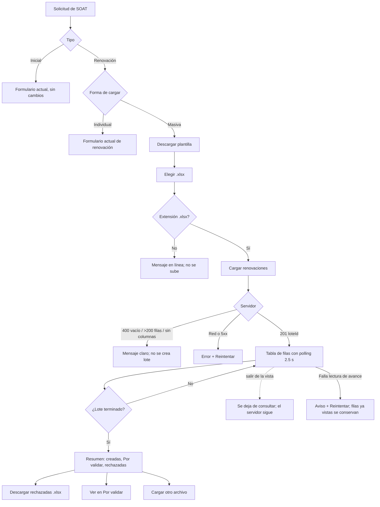

# UX — FLITO SOAT · Carga masiva de renovaciones desde la solicitud (HU #14134)

Feature #14013 · Épica #13760 · Backend: HU #14131 (recibir/validar), #14132 (worker), #14133 (resumen/rechazadas).
Mockup HTML autocontenido: `docs/ux/flito-soat-carga-masiva-renovaciones.mockup.html`. Mockup publicado: _(el hilo pega aquí el link del Artifact)_.

Fuentes leídas: `_principios-flito.md`, `FlitoSoatSolicitud.tsx` (montaje: `<SelectorTipoSoat/>` línea 974, bloque `tipo !== null` líneas 975–1120), `SelectorTipoSoat.tsx` (patrón de radios), `flitPageKit.tsx`, `FlitUploadBox.tsx`, `StatusChip.tsx`.

## Contexto y roles

- **Quién:** usuario Cliente de una compañía con la función «Solicitar SOAT sin trámite» (`puedeSolicitarSoat`). Operaciones/admin llegan por la misma pantalla y eligen compañía con `CampoCompaniaSoat` (ya existente; su `companiaId` viaja en el multipart solo en ese caso).
- **Qué vino a hacer:** renovar el SOAT de **muchos** vehículos a la vez, sin digitar placa por placa, y saber **cuáles quedaron mal y por qué** para corregirlos.
- **Qué no es:** no es un historial de cargas ni una pantalla para retomar un lote (AC6). No toca la modalidad Individual ni el SOAT Inicial.
- **Tratamiento:** **usted** (igual que toda la pantalla de solicitud).
- **Permiso/slug:** el de la pantalla (`flito_soat`, sub-ruta `/flito/soat/solicitud`); ningún `PageSlug` ni ruta nuevos. Gate existente `puedeSolicitarSoat`. El E2E y la ficha de ayuda viven en la HU (AC8).

## Qué se ve / qué se calla

1. **Siempre visible, en orden:** (a) selector «Individual / Masiva» (solo con tipo Renovación); (b) en Masiva: paso único «descargue la plantilla, llénela, súbala»; (c) tras subir: aviso de avance + tabla de filas con **Placa · Vehículo (RUNT) · Estado · Detalle**; (d) al terminar: resumen con 3 cifras y la acción.
2. **Se calla (no existe en esta pantalla):** documento del propietario (PII, vive en el Excel y no se devuelve), id del lote, tiempos, intentos, nombre del proveedor/RUNT como jerga, historial de lotes anteriores.
3. **Una sola primaria por momento:**
   - Con archivo elegido y sin lote: **«Cargar renovaciones»**.
   - Con lote terminado y rechazadas > 0: **«Descargar rechazadas»**.
   - Con lote terminado sin rechazadas: **«Cargar otro archivo»**.
   - Todo lo demás (Descargar plantilla, Cargar otro archivo cuando hay rechazadas, enlace «Ver en Por validar», Reintentar) es secundario o enlace.
   - Durante el procesamiento no hay primaria (no hay nada que decidir; solo se mira).

**Disposición elegida.** Se evaluaron dos: (A) pestaña/ruta nueva «Carga masiva» y (B) modalidad dentro de la solicitud existente (selector Individual/Masiva). Se elige **B**: es lo que pide AC1, mantiene «el Cliente tiene una sola página» y reutiliza compañía y tipo ya elegidos. (A) descartada: duplica el encabezado y rompe el `aria-current` del menú.

### Punto de montaje único (restricción de líneas)

`FlitoSoatSolicitud.tsx` solo cambia **una línea de JSX**: envolver el bloque `{tipo !== null && (<>…</>)}` actual en un componente nuevo:

```tsx
<SelectorTipoSoat … />
<ModalidadRenovacion tipo={tipo} companiaId={…} />   // pinta el selector Individual/Masiva y el panel masivo
{tipo !== null && modalidadIndividual && ( …bloque actual… )}
```

Para que la página no gane estado, la forma preferida es **render-prop**: `<ModalidadRenovacion tipo={tipo} companiaId={compania.id}>{formularioIndividual}</ModalidadRenovacion>`. El componente dueño del estado `modalidad` decide: si `tipo !== RENOVACION` o `modalidad === 'individual'` devuelve `children`; si es `masiva` devuelve `<PanelMasivoRenovacion/>` y **no monta** `children` (así tampoco se pinta `BarraEnvioSolicitud`). El estado de los campos individuales vive en la página, por lo que alternar no pierde lo digitado. Componentes nuevos en `components/flito/soat-cliente/masivo/`:

| Componente | Responsabilidad | Kit que reutiliza |
|---|---|---|
| `ModalidadRenovacion` | Selector Individual/Masiva + decide qué pintar + confirmación al salir de un lote en curso | `Seccion`, patrón de radios de `SelectorTipoSoat`, `FlitModal`, botones del kit |
| `PanelMasivoRenovacion` | Máquina de estados (vacío → subiendo → en curso → terminado → error) y polling | — |
| `PasoPlantilla` + `ZonaCargaExcel` | Descarga de plantilla y elegir archivo | `flitBtnSecondary`, `FlitUploadBox` (`accept=".xlsx"`, con `hint`) |
| `TablaFilasLote` | Tabla de filas | `FlitTable`, `StatusChip`, `PageContentSkeleton`/filas esqueleto |
| `ResumenLote` | Cifras, rechazadas, enlaces | `StatusChip`, `flitBtnPrimary/Secondary` |

Sin patrón visual nuevo: todo es `Seccion` + `FlitUploadBox` + `FlitTable` + `StatusChip`.

## Flujo de usuario



## Pantalla 1 — Solicitud, forma de cargar y panel masivo

### Wireframe desktop (≥ lg)

Estado **vacío** (Masiva elegida, sin archivo):

```
┌ Solicitud de SOAT ───────────────────────────────────────────────────────────────┐
│ Renueve el SOAT de sus vehículos.                                                │
└──────────────────────────────────────────────────────────────────────────────────┘
┌ Compañía  [ Transportes Andina S.A.S. ▾ ]   (solo Operaciones/admin) ────────────┐
┌ Tipo de SOAT ────────────────────────────────────────────────────────────────────┐
│ (o) SOAT inicial        (●) Renovación                                           │
└──────────────────────────────────────────────────────────────────────────────────┘
┌ Forma de cargar ─────────────────────────────────────────────────────────────────┐
│ ( ) Individual          (●) Masiva                                               │
│     Un vehículo         Hasta 200 renovaciones desde un Excel                    │
└──────────────────────────────────────────────────────────────────────────────────┘
┌ Renovaciones en masa ────────────────────────────────────────────────────────────┐
│ 1. Descargue la plantilla y llene una fila por vehículo.   [⭳ Descargar plantilla]│
│ 2. Suba el archivo (.xlsx, hasta 200 filas).                                     │
│  ┌ ─ ─ ─ ─ ─ ─ ─ ─ ─ ─ ─ ─ ─ ─ ─ ─ ─ ─ ─ ─ ─ ─ ─ ─ ─ ─ ─ ─ ─ ─ ─ ─ ─ ─ ─ ─ ┐   │
│  │        ⭱  Elegir archivo de renovaciones                              │   │
│  │           Excel .xlsx · hasta 200 filas                               │   │
│  └ ─ ─ ─ ─ ─ ─ ─ ─ ─ ─ ─ ─ ─ ─ ─ ─ ─ ─ ─ ─ ─ ─ ─ ─ ─ ─ ─ ─ ─ ─ ─ ─ ─ ─ ─ ─ ┘   │
│                                              [ Cargar renovaciones ] (deshab.)  │
└──────────────────────────────────────────────────────────────────────────────────┘
```

Con archivo elegido: la caja pasa a `state="verified"`, muestra el nombre del archivo (`renovaciones.xlsx`) y «Cambiar archivo» se logra volviendo a pulsar la caja; el botón **Cargar renovaciones** (primaria) se habilita.

Estado **lleno, en curso** (polling):

```
┌ Renovaciones en masa ────────────────────────────────────────────────────────────┐
│ ⟳ Procesando: 12 de 40 filas. Puede salir de esta página; el proceso continúa.   │ role=status
│ ┌ Placa ─ Vehículo (RUNT) ──────────────── Estado ───────── Detalle ───────────┐ │
│ │ ABC123  RENAULT LOGAN 2019               ● Creada                            │ │
│ │ DEF456  CHEVROLET SPARK 2018             ● Por validar    RUNT sin respuesta │ │
│ │ GHI789  —                                ● Consultando                       │ │
│ │ JKL012  —                                ● En cola                           │ │
│ │ MNO345  KIA PICANTO 2020                 ● Rechazada      SOAT vigente       │ │
│ └──────────────────────────────────────────────────────────────────────────────┘ │
└──────────────────────────────────────────────────────────────────────────────────┘
```

Estado **lleno, terminado** (la tabla se queda; el aviso se sustituye por el resumen y baja a ser lectura):

```
┌ Resultado de la carga ───────────────────────────────────────────────────────────┐
│  ● 36 creadas      ● 2 enviadas a Por validar      ● 2 rechazadas                │
│  Las 2 por validar se consultarán de nuevo.  [Ver en Por validar →]              │
│                                                                                  │
│  Rechazadas                                                                      │
│   MNO345 · El vehículo ya tiene SOAT vigente                                     │
│   PQR678 · La placa no existe en el RUNT                                         │
│                               [ Cargar otro archivo ]  [ Descargar rechazadas ]  │
└──────────────────────────────────────────────────────────────────────────────────┘
(tabla completa de filas debajo, igual que en curso)
```

Las «rechazadas (placa + motivo)» del resumen se listan de forma compacta; si son más de 5, las 5 primeras y «y N más: están en el archivo» (la tabla de abajo ya las trae todas). Sin rechazadas, esa subsección y su botón no se pintan.

### Wireframe móvil (< lg)

```
┌ Solicitud de SOAT ─────────┐
│ Renueve el SOAT de sus ... │
├ Tipo de SOAT ──────────────┤
│ ( ) Inicial  (●) Renovación│   (tarjetas apiladas, 1 col)
├ Forma de cargar ───────────┤
│ ( ) Individual             │
│ (●) Masiva                 │
├ Renovaciones en masa ──────┤
│ 1. Descargue la plantilla  │
│ [⭳ Descargar plantilla]    │   ancho completo
│ 2. Suba el archivo         │
│ ┌ ─ ─ ─ ─ ─ ─ ─ ─ ─ ─ ─ ┐  │
│ │  ⭱ Elegir archivo     │  │
│ └ ─ ─ ─ ─ ─ ─ ─ ─ ─ ─ ─ ┘  │
│ [ Cargar renovaciones ]    │   ancho completo
├ Resultado ─────────────────┤
│ ● 36 creadas               │   cifras apiladas
│ ● 2 por validar            │
│ ● 2 rechazadas             │
│ [ Descargar rechazadas ]   │   primaria arriba
│ [ Cargar otro archivo ]    │
├ tabla (scroll del kit) ────┤
│ Placa · Vehículo · Estado →│   scroll horizontal; Placa y Estado primeras
└────────────────────────────┘
```

### Estados (4) y sus variantes

| Estado | Qué se ve | Copy exacto |
|---|---|---|
| **Vacío** (sin archivo / sin lote) | Paso 1–2 con plantilla y caja de carga; «Cargar renovaciones» deshabilitada (`aria-disabled`, con razón visible: «Elija un archivo para continuar.») | Título sección «Renovaciones en masa». Paso 1: «Descargue la plantilla y llene una fila por vehículo.» Paso 2: «Suba el archivo con las renovaciones.» Hint caja: «Excel .xlsx · hasta 200 filas» |
| **Cargando** | Subiendo: botón primaria `Cargando…` deshabilitado y caja inerte. Primer GET de avance: 5 filas esqueleto con las mismas columnas de la tabla. Descargando plantilla/rechazadas: el botón muestra «Descargando…» | Botón: «Cargando…». Aviso: «Recibiendo el archivo…» |
| **Error** | Aviso `role="alert"` dentro de la sección + **Reintentar**. Tres variantes abajo | ver tabla siguiente |
| **Lleno** | En curso: aviso de avance + tabla. Terminado: resumen + tabla | «Procesando: {n} de {total} filas. Puede salir de esta página; el proceso continúa.» / «Lote procesado.» |

Errores (siempre en línea, nunca el mensaje crudo del API; el texto se decide por `codigo`/estatus):

| Caso (AC) | Dónde | Copy | Acción |
|---|---|---|---|
| Archivo no `.xlsx` (AC4) | En línea bajo la caja, `role="alert"`; no se sube, el botón sigue deshabilitado | «El archivo debe ser un Excel .xlsx. Descargue la plantilla y úsela.» | Elegir otro archivo |
| Archivo vacío (AC4, `archivo_vacio`) | En línea | Según el tipo de plantilla elegido (ver «Copy por tipo de plantilla»): Renovación «El archivo no tiene renovaciones. Llene al menos una fila de la plantilla.» · Inicial «El archivo no tiene vehículos. Llene al menos una fila de la plantilla.» | Elegir otro archivo |
| Plantilla equivocada (`plantilla_equivocada`, HU #14135) | En línea | Renovación elegida con archivo Inicial: «Este archivo es de la plantilla Inicial. Elija Inicial o descargue la plantilla de Renovación.» · Inicial elegida con archivo de Renovación: «Este archivo es de la plantilla de Renovación. Elija Renovación o descargue la plantilla Inicial.» | Descargar plantilla |
| Más de 200 filas (AC4) | En línea | «El archivo tiene más de 200 filas. Divídalo en archivos de hasta 200 y cárguelos uno a uno.» | Elegir otro archivo |
| Columnas no coinciden (`400` por plantilla) | En línea | «El archivo no tiene el formato de la plantilla. Descárguela de nuevo y vuelva a llenarla.» | Descargar plantilla |
| Red/servidor al subir (AC5) | Aviso en la sección, conserva el archivo elegido | «No pudimos cargar el archivo. Revise su conexión e intente de nuevo.» | **Reintentar** (repite el POST con el mismo archivo) |
| Red/servidor al leer avance (AC5) | Aviso sobre la tabla; la tabla con lo último recibido se conserva; **el polling se pausa** | «No pudimos actualizar el avance. El proceso continúa en FLITO.» | **Reintentar** (reanuda el polling) |
| `404` del lote al leer avance | Aviso | «No encontramos esta carga. Cargue el archivo de nuevo si no ve sus {renovaciones\|solicitudes} en la lista.» | Cargar otro archivo |
| Lote activo (`lote_activo`, 409) | Aviso en la sección (el id opaco del lote activo viaja en `datos`; no se muestra) | «Su compañía ya tiene una carga en curso. Espere a que termine para subir otro archivo.» | Elegir otro archivo |
| Carga masiva apagada (`carga_masiva_no_disponible`, 503) | Aviso en la sección | «La carga masiva no está disponible por ahora. Intente de nuevo más tarde.» | **Reintentar** |
| Falla descarga plantilla/rechazadas | Toast de error (acción puntual) | «No pudimos descargar el archivo. Intente de nuevo.» | — |

### Copy por tipo de plantilla (decisión tras revisión del mockup)

La vista de carga masiva se reutiliza con la plantilla **Inicial** en la HU #14137, y el backend ya acepta `tipo=inicial` (HU #14135). Por eso **ningún texto de la vista puede decir «renovaciones» fijo**: el frontend de la HU #14134 construye un diccionario `COPY_MASIVO[tipo]` desde el inicio y la HU #14137 solo agrega las entradas de Inicial. Reglas:

1. El texto se elige por `tipo` (el elegido en la vista, no el del API) y por `codigo` del error; **nunca** se muestra `mensaje` crudo del API (hoy el backend devuelve textos genéricos como «El archivo no tiene filas de datos.»).
2. Sustantivo por tipo: Renovación → «renovaciones» (la fila es un vehículo con SOAT por renovar); Inicial → «vehículos» (la fila es un VIN; todavía no hay SOAT).
3. Textos que cambian con el tipo: título de la sección («Renovaciones en masa» / «SOAT inicial en masa»), hint de la caja, botón primario («Cargar renovaciones» / «Cargar vehículos»), pasos 1–2 de la plantilla, toast de archivo recibido («Estamos procesando las renovaciones.» / «Estamos procesando los vehículos.»), los avisos de arriba y la columna clave de la tabla (Placa / VIN).
4. Textos que **no** cambian: errores de formato `.xlsx`, más de 200 filas, red/servidor, descarga fallida, «Descargar rechazadas», «Cargar otro archivo».
5. Esta HU (#14134) solo expone el tipo Renovación al usuario, pero la prop `tipo` y el diccionario existen ya, con la entrada Inicial vacía o igual a la de Renovación marcada `TODO #14137`, para no rehacer los componentes después.

### Estados de fila (AC2)

| Estado API | Chip (`StatusChip` tone) | Rótulo | Columna Detalle |
|---|---|---|---|
| en cola | `draft` | En cola | — |
| consultando | `active` | Consultando | — |
| creada | `success` | Creada | — |
| por validar | `warning` | Por validar | «El RUNT no respondió; se consultará de nuevo.» (motivo ya humanizado por el front a partir del `codigo`) |
| rechazada | `danger` | Rechazada | motivo legible, p. ej. «El vehículo ya tiene SOAT vigente» |

«Vehículo (RUNT)» muestra `marca línea · modelo` cuando el RUNT ya respondió y «—» antes. El chip lleva siempre texto (el color no es el único portador del estado).

### Acciones y validaciones

- **Descargar plantilla**: `GET /cliente/masivo/plantilla?tipo=renovacion` vía `api.ts` (blob). Secundaria. Visible siempre en Masiva.
- **Elegir archivo**: `FlitUploadBox accept=".xlsx"`. Validación cliente solo por extensión `.xlsx` (AC4). Vacío y >200 filas los decide el servidor en el `POST` (`400` con código); **no se crea lote** y el copy es el de arriba. _(Pregunta cerrada para backend #14131: los códigos de `400` distinguibles para vacío / >200 / formato.)_
- **Cargar renovaciones** (primaria): `POST /cliente/masivo` multipart `archivo` + `tipo=renovacion` (+ `companiaId` si es Operaciones/admin). Sin compañía elegida (Operaciones) el botón queda `aria-disabled` y la razón dice «Elija la compañía para continuar.»
- **Polling**: `GET /cliente/masivo/:loteId` cada **2,5 s** mientras la vista esté abierta y el lote no esté terminado; se cancela en el cleanup del efecto (AC6), se pausa mientras `document.hidden`, y se detiene ante error (hasta Reintentar). Sin SSE. Una petición en vuelo a la vez (no se encolan).
- **Descargar rechazadas** (AC3): `.xlsx` con columna «Motivo». **Requerimiento a #14133:** ruta (propuesta `GET /cliente/masivo/:loteId/rechazadas`, mismo auth/compañía), respuesta blob.
- **Ver en Por validar** (AC7): se abre con `navigate('/flito/soat', { state: { pastilla: 'incompleta' } })` (verificado en `FlitoSoat.tsx`; el rótulo visible sigue siendo «Por validar»). Sin query ni PII en la URL. Solo se pinta si `porValidar > 0`.
- **Cargar otro archivo**: vuelve al estado vacío. Si el lote está en curso no se ofrece.
- **Cambiar a Individual con lote en curso**: `FlitModal` «¿Salir de la carga en masa?» / «El procesamiento continúa en FLITO, pero no podrá volver a ver este avance.» / botones «Quedarme» (secundaria) y «Salir» (primaria del modal). Con lote terminado o sin lote: cambia sin preguntar.

### Datos (endpoints)

Todos existentes según el contrato dado, salvo la descarga de rechazadas (requerimiento a #14133). Sin PII en URL ni query: `loteId` es uuid opaco en path; placas llegan en el cuerpo de la respuesta. El documento del propietario no se muestra ni se devuelve en la lista.

### Códigos reales del API (decididos por el hilo)

POST: `archivo_requerido`, `formato_invalido`, `encabezados_invalidos`, `archivo_vacio`, `archivo_muy_grande`, `demasiadas_filas`, `lote_activo`, `tipo_invalido`, `carga_masiva_no_disponible`, `plantilla_equivocada`. Descarga de rechazadas: 409 `lote_en_proceso`, 410 `descarga_no_disponible`. El `codigo` llega en `ApiError.rawDetails`. Las filas traen `motivo.mensaje` ya redactado por el backend y se muestran tal cual.

### Privacidad de la fila (ADR-0032, PII efímera)

Al terminar el lote el backend borra placa, VIN y datos del vehículo de las filas creadas y por validar. El frontend conserva **en memoria** (estado del hook; nunca storage, URL ni consola) lo recibido en sondeos anteriores y fusiona por `nFila`: un campo ya recibido no se pierde porque el sondeo final lo traiga `null`. Se descarta al salir de la vista.

## Responsive (< lg)

- Selectores (tipo y forma): una columna (`grid-cols-1 sm:grid-cols-2`).
- Pasos: texto arriba, botones de ancho completo debajo (`flex-wrap`/`w-full sm:w-auto`).
- Cifras del resumen apiladas; barra de acciones envuelve y en móvil la primaria va primero (`flex-col` ordenado, mismo patrón que el modal de `SelectorTipoSoat`).
- Tabla dentro de `FlitTable` (scroll horizontal del kit); Placa y Estado son las dos primeras columnas visibles.
- Objetivos táctiles ≥ 44 px (radio-tarjetas ya lo cumplen con `min-h-[44px]`).

## Interacción y notificaciones

| Control | Hover | Foco |
|---|---|---|
| Radio-tarjetas Individual/Masiva | `hover:bg-[var(--flit-bg-hover)]` + `has-[:focus-visible]` (igual que `SelectorTipoSoat`) | anillo `--flit-border-focus` |
| Caja de carga | velo `--flit-bg-hover` (variante `multiple` de `FlitUploadBox`, ya existe) — se pide que el feedback hover/focus aplique también sin `multiple`; si no, se activa con la clase `MULTIPLE_FEEDBACK` | `focus-within` anillo; input alcanzable por teclado (`sr-only`, no `hidden`) |
| Botones (primaria/secundaria/Reintentar) | `flitBtnPrimary` / `flitBtnSecondary` del kit | `flit-focus` |
| Enlace «Ver en Por validar» | subrayado + tono `--flit-blue-text` | `flit-focus` |
| Región de la tabla | — | `FlitTable` ya da foco cuando desborda |

Notificaciones:

| Acción | Patrón | Copy |
|---|---|---|
| Archivo recibido (201) | Toast cerrable ~4 s | «Archivo recibido. Estamos procesando las renovaciones.» |
| Lote terminado | **Aviso en página** (el resumen); no toast, el estado sigue siendo cierto. Además un `aria-live="polite"` sr-only: «Carga terminada: 36 creadas, 2 por validar, 2 rechazadas.» | — |
| Error al subir / leer avance | Aviso en página con Reintentar | ver tabla de errores |
| Falla descarga | Toast de error (cerrable, ≥ 6 s) | «No pudimos descargar el archivo. Intente de nuevo.» |
| Rechazadas descargadas | Sin toast (el navegador ya muestra la descarga) | — |

## Accesibilidad

- Forma de cargar: `radiogroup` con `aria-label="Forma de cargar"`, radios reales con `<label>` (mismo patrón y misma gestión de foco que `SelectorTipoSoat`).
- Caja de carga: `<label>` envolvente (kit) + `aria-describedby` apuntando al hint y al error en línea; error con `role="alert"`.
- Avance: contenedor `role="status"` (`aria-live="polite"`) con la frase «Procesando: n de total filas»; **no** anunciar cada cambio de fila (evita ruido cada 2,5 s). Al terminar se mueve el foco al encabezado «Resultado de la carga» (`tabIndex={-1}`).
- Tabla con `label="Filas de la carga en masa"` y `<th scope="col">`; estado siempre en texto.
- Contraste: solo tokens `--flit-*` con par oscuro (`StatusChip` ya medido). Revisar ambos temas.
- Botón deshabilitado por faltante usa `aria-disabled` + razón visible (misma doctrina que la barra de envío).

## Notas para QA

1. AC1: con tipo SOAT inicial no aparece «Forma de cargar»; con Renovación sí; Individual muestra el formulario actual intacto, y alternar Individual→Masiva→Individual conserva lo digitado.
2. AC1: Masiva no pinta `BarraEnvioSolicitud` ni bloques de vehículo/propietario.
3. AC2: las cinco etiquetas de estado aparecen con su chip; el vehículo RUNT aparece sin recargar; la red muestra una petición cada ~2,5 s y ninguna con la pestaña oculta.
4. AC3: cifras suman el total; «Descargar rechazadas» entrega `.xlsx` con columna «Motivo»; sin rechazadas no hay botón.
5. AC4: `.csv`, `.xlsx` vacío y 201 filas muestran el copy y no crean lote (sin fila nueva, sin polling).
6. AC5: forzar offline en el POST y en el GET; «Reintentar» recupera; la tabla previa se conserva.
7. AC6: navegar fuera detiene las peticiones (red); volver a la pantalla muestra el estado vacío (sin retomar).
8. AC7: enlace solo con `porValidar > 0`; abre la cola con la pestaña «Por validar».
9. Ninguna URL ni query contiene placa, documento ni `companiaId`.
10. Claro y oscuro, 1440 px y 375 px; foco visible en cada control.

## Decisiones y descartes

- **Modalidad dentro de la solicitud, no pantalla nueva** (ver arriba). Un punto de montaje y componentes nuevos por el techo de líneas.
- **Tabla única que se queda al terminar** en vez de pasar a «solo rechazadas»: el Cliente necesita ver también las creadas con su vehículo; el resumen arriba da la lectura rápida.
- **Sin barra de progreso ni porcentaje**: una frase «n de total» dice lo mismo sin adorno.
- **Sin pantalla para retomar el lote** (AC6) y, por eso, advertencia al cambiar de forma con lote en curso.
- **Sin SSE**: polling simple con una sola petición en vuelo.
- **No se muestra el documento del propietario** ni jerga (ANS, RUNT técnico, intentos).
- **Descargar rechazadas como primaria** cuando hay rechazadas: es lo único que el usuario tiene que hacer para corregir; si no hay, la primaria es cargar otro archivo.
- Preguntas abiertas para el hilo: (1) ruta de rechazadas (#14133); (2) códigos `400` diferenciados de #14131; (3) nombre real de la pastilla «Por validar» en la cola.

## Brief de mockup

Archivo: `docs/ux/flito-soat-carga-masiva-renovaciones.mockup.html` (autocontenido, tokens `--flit-*` en claro/oscuro; selector de estado, tema y ancho solo para revisar). Pantallas: solicitud con Renovación + Masiva en estados vacío, archivo elegido, subiendo, error de subida, error de formato (.xlsx/vacío/>200), en curso, error de avance, terminado con rechazadas, terminado sin rechazadas; vista móvil (375 px) y modal de confirmación. Datos ficticios (placas tipo `ABC123` inventadas, marcas genéricas; sin nombres ni documentos). No mostrar: documento, id de lote, historial. Kit a nombrar: `PageHeaderCard`, `Seccion`, `FlitUploadBox`, `FlitTable`, `StatusChip`, `FlitModal`, `flitBtnPrimary/Secondary`.
