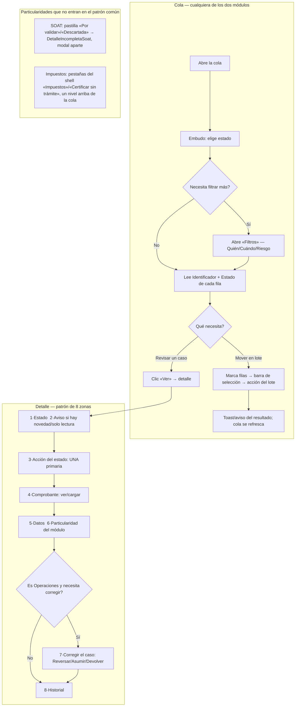

# UX — Patrón unificado de cola y detalle para SOAT e Impuestos (Épica #14560)

> Modo **full**. Trabajo directo sobre la Épica 14560 («Rediseño total de FLITO con el UI Kit 2026»),
> sin Features ni HUs hijos — decisión del PO, mismo patrón que rondas anteriores de esta misma épica.
> **Alcance estrictamente visual/estructural**: jerarquía, agrupación, affordance y maquetación. Nada
> de comportamiento, validaciones, endpoints, rutas, permisos ni reglas de negocio — eso no se toca.
> Oficio: `docs/ux/_principios-flito.md`. Referencia de nivel de curaduría:
> `docs/ux/flito-soat-rediseno-experiencia.md` (HU #12819).
> Código verificado en `develop` (rama actual `HU/14665-...`, sin relación con este trabajo):
> `apps/web/src/pages/FlitoSoat.tsx`, `FlitoImpuestos.tsx`, `FlitoImpuestosShell.tsx`,
> `apps/web/src/components/flito/soat/*`, `apps/web/src/components/flito/{DetalleImpuesto,ImpuestoCola}.tsx`,
> `apps/web/src/components/flito/impuestos/{ImpuestosFiltros,ImpuestosColumnas,ImpuestosEmbudo}.tsx`,
> `apps/web/src/components/flit/{PanelFiltros,DataTable,Bloques,GradientButton,StatusChip,PageHeaderCard}.tsx`.

---

## 0. El problema que responde esta spec

SOAT e Impuestos son, funcionalmente, la misma pieza: una cola con fronteras por rol + un detalle
de gestión de un trámite. SOAT tuvo un rediseño de experiencia dedicado (HU #12819) que dejó un
orden deliberado de columnas y de secciones del detalle. Impuestos nunca lo tuvo: su cola usa el kit
genérico pero con una tabla de **11-12 columnas** y el Estado en **8.ª posición** (el mismo problema
D3 que SOAT ya resolvió), y su detalle creció por acreción de cinco HUs puntuales (comprobante,
reemplazo, soporte FLIT1/FLIT2, validación RUNT, dirección del comprador) sin que nadie volviera a
decidir el orden global. Ese es el desorden que reporta el humano, confirmado leyendo el código.

**Decisión de producto (no se reabre):** no se adopta ni SOAT ni el kit genérico como molde único.
Se diseña un patrón nuevo que tome la curaduría de SOAT (orden deliberado, una primaria por zona,
agrupación por intención) y la composición ya lograda por Impuestos con el kit genérico
(`PanelFiltros`, `FiltrosInteligentes`, `DataTable`, `BarraAccion`). Las particularidades de cada
módulo (las 3 fronteras y «solicitud incompleta» en SOAT; las pestañas del shell y las fases de
comprobante en Impuestos) se preservan intactas, con huecos explícitos en el patrón.

---

## 1. Contexto y roles

| Módulo | Roles/funciones (sin cambio) | Canal Cliente |
|---|---|---|
| **SOAT** (`flito_soat`) | Operaciones (`esOperaciones`), Gestor/proveedor (`esGestor`), Auditor (`soloLectura`), **Cliente** (`esCliente`) | Sí — Davivienda, canal externo, trato de **usted** |
| **Impuestos** (`flito_impuestos`) | Operaciones (`esOperaciones`), Gestor del organismo (`esGestor`), Auditor (`soloLectura`) | **No existe hoy**. El patrón no lo inventa: es un hueco que queda vacío en este módulo |

**Qué vino a hacer quien abre cualquiera de las dos colas (una frase):** decidir, por el estado y la
antigüedad de cada fila, cuál abrir o mover en lote — y en el detalle, actuar sobre el estado (cargar
un comprobante, resolver una novedad) sin tener que sortear datos de consulta primero.

**Qué NO es este trabajo:** no es una unificación de marca entre SOAT e Impuestos (cada uno conserva
su tuteo/usted, sus estados y sus reglas), no es un cambio de contrato de API, y no es el sitio para
decidir si Impuestos debería tener canal Cliente — eso es una decisión de producto aparte.

---

## 2. Qué se ve / qué se calla (diagnóstico leyendo el código)

### 2.1 Cola — lo que ya converge y lo que no

| Pieza | SOAT hoy | Impuestos hoy | Converge? |
|---|---|---|---|
| Cabecera de módulo | `PageHeaderCard` | `PageHeaderCard` (en el shell, con pestañas) | **Sí**, ya es la misma pieza |
| Barra de acción primaria + exportar | Fila a la derecha, apila en móvil | Misma composición (`BotonExportarCola` + `GradientButton`) | **Sí** |
| Embudo de estado | `EmbudoSoat` (envuelve `.embudo` del kit + `registrarEstados`) | `ImpuestosEmbudo` (misma envoltura) | **Casi**: son dos componentes casi idénticos; el propio código de Impuestos dice que debería ser uno (`ImpuestosEmbudo.tsx:3-4`) |
| Barra de filtros | `BarraFiltrosSoat` — viste las clases de `PanelFiltros` **a mano** porque necesita filtrar en vivo (sin «Aplicar») | `ImpuestosFiltros` — usa **el componente `PanelFiltros` real** | **Parcial**: misma forma visual (Quién · Cuándo · Riesgo), implementación distinta por una razón real (filtrar en vivo vs al aplicar) |
| Barra de selección | `BarraEnvioSoat` (selector de destino + `BarraAccion` del kit) | `BarraSeleccion` local (dos acciones: enviar/certificar, con `BarraAccion` del kit) | **Sí** en la envoltura (`BarraAccion`), lógica propia de cada módulo (correcto, no se unifica) |
| Tabla | `TablaColaSoat` con `FlitTable`/`FlitTh`/`FlitTr` (kit viejo, sin modo tarjeta <900px) | `DataTable` genérico (con modo tarjeta <900px ya construido) | **No** — es la brecha más grande |
| **Orden/densidad de columnas** | Vehículo · **Estado** (2.ª) · Compañía · Gestiona · Solicitado · Pagado · Valor · acciones (≈8-9) | Sel · Trámite+acción · Vehículo · Fechas · Compañía · Organismo · Gestiona · **Estado (8.ª)** · Solicitado · Fecha pago · Liquidado · Pagado · acciones (**12**) | **No** — Impuestos repite el problema D3 que SOAT ya resolvió, y encima con más columnas |
| Acciones de fila | `[Descargar h-7][Ver › h-7]` | `[Descargar][Ver ›]` con `claseBoton('secondary','sm')` | **Sí**, mismo patrón |
| 4 estados de la tabla | Vía `EstadoVista` interno de `FlitTable` | Vía `DataTable`/`EstadoVista` | **Sí**, misma infraestructura |

**Veredicto:** los filtros y la barra de selección ya están convergidos en la forma correcta (Quién
· Cuándo · Riesgo; `BarraAccion`). El patrón unificado de cola es, sobre todo, **una decisión sobre
la tabla**: qué columnas, en qué orden, y con qué componente.

### 2.2 Detalle — por qué Impuestos se ve desordenado

`DetalleSoat.tsx` ya tiene el orden canónico decidido en HU #12819 §7: **1·estado → 2·aviso
contextual → 3·acción del estado (una primaria) → 4·comprobante → 5·datos → 6·compradores →
7·corregir el caso → 8·historial**.

`DetalleImpuesto.tsx`, leído de arriba a abajo, es:

chips de estado → `AvisoDireccion` (correcto, arriba) → un `<dl>` de ~14 campos que **mezcla datos
de consulta con botones de acción** («Cargar comprobante», «Cargar recibo de caja», «Reemplazar
comprobante» viven dentro de la ficha de datos) → `SeccionValidacion` (RUNT) → `DatosDocumentoFactura`
→ `DireccionComprador` → modales → `HistorialEstados` → **`motivoRechazo` al final, con
`bg-red-50 text-red-700`** → **`soloLectura` al final, con `bg-blue-50 text-blue-800`** → **el error
general con `text-red-600`** → la fila de acciones (Rechazar/Reactivar/Asumir/Devolver/Reversar, las
cinco con el mismo peso) → los formularios.

Dos problemas, no uno: (a) el orden no sigue la jerarquía «qué se vino a ver primero» (el motivo de
una novedad es lo más importante de un caso `con_novedad` y está hasta abajo), y (b) tres superficies
usan colores Tailwind crudos sin par oscuro (`red-50`, `red-700`, `blue-50`, `blue-800`, `red-600`),
que es exactamente la deuda que `AGENTS.md` regla 13 prohíbe y que en tema oscuro queda fosforescente
o ilegible.

---

## 3. Patrón unificado de cola

### 3.1 Esqueleto común (de arriba abajo)

1. **Cabecera de módulo** (`PageHeaderCard`) — sin cambio en ningún módulo.
2. **Barra de acción primaria + exportar**, bajo la cabecera — sin cambio.
3. **Avisos persistentes** (export en curso, ZIP en curso, análisis/certificación en curso) — sin cambio de ubicación ni de componente.
4. **Embudo de estado** (`Embudo` del kit, vía wrapper del módulo) — sin cambio de ubicación.
5. **Barra de filtros** (`PanelFiltros` + grupos **Quién · Cuándo · Riesgo** + `FiltrosInteligentes`) — sin cambio de forma.
6. **Barra de selección** (`BarraAccion`), solo con selección > 0, antes de la tabla — sin cambio de ubicación.
7. **Tabla** (`DataTable`) — **aquí está el rediseño**: orden canónico de columnas (§3.3) y migración de componente para SOAT (§5).
8. **Paginación** — sin cambio.

### 3.2 Wireframe a 1366 px — patrón común, anotado por módulo

```
┌────────────────────────────────────────────────────────────────────────────────────────────────┐
│ (icono) SOAT / IMPUESTOS                                    [⇪ Cargar facturas/recibos (masivo)] │ ← PageHeaderCard,
│ <subtítulo de una frase, sin mecánica interna>                       [⤓ Exportar a Excel] ◀prim. │   común
└────────────────────────────────────────────────────────────────────────────────────────────────┘
 [IMPUESTOS: pestañas «Impuestos» / «Certificar sin trámite», del shell — por encima de todo esto]
 [aviso de export / ZIP / análisis en curso, si hay — mismo sitio en los dos]
┌─ embudo ──────────────────────────────────────────────────────────────────────────────────────┐
│ (●Todos) (●Pendiente) (●Solicitado) (●Con novedad) (●Pagado)   [SOAT: + ●Por validar/Descartada]│ ← Embudo del kit
└────────────────────────────────────────────────────────────────────────────────────────────────┘
┌─ filtros ──────────────────────────────────────────────────────────────────────────────────────┐
│ [🔍 Buscar placa, VIN, comprador/trámite…]         [⚙ Filtros (n)]  [Vistas rápidas: chips…]     │
│ ┄┄┄┄┄┄┄┄┄┄┄┄┄┄┄┄┄┄┄┄┄┄┄┄┄┄┄┄ panel (abierto) ┄┄┄┄┄┄┄┄┄┄┄┄┄┄┄┄┄┄┄┄┄┄┄┄┄┄┄┄┄┄┄┄┄┄┄┄┄┄┄┄┄┄┄┄┄┄┄┄┄┄┄ │
│ QUIÉN                          CUÁNDO                           RIESGO                          │
│ [Compañía ▾] [Organismo/Prov▾] Creado en FLITO [desde]–[hasta]  [SOAT: Vigencia ▾]              │
│ [SOAT: Proveedor ▾] Gestiona▾  Solicitado      [desde]–[hasta]  [IMP: Liquidado pend. pago ☐]   │
│                                Pagado          [desde]–[hasta]  [☐] Solo sin gestión            │
│ Filtros aplicados: (chip ✕)(chip ✕) …                              [Limpiar todo]               │
└────────────────────────────────────────────────────────────────────────────────────────────────┘
┌─ barra de selección (solo con filas marcadas; BarraAccion del kit) ─────────────────────────────┐
│ N seleccionado(s)                        [SOAT: Enviar a ▾][➤ Enviar al gestor (k de n)]        │
│                                           [IMP: ➤ Enviar al gestor (k)][Certificar (j)]          │
│ De las N marcadas, k… son las únicas que admiten esta acción. …usa las N.                        │
└────────────────────────────────────────────────────────────────────────────────────────────────┘
┌─ tabla (DataTable) ──────────────────────────────────────────────────────────────────────────────┐
│ N … · página X de Y                                                     [← Anterior][Siguiente →]│
│ ┌──┬──────────────┬───────────────┬───────────┬────────────┬──────────────┬──────────┬─────────┐ │
│ │☐ │ IDENTIFICADOR│ ESTADO        │ COMPAÑÍA  │ GESTIONA   │ FECHA ENVÍO  │ PAGADO   │         │ │
│ │  │ (placa/trám.)│ (chip+señales)│           │            │              │          │         │ │
│ ├──┼──────────────┼───────────────┼───────────┼────────────┼──────────────┼──────────┼─────────┤ │
│▌☑ │ ABC123       │ ⧗ Solicitado  │ Davivienda│ Seguros A  │ 12/09 (3 d)  │ —        │[⤓][Ver ›]│ │
│ │  │ [SOAT: vehíc]│ [IMP: + chip certificación / semáforo RUNT, mismo lugar que vigencia en SOAT]│ │
│ └──┴──────────────┴───────────────┴───────────┴────────────┴──────────────┴──────────┴─────────┘ │
│  [SOAT: filas «Por validar»/«Descartadas» (FilaIncompletaSoat) ANTES de las filas normales]       │
└────────────────────────────────────────────────────────────────────────────────────────────────┘
 ▌ = fila marcada (fondo de velo + filete izquierdo, token de acento)
```

### 3.3 Orden canónico de columnas (regla única para los dos módulos)

| # | Columna | Contenido | Por qué ahí |
|---|---|---|---|
| 1 | **Identificador** | Placa/VIN (SOAT) o placa/VIN + N.º de trámite FLIT (Impuestos) | Lo primero que se busca con la vista |
| 2 | **Estado** | Chip de estado + señales de la misma intención en la misma celda: «sin gestión» (ambos), vigencia RUNT (SOAT), certificación/semáforo RUNT y «Diferencia de valor»/documentos (Impuestos) | «Siempre visible: identificador + estado» (principios §Jerarquía); decide si se abre la fila |
| 3 | **Compañía** | Sin cambio | — |
| 4 | **Gestiona** | Proveedor/Operaciones (SOAT) u Organismo/Operaciones (Impuestos) | Mismo dato, mismo lugar |
| 5 | **Fecha de envío/solicitud** (+ antigüedad si no está pagado) | Sin cambio en SOAT; en Impuestos, sustituye a la columna «Fechas» de trámite, que pasa al detalle | Es la fecha que decide urgencia; «Creado»/«Aprobado» del trámite es dato de consulta |
| 6 | **Fecha de pago** | Sin cambio | — |
| 7 | **Valor** (solo si el rol no es Cliente) | SOAT ya lo tiene así; Impuestos **fusiona** «Liquidado» y «Pagado» en una sola columna «Valor» (pagado si existe, si no liquidado) y mueve el otro valor al detalle | Dos columnas de dinero casi siempre vacías una de las dos es ruido; SOAT ya demostró que una basta |
| 8 | **Acciones** | `[Descargar][Ver ›]`, ya idéntico en los dos | — |

**Lo que sale de la tabla de Impuestos y pasa al detalle** (paralelo exacto a la decisión P-2 de
SOAT): la columna «Fechas» (creado/aprobado del trámite en FLIT) y el valor «Liquidado» cuando ya
hay «Pagado» en la fila. Son datos de consulta, no de decisión «¿abro esta fila?».

**Lo que no se mueve, a propósito:** la acción de certificación/semáforo de Impuestos (hoy pegada al
número de trámite en la 1.ª columna) se reubica **dentro de la celda de Estado**, igual que SOAT ya
mete la vigencia RUNT dentro de su celda de Estado — no es una columna nueva, es la misma celda que
ya absorbe señales de la misma naturaleza (riesgo/estado).

### 3.4 Huecos para las particularidades (no se fuerzan a desaparecer)

- **SOAT — solicitud incompleta:** las pastillas «Por validar»/«Descartadas» y sus filas
  `FilaIncompletaSoat` (antes de las filas normales) y su modal propio `DetalleIncompletaSoat` **no
  entran en este patrón de tabla de trámites**: siguen siendo su propio renglón, con su propia acción
  principal («Reintentar consulta»). El hueco es el embudo (que admite estados extra) y el
  encabezado de la tabla (que admite filas especiales al inicio) — ya los tiene SOAT hoy.
- **SOAT — 3 fronteras de visibilidad y canal Cliente:** sin cambio; el patrón de columnas por rol
  (menos columnas, sin jerga, trato de usted) sigue igual que hoy.
- **Impuestos — pestañas del shell:** viven un nivel arriba (`FlitoImpuestosShell`), fuera de la
  cola; el patrón de cola no las toca.
- **Impuestos — preset «Con alertas» (semáforo RUNT) y filtro «Liquidado, pendiente de pago»:** son
  filtros propios del dominio; viven en el grupo **Riesgo** del panel, igual que SOAT pone ahí
  «Vigencia» y «Solo sin gestión». Mismo hueco, contenido distinto por módulo — no se unifican los
  filtros de negocio, solo su posición.

### 3.5 Dos disposiciones consideradas para la tabla

| | A · Migrar las dos colas a `DataTable` genérico (**recomendada**) | B · Mantener `TablaColaSoat`/`FlitTable` y portarle el modo tarjeta a mano |
|---|---|---|
| Forma | SOAT reescribe `TablaColaSoat` usando `ColumnaTabla<SoatItem>[]` (mismo patrón que `columnasImpuestos`) sobre `DataTable` | Se le añade a `FlitTable`/`FlitTr` el modo tarjeta <900px que `DataTable` ya tiene |
| A favor | Una sola implementación de los 4 estados, paginación y modo tarjeta responsive para los dos módulos; Impuestos ya probó el componente en producción | SOAT no toca su tabla, que ya está estable desde HU #12819 |
| En contra | Hay que migrar `marcada` (fila seleccionada con filete), la celda compuesta de vehículo y las filas especiales de incompletas al vocabulario de `ColumnaTabla` | Duplica para siempre el trabajo de mantener dos tablas con los mismos 4 estados; el kit ya resolvió esto una vez (Impuestos) y resolverlo otra vez en el componente viejo es construir sobre el componente que se va a deprecar |
| Veredicto | **Elegida.** Es la migración de mayor impacto de esta spec, pero es exactamente lo que `AGENTS.md` regla 13 pide: «sin drift visual», un solo patrón de tabla con breakpoints reales en vez de dos | Descartada — mantiene el drift que esta spec existe para cerrar |

---

## 4. Patrón unificado de detalle

### 4.1 Orden canónico (de arriba abajo, generalización del §7 de HU #12819)

```
┌ <Módulo> · <identificador> ────────────────────────────────────────────── [✕] ┐
│ ⧗ Estado   [chips complementarios: sin gestión / diferencia de valor / docs]  │  1 · estado
│ ┌───────────────────────────────────────────────────────────────────────┐   │
│ │ ⚠ Motivo de la novedad / aviso de dirección incorrecta / solo lectura  │   │  2 · aviso contextual
│ └───────────────────────────────────────────────────────────────────────┘   │    (todo lo persistente,
│ [Acción primaria del estado]  [secundaria del estado]                        │  3 · acción del estado
│ ───────────────────────────────────────────────────────────────────────────  │
│ COMPROBANTE  [👁 Ver soporte] [⤓ Descargar] [Cargar / Cargar recibo / Reempl.]│  4 · comprobante
│ ───────────────────────────────────────────────────────────────────────────  │
│ (Fichas: grid de datos — VIN, vehículo, compañía, organismo/proveedor,       │  5 · datos
│  gestiona, fechas del trámite, valores)                                      │
│ (zona propia del módulo: compradores (SOAT) / validación RUNT + dirección +  │  6 · particularidad
│  documento de factura (Impuestos))                                           │
│ ───────────────────────────────────────────────────────────────────────────  │
│ CORREGIR EL CASO (solo Operaciones)                                          │  7 · correcciones
│ [Reversar] [Cambiar proveedor] [Asumir] [Devolver]                           │
│ ───────────────────────────────────────────────────────────────────────────  │
│ HISTORIAL                                                                     │  8 · historial
└────────────────────────────────────────────────────────────────────────────────┘
```

| Zona | SOAT (ya correcto, referencia) | Impuestos (reordenar, sin tocar lógica) |
|---|---|---|
| 1 · Estado | `ChipEstadoSoat` + `ChipSinGestion` | `StatusChip` + `ChipSinGestion` + «Diferencia de valor» + `ChipDocumentos` (**sin cambio de contenido**, ya está aquí) |
| 2 · Aviso contextual | Motivo de la novedad / solo lectura | **Subir aquí**: `motivoRechazo` (hoy al final, con `bg-red-50`) y `soloLectura` (hoy al final, con `bg-blue-50`); `AvisoDireccion` **ya está arriba**, se queda |
| 3 · Acción del estado (una primaria) | Cargar factura / Rechazar / Reactivar | **Agrupar aquí**: Rechazar (en gestión) y Reactivar (con novedad) — hoy ya están cerca del final junto con Asumir/Devolver/Reversar; se separan |
| 4 · Comprobante | Ver soporte + Descargar | **Mover aquí, fuera del `<dl>`**: «Ver soporte», «Cargar comprobante», «Cargar recibo de caja», «Reemplazar comprobante» (hoy viven dentro de la ficha de datos, mezclando consulta con acción) |
| 5 · Datos | `dl`/`Fichas`: VIN, vehículo, compañía, organismo, fechas del trámite, enviado por/enviado, valores | Mismo contenido que hoy tiene el `<dl>`, **menos** lo que se mueve a la zona 4; se recomienda migrar a `Fichas` del kit (§5) |
| 6 · Particularidad | Compradores | Validación RUNT (`SeccionValidacion`) + Documento de factura + Dirección del comprador — **mismo nivel**, no se fuerza a parecerse a «Compradores» |
| 7 · Corregir el caso | Reversar / Cambiar proveedor / Asumir / Devolver | **Agrupar aquí, aparte de la zona 3**: Asumir en Operaciones / Devolver al gestor / Reversar |
| 8 · Historial | `HistorialEstados`, oculto al Cliente | `HistorialEstados`, siempre visible (sin canal Cliente) |

### 4.2 Lo que corrige de paso (deuda de tema oscuro, no es alcance nuevo)

Al mover `motivoRechazo`, `soloLectura` y el error general a sus zonas, sus colores dejan de ser
Tailwind crudo (`bg-red-50 text-red-700`, `bg-blue-50 text-blue-800`, `text-red-600`) y pasan a los
mismos tokens que ya usa `DetalleSoat.tsx` para los mismos avisos (fondo de tarjeta + tinta de
peligro/información con par oscuro, `role="alert"`/`role="status"`). Esto no es un cambio de alcance:
es la misma reubicación que ya exige mover el bloque, hecha con el token correcto en vez de con el
que tenía.

---

## 5. Spec de componentes

| Componente | Estado hoy | Veredicto |
|---|---|---|
| `PageHeaderCard` | Genérico, usado por ambos módulos | **Se queda igual.** |
| `PanelFiltros` + `FiltrosInteligentes` | Genérico; Impuestos lo usa directo (`ImpuestosFiltros`); SOAT lo clona a mano (`BarraFiltrosSoat`) porque necesita filtrar **en vivo** (sin «Aplicar») | **Variante legítima, no se fuerza.** Si en el futuro `PanelFiltros` gana un modo `enVivo` (sin submit), `BarraFiltrosSoat` se reemplaza por una composición directa del kit; mientras no exista ese modo, mantener dos piezas es correcto — no es el deber de esta spec inventarlo |
| `Embudo` (`Bloques.tsx`) | Genérico, pero `cuenta` es obligatoria (`number`) | **Generalizar `cuenta` a opcional** (el propio comentario de `ImpuestosEmbudo.tsx:3-4` ya lo pide). Hecho eso, `EmbudoSoat` e `ImpuestosEmbudo` — hoy casi código duplicado — se funden en un único wrapper (`EmbudoEstadoCola`) que solo registra los glifos del módulo y llama a `Embudo` |
| `DataTable` | Genérico, con modo tarjeta <900px ya construido; lo usa Impuestos | **Es la pieza de la tabla única.** SOAT migra `TablaColaSoat` a `DataTable` (§3.5, disposición A) |
| `TablaColaSoat.tsx` (`FlitTable`/`FlitTh`/`FlitTr`) | Variante vieja de SOAT, sin modo tarjeta | **Se deprecia** tras la migración a `DataTable`. `FlitTr`/`FlitTh`/`FlitTable` quedan disponibles para quien aún los use fuera de estos dos módulos, pero SOAT deja de ser su único consumidor de referencia |
| `BarraAccion` (`Bloques.tsx`) | Genérico, ya usado por ambos para la barra de selección | **Se queda igual.** |
| `BarraFiltrosSoat.tsx` | Variante de SOAT (filtro en vivo) | **Se queda como variante** (ver fila de `PanelFiltros`); gana el grupo Quién/Cuándo/Riesgo que ya tiene — sin cambio de forma, solo el que ya trae |
| `BarraEnvioSoat.tsx` | Selector de destino + `BarraAccion` | **Se queda igual.** Lógica de negocio propia de SOAT |
| `Fichas` (`Bloques.tsx`) | Genérico, construido para «fichas de datos del detalle», **sin ningún consumidor hoy** | **Adoptar en la zona 5 de los dos detalles**, sustituyendo los `<dl>`/`Dato` ad-hoc de `DetalleSoat.tsx` y `DetalleImpuesto.tsx`. Es la pieza que ya existe para resolver exactamente este caso y nadie la usa |
| `StatusChip` | Genérico, ya usado por ambos | **Se queda igual.** |
| `ChipEstadoSoat` | Variante de SOAT (icono por estado via `registrarEstados`) | **Se queda como variante** — correcto: cada módulo registra sus propios estados y glifos sobre la misma infraestructura del kit (`estadoKit`) |
| `ChipSinGestion`, `AntiguedadPill` | Genéricos, ya usados por ambos | **Se quedan igual.** |
| `DetalleSoat.tsx` | Ya tiene las 8 zonas en orden (HU #12819) | **Se queda como la referencia.** Única adición: migrar su `dl`/`Dato` a `Fichas` en la zona 5 |
| `DetalleImpuesto.tsx` | Sin orden global; colores sin par oscuro | **Reordenar en las 8 zonas** (§4.1) sin tocar lógica; migrar colores crudos a tokens del kit; migrar `dl`/`Dato` a `Fichas` |
| `ImpuestosFiltros.tsx` | Ya compone `PanelFiltros` con Quién/Cuándo/Riesgo | **Se queda igual** — es, de las dos, la que ya está en la forma final |
| `ImpuestosColumnas.tsx` | 11 columnas, Estado en 8.ª posición, acción de trámite pegada al identificador | **Reordenar** según §3.3: Identificador (fusionando trámite+vehículo) → Estado (con la acción de certificación/semáforo dentro de la celda) → Compañía → Organismo/Gestiona → Solicitado → Pagado (fusiona Liquidado) → acciones. «Fechas» y «Liquidado» (cuando ya hay Pagado) pasan al detalle |
| `GradientButton` / `claseBoton` | Genérico (`.btn`), ya usado por ambos | **Se queda igual.** |

**Nota de alcance:** todo lo de esta tabla es **estructura y componente**, no lógica. Migrar
`TablaColaSoat` a `DataTable` no cambia qué filas se pueden marcar, qué se envía, ni los permisos;
reordenar `DetalleImpuesto.tsx` no cambia qué botón hace qué ni cuándo se ofrece.

---

## 6. Flujo de usuario (sin cambios de comportamiento; se marca dónde actúa el patrón)



---

## 7. Responsive (<`lg`) — zona por zona, los dos módulos

| Zona | Comportamiento |
|---|---|
| Cabecera | Acciones se apilan bajo el título, primaria primero, ancho completo en <`sm` (sin cambio, ya es así) |
| Pestañas de Impuestos | Ya envuelven/scroll del kit; sin cambio |
| Embudo | `.embudo` ya envuelve en el kit; sin cambio |
| Filtros | Panel plegado por defecto en todos los anchos; rejilla a una columna en <`sm` (ya es así en los dos) |
| Barra de selección | Pegajosa o en flujo según el kit ya decidido; envuelve, botones a ancho completo en <`sm` |
| **Tabla** | Con la migración a `DataTable`: por debajo de **900px cada fila es una tarjeta** (Identificador como título, el resto con `data-etiqueta`); por debajo de **380px, una columna**. Esto es una **mejora real** para SOAT, que hoy solo tiene scroll horizontal del kit viejo, no tarjetas |
| Detalle (modal) | `FlitModal` a pantalla casi completa; `Fichas`/`dl` en una columna; grupos de botones envuelven (sin cambio de patrón, ya es así en los dos) |

---

## 8. Interacción y notificaciones

- **Feedback de controles:** `.btn`, `.chip` y los controles del `PanelFiltros`/`DataTable` del UI Kit
  2026 ya definen hover y foco a nivel de clase (`apps/web/src/styles/kit/*.css`). La migración de
  `DetalleImpuesto.tsx` a estas clases (en vez de `bg-red-50`/`text-red-600` sueltos) **resuelve de
  paso** el affordance de esos elementos: hoy son texto plano sin hover porque no usan ninguna clase
  del kit.
- **Toast vs aviso**, sin cambios respecto a lo que cada módulo ya decide (`toastOk`/`toastError` del
  kit para el resultado de una acción puntual del detalle o del lote; aviso en página para lo que
  sigue siendo cierto al mirar la pantalla — export/ZIP/análisis en curso). Esta spec no inventa
  notificaciones nuevas: solo reubica dónde vive cada aviso dentro del detalle (§4).

---

## 9. Accesibilidad

- Los chips de estado, `Fichas`, `DataTable` y `BarraAccion` ya traen sus `role`/`aria-*` del kit; no
  se tocan.
- `DetalleImpuesto.tsx`: al mover `motivoRechazo` y el error general a su zona, conservan (y en el
  caso del error, **ganan**) `role="alert"`; `soloLectura` conserva `role="status"`. Hoy ninguno de
  los tres lleva `role`.
- Contraste: los tokens que sustituyen a `bg-red-50 text-red-700`/`bg-blue-50 text-blue-800`/
  `text-red-600` deben pasar `check:contraste` en los dos temas (ya lo hacen en `DetalleSoat.tsx`,
  que usa el equivalente correcto para el mismo aviso).
- Migrar `TablaColaSoat` a `DataTable` conserva los nombres accesibles ya fijados por E2E (checkbox
  «Seleccionar las filas de esta página», «Seleccionar {placa}», botón «Ver», «Descargar comprobante
  {placa}»): el frontend-agent que implemente esto tiene que mapear esos `aria-label` dentro de
  `ColumnaTabla.render`, no inventarlos de nuevo.

---

## 10. Notas para QA

1. Ningún endpoint, query, cuerpo ni permiso cambia: cualquier test que falle por un 403/400 nuevo es un defecto de la implementación, no algo que esta spec pida.
2. La columna Estado es la 2.ª en ambas colas tras el cambio (hoy, en Impuestos, es la 8.ª) — verificar con `getByRole('columnheader')`, nunca por índice fijo.
3. «Fechas» (creado/aprobado del trámite) y «Liquidado» (cuando ya hay «Pagado») dejan de estar en la tabla de Impuestos y aparecen en el detalle — verificar que el dato sigue existiendo, solo que en otro sitio.
4. El motivo de la novedad y el aviso de solo lectura de Impuestos se leen arriba del modal (zona 2), no al final.
5. Los tres colores crudos de `DetalleImpuesto.tsx` (`bg-red-50`, `bg-blue-50`, `text-red-600`) no deben seguir en el diff final; `grep -nE "(red|blue)-[0-9]{2,3}" apps/web/src/components/flito/DetalleImpuesto.tsx` debe salir vacío.
6. Tras migrar `TablaColaSoat` a `DataTable`: los literales de E2E de SOAT (§16.2 de `docs/ux/flito-soat-rediseno-experiencia.md`) deben seguir intactos — es una migración de componente, no de copy.
7. A <900px, las dos tablas pasan a modo tarjeta (hoy solo Impuestos lo hace); a <380px, una columna.
8. `EmbudoSoat`/`ImpuestosEmbudo`: si se funden en un wrapper único, los `data-tono`/`aria-pressed` de cada chip no cambian.
9. Ninguna acción ni validación cambia de guarda (`hasFuncion`) ni de estado que la habilita: el QA de esta spec es visual, no de reglas de negocio.
10. Tema oscuro: verificar visualmente las dos colas y los dos detalles en los dos temas, con `check:contraste` en verde.

---

## 11. Decisiones y descartes

| Decisión | Por qué | Descartado |
|---|---|---|
| Orden de columnas: Identificador → Estado → Compañía → Gestiona → Fechas → Valor → acciones, igual en los dos módulos | Replica el principio ya probado en SOAT (HU #12819 D3): «siempre visible, identificador + estado» | Dejar a Impuestos con Estado en 8.ª posición «porque ya funciona así» — es la misma causa raíz que SOAT ya corrigió |
| Migrar `TablaColaSoat` a `DataTable` (§3.5) | Una sola implementación de los 4 estados + modo tarjeta responsive para los dos módulos | Portar el modo tarjeta a `FlitTable` a mano — duplica mantenimiento de algo que el kit ya resolvió |
| Reordenar `DetalleImpuesto.tsx` en las 8 zonas de SOAT, sin tocar lógica | Es la misma jerarquía ya probada; el detalle de Impuestos no necesita una jerarquía distinta, necesita la misma aplicada con disciplina | Diseñar un orden de zonas distinto para Impuestos «porque tiene más fases» — las fases de comprobante son contenido de la zona 4, no una razón para otro orden |
| Fusionar «Liquidado»/«Pagado» en una columna «Valor» en la tabla de Impuestos | SOAT ya demuestra que una columna de dinero basta; la otra pasa al detalle | Mantener las dos columnas — raramente las dos tienen valor a la vez y es ruido |
| `Fichas` del kit para la zona 5 de los dos detalles | Ya existe, construida para este caso exacto, y hoy nadie la usa | Mantener los `<dl>`/`Dato` ad-hoc de cada módulo — es exactamente el drift que esta spec busca cerrar |
| `BarraFiltrosSoat` se queda como variante (no se fuerza a usar `PanelFiltros` directo) | Filtra en vivo por una razón de producto real (la cola live-reload); forzarlo rompería ese comportamiento, que está fuera de alcance | Reescribir el filtrado de SOAT para que use `PanelFiltros` con «Aplicar» — eso es un cambio de comportamiento, prohibido en esta spec |
| Generalizar `cuenta` de `Embudo` a opcional para fundir `EmbudoSoat`/`ImpuestosEmbudo` | Ya lo pide el propio comentario del código; es casi-duplicado real | Dejarlos como están «porque funcionan» — es deuda ya señalada en el código, no una oportunidad nueva que esta spec invente |
| No se toca `FlitoImpuestosCertificar.tsx`/`FlitoImpuestosCertificarEditor.tsx` | Instrucción explícita: están en medio de la HU #14665 sin relación con este trabajo | Incluirlos como referencia de patrón de detalle |
| Sin canal Cliente nuevo en Impuestos | Decisión de producto fuera de esta spec | Diseñar un hueco de Cliente para Impuestos «por paridad con SOAT» |

### Preguntas abiertas al PO (no bloquean; hay un default aplicado)

- **P-1.** ¿Se fusionan «Liquidado» y «Pagado» en una sola columna «Valor» en la tabla de Impuestos
  (§3.3), o el PO prefiere conservar las dos y aceptar que casi siempre una esté vacía? **Default: se
  fusionan**, como en SOAT.
- **P-2.** ¿Se autoriza la migración de `TablaColaSoat` a `DataTable` (cambio de componente, no de
  comportamiento) en la misma ronda, o se pospone y por ahora solo se reordenan columnas dentro del
  componente actual? **Default: se migra**, porque es la única forma de que las dos colas comparen
  igual <900px.

---

## 12. Brief de mockup

**Para quien materializa la maqueta** (el hilo o `frontend-agent` en modo «solo maqueta», con
Playwright MCP para la captura — `ux-agent` no tiene navegador y entrega este brief).

Archivo: `docs/ux/mockups/flito-soat-impuestos-patron-unificado.html`. Un solo archivo autocontenido,
clases Tailwind + patrones de `components/flit/`/`components/shell/` ya presentes (tokens `--flit-*`
y del UI Kit 2026 `--color-*`/`--kit-*`, nunca HEX sueltos), sin JS de negocio ni llamadas de red.

### Pantallas a mostrar (4, cada una con su wireframe de referencia arriba)

1. **Cola — variante SOAT (Operaciones), estado «Lleno»** (wireframe §3.2, columna izquierda SOAT).
   - Componentes por nombre: `PageHeaderCard` (icono `flito-soat`, título «SOAT», subtítulo «Cola de
     adquisición del SOAT: de Pendiente a Pagado.»), `Embudo` del kit con chips Todos/Pendiente/
     Solicitado/Con novedad/Pagado + Por validar/Descartada, `PanelFiltros` con el buscador y el
     botón «Filtros (2)» cerrado, `BarraAccion` con «3 seleccionado(s)» y «Enviar al gestor (1 de 3)»,
     `DataTable` con columnas Identificador·Estado·Compañía·Gestiona·Solicitado·Pagado·Valor·acciones.
   - Datos ficticios: placas `ABC123`/`XYZ789`/`JKL456` (no reales), compañía «Transportes Modelo
     S.A.S.», proveedor «Aseguradora Ejemplo».
   - Una fila marcada (velo + filete izquierdo).

2. **Cola — variante Impuestos (Operaciones), estados «Cargando» y «Error con reintento»**
   (wireframe §3.2, columna derecha Impuestos).
   - Mismos componentes que arriba, pero columnas Identificador (placa + N.º trámite) · Estado (con
     chip de certificación) · Compañía · Organismo/Gestiona · Solicitado · Valor · acciones.
   - «Cargando»: esqueleto de la misma estructura de columnas (no un spinner genérico).
   - «Error»: tarjeta con «No se pudo cargar la cola de impuestos. Revisa tu conexión e intenta de
     nuevo.» + botón «Reintentar».

3. **Detalle — variante SOAT con novedad** (wireframe §4.1, columna izquierda de la tabla de zonas).
   - `FlitModal` con las 8 zonas: estado `Con novedad`, zona 2 con el motivo «La factura no
     corresponde al VIN.» (dato ficticio), zona 3 con «Reactivar» secundario, zona 4 «Ver soporte» +
     «Descargar comprobante», zona 5 con `Fichas` (VIN, vehículo, compañía, fechas del trámite), zona
     6 «Compradores» (nombre ficticio «Juan Pérez Ejemplo», documento ficticio), zona 7 «Corregir el
     caso» con Reversar/Cambiar proveedor/Asumir/Devolver, zona 8 historial (2-3 eventos ficticios).

4. **Detalle — variante Impuestos reordenado** (wireframe §4.1, columna derecha).
   - Mismo modal, estado `Solicitado`, zona 2 vacía (sin novedad, para mostrar el caso «lleno» sin
     aviso), zona 3 con «Rechazar» secundario, zona 4 agrupando «Ver soporte» + «Cargar comprobante»
     + «Cargar recibo de caja» (con su nota de «primero liquida» si aplica) + «Reemplazar
     comprobante», zona 5 con `Fichas` (VIN, trámite FLIT, compañía, organismo, fechas, valores),
     zona 6 con la validación RUNT (semáforo ficticio «verde») + dirección del comprador (ficticia) +
     documento de factura, zona 7 «Corregir el caso» con Asumir/Devolver/Reversar, zona 8 historial.

### Qué NO mostrar

- No mostrar `FlitoImpuestosCertificar`/`FlitoImpuestosCertificarEditor` (fuera de alcance, HU #14665
  en curso).
- No mostrar el canal Cliente de SOAT en esta maqueta (ya está resuelto desde HU #12819; esta spec no
  lo toca). Si se quiere ilustrar, como anotación aparte, no como quinta pantalla.
- No mostrar `DetalleIncompletaSoat` completo: basta una nota/anotación de que es un modal aparte.
- Sin animaciones, sombras nuevas ni ilustraciones — solo lo que el UI Kit 2026 ya define para hover/foco.

### Copy exacto de vacío/error a usar en la maqueta

- Vacío con filtros (ambos): «Ningún {SOAT/impuesto} coincide con los filtros.» + «Quita algún filtro
  o usa «Limpiar filtros».»
- Error de cola (ambos, mismo patrón, sustituyendo el sustantivo): «No se pudo cargar la cola de
  {SOAT/impuestos}. Revisa tu conexión e intenta de nuevo.» + botón «Reintentar».

**Tras generar el HTML:** capturar con Playwright MCP las 4 pantallas (y, dentro de cada una, sus
estados) en 1366×768 y 375×812, en claro y oscuro, guardar en
`docs/ux/mockups/flito-soat-impuestos-patron-unificado-<pantalla>-<estado>.png`, y esperar el «ok»
humano antes de lanzar `frontend-agent` sobre el cambio real.
