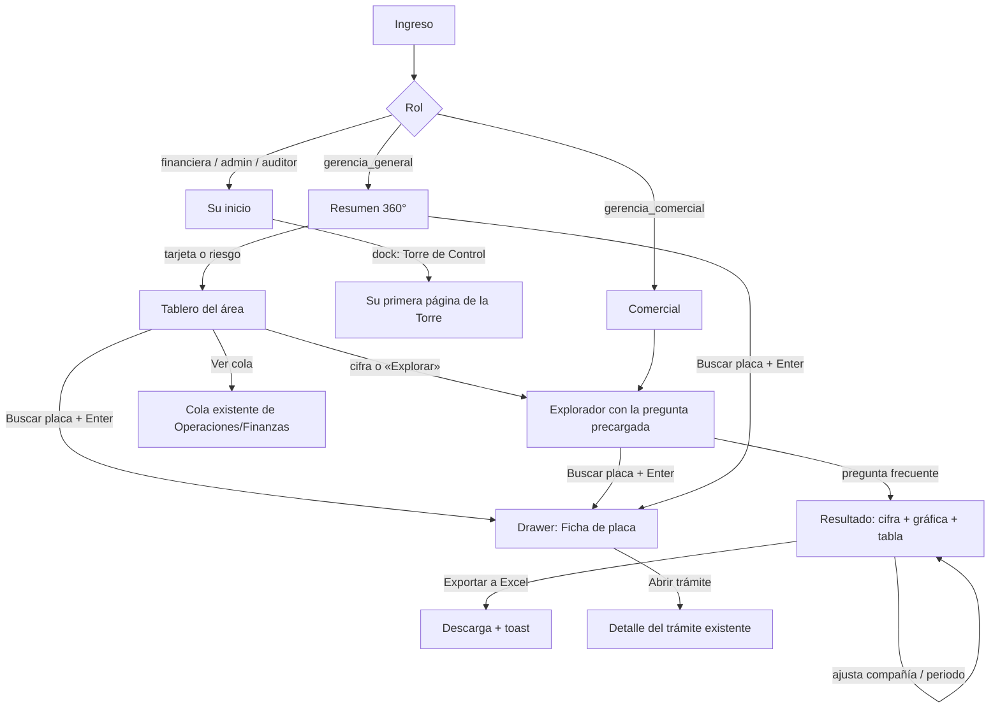
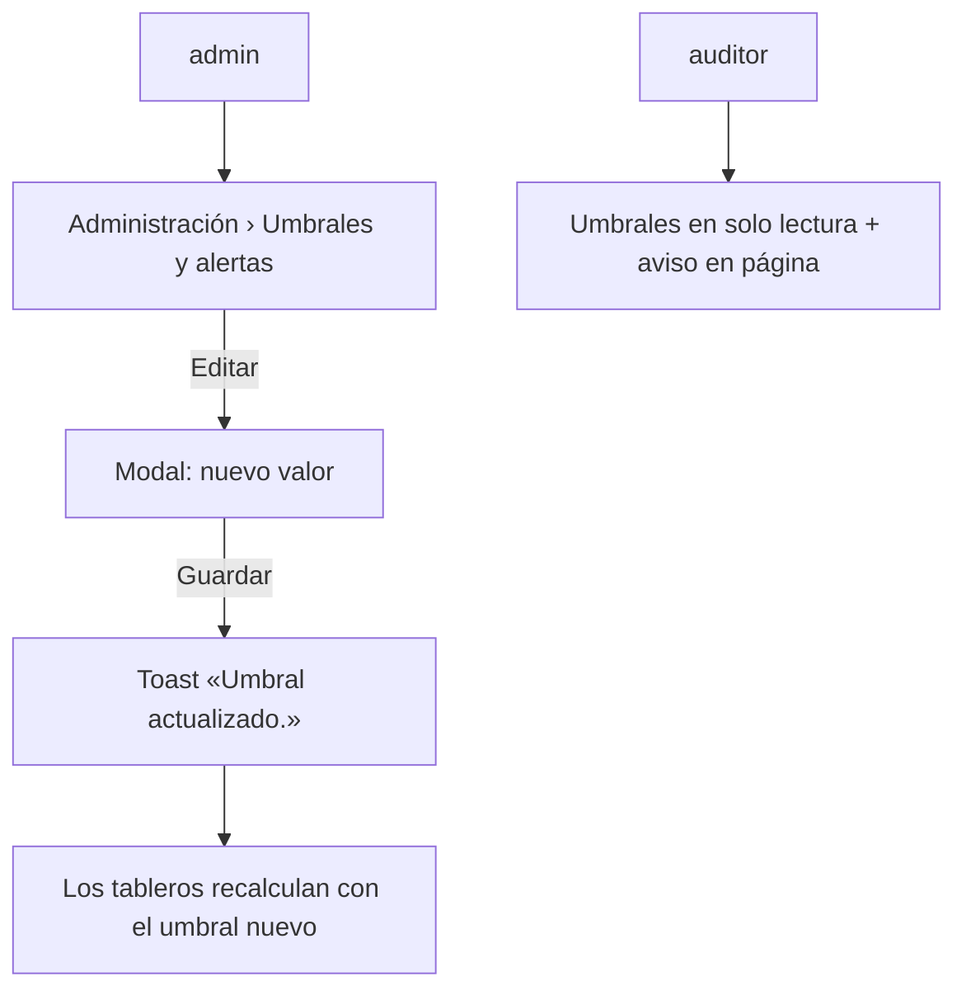

# UX — Torre de Control Gerencial (Épica #14590)

Modo: **full**. Es una sección nueva, con cinco páginas, un panel lateral y una página de Administración.
Kit: el del rediseño (Épica #14560, rama `FEATURE/14560-davidchica-rediseno-ui-kit-2026`). Plan técnico: `/home/david/.claude/plans/revisa-este-documento-docs-spec-torre-co-happy-badger.md`.

Maquetas (descartables, no se importan a `apps/web`):

- `docs/ux/mockups/torre-explorador.html`
- `docs/ux/mockups/torre-comercial.html`, que es el **molde** de los cuatro tableros
- `docs/ux/mockups/torre-ficha-placa.html`
- `docs/ux/mockups/torre-360.html`
- CSS común: `docs/ux/mockups/torre-maqueta.css`. El método está en el §13.

Decisión del PO (2026-11-17): los filtros viven en **`sessionStorage`**, se comparten entre las páginas de la Torre y **nunca van en la URL**. El kit se respeta tal cual; las únicas extensiones son las aditivas del §9.

---

## 1. Contexto y roles

**Qué viene a hacer quien abre la Torre:** saber en un vistazo si algo va mal en su área (qué cliente se está yendo, dónde se atasca el trabajo, qué bolsa se agota) y responder una pregunta concreta de negocio sin pedirle un reporte a nadie. Por ejemplo: «¿cuántos aprobó hoy la compañía X?», «¿cuánto costó la logística de marzo?».

**Público:** son operadores internos, de gerencia y de control. **No es el canal Cliente.** Por eso sí se usa jerga interna (ANS, bolsa, margen), pero el copy está escrito para alguien **no técnico**: frases de negocio, nunca nombres de columnas.

**Qué NO es esta pantalla:**
- No es una cola de trabajo: aquí no se opera ningún trámite. Para eso se va a la cola con «Ver cola» o «Abrir trámite».
- No sustituye a `FlitoTablero`: la Operativa lo enlaza y no le duplica los conteos por estado.
- No es el Centro de Informes (F5) ni el inventario de soportes (F6).

**Tratamiento:** **usted** en toda la Torre. Es pantalla nueva y el público es la gerencia.

### Sección, páginas y slugs

La sección se llama **«Torre de Control»**: clave `torre`, que en `SECTION_ORDER` va justo después de `general`, y glifo `reportes` del kit. Las rutas son **propuesta**; `architecture-agent` las confirma junto con los slugs.

| Orden | Página | Slug (propuesta) | Ruta (propuesta) |
|---|---|---|---|
| 1 | Resumen 360° | `torre_resumen` | `/flito/torre/resumen` |
| 2 | Comercial | `torre_comercial` | `/flito/torre/comercial` |
| 3 | Operativa | `torre_operativa` | `/flito/torre/operativa` |
| 4 | Financiera | `torre_financiera` | `/flito/torre/financiera` |
| 5 | Explorador de métricas | `torre_explorador` | `/flito/torre/explorador` |
| — | Umbrales y alertas (en la sección **Administración**) | `torre_umbrales` | `/flito/torre/umbrales` |
| — | Ficha de placa | sin slug ni ruta: es un `Drawer` dentro de cualquier página de la Torre | — |

### Qué ve cada rol y dónde entra

| Rol | Entra a | Ve en la Torre | Umbrales |
|---|---|---|---|
| `gerencia_general` | **Resumen 360°** (es su página de inicio, vía `DEFAULTS_POR_ROL`) | Las 5 páginas | — |
| `gerencia_comercial` | **Comercial** (su página de inicio) | Comercial y Explorador | — |
| `financiera` | Su inicio actual, sin cambios. La Torre abre en **Financiera** | Financiera y Explorador | — |
| `admin` | Su inicio actual. La Torre abre en **Operativa** | Operativa y Explorador | **Edita** |
| `auditor` | Su inicio actual. La Torre abre en **Resumen 360°** | Las 5 páginas, en solo lectura (ningún tablero tiene escritura) | **Consulta, sin editar** |

Reglas de la tabla:
- Lo que el rol no ve **no aparece**, ni en el dock ni en las pestañas. No hay elementos deshabilitados. Una URL directa sin permiso cae en la guarda de `ProtectedRoute` que ya existe.
- Una tarjeta del 360° solo es enlace (`KpiCard to`) si el rol puede ver el tablero al que lleva. Si no puede, es una tarjeta sin `to`.
- La Ficha de placa está disponible para quien vea al menos una página de la Torre.
- El rol `operaciones` no existe (CF-12) y no se diseña.

---

## 2. Qué se ve y qué se calla

| Superficie | Se ve primero | A un clic | No está |
|---|---|---|---|
| Tablero (molde) | 3–4 cifras con su semáforo: lo que pide atención va en naranja | Bloques de detalle debajo; la lista completa, en el Excel o en el Explorador | Conteos por estado de la operación diaria (viven en `FlitoTablero`), PII, banners |
| Resumen 360° | Tres tarjetas (Comercial, Operativo, Financiero) y los 5 riesgos de hoy | El tablero de cada área | El detalle de cada área |
| Explorador | La respuesta: **una cifra grande** que repite la pregunta en su título | Gráfica y tabla del desglose; el Excel | El SQL, los nombres de columnas, las métricas fuera del catálogo |
| Ficha de placa | Estado, la duración total en grande y la línea de avance | El historial de estados y las fichas de SOAT, impuesto, derecho y logística | Valor pagado, comprador, propietario y documentos |

**Dos disposiciones evaluadas para los tableros** (oficio full):
- **A. Una página con scroll:** cifras arriba y bloques debajo en rejilla de 2.
- **B. Cifras arriba y un bloque por pestaña.**

**Se elige A.** El trabajo de la visita es el *vistazo*, y en B cada pestaña esconde tres cuartas partes del tablero, lo que obliga a abrirlas todas para saber si algo va mal. Las pestañas de la Torre ya se usan para moverse entre páginas, y una segunda fila de pestañas sería ruido.

**Densidad:** cada tablero tiene como máximo 4 cifras y 5 bloques. Lo que no cabe se pregunta en el Explorador; no se apila.

---

## 3. Flujo de usuario





---

## 4. Barra de filtros transversal (`BarraFiltrosTorre`)

Es un solo componente de página, compuesto con piezas del kit, que va igual en las 5 páginas, justo debajo de las pestañas.

```
┌──────────────────────────────────────────────────────────────────────────────────────┐
│ Compañía                         Periodo                                             │
│ [Todas las compañías        ▾]   [Este mes                 ▾]                        │
│ [🔍 Buscar placa                                              ] [⛛ Más filtros  2 ]  │
│ (OT: OT Demo Norte ✕) (Departamento: Antioquia ✕)  Limpiar todo                      │
└──────────────────────────────────────────────────────────────────────────────────────┘
```

**Las piezas, en orden:**
1. **Compañía.** Un `FlitSelect` («Todas las compañías», luego la lista). Siempre está a la vista porque aparece en casi todas las preguntas de negocio.
2. **Periodo.** Un `FlitSelect` con periodos con nombre: Hoy · Ayer · Últimos 7 días · Este mes · Mes anterior · Últimos 6 meses · Este año · los 12 meses anteriores por nombre («Octubre 2026» … «Diciembre 2025») · «Rango personalizado…».
   - Al elegir «Rango personalizado…» aparece al lado el `RangoFechas` del kit, sin cambios.
   - Así «marzo» cuesta **un** clic y no hace falta navegar el calendario.
3. **`PanelFiltros`.**
   - Su buscador es **«Buscar placa»**. Pulsar Enter abre la Ficha de placa en un `Drawer`; **no filtra el tablero**. El `aria-label` lo dice.
   - El botón «Más filtros» abre el panel con OT (`FlitOrganismoCombobox`), Departamento, Ciudad (que se habilita al elegir departamento), Tipo de trámite y Estado.
   - Los filtros aplicados quedan como **chips** con su ✕, más «Limpiar todo».
   - Compañía y Periodo no generan chip, porque ya se ven.

**Persistencia:**
- Todo se guarda en `sessionStorage['flito-torre-filtros']`: compañía, OT, departamento y ciudad (códigos), tipo, estado y periodo (clave o fechas).
- Lo leen las 5 páginas al montarse.
- **La placa nunca se guarda** (solo vive en memoria mientras el Drawer está abierto) y **nada va en la URL**.
- Se borra al cerrar sesión.
- Si una pregunta frecuente del Explorador cambia el periodo, el cambio también queda en la barra compartida (se declara en QA).

**Filtros que no aplican:** si un bloque ignora un filtro, su subtítulo lo dice. Ejemplos: «No depende del periodo elegido» en Tendencia, Cobertura de bolsas y Proyección.

**Defaults:** en los tableros, Periodo = «Este mes» y Compañía = «Todas».

**Móvil (<`lg`):**
- Compañía y Periodo pasan a ocupar cada uno todo el ancho, uno encima del otro.
- El buscador y el botón de filtros comparten renglón, porque el kit les pone `nowrap` por debajo de 640 px y el botón queda solo con ícono y la cuenta.
- El panel se abre en el flujo, a una columna.
- Los chips envuelven.

**Feedback:**
- Los selects y el buscador usan el foco del kit (borde azul más `--kit-sombra`).
- El botón de filtros tiene el hover del kit.
- Los chips aplicados usan el hover de `filtro-activo`.
- «Limpiar todo» es `btn ghost` con hover `--kit-hover`.

**Notificación:** los filtros puestos son estado persistente y se avisan **en la página**, con los chips. Nunca con un toast.

---

## 5. Explorador de métricas

### 5.1 Patrón: preguntas frecuentes y una oración editable

Es una sola tarjeta, **«¿Qué quiere saber?»**, con dos partes:
1. **Preguntas frecuentes:** chips `chip chip--sm` con `aria-pressed`, que envuelven. Cada chip deja puestas la métrica, la agrupación y el periodo, y consulta de inmediato. Su descripción va en el `title`.
2. **La oración:** «**Medir** [métrica ▾] agrupado por **[agrupación ▾]**». Son dos `select.control` con su `<label>` visible.
   - **Métricas** (lista blanca, en tres grupos):
     - *Cuántos*: Trámites aprobados · Trámites creados.
     - *Cuánto se tardó*: Tiempo de creación a aprobación.
     - *Cuánto se pagó*: Costo de logística · Impuestos pagados · Derechos de tránsito pagados.
   - **Agrupar por:** Sin agrupar (total) · Día · Mes · Compañía · Organismo de tránsito · Departamento · Ciudad.

La compañía, el periodo y el resto de filtros salen de la **barra transversal**, nunca de la oración, para no tener el mismo filtro en dos sitios. **No hay botón «Consultar»:** cada cambio recalcula, y gana la última petición.

**Interacciones por pregunta de negocio (≤3):**

| Pregunta | Interacciones |
|---|---|
| ¿Cuántos aprobó hoy la compañía X? | chip «Aprobados hoy» (1) → Compañía X (2) |
| ¿Cuánto tardó Operaciones en aprobar los trámites de X? | chip «Tiempo hasta la aprobación» (1) → Compañía X (2) |
| ¿Cuánto costó la logística de marzo para X? | chip «Costo de logística del mes» (1) → Compañía X (2) → Periodo «Marzo 2026» (3) |
| ¿Cuánto he pagado en impuestos al OT Y? | chip «Impuestos pagados por organismo» (1). Y es una fila de la tabla y el total está en la cifra |
| ¿Qué derechos de tránsito pagué en un rango? | chip «Derechos de tránsito pagados» (1) → Periodo (2) → Exportar (3) |
| ¿Cuántos se matricularon en el departamento Y? | chip «Matrículas por departamento» (1). Para bajar a ciudad: Agrupar por «Ciudad» (2) |
| Estado o tiempo de la placa AAA123 | Buscar placa + Enter (1): abre la ficha |

### 5.2 Cómo se ve el resultado

Es una tarjeta cuyo título **repite la pregunta**: «{Métrica} · {Periodo} · por {agrupación}». El subtítulo lleva la compañía y los filtros. La región va con `aria-live="polite"`.

| Caso | Qué muestra |
|---|---|
| Sin agrupar | Una `KpiCard` con la cifra. En el pie, la comparación con el periodo anterior si existe |
| Agrupado por tiempo (día, mes) | Una `KpiCard` con el total, **`LineaTendencia`** y un `DataTable` |
| Agrupado por categoría | Una `KpiCard` con el total y un **ranking Top 10** con `AvanceBarra` (participación %). Si hay más de 10, se añade una fila «Los demás (n)». Debajo, `DataTable` completo, paginado de 20 en 20 |
| Tiempos de ciclo | 4 `KpiCard`: **Mediana** («La mitad tardó menos»), **9 de cada 10** (percentil 90), **El que más tardó** (con placa y «ver ficha», que abre el Drawer) y **Lapso total** (del primero creado al último aprobado). En el subtítulo, cuántos trámites entran. Si se agrupa por tiempo, `LineaTendencia` con mediana y p90; si es por categoría, tabla con n, mediana, p90 y máximo |
| Base de fecha | Si algún trámite del conjunto es anterior a julio de 2026, aparece un `InlineAlert` de tono info (aviso en página). Copy en el §11 |

Formatos:
- Dinero: «$ 18,4 millones» en la cifra y «$ 18.400.000» en la tabla.
- Días con una decimal y coma: «3,5 días».

**Única primaria:** «Exportar a Excel», en la cabecera. Envía el mismo cuerpo de la consulta a `POST /flito/torre/metricas/exportar` y se muestra con `GradientButton ocupado` mientras genera. Queda deshabilitada mientras carga, en vacío y en error.

### 5.3 Wireframes del Explorador

**Lleno (conteo por categoría), escritorio:**
```
┌ PageHeaderCard ───────────────────────────────────────────────────────────────────────┐
│ Inicio › Torre de Control › Explorador de métricas                                    │
│ Explorador de métricas                                          [⤓ Exportar a Excel]  │
│ Responda preguntas sobre trámites, tiempos y costos sin pedir un reporte.             │
└───────────────────────────────────────────────────────────────────────────────────────┘
 RESUMEN 360° │ COMERCIAL │ OPERATIVA │ FINANCIERA │ [EXPLORADOR]
 <BarraFiltrosTorre>  (Compañía: Todas · Periodo: Hoy · chip OT: OT Demo Norte)
┌ ¿Qué quiere saber? ───────────────────────────────────────────────────────────────────┐
│ Elija una pregunta frecuente o arme la suya.                                          │
│ (●Aprobados hoy) (Tiempo hasta la aprobación) (Costo de logística del mes)            │
│ (Impuestos pagados por organismo) (Derechos de tránsito pagados) (Matrículas por dpto)│
│ Medir                                   Agrupar por                                   │
│ [Trámites aprobados      ▾]  agrupado por [Compañía      ▾]                           │
└───────────────────────────────────────────────────────────────────────────────────────┘
┌ Trámites aprobados · Hoy · por compañía ──────────────────────────────────────────────┐
│ Todas las compañías · OT Demo Norte                                                   │
│ ┌ Aprobados hoy ──────┐   Participación por compañía                                  │
│ │ 47                  │   Compañía Demo A ████████████░░░░░░░░ 38 %   18               │
│ │ 12 más que ayer (35)│   Compañía Demo B ████████░░░░░░░░░░░░ 26 %   12               │
│ └─────────────────────┘   Compañía Demo C ██████░░░░░░░░░░░░░░ 19 %    9               │
│                           …                                                           │
│ ┌ COMPAÑÍA ───────────────┬ APROBADOS ┬ PARTICIPACIÓN ┐                               │
│ │ Compañía Demo A         │        18 │          38 % │   (DataTable)                  │
└───────────────────────────────────────────────────────────────────────────────────────┘
```

**Tiempos:**
```
┌ Tiempo de creación a aprobación · Últimos 6 meses · por mes ──────────────────────────┐
│ Compañía Demo A · 100 trámites aprobados                                              │
│ [Mediana 3,5 días] [9 de cada 10: 8 días o menos] [El que más tardó 21 días] [Lapso 27]│
│ ⓘ Los tiempos se cuentan desde la creación… 12 de estos 100 son anteriores a jul-2026…│
│  LineaTendencia: ── Mediana (azul)  ── Percentil 90 (turquesa), may…oct               │
│  DataTable: Mes · Trámites · Mediana · Percentil 90 · Máximo                          │
└───────────────────────────────────────────────────────────────────────────────────────┘
```

**Vacío** (en la tarjeta de resultado; la pregunta y la barra siguen operables):
```
┌───────────────────────────────────────────┐
│               (◯ carpeta)                 │
│  Ningún trámite cumple esta consulta.     │
│  Pruebe con un periodo más amplio o quite │
│  algún filtro.                            │
│            [Limpiar filtros]              │
└───────────────────────────────────────────┘
```

**Error:**
```
┌───────────────────────────────────────────┐
│             (◯ nube-alerta)               │
│ No pudimos calcular esta consulta. Revise │
│ su conexión e intente de nuevo.           │
│              [↻ Reintentar]               │
└───────────────────────────────────────────┘
```

**Cargando:** solo se reemplaza la tarjeta de resultado, con un esqueleto de **esa** estructura (título, cifra, ranking y filas). Se anuncia como «Calculando la consulta».

**Móvil (375 px):**
```
┌──────────────────────────────┐
│ Explorador de métricas       │
│ Responda preguntas…          │
│ [⤓ Exportar a Excel ]        │  ← acciones bajo el título, a todo el ancho
│ RESUMEN 360° │ COMERCIAL │ …→ │  ← pestañas que se deslizan
│ Compañía [Todas         ▾]   │
│ Periodo  [Hoy           ▾]   │
│ [🔍 Buscar placa     ] [⛛ 1] │
│ (OT: OT Demo Norte ✕)        │
│ ┌ ¿Qué quiere saber? ──────┐ │
│ │(Aprobados hoy)(Tiempo…)  │ │  ← chips envuelven
│ │Medir [Trámites aprob. ▾] │ │  ← oración apilada; «agrupado por» se oculta
│ │Agrupar por [Compañía  ▾] │ │
│ └──────────────────────────┘ │
│ ┌ Aprobados hoy: 47 ───────┐ │
│ │Compañía Demo A       18  │ │  ← ranking: nombre y cifra; la barra debajo
│ │████████░░░░░░ 38 %       │ │
│ └──────────────────────────┘ │
│ DataTable → tarjetas (≤900)  │
└──────────────────────────────┘
```

---

## 6. Ficha de placa (`Drawer`)

**Dónde vive:** en el buscador «Buscar placa» de la barra transversal, en cualquier página de la Torre, y en el enlace «ver ficha» de «El que más tardó». La búsqueda va en el **cuerpo** de `POST /flito/torre/placa/buscar`, con `logPiiAccess`. La placa no toca la URL ni el historial del navegador.

**Validación:** antes de enviar se normaliza a mayúsculas sin espacios. Si tiene menos de 5 caracteres, no se envía y aparece un error en línea bajo la barra (`.error` con `aria-describedby` en el input). Copy en el §11.

**Contenido:**
- **Cabecera de la ficha:** `Placa` + tipo de trámite + «Compañía · OT» + `EtiquetaEstado`.
- **Duración:** un bloque `--kit-hover` con la cifra grande.
  - Si está aprobado: «14 días» y debajo «de la creación a la aprobación · 2 oct → 16 oct 2026».
  - Si no lo está: «Lleva 9 días» y debajo «desde la creación; aún no se aprueba».
- **`LineaAvance`:** Creado → Radicado → Aprobado → Facturado, con la fecha de cada paso.
- **`Fichas`:** SOAT · Impuesto · Derecho de tránsito · Logística. Solo dicen **estado**, nunca valores.
- **Historial de estados** (`ActividadLinea`): la fecha y «Pasó a X · estuvo N días en Y».
- **Base de fecha:** si el trámite es anterior a julio de 2026, un `InlineAlert` info.
- **Acción:** «Abrir trámite» (`btn secondary`) lleva al detalle existente, con el uuid en el path. Es la única acción y es de navegación: la ficha es una consulta y **no tiene primaria**, igual que cualquier `Drawer` de detalle del kit.

**Varios trámites con la misma placa:** «La placa XXX000 tiene 2 trámites en FLITO. Elija cuál ver.», con un `ListaFila` del más reciente al más antiguo y la acción «Ver ficha».

**Fuera del alcance del usuario:** se responde igual que «no encontrada», para no filtrar que el trámite existe.

```
┌ (velo) ─────────────────────────────┬ Torre de Control ──────────────── ✕ ┐
│                                     │ Ficha de la placa                   │
│                                     │ [XXX000] Traspaso                   │
│                                     │          Compañía Demo A · OT Demo N│
│                                     │          ◆ Aprobado                 │
│                                     │ ┌─────────────────────────────────┐ │
│                                     │ │ 14 días                         │ │
│                                     │ │ de la creación a la aprobación  │ │
│                                     │ └─────────────────────────────────┘ │
│                                     │ ✔Creado ─ ✔Radicado ─ ✔Aprobado ─ ○Facturado
│                                     │ [SOAT: Vigente…][Impuesto: Pagado]  │
│                                     │ [Derecho: Pagado][Logística: Entreg]│
│                                     │ Historial de estados                │
│                                     │ • 16 oct Pasó a Aprobado · 6 días…  │
│                                     │ • 10 oct Pasó a Radicado · 8 días…  │
│                                     │                  [Abrir trámite]    │
└─────────────────────────────────────┴─────────────────────────────────────┘
```

**No encontrada:**
```
│ Ficha de la placa                    ✕ │
│            (◯ lupa)                    │
│ No encontramos la placa XXX000 en FLITO.│
│ Revise que esté bien escrita. La Torre │
│ solo ve trámites registrados en FLITO. │
```
El texto de la placa sigue en el buscador para que se pueda corregir.

**Error:** «No pudimos buscar la placa. Intente de nuevo.» con [Reintentar].

**Cargando:** un esqueleto con la forma de la ficha (placa, duración, línea, fichas). Se anuncia como «Buscando la placa».

**Móvil:** el `Drawer` ocupa la pantalla completa. La `LineaAvance` cabe con 4 pasos en 343 px. Las fichas caen a una columna (`.dl` con auto-fit).

**Foco y teclado:**
- Al abrir, el foco va al título.
- El foco queda atrapado dentro del panel, como en el modal del kit.
- Esc o ✕ lo cierran y el foco vuelve al buscador.
- ✕ tiene el hover `--kit-hover` del kit.

---

## 7. Molde de los tableros

Los cuatro se arman con la misma estructura:

```
PageHeaderCard (miga · h1 · subtítulo de una frase · [Exportar a Excel] ← ÚNICA primaria)
Pestanas de la Torre (solo si el rol ve ≥2 páginas de la Torre)
BarraFiltrosTorre
.rejilla-kpi: 3–4 KpiCard (naranja = `pendiente` cuando supera su umbral; `to` si lleva a algo)
.rejilla-2 (1 col <lg): bloques en FlitCard con card__cabeza (h2 + subtítulo que dice qué mide
                         y si ignora algún filtro)
bloque ancho opcional (tabla/matriz)
```

**Los 4 estados, a nivel de página.** Cada tablero hace **una** petición.

| Estado | Qué muestra |
|---|---|
| Cargando | Esqueleto de la misma rejilla: 4 cifras y 4 bloques |
| Error | `ErrorVista`: «No pudimos cargar el tablero {nombre}. Intente de nuevo.» con [Reintentar] |
| Vacío | Cuando no hay ningún trámite con esos filtros: `Vacio` «No hay trámites en este periodo con los filtros puestos.», detalle «Amplíe el periodo o quite filtros para ver el tablero.» y [Limpiar filtros] |
| Lleno | El tablero |

Además, **cada bloque** sin datos muestra su propio `grafico-vacio` con un copy específico (§11). Un bloque vacío suele ser una **buena** noticia («Ningún cliente cayó…») y el copy lo dice así.

**Exportar:** el Excel lleva una hoja por bloque, con los mismos filtros. Si sale bien: toast «Listo: descargamos el Excel del tablero.». Si falla: toast de error cerrable.

**Feedback:**
- Las `KpiCard` con `to` llevan el borde azul del kit al pasar el puntero, y foco.
- Las filas de tabla, el hover `--kit-hover`.
- Los «Ver», «Explorar» y «Ver cola» son `btn ghost sm` con hover.
- Los segmentados (`FiltroSegmentado`) tienen hover y foco del kit.

**Móvil:**
- Las cifras caen a 1 columna (`auto-fit` de 220 px).
- Los bloques, a 1 columna.
- `DataTable` pasa a tarjetas por debajo de 900 px. La matriz de venta cruzada usa `matriz`, con scroll horizontal.
- Las gráficas escalan al ancho. Por debajo de 640 px, la de categorías muestra el Top 5 y la de línea rotula una de cada dos etiquetas.

### 7.1 Comercial

Es la maqueta del molde. Sus indicadores:
- **Cifras:**
  1. **Clientes con caída de volumen.** El número de compañías con fuga mayor o igual al umbral. Va en naranja si es mayor que 0 y su pie «Ver cuáles» lleva al bloque.
  2. **Concentración en el Top 3.** El porcentaje del volumen; en el pie, el Top 5.
  3. **Conversión a facturado.** El porcentaje de lo creado en el periodo que ya está en `siigo_factura_tramites` activo.
  4. **Trámites del periodo.** Con la comparación con el periodo anterior y un `Sparkline`.
- **Bloques:**
  1. **Clientes con caída de volumen.** Un `ListaFila` con el cliente, «41 trámites; su promedio es 66», `EtiquetaEstado warn` «−38 %» y «Explorar», que abre el Explorador con esa compañía. En la nota, el umbral.
  2. **Concentración de clientes.** `Dona` con el Top 3 y «Los demás (n)». Un `FiltroSegmentado` alterna Volumen e Ingreso (`flito_liquidaciones`).
  3. **Conversión.** Ranking con `AvanceBarra`: Creados, Radicados, Aprobados, Facturados, cada uno con cifra y porcentaje sobre los creados.
  4. **Tendencia.** `LineaTendencia` mensual con los últimos 6 meses cerrados, que alterna Mensual y Trimestral. No depende del periodo elegido.
  5. **Venta cruzada** (bloque ancho). Matriz de cliente × línea (Trámites, SOAT, Impuestos, Derechos, Logística) con `EtiquetaEstado`: ok «Usa», info «Autogestiona» (flag `*_autogestionable`) y neutro «No usa». Muestra los 10 clientes con más trámites; el resto, en el Excel.

```
┌ PageHeaderCard: Comercial · «Qué clientes crecen, cuáles se están yendo y dónde hay venta por hacer.» [⤓ Exportar] ┐
 RESUMEN 360° │ [COMERCIAL] │ OPERATIVA │ FINANCIERA │ EXPLORADOR
 <BarraFiltrosTorre>
[Clientes con caída 3 ⚠] [Concentración Top 3 61 %] [Conversión a facturado 75 %] [Trámites del periodo 1.170 ⌁]
┌ Clientes con caída de volumen ─────┐ ┌ Concentración de clientes  (Volumen|Ingreso) ┐
│ Compañía Demo B  41; prom. 66 ◆−38%│ │ (dona) Demo A 31 % · Demo B 18 % · Demo C 12 %│
│ Compañía Demo D  …           ◆−24% │ │        Los demás (14) 39 %                   │
└────────────────────────────────────┘ └──────────────────────────────────────────────┘
┌ Conversión ────────────────────────┐ ┌ Tendencia  (Mensual|Trimestral) ─────────────┐
│ Creados    ██████████ 100 %  1.240 │ │  LineaTendencia may…oct                      │
│ Facturados ███████░░░  75 %    930 │ │                                              │
└────────────────────────────────────┘ └──────────────────────────────────────────────┘
┌ Venta cruzada ───────────────────────────────────────────────────────────────────────┐
│ CLIENTE        │ TRÁMITES │ SOAT          │ IMPUESTOS │ DERECHOS │ LOGÍSTICA          │
│ Compañía Demo A│ ◆Usa     │ ◆Usa          │ ◆Usa      │ ◆Usa     │ ◆No usa            │
└──────────────────────────────────────────────────────────────────────────────────────┘
```

### 7.2 Operativa

Extiende `flito-tablero` sin duplicarlo. Sus indicadores:
- **Cifras:**
  1. **Sin gestión fuera de ANS.** SOAT más impuestos; en naranja si es mayor que 0.
  2. **Borradores abandonados.** Los que llevan más del umbral de días; en naranja si es mayor que 0.
  3. **Trámites en curso (WIP).**
  4. **Entregas al primer intento.** El porcentaje.
- **Bloques:**
  1. **Radar de estancamiento.** Un `ListaFila` por causa: SOAT sin gestión, impuestos sin gestión, borradores con más de N días y estancados en el OT con más de N días. Cada fila lleva la cifra, `EtiquetaEstado` («Atención» o «Crítico» según el umbral) y «Ver cola», que lleva a la cola existente. Al pie, el enlace «Abrir el tablero operativo» (`FlitoTablero`).
  2. **Carga activa.** Ranking con `AvanceBarra` del WIP por OT (Top 8). Un `FiltroSegmentado` alterna «Por organismo» y «Por funcionario». Esta segunda opción **solo aparece** si hay datos de `enviado_por_id` en el conjunto, y su nota dice «Solo trámites con funcionario registrado».
  3. **Comparativo de organismos de tránsito** (bloque ancho). `DataTable` con OT, Volumen, % aprobado, % rechazado, Pendientes y Mediana de respuesta. Se puede ordenar, y la mediana sobre el umbral lleva `EtiquetaEstado warn`.
  4. **Eficiencia logística.** Tres cifras pequeñas (primer intento %, viajes fallidos con `numero>=2` y tiempo medio de entrega) y una `Dona` de primer intento frente a reintento.

```
┌ PageHeaderCard: Operativa · «Dónde se está quedando el trabajo y qué organismo responde más lento.» [⤓ Exportar] ┐
 … pestañas · <BarraFiltrosTorre>
[Sin gestión fuera de ANS 14 ⚠] [Borradores abandonados 62 ⚠] [Trámites en curso 418] [Primer intento 91 %]
┌ Radar de estancamiento ──────────────┐ ┌ Carga activa  (Por organismo|Por funcionario) ┐
│ SOAT sin gestión        8 ◆Crítico [Ver cola]│ │ OT Demo Norte ████████░░ 96            │
│ Borradores > 5 días    62 ◆Atención [Ver cola]│ │ OT Demo Centro █████░░░░ 61           │
│ Abrir el tablero operativo           │ └───────────────────────────────────────────────┘
└──────────────────────────────────────┘
┌ Comparativo de organismos de tránsito ─────────────────────────────────────────────────┐
│ OT │ VOLUMEN │ % APROBADO │ % RECHAZADO │ PENDIENTES │ MEDIANA DE RESPUESTA            │
│ OT Demo Norte │ 310 │ 82 % │ 9 % │ 96 │ ◆ 9 días                                       │
└────────────────────────────────────────────────────────────────────────────────────────┘
┌ Eficiencia logística ────────────────────────────────────────────────────────────────┐
│ 91 % al primer intento · 12 viajes fallidos · 2,1 días de entrega   (dona 1.º/reint.) │
└──────────────────────────────────────────────────────────────────────────────────────┘
```

### 7.3 Financiera

- **Cifras:**
  1. **Bolsa con menor cobertura.** «4 días», con «Compañía Demo A» en el pie y el chip «Crítico» o «Atención» según el umbral.
  2. **Trabajo sin facturar.** «$ 18,4 millones», con «41 trámites» en el pie; en naranja si es mayor que 0.
  3. **Margen bruto del periodo.** El porcentaje.
  4. **Soportes completos 3/3.** El porcentaje.
- **Bloques:**
  1. **Cobertura de bolsas.** `DataTable` con Compañía, Saldo, Consumo diario (30 días), Días de cobertura y Estado (semáforo con `EtiquetaEstado`: ok ≥ atención, warn entre crítico y atención, danger < crítico). Va ordenada de menor a mayor cobertura. No depende del periodo: es el saldo de hoy y el consumo de los últimos 30 días.
  2. **Trabajo terminado sin facturar.** `DataTable` con Compañía, Trámites, Valor estimado y «Más antiguo (días)». La acción de fila «Ver en reporte de costos» lleva a la página existente.
  3. **Margen por servicio.** `BarrasGrupo` con las series Cobrado (azul) y Costo (gris) para Trámite, SOAT, Impuestos, Derechos y Logística. El margen por cliente va en el Excel.
  4. **Conciliación documental 3/3.** `Dona` con 3/3 (verde), 2/3 (amarillo), 1/3 (naranja) y 0/3 (gris). Usa el mismo cálculo que F6 y, cuando F6 exista, enlaza a «Ver inventario».

```
┌ PageHeaderCard: Financiera · «Cuánto dura el saldo de cada bolsa, qué falta por facturar y cuánto deja cada servicio.» [⤓ Exportar] ┐
 … pestañas · <BarraFiltrosTorre>
[Menor cobertura 4 días ◆Crítico] [Sin facturar $ 18,4 M ⚠] [Margen bruto 23 %] [Soportes 3/3 82 %]
┌ Cobertura de bolsas ────────────────────────────────────────────────────────────────────┐
│ COMPAÑÍA │ SALDO │ CONSUMO DIARIO (30 D) │ DÍAS DE COBERTURA │ ESTADO                   │
│ Compañía Demo A │ $ 2.100.000 │ $ 525.000 │ 4 │ ◆ Crítico                              │
└─────────────────────────────────────────────────────────────────────────────────────────┘
┌ Trabajo terminado sin facturar ─────┐ ┌ Margen por servicio ───────────────────────────┐
│ Compañía │ Trámites │ Valor │ Más ant.│ │ BarrasGrupo Cobrado/Costo × 5 servicios      │
│  … [Ver en reporte de costos]       │ └────────────────────────────────────────────────┘
└─────────────────────────────────────┘ ┌ Conciliación documental 3/3 (dona) ────────────┐
```

### 7.4 Resumen 360°

No calcula nada propio: consume los servicios de F1 a F3. Va en **tres peticiones**, así que el error es **por tarjeta**: si una falla, las otras se pintan, y en su lugar aparece un `ErrorVista` pequeño («No pudimos cargar el resumen {área}.») con [Reintentar]. El vacío y el error de página son los del molde.

- **Tres tarjetas** (`KpiCard`, que llevan al tablero del área cuando el rol lo ve):
  1. **Comercial.** Trámites del mes, con un chip warn si hay clientes en caída («3 clientes en caída»).
  2. **Operativo.** El porcentaje de aprobados dentro del ANS. En el pie va la meta, y la tarjeta queda en naranja si está por debajo.
  3. **Financiero.** El porcentaje de margen bruto; en el pie, «$ X sin facturar».
- **Proyección de cierre del mes.** La cifra («1.220 trámites») y «4 % más que octubre (1.170). Calculada con el ritmo diario de lo que va del mes.». Va con una `LineaTendencia` del acumulado diario: el mes en curso en azul continuo, la proyección en azul punteado, el mes anterior en gris y la meta como guía discontinua de tinta. La meta solo se dibuja si el umbral `meta_tramites_mes` está configurado. Siempre muestra el mes en curso, sin importar el periodo elegido.
- **Los 5 riesgos de hoy.** Un `ListaFila` con la frase de negocio, el área y el umbral en `small`, `EtiquetaEstado` «Crítico» (danger) o «Atención» (warn) y «Ver», que lleva al tablero. El orden es primero por gravedad del umbral y luego por impacto (monto o volumen afectado); el *score* exacto lo define `architecture-agent`. Si no hay riesgos: «Nada fuera de umbral hoy.».

```
┌ PageHeaderCard: Resumen 360° · «Cómo va la compañía este mes: comercial, operación y finanzas en una vista.» [⤓ Exportar] ┐
 [RESUMEN 360°] │ COMERCIAL │ OPERATIVA │ FINANCIERA │ EXPLORADOR · <BarraFiltrosTorre>
[Comercial · trámites del mes 690 ◆3 en caída →] [Operativo · dentro del ANS 86 % ⚠ meta 90 % →] [Financiero · margen 23 % →]
┌ Proyección de cierre del mes ───────┐ ┌ Los 5 riesgos de hoy ──────────────────────────┐
│ 1.220 trámites                      │ │ La bolsa de Compañía Demo A alcanza p/ 4 días  │
│ 4 % más que octubre (1.170)…        │ │   Financiero · crítico 5 días   ◆Crítico [Ver] │
│ LineaTendencia acumulado + proyección│ │ Compañía Demo B bajó 38 % …    ◆Atención [Ver]│
│ ---- meta 1.300                     │ │ …                                              │
└─────────────────────────────────────┘ └────────────────────────────────────────────────┘
```

### 7.5 Umbrales y alertas (Administración)

No tiene maqueta: es el molde de tabla del kit.
- **Cabecera:** `PageHeaderCard` «Umbrales y alertas», con el subtítulo «Los límites que usan los tableros de la Torre para marcar algo en atención o en crítico.».
- **Tabla:** `Pestanas` en modo página (Comercial, Operativa, Financiera, General) y `DataTable` con Umbral, Valor, Unidad, Descripción, «Última modificación» (quién y cuándo) y la acción de fila «Editar».
- **Edición:** «Editar» abre un `FlitModal` con un `campo` numérico, la unidad y el valor actual. Valida mínimo y máximo **en línea**, junto al campo. La **primaria del modal es «Guardar»**. Si guarda, toast «Umbral actualizado.»; si falla, error en línea en el modal.
- **Primaria de la página:** no hay; la acción es de fila.
- **4 estados:** los del `DataTable`. Vacío: «Aún no hay umbrales configurados. Ejecute la migración de la Torre o pida ayuda a soporte.»
- **Auditor:** no ve la columna Editar. Arriba aparece un `InlineAlert` info: «Usted puede consultar los umbrales; para cambiarlos, pida a un administrador.».

---

## 8. Datos

Todo pasa por `src/lib/api.ts`. No se piden endpoints fuera del plan.

| Superficie | Endpoint (plan F0) | Notas para `architecture-agent` |
|---|---|---|
| Barra (listas) | Las listas existentes de compañías, OT y DIVIPOLA (catálogo de `shared-types`) | Sin endpoint nuevo |
| Explorador | `POST /flito/torre/metricas/consultar` · `POST …/exportar` | El cuerpo es `FiltroTorre` + `metrica` + `agrupacion`. La respuesta debe traer, **por fila**, el valor y la participación. En tiempos: n, mediana, p90, máximo, lapso, la placa del máximo y **`nBaseSincronizacion`** (cuántos usaron el `created_at` del sync) |
| Ficha | `POST /flito/torre/placa/buscar` | Devuelve 0, 1 o N trámites. Por cada uno: estado, tipo, compañía, OT, fechas por paso, historial (`campo='flit_estado'`), estado de SOAT, impuesto, derecho y logística (**sin valores**), `baseFecha` y el uuid para «Abrir trámite» |
| Tableros | Un endpoint por gerencia, que recibe `FiltroTorre` | Cada bloque declara qué filtros ignora (para el subtítulo) |
| 360° | Los 3 resúmenes de F1–F3 | Tres peticiones, para poder mostrar el error por tarjeta |
| Umbrales | CRUD de `flito_torre_umbrales` | `actualizado_por` y `actualizado_en` se muestran en la tabla |

**PII:**
- La placa va solo en el cuerpo del POST y nunca en la URL ni en `sessionStorage`.
- La ficha no proyecta datos personales del titular. `logPiiAccess` se mantiene según el plan; `security-agent` confirma si aplica.
- La placa del «máximo» en el Explorador va en la respuesta, no en la URL.

---

## 9. Componentes: lo que se reutiliza y lo que falta

Se reutilizan:
- `PageHeaderCard`, `Pestanas` (modo enlaces), `PanelFiltros`, `RangoFechas`, `FlitSelect`, `FlitOrganismoCombobox`;
- `KpiCard`, `Sparkline`, `Dona`, `BarrasGrupo`, `SERIE_KIT`;
- `AvanceBarra`, `ListaFila`, `ActividadLinea`, `LineaAvance`, `Fichas`, `EtiquetaEstado`;
- `DataTable` (incluido `matriz`), `FiltroSegmentado`, `Drawer`, `FlitModal`, `InlineAlert`;
- `EstadoVista`, `Vacio`, `ErrorVista`, `PageContentSkeleton`, `ToastFlito`, `GradientButton ocupado`.

Lo que falta, siempre **aditivo**: ninguna prop existente cambia.

1. **`LineaTendencia`**, nuevo en `components/flit/Graficos.tsx`.
   - Firma: `{ etiquetas: string[]; series: { t: string; c: string; v: (number|null)[]; punteada?: boolean }[]; titulo: string; guia?: { v: number; t: string }; formato?: (n: number) => string }`.
   - Usa la misma geometría que `BarrasGrupo`: `viewBox 0 0 560 250`, `x0=34`, `y0=214`, `alto=190`, el mismo cálculo de paso y tope, `grafico__guia` y `grafico__eje`, y la `leyenda`.
   - El trazo es de 2,5, con puntos de radio 4 y `<title>` por punto. Una serie `punteada` usa `stroke-dasharray 6 6`. La `guia` (la meta) es una línea discontinua `--color-text-primary` que se nombra en la leyenda.
   - Un `null` corta la línea, por ejemplo en los días que aún no llegan.
   - Lleva `role="img"` y un `aria-label` que resume la serie. Si no hay datos, `grafico-vacio`.
   - Colores solo por `SERIE_KIT`. Por debajo de 640 px rotula una de cada dos etiquetas cuando hay más de 8.
   - Lo dibujan las maquetas `torre-explorador` (vista tiempos), `torre-comercial` y `torre-360`.
2. **`PanelFiltros`** recibe dos props opcionales:
   - `onEnviarBusqueda?(texto)`: Enter en el buscador. La Torre la usa para abrir la ficha sin filtrar.
   - `textoBoton?` (por defecto «Filtros»): la Torre lo pone en **«Más filtros»**, porque Compañía y Periodo ya se ven fuera del panel.
3. **No hay nada más.** El periodo con meses por nombre es un `FlitSelect` que muestra `RangoFechas` solo en «Rango personalizado…». El ranking es `AvanceBarra` repetido. Las preguntas frecuentes son `chip chip--sm`. El semáforo es `EtiquetaEstado` o el `chip` de `KpiCard`.

---

## 10. Interacción y notificaciones

| Acción | Resultado | Patrón |
|---|---|---|
| Elegir una pregunta, una métrica, una agrupación o un filtro | Recalcula el resultado | Esqueleto en la tarjeta de resultado. Sin toast: el título de la tarjeta, con `aria-live`, anuncia la nueva cifra |
| Exportar a Excel (Explorador o tablero) | Descarga | Toast ok, una frase, unos 4 s, cerrable. Toast de error cerrable de al menos 6 s, con «Reintentar» |
| Buscar placa (Enter) | Drawer | Estados dentro del Drawer. Si el formato no es válido, error en línea bajo la barra |
| Filtros aplicados | — | Chips (aviso en página), no toast |
| Base de fecha de sincronización | — | `InlineAlert` info persistente |
| Guardar umbral | Cierra el modal | Toast «Umbral actualizado.». Si falla, error en línea en el modal |

Ningún mensaje muestra el error crudo del API.

---

## 11. Copy (textos exactos)

**Títulos y subtítulos de página:**

| Página | h1 | Subtítulo |
|---|---|---|
| Resumen 360° | Resumen 360° | Cómo va la compañía este mes: comercial, operación y finanzas en una vista. |
| Comercial | Comercial | Qué clientes crecen, cuáles se están yendo y dónde hay venta por hacer. |
| Operativa | Operativa | Dónde se está quedando el trabajo y qué organismo responde más lento. |
| Financiera | Financiera | Cuánto dura el saldo de cada bolsa, qué falta por facturar y cuánto deja cada servicio. |
| Explorador | Explorador de métricas | Responda preguntas sobre trámites, tiempos y costos sin pedir un reporte. |
| Umbrales | Umbrales y alertas | Los límites que usan los tableros de la Torre para marcar algo en atención o en crítico. |

**Etiquetas fijas:**
- Sección del menú: «Torre de Control». Pestañas: «Resumen 360°», «Comercial», «Operativa», «Financiera», «Explorador».
- Primaria: «Exportar a Excel».
- Barra: «Compañía», «Todas las compañías», «Periodo», «Rango personalizado…», «Más filtros», «Limpiar todo». Placeholder: «Buscar placa». `aria-label` del buscador: «Buscar placa: escriba la placa y pulse Enter para ver su ficha».
- Tarjeta del Explorador: «¿Qué quiere saber?», con el subtítulo «Elija una pregunta frecuente o arme la suya.». Grupo: «Preguntas frecuentes». Campos: «Medir» y «Agrupar por»; texto de unión: «agrupado por».

**Preguntas frecuentes** (rótulo del chip y lo que deja puesto, en el `title`):

| Chip | Métrica · agrupación · periodo |
|---|---|
| Aprobados hoy | Trámites aprobados · Compañía · Hoy |
| Tiempo hasta la aprobación | Tiempo de creación a aprobación · Mes · Últimos 6 meses |
| Costo de logística del mes | Costo de logística · Compañía · Este mes |
| Impuestos pagados por organismo | Impuestos pagados · Organismo de tránsito · Este mes |
| Derechos de tránsito pagados | Derechos de tránsito pagados · Compañía · Este mes |
| Matrículas por departamento | Trámites aprobados (tipo de trámite de matrícula, según el catálogo de tipos) · Departamento · Este año |

**Rótulos de tiempos:** «Mediana» (pie «La mitad tardó menos»), «9 de cada 10» (cifra «N días o menos», pie «Percentil 90»), «El que más tardó» (pie «Placa XXX000 · ver ficha») y «Lapso total» (pie «Del primero creado al último aprobado»).

**Nota de base de fecha:**
- Explorador, con n > 0: «Los tiempos se cuentan desde la creación del trámite en FLITO. {n} de estos {total} trámites son anteriores a julio de 2026: para ellos se cuenta desde la fecha en que FLITO los sincronizó, que puede ser posterior a la creación real.»
- Ficha: «Este trámite es anterior a julio de 2026: el tiempo se cuenta desde la fecha en que FLITO lo sincronizó, que puede ser posterior a la creación real.»
- Con n = 0 no se muestra el aviso. El subtítulo dice «Desde la creación del trámite en FLITO hasta su aprobación.».

**Vacíos:**

| Dónde | Texto | Detalle / acción |
|---|---|---|
| Explorador | Ningún trámite cumple esta consulta. | Pruebe con un periodo más amplio o quite algún filtro. · [Limpiar filtros] |
| Tablero (página) | No hay trámites en este periodo con los filtros puestos. | Amplíe el periodo o quite filtros para ver el tablero. · [Limpiar filtros] |
| Bloque Caídas | Ningún cliente cayó por debajo de su promedio en este periodo. | — |
| Bloque Venta cruzada | Sin clientes con trámites en el periodo. | — |
| Bloque Radar | Nada estancado fuera de umbral. | — |
| Bloque Logística | Sin viajes de logística en el periodo. | — |
| Bloque Cobertura | Todas las bolsas cubren más de {umbral} días. | — |
| Bloque Sin facturar | No hay trabajo terminado pendiente de facturar. | — |
| 360° Riesgos | Nada fuera de umbral hoy. | — |
| Ficha | No encontramos la placa {PLACA} en FLITO. | Revise que esté bien escrita. La Torre solo ve trámites registrados en FLITO. |
| Umbrales | Aún no hay umbrales configurados. | Ejecute la migración de la Torre o pida ayuda a soporte. |

**Errores:**
- Explorador: «No pudimos calcular esta consulta. Revise su conexión e intente de nuevo.» con [Reintentar].
- Tablero: «No pudimos cargar el tablero {Comercial|Operativo|Financiero}. Intente de nuevo.» con [Reintentar].
- Tarjeta del 360°: «No pudimos cargar el resumen {comercial|operativo|financiero}.» con [Reintentar].
- Ficha: «No pudimos buscar la placa. Intente de nuevo.» con [Reintentar].
- Placa inválida (en línea): «Escriba la placa completa, por ejemplo XXX000.»
- Exportar: «No pudimos generar el Excel. Intente de nuevo en un momento.»

**Éxitos:**
- «Listo: descargamos el Excel de esta consulta.» (Explorador)
- «Listo: descargamos el Excel del tablero.» (tableros)
- «Umbral actualizado.»

**Ficha:**
- «Ficha de la placa» (con el antetítulo «Torre de Control»).
- Duración: «{N} días» + «de la creación a la aprobación»; si no está aprobada, «Lleva {N} días» + «desde la creación; aún no se aprueba».
- «Historial de estados»; cada evento: «Pasó a {Estado} · estuvo {N} días en {Estado anterior}».
- «Abrir trámite».
- Varios trámites: «La placa {PLACA} tiene {n} trámites en FLITO. Elija cuál ver.»

---

## 12. Accesibilidad

- Una sola `h1` por página. Los bloques usan `h2` dentro de `card__cabeza`, y la ficha, `h2` en el título del Drawer y `h3` en sus secciones.
- **Gráficas:**
  - Llevan `role="img"` y un `aria-label` que resume los datos.
  - Siempre hay una alternativa en texto: la tabla, el ranking con cifras o la leyenda con valores.
  - El color nunca va solo: el semáforo lleva texto («Crítico», «Atención»), la proyección se distingue por el punteado y no solo por el tono, y las series se nombran en la leyenda.
- **Controles:**
  - Cada select tiene su `<label>` visible.
  - Los chips de preguntas usan `aria-pressed`.
  - El buscador lleva un `aria-label` explícito que dice lo que hace.
  - Las `KpiCard` enlazadas tienen un `aria-label` que dice a dónde llevan.
  - El resultado del Explorador va en `aria-live="polite"`.
- **Drawer:** foco al título, foco atrapado, Esc, y el foco vuelve al buscador al cerrar.
- **Contraste y foco:** contraste AA en claro y oscuro con los tokens del kit, y foco de 2 px azul. En oscuro, la meta usa `--color-text-primary` y las líneas usan `SERIE_KIT`; hay que verificarlo en la captura oscura.

---

## 13. Maquetas: método y brief

**Método** (el mismo de la propuesta del rediseño #14560, que es HTML estático con las clases del kit):
- Cada maqueta es un **HTML estático que enlaza el CSS real del kit**: `apps/web/src/styles/kit/kit-variables.css` → `tokens.css` → `kit-propuesta.css` → `kit-ui.css` → `kit-react.css` → `kit-responsive.css`, en el orden de `index.css`.
- Encima va `torre-maqueta.css`, que solo aporta el preflight mínimo, las rejillas que en la app da Tailwind y las fuentes y la placa por ruta relativa.
- No tiene HEX propios, ni JS de negocio, ni red. Un script de 5 líneas lee `?vista=` y `&tema=oscuro`.
- Lo que se ve es la **piel real** del kit (clases `page-header`, `metrica`, `filtros`, `kit-etiqueta`, `dona`, `grafico`, `kit-modal--lateral`…), no una imitación.
- **Limitación declarada:** la maqueta no incluye el shell (barra superior y dock con «Más»). La Torre se monta dentro del shell existente sin cambiarlo, salvo la sección nueva.

**Archivos y vistas:**

| Archivo | Vistas (`?vista=`) |
|---|---|
| `docs/ux/mockups/torre-explorador.html` | `lleno` · `tiempos` · `vacio` · `error` · `cargando` |
| `docs/ux/mockups/torre-comercial.html` (molde) | `lleno` · `vacio` · `error` · `cargando` |
| `docs/ux/mockups/torre-ficha-placa.html` | `lleno` (aprobado) · `encurso` · `varios` · `noencontrada` · `error` · `cargando` |
| `docs/ux/mockups/torre-360.html` | `lleno` · `parcial` (una tarjeta con error) · `cargando` |

Todas aceptan `&tema=oscuro`. Se abren directamente con `file://` y no necesitan servidor. Ejemplo: `file:///home/david/flit/flito/docs/ux/mockups/torre-explorador.html?vista=lleno`.

**Capturas** (las hace el hilo con Playwright MCP, en navegador visible y a página completa):
- Anchos: 1366×768 y 375×812, en tema claro, para cada vista.
- Oscuro: además, 1366 y 375 de `lleno` de cada archivo.
- Nombre del archivo: `docs/ux/mockups/torre-<pantalla>-<vista>-<1366|375>[-oscuro].png`.

**Datos:**
- Todos ficticios: Compañía Demo A–E, OT Demo Norte y OT Demo Centro, placas XXX000, XXX001 y XXX007, «Ciudad Demo».
- Sin PII real.

**Qué NO mostrar:** valores pagados en la ficha, comprador, propietario, documentos, nombres de columnas o de SQL, banners y el `BannerInicio`.

Operativa y Financiera **no tienen maqueta**: heredan el molde de Comercial y se rigen por los wireframes del §7.2 y §7.3.

---

## 14. Notas para QA

- Las 8 preguntas de negocio del plan se responden en ≤3 interacciones, según la tabla del §5.1, y la cifra coincide con el *fixture* del test de servicio.
- **Matriz de roles del §1:** cada rol ve solo sus páginas (en el dock y en las pestañas). El auditor no ve «Editar» en Umbrales. Una URL directa sin permiso cae en la guarda.
- **`sessionStorage`:**
  - Los filtros puestos en Comercial siguen puestos al pasar a Explorador.
  - La URL nunca lleva compañía, periodo ni placa.
  - La placa no queda en `sessionStorage` ni en el historial.
  - Al cerrar sesión se limpian.
- Una pregunta frecuente cambia el periodo de la barra compartida. Es comportamiento esperado, no un bug.
- **Explorador:**
  - Los 4 estados aparecen en la tarjeta de resultado.
  - Exportar queda deshabilitado en vacío, error y cargando.
  - Ningún toast muestra el error crudo.
- **Tiempos:** con trámites anteriores a julio de 2026 en el conjunto aparece el aviso con el n correcto; con n = 0, no aparece.
- **Ficha:**
  - Con menos de 5 caracteres, error en línea y ninguna petición.
  - Una placa fuera del alcance se comporta igual que «no encontrada».
  - Con varios trámites aparece la lista.
  - Esc devuelve el foco al buscador.
- **360°:** con un resumen fallando (por ejemplo el financiero), las otras dos tarjetas se pintan. Sin `meta_tramites_mes` configurada, no se dibuja la meta.
- **Móvil (375):** sin desborde horizontal, la barra se reorganiza como en el §4, el `DataTable` pasa a tarjetas y el `Drawer` ocupa la pantalla completa.
- **Oscuro:** semáforos, líneas de la gráfica y la meta legibles; contraste AA.

---

## 15. Decisiones y descartes

| Decisión | Descartado | Por qué |
|---|---|---|
| **Oración editable** (métrica + agrupación) con preguntas frecuentes en chips | Un constructor tipo tabla dinámica, o un formulario con 8 campos | Un gerente no técnico piensa en una pregunta, no en dimensiones. La oración se lee como lo que responde |
| Chips visibles para las preguntas | `FiltrosInteligentes` (desplegable) | Su rótulo «Vista» está fijo y esconde las preguntas tras un clic. Para quien no sabe qué preguntar, verlas es la ayuda |
| Compañía y Periodo fuera del panel | Todo dentro de «Filtros» | Son los filtros de casi todas las preguntas. Dentro del panel, cada pregunta costaría 4 interacciones o más |
| Periodo como `FlitSelect` con meses por nombre, y `RangoFechas` solo para un rango | Solo `RangoFechas` | «Marzo» en el calendario son 3 a 5 clics. Así no se toca `RangoFechas` |
| La búsqueda de placa en el buscador de `PanelFiltros` (con `onEnviarBusqueda`) | Un segundo buscador en la cabecera | Un solo campo de búsqueda por página. El `aria-label` y el placeholder dicen que abre la ficha |
| Ficha en `Drawer` | Una página con ruta | La placa no puede ir en la URL (regla 14), y el Drawer conserva el contexto del tablero |
| Ranking con `AvanceBarra` para categorías | `BarrasGrupo` con 20 o más compañías | Con muchas categorías las barras verticales no se leen, y menos en móvil. El ranking lleva la cifra en texto |
| Matriz con `EtiquetaEstado` en venta cruzada | Un mapa de calor | Sería un patrón visual nuevo sin justificación. La etiqueta además lleva texto, no solo color |
| Disposición A (una página con scroll) | B (bloques en pestañas) | El trabajo de la visita es el vistazo (ver §2) |
| «Exportar a Excel» como única primaria **también en el 360°** | El 360° sin primaria (mi propuesta inicial en la mesa redonda) | La misma acción en el mismo sitio en las 5 páginas. Una superficie sin acción falla el oficio |
| Error por tarjeta en el 360° | Error de página | Tiene 3 fuentes, y una caída no debe tapar las otras dos |
| Sin `BannerInicio`, ilustraciones ni animación | — | Es adorno. El carácter lo dan el orden y los semáforos con tokens |
| Pestañas de la Torre bajo la cabecera | Solo el dock | En móvil el menú lateral está a 2 toques, y el flujo del 360° es ir y volver entre áreas. Se ocultan si el rol ve una sola página |

**Densidad:** no empeora nada existente. `FlitoTablero` no se toca, y la Operativa lo enlaza en vez de copiarlo.

**Preguntas abiertas** (no bloquean la maqueta; se confirman antes de `frontend-agent`):
1. ¿`gerencia_comercial` ve en el Explorador las métricas de costo (logística, impuestos, derechos)? Por defecto: **sí**, todas las métricas para todo rol con Explorador.
2. ¿La meta mensual del 360° la configura `admin` en Umbrales (clave `meta_tramites_mes`)? Por defecto: **sí**, y es opcional.
3. ¿«Autogestiona» en venta cruzada debe contarse como «usa»? Por defecto: es una etiqueta propia (info), porque el cliente lo hace sin FLITO y eso no es una oportunidad igual que «No usa».
