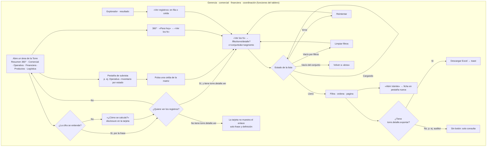

# UX — Torre de Control: cifras que se explican y detalle universal (Épica #14590, ampliación)

> Modo **full**. Plan aprobado: `~/.claude/plans/hablemos-sobre-el-desarrollo-wiggly-blum.md` (F1–F6).
> Extiende `docs/ux/flito-torre-control.md` y `docs/ux/flito-torre-explorador-flexible.md`. Si algo choca, manda este documento en lo que trata (KPI, detalle, subvistas, «Para hoy», «Ver registros»).
> Oficio: `docs/ux/_principios-flito.md`. Tratamiento: **usted**, igual que el resto de la Torre («Responda preguntas…», «Vea cuáles…»).
> Mockups (los construye el hilo con el kit; ver §11): `docs/ux/mockups/torre-kpi-explicable.html`, `torre-detalle.html`, `torre-operativa-inventario.html`, `torre-360-para-hoy.html`, `torre-explorador-ver-registros.html`.

---

## 1. Contexto y roles

**Qué viene a hacer quien abre la Torre.** Gerencia, comercial, financiera y la coordinación operativa vienen a responder dos preguntas: *¿cómo vamos?* y *¿qué tengo que mover hoy?* La Torre ya contesta la primera con cifras. No contesta la segunda porque **la cifra no dice de qué habla ni deja ver los registros**. Tres ejemplos del humano:

- «Concentración en el Top 3: 98 %». No dice de qué es el Top 3 ni sobre qué base sale el 98 %.
- «Borradores abandonados». No dice qué cuenta como abandonado ni dónde se ven.
- «Soportes completos 3/3». No dice qué soportes son ni a quién le faltan.

**Público.** Solo operador interno, con los roles y funciones que ya tiene la Torre (`REPARTO_TORRE`). No hay canal Cliente. El detalle suma dos funciones, `torre.detalle.ver` y `torre.detalle.exportar` (§5.5).

**Qué es cada pieza.**

| Pieza | Qué es | Qué **no** es |
|---|---|---|
| KPI explicable | Una cifra, una frase con sujeto y base, cómo se calcula y la puerta a sus registros | Un mini-reporte con 4 enlaces ni una gráfica dentro de la tarjeta |
| Página Detalle `/flito/torre/detalle` | La lista exacta de los registros que forman **una** cifra, con filtros propios, orden, paginación, Excel y «Abrir trámite» | Una segunda bandeja de trámites para operar: aquí no se cambian estados ni se gestiona nada |
| Subvistas por área (`Pestanas`) | Cada área deja de ser un solo tablero y se convierte en una sección | Una pestaña por cada bloque del tablero de hoy |
| «Para hoy» (360°) | Los frentes por atender hoy: cifra, frase y acción | Un feed de alertas ni una copia de las KPI |
| «Ver registros» (Explorador) | Abrir la fila o la celda del resultado como lista | Un cambio del constructor de consultas |

---

## 2. Qué se ve / qué se calla

**Regla de la Torre desde esta ampliación: toda cifra responde «¿de qué?» antes de que el usuario lo pregunte.** La frase nombra el sujeto (trámites, gestiones, bolsas), la población (creados, aprobados o en curso), la base (en el periodo o la foto de hoy) y, cuando caben, los nombres que forman la cifra (las 3 compañías).

| Superficie | Siempre visible | A un clic | No está |
|---|---|---|---|
| KPI | Rótulo, cifra, frase de ≤ 2 líneas, chip «Foto de hoy» si no depende del periodo, «Ver los N» | «¿Cómo se calcula?»: definición de 1–2 líneas con el umbral y dónde se configura | Sparkline nueva, segunda cifra que compita, varios enlaces |
| Detalle | Título del conjunto, frase con el total vivo, definición en una línea, filtros heredados como chips, tabla con la columna clave ordenada | Filtros propios (`FiltrosPlegables`), ficha del trámite (pestaña nueva) | Nombre y cédula del titular, acciones de gestión, la placa en la URL |
| Inventario por estado | Matriz estado × antigüedad con totales | La lista de cada celda (detalle) | Mapa de calor decorativo |
| «Para hoy» | Cifra, frase y acción por frente, en orden de gravedad | Los frentes de la 9.ª fila en adelante, tras «Ver los N restantes» | Frentes en cero |

**Regla de «Ver cuáles».** El enlace abre **el conjunto que pide acción** y su rótulo lo dice con la cifra:

- Si la KPI cuenta un problema (borradores, sin facturar), abre ese conjunto: «Ver los 12 borradores».
- Si la KPI es un porcentaje de éxito (3/3, primer intento, conversión), abre **el complemento**: «Ver los 52 incompletos».
- Con la cifra en 0, el enlace no se muestra, porque no hay nada que ver. La definición sigue disponible.

### 2.1 Dos disposiciones evaluadas (arquitectura no obvia)

**A. KPI → Drawer con la lista sobre el tablero.**
- A favor: no se sale del tablero.
- En contra: el Drawer del kit no aguanta una tabla de 9 columnas con paginación, filtros y Excel. Tampoco se puede compartir ni volver con «Atrás». En móvil queda una tabla dentro de un panel dentro de una página.

**B. KPI → página Detalle propia, con «Volver a <área>». (Elegida, y además decisión de la ronda P9.)**
- Una idea por superficie: el tablero resume y el detalle lista.
- La URL es compartible y solo lleva datos opacos (`?c=&s=`).
- Una sola página sirve para las 5 áreas, el Explorador y «Para hoy».

**Para «¿Cómo se calcula?»: popover flotante o disclosure en línea.** El kit no tiene popover. Uno nuevo exigiría posicionamiento, trampa de foco y cierre con Esc y clic fuera, que es un patrón nuevo. En móvil, además, taparía la tarjeta vecina. **Se elige el disclosure en línea**: un botón con `aria-expanded` que despliega el texto dentro de la misma tarjeta. Es el patrón de `FiltrosPlegables` en pequeño: no añade componente, se lee con teclado y lector de pantalla, y funciona en 375 px. La tarjeta crece; las vecinas de la rejilla no (`items-start`).

---

## 3. Flujo de usuario



---

## 4. Pantalla 1 — KPI explicable (todas las áreas)

### 4.1 Anatomía

```
┌──────────────────────────────────────────────┐
│ Borradores abandonados        [Foto de hoy]  │ ← rótulo (metrica__etiqueta) + chip neutro si no depende del periodo
│ 12                                           │ ← cifra (metrica__cifra); --pendiente si pide atención
│ 12 trámites siguen en Borrador más de 7 días │ ← frase, ≤ 2 líneas, sin truncar
│ después de creados; 4 pasan de 14 días.      │
│                                              │
│ ¿Cómo se calcula? ▾            Ver los 12 →  │ ← botón disclosure (izq.) · enlace (der.)
├──────────────────────────────────────────────┤ ← solo si está abierto (aria-expanded=true)
│ Trámites en estado Borrador cuya fecha de    │
│ creación tiene más de 7 días. El umbral se   │
│ cambia en Umbrales y alertas. Es la foto de  │
│ hoy: no depende del periodo elegido.         │
└──────────────────────────────────────────────┘
```

**Cambio de comportamiento del `KpiCard` (bloqueante para a11y).** Hoy la tarjeta con `to` es entera un `<Link>`. Con dos controles dentro no puede seguir así, porque un botón dentro de un enlace es HTML inválido y además el foco se vuelve ambiguo. La **KPI explicable** se pinta como `<div>` con dos controles reales: `button` «¿Cómo se calcula?» y `Link` «Ver los N». Se compone sobre `KpiCard`, con props nuevas `frase`, `definicion`, `ver: { to, etiqueta }` y `foto`, sin clonarlo. La frase reemplaza a `hint`. El `KpiCard` con `to` simple sigue existiendo para el 360°.

**Peso visual.** La cifra sigue siendo lo dominante. La frase va en `metrica__pie` (texto secundario, contraste ≥ 4.5:1 en los dos temas). Los dos controles tienen tamaño de texto pequeño y peso de enlace: ninguno es primaria. **En las áreas, la primaria del encabezado no cambia**: sigue siendo «Descargar Excel» del tablero, si existe.

### 4.2 Las 12 KPI reescritas

Los valores entre corchetes vienen del API. Los nombres y los desgloses de **ejemplo** son ficticios. «P» = respeta el periodo; «Foto» = foto de hoy (chip «Foto de hoy»). Los datos que el DTO de hoy **no** trae se marcan con ⓡ y van en §4.4.

#### Comercial

| # | Rótulo | Cifra | Frase (lleno) | Frase en 0 / sin dato | ¿Cómo se calcula? | Enlace → conjunto |
|---|---|---|---|---|---|---|
| C1 | Clientes con caída de volumen | `3` · Foto | «3 compañías crearon al menos 30 % menos trámites en los últimos 30 días que en su promedio: Flota Norte, Leasing Pacífico y Transportes Ribera.» ⓡ nombres (máx. 3; con más, «y N más») | «Ninguna compañía está por debajo de su promedio.» | «Por compañía: los trámites creados en los últimos [30] días frente a su promedio de los 90 días anteriores, llevado a la misma ventana. Entra si la caída es de [30] % o más. Los dos valores se cambian en Umbrales y alertas. No depende del periodo.» | «Ver los trámites de las 3» → `fuga` (trámites de esas compañías en la ventana, con la columna clave «Compañía») |
| C2 | Concentración en 3 compañías | `98 %` · P | «98 % de los [1.240] trámites creados en el periodo vienen de 3 compañías: Aseguradora Andina (61 %), Rentacar Sur (25 %) y Flota Norte (12 %). Con las 5 más grandes: 99 %.» ⓡ nombres y % de cada una | «No hay trámites creados en el periodo.» (cifra «—») | «Trámites creados en el periodo, agrupados por compañía. Se suman las 3 con más trámites y se dividen entre el total. En el bloque Concentración, la vista Ingreso hace lo mismo con lo liquidado de los aprobados.» | «Ver sus [1.215] trámites» → `concentracion:top3` |
| C3 | Conversión a facturado | `25 %` · P | «De los [1.240] trámites creados en el periodo, [310] ya están facturados. [610] siguen sin aprobar y [320] están aprobados sin factura.» ⓡ desglose por paso | «No hay trámites creados en el periodo.» | «Se parte de los trámites creados en el periodo y se cuentan los que ya tienen factura activa en Siigo. El bloque Conversión muestra cada paso: radicado, aprobado y facturado.» | «Ver los [930] sin facturar» → `embudo:no_facturado` (la columna clave «Paso» dice dónde va cada uno) |
| C4 | Trámites del periodo | `1.240` · P | «[1.240] trámites creados en el periodo, [85] más que en el periodo anterior ([1.155]).» (se conserva la sparkline actual) | «No se crearon trámites en el periodo.» | «Trámites cuya fecha de creación cae en el periodo elegido, con los filtros de arriba. El periodo anterior tiene la misma duración y termina el día antes.» | «Ver los [1.240]» → `creados` |

> La pista de hoy de C2 («Top 5: …» bajo un rótulo «Top 3») confundía. El rótulo pasa a **«Concentración en 3 compañías»** y el Top 5 queda como cierre de la frase.

#### Operativa

| # | Rótulo | Cifra | Frase (lleno) | Frase en 0 | ¿Cómo se calcula? | Enlace → conjunto |
|---|---|---|---|---|---|---|
| O1 | Gestiones sin soporte fuera de ANS | `14` · Foto | «14 gestiones llevan más de [48] horas sin soporte: [9] de SOAT y [5] de impuestos. [6] pasan de [96] horas.» ⓡ desglose de las que pasan el doble | «Todas las gestiones de SOAT e impuestos tienen soporte dentro de [48] horas.» | «Gestiones de SOAT e impuestos sin soporte cargado [48] horas después de pedidas. El umbral se cambia en Umbrales y alertas. No depende del periodo.» | «Ver las 14» → `radar:sin_gestion` (columna clave «Qué falta»: SOAT o Impuesto) |
| O2 | Borradores abandonados | `12` · Foto | «12 trámites siguen en Borrador más de [7] días después de creados; [4] pasan de [14] días.» | «Ningún borrador pasa de [7] días.» | «Trámites en estado Borrador cuya fecha de creación tiene más de [7] días. El umbral se cambia en Umbrales y alertas. Es la foto de hoy: no depende del periodo elegido.» | «Ver los 12 borradores» → `borrador_abandonado` |
| O3 | Trámites en curso | `312` · Foto | «[312] trámites están en curso hoy; [41] llevan en el organismo más de [10] días.» ⓡ el desglose sale de `estancado_ot` del radar | «No hay trámites en curso.» | «Trámites en un estado de trabajo activo, sin contar Borrador ni los terminados [confirmar la lista exacta de `EN_CURSO` con architecture]. No depende del periodo. Para verlos por estado y antigüedad, vaya a la pestaña Inventario por estado.» | «Ver los 312» → `en_curso` |
| O4 | Entregas al primer intento | `92 %` · P | «De las [240] entregas de trámites aprobados en el periodo, [221] se hicieron al primer intento; [19] necesitaron otro viaje.» | «No hubo entregas en el periodo.» (cifra «—») | «Trámites aprobados en el periodo con logística cobrada. Cuentan como primer intento los que no tuvieron un segundo viaje.» | «Ver las [19] con reintento» → `entregas:reintento` |

> El hint actual de O3, «Trabajo activo hoy», se queda corto. Lo reemplaza la frase.

#### Financiera

| # | Rótulo | Cifra | Frase (lleno) | Frase en 0 / sin dato | ¿Cómo se calcula? | Enlace → conjunto |
|---|---|---|---|---|---|---|
| F1 | Bolsa con menor cobertura | `3 días` · Foto | Con dinero: «La bolsa de Rentacar Sur alcanza para 3 días al ritmo de los últimos 30 ($4,2 M de saldo; $1,4 M al día). [2] bolsas más están en atención.» Sin dinero: «La bolsa de Rentacar Sur alcanza para 3 días al ritmo de los últimos 30. [2] bolsas más están en atención.» ⓡ conteo de bolsas en atención o críticas | «Ninguna bolsa tiene consumo en los últimos 30 días.» (cifra «—») | «Saldo de hoy de la bolsa dividido entre su consumo diario promedio de los últimos 30 días. Bajo [5] días es crítico y bajo [10], atención; se cambia en Umbrales y alertas. No depende del periodo.» | «Ver las [3] bolsas en riesgo» → `bolsas:cobertura_baja` |
| F2 | Trabajo sin facturar | `$48 M` (sin dinero: `63`) · P | Con dinero: «$48 M en [63] trámites aprobados en el periodo que aún no tienen factura. [5] no tienen liquidación y no suman valor.» Sin dinero: «[63] trámites aprobados en el periodo aún no tienen factura.» | «Todo lo aprobado en el periodo ya está facturado.» | «Trámites aprobados en el periodo que no están en una factura activa de Siigo. El valor es el total de su liquidación. No suman los anulados ni los que no tienen liquidación.» | «Ver los [63]» → `sin_facturar` |
| F3 | Margen bruto del periodo | `22 %` · P · solo dinero | «Del periodo se cobraron $320 M y costaron $250 M: queda el 22 %. [7] trámites no tienen costo registrado.» ⓡ cobrado, costo y sin costo totales | Sin dinero: «Necesita permiso para ver dinero.» (cifra «—», sin enlace) · Sin aprobados: «No hay trámites aprobados en el periodo.» | «Lo cobrado en las liquidaciones de los aprobados del periodo, menos el costo de SOAT, impuesto, derecho y logística, dividido entre lo cobrado. El trámite digital no tiene costo en FLITO.» | «Ver los [180] aprobados» → `margen` (columnas clave Cobrado, Costo y Margen; solo con dinero) |
| F4 | Soportes completos 3/3 | `71 %` · P | «[128] de los [180] trámites aprobados en el periodo tienen sus 3 soportes: SOAT, impuesto y derecho. A [52] les falta al menos uno.» | «No hay trámites aprobados en el periodo.» (cifra «—») | «Por cada trámite aprobado en el periodo se revisa si tiene soporte vigente de SOAT, de impuesto y de derecho. Un soporte descartado no cuenta.» | «Ver los [52] incompletos» → `soportes:incompletos` (columna clave «Le falta»: chips SOAT · Impuesto · Derecho) |

**Bloques de cada área (radar, caídas, sin facturar, donas).** Aplica la misma regla, una fila por vez.

- Cada fila de `RankingTorre`, del radar y de la tabla de caídas lleva al final su enlace «Ver los N» al conjunto con el segmento: la causa del radar, la compañía de la caída. El enlace no se pone sobre la fila entera.
- Las secciones de las `Dona` (p. ej. 3/3 · 2/3 · 1/3 · 0/3) se pueden pulsar. Su leyenda pasa a ser una lista de botones: «2 de 3: 30 trámites. Ver cuáles».
- Los enlaces de hoy **«Ver cola»** y **«Ver en reporte de costos»** se reemplazan por «Ver los N», que va al detalle con el mismo filtro. Ir a una pantalla sin filtrar era el defecto.

### 4.3 Estados de la KPI

| Estado | Qué se ve |
|---|---|
| Cargando | Esqueleto de la rejilla con **4 tarjetas de la misma altura**: rótulo, cifra y dos líneas de frase. Lo da el esqueleto que ya tiene `PaginaTorre` |
| Error | No cambia: el error del tablero lo maneja `PaginaTorre` con «Reintentar» |
| Cero / vacío | Cifra `0` o «—», frase de la columna «en 0», chip «Foto de hoy» si aplica, «¿Cómo se calcula?» disponible y **sin** «Ver» |
| Lleno | Como en 4.1 |
| Sin `torre.detalle.ver` | Frase y definición, sin enlace. No se explica por qué: el enlace sencillamente no existe |

### 4.4 Datos (requerimiento para architecture/backend, plan §6)

El DTO de cada tablero suma, por KPI, `{ conjunto, segmento?, total, desglose? }`:

- C1: los nombres de las compañías en caída (máx. 3) y el total.
- C2: el Top 3 con nombre y % de cada una.
- C3: el desglose del embudo por paso.
- O1: las gestiones de SOAT e impuesto, y las que pasan el doble del umbral.
- O3: el número de trámites con más de `dias_respuesta_ot` en el organismo.
- F1: el número de bolsas en atención o críticas.
- F3: cobrado, costo y los trámites sin costo.

Las definiciones de «¿Cómo se calcula?» son el texto `definicion` del catálogo `CONJUNTOS_TORRE`, con los umbrales interpolados. **Se escriben una vez**, en el catálogo, y no en el componente.

---

## 5. Pantalla 2 — Detalle (`/flito/torre/detalle`)

### 5.1 Wireframe — escritorio (≥ lg), lleno

```
┌─ Shell ───────────────────────────────────────────────────────────────────────────────────┐
│ Torre de Control › Operativa › Borradores abandonados                         (miga)      │
│ ┌ PageHeaderCard ───────────────────────────────────────────────────────────────────────┐ │
│ │ Borradores abandonados                         [← Volver a Operativa] [Descargar Excel]│ │
│ │ 12 trámites siguen en Borrador más de 7 días después de creados.        (secundaria) (PRIMARIA)│
│ │ Cómo se calcula: trámites en Borrador cuya fecha de creación tiene más de 7 días.     │ │
│ │ El umbral se cambia en Umbrales y alertas.                                            │ │
│ └───────────────────────────────────────────────────────────────────────────────────────┘ │
│ ┌ Barra de filtros de la Torre (BarraFiltrosTorre, la misma de las áreas) ──────────────┐ │
│ │ [Foto de hoy] · Compañías: Todas ▾ · Organismos: Todos ▾ · Tipo: Todos ▾               │ │
│ └───────────────────────────────────────────────────────────────────────────────────────┘ │
│ ┌ FiltrosPlegables «Filtrar esta lista» (cerrado por defecto) ─────────────────────────┐ │
│ │ ▸ Filtrar esta lista                                         (2 filtros aplicados) ✕ │ │
│ └───────────────────────────────────────────────────────────────────────────────────────┘ │
│ ┌ DataTable ────────────────────────────────────────────────────────────────────────────┐ │
│ │ Placa   │ Compañía          │ Tipo de trámite │ Estado     │ Organismo     │ Días en  ▼│ │
│ │         │                   │                 │            │               │ el estado │ │
│ │─────────┼───────────────────┼─────────────────┼────────────┼───────────────┼───────────│ │
│ │ FLT 101 │ Aseguradora Andina│ Traspaso        │ (Borrador) │ Medellín      │   21      │ │
│ │ FLT 214 │ Rentacar Sur      │ Matrícula       │ (Borrador) │ Envigado      │   16      │ │
│ │ ...                                                                                   │ │
│ │                    … │ Creado     │ Último cambio │ Valor*      │                       │ │
│ │                    … │ 28 oct 2026│ 28 oct 2026   │ $ 1.250.000 │ [Abrir trámite ↗]     │ │
│ └───────────────────────────────────────────────────────────────────────────────────────┘ │
│ Paginacion:  Mostrando 1–25 de 12  ·  [25 ▾] por página  ·  ‹ 1 ›                         │
└───────────────────────────────────────────────────────────────────────────────────────────┘
 * «Valor» solo con torre.metricas.dinero. Sin ese permiso la columna no se pinta (no «—» en cada fila).
```

**Jerarquía.** Primero el título y la frase, que dicen qué es la lista y cuántos hay. Luego la definición, siempre visible en una línea: es la pregunta con la que llegó el usuario. Después, la tabla ordenada por la columna clave del conjunto.

**Columnas.** Placa · Compañía · Tipo de trámite · Estado (`StatusChip`) · Organismo · Días en el estado · Creado · Último cambio · Valor (solo con permiso de dinero) · acción.

- **Cada conjunto declara su columna clave y su orden por defecto.** Esa columna queda marcada en el encabezado y en ella arranca el orden:
  - borradores y en curso: «Días en el estado», descendente;
  - soportes: «Le falta»;
  - sin facturar: «Valor» o «Aprobado»;
  - entregas: «Viajes»;
  - margen: «Margen».
- La columna clave que no es base se inserta **después de Estado**.
- Con dos columnas propias o más, el conjunto **reemplaza** «Último cambio» y «Creado» para no pasar de 10.
- **Entidades distintas de trámite** (bolsa, factura, funcionario) usan sus propias columnas y no llevan «Abrir trámite». Bolsas: Compañía · Saldo* · Consumo diario* · Días de cobertura · Semáforo. Ruta de «Ver movimientos de la bolsa»: **a confirmar con architecture**; si no hay pantalla, no hay acción por fila.

**Acciones.**

| Acción | Peso | Comportamiento |
|---|---|---|
| **Descargar Excel** | **Primaria única** (`flitBtnPrimary`) | `POST …/detalle/exportar` con el mismo conjunto, segmento y filtros (los de la Torre y los del detalle) y el mismo orden. Solo con `torre.detalle.exportar`; sin la función no se pinta y la página queda sin primaria, lo cual es correcto en consulta |
| Volver a <área> | Secundaria (`flitBtnSecondary`) | Vuelve al área y a la subvista de origen (`?vista=`) con el mismo filtro de la Torre. Desde el Explorador dice «Volver al Explorador» y conserva la consulta |
| Abrir trámite ↗ | En la fila (enlace de texto) | Abre la ficha del trámite **en una pestaña nueva** (`target="_blank" rel="noopener"`). Así la lista, la página y los filtros siguen donde estaban; es una revisión de muchos registros seguidos. `aria-label="Abrir trámite FLT 101 (se abre en otra pestaña)"`. La ruta es la de la ficha que ya existe, con el `uuid` del trámite |
| Ordenar | Encabezado de columna | Botón en el `th` con `aria-sort`. El orden viaja en el body |
| Filtrar esta lista | `FiltrosPlegables` | Ver 5.2 |

### 5.2 Filtros

- **Filtro de la Torre** (periodo, compañías, organismos, tipos): es la `BarraFiltrosTorre` de las áreas, con el estado en `lib/torreFiltros.ts`. Si se cambia ahí, cambia el conjunto, y la frase del encabezado se recalcula con el total nuevo.
  - En un conjunto «Foto de hoy», el selector de periodo se deshabilita y muestra el chip «Foto de hoy». El `title` y la ayuda bajo el chip dicen: «Esta lista es la foto de hoy: no depende del periodo».
- **Filtrar esta lista** (`FiltrosPlegables`, cerrado por defecto; resume «N filtros aplicados» y lleva ✕ «Quitar filtros»):
  - **Placa**: texto, ≥ 3 caracteres, con debounce de 400 ms. **Viaja solo en el body** del `POST` y **nunca** en la URL ni en `sessionStorage`; al recargar la página se pierde, y es lo esperado.
  - **Estado**: multiselección con los estados que hay en el conjunto.
  - **Organismo** y **Tipo de trámite**: multiselección.
  - **Días en el estado**: «al menos N».
  - Estado, organismo y tipo son **opacos** y pueden ir a la URL (`&fe=`, `&fo=`, `&ft=`) para que «Atrás» y compartir funcionen. La placa no.
- La URL solo lleva datos opacos: `?c=<conjunto>&s=<uuid|clave de estado|causa>&vista-origen=<área.vista>`. La placa no va jamás.

### 5.3 Estados (4 y sus variantes)

| Estado | Wireframe / qué se ve | Copy |
|---|---|---|
| **Cargando** | Encabezado con el título real (sale del catálogo, sin esperar al API) y la frase en esqueleto. Tabla con 8 filas de esqueleto y **las mismas columnas**; `aria-busy="true"` en la sección. Al cambiar de página o de filtro, la tabla anterior se queda con opacidad reducida y `aria-busy`, sin parpadear a esqueleto | (lector de pantalla) «Cargando la lista» |
| **Error** | `InlineAlert` tono peligro en el lugar de la tabla, con botón **Reintentar**. Encabezado y filtros siguen usables | «No pudimos cargar la lista de borradores abandonados. Revise su conexión e intente de nuevo.» · Tiempo agotado: «La consulta tardó demasiado. Acote el periodo o agregue un filtro, e intente de nuevo.» |
| **Vacío del conjunto** (total = 0 sin filtros propios) | `FlitEmpty` en el lugar de la tabla, con botón «Volver a Operativa». Excel deshabilitado con `title` | «Hoy ningún borrador pasa de 7 días. Cuando alguno supere el umbral, aparecerá aquí.» (cada conjunto trae su texto «en 0» de §4.2, en forma de frase completa) |
| **Vacío por filtros** (total = 0 con filtros propios) | `FlitEmpty` con botón «Quitar filtros». Excel deshabilitado | «Ningún trámite de esta lista coincide con los filtros. Quítelos para volver a ver los 12.» |
| **Lleno** | 5.1 | Frase con el total vivo del detalle |
| Lleno con tope de Excel (total > `TOPES_TORRE.exportar`) | `InlineAlert` informativo **persistente**, sobre la tabla y solo cuando se pasa el tope | «La lista tiene 12.400 filas y el Excel trae las primeras 10.000. Filtre la lista para descargar el resto.» |
| Conjunto desconocido o vencido (`?c=` inválido) | `FlitEmpty` en la página, con botón «Ir al Resumen 360°» | «Esta lista no existe o ya no está disponible. Vuelva al tablero y ábrala desde la cifra.» |
| Sin `torre.detalle.ver` (403) | La guarda de la ruta muestra la pantalla de sin permiso de siempre | «No tiene permiso para ver los registros de la Torre. Pídalo a un administrador.» |

**Cifra del tablero ≠ total del detalle.** Puede pasar, porque la caché es de 60 s y en una foto de hoy el tiempo corre. Manda el total del detalle, que es el de la frase del encabezado. No se avisa: los dos números salen del mismo SQL y la diferencia es de segundos. Si QA ve una diferencia **con el mismo filtro y la caché fría**, es un defecto (§9).

### 5.4 Responsive (< lg)

```
┌ 375 px ──────────────────────────┐
│ ‹ Operativa                      │ ← la miga se reduce al nivel anterior
│ Borradores abandonados           │
│ 12 trámites siguen en Borrador   │
│ más de 7 días después de creados.│
│ Cómo se calcula: …(2–3 líneas)   │
│ [Descargar Excel]  (ancho total) │ ← las acciones se apilan bajo el título; primaria arriba
│ [← Volver a Operativa]           │
│ [Foto de hoy] [Filtros de la     │ ← la barra de la Torre envuelve (flex-wrap)
│  Torre ▾]                        │
│ ▸ Filtrar esta lista (2)       ✕ │
│ ┌──────────────────────────────┐ │
│ │ FLT 101        (Borrador)    │ │ ← tarjeta por fila: placa + estado
│ │ Aseguradora Andina · Traspaso│ │
│ │ Medellín · 21 días en estado │ │ ← la columna clave, en negrita
│ │ Abrir trámite ↗              │ │
│ └──────────────────────────────┘ │
│ ‹ 1 2 › · 25 por página          │
└──────────────────────────────────┘
```

- Bajo `lg`, `DataTable` pasa a su modo de tarjetas, si el kit lo trae. Si no, usa su scroll horizontal con la primera columna (Placa) fija. **Recomendación: tarjetas**, porque 9 columnas en scroll no se usan en 375 px. Si `DataTable` no tiene modo tarjeta, **se pregunta antes de crear uno**: el fallback aceptado es el scroll del kit.
- El orden en móvil se elige con un `Select` «Ordenar por», con la columna clave por defecto, porque no hay encabezados que pulsar.
- `FiltrosPlegables` ocupa el ancho completo y sus campos van en una columna.

### 5.5 Permiso y comportamiento por rol

- `PageSlug` nuevo **`torre_detalle`**, registrado en `App.tsx` con `lazy()` dentro de `ProtectedRoute`. **No aparece en la navegación**: se llega desde una cifra.
- Para ver el detalle hace falta `torre.detalle.ver` **y** la función del tablero de origen. El conjunto declara su área y el API lo valida. Si falta la del tablero, se responde 403 con el copy de §5.3.
- Para exportar hace falta `torre.detalle.exportar`. Según el plan, el **auditor ve pero no exporta**. El reparto exacto por rol lo fija architecture en `REPARTO_TORRE`, con roles de `USER_ROLES` solamente (sin `operaciones`).
- Sin `torre.metricas.dinero`: las columnas de valor no se pintan, el conjunto `margen` no se ofrece y la frase de F2 cuenta trámites en vez de pesos.

### 5.6 Datos

`POST /api/flito/torre/detalle/consultar` y `POST …/exportar` (plan §3). La respuesta trae `{ total, filas, columnas, definicion, truncado }`, y la UI **pinta las columnas que manda el API**, en el orden que manda. **PII:** se muestran placa, compañía y estado, sin nombre ni cédula del titular. La lectura proyecta la placa, así que **se pregunta a security-agent** si el detalle registra en `pii_access_log` (`AGENTS.md` §16). La recomendación de UX es que sí, como en la Ficha por placa.

---

## 6. Pantalla 3 — Subvistas por área (`Pestanas`)

### 6.1 Estructura común

```
┌ PageHeaderCard (PaginaTorre) ─ Operativa ── «Dónde se está quedando el trabajo…» ─ [Descargar Excel] ┐
├ BarraFiltrosTorre ─────────────────────────────────────────────────────────────────────────────────┤
├ Pestanas: [Resumen] · Inventario por estado · Soportes · Equipo ───────────────────────────────────┤
│  (contenido de la subvista)                                                                          │
└──────────────────────────────────────────────────────────────────────────────────────────────────────┘
```

| Área | Pestañas | Notas |
|---|---|---|
| Resumen 360° | (sin pestañas) | Suma «Para hoy» (§7) |
| Comercial | Resumen · Clientes · Conversión | Clientes: ranking por compañía. Cada fila abre `compania:<uuid>` |
| Operativa | Resumen · Inventario por estado · Soportes · Equipo | Equipo solo para gerencia y admin (F5): sin la función, la pestaña no se pinta |
| Financiera | Resumen · Facturación · Bolsas y cartera | |
| **Productos** (nueva) | SOAT · Impuestos · Derechos | F3 |
| **Logística** (nueva) | Traslados · Entregas | F4 |

- «Resumen» es el tablero de hoy de cada área, con las KPI explicables. Las demás subvistas se especifican en el slim de su bloque (F2–F5) siguiendo este molde: KPI explicables arriba (máx. 4), una tabla o matriz principal y «Ver los N» en cada fila o celda. **Este doc solo detalla Inventario por estado** como ejemplo vinculante.
- La pestaña activa va en la URL (`?vista=inventario`). «Atrás» y «Volver a <área>» del detalle vuelven a ella.
- La primaria del encabezado («Descargar Excel» del tablero) **exporta la subvista activa**. Si una subvista no tiene export, el botón no se pinta en ella.
- Áreas nuevas: se registran en `PAGINAS_TORRE`, `navEntradas.ts` y `permissions.ts`, con un slug por área (`torre_productos`, `torre_logistica`).

### 6.2 Ejemplo vinculante — Operativa › Inventario por estado

**Para qué existe.** Quien coordina la operación entra a ver *dónde está represado el trabajo y desde cuándo*. La matriz responde en un vistazo, y cada número abre su lista.

```
┌ Inventario por estado ─────────────────────────────────────── [Foto de hoy] ┐
│ 312 trámites en curso hoy, por estado y por días en ese estado.             │
│ Organismo: [Todos ▾]                    ¿Cómo se calcula? ▾                 │
│ ┌──────────────────────┬───────┬───────┬────────┬─────────┬───────┬───────┐ │
│ │ Estado               │ 0–2 d │ 3–7 d │ 8–15 d │ 16–30 d │ > 30 d│ Total │ │
│ ├──────────────────────┼───────┼───────┼────────┼─────────┼───────┼───────┤ │
│ │ Borrador             │  [9]  │  [5]  │  [▲ 8] │  [▲ 3]  │  [▲1] │ [26]  │ │
│ │ Radicado             │ [40]  │ [31]  │  [12]  │   [4]   │   —   │ [87]  │ │
│ │ Enviado a OT         │ [22]  │ [35]  │ [▲ 28] │  [▲ 9]  │ [▲ 4] │ [98]  │ │
│ │ Entregado            │ [18]  │ [20]  │  [▲ 9] │  [▲ 4]  │   —   │ [51]  │ │
│ │ …                    │       │       │        │         │       │       │ │
│ ├──────────────────────┼───────┼───────┼────────┼─────────┼───────┼───────┤ │
│ │ Total                │ [101] │ [104] │  [65]  │  [24]   │ [18]  │ [312] │ │
│ └──────────────────────┴───────┴───────┴────────┴─────────┴───────┴───────┘ │
│ ▲ Pasa el umbral de ese estado (Borrador: 7 días; en el organismo: 10 días). │
└──────────────────────────────────────────────────────────────────────────────┘
```

- **Celdas.** Cada número es un `button` con hover de velo (`--flit-bg-hover`) y foco del kit. Abre el detalle del conjunto `estado:<clave>`, con el segmento `antiguedad:<tramo>` y el organismo elegido. Las celdas en 0 muestran «—» y no se pueden pulsar. También se pueden pulsar los totales de fila, de columna y el general.
- **«Pasa el umbral».** No es un mapa de calor. Solo las celdas que superan el umbral de **su** estado llevan ▲ y la tinta de atención (`--flit-warning-ink`, con par oscuro). El significado nunca va solo en el color: el ▲ está y la leyenda lo explica. Los estados sin umbral no se marcan.
- **¿Cómo se calcula?** «Trámites en curso hoy, agrupados por su estado actual y por los días que llevan en él, contados desde el último cambio de estado (o desde la creación, si nunca cambió). Los umbrales se cambian en Umbrales y alertas. No depende del periodo.»
- **Organismo**: `Select` con «Todos» y los organismos con trámites en curso. Se suma al filtro de la Torre y no lo reemplaza.
- Los **tramos** (0–2, 3–7, 8–15, 16–30, > 30) son fijos en F2. Si el PO quiere tramos configurables, se pregunta: no se inventa un umbral.
- Las **filas** son los estados reales de `flit_estado` presentes en el conjunto, en el orden del flujo del trámite (lo da `catalogo.ts`). Los nombres del wireframe son ilustrativos.

**Estados.**

| Estado | Qué se ve | Copy |
|---|---|---|
| Cargando | La rejilla de la matriz con el número real de columnas y 5 filas de esqueleto | — |
| Error | `InlineAlert` + Reintentar en el lugar de la matriz | «No pudimos cargar el inventario por estado. Intente de nuevo.» |
| Vacío | `FlitEmpty` | Sin filtro de organismo: «No hay trámites en curso hoy.» Con organismo: «Este organismo no tiene trámites en curso. Elija «Todos» para ver el resto.» |
| Lleno | Matriz | — |

**Móvil (< lg).** La matriz usa el scroll horizontal del kit, con la columna «Estado» fija a la izquierda. Son 7 columnas numéricas estrechas y se leen. El `Select` de organismo y «¿Cómo se calcula?» envuelven en dos líneas.

---

## 7. Pantalla 4 — «Para hoy» en el Resumen 360°

**Reemplaza al bloque «Los 5 riesgos de hoy»**: es la misma idea, ahora con acción. Si se dejaran los dos, los frentes saldrían duplicados. Va **primero** en el 360°, sobre las tres KPI de área: es lo que se viene a hacer «hoy».

```
┌ Para hoy: hay 6 frentes por atender ─────────────────────────────────────────── [Foto de hoy] ┐
│ Ordenados por gravedad y luego por cuántos registros tocan.                                    │
│ ┌─────────────────────────────────────────────────────────────────────────────────────────────┐ │
│ │ ● Crítico │ 14 │ gestiones de SOAT e impuestos llevan más de 48 horas sin soporte.  Ver las 14 →│
│ │ ● Crítico │  3 │ bolsas alcanzan para menos de 5 días; la más baja, Rentacar Sur.   Ver las 3  →│
│ │ ▲ Atención│ 12 │ trámites siguen en Borrador más de 7 días después de creados.      Ver los 12 →│
│ │ ▲ Atención│ 41 │ trámites llevan en el organismo más de 10 días.                    Ver los 41 →│
│ │ ▲ Atención│ 63 │ trámites aprobados este mes aún no tienen factura ($48 M).         Ver los 63 →│
│ │ ▲ Atención│  3 │ compañías crearon al menos 30 % menos trámites que su promedio.    Revisar    →│
│ └─────────────────────────────────────────────────────────────────────────────────────────────┘ │
│ (con más de 8 frentes)  [Ver los 3 frentes restantes ▾]                                         │
└────────────────────────────────────────────────────────────────────────────────────────────────┘
```

- **Fila.** Gravedad (`StatusChip` tono peligro o atención, con texto, nunca solo color) · cifra (`tabular-nums`, en negrita) · frase · acción. La acción es un enlace de texto, **no** un botón primario.
  - «Ver los N» lleva al detalle del conjunto.
  - «Revisar» lleva a una subvista cuando el frente es de compañías (Comercial › Clientes, filtro «En caída»).
  - La fila **no** se puede pulsar entera: el único destino es el enlace, que evita el doble destino y el conflicto de foco.
- **Fuente.** Los mismos conjuntos de F1–F5, con los umbrales de Umbrales y alertas. Entra el frente con cifra > 0. Es crítico si tiene registros sobre el doble del umbral (la regla de `severidad` de hoy). Máximo **8 visibles**; el resto queda tras «Ver los N frentes restantes», un disclosure con `aria-expanded`.
- **Periodo.** Es una foto de hoy, salvo sin facturar, que usa el mes en curso, como la proyección; su frase lo dice: «este mes».
- **Permisos.** Solo entran los frentes cuyos tableros de origen puede ver el usuario. Sin `torre.detalle.ver`, las filas no tienen enlace y la frase basta. Sin dinero, se omite el «($48 M)».
- **Primaria del 360°.** No cambia: sigue la del encabezado, si existe.

**Estados.**

| Estado | Qué se ve | Copy |
|---|---|---|
| Cargando | El bloque con 4 filas de esqueleto con la misma estructura (chip · cifra · frase · enlace) | — |
| Error | `InlineAlert` + Reintentar **dentro del bloque**. El resto del 360° sigue | «No pudimos armar los frentes de hoy. Intente de nuevo.» |
| Vacío | Bloque con título «Para hoy: nada por atender» y una línea | «Hoy ninguna cifra pasa su umbral. Las cifras de cada área siguen en sus pestañas.» |
| Lleno | Wireframe | Título: «Para hoy: hay N frentes por atender» (con 1: «hay 1 frente por atender») |

**Móvil (< lg).** Cada fila se apila en tres líneas: chip y cifra; la frase; el enlace alineado a la izquierda. Sin columnas fijas.

---

## 8. Pantalla 5 — Explorador: «Ver registros» (delta)

```
Resultado · Trámites aprobados · por compañía · oct 2026
┌───────────────────────┬──────────┬───────────────────────┐
│ Compañía              │ Trámites │                       │
├───────────────────────┼──────────┼───────────────────────┤
│ Aseguradora Andina    │   230    │ Ver los 230 registros →│
│ Rentacar Sur          │    95    │ Ver los 95 registros → │
└───────────────────────┴──────────┴───────────────────────┘
Tabla cruzada: cada celda con número es un button → «Aseguradora Andina · Traspaso: 41 trámites. Ver registros»
```

- En la tabla del resultado (`ResultadoExplorador`) se suma una **última columna sin rótulo visible** (`<th>` con `sr-only` «Registros») que trae el enlace por fila. En la cruzada (`TablaCruzadaTorre`), cada celda con valor es un `button`, con el mismo patrón que la matriz de §6.2.
- El enlace abre el detalle con `c=explorador:<métrica>` y `s=<clave de agrupación>`, y conserva la consulta para «Volver al Explorador». **Solo existe si la entidad de la métrica tiene detalle** (lo dice el catálogo).
- Si la métrica no tiene detalle, no hay columna: el pie del resultado lo dice con una línea gris, «Esta métrica no tiene lista de registros.» No se ponen enlaces deshabilitados en cada fila.
- La fila «Sin dato» u «Otros» también abre su lista cuando el segmento se puede expresar. «Otros» (el resto tras el top) **no** la abre en F1: sin enlace.
- La primaria del Explorador no cambia.
- Móvil: el enlace queda dentro del scroll de la tabla. En la cruzada, igual que en §6.2.

---

## 9. Interacción y notificaciones

**Feedback de controles. Ninguno queda plano.**

| Control | Hover | Foco | Otros |
|---|---|---|---|
| «¿Cómo se calcula?» (botón tipo enlace) | Subrayado y tinta `--flit-blue-text` | `flit-focus` | Chevron que rota sin animación (cambia de ▾ a ▴); `aria-expanded` y `aria-controls` |
| «Ver los N →», «Abrir trámite ↗», enlaces de «Para hoy» | Subrayado | `flit-focus` | `transition-colors` ≤ `--flit-duration-base` |
| Celdas de matriz y cruzada, secciones de dona | Velo `--flit-bg-hover` | `flit-focus` (anillo dentro de la celda, sin desbordar) | `cursor-pointer`; las celdas «—» llevan `cursor-default` y no reaccionan |
| Encabezados ordenables | Velo | `flit-focus` | `aria-sort` |
| Descargar Excel | El del kit `flitBtnPrimary` | Del kit | Mientras genera: `disabled` + texto «Generando Excel…» y `aria-busy`, sin spinner extra |
| Pestañas | Las de `Pestanas` | Del kit | Flechas ←/→ (las de `Pestanas`) |

**Notificaciones.**

| Acción | Patrón | Copy |
|---|---|---|
| Excel descargado | **Toast** de éxito, cerrable, ~4 s (`ToastFlito`) | «Se descargó el Excel con 63 trámites.» (con tope: «Se descargó el Excel con las primeras 10.000 filas.») |
| Excel falló | **Toast** de error, cerrable, ≥ 6 s | «No se pudo generar el Excel. Intente de nuevo en un momento.» · 403: «No tiene permiso para descargar esta lista.» |
| Lista truncada en el Excel | **Aviso en página** (`InlineAlert`), porque sigue siendo cierto mientras se mira | §5.3 |
| Carga o filtro de la lista | Nada. El total del encabezado cambia; `role="status"` con «12 trámites» para el lector de pantalla | — |

Nunca se muestra el error crudo del API.

---

## 10. Accesibilidad

- KPI explicable:
  - es `<article aria-labelledby="<id rótulo>">`;
  - la cifra y la frase se leen en orden;
  - «¿Cómo se calcula?» es `<button aria-expanded aria-controls="def-<conjunto>">`, y la región desplegada lleva `id` sin `role` extra;
  - «Ver los 12 borradores» tiene texto completo, así que no hace falta `aria-label`. Si el texto visible es corto («Ver los 12 →»), lleva `aria-label="Ver los 12 borradores abandonados"`.
- **Ningún control interactivo va dentro de otro**: la tarjeta deja de ser `<Link>` (§4.1).
- Matriz: `<table>` real, con `<th scope="col">` y `<th scope="row">` y `<caption class="sr-only">Trámites en curso por estado y días en el estado</caption>`. Cada celda-botón lleva `aria-label`, por ejemplo «Enviado a OT, 8 a 15 días: 28 trámites, pasa el umbral. Ver cuáles».
- Detalle:
  - el encabezado es `h1`;
  - la tabla lleva `<caption class="sr-only">` con el nombre del conjunto y el total;
  - el `role="status"` anuncia los cambios de total;
  - el foco va al `h1` al llegar desde una cifra y vuelve a la tarjeta de origen con «Volver a <área>» (el `id` del conjunto va en el hash de la vuelta);
  - el filtro de placa tiene `<label>` visible «Placa».
- «Para hoy» es una `<ul>` con un `<li>` por frente. La gravedad va en texto («Crítico», «Atención») y no solo en color.
- Contraste ≥ 4.5:1 de la frase (`metrica__pie`) y de la tinta de atención, en claro **y** oscuro. El ▲ ≥ 3:1.
- Todo funciona con teclado, en este orden: pestañas → filtros → tabla → paginación.

---

## 11. Notas para QA

1. **Invariante central.** Para cada una de las 12 KPI y cada fila de bloque, con el mismo filtro y la caché fría, la cifra del tablero es igual al total del detalle. «Borradores abandonados = 12» abre un detalle con 12 filas.
2. La placa **nunca** aparece en la URL: ni al filtrar por placa, ni al abrir el detalle, ni al volver. Revisar también la historia del navegador.
3. «¿Cómo se calcula?» se abre y se cierra con Enter y con Espacio, anuncia `aria-expanded`, y su texto trae los umbrales **vigentes**: si se cambian en Umbrales y alertas, el texto cambia.
4. Con la cifra en 0 no aparece «Ver»; con un conjunto vacío forzado por URL aparece el vacío del conjunto; con filtros propios sin resultados aparece el vacío por filtros, con «Quitar filtros».
5. Sin `torre.detalle.ver` no hay enlaces en las KPI ni en «Para hoy», y la URL directa da 403. El auditor ve la lista y no ve «Descargar Excel».
6. Sin `torre.metricas.dinero`, la columna Valor no se pinta, F2 muestra trámites, F3 muestra «—» sin enlace y el Excel no trae dinero.
7. El Excel respeta el conjunto, el segmento, los filtros (los de la Torre y los del detalle) y el orden. Por encima del tope aparece el aviso en página y el toast dice «las primeras N».
8. Inventario: cada celda abre la lista con su estado y su tramo. Los totales de fila y columna cuadran con la suma de sus celdas, y el total general con O3, «Trámites en curso».
9. «Para hoy»: nada en cero entra, el orden es crítico → atención → impacto, hay máximo 8 visibles y el bloque «Los 5 riesgos de hoy» ya no existe.
10. Móvil a 375 px y tema oscuro en el detalle, la matriz y «Para hoy»: sin desborde de página, acciones apiladas, contraste.

---

## 12. Decisiones y descartes

- **Detalle como página y no como Drawer** (§2.1): la decisión es de la ronda P9 y además la sostiene el oficio, con una idea por superficie y una URL compartible.
- **Disclosure en línea y no popover**: el kit no tiene popover, y un popover es un patrón nuevo con trampa de foco y problemas en móvil.
- **«Ver cuáles» abre el complemento cuando la cifra es de éxito.** Ver el 71 % que está bien no sirve para actuar; ver los 52 incompletos, sí. El rótulo nombra lo que se abre, así que el cambio de población no engaña.
- **Un enlace por tarjeta**: sin enlace a la compañía de la frase, sin «ver en otra pantalla» y sin «ver más». Los nombres de la frase son texto; las filas de los bloques llevan sus enlaces propios.
- **«Para hoy» reemplaza a «Los 5 riesgos»**, para no tener dos listas del mismo tema.
- **Matriz sin mapa de calor**: solo se marca lo que pasa el umbral, con un ▲ además del color. Un degradado por cantidad es adorno y no dice qué hay que mover.
- **«Abrir trámite» en pestaña nueva**, para no perder la página ni los filtros en una revisión fila a fila. Se anuncia en el `aria-label`.
- **Sin sombras, animaciones ni gradientes nuevos.** El único movimiento es `transition-colors` del kit.
- **Descartado**: una sparkline por KPI (adorno; C4 conserva la suya), un detalle editable con acciones de gestión (no es el trabajo de esta visita; para eso está «Abrir trámite»), y nombres de titular en la lista (decisión P9 y Ley 1581).
- **Preguntas abiertas (no bloquean F1):**
  1. ¿`DataTable` tiene modo tarjeta en móvil? Si no lo tiene, se usa scroll + primera columna fija, en vez de crear un patrón.
  2. ¿El detalle registra la lectura de placa en `pii_access_log`? Lo decide `security-agent`.
  3. ¿Hay pantalla de movimientos de una bolsa para la acción por fila?
  4. ¿Cuál es la lista exacta de estados de `EN_CURSO` para el copy de O3?
  5. ¿Los tramos de antigüedad son fijos o configurables? Se proponen fijos.
  6. La regla de «Borradores abandonados» se unifica en F2 (plan); el copy de O2 cambia si cambia la regla.

---

## 13. Brief de mockup (lo construye el hilo con el kit; gate humano antes de `frontend-agent`)

Todo usa `docs/ux/mockups/torre-maqueta.css` y las clases del kit (`metrica`, `card`, `flitBtnPrimary`, `flitBtnSecondary`, `StatusChip`, `FlitEmpty`, `InlineAlert`, `Pestanas`, `FiltrosPlegables`, `DataTable`, `Paginacion`), con tokens `--flit-*` y sin HEX sueltos. Cada archivo tiene una sección por estado, una vista móvil de 375 px y los dos temas (claro y oscuro). Sin JS de negocio; el disclosure abierto se muestra en una sección aparte.

**Datos ficticios** (prohibido usar datos reales):
- compañías: Aseguradora Andina, Rentacar Sur, Flota Norte, Leasing Pacífico, Transportes Ribera;
- placas con el patrón inventado `FLT 101`, `FLT 214`…;
- organismos: Medellín, Envigado, Bello;
- cifras: las de §4.2.

| # | Archivo | ¿Necesita maqueta? | Vistas |
|---|---|---|---|
| 1 | `torre-kpi-explicable.html` | **Sí** | Rejilla de Operativa › Resumen con O1–O4: O2 con «¿Cómo se calcula?» abierto, O4 en cero (sin «Ver»), una tarjeta sin `torre.detalle.ver`. Fila de Financiera F1–F4 con dinero y sin dinero. Comercial C2 con la frase del Top 3. Esqueleto. Móvil |
| 2 | `torre-detalle.html` | **Sí** (pantalla nueva) | «Borradores abandonados» lleno (escritorio), filtros abiertos, cargando, error, vacío del conjunto, vacío por filtros, aviso de tope de Excel, «Soportes incompletos» con la columna «Le falta», conjunto inválido, móvil en tarjetas, toast de éxito del Excel |
| 3 | `torre-operativa-inventario.html` | **Sí** | Pestañas de Operativa con «Inventario por estado» activa, matriz llena con ▲, cargando, error, vacío con organismo, móvil con scroll y columna fija |
| 4 | `torre-360-para-hoy.html` | **Sí** | 360° con «Para hoy» primero (6 frentes), la variante con más de 8 (disclosure), vacío, error dentro del bloque, móvil |
| 5 | `torre-explorador-ver-registros.html` | Ligera (delta) | Resultado por compañía con la columna de enlaces, cruzada con celdas-botón, métrica sin detalle (pie), móvil |

**Qué NO mostrar:** nombre o cédula del titular, acciones de gestión en el detalle, el bloque «Los 5 riesgos de hoy» en el 360°, mapas de calor, sparklines nuevas, una segunda primaria en ningún encabezado.

Mockup: `docs/ux/mockups/torre-kpi-explicable.html` · `torre-detalle.html` · `torre-operativa-inventario.html` · `torre-360-para-hoy.html` · `torre-explorador-ver-registros.html` (pendientes de construir y capturar a 1366×768 y 375×812).
