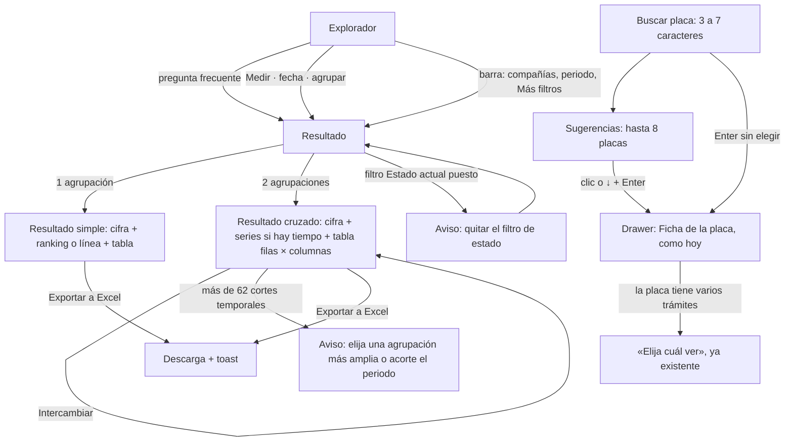

# UX slim — Explorador flexible de la Torre de Control (Épica #14590)

Modo: **slim**. Extiende el Explorador de métricas ya especificado en `docs/ux/flito-torre-control.md` (§4 barra, §5 Explorador) y reutiliza la barra compartida `BarraFiltrosTorre`. No cambia ruta, slug, cabecera ni pestañas.

Alineado con:
- **ADR-0044** (`docs/adr/ADR-0044-flito-torre-explorador-flexible.md`, D1–D9).
- El diseño técnico `docs/diseno/epica-14590-torre-explorador-flexible.md`, §11 (U1–U12), con la corrección del humano a U4 (ver §3.2).

Mockup: `docs/ux/mockups/torre-explorador-flexible.html`. Lo genera el hilo a partir del brief del §13; aún no existe.

**Pedido (textual):** «El Explorador debe ser muy flexible: que a través de seleccionar diferentes filtros y agrupaciones yo pueda saber, por ejemplo, trámites realizados en los últimos 6 meses por compañía (trámites en estado Aprobado + fecha de aprobación desde junio + agrupar por compañía). También en la búsqueda de placa, al escribirla, mostrar coincidencias mientras se escribe.»

**Decisiones cerradas que esta spec aplica:**

| Decisión | Qué fija |
|---|---|
| D1 | Constructor libre: medida + fecha base + filtros múltiples + agrupaciones, sobre un catálogo cerrado |
| D2 | Hasta 2 agrupaciones. Con dos, tabla cruzada; series si una es temporal; el Excel exporta la tabla cruzada |
| D3 | «Aprobado» = fecha de aprobación en el rango, **sin importar el estado actual**; el estado actual es otro filtro |
| D4 / D8 | Sugerencias de placa desde 3 caracteres, hasta 8, coincidencia en cualquier parte. **Una por placa**, con compañía y estado del trámite más reciente, sin conteo. Nunca en la URL ni guardadas |
| D5 | Fechas base: **solo** creación, aprobación, facturación y pago |
| D7 | «Últimos 6 meses» alineado a mes, resuelto por la API |
| D9 | El tiempo de ciclo solo por aprobación; los tableros reciben varias compañías; el ejemplo del pedido entra como pregunta frecuente |

---

## 1. Superficie tocada

| Pieza | Archivo hoy | Qué cambia |
|---|---|---|
| Tarjeta «¿Qué quiere saber?» | `pages/torre/TorreExplorador.tsx` | La oración pasa de 2 campos a 4: **Medir · Según la fecha de · Agrupar por · Y luego por**. Se suman 2 preguntas frecuentes |
| Tarjeta de resultado | `components/torre/ResultadoExplorador.tsx` | Nuevo caso **cruzado** (2 agrupaciones). El caso simple no cambia de forma |
| Barra compartida (las 5 páginas) | `components/torre/BarraFiltrosTorre.tsx` | Compañía, OT, Departamento, Tipo de trámite y Estado actual pasan a **selección múltiple**. El buscador de placa muestra **coincidencias mientras se escribe** |
| Estado compartido | `lib/torreFiltros.ts` | Los filtros pasan de valor único a lista (RN-TOR-W1). El contrato `FiltroTorre` ya es de listas |

**Kit encontrado** para selección múltiple, chips y autocompletado. No se inventa ninguno:

| Componente | Sirve para | Por qué sí / no |
|---|---|---|
| `FlitComboboxBuscable` | Base del **selector múltiple** y piel de la **lista de sugerencias** | Es presentacional y ya trae lo necesario:<br>• teclado (↓/↑, Enter, Esc que para la propagación);<br>• `role="combobox"` + `aria-activedescendant`;<br>• opción `<li role="option">` con `principal`/`detalle`/`chip`;<br>• los estados `pista · cargando · error · lista`.<br>Le falta el modo múltiple → **extensión aditiva** (§3.3) |
| `PanelFiltros` | Barra, chips `filtro-activo` con ✕, «Limpiar todo», panel «Más filtros» con «Aplicar filtros» | Se mantiene. Su buscador necesita la lista de sugerencias → **extensión aditiva** (§6) |
| `ThFiltroMulti` | Multiselect con casillas en un `<details>` | Pensado para el encabezado de una columna: texto `xs`, ancho de 12rem, «N seleccionado(s)» y sin búsqueda. **Descartado** para la barra |
| `FlitOrganismoCombobox` | Organismo con búsqueda local | Es de selección única. Su regla de búsqueda se reutiliza en el selector múltiple de OT: desde 2 letras, sin tildes, por nombre, ciudad o código |
| `FlitSelect` | Selects con estado de carga y de fallo | Se queda para **Periodo**. El selector múltiple hereda su patrón «No pudimos cargar las opciones…» + «Volver a cargar las opciones» |
| `DataTable matriz` (`kit-matriz`) | Tabla cruzada con scroll horizontal (no pasa a tarjetas) | Ya existe. Falta fijar la primera columna → **CSS aditivo** (§5.3) |
| `LineaTendencia`, `SERIE_KIT`, `KpiCard`, `InlineAlert`, `Vacio`, `ErrorVista`, `StatusChip`/`EtiquetaEstado`, `GradientButton` | Resultado, avisos y estados | Sin cambios de props |

---

## 2. Delta de claridad (qué se ve / qué se calla)

**Qué vino a hacer quien abre esto:** armar una pregunta de negocio propia y leer la respuesta sin pedir un reporte. El ejemplo del pedido es el caso guía.

**Qué se ve primero:** igual que hoy, **la respuesta**, es decir, la cifra grande con el título que repite la pregunta. Lo nuevo: ese título se lee ahora como la oración completa, con la medida, la fecha base, el periodo y las agrupaciones.

**La oración se arma en un solo renglón de la tarjeta:**

> **Medir** [Trámites ▾] **según la fecha de** [aprobación ▾] · **Agrupar por** [Compañía ▾] **y luego por** [Ninguna ▾]

La tarjeta de resultado la devuelve como frase:
- Título: **«Trámites aprobados · Últimos 6 meses · por compañía»**.
- Subtítulo: «1 jun – 18 nov 2026 · Todas las compañías».

### Dónde viven los filtros de selección múltiple: en la barra compartida (opción A)

| | A. En la barra compartida (**recomendada**, alineada con D9 / P-4) | B. En el constructor del Explorador |
|---|---|---|
| Fuente de verdad | Una sola: `sessionStorage['flito-torre-filtros']`, la misma de las 5 páginas (decisión del PO del 2026-11-17) | Dos: la barra sigue con Compañía y Periodo únicos, y el Explorador tiene los suyos |
| Ir de Comercial al Explorador (o volver) | Los filtros viajan intactos | Hay que decidir qué gana, y cualquier respuesta sorprende |
| Regla de §5.1 «el mismo filtro en un solo sitio» | Se cumple | Se rompe |
| Impacto en los tableros | Comercial, Operativa, Financiera y 360° **aceptan varias compañías** desde la barra: la barra es un solo componente y el contrato ya recibe listas | Ninguno |
| Densidad del constructor | Sube de 2 a 4 campos | Subiría a 9 campos: el formulario de 8 campos que §15 de la spec madre ya descartó |

**Por qué A:** la pregunta tiene dos mitades, y cada una ya tiene casa:
- **qué** se mide va en la tarjeta «¿Qué quiere saber?»;
- **sobre qué conjunto** va en la barra, igual en toda la Torre.

Partir el conjunto entre dos sitios obligaría al gerente a recordar cuál manda. La oración no se pierde: el título del resultado la junta entera.

### Qué se calla

- Las fechas que no aplican a la medida no desaparecen: quedan **deshabilitadas** con «(no aplica)».
- En la tabla cruzada, un eje de **dimensión** se corta en 12 columnas o 50 filas, con «Los demás (N)». Un eje **temporal** no se corta. El resto va en el Excel, dentro de sus topes (§5.3).
- En las sugerencias de placa no hay tipo de trámite, fechas, valores ni conteo de trámites. Solo hay **placa, compañía y estado** (D4/D8).

### Densidad y primaria

**Densidad:** **empeora un poco** en el constructor, que pasa de 2 a 4 campos. Lo deciden D1 y D2, que ya están cerradas. Se compensa así:
- la pantalla abre con valores que ya responden la pregunta más común;
- «Y luego por» solo aparece si hay agrupación principal;
- una pregunta frecuente arma el ejemplo del pedido en **1 clic**.

La barra no suma controles: solo cambia su tipo. Los chips se agrupan **por filtro**, no por valor.

**Primaria:** se mantiene **una**, «Exportar a Excel» en la cabecera, con las mismas reglas de deshabilitado. El resto es secundario:
- «Intercambiar» va en `btn ghost sm`.
- «Listo» del selector múltiple va en `btn secondary sm`.
- «Aplicar filtros» es la primaria **del panel** «Más filtros», como ya es hoy.

### Pasos para el ejemplo del pedido

| Camino | Interacciones |
|---|---|
| Pregunta frecuente **«Aprobados por compañía · 6 meses»** | **1** |
| Al abrir la pantalla (Trámites · aprobación · Compañía) | **1**: Periodo «Últimos 6 meses» |
| Desde otra medida o agrupación | **3**: Medir «Trámites» → fecha «aprobación» → Periodo «Últimos 6 meses» (Agrupar por ya está en Compañía) |
| Además, mes a mes | +1: «Y luego por» «Mes» → tabla cruzada compañía × mes |

### El ejemplo y el estado actual (D3)

El pedido dice «estado Aprobado + fecha de aprobación». Por D3, «trámites realizados» = **aprobados en el periodo, sin importar el estado actual**. Por eso la pregunta frecuente del ejemplo **no** filtra el estado. Si se filtrara Estado actual = Aprobado, quedarían fuera los aprobados en junio que hoy ya están Facturados.

Consecuencias en la pantalla:
- El filtro se llama **«Estado actual»**, no «Estado».
- Siempre que esté puesto, el resultado lo advierte con un `InlineAlert` que trae la acción de quitarlo (§5.4). Esto vale con cualquier fecha base.

---

## 3. Constructor «¿Qué quiere saber?»

### 3.1 Campos

| Campo (`<label>` visible) | Control | Opciones |
|---|---|---|
| **Medir** | `select.control` con `optgroup` | *Cuántos*: Trámites · Trámites en curso (hoy) · Tasa de aprobación · Aprobados sin facturar.<br>*Cuánto se tardó*: Tiempo de creación a aprobación.<br>*Cuánto se pagó*: Costo de logística · Impuestos pagados · Derechos de tránsito pagados · Ingreso liquidado.<br>Las de dinero solo se ofrecen con `FUNCION_TORRE_DINERO`, igual que hoy |
| **Según la fecha de** | `select.control` | **creación · aprobación · facturación · pago**, en minúscula para que la oración se lea. No hay más (D5). Las que no aplican a la medida van `disabled` con el sufijo «(no aplica)», según la matriz de abajo |
| **Agrupar por** | `select.control` con `optgroup` | Sin agrupar (total).<br>*En el tiempo*: Día · Semana · Mes · Trimestre.<br>*Por categoría*: Compañía · Organismo de tránsito · Departamento · Tipo de trámite · Estado actual |
| **Y luego por** | `select.control` con `optgroup` | Ninguna, más las mismas de «Agrupar por» con dos exclusiones: la elegida arriba, y las otras temporales si la principal es temporal (y al revés; RN-TOR-C1). Solo se ve si «Agrupar por» ≠ «Sin agrupar» |
| *(entre las dos agrupaciones)* | `btn ghost sm` con ícono ⇄ y el texto «Intercambiar» (`aria-label` «Intercambiar filas y columnas») | Solo se ve con 2 agrupaciones |

**Matriz medida × fecha base** (ADR-0044 §(a), RN-TOR-M11). ● = la fecha por defecto de la medida; «—» = la opción se muestra `disabled` con «(no aplica)».

| Medida | creación | aprobación | facturación | pago |
|---|---|---|---|---|
| Trámites | ● | sí | sí | — |
| Costo de logística | — | ● | sí | — |
| Ingreso liquidado | — | ● | sí | — |
| Tiempo de creación a aprobación | — | ● (única) | — | — |
| Impuestos pagados | — | — | — | ● (única) |
| Derechos de tránsito pagados | — | — | — | ● (única) |
| Tasa de aprobación | ● (única) | — | — | — |
| Aprobados sin facturar | — | ● (única) | — | — |
| Trámites en curso (hoy) | sin fecha (foto del momento) | | | |

**Estado al abrir la pantalla:** Trámites · aprobación · Compañía · Ninguna. Es la continuidad con el Explorador de hoy, que abre en «Trámites aprobados por compañía». La fecha por defecto de la matriz (●) **solo** se usa cuando la fecha elegida deja de aplicar al cambiar de medida.

**«Trámites en curso (hoy)», la medida sin fecha:**
- «Según la fecha de» queda `disabled` y muestra una sola opción: «hoy (foto del momento)».
- Debajo lleva la pista `small` «Esta medida es la foto de hoy: no usa fecha ni periodo.», asociada por `aria-describedby`.
- El subtítulo del resultado dice «No depende del periodo elegido.».
- No se ofrecen agrupaciones temporales (`agrupacionesPermitidas`).

**Reglas de coherencia** (sin `alert`: el control se corrige solo y se anuncia):
- Si al cambiar la medida la fecha elegida deja de aplicar, pasa a la ● de la nueva medida.
- Si la agrupación deja de valer, pasa a «Sin agrupar» o a «Ninguna».
- La región `sr-only` existente anuncia el cambio. Ejemplo: «La fecha cambió a pago: aprobación no aplica a Impuestos pagados.».
- No hay aviso visible aparte: el select ya muestra el valor nuevo.
- Sigue sin haber botón «Consultar»: cada cambio recalcula y gana la última petición.

### 3.2 Preguntas frecuentes

Se mantienen las 6 de §11 de la spec madre y se suman 2.

Qué deja puesto cada chip:
- Siempre: medida, fecha, periodo y las dos agrupaciones.
- **Nunca** toca las compañías ni «Más filtros». La única excepción es «Matrículas por departamento», que pone el tipo de trámite, como hoy.
- Ningún chip pone el filtro «Estado actual».

`aria-pressed` compara las 5 cosas.

| Chip | Medida · fecha · agrupar · y luego · periodo |
|---|---|
| Aprobados hoy | Trámites · aprobación · Compañía · Ninguna · Hoy |
| **Aprobados por compañía · 6 meses** *(nuevo; el ejemplo del pedido)* | Trámites · aprobación · Compañía · Ninguna · Últimos 6 meses. **Sin filtro de estado** (D3) |
| **Aprobados por compañía y mes** *(nuevo)* | Trámites · aprobación · Compañía · Mes · Últimos 6 meses |
| Tiempo hasta la aprobación | Tiempo de creación a aprobación · aprobación · Mes · Ninguna · Últimos 6 meses |
| Costo de logística del mes | Costo de logística · aprobación · Compañía · Ninguna · Este mes |
| Impuestos pagados por organismo | Impuestos pagados · pago · Organismo de tránsito · Ninguna · Este mes |
| Derechos de tránsito pagados | Derechos de tránsito pagados · pago · Compañía · Ninguna · Este mes |
| Matrículas por departamento | Trámites · aprobación · Departamento · Ninguna · Este año · Tipo = matrícula |

> **Corrección sobre el diseño técnico (§11 U4):** el diseño proponía que el chip del ejemplo llevara Estado = Aprobado. El humano eligió D3, «aprobados en el periodo sin importar el estado actual», así que el chip **no** lleva estado. No hay chip «Siguen en Aprobado».

### 3.3 Selector múltiple

Se usa para Compañía en la barra, y para OT, Departamento, Tipo de trámite y Estado actual dentro de «Más filtros». Es una **extensión aditiva de `FlitComboboxBuscable`** (modo `multiple`): ninguna prop existente cambia.

**Botón que lo abre:**

| Selección | Texto visible | `aria-label` |
|---|---|---|
| Ninguna | «Todas las compañías» (o «Todos los organismos», «Todos los departamentos», «Todos los tipos», «Todos los estados») | — |
| 1 | El nombre | — |
| 2 o más | «{primero} y {n−1} más», truncado | Dice todos: «Compañía: Compañía Demo A, Compañía Demo B y Compañía Demo C» |

**Lista:**
- Arriba, un **buscador**, solo si hay más de 10 opciones. Busca sin tildes y en cualquier parte del nombre.
- En OT, el buscador funciona desde 2 letras (regla de `FlitOrganismoCombobox`). Se ven como máximo 50 opciones, con el pie «Escriba para acotar: hay más organismos.».
- La primera opción es «Todas las compañías»: vacía la selección y lleva `aria-selected` cuando no hay ninguna elegida.
- Cada opción lleva la casilla visual del kit (`size-4`) y `aria-selected`.
- Las opciones van en **orden alfabético**. Lo elegido no salta arriba, para que la lista no se mueva bajo el puntero.
- Pie: «{n} elegidas» · `btn ghost sm` «Quitar selección» · `btn secondary sm` «Listo».

**Cuándo aplica la selección:**
- **Compañía, en la barra:** aplica **al cerrar** la lista (Listo, Esc, clic fuera o Tab). Así no se lanza una consulta por casilla.
- **Dentro de «Más filtros»:** va al borrador hasta «Aplicar filtros», como hoy.

**Teclado:**

| Tecla | Efecto |
|---|---|
| ↓ / ↑ | Mueven el resaltado |
| Espacio o Enter | Marcan o desmarcan, **sin cerrar** |
| Esc | Cierra y conserva la selección; para la propagación |
| Tab | Cierra |

Listbox con `aria-multiselectable="true"`.

**Estados de las opciones** (una sola petición a `GET /flito/torre/opciones`):

| Estado | Qué se ve |
|---|---|
| Cargando | El botón queda deshabilitado con «Cargando las opciones…» |
| Error | «No pudimos cargar las opciones de los filtros.» + «Volver a cargar las opciones». Es un solo aviso, en Compañía, como hoy |
| Sin coincidencias | «Ninguna compañía coincide con «{texto}».», y su equivalente en cada filtro |
| Lista | Las opciones |

**Feedback:**
- Botón: borde `--kit-azul` al pasar + `flit-focus`.
- Opciones: velo `--kit-hover` al resaltarlas o pasar el puntero.
- «Quitar selección», «Listo» y «Limpiar todo»: hover del kit.

### 3.4 Filtros activos (chips quitables)

- **Un chip por filtro, no por valor.** Ejemplos: «OT: OT Demo Norte», «OT: OT Demo Norte y 2 más», «Departamento: Antioquia y Caldas», «Estado actual: Aprobado».
- El ✕ quita el filtro entero. Su `aria-label` lista todos los valores: «Quitar filtro OT: OT Demo Norte, OT Demo Centro y OT Demo Sur».
- Para quitar un solo valor, se abre el selector.
- Compañía y Periodo siguen **sin chip**: ya se ven en sus controles.
- «Limpiar todo» quita lo de «Más filtros» y conserva Compañía y Periodo.
- Es estado persistente: aviso en página, nunca toast.

### 3.5 Wireframes del constructor

**1366:**
```
┌ ¿Qué quiere saber? ──────────────────────────────────────────────────────────────────────────┐
│ Elija una pregunta frecuente o arme la suya.                                                 │
│ (Aprobados hoy) (●Aprobados por compañía · 6 meses) (Aprobados por compañía y mes)           │
│ (Tiempo hasta la aprobación) (Costo de logística del mes) (Impuestos pagados por organismo)  │
│ (Derechos de tránsito pagados) (Matrículas por departamento)                                 │
│                                                                                              │
│ Medir                  Según la fecha de        Agrupar por                 Y luego por      │
│ [Trámites          ▾]  [aprobación         ▾]   [Compañía         ▾]        [Ninguna     ▾]  │
└──────────────────────────────────────────────────────────────────────────────────────────────┘
```
«Intercambiar» solo aparece cuando «Y luego por» ≠ Ninguna. En ese caso va entre los dos selects de agrupación: `[Compañía ▾] [⇄ Intercambiar] [Mes ▾]`.

**Select «Según la fecha de» abierto**, con Medir = Tiempo de creación a aprobación:
```
 [aprobación         ▴]
 ┌──────────────────────────────┐
 │ creación (no aplica)         │  ← disabled
 │ ✓ aprobación                 │
 │ facturación (no aplica)      │  ← disabled
 │ pago (no aplica)             │  ← disabled
 └──────────────────────────────┘
```

**Medir = Trámites en curso (hoy):**
```
 Según la fecha de
 [hoy (foto del momento)  ▾]   ← disabled
 Esta medida es la foto de hoy: no usa fecha ni periodo.
```

**375:**
```
┌ ¿Qué quiere saber? ──────────┐
│ Elija una pregunta frecuente │
│ o arme la suya.              │
│ (Aprobados hoy)              │
│ (●Aprobados por compañía ·   │
│   6 meses) (Aprobados por…)  │  ← los chips envuelven
│ Medir                        │
│ [Trámites               ▾]   │
│ Según la fecha de            │
│ [aprobación             ▾]   │
│ Agrupar por                  │
│ [Compañía               ▾]   │
│ Y luego por                  │
│ [Mes                    ▾]   │
│            [⇄ Intercambiar]  │  ← bajo los dos selects, alineado a la derecha
└──────────────────────────────┘
```

**Barra con el selector múltiple abierto (1366):**
```
 Compañía                          Periodo
 [Compañía Demo A y 2 más     ▴]   [Últimos 6 meses          ▾]
 ┌──────────────────────────────┐
 │ ☐ Todas las compañías        │
 │ ☑ Compañía Demo A            │
 │ ☑ Compañía Demo B            │
 │ ☐ Compañía Demo C            │  ← resaltado con --kit-hover
 │ ☑ Compañía Demo D            │
 │ ☐ Compañía Demo E            │
 │ ☐ Compañía Demo F            │
 ├──────────────────────────────┤
 │ 3 elegidas  Quitar selección  [Listo] │
 └──────────────────────────────┘
 [🔍 Buscar placa                                        ] [⛛ Más filtros  2 ]
 (OT: OT Demo Norte y 1 más ✕) (Estado actual: Aprobado ✕)  Limpiar todo
```
Con 6 compañías no hay buscador en la lista: solo aparece con más de 10.

**375:** la lista ocupa todo el ancho del campo, con `max-h` de 60vh, opciones de 44 px y el pie fijo al fondo. Los chips envuelven.

---

## 4. Flujo



---

## 5. Resultado

### 5.1 Título y subtítulo: la oración devuelta

**Título:** «{Medida con su fecha} · {Periodo} · por {agrupación}[ y {secundaria}]».
- Con 1 agrupación: «Trámites aprobados · Últimos 6 meses · por compañía».
- Con 2: «Trámites aprobados · Últimos 6 meses · por compañía y mes».

**«Medida con su fecha»:**

| Medida | Fecha | Rótulo |
|---|---|---|
| Trámites | creación | «Trámites creados» |
| Trámites | aprobación | «Trámites aprobados» |
| Trámites | facturación | «Trámites facturados» |
| Costo de logística | aprobación | «Costo de logística · por fecha de aprobación» |
| Costo de logística | facturación | «Costo de logística · por fecha de facturación» |
| Ingreso liquidado | aprobación | «Ingreso liquidado · por fecha de aprobación» |
| Ingreso liquidado | facturación | «Ingreso liquidado · por fecha de facturación» |
| Medidas de una sola fecha | — | El nombre de la medida, sin sufijo («Impuestos pagados», «Tiempo de creación a aprobación», «Tasa de aprobación», «Aprobados sin facturar», «Trámites en curso») |

No existe «Trámites radicados».

**Subtítulo:** «{fechas reales del periodo} · {compañías} · {otros filtros}».
- Ejemplo: «1 jun – 18 nov 2026 · Compañía Demo A, Compañía Demo B y 1 más · Estado actual: Aprobado».
- Las fechas reales salen de la **respuesta de la API**, que resuelve los presets (RN-TOR-F5 / D7). La web no calcula otro rango.
- Con «Trámites en curso»: «Hoy · {compañías} · No depende del periodo elegido.».

### 5.2 Resultado simple (1 agrupación o ninguna)

**Sin cambios de forma** respecto al §5.2 de la spec madre: `KpiCard` + ranking Top 10 (por categoría) o `LineaTendencia` (en el tiempo) + `DataTable` paginado.

Solo cambian dos cosas:
- el título y el subtítulo (§5.1);
- la columna «Grupo» toma el nombre de la agrupación («Compañía», «Mes»…).

```
1366
┌ Trámites aprobados · Últimos 6 meses · por compañía ─────────────────────────────────┐
│ 1 jun – 18 nov 2026 · Todas las compañías                                            │
│ ┌ Trámites aprobados ┐   Participación                                               │
│ │ 1.102              │   Compañía Demo A ███████████░░░░░░░ 36 %   398               │
│ └────────────────────┘   Compañía Demo B ██████░░░░░░░░░░░░ 21 %   231               │
│                          Compañía Demo D ████░░░░░░░░░░░░░░ 13 %   142               │
│                          …                                                           │
│ ┌ COMPAÑÍA ─────────────┬ TRÁMITES APROBADOS ┬ PARTICIPACIÓN ┐                       │
│ │ Compañía Demo A       │                398 │          36 % │                       │
└──────────────────────────────────────────────────────────────────────────────────────┘

375
┌ Trámites aprobados · Últimos ┐
│ 6 meses · por compañía       │
│ 1 jun – 18 nov 2026 · Todas… │
│ ┌ Trámites aprobados 1.102 ┐ │
│ Compañía Demo A        398   │
│ ██████████░░░░ 36 %          │
│ DataTable → tarjetas (≤900)  │
└──────────────────────────────┘
```

### 5.3 Resultado cruzado (2 agrupaciones)

**Estructura, de arriba abajo:**
1. **Cifra.** Una `KpiCard` con el total. En tiempos, las 4 cifras de siempre: Mediana, 9 de cada 10, El que más tardó y Lapso total.
2. **Gráfica por series**, solo si una de las dos agrupaciones es temporal.
   - Es una `LineaTendencia`: el eje x es la agrupación temporal y cada serie es un valor de la categórica.
   - Muestra las **5 series con más volumen**.
   - En **conteo y dinero** se añade la serie «Los demás», que se suma en el cliente a partir de `celdas`.
   - En **tiempo y tasa** no hay «Los demás», porque no son aditivos (U11). En tiempos, cada serie es la mediana.
   - Colores: azul, turquesa, amarillo, verde y naranja, más gris para «Los demás». No se usa rojo, que en la Torre es semáforo.
   - La leyenda nombra cada serie.
   - Si las dos agrupaciones son categóricas, **no hay gráfica**: la tabla es la respuesta.
3. **Tabla cruzada** (`DataTable matriz`).

**La tabla cruzada:**
- **Filas:** la agrupación principal.
  - Si es de dimensión: se ordena por total, de mayor a menor. En pantalla se ven como máximo 50 filas más «Los demás (N)» (RN-TOR-C3).
  - Si es temporal: va en orden cronológico, con todos sus cortes.
  - En los dos casos, paginada de 20 en 20.
- **Columnas:** la secundaria.
  - **Eje de dimensión:** como máximo **12** (las de más volumen), más la columna **«Los demás (N)»** si hay más (RN-TOR-C2).
  - **Eje temporal:** **no se corta**. Van todos sus cortes con registros, en orden cronológico y sin «Los demás», hasta 62. El scroll horizontal del kit se encarga del ancho.
- **Primera columna:**
  - Es el encabezado de fila (`<th scope="row">`) y queda **fija** al desplazar (`position: sticky; left: 0`, con fondo `--color-surface-elevated`).
  - Ancho máximo: 16rem en ≥`lg` y 9rem en <`lg`.
  - Si el nombre no cabe, se trunca, y el nombre completo va en `title`.
- **Cierres (columna y fila):**
  - Se llaman **«Total»** en conteo y dinero, porque es una suma.
  - Se llaman **«General»** en tiempo y tasa: es la mediana o la tasa del conjunto, calculada en el servidor (RN-TOR-C4), **no** una suma.
  - La fila de cierre va en `<tfoot>` y se repite en cada página: es del conjunto, no de la página.
- **Celdas:**
  - Llevan la cifra con el formato de la tabla: «398», «$ 18.400.000», «3,5 días», «82 %».
  - Sin registros (`null`): «0» en conteo y dinero, y «—» en tiempo y tasa, ambos en `--color-text-tertiary`.
  - No son interactivas.
- **Sobre la tabla**, solo si hay desborde horizontal: el texto `small` «Deslice para ver más columnas.».
- **Bajo la tabla**, solo si se cortó un eje **de dimensión**: un `InlineAlert` info (§5.4). Si el eje cortado es el de columnas, se usa ese aviso; si es el de filas, el aviso de filas. Un eje temporal nunca dispara el aviso.
- **«Intercambiar»** (en el constructor) cambia filas por columnas y recalcula.

**Excel (D2, RN-TOR-X4):**
- Es la misma tabla cruzada, con cierres «Total» o «General».
- Tiene un tope de **2.000 filas × 100 columnas**: lo que pasa de ahí se pliega en «Los demás (N)», en la última fila o la última columna.
- El toast de éxito y el de error son los de hoy.

**Más de 62 cortes temporales** (RN-TOR-C3). Por ejemplo, «Últimos 6 meses» agrupado por día:
- La API responde `400` con `campo: 'rango'` y la tarjeta muestra el estado «demasiados cortes» (§5.5).
- No es un error de conexión: no lleva «Reintentar».

**Wireframe 1366** — Trámites aprobados · Últimos 6 meses · por compañía y mes:
```
┌ Trámites aprobados · Últimos 6 meses · por compañía y mes ──────────────────────────────────┐
│ 1 jun – 18 nov 2026 · Todas las compañías                                                   │
│ ┌ Trámites aprobados ┐  LineaTendencia jun…nov: ── Demo A ── Demo B ── Demo D ── Demo C      │
│ │ 1.102              │                          ── Demo E ── Los demás (gris)              │
│ └────────────────────┘                                                                     │
│ ┌──────────────────┬─────┬─────┬─────┬─────┬─────┬─────┬────────┐                          │
│ │ COMPAÑÍA         │ JUN │ JUL │ AGO │ SEP │ OCT │ NOV │ TOTAL  │                          │
│ ├──────────────────┼─────┼─────┼─────┼─────┼─────┼─────┼────────┤                          │
│ │ Compañía Demo A  │  61 │  70 │  66 │  72 │  80 │  49 │    398 │                          │
│ │ Compañía Demo B  │  35 │  41 │  38 │  44 │  45 │  28 │    231 │                          │
│ │ Compañía Demo D  │  25 │  22 │  27 │  24 │  30 │  14 │    142 │                          │
│ │ Compañía Demo C  │  20 │   0 │  31 │  29 │  33 │  17 │    130 │  ← 0 en tinta terciaria   │
│ │ Compañía Demo E  │  18 │  20 │  19 │  21 │  22 │  12 │    112 │                          │
│ │ Compañía Demo F  │  15 │  16 │  14 │  18 │  17 │   9 │     89 │                          │
│ ├──────────────────┼─────┼─────┼─────┼─────┼─────┼─────┼────────┤                          │
│ │ Total            │ 174 │ 169 │ 195 │ 208 │ 227 │ 129 │  1.102 │  ← tfoot                  │
│ └──────────────────┴─────┴─────┴─────┴─────┴─────┴─────┴────────┘                          │
└────────────────────────────────────────────────────────────────────────────────────────────┘
```

**Wireframe 375** — compañía × organismo; el eje de dimensión se corta:
```
┌ Trámites aprobados · Últimos ┐
│ 6 meses · por compañía y OT  │
│ 1 jun – 18 nov 2026 · Todas… │
│ ┌ Trámites aprobados 1.102 ┐ │   (sin gráfica: ninguna agrupación es temporal)
│ Deslice para ver más columnas.│
│ ┌─────────┬──────┬──────┬─→  │
│ │COMPAÑÍA │OT DE…│OT DE…│ …  │  ← primera columna fija (9rem); el resto se desliza
│ │Demo A   │   52 │   40 │    │     … OT Demo 12 · Los demás (2) · Total
│ │Demo B   │   30 │   25 │    │
│ │Total    │  140 │  118 │    │
│ └─────────┴──────┴──────┴─→  │
│ ⓘ Se muestran las 12 columnas│
│   con más registros; el resto│
│   va en «Los demás (2)». El  │
│   Excel trae hasta 100.      │
└──────────────────────────────┘
```

**Wireframe 375** — compañía × día de octubre; el eje temporal no se corta:
```
│ ┌─────────┬────┬────┬────┬─→ │   31 columnas (1 oct … 31 oct) + Total, sin «Los demás»
│ │COMPAÑÍA │ 1  │ 2  │ 3  │ … │   y sin aviso de columnas cortadas
```

**CSS aditivo** (es el único cambio al kit):
- Fijar `th[scope="row"]` dentro de `.kit-matriz` con `position: sticky; left: 0; z-index: 1`, y añadirle un borde derecho `--color-border` para que se note el corte al desplazar.
- Verificar a 375 que no gana la regla de `kit-propuesta.css` (≈ línea 707) que pasa `th[scope="row"]` a `display: block`. La regla de la línea 810 lo devuelve a `table-cell`.
- Si `DataTable` no pinta la primera columna como `th scope="row"`, se le añade una prop **aditiva**.

### 5.4 Avisos en página del resultado

Son `InlineAlert` info. Se apilan bajo las cifras, junto a los que ya existen (base de fecha, excluidos sin fecha, truncado).

| Cuándo | Copy | Acción |
|---|---|---|
| El filtro «Estado actual» está puesto, con **cualquier** fecha base. No aplica a «Trámites en curso», que es la foto de hoy | «Solo entran los trámites que hoy están en {estados}. Los que ya pasaron a otro estado quedan fuera, aunque su fecha de {fecha} caiga en el periodo. Para contarlos todos, quite el filtro de estado.» | `btn ghost sm` «Quitar el filtro de estado». Quita solo esa dimensión |
| Un eje de **dimensión** cortado en columnas | «Se muestran las 12 columnas con más registros; el resto va en «Los demás ({N})». El Excel trae hasta 100.» | — |
| Un eje de **dimensión** cortado en filas | «Se muestran las 50 filas con más registros; el resto va en «Los demás ({N})». El Excel trae hasta 2.000.» | — |

Con un solo estado, `{estados}` es su nombre («Aprobado»). Con varios, «Aprobado o Facturado» (2), o «Aprobado, Radicado o Facturado» (3 o más).

### 5.5 Los 4 estados (simple y cruzado)

Todos van en la tarjeta de resultado. La pregunta y la barra siguen operables en todos.

| Estado | Simple | Cruzado |
|---|---|---|
| **Cargando** | El esqueleto actual: título, cifra, ranking de 4 barras y 5 filas. Anuncio «Calculando la consulta» | Esqueleto de **esa** estructura: título, cifra, un bloque de gráfica (solo si hay agrupación temporal) y una rejilla con la cabecera y 6 filas × 5 celdas, la primera más ancha. Mismo anuncio |
| **Error** | `ErrorVista` «No pudimos calcular esta consulta. Revise su conexión e intente de nuevo.» + [Reintentar] | Igual |
| **Demasiados cortes** | No aplica | `Vacio` con el ícono de alerta y el texto «Con dos agrupaciones, el periodo admite hasta 62 cortes por {día \| semana}.». Detalle: «Elija una agrupación más amplia o acorte el periodo.». Acción: [Agrupar por mes], que cambia la agrupación temporal a Mes |
| **Vacío** | Ver la tabla siguiente | Igual. Solo cuando el **conjunto** está vacío: una tabla con algunas celdas en 0 es **lleno** |
| **Lleno** | §5.2 | §5.3 |

**Vacío con una acción útil.** Reemplaza el «Limpiar filtros» de hoy, que devolvía el periodo a «Este mes» y podía achicar la consulta en vez de ampliarla. Todas las acciones usan `GradientButton variant="secondary" size="sm"`.

| Caso | Texto | Detalle | Acción |
|---|---|---|---|
| Hay compañías elegidas o filtros en «Más filtros» | «Ningún trámite cumple esta consulta.» | «Pruebe quitar algún filtro o ampliar el periodo.» | **Quitar filtros**: vacía las compañías y «Más filtros»; conserva el periodo, la medida, la fecha y las agrupaciones |
| Sin filtros y con periodo corto: Hoy, Ayer, Últimos 7 días, Este mes, Mes anterior, un mes por nombre o un rango de 31 días o menos | «No hay {medida con su fecha, en minúscula} {frase del periodo}.» | «Pruebe con un periodo más amplio.» | **Ver los últimos 6 meses** |
| Sin filtros y con periodo largo | «No hay {medida con su fecha, en minúscula} {frase del periodo}.» | «Pruebe con otra medida u otra fecha.» | — |

**Frase del periodo:** «hoy», «ayer», «en los últimos 7 días», «este mes», «el mes anterior», «en octubre de 2026», «este año», «en los últimos 6 meses», «en el rango elegido». Ejemplos: «No hay trámites facturados hoy.» y «No hay trámites aprobados en los últimos 7 días.». `frontend-agent` pone esta tabla de frases junto a `etiquetaPeriodo`.

**Exportar a Excel** queda deshabilitado en cargando, error, demasiados cortes y vacío.

---

## 6. Autocompletado de placa (barra compartida, en las 5 páginas)

Es una **extensión aditiva de `PanelFiltros`**:
- Una prop opcional `sugerencias` (estado, opciones, `hayMas`, `onElegir`, `onReintentar`) convierte el buscador en `role="combobox"` y pinta la lista debajo.
- La lista lleva la **misma piel** que la de `FlitComboboxBuscable`. No es un tercer estilo de lista.
- Sin la prop, `PanelFiltros` se comporta como hoy en las demás pantallas.

**Endpoint:** `POST /api/flito/torre/placa/sugerencias`.
- Cuerpo: `{ texto }`, de 3 a 7 caracteres `[A-Z0-9]` ya normalizados.
- Respuesta: `{ sugerencias: [{ placa, compania, estado }] (0 a 8), hayMas }`. Sin resultados, la respuesta es 200 con la lista vacía.

**Comportamiento según el texto** (ya normalizado a mayúsculas, sin espacios ni guiones):

| Texto | Lista |
|---|---|
| 0 caracteres | Cerrada |
| 1–2 caracteres | Abierta, con la pista «Escriba al menos 3 caracteres para ver coincidencias.» |
| 3–7 caracteres | Consulta a los 250 ms sin teclear. Gana la última respuesta (RN-TOR-P7) |
| Más de 7 caracteres | No consulta y la lista se cierra. Enter sigue funcionando |

**Estados de la lista:**

| Estado | Qué se ve | Anuncio (`role="status"`, `aria-live="polite"`) |
|---|---|---|
| Pista (1–2 caracteres) | «Escriba al menos 3 caracteres para ver coincidencias.» | Una vez, al entrar en este estado; no en cada tecla |
| Cargando | 3 filas de esqueleto, solo si no hay lista previa. Si la hay, la anterior se queda hasta que llega la nueva | «Buscando coincidencias…» |
| Error | «No pudimos traer coincidencias. Puede escribir la placa completa y pulsar Enter.» + «Reintentar» | El texto, con `role="alert"` (patrón de `FlitComboboxBuscable`) |
| Sin coincidencias | «Ninguna placa contiene «{texto}». Revise que esté bien escrita.» | El mismo texto |
| Lista | De 1 a 8 opciones. Con `hayMas`, un pie: «Hay más coincidencias: siga escribiendo.» | «{n} coincidencias. Use las flechas para elegir.» (o «1 coincidencia…») |

**Cada opción** es **una placa**, con los datos de su trámite más reciente dentro del alcance (D8). No lleva conteo de trámites.
- **Línea 1:** la **placa** en mono semibold. La parte que coincide va en `<strong>`, sin un color nuevo. A la derecha, un `StatusChip`/`EtiquetaEstado` con el **estado**.
- **Línea 2:** la **compañía**, en `--color-text-secondary`.
- **Nombre accesible:** «XXX001 · Compañía Demo A · Aprobado».
- **Al elegirla:** se abre la ficha **como hoy**, con `POST /placa/buscar` y esa placa. Si la placa tiene varios trámites, la ficha ya muestra «La placa {PLACA} tiene {n} trámites en FLITO. Elija cuál ver.».

**Teclado.** El foco nunca sale del input; el resaltado va con `aria-activedescendant`.

| Tecla | Efecto |
|---|---|
| ↓ | Abre la lista si hay opciones y resalta la siguiente. Desde el input, resalta la primera |
| ↑ | Resalta la anterior. Desde la primera, vuelve al input, sin resaltado |
| Enter, con una opción resaltada | Pone la placa en el input, cierra la lista y abre la ficha |
| Enter, sin resaltado | **Lo de hoy:** si la placa tiene 5 caracteres o más, abre la ficha. Si es más corta, error en línea: «Escriba la placa completa, por ejemplo XXX000.» |
| Esc | Con la lista abierta, la cierra y conserva el texto. Con la lista cerrada, borra el texto (comportamiento nativo de `type="search"`) |
| Tab | Cierra la lista y sigue el orden de foco |
| Puntero | Al pasar por encima, resalta (`--kit-hover`). El clic abre la ficha. El `mousedown` lleva `preventDefault` para que el input no pierda el foco |

Al cerrar la ficha, el foco vuelve al buscador, como hoy.

**ARIA:**
- **Input:**
  - `role="combobox"`, `aria-expanded`, `aria-controls`, `aria-autocomplete="list"`, `aria-activedescendant` y `autocomplete="off"`.
  - `aria-label`: «Buscar placa: escriba 3 o más caracteres para ver coincidencias, o la placa completa y Enter para ver su ficha».
  - `aria-describedby` apunta al error en línea cuando existe.
- **Listbox:** `role="listbox"` con `aria-label="Coincidencias de placa"`.
- **Opciones:** `role="option"`, con `aria-selected` en la resaltada.

**PII** (regla 14, RN-TOR-P6):
- El texto va en el **cuerpo** del POST.
- Nunca va en la URL, ni en `sessionStorage`, ni en el historial.
- Solo trae placas dentro del alcance del usuario.
- El backend aplica `logPiiAccess` en cada petición y un limiter propio de 60 por minuto. Ni el servicio ni la ruta loguean el texto.

**Wireframes:**
```
1366 — lista con coincidencias (texto «XXX0», hayMas = true)
 [🔍 XXX0                                                  ] [⛛ Más filtros ]
 ┌──────────────────────────────────────────────────────────┐
 │ XXX001                                   ◆ Aprobado      │  ← resaltada (--kit-hover); «XXX0» en <strong>
 │ Compañía Demo A                                          │
 │ XXX003                                   ◆ Radicado      │
 │ Compañía Demo B                                          │
 │ XXX007                                   ◆ Facturado     │
 │ Compañía Demo C                                          │
 │ …  (hasta 8 placas)                                      │
 ├──────────────────────────────────────────────────────────┤
 │ Hay más coincidencias: siga escribiendo.                 │
 └──────────────────────────────────────────────────────────┘

1366 — pista / cargando / sin coincidencias / error (mismo contenedor)
 │ Escriba al menos 3 caracteres para ver coincidencias.    │
 │ ▒▒▒▒▒▒▒▒          ▒▒▒▒▒   (3 filas de esqueleto)          │
 │ Ninguna placa contiene «XQZ». Revise que esté bien escrita.│
 │ No pudimos traer coincidencias. Puede escribir la placa  │
 │ completa y pulsar Enter.                    [Reintentar]  │

375
┌──────────────────────────────┐
│ [🔍 XXX0            ] [⛛ 2]  │
│ ┌──────────────────────────┐ │  ← la lista ocupa el renglón entero (input + botón),
│ │ XXX001      ◆ Aprobado   │ │    con max-h de 60vh y filas de 44 px
│ │ Compañía Demo A          │ │
│ │ XXX003      ◆ Radicado   │ │
│ │ Compañía Demo B          │ │
│ │ Hay más coincidencias:   │ │
│ │ siga escribiendo.        │ │
│ └──────────────────────────┘ │
│ (OT: OT Demo Norte ✕)        │
└──────────────────────────────┘
```

---

## 7. Responsive y feedback del delta

**Móvil (<`lg`):**
- **Constructor:** los 4 campos se apilan a todo el ancho (`flex-wrap`, `flex-[1_1_240px]`, como hoy). «Intercambiar» va debajo de «Y luego por», alineado a la derecha. Los chips envuelven.
- **Barra:** como en el §4 de la spec madre. El selector múltiple de Compañía ocupa todo el ancho; su lista también, con `max-h` de 60vh y el pie «Listo» siempre visible.
- **Resultado simple:** como hoy. El `DataTable` pasa a tarjetas por debajo de 900 px.
- **Resultado cruzado:**
  - **No** pasa a tarjetas: es `matriz`, con el scroll horizontal del contenedor del kit.
  - La primera columna queda fija, con 9rem.
  - Arriba va el texto «Deslice para ver más columnas.».
  - La gráfica muestra el Top 5. Con más de 8 cortes, rotula una etiqueta de cada dos (regla de `LineaTendencia`).
- **Autocompletado:** la lista ocupa el renglón del buscador, con filas de 44 px.
- En ningún caso hay desborde horizontal de la página.

**Feedback:**
- Selects y botón del selector múltiple: `flit-focus` y borde `--kit-azul` al pasar.
- Opciones de las listas: velo `--kit-hover`.
- «Intercambiar», «Quitar selección», «Quitar el filtro de estado» y «Limpiar todo»: `btn ghost` con hover `--kit-hover`.
- «Listo»: `btn secondary`.
- Chips de preguntas y de filtros: el hover del kit.
- Celdas de la tabla cruzada: solo el hover de fila del kit, sin cursor de mano.
- La única transición permitida es `transition-colors`.

**Notificaciones:**

| Acción | Patrón |
|---|---|
| Cambiar medida, fecha, agrupación o filtros, o intercambiar | Sin toast. Esqueleto en la tarjeta, y `aria-live` anuncia la cifra nueva |
| Ajuste automático de la fecha o de la agrupación | Solo el anuncio `sr-only` |
| Exportar a Excel | Toast cerrable, como hoy: «Listo: descargamos el Excel de esta consulta.» / «No pudimos generar el Excel. Intente de nuevo en un momento.» con Reintentar |
| Filtros puestos, Estado actual, ejes cortados, demasiados cortes | Aviso en página (chips, `InlineAlert` o el estado de la tarjeta), nunca toast |
| Sugerencias de placa | Dentro de la lista, con los estados del §6 |

Ningún mensaje muestra el error crudo del API.

---

## 8. Permiso y slug

- Slug `torre_explorador`, sin cambios. Roles: los del §1 de la spec madre.
- Las medidas de dinero exigen `FUNCION_TORRE_DINERO`, como hoy. «pago» solo es válida para Impuestos y Derechos, que son de dinero: sin esa función nunca se puede elegir.
- Sugerencias de placa: la misma función que la ficha (`torre.placa.buscar`). Solo muestran placas dentro del alcance del usuario.
- Tableros (Comercial, Operativa, Financiera y 360°): aceptan varias compañías desde la barra compartida (D9).

---

## 9. Datos (alineados con el diseño técnico)

| # | Qué | Dónde está |
|---|---|---|
| R1 | `fechaBase` dentro de la matriz de RN-TOR-M11; la primera de cada medida es la de defecto | RN-TOR-M10/M11 |
| R2 | `agrupacionColumnas` opcional, distinta de `agrupacion` y nunca dos temporales | RN-TOR-C1 |
| R3 | El cruce trae `celdas` y marginales calculados en SQL; las celdas sin registros son `null` | RN-TOR-C4 |
| R4 | Topes: en pantalla, 50 filas y 12 columnas de dimensión más «Los demás (N)»; un eje temporal sin recorte, hasta 62 cortes; en el Excel, 2.000 × 100 | RN-TOR-C2/C3 |
| R5 | Más de 62 cortes → `400` con `campo: 'rango'` (estado «demasiados cortes») | RN-TOR-C3 |
| R6 | Los tableros y el 360° respetan las listas de `FiltroTorre` | D9, `condicionesTorre` |
| R7 | `FiltrosTorre` v2 con arreglos y lectura de la forma escalar vieja | RN-TOR-W1 |
| R8 | `POST /api/flito/torre/placa/sugerencias` | RN-TOR-P5/P6/P7 |
| R9 | `ultimos_6m` lo resuelve la API, alineado a mes; la respuesta trae el rango real para el subtítulo | RN-TOR-F5 |

**Nota de alineación para `backend-agent`:** RN-TOR-X4 nombra «Otros» y «Total» en el Excel. Para que coincida con la pantalla, la fila o columna plegada debe decir «Los demás (N)» (como en §5 del diseño), y el cierre en tiempo y tasa, «General».

---

## 10. Accesibilidad

- Los 4 campos del constructor tienen un `<label>` visible y asociado.
- «Y luego por» se oculta cuando no aplica; no se deshabilita.
- Las fechas que no aplican son `option disabled` con el texto «(no aplica)», así que no dependen del gris.
- En «Trámites en curso», la pista va con `aria-describedby`.
- **Selector múltiple:**
  - Listbox con `aria-multiselectable` y `aria-selected` en cada opción.
  - El botón que lo abre lleva `aria-haspopup="listbox"` y `aria-expanded`.
  - El `aria-label` del botón lista lo elegido.
- **Chips:** `aria-label` «Quitar filtro {filtro}: {todos los valores}».
- **Tabla cruzada:**
  - Lleva un `<caption class="sr-only">` con el título del resultado.
  - `scope="col"` y `scope="row"` en los encabezados.
  - Los cierres se llaman «Total» o «General» en el texto, no solo por estilo.
  - El contenedor que se desliza es enfocable (`tabindex="0"`, `aria-label` «Tabla cruzada: {título}») y lleva `flit-focus`.
- **Gráfica por series:**
  - Lleva `role="img"` y un `aria-label` que nombra las series y el periodo.
  - La alternativa en texto es la tabla.
  - La leyenda lleva el nombre de cada serie: el color nunca va solo.
- **Autocompletado:** lo descrito en el §6. Esc no cierra ni el panel ni el Drawer de alrededor.
- **Contraste:** AA en claro y en oscuro. Los «0» y «—» en tinta terciaria deben pasar 4.5:1 en los dos temas; si no pasan, se usa `--color-text-secondary`.

---

## 11. Notas para QA (≤10)

1. **Ejemplo del pedido.** El chip «Aprobados por compañía · 6 meses» da, en 1 clic, «Trámites aprobados · Últimos 6 meses · por compañía», con el subtítulo «1 jun – 18 nov 2026». **No** pone el filtro de estado, y la cifra incluye los aprobados en el rango que hoy están Facturados (D3).
2. **Aviso de Estado actual.** Con el filtro «Estado actual» puesto aparece el aviso del §5.4, con **cualquier** fecha base, creación incluida. «Quitar el filtro de estado» quita solo esa dimensión. Con «Trámites en curso», el aviso no sale.
3. **Matriz medida × fecha.** Solo aparecen 4 fechas, sin radicación ni liquidación. Las que no aplican se ven con «(no aplica)» y no se pueden elegir. Al pasar a Impuestos con aprobación elegida, la fecha salta a pago y se anuncia. Con «Trámites en curso», el control queda deshabilitado y con la pista.
4. **Tabla cruzada:**
   - Los cierres son correctos y se llaman «General» en tiempo y tasa.
   - Un eje de dimensión con más de 12 columnas muestra «Los demás (N)» y el aviso.
   - Un eje temporal de 31 días muestra las 31 columnas, sin aviso.
   - «Últimos 6 meses» por compañía y día da el estado «demasiados cortes», y [Agrupar por mes] lo resuelve.
   - La fila de cierre se repite en la página 2.
5. **375 px:** la tabla cruzada se desliza con la primera columna fija y sin desborde de página. El constructor y la barra se apilan.
6. **Selección múltiple:**
   - Marcar 3 compañías lanza **una** consulta, al cerrar.
   - La selección se mantiene al ir a Comercial, Operativa, Financiera y 360°, y esos tableros calculan con las 3.
   - Lo guardado en la forma escalar vieja se lee sin error.
7. **Chips:** hay uno por filtro («OT: … y 2 más») y el ✕ quita el filtro entero. Compañía y Periodo no generan chip.
8. **Vacío:**
   - Con filtros, «Quitar filtros» conserva el periodo.
   - Sin filtros y con «Hoy», aparece «Ver los últimos 6 meses».
   - Exportar queda deshabilitado en cargando, error, demasiados cortes y vacío.
   - El Excel cruzado pliega lo que pasa de 2.000 × 100 en «Los demás (N)».
9. **Autocompletado:**
   - Con 2 caracteres, sale la pista y no hay petición.
   - De 3 a 7 caracteres hay un `POST …/placa/sugerencias`, sin la placa en la URL. Llegan hasta 8 placas, **una por placa** y sin conteo. Con `hayMas`, sale el pie.
   - Elegir una abre la ficha, con «Elija cuál ver» si la placa tiene varios trámites.
   - Teclado: ↓/↑, Enter con una opción y Enter sin opción, que se comporta como hoy. Esc no cierra el Drawer.
   - La placa no queda en `sessionStorage`.
10. **Oscuro:** las series, los «0» y «—», la columna fija y el resaltado `--kit-hover` se leen; contraste AA.

---

## 12. Decisiones y descartes

| Decisión | Descartado | Por qué |
|---|---|---|
| Los filtros múltiples van en la **barra compartida** | En el constructor del Explorador | Una sola fuente de verdad para las 5 páginas, y cada filtro en un solo sitio (§2) |
| La oración se devuelve en el **título del resultado** | Repetir los filtros como texto dentro del constructor | El título ya repite la pregunta; un segundo resumen la duplicaría |
| El chip del ejemplo **sin** Estado = Aprobado | Chip «Siguen en Aprobado» (propuesta del diseño técnico, U4) | Lo decidió el humano en D3: se cuentan los aprobados en el periodo, sin importar su estado actual |
| Aviso de «Estado actual» con cualquier fecha base | Mostrarlo solo cuando la fecha no es creación | El filtro acota al estado **de hoy** sea cual sea la fecha (U9) |
| Extender `FlitComboboxBuscable` (modo múltiple) y `PanelFiltros` (sugerencias) de forma aditiva | Un componente nuevo; `ThFiltroMulti` en la barra | El kit ya tiene el teclado, el ARIA y la piel de la lista |
| La selección de Compañía aplica **al cerrar** | Aplicar en cada casilla | Evita N consultas y un resultado que parpadea |
| Un chip por filtro | Un chip por valor | Con 5 compañías y 3 OT serían 8 chips |
| Las fechas que no aplican van **deshabilitadas con «(no aplica)»** | Ocultarlas | Así se entiende por qué no se pueden elegir |
| Dimensión: 12 columnas / 50 filas + «Los demás (N)». Tiempo: sin recorte, hasta 62 | Recortar también el tiempo | Un hueco en el tiempo engaña. 62 cortes con la primera columna fija siguen siendo legibles al deslizar |
| Estado propio «demasiados cortes», con [Agrupar por mes] | Tratarlo como error genérico con «Reintentar» | Reintentar no lo resuelve; cambiar la agrupación sí |
| Gráfica con el Top 5; «Los demás» solo en conteo y dinero; sin rojo | Una serie por valor; «Los demás» en tiempo o tasa | Más de 6 líneas no se leen; tiempo y tasa no se suman; el rojo es semáforo |
| Vacío según el caso | «Limpiar filtros», que volvía a «Este mes» | El botón de hoy podía achicar la consulta en vez de ampliarla |
| Sugerencias: **una por placa**, con el trámite más reciente; al elegirla, la ficha de hoy | Una fila por trámite | Lo decidió el humano en D8. La ficha ya resuelve los casos con varios trámites |
| Enter sin opción resaltada = lo de hoy | Que Enter elija la primera sugerencia | Quien escribe la placa completa no cambia su costumbre |
| Sin animaciones; la coincidencia va en `<strong>` | Resaltarla con color | Basta con el peso; el color sería adorno |

---

## 13. Brief de mockup (lo genera el hilo)

**Archivo:** `docs/ux/mockups/torre-explorador-flexible.html`, un solo HTML estático, con el método del §13 de la spec madre:
- Enlaza el CSS real del kit en el orden de `index.css` (`kit-variables.css` → `tokens.css` → `kit-propuesta.css` → `kit-ui.css` → `kit-react.css` → `kit-responsive.css`) y, encima, `torre-maqueta.css`.
- Sin HEX propios, sin JS de negocio y sin red.
- Un script de 5 líneas lee `?vista=` y `&tema=oscuro`.
- Lo único que se añade es el CSS aditivo de la columna fija (§5.3), dentro de la maqueta.
- No incluye el shell.

**Estructura común a todas las vistas:**
1. `PageHeaderCard` «Explorador de métricas», con el subtítulo «Responda preguntas sobre trámites, tiempos y costos sin pedir un reporte.» y [⤓ Exportar a Excel]. El botón va habilitado solo en las vistas «lleno».
2. Las pestañas de la Torre, con «Explorador» activa.
3. La barra.
4. La tarjeta «¿Qué quiere saber?».
5. La tarjeta de resultado.

### Datos demo (ficticios, sin PII; usarlos tal cual)

**Hoy** = 18 nov 2026. «Últimos 6 meses» = 1 jun – 18 nov 2026.

**Compañías:** Compañía Demo A, B, C, D, E y F (6 en la lista de la barra).

**Cruce compañía × mes** (Trámites aprobados · Últimos 6 meses). El total general es **1.102**. Las filas van ordenadas por total:

| Compañía | jun | jul | ago | sep | oct | nov | Total |
|---|---|---|---|---|---|---|---|
| Compañía Demo A | 61 | 70 | 66 | 72 | 80 | 49 | 398 |
| Compañía Demo B | 35 | 41 | 38 | 44 | 45 | 28 | 231 |
| Compañía Demo D | 25 | 22 | 27 | 24 | 30 | 14 | 142 |
| Compañía Demo C | 20 | 0 | 31 | 29 | 33 | 17 | 130 |
| Compañía Demo E | 18 | 20 | 19 | 21 | 22 | 12 | 112 |
| Compañía Demo F | 15 | 16 | 14 | 18 | 17 | 9 | 89 |
| **Total** | 174 | 169 | 195 | 208 | 227 | 129 | **1.102** |

**Simple por compañía** (los mismos totales):

| Compañía | Trámites | Participación |
|---|---|---|
| Compañía Demo A | 398 | 36 % |
| Compañía Demo B | 231 | 21 % |
| Compañía Demo D | 142 | 13 % |
| Compañía Demo C | 130 | 12 % |
| Compañía Demo E | 112 | 10 % |
| Compañía Demo F | 89 | 8 % |

**Series de la gráfica:** Demo A, B, D, C y E, más «Los demás» (= Demo F) en gris.

**Cruce compañía × OT:**
- Las mismas 6 filas, con los mismos totales por fila (398, 231…).
- Columnas: OT Demo 01 … OT Demo 12 + «Los demás (2)» + Total.
- Los valores son libres, con una condición: cada fila suma su total, cada columna suma su cierre y el general es 1.102.

**Cruce compañía × día:**
- Periodo «Octubre 2026».
- Columnas: 1 … 31 + Total. Fila Total = 227 (los totales de octubre).
- Valores libres que sumen por fila los totales de octubre: A 80, B 45, D 30, C 33, E 22, F 17.

**Filtros:** OT Demo Norte y OT Demo Centro; Estado actual: Aprobado.

**Placas:** texto escrito «XXX0». Sugerencias:

| Placa | Compañía | Estado |
|---|---|---|
| XXX001 | Compañía Demo A | Aprobado |
| XXX003 | Compañía Demo B | Radicado |
| XXX007 | Compañía Demo C | Facturado |
| XXX009 | Compañía Demo D | Aprobado |
| XXX010 | Compañía Demo E | Borrador |
| XXX015 | Compañía Demo A | Aprobado |
| XXX021 | Compañía Demo F | Radicado |
| XXX034 | Compañía Demo B | Facturado |

`hayMas = true`. Sin coincidencias: texto «XQZ».

### Vistas (`?vista=`)

| Vista | Constructor | Barra | Resultado |
|---|---|---|---|
| `constructor` | Trámites · aprobación · Compañía · Mes, con «Intercambiar» visible y el chip «Aprobados por compañía y mes» `aria-pressed` | Todas · Últimos 6 meses · sin chips | Cruce compañía × mes (lleno) |
| `fecha-abierta` | Medir = Tiempo de creación a aprobación, con el select de fecha **abierto y dibujado en HTML** (el `<select>` nativo no se puede capturar abierto): «creación (no aplica)», «✓ aprobación», «facturación (no aplica)», «pago (no aplica)» | Por defecto | Esqueleto (cargando) |
| `en-curso` | Medir = Trámites en curso (hoy), con la fecha deshabilitada «hoy (foto del momento)», la pista y Agrupar = Compañía | Por defecto | Simple con el subtítulo «Hoy · Todas las compañías · No depende del periodo elegido.» |
| `multiple` | Por defecto | La lista de Compañía **abierta**, con A, B y D marcadas, el pie «3 elegidas · Quitar selección · Listo», y los chips «OT: OT Demo Norte y 1 más ✕» y «Estado actual: Aprobado ✕» | Esqueleto |
| `simple` | El chip «Aprobados por compañía · 6 meses» activo | Todas · Últimos 6 meses | Simple por compañía, sin aviso de estado |
| `cruzado` | Como en `constructor` | Como en `constructor` | Cruce compañía × mes, con la gráfica de 6 series y la tabla con Total |
| `cruzado-ancho` | Trámites · aprobación · Compañía · Organismo de tránsito | Todas · Últimos 6 meses | Sin gráfica, 12 columnas + «Los demás (2)» + Total, con el aviso de columnas cortadas |
| `cruzado-dias` | Trámites · aprobación · Compañía · Día | Todas · Octubre 2026 | Gráfica por día y tabla de 31 columnas sin aviso, con la primera columna fija |
| `demasiados-cortes` | Trámites · aprobación · Compañía · Día | Todas · Últimos 6 meses | Estado del §5.5, con «Con dos agrupaciones, el periodo admite hasta 62 cortes por día.» y [Agrupar por mes] |
| `aviso-estado` | Como en `simple` | El chip «Estado actual: Aprobado ✕» | Simple, con cifras más bajas (A 120, B 70, D 41, C 38, E 30, F 22; total 321) y el aviso del §5.4: «Solo entran los trámites que hoy están en Aprobado. Los que ya pasaron a otro estado quedan fuera, aunque su fecha de aprobación caiga en el periodo. Para contarlos todos, quite el filtro de estado.», con [Quitar el filtro de estado] |
| `cargando` | Como en `cruzado` | Como en `cruzado` | Esqueleto del cruce |
| `error` | Como en `cruzado` | Como en `cruzado` | `ErrorVista` con Reintentar |
| `vacio-filtros` | Como en `simple` | Compañía Demo F + chip «OT: OT Demo Sur» | «Ningún trámite cumple esta consulta.» con [Quitar filtros] |
| `vacio-periodo` | Trámites · facturación · Compañía | Todas · Hoy | «No hay trámites facturados hoy.» con «Pruebe con un periodo más amplio.» y [Ver los últimos 6 meses] |
| `placa-lista` | Por defecto | Buscador «XXX0» con la lista abierta: las 8 placas, XXX001 resaltada y «XXX0» en negrita, más el pie «Hay más coincidencias: siga escribiendo.» | Simple (de fondo) |
| `placa-estados` | Por defecto | 4 cajas de lista apiladas, una por estado: pista (texto «XX»), cargando, sin coincidencias («XQZ») y error con Reintentar | Simple (de fondo) |

En todas las vistas, Exportar va deshabilitado salvo en `simple`, `cruzado`, `cruzado-ancho`, `cruzado-dias`, `en-curso` y `aviso-estado`.

### Capturas (Playwright MCP, navegador visible, página completa)

- **Claro:** cada una de las 16 vistas, a **1366×768** y **375×812**.
- **Oscuro** (`&tema=oscuro`), a 1366×768 y 375×812: `cruzado`, `cruzado-ancho`, `multiple` y `placa-lista`.
- **A 375**, en `cruzado-ancho` y `cruzado-dias`, una captura adicional con el contenedor de la tabla **desplazado a la derecha** (sufijo `-deslizada`), para comprobar que la primera columna queda fija.
- Nombre: `docs/ux/mockups/torre-explorador-flexible-<vista>-<1366|375>[-oscuro|-deslizada].png`.

### Kit por nombre

- `card`, `card__cabeza`, `chip chip--sm`, `campo` + `select.control`.
- `filtros`, `filtro-activo`, `btn ghost sm`, `btn secondary sm`, `GradientButton`.
- `metrica` (`KpiCard`), `grafico` (`LineaTendencia`, `SERIE_KIT`).
- `tabla-wrap kit-matriz` + `table.matriz`, `kit-etiqueta` para el estado.
- `alerta` (`InlineAlert`), `kit-esqueleto`.
- La piel de lista de `FlitComboboxBuscable` (`--kit-hover`, `--kit-sombra`).

### Qué NO mostrar

- En la ficha y en las sugerencias: valores pagados, propietario, comprador, cédula, tipo de trámite, fechas ni conteo de trámites.
- En ninguna parte: radicación ni liquidación como fecha; nombres de columnas ni de SQL; banners; animaciones.
- En un eje de dimensión, más de 12 columnas.
