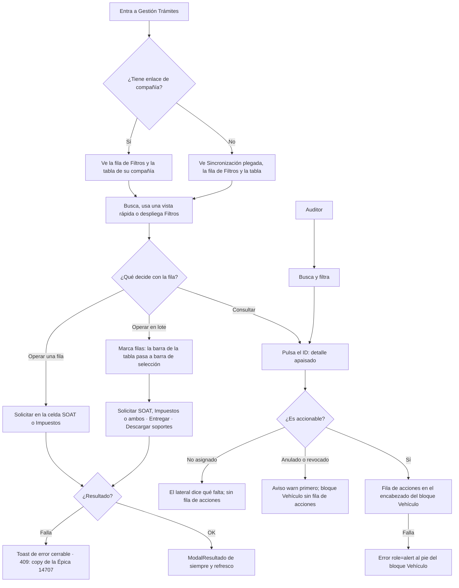

# UX full: rediseño de Gestión Trámites y detalles apaisados (trámite, SOAT, impuesto)

**Estado: aprobado por David (2026-11-26).**
**Maqueta aprobada:** `docs/ux/mockups/flito-tramites-rediseno.html`, con capturas en `docs/ux/mockups/flito-tramites-rediseno-*.png`.
**Si este documento y la maqueta no coinciden, manda la maqueta.**

Pedido del humano (David, 2026-11-26): ordenar el diseño de Gestión Trámites para que la experiencia mejore enormemente, y que los modales de detalle (trámite, SOAT e impuesto) sean **más anchos que altos** en pantallas grandes.

**Decisiones del humano, tomadas sobre la maqueta (no se discuten):**

| # | Decisión | Dónde |
|---|---|---|
| R1 | Los filtros son un **desplegable** como «Sincronización». Plegado se ven la búsqueda, «Filtros» con su cuenta y las vistas rápidas (R12) | §5.4 |
| R2 | La **tabla va sin tarjeta**, a todo el ancho, como en las colas SOAT e Impuestos | §5.1, §5.5 |
| R3 | **Azul principal `#557eff` en toda la app.** Cambia *todo* el azul del tema claro, incluidos `--color-action` y `--color-heading`, con waiver de contraste | §6 |
| R4 | **Placas:** la moto (`AAA45T`) en amarillo naranjado; el servicio público en blanco | §7 |
| R5 | **Columnas SOAT e Impuestos mínimas:** un chip y, como mucho, una acción o un dato | §5.3 |
| R6 | **Detalle del trámite:** las acciones van en una fila compacta arriba, dentro del bloque Vehículo | §9 |
| R7 | **Detalles SOAT e Impuesto:** igual, las acciones arriba dentro del bloque principal (Datos) | §10 |
| R8 | Los filtros, ordenados: arriba las vistas, en medio la rejilla y abajo los aplicados con «Limpiar filtros». No hay un botón de panel anidado | §5.4 (afinado por R10 y R12) |
| R9 | **Sin placa en la cabecera de los detalles:** es redundante con el bloque Vehículo | §8.1, §9.2, §10 |
| R10 | **Rejilla de filtros simétrica:** 10 celdas iguales en 5 × 2 (≥ 1280 px), 2 columnas entre 640 y 1279 px y 1 columna por debajo de 640 px. El rótulo va encima y todos los controles tienen el mismo ancho, 40 px de alto y chevron. Orden: Creado · Aprobado · Trámite · SOAT · Impuestos / Fuente · Autogestión · Empresa gestora · Tránsito · Ciudad. Sin rótulos de grupo. Fuente y Autogestión **dejan de ser `FiltroSegmentado`** | §5.4 |
| R11 | **Sin filtros en las cabeceras de columna:** se quitan los `ThFiltroMulti` de Trámite, SOAT, Impuestos, Empresa, Tránsito y Ciudad, que pasan a vivir solo en el panel. *Corrige la revisión 3, que decía que «siguen en las cabeceras».* | §5.1, §5.4 |
| R12 | **Vistas rápidas en la fila del encabezado de Filtros**, a la derecha del buscador y visibles también con el panel plegado. Por debajo de 1024 px bajan bajo el buscador. El panel desplegado queda en la rejilla y el pie de aplicados con «Limpiar filtros» | §5.4 |

**Módulos:** FLITO (`flito-tramites`, `flito-soat`, `flito-impuestos`) y el kit común (`components/flit/Placa.tsx` y los tokens). No toca los módulos legacy sin prefijo, salvo en que la placa y el azul del kit también se ven allí (son piezas comunes).

**Alcance:** se reorganiza lo que ya existe y se aplican dos decisiones visuales de marca (R3, R4). No hay ninguna regla de negocio nueva. **Hay un requerimiento de datos nuevo:** el tipo de servicio del vehículo (§7.4). Se integra la Épica #14707 sin contradecirla (`docs/ux/epica-14707-tramite-muerto.md` §3–§6 y su maqueta aprobada).

---

## 1. Contexto y roles

**Qué viene a hacer quien abre Gestión Trámites:** recorrer la bandeja para decidir **qué trámites mueve hoy** (solicitar SOAT o impuestos, entregar los que están listos) y **resolver bloqueos** (empresa inexistente, secretaría sin emparejar).

**Qué viene a hacer quien abre un detalle:** saber **en qué va el trámite y qué le falta**, y hacer la acción que corresponde sin perder de vista el vehículo.

| Quién | Qué ve y qué hace | Tono |
|---|---|---|
| `admin` sin enlace | Todo: Sincronización, filtros, selección, acciones de lote y de fila, «+ Trámite demo» | Tú |
| Usuario con enlace de compañía | Solo los trámites de su compañía. No ve Sincronización, ni el filtro Empresa gestora, ni «Solicitar SOAT», «Solicitar ambos» o «+ Trámite demo» (HU #13452). Ve Solicitar Impuestos, Entregar y Descargar soportes si su rol tiene esas funciones | Tú |
| Auditor | Solo lectura: filtros, tabla y detalle, sin casillas ni acciones | Tú |
| Detalle SOAT en el canal Cliente (`esCliente`) | El mismo modal apaisado, sin historial (HU 11914) | Usted |

**Qué no es esta pantalla:** no es la cola del Proveedor ni la del Gestor de Impuestos, no carga recibos de derechos, no factura y no es un tablero.

**Permisos:** el slug existente de Gestión Trámites, sin cambio. Funciones: `tramites.solicitud.pedir_soat`, `tramites.vistas_columnas.administrar`, `tramites.tramite.ver_soportes`, `tramites.tramite.ver_historial`, `tramites.soportes.descargar`, más las `soat.*` e `impuestos.*` de cada detalle. Roles: los de `USER_ROLES`.

---

## 2. Diagnóstico del diseño actual (código leído)

### 2.1 La página `apps/web/src/pages/FlitoTramites.tsx`

| # | Hallazgo | Dónde |
|---|---|---|
| D1 | El subtítulo tiene dos frases, explica mecánica y dice «sincroniza» (la lectura ya es automática) | `:288` |
| D2 | La única acción de la cabecera es «+ Trámite demo», una herramienta de pruebas | `:289-292` |
| D3 | Un único error fijo y pegajoso para el listado, las acciones, la factura y el historial: muestra `errorMessage(e)` crudo y **sin Reintentar** | `:297-304` (`:161`, `:245`, `:269`, `:280`) |
| D4 | El error de una acción lanzada **desde el modal** queda **detrás del velo** | `:465-467` → `:242-247` |
| D5 | La barra de selección aparece encima de la tabla y la desplaza 56–80 px; además no es sticky | `:306-346` |
| D6 | La barra superior acumula unos 13 controles en un `flex-wrap` que a 1366 px ocupa 3 líneas | `:371-418` |
| D7 | El chip de alerta del Tablero usa estilo de primaria | `:389-395` |
| D8 | Hay filtros en dos sitios: la barra y 6 `ThFiltroMulti` en las cabeceras. El de una columna fuera de la vista no se ve. **Se resuelve con R11** | `CabeceraTramites.tsx:56-73` |
| D9 | La paginación solo está arriba | `:407-413` |
| D10 | Mientras carga (`data === null`) no se pinta nada | `:360`, `:367` |
| D11 | Los avisos están dispersos | `:350-358`, `:419-420` |
| D12 | El copy usa «(s)» | `:406`, `:310` |
| D13 | La tabla va dentro de una `FlitCard`, mientras las colas la pintan a todo el ancho | `:367-448`; colas: `FlitoSoat.tsx:591-602` → `TablaColaSoat` → `DataTable` |

### 2.2 La fila (`FilaTramite.tsx`, `CeldasTramite.tsx`, `CabeceraTramites.tsx`)

| # | Hallazgo | Dónde |
|---|---|---|
| F1 | Una columna «Ver» con un botón por fila | `FilaTramite.tsx:55-60` |
| F2 | El ID es el texto más tenue de la fila | `FilaTramite.tsx:63` |
| F3 | Los «Solicitar» son primarios: hasta 100 por página | `CeldasTramite.tsx:29-35` |
| F4 | Las celdas SOAT e Impuesto llegan a 7–8 líneas, y la de Vehículo a 4 | `CeldasTramite.tsx:48-56`, `:83-93`; `FilaTramite.tsx:87-94` |
| F5 | Hasta 9 controles por fila | — |
| F6 | El documento del titular se ve en la lista | `FilaTramite.tsx:100` |
| F7 | El chip abre `ModalHistorial`, que duplica la sección Historial del detalle | `FilaTramite.tsx:66-69` |
| F8 | Los documentos están repartidos entre Vehículo y Soportes | `FilaTramite.tsx:92`, `:182-188` |
| F9 | `Placa` pinta igual una moto, un particular y un vehículo público | `Placa.tsx:20-27` |

### 2.3 El detalle del trámite

| # | Hallazgo | Dónde |
|---|---|---|
| M1 | A 1920×1080 el modal mide 1280×1032 (≈1,24:1): casi cuadrado | `ModalDetalleTramite.tsx:134` |
| M2 | Las acciones van en un pie de ancho completo que consume altura | `:180-187` |
| M3 | «Resumen» repite el estado y la fuente | `SeccionesDetalle.tsx:75`, `:77` |
| M4 | Se cierra con «Cerrar» en texto, mientras el kit usa la ✕ | `:149` |
| M5 | La sección Vehículo está en el tercer puesto. La solución es subirla al primero (§9), **no** repetir la placa en la cabecera (R9) | `SECCIONES` `:36-39` |

### 2.4 Los detalles SOAT e Impuesto

| # | Hallazgo | Dónde |
|---|---|---|
| S1 | `FlitModal wide` mide 672 px de ancho y tiene un solo scroll | `FlitModal.tsx:59` |
| S2 | Ocho zonas en una sola columna: al desplazarse, la acción sale de la vista | — |
| S3 | La comparativa RUNT y los 16 datos quedan apretados | `DetalleImpuesto.tsx:218-247`, `:355-378` |

### 2.5 El azul del kit

| # | Hallazgo | Dónde |
|---|---|---|
| A1 | El tema claro sobrescribe el `#557eff` base con `#1d53ff` | `kit-variables.css:281-286` |
| A2 | Hay `#1d53ff` escrito a mano | `kit-react.css:29`; `kit-ui.css:569-570, 585, 611, 613`; `tokens.css:35, 49`; `kit-variables.css:287` |

**Se conserva sin cambio:**
- La Sincronización plegada (HU #13238).
- Las vistas de columnas (ADR-0045).
- El aviso de novedades (HU #13684).
- La regla «lo marcado ≠ lo accionable» con su conteo (HU #11910).
- El orden canónico de los detalles (`flito-soat-impuestos-patron-unificado.md` §4.1), con la variación declarada en §10.
- El detalle en memoria (ADR-0046).
- Los 4 estados de cada sección.

---

## 3. Qué se ve y qué se calla

### 3.1 Disposición de la bandeja

**A · Molde de cola (aprobada):** búsqueda con filtros desplegables, **barra de la tabla** que se convierte en barra de selección, **tabla a todo el ancho y sin tarjeta**, y paginación abajo.

Se descartó **B · Lista y detalle en dos paneles**, porque pierde la comparación entre filas y el trabajo en lote.

### 3.2 Jerarquía de la bandeja

1. **Siempre visible:**
   - el título;
   - la fila de **Filtros**: «Filtros» con su cuenta, el buscador y las **vistas rápidas**;
   - el conteo;
   - en cada fila: la casilla, el **ID como enlace al detalle**, el chip de estado, «Listo para entregar», la placa con su variante y el tipo, el chip de SOAT y de Impuestos con a lo sumo una cosa más, y los bloqueos.
2. **Al desplegar Filtros:** la rejilla de 10 filtros y el pie con los aplicados y «Limpiar filtros».
3. **Un clic más allá (en el detalle):** VIN cuando hay placa, documento del propietario, valores, fechas de envío, Desbloqueado, Diferencia de valor, Liquidado e historial.
4. **Ya no está:** la columna «Ver», los filtros en las cabeceras de columna (R11), el modal de historial suelto y la tarjeta alrededor de la tabla.

**Una sola primaria:** **«Entregar (n)»**, en la barra de selección. Sin selección, la bandeja no tiene primaria.

### 3.3 Disposición de los detalles (aprobada)

- **Lateral (18rem):** dice **en qué va** el trámite, en texto y enlaces, **sin pila de botones**.
- **Contenido:** abre con el **bloque principal**, que lleva en su encabezado la **fila compacta de acciones** (título a la izquierda, acciones a la derecha).

Se descartó la versión de la revisión 1, con las acciones apiladas en el lateral: el humano la rechazó.

---

## 4. Flujo de usuario



---

## 5. Pantalla 1: bandeja de Gestión Trámites

### 5.1 Wireframe de escritorio (≥ `lg`, 1366 px), lleno, con los filtros plegados

```
┌─ Gestión Trámites ─────────────────────────────────────────────────────────── [+ Trámite demo] ┐
│ Solicita SOAT e impuestos de los trámites Asignados y entrégalos cuando estén listos.           │
└─────────────────────────────────────────────────────────────────────────────────────────────────┘
┌ ▸ Sincronización    FLIT 1: Encendida · FLIT 2: Encendida   ⚠ Requiere atención ───────────────┐  (sin cambio)
└─────────────────────────────────────────────────────────────────────────────────────────────────┘
┌─ acordeón Filtros (plegado) ────────────────────────────────────────────────────────────────────┐
│ [› Filtros ④]  [🔍 Buscar placa, VIN, id o propietario…              ]  VISTAS RÁPIDAS (Recién llegados sin gestionar) │
└─────────────────────────────────────────────────────────────────────────────────────────────────┘
  ● Hay 3 trámites nuevos que cumplen tus filtros.                                          [Ver]    ← zona de avisos (solo si hay)
  1.284 trámites                                          [Columnas (2 ocultas)]  Orden [Más recientes ▾]  ← barra de la tabla (sticky, sin tarjeta)
┌──┬─────────────────────┬─────────┬──────────────────┬─────────────────┬────────────────┬──────────────┬──────────────┬────────────────┐
│☐ │Trámite              │Creado   │Vehículo          │Empresa gestora  │Tránsito        │SOAT          │Impuestos     │Soportes        │ ← sin filtros en cabecera (R11)
├──┼─────────────────────┼─────────┼──────────────────┼─────────────────┼────────────────┼──────────────┼──────────────┼────────────────┤
│☐ │2026-000812 ↗        │12 nov 26│[KLM 482]         │Concesionario N. │STT Pereira     │(● Pendiente) │(● Pendiente) │Ver soportes    │
│  │Traspaso             │(14 días)│Mazda 3 · Autom.  │NIT 900111       │                │[Solicitar]   │[Solicitar]   │Factura de venta│
│  │(● Asignado)         │         │                  │                 │                │              │              │                │
├──┼─────────────────────┼─────────┼──────────────────┼─────────────────┼────────────────┼──────────────┼──────────────┼────────────────┤
│☐ │…                    │         │[MNB 22F]▒        │                 │                │(● Pagado)    │(● Pagado)    │                │ ← moto
│  │(✓ Listo p. entregar)│         │Yamaha NMAX · Motocicleta           │                │              │              │                │
├──┼─────────────────────┼─────────┼──────────────────┼─────────────────┼────────────────┼──────────────┼──────────────┼────────────────┤
│☐ │…                    │         │[TRE 664]□        │                 │                │(● Con novedad│(● Solicitado)│                │ ← público
│  │                     │         │Hyundai Grand i10 · Taxi · Público  │                │Póliza no co… │Sin gestión 5d│                │
├──┼─────────────────────┼─────────┼──────────────────┼─────────────────┼────────────────┼──────────────┼──────────────┼────────────────┤
│☐ │…                    │         │[KTR 18D]▒□       │                 │                │              │              │                │ ← moto pública
│  │                     │         │AKT 125 · Motocicleta · Público     │                │              │              │                │
├──┼─────────────────────┼─────────┼──────────────────┼─────────────────┼────────────────┼──────────────┼──────────────┼────────────────┤
│▫ │2026-000815 ↗        │13 nov 26│[RTX 019]         │Concesionario N. │STT Pereira     │Descartado    │Descartado    │Ver soportes    │ ← anulado (14707 §3)
│  │Traspaso (⊘ Anulado) │         │Renault Logan     │NIT 900111       │                │              │              │                │
└──┴─────────────────────┴─────────┴──────────────────┴─────────────────┴────────────────┴──────────────┴──────────────┴────────────────┘
                                         ‹ Anterior    Página 1 de 26    Siguiente ›                   ← paginación abajo (única)
 ↗ = el ID es un botón con aspecto de enlace que abre el detalle. ▫ = casilla deshabilitada (14707). ④ = burbuja de la cuenta.
```

Las filas exactas (incluidos un trámite con la empresa inexistente, otro con la secretaría sin emparejar y un vehículo sin placa, con VIN) son las de la vista 1 de la maqueta.

### 5.2 Con selección (la barra de la tabla cambia de modo; no se inserta otra)

```
  ┌ 4 seleccionados  [Solicitar SOAT (3 de 4)] [Solicitar Impuestos (3 de 4)] [Solicitar ambos (3 de 4)]      ┐ ← sticky y con fondo opaco
  │                  [Entregar (3 de 4)]▓ [Descargar soportes (4)]                          [Limpiar selección]│
  │ De las 4 filas marcadas, 3 están Asignadas con empresa y secretaría emparejadas y son las únicas sobre las │ ← solo si hay desajuste
  └ que actúan Solicitar y Entregar. Descargar soportes usa las 4. ───────────────────────────────────────────┘
```

- El orden y los rótulos con conteo no cambian (HU #11910). «Limpiar» pasa a ser **«Limpiar selección»** (ghost sm, a la derecha).
- En modo selección se ocultan «Columnas», «Orden» y el conteo: cambiarlos limpiaría la selección (`FlitoTramites.tsx:151`).
- **Nombre accesible:** la maqueta pone `aria-label`s del tipo «Solicitar SOAT de 3 de los 4 trámites marcados». Se recomienda **no** añadirlos y dejar como nombre el texto visible («Solicitar SOAT (3 de 4)»), por dos razones: el criterio 2.5.3 (el nombre accesible debe contener el texto visible) y los E2E (`novedades:200/220` buscan «Solicitar SOAT (1)»). Si se mantienen, hay que actualizar esos E2E.
- **«Entregar (n)» es la única primaria de la pantalla.**

### 5.3 Densidad de la fila

| Celda | Propuesta |
|---|---|
| Columna «Ver» | **Se retira.** El ID pasa a ser un `<button>` con estilo de enlace (`text-sm font-semibold tabular-nums`, `--color-action`, subrayado al pasar el puntero, `flit-focus`). Conserva `aria-label="Ver el detalle del trámite {idFlit}"` y `atributoVer` |
| Trámite | ID · tipo · chip (+ «Listo para entregar»). El chip **sigue abriendo el historial** (14707 §3), ahora en el detalle, en la sección Historial |
| Vehículo | Línea 1: `Placa` con su variante (§7), o «VIN …» si no hay placa. Línea 2: marca y línea · tipo · «Público» cuando el servicio es público (texto visible, §7.1). El VIN con placa va al detalle y la factura de venta a «Soportes» |
| Propietario | Nombre y «n propietarios». El documento va al detalle |
| Empresa gestora / Tránsito | Sin cambio |
| **SOAT / Impuestos (R5)** | **Un chip de estado y, como mucho, una cosa más**, por prioridad: (1) «Solicitar» (secundario `sm`, `aria-label="Solicitar SOAT de {placa o idFlit}"` o «Solicitar impuesto de …»); (2) el motivo de la novedad en una línea (`--kit-rojo-texto`, truncado, completo en `title`); (3) «Sin gestión {n} d» en `--kit-rojo-texto`. «Autogestionado» es solo el chip. «Sin registro» va en tenue. Todo lo demás pasa al detalle |
| Soportes | «Ver soportes» y, si existe, «Factura de venta» (clase `enlace`) |
| Fila muerta (14707) | Como se aprobó: «Descartado» en tenue en SOAT e Impuestos, o el chip histórico si fue revocada |

El encabezado de la tabla queda en texto plano, sin filtros (R11). Resultado: como mucho 7 controles por fila y ninguna primaria en la tabla. **Densidad: aliviada.**

### 5.4 Filtros (R1, R8, R10, R11, R12)

Tienen la misma piel que «Sincronización» (clases `acordeon`). El acordeón se contrae en cada visita y queda abierto mientras se siga en la página.

**Fila del encabezado (siempre visible, plegado o desplegado):**

```
≥ 1024 px:  [› Filtros ④]  [🔍 Buscar placa, VIN, id o propietario…            1fr]  VISTAS RÁPIDAS (Recién llegados sin gestionar)
< 1024 px:  [› Filtros ④]  [🔍 Buscar placa, VIN, id o propietario…            1fr]
            VISTAS RÁPIDAS (Recién llegados sin gestionar)                       ← a todo el ancho; si no cabe, scroll horizontal
```

- **Rejilla de la fila:** `grid-template-columns: auto minmax(0,1fr)` y, desde 1024 px, `auto minmax(0,1fr) auto`. Los tres elementos miden **40 px** de alto.
- **El botón del acordeón** va primero: chevron (gira al abrirse, como en Sincronización), «Filtros» y la burbuja `acordeon__cuenta` con el número de filtros activos (`aria-label="{n} filtros activos"`). La burbuja se pinta **también por debajo de 480 px**, aunque el kit la oculte ahí, porque es la única pista de que hay filtros puestos. Se acompaña de `aria-expanded` y `aria-controls`.
  - **n** = filtros activos en la rejilla + la alerta del Tablero. El texto buscado no cuenta.
- **El buscador** va fuera del botón (un botón no puede contener un campo). Su placeholder no cambia: «Buscar placa, VIN, id o propietario…».
- **Vistas rápidas:** `role="group" aria-label="Vistas rápidas"`, con el rótulo «VISTAS RÁPIDAS» y el preset «Recién llegados sin gestionar» como `chip chip--sm` de 40 px con `aria-pressed`. Pulsarlo de nuevo lo quita.

**Panel desplegado:** la rejilla y el pie.

```
┌───────────────────────────────────────────────────────────────────────────────────────────────────────┐
│ Creado               Aprobado             Trámite              SOAT                 Impuestos           │ ← ≥ 1280 px: 5 × 2
│ [1 nov – 15 nov 2026 ▾][Cualquier fecha  ▾][Todos            ▾][Pendiente        ▾][Todos             ▾]│
│ Fuente               Autogestión          Empresa gestora      Tránsito             Ciudad              │
│ [FLIT 2           ▾][Todas            ▾][Todas            ▾][Todos            ▾][Todas             ▾]│
│ ─────────────────────────────────────────────────────────────────────────────────────────────────────── │ ← filete
│ APLICADOS (Creado: 1 nov – 15 nov ✕) (SOAT: Pendiente ✕) (Fuente: FLIT 2 ✕) (Alerta: SOAT sin gestión ✕)  [Limpiar filtros] │
└───────────────────────────────────────────────────────────────────────────────────────────────────────┘
```

**Rejilla simétrica (R10):**
- **10 celdas iguales**, en este orden de lectura: **Creado · Aprobado · Trámite · SOAT · Impuestos / Fuente · Autogestión · Empresa gestora · Tránsito · Ciudad**. Sin rótulos de grupo.
- **Columnas:** 5 a partir de 1280 px, 2 entre 640 y 1279 px, y 1 por debajo de 640 px (`repeat(N, minmax(0,1fr))`, `gap: var(--space-16)`).
- **Cada celda** (`campo-filtro`) lleva el rótulo encima (`text-caption`, 600, `--color-text-secondary`) y un **control desplegable** (`control-filtro`): ancho completo de la celda, **40 px de alto**, valor resumido a la izquierda con elipsis y chevron a la derecha (`--color-text-tertiary`).
- **Feedback del control:** hover `--kit-hover` y foco `outline 2px var(--kit-azul)`. Con un valor puesto lleva `data-puesto`: borde `--kit-azul`, texto `--color-action` y peso 600.
- **Tipos de control:**
  - **Creado y Aprobado:** el rango de fechas del kit (`RangoFechas` en un popover, `aria-haspopup="dialog"`). Valor: «Cualquier fecha» o «1 nov – 15 nov 2026».
  - **Trámite, SOAT, Impuestos, Empresa gestora, Tránsito y Ciudad:** multiselección en un menú flotante con casillas (`menu-flotante` + `opcion-filtro`, `aria-haspopup="listbox"` / `aria-expanded`). Las opciones son las de hoy: facetas de `/flito/tramites/facetas`, `ESTADOS_SOAT_OPERATIVOS`, `ESTADOS_IMPUESTO_OPERATIVOS` y las compañías de parametrización; la lista de la maqueta es ilustrativa. Valor: «Todos/Todas», el estado elegido, o «{n} seleccionados».
  - **Fuente y Autogestión dejan de ser `FiltroSegmentado`:** pasan a ser el mismo desplegable, pero de elección única (Todas · FLIT 1 · FLIT 2; Todas · Autogestionadas · No autogestionadas). Nombre accesible: `aria-label="Filtrar por fuente: {valor}"` y `"Filtrar por autogestión: {valor}"`, como en la maqueta: se conserva el prefijo que usan los E2E.
- **Empresa gestora solo existe sin enlace** (HU #13452). Con enlace, esa celda no se pinta y las demás conservan su orden; la segunda fila queda con 4 celdas.
- Los filtros se aplican **en vivo**, sin botón «Aplicar».

**Pie (solo si hay algún filtro o texto puesto):**
- Separado por un filete (`border-top: 1px solid var(--color-divider)`).
- Lleva el rótulo «APLICADOS» y los chips `filtro-activo` (`aria-label="Quitar filtro …"`), que envuelven.
- «Limpiar filtros» (`btn ghost sm`, mismo nombre accesible) va alineado a la derecha.
- Formato de cada chip: «Rótulo: valor»; con más de dos valores, «Tránsito: 3 seleccionados». La alerta del Tablero se muestra como un chip más.

**Sin cabeceras con filtro (R11):** `CabeceraTramites` pierde los seis `ThFiltroMulti`. Los filtros viven solo en el panel; lo aplicado se ve en los chips y en la cuenta de «Filtros».

**Pieza nueva:** `FiltrosTramites` + `CampoFiltro` (§17). **No se extiende `BarraFiltrosCola`**, así que las colas SOAT e Impuestos no cambian.

### 5.5 Barra de la tabla y tabla sin tarjeta (R2)

- La tabla va **sin `FlitCard`**, a todo el ancho (`tabla-wrap kit-matriz`, como `TablaColaSoat` → `DataTable`). La región `aria-label="Trámites"` se conserva.
- **Barra de la tabla:** sticky (`top-[calc(var(--kit-alto-barra)+0.5rem)] z-20`) y **opaca**:
  - sin selección, fondo `var(--color-surface)`;
  - con selección, `color-mix(in srgb, var(--color-action) 10%, var(--color-surface))`.
- **Sin selección:** el conteo («1.284 trámites», `role="status"`, o «Actualizando…» mientras carga) y, a la derecha, «Columnas (n ocultas)» y «Orden».
- **Con selección:** §5.2.
- **Zona de avisos**, entre los filtros y la barra: error del listado, novedades, vistas de columnas y ZIP.

### 5.6 Estados (4)

| Estado | Qué se ve | Copy |
|---|---|---|
| **Cargando (primera vez)** | La fila de Filtros y el esqueleto de la barra y de las filas | — |
| **Cargando (filtro, página u orden)** | La tabla anterior se queda, con `aria-busy` | «Actualizando…» |
| **Error** | `InlineAlert danger` con [Reintentar]. Si ya había datos, la tabla sigue debajo | «No pudimos cargar los trámites. Revisa tu conexión y vuelve a intentarlo.» |
| **Vacío sin trámites** | `FlitEmpty` | «Todavía no hay trámites. FLITO los trae solo de FLIT 1 y FLIT 2; aparecen aquí en cuanto lleguen. Si esperabas trámites, revisa el estado en Sincronización.» · Con enlace: `vacioConEnlace` |
| **Vacío por filtro** | `FlitEmpty`, o `VacioFuenteTramite` si el filtro es la fuente. La barra dice «0 trámites» | «Ningún trámite coincide con el filtro. Quita algún filtro de arriba o usa «Limpiar filtros».» |
| **Lleno** | §5.1 | — |

### 5.7 Acciones y notificaciones

| Acción | Si sale bien | Si falla |
|---|---|---|
| Solicitar / Entregar (en lote o desde la fila) | `ModalResultado` y refresco (sin cambio, 14707 §6) | `toastError` cerrable, sin el error crudo. Si el API trae una frase de negocio (409/422), esa (`textoError` de `DetalleSoat.tsx:42-50`). Si no: «No se pudo solicitar el SOAT. Intenta de nuevo.» / «…el impuesto…» / «…el SOAT ni el impuesto…» / «No se pudo entregar. Intenta de nuevo.» Para el 409 de trámite no vigente, el copy de 14707 |
| Abrir la factura de venta | `ModalFacturaVenta` | `toastError` con Reintentar: «No se pudo abrir la factura de venta del trámite {idFlit}. Intenta de nuevo.» |
| Chip del historial | El detalle, en la sección Historial | Lo gestiona la sección |
| Fallo del listado | — | Aviso en página (§5.6) |

### 5.8 Datos

Los mismos endpoints de hoy, más el tipo de servicio (§7.4).

---

## 6. Azul principal `#557eff` en toda la app (R3): waiver de contraste

### 6.1 Decisión humana registrada

> **Waiver de contraste.** Decisión de David (2026-11-26), explícita, tomada conociendo el impacto y confirmada dos veces sobre la maqueta: **todo** el azul del tema claro pasa a `#557eff`. Afecta a `--kit-azul`, `--kit-azul-hover`, `--color-action`, `--gradient-action(-hover)`, `--color-highlight(-display)`, `--color-heading`, `--color-info` y `--kit-azul-relleno`, incluidos títulos y enlaces. El texto azul de tamaño normal y el texto blanco sobre relleno azul quedan por debajo del 4,5:1 de `AGENTS.md` §12. El waiver cubre **solo** los pares de la tabla siguiente; cualquier otro par por debajo del AA sigue siendo bloqueante.

| Par | `#1d53ff` (hoy) | `#557eff` | Umbral |
|---|---|---|---|
| Texto azul sobre blanco | 5,6:1 | **3,6:1** | 4,5 para texto · 3 para texto grande |
| Texto azul sobre `--color-surface` (`#e6f0ff`) | 4,9:1 | **3,1:1** | 4,5 |
| Texto azul sobre `--kit-hover` (`#e1ebfb`) | 4,7:1 | **≈3,0:1** | 4,5 |
| Blanco sobre relleno azul | 5,6:1 | **3,6:1** | 4,5 |
| Foco y bordes (no texto) | ≥ 4,6 | 3,6 / 3,1 / ≈3,0 | 3 (cumple; el hover queda en el límite) |

- **Quedan bajo AA:** enlaces, secundarios y ghost, chips `filtro-activo` e `info`, pestañas, el paso actual, `acordeon__cuenta`, `control-filtro[data-puesto]` y el texto de los primarios.
- **Cumplen:** los títulos grandes y el foco.
- **Tema oscuro:** sin cambio, salvo el relleno.

### 6.2 Tokens y archivos que cambian (sin drift)

Los valores siguen la maqueta: los tokens derivan del token, no se escriben HEX nuevos.

| Token o regla | Hoy | Pasa a | Archivo |
|---|---|---|---|
| `--kit-azul` (claro) | `#1d53ff` | `#557eff` | `kit-variables.css:282` |
| `--kit-azul-hover` (claro) | `#1746e0` | `color-mix(in srgb, var(--kit-azul) 86%, var(--kit-tinta))` | `:282` |
| `--kit-azul-relleno` (los dos temas) | `#1d53ff` | `var(--kit-azul)` en claro · `#557eff` en el relleno oscuro | `tokens.css:49`, `tokens.css:35`, `kit-variables.css:287` |
| `--gradient-action` / `--gradient-action-hover` (claro) | `#1d53ff` / `#1746e0` | `linear-gradient(var(--kit-azul), var(--kit-azul))` / `…var(--kit-azul-hover)…` | `:283` |
| `--color-action`, `--color-heading`, `--color-highlight`, `--color-highlight-display`, `--color-info` (claro) | `#1d53ff` | `var(--kit-azul)` | `:283-284` |
| `.kit-etiqueta[data-tono="info"]` | `#1d53ff` | `var(--kit-azul)` | `kit-react.css:29` |
| Banners, paso actual y rellenos oscuros | `#1d53ff` | `var(--kit-azul)` / `var(--kit-azul-relleno)` | `kit-ui.css:569, 570, 585, 611, 613` |
| `--kit-gris`, `--color-text-tertiary` | — | **sin cambio** | — |
| Derivados (`--color-accent-soft`, `--kit-hover`, `--kit-velo`, `.filtros__cuenta`, `:focus-visible`, `.barra-accion`, `.chip[aria-pressed]`) | — | Heredan el cambio | — |

**Condiciones:**

1. `kit-variables.css` es un archivo **generado** («No editar a mano: ver `docs/ux/rediseno-2026/README.md`»). El cambio se hace en la fuente o en el generador; si el bloque `:281-287` no sale del generador, se edita y se documenta allí.
2. **Gate de CI `check:contraste`** (`scripts/check-contraste-paleta.mjs`, AA 4,5, casos 2 «azul de texto» y 3 «blanco sobre botón azul»). Con el cambio se pone en rojo, así que necesita una **excepción acotada**:
   - Una lista explícita **solo de los pares de §6.1** (texto `--color-action` sobre `--color-surface-elevated`, `--color-surface` y `--kit-hover` en tema claro, y blanco sobre `--kit-azul-relleno`), cada uno con su ratio mínimo aceptado.
   - **Un comentario que cite la decisión**: «Waiver de contraste — decisión de David, 2026-11-26, `docs/ux/flito-tramites-rediseno.md` §6», más el ADR.
   - **Sin bajar `AA = 4.5`**, sin apagar casos y sin comodines. Cualquier otro par bajo AA sigue en rojo.
   - **Atada al valor `#557eff`:** si el azul vuelve a moverse, la excepción deja de aplicar.
3. `AGENTS.md` §12 no cambia por esta spec. El waiver se registra como **ADR** (`architecture-agent`). Si `AGENTS.md` gana una línea de excepción, lo decide el humano.
4. `grep -rn "1d53ff\|1746e0" apps/web/src` debe quedar vacío.
5. En los escaneos axe de los E2E, las violaciones `color-contrast` esperables se acotan a estos tokens; no se apagan en global.

---

## 7. Placas: moto y servicio público (R4)

### 7.1 Reglas (las de la maqueta)

| Caso | Cómo se reconoce | Fondo | Texto | Filete |
|---|---|---|---|---|
| Particular u otro (por defecto) | Ninguno de los de abajo, o falta el dato | `--placa-fondo` (`#ffd100`, con la imagen de hoy) | `--placa-texto` `#111111` (≈13:1) | El de la imagen |
| **Moto** | El texto normalizado (`trim`, mayúsculas, sin espacios ni guiones) cumple `^[A-Z]{3}\d{2}[A-Z]$`, p. ej. `MNB22F`. No necesita datos | `--placa-fondo-moto` = `color-mix(in srgb, var(--placa-fondo) 72%, var(--kit-naranja))` (≈ `#ffac00`) | `#111111` (≈10:1) | `box-shadow: inset 0 0 0 2px var(--placa-texto)` |
| **Servicio público** | `tipoServicio === 'publico'` (§7.4) | `--placa-fondo-publico` (`#ffffff`; es el objeto real, como el lienzo de un PDF) | `#111111` (≈18,9:1) | `inset 0 0 0 2px var(--placa-texto)` (obligatorio: sin él, la placa desaparece sobre una tarjeta blanca) |
| **Moto de servicio público** (precedencia) | Las dos condiciones | **Blanco:** manda el servicio | `#111111` | Doble: `inset 0 0 0 2px var(--placa-texto), inset 0 0 0 5px var(--placa-fondo-moto)`, para conservar la señal de moto |

- **Detalles de la variante:** la placa es igual en los dos temas. Las variantes usan `background-image: none`. El formato viejo `AAA45` sigue amarillo.
- **Señal que no depende del color (1.4.1):** el **texto visible** de la línea del vehículo dice el tipo y el servicio. En la fila: «Yamaha NMAX · Motocicleta» / «Hyundai Grand i10 · Taxi · Público». En el detalle: «Motocicleta · Particular · VIN …» / «Taxi · Servicio público · VIN …».
- **En pantallas sin esa línea**, `Placa` añade `<span class="sr-only">, servicio público</span>` y `title`.

### 7.2 En el componente común `components/flit/Placa.tsx`

Aplicarlo en el componente común es lo coherente: hay 12 archivos con `<Placa`, y una variante solo para Trámites sería drift (regla 13).
- **Prop:** `servicio?: 'publico' | 'particular' | 'oficial' | 'otro' | null`; el caso moto se calcula dentro.
- **Estilos:** clases `.placa--moto` y `.placa--publico` en `kit-propuesta.css`, y los tokens `--placa-fondo-moto` / `--placa-fondo-publico` en `tokens.css` §3.
- **Efecto en el resto de la app:** la moto cambia de color en todas las pantallas desde el primer día; el blanco de servicio público solo aparece donde llegue el dato.

### 7.3 Dónde aparece en este rediseño

En la celda Vehículo de la bandeja y en el **bloque principal** de los tres detalles (placa grande). **No aparece en la cabecera de los detalles** (R9).

### 7.4 Requerimientos de datos (`architecture-agent` / `backend-agent`)

- **R-1 (obligatorio):** `tipoServicio`, normalizado a `'publico' | 'particular' | 'oficial' | 'otro' | null`, en `TramiteFila.vehiculo` (`GET /flito/tramites`) y en `TramiteDetalle.vehiculo` (`/:id/detalle`).
  - `vehicles.tipo_servicio` existe (`apps/api/src/db/schema/flota.ts:71`, `varchar(30)` libre), pero la bandeja lee los trámites de FLIT 1 y FLIT 2 y **probablemente no lo trae**.
  - Arquitectura decide la fuente (payload de FLIT, cruce por placa o VIN, o las dos). El backend normaliza; la UI no interpreta texto libre.
- **R-2 (recomendado):** el mismo campo en `SoatItem` e `ImpuestoItem` (la maqueta lo usa en los dos detalles; pregunta 4 de §16).
- No es PII. Cambia `packages/shared-types`, así que hay que hacer `grep` de sus usos en web.

---

## 8. Patrón común: modal de detalle apaisado (`kit-modal--horizontal`)

### 8.1 Medidas y estructura

| | ≥ `lg` (1024 px) | < `lg` |
|---|---|---|
| Caja | `width: min(88rem, 94vw)` · `height: min(44rem, 86dvh)` · radio 9 px · borde `--color-border` · sin sombra | Pantalla completa (`100vw × 100dvh`), sin radio. El velo con `p-0 lg:p-6` |
| Proporción | Siempre más ancha que alta. A 1366×768 mide 1284×660; a 1920×1080, 1408×704 | — |
| Cabecera (R9) | Fila alineada a la izquierda: antetítulo (solo en el trámite) · **título** · chips de estado (zona 1) · a la derecha, la navegación (`btn ghost sm`, solo en el trámite) y la ✕ (`kit-modal__cerrar` dentro del flujo, `aria-label="Cerrar"`). **Sin placa visible** | Envuelve |
| Cuerpo | `grid-template-columns: var(--kit-modal-lateral, 18rem) minmax(0,1fr)`, cada columna con su propio scroll | Una columna, un solo scroll, con el lateral arriba |
| Lateral | **Contexto en texto y enlaces, sin pila de botones** (bloques `lateral-bloque` con `lateral-titulo`) | Arriba |
| Índice (opcional) | `kit-modal__indice`, debajo del lateral (solo en el trámite) | Tira horizontal sticky en `top:0` |
| Contenido | Abre con el **bloque principal** (`card`). Su encabezado (`bloque-cabeza`) lleva el título de sección a la izquierda y la **fila compacta de acciones** (`acciones-fila`: botones `sm`, con la primaria) a la derecha, envolviendo. Debajo, `vehiculo` (placa grande, nombre y meta) y los datos. Después, las secciones de consulta (`zona` o `card`) | Las acciones bajan bajo el título y envuelven en `grid-cols-2`; la primaria ocupa todo el ancho |

CSS propuesto en `styles/kit/kit-react.css` (solo tokens), con las clases tal como las usa la maqueta:

```
.kit-modal--horizontal                      → width:100%; height:100dvh; border-radius:0; border:0  (≥lg: medidas de arriba)
.kit-modal--horizontal .kit-modal__cabeza   → flex-direction:row; align-items:flex-start; text-align:left; padding: var(--space-16) var(--space-24)
.kit-modal--horizontal .kit-modal__cerrar   → position:static
.kit-modal__columnas  → flex:1; min-height:0; overflow-y:auto; display:grid   (≥lg: columnas 18rem / 1fr; filas auto / minmax(0,1fr); overflow:hidden)
.kit-modal__lateral   → ≥lg: grid-column:1; overflow-y:auto; border-right:1px solid var(--color-border)   (sin índice: grid-row:1 / span 2)
.kit-modal__indice    → ≥lg: grid-column:1 · <lg: sticky top:0; z-index:1; background:var(--color-surface-elevated); overflow-x:auto
.kit-modal__contenido → ≥lg: grid-column:2; grid-row:1 / span 2; overflow-y:auto
.bloque-cabeza        → flex; flex-wrap; align-items:center; justify-content:space-between; gap
.acciones-fila        → flex; flex-wrap; gap: var(--space-8)
```

### 8.2 Componente `components/flit/FlitModalHorizontal.tsx` (nuevo)

Compone `ModalPortal`, `useEscape` (cierra el diálogo de más arriba), `useFocusTrap` y `useBackdropClose`.

| Prop | Uso |
|---|---|
| `nombreAccesible: string` | `aria-label` del diálogo. **Se conservan** «SOAT · {placa}» e «Impuesto · {placa}» (los usan los E2E) |
| `titulo: ReactNode` + `tituloId?` | Título **visible**: «SOAT», «Impuesto» o el `h2` con el idFlit. El trámite usa `aria-labelledby` sobre su `h2`, como hoy |
| `antetitulo?` | «Gestión Trámites · 4 de 128» (`aria-live="polite"`) |
| `chips?` | Zona 1 |
| `navegacion?` | ‹ Anterior / Siguiente › |
| `lateral`, `etiquetaLateral` | Región del lateral |
| `indice?` | `nav` de secciones |
| `children`, `etiquetaContenido` | Región del contenido: «Detalle del trámite {idFlit}» / «Datos del SOAT {placa}» / «Datos del impuesto {placa}» |
| `contenidoRef?`, `onScrollContenido?` | Seguimiento de la sección visible. Por debajo de `lg` quien desplaza es `.kit-modal__columnas` |
| `onClose`, `restoreFocusRef?`, `cierreBloqueado?`, `trampaActiva?` | — |

`FlitModal` no cambia.

---

## 9. Pantalla 2: detalle del trámite (R6, R9)

### 9.1 Wireframe ≥ `lg`

```
┌────────────────────────────────────────────────────────────────────────────────────────────────────────────┐
│ Gestión Trámites · 4 de 128                                                                                 │
│ 2026-000812  (FLIT 1) (● Asignado)                                         [‹ Anterior] [Siguiente ›] [✕]  │ ← ID, fuente, estado
├──────────────────────────┬─────────────────────────────────────────────────────────────────────────────────┤
│ ESTADO DE LA GESTIÓN     │ ┌─────────────────────────────────────────────────────────────────────────────┐ │
│ Para entregar Falta: SOAT│ │ Vehículo          [Solicitar SOAT] [Solicitar Impuestos] [Solicitar ambos] [▓Entregar▓] │ ← título + fila de acciones
│ Semáforo  (● Amarillo)   │ │ [ KLM 482 ]  Mazda 3                                                          │ │
│ SOAT      (● Pendiente)  │ │              Automóvil · Particular · VIN 9BW…4251                            │ │
│ Impuestos (● Pagado)     │ │ (error de acción, role=alert, al pie del bloque)                              │ │
│ Logística Registrada     │ └─────────────────────────────────────────────────────────────────────────────┘ │
│ ──────────────────────── │ ┌ Resumen: Tipo · Creado · Aprobado · Ciudad · Sincronizado ─────────────────┐ │
│ ▌Vehículo                │ ┌ Propietario y gestora: Propietario · Documento · Empresa gestora · Tránsito ┐ │
│  Resumen                 │ ┌ Soportes (3) · Costos y facturación · Historial …          (scroll propio) ▼ │
│  Propietario y gestora   │                                                                                │
│  Soportes (3)            │                                                                                │
│  Costos y facturación    │                                                                                │
│  Historial               │                                                                                │
└──────────────────────────┴─────────────────────────────────────────────────────────────────────────────────┘
```

### 9.2 Reglas

- **Cabecera (R9):** `h2` con el idFlit, `EtiquetaFuente` y el chip de estado (o el de Anulado/Revocado de 14707). **Sin placa.** La navegación va en `btn ghost sm` y la ✕ conserva el nombre accesible «Cerrar».
- **Lateral «Estado de la gestión»:** un `dl` pintado desde la fila, con Para entregar, Semáforo, SOAT, Impuestos y Logística.
  - El Semáforo viene del detalle: muestra «Cargando…» o «Sin dato» mientras tanto.
  - En un trámite muerto: «No aplica» / «Sin dato» / «Descartado» / «Sin registro», en tenue.
  - **No lleva botones.** La región se llama `aria-label="Estado de la gestión"`. La maqueta todavía dice «Estado y acciones del trámite», pero el lateral ya no tiene acciones.
  - Debajo va el índice: `nav aria-label="Secciones del trámite"`, con `aria-current` y «Soportes (n)».
- **Bloque Vehículo** (la primera sección):
  - El encabezado lleva «Vehículo» a la izquierda y la **fila de acciones** a la derecha, con los botones y reglas del pie de hoy (`ModalDetalleTramite.tsx:121-126`): Solicitar SOAT · Solicitar Impuestos · Solicitar ambos (secundarios `sm`) · **Entregar** (primaria `sm`, la única del modal).
  - Debajo, el `vehiculo` con la placa grande y su meta (tipo · servicio · VIN).
  - Si no hay acciones, la fila no se pinta (14707 §4).
- **Error de una acción:** `role="alert"` al pie del bloque Vehículo, en `--flit-danger-ink` (corrige D4). Un 409 sigue 14707 §6.
- **Aviso 14707:** primero en el contenido, encima del bloque Vehículo.
- **Secciones:** Vehículo · Resumen (Tipo, Creado, Aprobado, Ciudad, Sincronizado) · Propietario y gestora (Propietario, Documento, Empresa gestora · NIT, Tránsito) · Soportes · Costos y facturación · Historial.

### 9.3 Estados (4)

Cada sección conserva los suyos. El lateral sale de la fila. El bloque Vehículo se pinta con su fila de acciones aunque el detalle esté cargando o haya fallado.

---

## 10. Pantallas 3 y 4: detalles de SOAT e impuesto (R7, R9)

**Cabecera (R9):** título **visible** «SOAT» / «Impuesto», seguido de los chips de la zona 1. El **nombre accesible** del diálogo se conserva: `aria-label="SOAT · {placa}"` / `"Impuesto · {placa}"` (lo usan unos 20 E2E y distingue el caso cuando hay submodales). La placa no se ve en la cabecera; vive en el bloque principal.

**Reparto, tal como la maqueta:**

- **Lateral** (`aria-label="Estado del SOAT"` / `"Estado del impuesto"`), en texto y enlaces:
  - aviso contextual (zona 2: motivo, solo lectura, Cliente);
  - **Comprobante** (zona 4, consulta): «Todavía no hay comprobante.», o los enlaces «Ver soporte» / «Descargar» y, en Impuesto, «En FLIT 2 · Enviado el …»;
  - **Documentos adicionales** (zona 4b, SOAT): lista con «Ver».
- **Contenido:**
  - **bloque principal «Datos»**: en el encabezado, la fila de acciones (zona 3 y las cargas de la zona 4); debajo, el `vehiculo` con la placa grande y su variante, y las fichas en 3 columnas (zona 5);
  - después, la particularidad (zona 6), «Corregir el caso» (zona 7) e Historial (zona 8).

**Variación declarada respecto al §4.1:**
- La consulta del comprobante (zona 4) y los documentos adicionales (4b) suben al lateral.
- Las **cargas** de la zona 4 (Cargar comprobante, Cargar recibo de caja, Reemplazar comprobante) van en la fila de acciones.

### 10.1 SOAT

```
┌──────────────────────────────────────────────────────────────────────────────────────────────────────┐
│ SOAT   (● En adquisición) (Sin gestión hace 3 días)                                             [✕] │  dialog aria-label="SOAT · MNB22F"
├──────────────────────────┬───────────────────────────────────────────────────────────────────────────┤
│ (aviso de novedad /      │ ┌─────────────────────────────────────────────────────────────────────────┐ │
│  Cliente, si aplica)     │ │ Datos                      [▓ ⬆ Cargar comprobante de SOAT ▓] [Rechazar] │ │ ← fila de acciones
│ COMPROBANTE              │ │ [ MNB 22F ]▒  Yamaha NMAX                                               │ │
│ Todavía no hay           │ │               Motocicleta · Particular · VIN 9BW…6120                   │ │
│ comprobante.             │ │ Compañía · Organismo · Trámite FLIT · Trámite creado · Trámite aprobado │ │
│ DOCUMENTOS ADICIONALES   │ │ Gestiona · Enviado por · Enviado · Valor pagado · Vigencia · Último RUNT│ │
│ Cotización          Ver  │ └─────────────────────────────────────────────────────────────────────────┘ │
│ Formulario tomador  Ver  │ COMPRADORES  Comprador de ejemplo · CC ••••   100 %                       │
│                          │ CORREGIR EL CASO  [Reversar] [Cambiar proveedor] [Asumir en Operaciones]  │ ← ghost sm
│                          │ HISTORIAL …                                                               │
└──────────────────────────┴───────────────────────────────────────────────────────────────────────────┘
```

- **Primaria:** «Cargar comprobante de SOAT» (con su ícono), primera de la fila. «Rechazar» y «Reactivar» son secundarios.
- **Formularios:** los de la zona 3 (Rechazar, Reactivar, PDF protegido) se abren dentro del bloque Datos, bajo el encabezado, y ocultan la fila mientras están abiertos. Su error va junto a su «Confirmar».
- **«Ver soporte» y «Descargar»** pasan a ser **enlaces-botón** (`<button class="enlace-btn">`, mismo nombre accesible) en el lateral. «Ver soporte» sigue siendo el destino de la devolución del foco.
- **«Corregir el caso»** va aparte, con botones `ghost sm`.
- **Las fichas** son las de hoy (`DetalleSoat.tsx:303-324`); en el Cliente se omiten las de trastienda.
- **Cliente (usted):** lateral con su aviso, la fila con lo que su función permita y sin Historial.

### 10.2 Impuesto

```
┌──────────────────────────────────────────────────────────────────────────────────────────────────────┐
│ Impuesto   (● Con novedad) (Diferencia de valor) (Docs: Liquidación)                            [✕] │  dialog aria-label="Impuesto · TRE664"
├──────────────────────────┬───────────────────────────────────────────────────────────────────────────┤
│ ⚠ Motivo de rechazo      │ ┌─────────────────────────────────────────────────────────────────────────┐ │
│ El valor no coincide …   │ │ Datos               [Reactivar] [Cargar comprobante] [Cargar recibo de caja]│ │ ← fila de acciones
│ COMPROBANTE              │ │ [ TRE 664 ]□  Hyundai Grand i10                                         │ │
│ Comprobante de pago      │ │               Taxi · Servicio público · VIN 9BW…3318                    │ │
│              Ver soporte │ │ (fichas de hoy, rejilla de 3 columnas)                                  │ │
│ En FLIT 2  Enviado el …  │ └─────────────────────────────────────────────────────────────────────────┘ │
│                          │ VALIDACIÓN FACTURA ↔ RUNT (tabla a lo ancho)                              │
│                          │ DOCUMENTO DE FACTURA · DIRECCIÓN DEL COMPRADOR                            │
│                          │ CORREGIR EL CASO  [Asumir en Operaciones] [Reversar]                      │ ← ghost sm
│                          │ HISTORIAL …                                                               │
└──────────────────────────┴───────────────────────────────────────────────────────────────────────────┘
```

- **Fila de acciones:** Rechazar o Reactivar · Cargar comprobante · Cargar recibo de caja · Reemplazar comprobante. Son secundarios `sm` y aparecen solo cuando aplican, con las reglas de `DetalleImpuesto.tsx:118-133`. **Sin primaria**, como hoy.
- **Debajo de la fila:** el motivo de «Cargar recibo de caja» (`aria-describedby`).
- **Lateral:** «Ver soporte» (enlace-botón, destino de `verSoporteRef`) y «Comprobante en FLIT 1/2».
- **Fichas:** el conjunto de datos de hoy (`DetalleImpuesto.tsx:218-247`). Las que muestra la maqueta son ilustrativas; **no se inventan campos**.
- **Submodales:** se abren encima, como hoy.

### 10.3 Estados (4)

Sin cambio: cada sección conserva sus estados. Solo cambia dónde se pintan.

---

## 11. Responsive (< `lg`)

- **Fila de Filtros:** el botón y el buscador en una línea; las vistas rápidas debajo, a todo el ancho (con scroll horizontal si no caben). Todo a 40 px; en táctil, 44 px (`kit-responsive.css`).
- **Rejilla de filtros:** 2 columnas entre 640 y 1279 px y 1 columna por debajo de 640 px. En el pie, los chips envuelven y «Limpiar filtros» queda a la derecha (o en la línea siguiente si no cabe).
- **Barra de la tabla:** envuelve. Con selección sigue sticky, con las acciones en `grid-cols-2` y «Entregar» a todo el ancho.
- **Tabla:** scroll del kit. Paginación: envuelve.
- **Detalles:** a pantalla completa, con un solo scroll en este orden: lateral, índice sticky (solo el trámite), bloque principal y secciones. En el bloque principal, la fila de acciones baja bajo el título en `grid-cols-2`, con la primaria a todo el ancho.
- **Placas:** el tamaño del kit; las variantes no cambian la medida.

## 12. Interacción y notificaciones

| Control | Feedback |
|---|---|
| Botón «Filtros» | Hover `--kit-hover`; el chevron gira como en Sincronización (no es una animación nueva); `flit-focus` |
| `control-filtro` | Hover `--kit-hover`, foco con `outline 2px var(--kit-azul)`, `data-puesto` cuando tiene valor |
| Opciones del menú | Hover `--kit-hover`; las casillas con su foco |
| Vista rápida, chips del pie | `.chip` / `.filtro-activo` (hover y foco) |
| ID del trámite, enlaces del lateral | Subrayado y cambio de tono; `flit-focus` |
| Chip de estado (historial) | `hover:opacity-80` + `flit-focus` |
| Fila de acciones, «Solicitar», «Corregir el caso» | `claseBoton` (hover; `disabled` mientras está en proceso) |
| ✕ e índice | Los del kit |

Sin animaciones, sombras ni gradientes nuevos.

Toast o aviso:
- **Resultado de una acción:** `ModalResultado`.
- **Fallo desde la bandeja:** `toastError`.
- **Fallo desde un modal:** `role="alert"` en el bloque principal.
- **Listado, novedades, vistas y ZIP:** aviso en la página.
- **Nunca** el error crudo.

## 13. Accesibilidad

- **Modales:** `role="dialog"` y `aria-modal`; los nombres accesibles se conservan aunque el título visible se acorte. La trampa de foco y Escape funcionan como hoy. El foco vuelve a quien abrió.
- **Columnas con scroll:** `role="region"`, `aria-label`, `tabIndex={0}` y `flit-focus-inset`. El orden de tabulación coincide con el visual: cabecera, lateral, índice, contenido (encabezado del bloque principal con su fila primero).
- **Filtros:**
  - El botón lleva `aria-expanded` y `aria-controls`, con la burbuja `aria-label="{n} filtros activos"`.
  - Cada `control-filtro` está `aria-labelledby` por su rótulo y su valor (o con `aria-label` «Filtrar por fuente/autogestión: {valor}»), con `aria-haspopup` (`dialog` para las fechas y `listbox` para el resto) y `aria-expanded`.
  - El menú es un `role="group"` con nombre («Estados de SOAT»…) y casillas con `<label>`. Escape lo cierra y devuelve el foco al control.
  - Orden de tabulación: Filtros, buscador, vistas rápidas, las 10 celdas en el orden de lectura, chips y Limpiar filtros.
- **ID como botón:** el texto visible está contenido en el nombre accesible (WCAG 2.5.3). Los «Solicitar» de fila nombran la placa. Se recomienda que la barra de selección use el texto visible como nombre (§5.2).
- **Placas:** el texto real se conserva, y el tipo y el servicio también se dicen en texto (§7.1).
- **Contraste:** se usan tokens. Hay un **waiver humano en §6**, acotado a sus pares; todo lo demás debe cumplir AA en los dos temas (`check:contraste`).

## 14. Notas para QA

1. La fila de Filtros siempre muestra «Filtros» con su burbuja, el buscador y las vistas rápidas, también plegada. Por debajo de 1024 px, las vistas pasan bajo el buscador.
2. Al desplegar: una rejilla de 10 celdas iguales en el orden de R10 (5 × 2 a 1440 px, 2 columnas a 800 px, 1 columna a 375 px), todas de 40 px y con chevron. Al pie, los aplicados y «Limpiar filtros».
3. Fuente y Autogestión son desplegables de elección única (ya no segmentados). Con enlace, la celda Empresa gestora no aparece y las demás conservan su orden.
4. Las cabeceras de la tabla no tienen filtros. Filtrar por SOAT desde el panel crea el chip «SOAT: …» y sube la cuenta.
5. La tabla va sin tarjeta. La barra es sticky y opaca, y marcar una casilla no mueve la tabla.
6. Las celdas SOAT e Impuestos muestran un chip y, como mucho, una cosa más.
7. Placas: moto naranjada, público blanca con filete, moto pública con doble filete, y amarilla si falta el dato. El texto del vehículo dice el tipo y el servicio. Revisar también Flota, Torre y Vehículos.
8. Azul `#557eff` en todo el tema claro. No queda ningún `#1d53ff`. `check:contraste` en verde solo con la excepción acotada.
9. Detalle del trámite: la cabecera tiene ID, fuente y estado, sin placa. La fila de acciones va en el encabezado del bloque Vehículo y el lateral no tiene botones. En un anulado: el aviso va primero y no hay fila de acciones.
10. SOAT e Impuesto: el título visible es «SOAT» / «Impuesto» y el nombre accesible sigue siendo «SOAT · {placa}» / «Impuesto · {placa}». La fila de acciones va en el encabezado de «Datos». Ver soporte y Descargar están en el lateral como enlaces. Los modales son siempre apaisados (≥ `lg`) y a pantalla completa en 375 px, en los dos temas.

## 15. Decisiones y descartes

- **Filtros (R1, R8, R10, R11, R12): la maqueta aprobada manda.**
  - Una sola fila visible con Filtros, la búsqueda y las vistas.
  - La rejilla simétrica sin grupos reemplaza la agrupación «Cuándo · Estado · Origen» de la revisión 3.
  - Fuente y Autogestión pasan a desplegables para igualar alto, ancho y lectura.
  - Los filtros de cabecera se retiran: un solo sitio para filtrar, con lo aplicado siempre visible en la cuenta y los chips.
  - Se descarta el panel anidado.
- **Pieza propia de Trámites (`FiltrosTramites` + `CampoFiltro`)** en lugar de extender `BarraFiltrosCola`. La estructura aprobada difiere demasiado de la de las colas, y así las colas no se tocan.
- **R2: la tabla va sin tarjeta.** Por eso la barra sticky lleva fondo opaco.
- **Paginación abajo y en un solo lugar.** Dos instancias duplicarían nombres accesibles para los E2E.
- **R3: decisión humana con waiver acotado** (§6). Los tokens derivan de `--kit-azul`, como en la maqueta, para no dejar HEX nuevos.
- **R4, en el componente común.** La moto se deduce del formato y el servicio necesita el dato. En moto pública gana el blanco, con doble filete. La señal que no depende del color es el texto del vehículo.
- **R5:** cada celda responde una sola pregunta.
- **R6, R7: las acciones van en el encabezado del bloque principal**, junto al objeto. El lateral, en texto y enlaces, ocupa 18rem.
- **R9: la placa aparece una sola vez**, en el bloque principal. En SOAT e Impuesto el título visible se acorta, pero el nombre accesible se conserva.
- **Variación del §4.1 en SOAT/Impuesto:** la consulta del comprobante y los documentos adicionales van al lateral; las cargas, a la fila.
- **«Corregir el caso» va aparte**, con `ghost sm`, para que no compita con la acción del día.
- **Se mantienen:** sin columna «Ver», el chip abre el historial, el documento va al detalle, `ModalResultado` sin cambio, el aviso de 14707 va primero, «Entregar» es primaria, `FlitModalHorizontal`, alto fijo y sin efectos.

## 16. Preguntas abiertas al PO (no bloquean; hay un valor por defecto)

1. ¿«+ Trámite demo» se ve en PDN? Por defecto, sin cambio.
2. Chip → historial: ¿abre el detalle en Historial (por defecto) o un modal suelto?
3. ¿Se quitan Aprobado y Derechos de la vista del sistema? Por defecto, no.
4. ¿El tipo de servicio llega también a las colas SOAT e Impuestos en esta ráfaga (R-2)? Por defecto, recomendado: la maqueta lo usa en los dos detalles.

**Fuera de alcance (ya existía):**
- `buscar` viaja en la query y la URL acepta `?placa=` (`AGENTS.md` §14).
- La ayuda dice que el Auditor puede marcar trámites, pero el código no le pinta la casilla (`FilaTramite.tsx:45`).

---

## 17. Archivos que tocaría `frontend-agent` y riesgos

| Archivo | Cambio | Riesgo |
|---|---|---|
| `pages/FlitoTramites.tsx` (496) | Fila de Filtros y panel, zona de avisos, barra de la tabla, tabla sin `FlitCard`, paginación abajo; se retiran el error pegajoso y la columna Ver | Tiene que **bajar** de líneas; verificar si tiene techo en `eslint.config.mjs` |
| `components/flito/tramites/FiltrosTramites.tsx` (nuevo) | El acordeón: fila del encabezado (botón con cuenta, buscador, vistas), rejilla de 10 y pie | — |
| `components/flit/CampoFiltro.tsx` (nuevo, del kit) | Rótulo, control de 40 px con chevron y menú (multiselección o elección única) o popover de fechas. Reutiliza la lógica de `ThFiltroMulti` | Nueva pieza del kit justificada: la maqueta aprobada la define y no existía |
| `components/flito/tramites/CabeceraTramites.tsx` | **Se quitan los 6 `ThFiltroMulti`** (R11) y `conDetalle` | `ThFiltroMulti` y `FiltroSegmentado` pueden quedar sin usos en Trámites; se retiran solo si el `grep` lo confirma en toda la app |
| `components/flito/tramites/BarraTablaTramites.tsx` (nuevo) | Los dos modos; sticky y opaca | — |
| `components/flito/tramites/FilaTramite.tsx`, `CeldasTramite.tsx` | ID como botón, Vehículo (tipo y servicio en texto), Soportes, celdas mínimas, «Solicitar» secundario, `servicio` en `Placa` | Comparten archivos con el delta de 14707: mismo PR o en serie |
| `components/flito/tramites/detalle/ModalDetalleTramite.tsx`, `SeccionesDetalle.tsx` (+ `PanelEstadoTramite.tsx`) | `FlitModalHorizontal`; cabecera sin placa; lateral sin botones; Vehículo primero, con la fila en su encabezado; error al pie | Seguimiento de la sección visible con `IntersectionObserver` sobre el contenedor que desplaza. La sección inicial pasa a ser Vehículo |
| `components/flito/tramites/ModalesTramite.tsx` | `ModalHistorial` queda sin uso | Se retira tras el `grep` |
| `components/flit/FlitModalHorizontal.tsx` (nuevo) · `styles/kit/kit-react.css` | Patrón de §8 | Tokens con par oscuro |
| `components/flito/soat/DetalleSoat.tsx` (431) · `components/flito/DetalleImpuesto.tsx` (482) | `FlitModalHorizontal`; título visible acortado con el nombre accesible conservado; lateral con aviso, comprobante (enlaces) y documentos; bloque Datos con la fila de acciones; «Corregir» en `ghost sm` | Mover JSX sin tocar la lógica (permisos, `accion`, `pagadoDesde`, `verSoporteRef`, `restoreFocusRef`). Menos de ~50 líneas añadidas por archivo |
| `components/flit/Placa.tsx` · `kit-propuesta.css` · `tokens.css` | Variantes de §7 | Lo usan 12 archivos con `<Placa`: la moto cambia de color en todos |
| `kit-variables.css` (generado) · `tokens.css:35, 49` · `kit-react.css:29` · `kit-ui.css:569, 570, 585, 611, 613` · `scripts/check-contraste-paleta.mjs` | Azul (§6.2) y excepción acotada del gate | **Afecta a toda la app.** Requiere un ADR del waiver |
| `packages/shared-types` | `vehiculo.tipoServicio` | Va en el contract-first de `backend-agent`; `grep` en web |
| `content/ayuda/flito_tramites.md` (+ `flito_soat.md`, `flito_impuestos.md`) y sus capturas | «Pulse el ID»; fila de Filtros con vistas; rejilla de 10; sin filtros en las columnas; barra de selección; detalle con las acciones arriba; colores de placa | Gate `flit-ayuda-flito` |

**E2E que cambian:**

| Spec | Qué rompe | Qué hacer |
|---|---|---|
| `flito-tramites-fuente.spec.ts` · `flito-tramites-fuente.mobile.spec.ts` | **Fuente y Autogestión ya no son segmentados:** `getByRole('group'/'radio', { name: 'Filtrar por fuente' … 'FLIT 2' })` deja de existir. Ahora hay que desplegar «Filtros», abrir el botón `name: /^Filtrar por fuente/` y elegir la opción. «Limpiar filtros» vive en el pie del panel desplegado. «3 trámite(s)» pasa a «3 trámites». `mobile:30` usaba 'Fuente' | Reescribir los pasos de filtro y el copy del conteo |
| `flito-tramites.spec.ts` | «Operaciones ve la tabla, estados y filtros»: los filtros de cabecera (`ThFiltroMulti`) **desaparecen**. Además: sin columna «Ver», sin documento y celdas mínimas | Pasar los filtros al panel y revisar las aserciones de la tabla |
| `flito-tramites-detalle.spec.ts` | `:128/:148` y `:108` se conservan. La sección inicial pasa de 'Resumen' a 'Vehículo' (`:99-109`). 'FLIT 1' solo aparece en la cabecera. Las acciones pasan al encabezado del bloque Vehículo | Ajustar |
| `flito-tramites-novedades.spec.ts` | «seleccionado(s)» pasa a «seleccionados». La paginación va abajo. «Solicitar SOAT (1)» / «Solicitar Impuestos (1)» se conservan **si** no se ponen los `aria-label` de la maqueta (§5.2) | Copy, y la decisión del `aria-label` |
| `flito-tramites-vistas-columnas.spec.ts` | «Columnas» se oculta durante la selección. Los `columnheader` (p. ej. «Empresa gestora») se conservan, ahora sin filtro | Verificar |
| `flito-tramites-sincronizacion` · `-estado-flit2` · `-acceso-flit2` | Sin cambio | Riesgo bajo |
| `flito-soat*.spec.ts` · `flito-impuestos*.spec.ts` | Los nombres de diálogo se conservan, pero el `h2` visible ahora es «SOAT» / «Impuesto», así que fallará cualquier `getByRole('heading', { name: 'SOAT · …' })`. Además: «Ver soporte» y «Descargar» se mueven al lateral (mismo nombre); `kit-modal__cuerpo` desaparece del apaisado; `toBeInViewport`; axe a 375 px; `color-contrast` por el waiver (acotarlo) | `grep -rn "heading.*SOAT ·\|heading.*Impuesto ·\|kit-modal__cuerpo\|color-contrast" apps/web/e2e` y luego correr los specs filtrados (P1) |

---

## Maqueta aprobada (registro)

**Archivos:** `docs/ux/mockups/flito-tramites-rediseno.html` y las capturas `docs/ux/mockups/flito-tramites-rediseno-*.png` (1366×768 y 375×812). La maqueta usa el `<head>` del kit real e incluye, rotuladas como propuesta, estas reglas: el azul `#557eff` del tema claro, `.placa--moto` / `.placa--publico`, la fila y la rejilla de filtros (`acordeon-fila`, `filtros-rejilla`, `campo-filtro`, `control-filtro`, `filtros-pie`) y `kit-modal--horizontal`. **No se importa a `apps/web`.**

**Vistas aprobadas** (`?vista=…`):

1. `bandeja`: fila de Filtros plegada (burbuja 4, buscador, vistas rápidas); avisos; barra; tabla sin tarjeta y sin filtros en las cabeceras, con placas particular, moto `MNB 22F`, público `TRE 664` y moto pública `KTR 18D`, más un anulado; paginación abajo.
2. `bandeja-seleccion`: barra en modo selección, sticky y opaca, con la frase del desajuste.
3a. `bandeja-filtros-desplegados`: rejilla de 10 celdas iguales y pie con 4 aplicados y «Limpiar filtros».
3b. `bandeja-filtros`: la misma, con la lista de SOAT abierta (casillas).
4. `bandeja-cargando`: esqueleto.
5. `bandeja-error`: «No pudimos cargar los trámites. Revisa tu conexión y vuelve a intentarlo.»
6. `bandeja-vacio`: sin trámites y sin coincidencias.
7. `detalle-tramite`: cabecera con ID, fuente y estado; lateral «Estado de la gestión» con el índice; bloque Vehículo con la fila de acciones.
8. `detalle-tramite-anulado`: aviso `warn` primero y sin fila de acciones.
9. `detalle-tramite-error`: error de acción al pie del bloque Vehículo.
10. `detalle-soat`: título «SOAT» (`aria-label="SOAT · MNB22F"`); lateral con comprobante y documentos; bloque Datos con la primaria «Cargar comprobante de SOAT» y Rechazar; placa de moto.
11. `detalle-soat-cliente`: en usted, con aviso de novedad y sin historial.
12. `detalle-impuesto`: título «Impuesto» (`aria-label="Impuesto · TRE664"`); motivo y comprobante en el lateral; fila con Reactivar, Cargar comprobante y Cargar recibo de caja; placa pública; RUNT a lo ancho.
13. `toast`: error de la factura de venta, con Reintentar y ✕.

Además: **oscuro** (vistas 1, 7 y 12 con `&tema=oscuro`) y **móvil** (las mismas vistas a 375 px).

**Datos ficticios** (los de la maqueta): placas `KLM 482`, `MNB 22F`, `TRE 664`, `KTR 18D`, `RTX 019`; IDs `2026-000812`, `2026-000815`, `2026-000805`, `2026-000802`…; «Concesionario Norte / Sur», «STT Pereira / Manizales», «Comprador de ejemplo» («CC ••••»), «Operador de ejemplo», «Gestor de ejemplo», «Aseguradora Sur». Sin PII real.

**No debe aparecer en la implementación:**
- filtros en las cabeceras de columna;
- segmentados de Fuente y Autogestión;
- rótulos de grupo o celdas de tamaño desigual en la rejilla;
- un botón de panel anidado;
- vistas rápidas ocultas con el panel plegado;
- tarjeta alrededor de la tabla;
- columna «Ver»;
- «Solicitar» primario;
- más de un chip y una cosa en las celdas SOAT e Impuestos;
- placa en la cabecera de los detalles;
- botones apilados en el lateral;
- pie de acciones;
- paginación arriba;
- `#1d53ff`;
- sombras, gradientes, animaciones o filas atenuadas;
- errores crudos del API.
