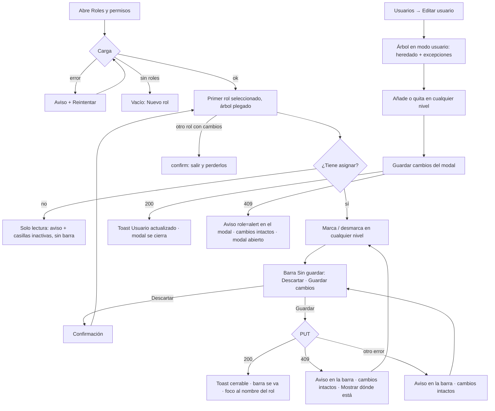

# UX — Permisos: panel de roles y de excepciones en tres niveles (HU #13430) + delta slim del menú (HU #13431)

Feature #13416 · Épica #13411 · Modo **full** (#13430) con **delta slim** (#13431).
Público: administrador de FLITO (operador interno). Tono: **tú** (calca `RolesPermisos.tsx` y el
editor de usuarios, que ya tutean).
Sustituye para el cuadro las secciones §6, §9, §13 y §14 de `docs/ux/roles-y-permisos-panel.md`;
lo demás de esa ficha (lista de roles, modales de crear/editar/borrar, salida con cambios, sin
identificadores en la URL) sigue vigente. El enlace del rol (#12876, `docs/ux/hu-12876-panel-roles-enlace.md`)
**no cambia**: sigue en el formulario del rol.

---

## Contexto y roles

**Qué vino a hacer quien abre esto.**
- En **Roles y permisos**: decidir qué elementos del menú, qué ítems y qué acciones tiene un rol, y
  guardarlo sin dejar a FLITO sin administrador.
- En **Editar usuario**: ver qué trae este usuario de su rol y cambiar **solo para él** lo que haga
  falta (añadir o quitar), en cualquier nivel.

**Qué no es esta pantalla.** No es un buscador de quién tiene qué (eso es Historial de permisos), no
es el sitio del enlace del rol (formulario del rol) ni un editor del menú.

**El árbol** (contexto cerrado por el PO):

| Nivel | Qué es | Ejemplo |
|---|---|---|
| 1 · Elemento del menú | Lo que se ve en la barra | General, Gestión, Tránsito, Flota, Mantenimiento, PESV, RNDC, LAFT, Finanzas, Administración, Ayuda, Perfil |
| 2 · Ítem | Una entrada del menú | Gestión → SOAT, Comparendos, Bitácora… |
| 3 · Acción | Algo que se hace dentro del ítem | SOAT → Ver la cola, Exportar… |
| 4 · (visual) | Una sola acción hija de otra | Exportar → «Exportar con datos de pago y trazabilidad» |

El nivel 3 existe solo en los 24 ítems FLITO; los módulos antiguos llegan al nivel 2.

**Permisos (AC6, AC7).** Slug de página: `roles_permisos` (existente, sin página nueva ni siembra).
Las acciones se nombran por su **nombre del catálogo**; el mapeo a código lo cierra la HU de backend
del Feature (ver «Datos»):

| Acción del catálogo | Qué habilita en la pantalla |
|---|---|
| Roles y permisos: **ver** | Entrar, ver la lista de roles y el árbol de cualquier rol, en solo lectura |
| Roles y permisos: **asignar** | Casillas activas, «Marcar todo / Desmarcar todo», barra «Sin guardar» |
| Roles y permisos: **editar** | Botón «Editar rol» (nombre, descripción, enlace) |
| Roles y permisos: **crear** | Botón «Nuevo rol» (cabecera y vacío) |
| Roles y permisos: **eliminar** | Botón «Borrar rol» |

Sin la acción, **el botón no se pinta** (no `disabled`): un botón que nunca se podrá pulsar es ruido.
Excepción que se conserva: «Borrar rol» con permiso pero rol no borrable (`motivoNoBorrable`) sigue
`disabled` con su motivo, como hoy.

`admin` (AC7) se ve y se edita como cualquier rol: sin candado, sin chip especial, sin casillas
bloqueadas. Lo protege el seguro anti-bloqueo del servidor (ADR-0022), no la UI.

---

## Qué se ve / qué se calla

**Primero:** el nombre del rol y el árbol plegado en los 12 elementos del menú, cada uno con su
casilla y su cuenta «k de n». En una pantalla se lee qué elementos tiene el rol sin abrir nada.

**A un clic (desplegar):** los ítems de un elemento y, dentro, sus acciones.

**Se calla:**
- Las tres secciones por origen (FLITO / Ya existía y FLITO lo usa / Existe pero no se usa) **se
  retiran**. El árbol sigue el menú; el origen del módulo no responde a «qué puede hacer este rol».
- Códigos técnicos: solo en `data-codigo`, nunca a la vista.
- El aviso «acciones marcadas sin pantalla» de #12717 §14.3 desaparece: con la regla de
  conservación (ver abajo) tener hijos marcados bajo un padre desmarcado **es un estado normal**,
  no una carga inconsistente.

**Se conserva** de la pantalla actual: disposición A (lista de roles | cuadro), tarjeta del rol,
barra «Sin guardar» con Descartar y Guardar, «Marcar todo» global, confirmación al salir con cambios,
región viva que anuncia el rol, esqueleto de dos columnas.

### Dos disposiciones (se elige A)

| | **A — Lista de roles + árbol del rol** (recomendada) | **B — Matriz roles × nodos** |
|---|---|---|
| Forma | Columna de roles a la izquierda; a la derecha, el árbol de **un** rol | Filas = nodos del árbol; columnas = roles |
| Pro | Una pregunta por vista («qué tiene este rol»); cabe en móvil; reusa lo que ya existe | Compara roles de un vistazo |
| Contra | Comparar dos roles exige alternar | 100+ filas × 8+ columnas; scroll horizontal obligatorio en <lg (choca con AC8); tri-estado en cada celda; dos primarias implícitas (¿guardar qué rol?) |

Se elige **A**: responde al trabajo de la visita, mantiene una primaria y no rompe AC8. Comparar
roles no está en los AC.

**Excepciones por usuario:** se quedan **en el modal de Editar usuario** (y Nuevo usuario), con el
**mismo componente de árbol** en modo «usuario». Llevarlas a una página propia es otra HU.

---

## Flujo de usuario



---

## Pantalla 1 — Roles y permisos (árbol del rol)

### Wireframe — escritorio (≥ lg)

```
┌ PageHeaderCard ───────────────────────────────────────────────────────────────────────────┐
│ Roles y permisos                                                 [Volver] [Nuevo rol]*    │
│ Qué puede hacer cada rol dentro de FLITO                                                  │
└───────────────────────────────────────────────────────────────────────────────────────────┘
┌ ListaRoles (280px) ─┐  ┌ FlitCard · rol ──────────────────────────────────────────────────┐
│ Administrador  142  │  │ Gestor de trámites                                                │
│▌Gestor de trám. 38  │  │ Enlace: Ninguno · 4 usuarios                                      │
│ Financiera      51  │  │ Gestiona SOAT e impuestos de los clientes.                        │
│ Cliente          9  │  │ [Editar rol]* [Borrar rol]*                                        │
│ …                   │  └───────────────────────────────────────────────────────────────────┘
│ (sin cambios)       │  ┌ Barra «Sin guardar» (sticky; SOLO con cambios) ───────────────────┐
└─────────────────────┘  │ Sin guardar: 3 marcadas, 1 desmarcada   [Descartar] [Guardar cambios]│
                         │ (aquí, si aplica, el aviso 409 / error — ver Estados)              │
                         └───────────────────────────────────────────────────────────────────┘
                         ┌ FlitCard · árbol ─────────────────────────────────────────────────┐
                         │ Permisos del rol                    [Marcar todo]* [Desmarcar todo]*│
                         │ ───────────────────────────────────────────────────────────────── │
                         │ ▸ [✓] General                                          1 de 1     │
                         │ ───────────────────────────────────────────────────────────────── │
                         │ ▾ [▬] Gestión                     9 de 14  [Marcar todo] [Desmarcar todo]│
                         │   │ ▾ [▬] SOAT                                         4 de 6     │
                         │   │   │ [✓] Ver la cola                                           │
                         │   │   │     Consulta las solicitudes en curso.                    │
                         │   │   │ [✓] Radicar solicitud                                     │
                         │   │   │ ▾ [✓] Exportar                                 1 de 2     │
                         │   │   │   │ [ ] Exportar con datos de pago y trazabilidad         │
                         │   │ ▸ [✓] Comparendos                                  3 de 3     │
                         │   │   [✓] Bitácora                                                │
                         │   │       Este ítem no se divide en acciones: marcarlo da acceso  │
                         │   │       al ítem completo.                                       │
                         │ ───────────────────────────────────────────────────────────────── │
                         │ ▾ [ ] Tránsito                     Inactivo · conserva 2 de 3     │
                         │   │ Tránsito está desmarcado: lo de adentro no aplica, pero sus   │
                         │   │ marcas se conservan para cuando lo vuelvas a marcar.          │
                         │   │ ▸ [✓] Bandeja de trámites      (inactivo, texto secundario)  │
                         │   │ ▸ [ ] Organismos STT           (inactivo)                     │
                         │ ───────────────────────────────────────────────────────────────── │
                         │ ▾ [✓] PESV                                            20 de 20    │
                         │   │ Los ítems de PESV no se dividen en acciones: marcar un ítem   │
                         │   │ da acceso al ítem completo.                                   │
                         │   │ [✓] Tablero PESV                                              │
                         │   │ [✓] Conductores    …                                          │
                         │ … Flota, Mantenimiento, RNDC, LAFT, Finanzas, Administración,     │
                         │   Ayuda, Perfil                                                   │
                         └───────────────────────────────────────────────────────────────────┘
* solo con su acción del catálogo (tabla de permisos).  ▸/▾ = botón de desplegar (no es la casilla).
```

Notas del wireframe:
- **Una sola tarjeta** para el árbol, con los 12 elementos separados por `border-t`
  (`--flit-border-soft`). Hoy son ~30 acordeones-tarjeta apilados; con 12 filas en una tarjeta se
  lee el rol de un vistazo.
- Sangría por nivel con una línea guía vertical fina (`border-l`, `--flit-border-soft`) — la misma
  línea fina que ya separa pantalla y acciones (#12717), no un adorno nuevo.
- Fila de nivel 1: nombre en `text-sm font-bold` `--flit-blue-text` (como el título del acordeón de
  hoy); niveles 2–4: `text-sm font-medium` `--flit-text-primary`. Descripción de la función debajo,
  en `--flit-text-secondary`, como hoy.
- Cuenta «k de n» a la derecha, `tabular-nums`, `--flit-text-muted` → **`--flit-text-secondary`**
  (muted no garantiza 4.5:1 en texto de dato).
- «Marcar todo / Desmarcar todo» por elemento: solo con el elemento **desplegado** (igual que hoy:
  plegado, cada elemento son dos paradas de tabulador, no cuatro). Sin botones masivos en niveles 2–4.
- Un nodo sin hijos no lleva botón de desplegar; se reserva el hueco del chevron para que las
  casillas queden alineadas.
- Al montar: todo plegado (como hoy). El padre remonta el árbol con `key={rol.codigo}`.

### Wireframe — móvil (< lg, 360–390 px)

```
┌ Roles y permisos ────────────────┐
│ Qué puede hacer cada rol…        │
│ [Volver] [Nuevo rol]             │  ← acciones bajo el título, envuelven
└──────────────────────────────────┘
┌ ListaRoles (ancho completo) ─────┐
│ Administrador              142   │
│▌Gestor de trámites          38   │
└──────────────────────────────────┘
┌ Gestor de trámites ──────────────┐
│ Enlace: Ninguno · 4 usuarios     │
│ [Editar rol] [Borrar rol]        │
└──────────────────────────────────┘
┌ Permisos del rol ────────────────┐
│ [Marcar todo] [Desmarcar todo]   │  ← envuelve bajo el rótulo
│ ▸ [✓] General                    │
│       1 de 1                     │  ← la cuenta cae bajo el nombre
│ ▾ [▬] Gestión                    │
│       9 de 14                    │
│       [Marcar todo] [Desmarcar…] │
│   ▾ [▬] SOAT                     │
│         4 de 6                   │
│     [✓] Ver la cola              │
│     ▾ [✓] Exportar               │
│       [ ] Exportar con datos de  │
│           pago y trazabilidad    │  ← el nombre envuelve, nunca trunca
└──────────────────────────────────┘
┌ (sticky abajo) ──────────────────┐
│ Sin guardar: 3 marcadas          │
│ [Descartar] [Guardar cambios]    │
└──────────────────────────────────┘
```

### Casillas tri-estado (regla única, todos los niveles)

Cada nodo con hijos es a la vez **una función propia** y **una puerta** para lo que tiene dentro.

| Estado visible | Cuándo | `aria-checked` / DOM |
|---|---|---|
| **Marcada** `[✓]` | El nodo está marcado **y** todo lo de adentro también | `checked` |
| **Parcial** `[▬]` | El nodo está marcado y **parte** de lo de adentro no (incluye «nada de adentro») | `checked=false`, `indeterminate=true`, `aria-checked="mixed"` |
| **Desmarcada** `[ ]` | El nodo no está marcado (sus hijos pueden conservar marcas) | `checked=false`, sin `aria-checked` |
| Hoja | Marcada / desmarcada | nativo |

**Qué hace un clic** (AC1, AC2):

| Desde | Clic → | Qué pasa con lo de adentro |
|---|---|---|
| Marcada | Desmarcada | **Nada se borra.** Los hijos quedan visibles, **deshabilitados y con sus marcas** |
| Parcial | Desmarcada | Igual: se conservan |
| Desmarcada | Marcada o Parcial | Los hijos **reaparecen activos** con las marcas que tenían; el estado resultante lo dicen ellos |

- Marcar un padre **no** marca a sus hijos y desmarcarlo **no** los desmarca. Para llenar o vaciar
  un elemento entero están «Marcar todo / Desmarcar todo» (del elemento o global), que sí tocan a
  todos los descendientes **y** al propio nodo.
- La regla es la misma en los cuatro niveles: un ítem desmarcado conserva sus acciones; «Exportar»
  desmarcado conserva «Exportar con datos de pago y trazabilidad». **Cambia la regla 4 de #12717**
  (desmarcar la última pantalla desmarcaba sus acciones): una sola regla en todo el árbol es más
  fácil de predecir que dos. Si el PO quiere mantener el borrado en el nivel ítem, se dice antes de
  implementar.
- **Desmarcado en cascada visual:** un nodo cuyo **ancestro** está desmarcado se pinta inactivo
  aunque él esté marcado (la puerta de arriba manda). Su casilla va `disabled` nativa, conserva el
  `checked`, el nombre pasa a `--flit-text-secondary` (decisión 30 de #12717: nunca `opacity` ni
  `muted`). La cuenta del padre desmarcado dice **«Inactivo · conserva k de n»**.
- **Explicación** (una por padre desmarcado, solo con él desplegado), primera línea de su panel, en
  `--flit-text-secondary`, enlazada por `aria-describedby` desde cada casilla inactiva:
  > «{Nombre} está desmarcado: lo de adentro no aplica, pero sus marcas se conservan para cuando lo vuelvas a marcar.»

### Ítem sin acciones (AC3)

Un ítem sin hijos **no tiene botón de desplegar** (no se abre una lista vacía). El aviso va en su
lugar, bajo el nombre, en `--flit-text-secondary`, enlazado por `aria-describedby` a la casilla:

- Ítem FLITO sin acciones (caso individual):
  > «Este ítem no se divide en acciones: marcarlo da acceso al ítem completo.»
- Elemento cuyos ítems **no tienen ninguno** acciones (módulos antiguos: PESV, RNDC, LAFT…): el aviso
  va **una vez**, como primera línea del panel del elemento, y no se repite en cada ítem:
  > «Los ítems de {Elemento} no se dividen en acciones: marcar un ítem da acceso al ítem completo.»

Repetir la frase en los 20 ítems de PESV sería ruido; una por elemento dice lo mismo.

### Estados (4)

| Estado | Qué se ve | Copy |
|---|---|---|
| **Cargando** | Esqueleto de dos columnas (existente) con la columna derecha ajustada: tarjeta del rol + **una** tarjeta con 8 barras de fila (h-6) separadas por `border-t`. Se retiran los tres rótulos de sección | `aria-label="Cargando roles y permisos"` (sin cambio) |
| **Error de carga** | `FlitCard` centrada, `role="alert"` + **Reintentar** | «No se pudo cargar el catálogo de roles y permisos. Revisa tu conexión y vuelve a intentarlo.» — **sin** `errorMessage(e)` a la vista (hoy se concatena; se quita) |
| **Vacío — catálogo** | `FlitEmpty` + Reintentar (sin cambio) | Copy actual (`COPY_VACIO_FUNCIONES`) |
| **Vacío — sin roles** | `FlitEmpty` + **Nuevo rol** como `GradientButton` (única primaria de ese estado). Sin la acción «crear»: sin botón y el copy cambia | Con crear: «Todavía no hay roles. Crea el primero para poder repartir permisos.» · Sin crear: «Todavía no hay roles. Pide a quien administre FLITO que cree el primero.» |
| **Vacío — rol sin nada marcado** | Línea sobre el árbol, `--flit-text-secondary` | «Este rol no tiene nada marcado: quien lo tenga no verá ningún elemento del menú al entrar. Marca los elementos y lo que deba usar dentro de cada uno, o usa «Marcar todo».» (en solo lectura: «Este rol no tiene nada marcado: quien lo tenga no verá ningún elemento del menú al entrar.») |
| **Lleno** | Árbol plegado, cuentas por elemento | — |

**Solo lectura (AC6)** — con «ver» y sin «asignar»:
- Aviso en página (`role="status"`, primera línea de la tarjeta del árbol, `--flit-text-secondary`):
  > «Solo lectura: puedes consultar los permisos de cada rol, pero no cambiarlos. Para cambiarlos hace falta la acción «Roles y permisos: asignar».»
  (el nombre entre comillas es el del catálogo; si el backend lo llama distinto, se usa ese).
- Casillas `disabled` nativas con su estado (marcada / parcial / desmarcada) **pero el nombre en
  `--flit-text-primary`**: en solo lectura nada está «inactivo», solo no es editable. El gris queda
  reservado para «inactivo porque el padre está desmarcado», que sigue viéndose igual.
- Sin «Marcar todo / Desmarcar todo», sin barra «Sin guardar». Desplegar/plegar **sí** funciona.
- «Editar rol», «Borrar rol», «Nuevo rol» según su propia acción (tabla de permisos).

### Acciones y validaciones

**Primaria única:** «Guardar cambios» (`GradientButton`) en la barra «Sin guardar», **solo** cuando
hay cambios. En reposo no hay primaria (decisión 3/4 de la ficha original, se conserva). «Nuevo rol»
es secundaria en la cabecera y primaria **solo** en el vacío sin roles.

| Acción | Peso | Resultado | Notificación |
|---|---|---|---|
| Marcar / desmarcar casilla | — | Cambia el borrador; aparece la barra | Barra «Sin guardar» (estado persistente → aviso, no toast) |
| Marcar todo / Desmarcar todo (global o por elemento) | Secundaria (`flitBtnSecondary` / `…Sm`) | Toca nodo + descendientes | Barra |
| Descartar | Secundaria | `window.confirm` (copy actual) → vuelve a la base | — |
| **Guardar cambios** | **Primaria** | `PUT` conjunto completo; la nueva base es la respuesta (AC7 de #12085) | Toast éxito / aviso en la barra si falla |
| Mostrar dónde está (tras 409) | Secundaria `Sm`, dentro del aviso | Despliega los ancestros de la función del 409 y le pone el foco | — |
| Editar rol / Borrar rol / Nuevo rol | Secundarias | Modales existentes | Sin cambio |

**Copy de notificaciones (exacto):**

- **Guardado OK** — toast de éxito, **cerrable** (✕), ~4 s, una frase:
  > «Permisos de {rol} guardados: cada usuario los verá en su siguiente acción.»
  Tras guardar la barra desaparece y el foco va al `h2` del rol (`tabIndex=-1`), para no dejarlo
  en un botón que ya no existe. El aviso de «cambió tu propio conjunto» (`COPY_PROPIO_CAMBIO`) se
  mantiene como aviso en página, sin cambio.
- **409 anti-bloqueo (AC5)** — **aviso en la barra «Sin guardar»** (`role="alert"`, `--flit-danger-ink`),
  **nunca** toast y **nunca** el texto del API. El borrador no se toca: la barra sigue con su
  resumen, Descartar y Guardar. `{funcion}` = `nombreNegocio` de la función que trae el cuerpo del
  409 (`{ error, funcion }`, ADR-0022), resuelto contra el catálogo ya cargado:
  > «No se guardó: con este cambio FLITO se quedaría sin ningún usuario activo que pueda administrar Usuarios y Roles y permisos. Deja marcada «{funcion}» en este rol o dásela antes a otro rol con usuarios activos. Tus cambios siguen aquí, sin guardar.»  [Mostrar dónde está]

  Si `funcion` no está en el catálogo o no llega: misma frase sin la parte de «{funcion}» y sin el
  botón: «…Usuarios y Roles y permisos. Revisa esas funciones en este rol o dáselas antes a otro rol
  con usuarios activos. Tus cambios siguen aquí, sin guardar.»
- **Otro error al guardar** — mismo sitio, `role="alert"`, sin `errorMessage(e)`:
  > «No se pudieron guardar los permisos. Tus cambios siguen aquí; vuelve a intentarlo con «Guardar cambios».»
- El aviso se limpia al volver a guardar, al descartar o al cambiar de rol.

### Permiso y comportamiento por rol

Ver la tabla de «Contexto y roles». El comportamiento lo decide **la acción del catálogo**, nunca el
nombre del rol (Épica #13411). `admin` sin trato especial (AC7).

### Datos (endpoints / requerimientos)

Existentes y suficientes: `GET /permisos/roles`, `GET|PUT /permisos/roles/:codigo/funciones`,
`GET /permisos/mios`, `PATCH /users/:id`, cuerpo 409 `{ error, funcion }`.

**Requerimientos para architecture/backend** (la web hoy recibe `GrupoDeFunciones[]` plano por
módulo, sin padre ni nivel; con eso no se puede pintar el árbol):

1. **R1 — Catálogo en árbol.** `GET /permisos/funciones` (o su sucesor) devuelve cada nodo con
   `codigo`, `nombreNegocio`, `descripcion`, `nivel` (1–4 o `tipo` equivalente), `padre`
   (`codigo | null`) y `orden`. Los nombres de nivel 1 y 2 son **los del menú** (fuente única que
   también lee el shell, ver #13431). El orden de nivel 1 es el del contexto: General, Gestión,
   Tránsito, Flota, Mantenimiento, PESV, RNDC, LAFT, Finanzas, Administración, Ayuda, Perfil.
2. **R2 — Los elementos de nivel 1 son funciones con código propio**, que se guardan en el `PUT`
   como cualquier otra (sin eso «desmarcar un elemento» no tiene qué persistir).
3. **R3 — Conservación persistida.** El `PUT` acepta y guarda hijos marcados bajo un padre
   desmarcado; el resolutor exige la cadena entera (padre **y** hijo) para dar acceso. Así lo que el
   administrador ve conservado tras guardar y recargar es lo que hay en la base. Si backend decide
   lo contrario (conservar solo en el borrador), la explicación de la UI miente tras guardar: hay que
   decidirlo antes de implementar.
4. **R4 — Sin huérfanos.** Toda función cuelga de un elemento del menú. Defensa en la web: un nodo
   sin padre conocido se pinta al final bajo «Sin elemento del menú» (nunca se oculta: un permiso
   invisible no se puede quitar). Es un fallo del catálogo, no un estado de diseño.
5. **R5 — Códigos de las acciones de AC6** (ver / asignar / editar / crear / eliminar de Roles y
   permisos). Hoy existen `permisos.cuadro.ver|guardar`, `permisos.rol.crear|editar|borrar`; la HU de
   backend confirma si se renombran o se reutilizan.

---

## Pantalla 2 — Excepciones por usuario (modal Editar / Nuevo usuario)

Mismo componente de árbol en **modo usuario** (AC4). Sustituye a `PermissionsPicker`. El rótulo del
bloque pasa de «Permisos individuales» a **«Permisos de este usuario»**.

### Wireframe — dentro de `FlitModal` (escritorio y móvil igual; el modal ocupa el ancho en móvil)

```
┌ Editar jperez ─────────────────────────────────────────────────── ✕ ┐
│ Nombre completo [__________]  Email [__________]                    │
│ Rol base [Gestor de trámites ▾]                                     │
│ (ámbito según el enlace)                                            │
│                                                                     │
│ Permisos de este usuario                                            │
│ Lo que trae del rol Gestor de trámites, con 2 excepciones:          │
│ 1 añadida y 1 quitada.                    [Quitar las excepciones]  │
│ ─────────────────────────────────────────────────────────────────── │
│ ▸ [✓] General                                         Del rol       │
│ ▾ [▬] Gestión                              Del rol · 2 excepciones  │
│   │ ▾ [▬] SOAT                             Del rol · 2 excepciones  │
│   │   │ [✓] Ver la cola                               Del rol       │
│   │   │ [ ] Radicar solicitud                         Quitado       │ ← excepción
│   │   │ ▸ [✓] Exportar                                Añadido       │ ← excepción
│   │ ▸ [✓] Comparendos                                 Del rol       │
│ ▸ [ ] Tránsito                                        No lo trae    │
│ …                                                                   │
│ ─────────────────────────────────────────────────────────────────── │
│ (aviso 409 aquí, role="alert", si aplica)                           │
│                                         [Cancelar] [Guardar cambios]│
└─────────────────────────────────────────────────────────────────────┘
```

### Heredado vs concedido vs revocado

La casilla muestra **lo que el usuario tendrá** (efectivo). La etiqueta de la derecha dice **de
dónde sale**. El color nunca va solo: el texto lleva el significado.

| Origen | Casilla | Etiqueta | Tinta |
|---|---|---|---|
| Lo trae el rol, sin excepción | ✓ | «Del rol» | `--flit-text-secondary`, normal |
| El rol no lo trae, sin excepción | ☐ | «No lo trae» — solo en nivel 1; en niveles 2–4 sin etiqueta (menos ruido) | `--flit-text-secondary` |
| **Excepción: añadido** | ✓ | «Añadido» | `--flit-blue-text`, `font-semibold` |
| **Excepción: quitado** | ☐ | «Quitado» | `--flit-blue-text`, `font-semibold` |
| Añadido que el rol ya trae | ✓ | «Añadido · ya lo trae el rol» | `--flit-text-secondary` |

- Lo **quieto** (heredado) habla bajo; lo que **es de este usuario** (excepciones) resalta. Es lo que
  se vino a revisar.
- Padres plegados resumen: «Del rol · n excepciones» (o «… · 1 excepción»), para encontrarlas sin
  desplegar. **Al abrir el modal se despliegan los ancestros de cada excepción**; el resto, plegado.
- Tri-estado y conservación: **la misma regla** que en el rol, aplicada al estado efectivo. Quitar
  «Gestión» a este usuario (excepción en nivel 1) deja sus hijos visibles, inactivos y con sus
  marcas, con la explicación: «Gestión no aplica a este usuario: lo de adentro se conserva, pero no
  tendrá acceso mientras Gestión esté quitado.»
- Clic sobre una casilla: si el resultado coincide con el rol, **se borra la excepción** (vuelve a
  «Del rol»); si no, se crea la excepción (conceder/revocar). Igual que hoy, en cualquier nivel.
- «Quitar las excepciones» (secundaria pequeña, solo si hay alguna) devuelve todo a lo del rol.
  Sustituye a «Quitar adicionales», que solo quitaba las añadidas y dejaba las quitadas: con dos
  direcciones visibles, el botón tiene que deshacer las dos. Sin `confirm`: el modal aún no ha
  guardado nada.
- El cambio de rol con excepciones (`CambioRolExcepciones`) **no cambia**.

### Estados (4) del bloque en el modal

| Estado | Qué se ve | Copy |
|---|---|---|
| Cargando | 6 barras de fila (h-6) con `border-t`, `role="status"` | `aria-label="Cargando los permisos del rol"` |
| Error | `role="alert"` + **Reintentar**; el resto del formulario sigue usable (comportamiento actual: se guarda sin tocar permisos) | «No se pudieron cargar los permisos del rol. Puedes guardar los demás datos del usuario; sus permisos quedarán como estaban. Reintentar.» — sin el texto técnico (hoy se pinta en `text-[10px]`; se quita) |
| Vacío (rol sin nada y sin excepciones) | Línea `--flit-text-secondary` sobre el árbol | «El rol {rol} no trae nada marcado. Marca aquí lo que este usuario deba tener, o asígnale otro rol.» |
| Lleno | Árbol con resumen de excepciones | — |

### Notificaciones del modal

- **Guardado OK:** toast actual «Usuario actualizado» (cerrable, ~4 s) y el modal se cierra; los
  toasts de «vuelve a entrar» existentes no cambian.
- **409 anti-bloqueo (AC5):** **no toast** (hoy va por `toast.error(formatErrors(err))`): aviso
  `role="alert"` en el modal, encima del pie, `--flit-danger-ink`. El modal **sigue abierto** con
  todo lo editado. Foco al aviso (`tabIndex=-1`).
  > «No se guardó: con este cambio FLITO se quedaría sin ningún usuario activo que pueda administrar Usuarios y Roles y permisos. Deja «{funcion}» a este usuario o dásela antes a otro usuario activo. Tus cambios siguen aquí, sin guardar.»  [Mostrar dónde está]
- **Otro error:** se deja como está hoy (fuera del alcance de esta HU), salvo que traiga el texto
  crudo del API: entonces «No se pudo guardar el usuario. Tus cambios siguen aquí; vuelve a intentarlo.»

### Permiso

El bloque se edita con quien hoy edita el usuario (sin cambio). Si el catálogo trae una acción
específica para «asignar excepciones», el árbol pasa a solo lectura sin ella (mismo aviso con el
nombre de esa acción). No se inventa la acción aquí.

---

## Responsive (< lg)

- **Roles y permisos:** la lista de roles cae encima del cuadro (como hoy); el árbol ocupa el ancho;
  la sangría baja de 24 px (`pl-6`) a 16 px (`pl-4`) por nivel bajo `sm`, para que el nivel 4 quede
  a ~64 px y no a ~96 px; la cuenta «k de n» y las etiquetas caen **bajo** el nombre (`flex-wrap`);
  los nombres envuelven, nunca truncan; «Marcar todo / Desmarcar todo» envuelven bajo el rótulo.
  **Sin scroll horizontal del layout** (AC8): ningún `min-w`, ninguna columna fija.
- **Barra «Sin guardar»:** en ≥ lg sigue sticky arriba (como hoy); en < lg pasa a **sticky abajo**
  (`bottom-0`) y el contenido deja su alto de margen inferior. Hoy en móvil no es sticky y en un
  árbol largo la primaria queda kilómetros arriba.
- **Modal de usuario:** el árbol **no** lleva scroll propio (se quita `max-h-72 overflow-y-auto`):
  scroll dentro de scroll en un modal atrapa el dedo y el foco. Scrollea el cuerpo del modal. Mismas
  reglas de sangría y envoltura.
- **Cabecera:** acciones bajo el título cuando no caben (comportamiento del `PageHeaderCard`).

---

## Interacción y notificaciones (feedback)

| Control | Hover (sutil) | Foco |
|---|---|---|
| Botón de desplegar (chevron) | velo `--flit-bg-hover`, `transition-colors` (como el disparador de `FlitAcordeon`) | `flit-focus` |
| Fila de casilla (el `<label>`) | velo `--flit-bg-hover` en toda la fila (como `PermissionsPicker` hoy), `rounded-lg` | `flit-focus` en el `input` |
| Casilla `disabled` | sin hover, `cursor-not-allowed` | no enfocable (nativo) |
| Marcar todo / Desmarcar todo / Mostrar dónde está / Quitar las excepciones | los de `flitBtnSecondary(Sm)` | kit |
| Guardar cambios | `GradientButton` | kit |

El chevron rota con la regla de `FlitAcordeon` (`motion-reduce:transition-none`). Nada más se anima.

Notificaciones (resumen): guardado OK → **toast cerrable**; 409 y error de guardado → **aviso**
(en la barra o en el modal; el estado «no guardado» sigue siendo cierto); solo lectura, nodo
inactivo, ítem sin acciones, rol vacío → **aviso en página**. Nunca el texto del API.

---

## Accesibilidad

**Patrón elegido: listas anidadas de `fieldset` con casillas nativas y botones de desplegar
(disclosure)** — no `role="tree"`.

Por qué no `tree`/`treeitem`:
- `treeitem` no puede contener controles interactivos; aquí cada nodo tiene **dos** (desplegar y
  marcar) y algunos un tercero (Marcar todo, Mostrar dónde está). Meterlos en un `tree` obliga a
  inventar atajos para cada uno y los lectores de pantalla salen del modo formulario.
- `tree` exige `tabindex` itinerante, flechas, Inicio/Fin y escritura anticipada hechos a mano: es
  justo el `keydown` a mano que la ficha original prohíbe (§9) y el más propenso a romperse.
- Las casillas nativas dan `<label>` asociado, Espacio, `disabled` y nombre accesible gratis (AC8).
- «Árbol navegable por teclado» (AC8) se cumple con Tab / Mayús+Tab en orden de lectura, Espacio en
  la casilla, Enter/Espacio en el botón de desplegar, y todo plegado al montar (12 elementos × 2
  paradas). Es el patrón que ya usa la pantalla.

**Marcado:**
- Cada nodo: `<li>` dentro de `<ul role="list">`. Nodo con hijos: el panel desplegado es
  `<fieldset>` con `<legend class="sr-only">Contenido de {nombre} · rol {rol}</legend>` (en modo
  usuario: «· usuario {username}»).
- Casilla: `<label>` envolvente con el nombre visible + `sr-only` «· rol {rol}» (patrón actual).
  Código técnico solo en `data-codigo`.
- **Parcial:** `input.indeterminate = true` por `ref` **y** `aria-checked="mixed"` (AC8); en los otros
  dos estados, sin `aria-checked` (manda el `checked` nativo). QA lo pasa por axe; si axe marcara el
  atributo sobre `input`, el plan B es el patrón APG de casilla mixta (`role="checkbox"` +
  `aria-checked` en un `button`) **solo** para los nodos con hijos — decidir en el gate, no antes.
- `aria-describedby` de la casilla, en este orden: descripción de la función → cuenta «k de n» (si
  tiene hijos) → explicación de inactivo / aviso de ítem sin acciones → etiqueta de origen (modo
  usuario).
- Botón de desplegar: `aria-expanded`, `aria-controls` al panel, `aria-label="Contenido de {nombre}"`
  (para no anunciar dos veces «Gestión» seguido, casilla y botón). El panel plegado se **desmonta**
  (como `FlitAcordeon`): nada oculto en el orden de tabulación.
- Región viva: la existente (`role="status"`, sr-only) anuncia el rol al cambiarlo; no se añaden
  otras. El aviso 409 es `role="alert"`; al aparecer recibe el foco.
- «Mostrar dónde está»: despliega los ancestros y mueve el foco a la casilla; si esa casilla está
  inactiva (ancestro desmarcado), el foco va al **ancestro desmarcado más alto**, que es el que hay
  que tocar.
- Contraste ≥ 4.5:1 en claro y oscuro: nombres `--flit-text-primary`/`--flit-blue-text`, secundarios
  `--flit-text-secondary` (no `muted`), errores `--flit-danger-ink`. Borde de casilla y foco ≥ 3:1.
  Ningún color nuevo: no hace falta par oscuro nuevo.

---

## Delta slim — HU #13431 (shell)

**Superficie tocada:** `navItems.ts` / `useNavSections` / `FlitNavBar` / `FlitSidebar` /
`CommandPalette` / menú de usuario de `FlitTopbar`. Sin página nueva.

**Delta de claridad:**
- **Nombres del catálogo:** el rótulo de cada sección y de cada ítem del menú sale del mismo
  catálogo que pinta el árbol (R1). Lo que el administrador marca es literalmente lo que el usuario
  ve. Se retira la doble verdad de `SECTION_LABEL`.
  - **Pregunta al PO (bloquea el copy, no el diseño):** hoy la sección se llama **«Cumplimiento»** y
    el contexto cerrado dice **«LAFT»**. Con «nombres del catálogo» el menú dirá lo que diga el
    catálogo. Hay que elegir uno; mientras no se diga, el catálogo manda (LAFT).
  - **General** queda con un solo ítem (Tablero) → el navbar lo pinta como enlace directo «Tablero»
    (regla existente de sección con un ítem).
- **«Ayuda»:** deja de ser un ítem de General y pasa a ser **su propio elemento del menú**, el
  **último** de la barra, después de Administración. Con un solo ítem se pinta como enlace directo
  (mismo comportamiento que General), con el nombre del ítem del catálogo e icono de ayuda del set ya
  usado (lucide, sin icono nuevo dibujado). En el drawer móvil, misma posición: última sección. En
  ⌘K, agrupado bajo «Ayuda».
  - Visibilidad: **por permiso** (elemento Ayuda + su ítem), no por `puedeVerAyudaFlito`. Los
    capítulos de dentro siguen filtrándose como hoy.
- **«Perfil»:** **no** entra en la barra lateral ni en el navbar. Sigue en el **menú de usuario**
  (avatar, arriba a la derecha), encima de «Cerrar sesión», como hoy. Se ve si el usuario tiene el
  elemento Perfil **y** su ítem (cadena completa, misma regla del árbol). Sin él, el menú muestra
  solo «Cerrar sesión». En ⌘K, «Mi perfil» bajo «Perfil» con la misma condición.
- Densidad: sin cambio (se mueve un ítem y se renombra lo que ya estaba).

**Estados:** el menú no tiene estados de datos propios; sin funciones aún (`null`) → fail-closed
como hoy (no se pinta el ítem).

**Responsive + feedback:** el drawer < lg hereda el orden y los nombres; hover y foco son los del
navbar/menú existentes (velo `--flit-bg-hover` + `flit-focus`), sin cambio. Sin notificaciones.

**Permiso/slug:** `flito_ayuda` y `perfil` existentes; su visibilidad pasa a la cadena del catálogo
(elemento → ítem).

**QA (≤ 10):** Ayuda es la última entrada de la barra y del drawer · sin el elemento Ayuda no aparece
en barra ni en ⌘K · Perfil nunca aparece en la barra lateral · Perfil en el menú de usuario solo con
elemento + ítem · desmarcar el elemento Gestión de un rol oculta la sección entera aunque sus ítems
sigan marcados (R3) · el rótulo de cada sección coincide con el nivel 1 del panel · General con solo
Tablero se pinta como enlace directo · nombres idénticos en navbar, drawer y ⌘K.

---

## Notas para QA

1. **AC1:** el árbol muestra los 12 elementos en el orden del contexto con los nombres del menú;
   cada nodo con hijos se pliega/despliega; un nodo marcado con hijos mezclados tiene
   `indeterminate` y `aria-checked="mixed"`; marcado con todo dentro, sin `aria-checked`.
2. **AC2 (E2E):** desmarcar «Gestión» → sus ítems siguen visibles, `disabled`, con el mismo
   `checked`; la explicación aparece; volver a marcarlo → activos con las mismas marcas. Guardar y
   recargar: las marcas conservadas siguen ahí (depende de R3).
3. Cuarto nivel: desmarcar «Exportar» inactiva «Exportar con datos de pago y trazabilidad» sin
   desmarcarla.
4. **AC3 (E2E):** un ítem FLITO sin acciones no tiene botón de desplegar y muestra el aviso exacto;
   PESV muestra el aviso una sola vez en su panel.
5. **AC4:** en Editar usuario, heredado «Del rol», «Añadido», «Quitado» con texto (no solo color);
   crear excepción en nivel 1, 2 y 3; volver a lo del rol borra la excepción; al abrir, los
   ancestros de las excepciones vienen desplegados.
6. **AC5 (E2E):** forzar 409 (quitar «Roles y permisos» al único rol administrador con usuarios
   activos) → aviso en la barra con el copy exacto, sin texto del API, sin toast; el borrador sigue;
   «Mostrar dónde está» despliega y enfoca. Guardado OK → toast con ✕, foco al nombre del rol. En el
   modal de usuario: aviso `role="alert"`, modal abierto.
7. **AC6:** con solo «ver»: aviso de solo lectura, casillas `disabled`, sin barra ni Marcar todo,
   sin Nuevo/Editar/Borrar; cada uno aparece solo con su acción.
8. **AC7:** el rol `admin` se edita como cualquier otro (sin candados ni chips).
9. **AC8:** Tab recorre chevron → casilla en orden; foco visible en ambos; axe sin violaciones
   (incluido `aria-checked` sobre `input`; ver plan B); 360 px sin scroll horizontal en claro y
   oscuro; barra sticky abajo en móvil.
10. Mutante sugerido: invertir la regla de conservación (desmarcar padre borra hijos) — debe caer
    el E2E de AC2.

---

## Decisiones y descartes

| # | Decisión | Por qué |
|---|---|---|
| 1 | Disposición A, no matriz | Una pregunta por vista, una primaria, sin scroll horizontal (AC8) |
| 2 | Se retiran las tres secciones por origen | El árbol sigue el menú; el origen no responde a esta visita y duplicaría la agrupación |
| 3 | Una tarjeta para el árbol en vez de un `FlitAcordeon` por módulo | `FlitAcordeon` no admite una casilla antes del título sin meter un control dentro de su botón; 12 filas en una tarjeta se leen de un vistazo. Es composición local (`pages/roles-permisos/`), no kit nuevo; reusa tokens, `flit-focus` y el chevron del acordeón |
| 4 | Padre = puerta; marcarlo/desmarcarlo no toca a los hijos | Lo exige AC2; la conservación solo es honesta si clic nunca borra. Los masivos son explícitos («Marcar todo») |
| 5 | Una regla en los 4 niveles (cambia #12717 regla 4) | Dos reglas en el mismo árbol no se predicen. Si el PO la quiere distinta en nivel ítem, se dice antes |
| 6 | Retirar el aviso «acciones sin pantalla» | Con conservación ya no es un estado inconsistente |
| 7 | Ítem sin acciones: sin chevron + aviso en línea; una vez por elemento antiguo | Una lista vacía desplegable es un callejón; 20 avisos iguales son ruido |
| 8 | Solo lectura con casillas `disabled` y texto en color primario | Se lee el estado sin confundirlo con «inactivo por el padre» (que sí va en gris) |
| 9 | Botones sin acción → no se pintan | Un botón que nunca funcionará no orienta; excepción: Borrar rol con motivo |
| 10 | Excepciones siguen en el modal, mismo componente | AC4 pide el mismo árbol, no otra página; mover el editor es otra HU |
| 11 | «Quitar las excepciones» sustituye a «Quitar adicionales» | Con dos direcciones visibles, deshacer solo una confunde |
| 12 | Barra sticky abajo en móvil | La primaria tiene que estar a la mano en un árbol largo |
| 13 | Disclosure + fieldsets, no `role="tree"` | Ver Accesibilidad |
| — | **Descartado:** buscador/filtro en el árbol, «Desplegar todo», comparar roles, chips de origen FLITO/legacy, iconos por elemento en el árbol | No están en los AC (P9); añaden densidad. Si el PO echa en falta el buscador tras usarlo, es otra HU |
| — | **Descartado:** animaciones de despliegue, sombras por nivel, colores por elemento | Adorno; la jerarquía la dan sangría, peso y la línea guía |

**Ficha de ayuda:** cambia lo que se ve en Roles y permisos y en Editar usuario → delta de
`flit-ayuda-flito` en el PR de #13430 (secciones por origen retiradas, regla de conservación,
solo lectura).
