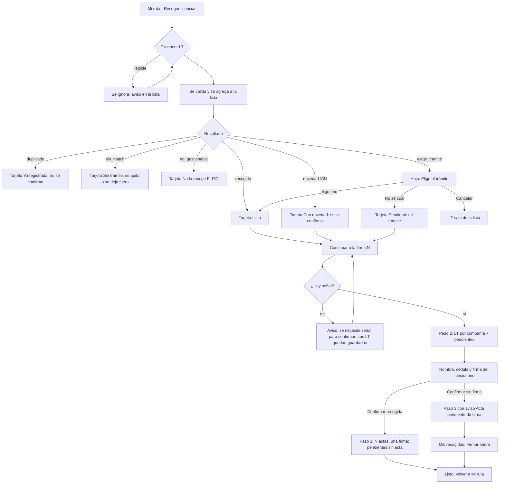

# UX — Logística · Confirmar recogida con firma del funcionario (HU #14111, C1.4, Feature C1 #14091, Épica 13758)

Modo: full. Público: mensajero (operador de campo) en celular. Tono: **tuteo**, calcando `FlitoRuta.tsx` hoy ("Escanea las LT…"). Contrato: ADR-0030 §17.1–17.4 y 17.7.
Mockup: pendiente (el hilo publica el Artifact `design` y espera el "ok" humano antes de `frontend-agent`).

## Contexto y roles

- **Qué vino a hacer quien abre esto:** está parado en el organismo de tránsito con varias licencias (LT) en la mano. Las escanea, y al final el funcionario del organismo firma que se las entregó. Debe salir de ahí con la recogida confirmada, o con la firma pendiente declarada, en menos de un minuto y con una mano.
- **Público:** mensajero (`logistica.documento.escanear` + `logistica.recogida.confirmar`). Pantalla móvil primero (360–390 px); en escritorio solo se ve centrada (`max-w-md`), como hoy.
- **Qué no es:** no es la bandeja de Operaciones para resolver trámites pendientes (C1.8). No lista trámites al mensajero salvo cuando debe elegir uno. No muestra tarifas, cobros ni compañías de otros viajes. No es el PDF del acta (C1.5).

## Qué se ve / qué se calla

1. **Primero se ve:** el botón de escanear (lista vacía) o la lista de LT escaneadas con su estado. Es lo que el mensajero hace con las manos.
2. **Una primaria por pantalla:**
   - Lista vacía: **Escanear LT**.
   - Con LT en la lista: **Continuar a la firma (N)** (fija abajo). "Escanear otra LT" baja a secundaria.
   - Paso de firma: **Confirmar recogida**.
   - Confirmación: **Listo** (volver a Mi ruta).
3. **Se calla (a un toque):** VIN, licencia, combustible y propietario de cada LT pasan a una línea secundaria colapsada (hoy se ven todos; en una lista de 10 LT saturan). Visible siempre en la tarjeta: **placa, N.º de LT, estado**. El resto, al tocar la tarjeta.
4. **No está:** ANS, tarifas, nombre del proveedor, cédula completa (el mensajero solo ve `••••1234` en "Mis recogidas"), geolocalización (se captura sin mostrarla, RN-07).

### Dos disposiciones del paso de firma (se elige una)

| | A. Pasos en la misma página (lista → firma → listo reemplazan el contenido del panel, con "Atrás") | B. Hoja inferior (bottom sheet) sobre la lista |
|---|---|---|
| Pro | El lienzo de firma ocupa toda la pantalla; sin scroll dentro de scroll; el teclado de nombre/cédula no tapa el lienzo. | Se conserva la lista a la vista. |
| Contra | Pierde de vista la lista (se resume arriba: "10 LT · 2 compañías"). | Hoja + teclado móvil + lienzo = área de firma pequeña y scroll anidado. |

**Recomendación: A.** Principio "una idea dominante por superficie": firmar es la idea de ese momento. El lienzo necesita ancho y alto. La hoja inferior se reserva solo para **elegir trámite** (decisión corta de un toque).

## Flujo de usuario



Un solo flujo (mensajero). Operaciones/proveedor no participan en esta HU.

## Pantalla 1 — Recoger licencias (extiende `PanelRecogida` de `FlitoRuta.tsx`)

### Wireframe, lleno

```
┌──────────────────────────────┐
│ Mi ruta            Mis recogidas›│
│ Escanea las LT en el organismo…  │
├──────────────────────────────┤
│ RECOGER LICENCIAS   4 escaneadas │
│ [ 📷 Escanear otra LT ] (secund.)│
│  o pega el contenido del código ▸│
│                                  │
│ ┌ QOX858        ✓ Lista      ✕ ┐ │
│ │ N.º de LT [ 10038156339 ]    │ │
│ │ Ver datos ▾                  │ │
│ └──────────────────────────────┘ │
│ ┌ ABC123   Pendiente de trámite ✕┐│
│ │ N.º de LT [ 10041002233 ]    │ │
│ │ Operaciones elegirá el       │ │
│ │ trámite. Igual queda firmada.│ │
│ └──────────────────────────────┘ │
│ ┌ XYZ987   Ya registrada        ✕┐│
│ │ Esta LT ya fue recogida; no   │ │
│ │ se incluye.                   │ │
│ └──────────────────────────────┘ │
├──────────────────────────────┤ (sticky)
│ [ Continuar a la firma (3) ]     │
└──────────────────────────────┘
```

"Mis recogidas" es un enlace de texto en la cabecera (secundario, foco y hover). El contador (3) cuenta solo LT que se confirmarán (listas + novedad + pendientes), no las duplicadas ni sin match.

### Hoja "Elige el trámite" (resultado `elegir_tramite`)

```
┌──────────────────────────────┐
│ ABC123 tiene varios trámites     │
│ ¿A cuál corresponde esta LT?     │
│ ┌──────────────────────────┐ │
│ │ FLIT-004512 · Transportes│ │
│ │ del Norte · Org. 11001   │ │ (botón de fila, 56 px alto)
│ └──────────────────────────┘ │
│ ┌──────────────────────────┐ │
│ │ FLIT-004530 · Rápido S.A.│ │
│ │ Org. 11001               │ │
│ └──────────────────────────┘ │
│ ┌──────────────────────────┐ │
│ │ FLIT-004541 · Autogestión│ │ (gestionable=false: deshabilitada,
│ │ No la recoge FLITO       │ │  texto explicado, no seleccionable)
│ └──────────────────────────┘ │
│ [ No sé cuál: dejar pendiente ]  │ (secundaria)
│ Cancelar (quitar esta LT)        │ (texto)
└──────────────────────────────┘
```

Una sola decisión en la hoja; **no hay primaria** dentro (cada fila es la acción). Orden de candidatos: el que viene del backend. Texto de apoyo bajo el título: "Si no sabes cuál es, deja la LT pendiente: Operaciones la asigna después y la firma ya queda tomada."

### Estados (4) de la pantalla de lista

| Estado | Qué se ve | Siguiente paso |
|---|---|---|
| Cargando | Al abrir: esqueleto de cabecera + botón de escanear (`PageContentSkeleton`-equivalente móvil). Por tarjeta: chip "Validando…" y número de LT editable. Al pulsar Continuar: chip "Registrando…" y botón deshabilitado. | — |
| Error | Por tarjeta, línea de motivo pulida + **Reintentar** en la tarjeta. Error global (sin señal, falla de red): aviso en página `role="alert"` "No pudimos registrar las LT. Revisa la señal e inténtalo de nuevo" + **Reintentar**. | Reintentar o quitar la LT |
| Vacío | "Aún no has escaneado licencias. Pulsa Escanear LT y apunta al código de barras del reverso." Botón **Escanear LT** (primaria). Si no hay cámara: el campo "Pega el contenido del código" queda abierto. | Escanear |
| Lleno | Lista como arriba. | Continuar a la firma |

### Resultados de escaneo → tarjeta y copy

| Resultado | Chip | Texto (usted no; tuteo) | ¿Entra a la recogida? |
|---|---|---|---|
| recogido | Lista | — | Sí |
| novedad | Con novedad | "El VIN no coincide con el del vehículo. Se registra igual y Operaciones la revisa." | Sí |
| duplicado | Ya registrada | "Esta LT ya fue recogida. No se incluye de nuevo." | No (✕ la quita) |
| sin_match, no encontrado | Sin trámite | "No encontramos este vehículo en FLITO. Revisa la placa o avisa a Operaciones." | No |
| sin_match, sin trámite pendiente de LT | Sin trámite | "El vehículo no tiene un trámite aprobado pendiente de LT." | No |
| no_gestionable | No la recoge FLITO | "Este trámite lo gestiona el cliente. No se recoge." | No |
| elegir_tramite | Elige trámite → Lista o Pendiente de trámite | Hoja de arriba | Sí tras elegir |
| pendiente | Pendiente de trámite | "Operaciones elegirá el trámite. La LT queda firmada igualmente." | Sí (sin acta) |
| ilegible (el parser la descarta hoy) | — | Toast "No pudimos leer ese código. Acércate y escanea de nuevo." | No |

El chip usa `StatusChip` del kit y tokens (`--flit-success`, `--flit-warning`, `--flit-danger`, `--flit-blue-text`); nada de `bg-white` ni RGBA sueltos nuevos (hoy `FlitoRuta` los usa: deuda, no replicar en lo nuevo; pendiente verificar par oscuro).

## Pantalla 2 — Revisar y firmar (paso 2)

Se entra con **Continuar a la firma**. Antes se registran las LT (escaneo persistente) en secuencia; las que devuelvan `elegir_tramite` abren la hoja de elección una por una.

### Wireframe

```
┌──────────────────────────────┐
│ ‹ Atrás        Confirmar recogida │
│ 5 LT · 2 compañías · 1 pendiente │
├──────────────────────────────┤
│ Transportes del Norte  · 3 LT  → acta 1
│   QOX858 · 10038156339          │
│   ABC124 · 10038156340          │
│   ...                           │
│ Rápido S.A.            · 1 LT  → acta 2
│   XYZ987 · …                    │
│ Pendientes de trámite  · 1 LT  (sin acta)
│   ABC123 · …                    │
│ ─────────────────────────────  │
│ Una firma sirve para las 2 actas.│
│ FUNCIONARIO DEL ORGANISMO        │
│ Nombre  [____________________]   │
│ Cédula  [____________________]   │
│ Firma   ┌──────────────────┐     │
│         │  (lienzo)         │     │
│         └──────────────────┘     │
│         Borrar                    │
├──────────────────────────────┤ (sticky)
│ [ Confirmar recogida ]           │
│ Confirmar sin firma (texto)      │
└──────────────────────────────┘
```

- Grupos por compañía: nombre de compañía + conteo + placa y N.º de LT. Los grupos se pueden plegar si son más de 5 LT (acordeón del kit).
- El grupo "Pendientes de trámite" va **último** y lleva la nota "Quedan con la firma, sin acta, hasta que Operaciones elija el trámite."
- Encabezado resumen: "N LT · M compañías · K pendientes"; copy: "Se generará 1 acta por compañía con una sola firma."
- Los datos del funcionario usan `FlitField`/`flitInp` con `<label>` visible. `FirmaCanvas` se reutiliza tal cual (`onChange(dataURL | null)`).

### Estados (4)

| Estado | Qué se ve |
|---|---|
| Cargando | Esqueleto del resumen + grupos mientras se registran las LT ("Registrando LT 3 de 5…"). Al confirmar: botón "Confirmando…" deshabilitado; el lienzo y campos quedan bloqueados. |
| Error | Aviso `role="alert"` sobre el botón, copy de la tabla de errores abajo; datos del funcionario y firma se conservan; botón **Reintentar** (el mismo `Idempotency-Key` evita duplicar). |
| Vacío | Si por filtros ninguna LT es confirmable (todas duplicadas o rechazadas): "Ninguna de las LT escaneadas se puede recoger. Vuelve atrás y escanea otras." Botón **Atrás**. El paso no se muestra. |
| Lleno | Wireframe de arriba. |

### Acciones y validaciones

- **Confirmar recogida (primaria):** habilitada con nombre (≥ 3 caracteres, sin números), cédula (solo dígitos, 5–12), firma dibujada. Errores en línea bajo cada campo: "Escribe el nombre completo del funcionario", "La cédula debe tener solo números (5 a 12 dígitos)", "Falta la firma del funcionario". Firma como PNG/JPEG dataURL ≤ 1 MB: el cliente la exporta comprimida; si aun así supera, error "La firma es muy pesada. Bórrala y vuelve a firmar con trazos más cortos."
- **Confirmar sin firma:** enlace de texto (secundaria baja) que abre un diálogo de confirmación: "Si no hay firma, la recogida queda con el acta pendiente de firma. Podrás firmarla después desde Mis recogidas." Botones: **Confirmar sin firma** / Volver. No pide nombre ni cédula (ver pregunta 1).
- **Atrás:** vuelve a la lista sin perder nada (estado local; las LT ya registradas quedan marcadas).
- **PII:** nombre y cédula nunca en URL, query, `console.*`, ni `localStorage` salvo cola offline cifrada si existe (ver pregunta 4). El input de cédula lleva `autocomplete="off"` y `inputMode="numeric"`.
- Geolocalización: `obtenerUbicacion()` al confirmar, silenciosa.

## Pantalla 3 — Confirmación

```
┌──────────────────────────────┐
│ ✓ Recogida confirmada            │
│ 2 actas generadas con una firma  │
│ Transportes del Norte · 3 LT     │
│ Rápido S.A.           · 1 LT     │
│ 1 LT pendiente de trámite:       │
│ quedó firmada, sin acta.         │
│ Operaciones elegirá el trámite.  │
│ [ Listo ]  Ver en Mis recogidas ›│
└──────────────────────────────┘
```

Variante sin firma: título "Recogida confirmada, acta pendiente de firma", aviso persistente (tarjeta `role="status"`, no toast) y el secundario **Firmar ahora** (lleva al detalle en "Mis recogidas"). Sin pendientes: omitir el bloque de pendientes. Una compañía: "1 acta generada".

Notificación: la pantalla 3 ya es el aviso persistente; **no** se lanza además un toast de éxito (una notificación por acción).

## Pantalla 4 — Mis recogidas (vista aparte)

Ruta propuesta: sub-vista de Mi ruta (`/flito/ruta/recogidas`), mismo `PageSlug` de Mi ruta (ver pregunta 3). Endpoints: `GET /recogidas/mias` (lista) y `GET /recogidas/:firmanteId` (detalle). Las actas de organismo **no** aparecen en "Entregas" de Mi ruta (§17.1).

```
LISTA                              DETALLE
┌─────────────────────────┐   ┌─────────────────────────┐
│ ‹ Mis recogidas          │   │ ‹ Recogida del 28 oct    │
│ Hoy, 10:42 · Org. 11001  │   │ Funcionario: María P.    │
│  5 LT · 2 actas          │   │ Cédula ••••1234          │
│  [Firmada]               │   │ [Firmada] / [Falta firma]│
│ Hoy, 08:15 · Org. 11001  │   │ Acta 1 · Transp. del Norte│
│  3 LT · 1 acta           │   │   3 LT (placas…)         │
│  [Falta firma]  Firmar › │   │ Acta 2 · Rápido S.A.     │
└─────────────────────────┘   │ Pendientes de trámite: 1 │
                                │ [ Firmar ahora ] (si falta)│
                                └─────────────────────────┘
```

- Lista: fecha-hora, organismo, "N LT · M actas", chip (`Firmada` / `Falta firma`). Fila clicable con hover (`--flit-bg-hover`) y foco. Orden: más recientes; las de "Falta firma" arriba.
- Detalle: nombre del funcionario, cédula `••••1234` (el backend ya la enmascara; el mensajero **no** tiene reveal), actas por compañía con sus placas, pendientes de trámite con su etiqueta. **Firmar ahora** (única primaria, solo si falta firma): abre el paso de nombre/cédula/firma de la pantalla 2.
- Estados: **Cargando** esqueleto de 3 filas; **Error** "No pudimos cargar tus recogidas." + Reintentar; **Vacío** "Todavía no has confirmado recogidas. Cuando escanees LT y las confirmes, las verás aquí." + botón **Ir a escanear**; **Lleno** la lista.
- Móvil: ya es de una columna; en escritorio `max-w-md` centrado igual que Mi ruta.

## Permiso y comportamiento por rol

- Página: se reutiliza el `PageSlug` de Mi ruta (pregunta 3). Función API `logistica.recogida.confirmar` (propia, §17.4) para confirmar/firmar; `logistica.documento.escanear` para escanear.
- **Sin `logistica.recogida.confirmar`:** puede escanear, pero el paso 2 no aparece: en su lugar el botón primario dice "Guardar LT escaneadas" y un aviso: "Tu usuario no puede confirmar recogidas. Pide a Operaciones que lo haga." (pregunta 5). 403 en confirmar, mismo mensaje.
- El rol `operaciones` no existe; no se diseña para él.

## Datos

Endpoints existentes (ADR §17): `POST /flito/logistica/escanear` (con `tramiteId`, `dejarPendiente`, `organismoCodigo`), `POST /recogidas/confirmar`, `GET /recogidas/mias`, `GET /recogidas/:firmanteId`.
**Requerimientos nuevos para architecture/backend (no están en 17.1–17.4):**
1. Confirmar **sin firma** y **firmar después**: el modelo exige `firma_storage_key NOT NULL` en `recogida_firmantes`; no hay endpoint documentado para "firmar luego". Sin esto, el AC no se cumple.
2. Si `/validar-lt` también devuelve `elegir_tramite` (para elegir al escanear, no al registrar).
3. Respuesta de `escanear` debe traer el `documentoId` (la confirmación necesita ids de LT).

## Responsive (<lg)

El diseño **es** móvil: columna única `max-w-md`. Botones ≥ 44 px de alto; el primario es sticky al fondo con `safe-area`. La hoja de trámite ocupa ancho completo, tope 85 % del alto con scroll. El lienzo de firma ocupa todo el ancho útil y ≥ 180 px de alto; con el teclado abierto se hace scroll al campo activo. En escritorio se centra igual; sin rejillas multicolumna.

## Interacción y notificaciones

Feedback de controles (hoy `FlitoRuta` usa solo `active:opacity`, sin foco ni hover: se corrige en lo nuevo):
- Botones: `flitBtnPrimary` / `flitBtnSecondary` del kit (hover con velo y `flit-focus`), con la variante a ancho completo y alto 48 px móvil (`w-full` sobre la clase del kit).
- Filas clicables (candidatos, mis recogidas): `hover:bg-[var(--flit-bg-hover)]`, `transition-colors`, `flit-focus`.
- ✕ de quitar LT: `flitBtnIconoSm` ampliado a 40 px de área táctil (`aria-label="Quitar LT QOX858"`).
- "Borrar" firma, enlaces de texto: subrayado al hover y `flit-focus`.

| Acción | Resultado | Patrón y copy |
|---|---|---|
| Escaneo ilegible | Código no válido | Toast error cerrable: "No pudimos leer ese código. Acércate y escanea de nuevo." |
| Escaneo con resultado (duplicado, sin match, etc.) | Estado de la fila | Estado en la tarjeta (persistente), sin toast |
| Quitar LT | Sale de la lista | Sin notificación |
| Confirmar con éxito | Recogida lista | Pantalla 3 (aviso persistente), sin toast |
| Confirmar sin firma | Recogida con acta pendiente | Pantalla 3 con tarjeta de estado |
| Firmar después, con éxito | Firma guardada | Toast ok (~4 s): "Firma guardada. Las actas quedaron completas." |
| Falla de red / servidor | No se confirmó | Aviso `role="alert"` en el paso + Reintentar |
| Guardado sin conexión | Cola | Aviso de página existente (barra offline de Mi ruta) |

### Códigos de error y copy (nunca el mensaje crudo)

| Código / caso | Dónde | Copy |
|---|---|---|
| 409 `LT_ESTADO_NO_CONFIRMABLE` | Aviso en paso 2; marca la(s) LT afectadas | "Algunas LT no se pueden confirmar porque ya tienen otro estado. Quítalas de la lista y vuelve a intentar." |
| 409 `LT_YA_EN_ACTA_ORGANISMO` | Aviso en paso 2 | "Una de estas LT ya está en un acta de recogida. Quítala y confirma las demás." |
| 403 | Aviso | "Tu usuario no puede confirmar recogidas. Pide a Operaciones que lo haga." |
| 400/422 firma pesada o inválida | En línea bajo el lienzo | "La firma no se pudo guardar. Bórrala y firma de nuevo." |
| 400/422 nombre o cédula | En línea | Textos de validación de arriba |
| 409 por reenvío con misma `Idempotency-Key` | Transparente | Se trata como éxito |
| 429 | Aviso | "Demasiados intentos seguidos. Espera un momento y reintenta." |
| 5xx / timeout / red | Aviso + Reintentar | "No pudimos confirmar la recogida. Revisa la señal e inténtalo de nuevo. Lo que escribiste se conserva." |
| Desconocido | Aviso | Igual que 5xx |

Todos los mensajes salen de un mapa en el front por código; `errorMessage(e)` crudo no se renderiza en lo nuevo.

## Accesibilidad

- Cada campo con `<label>` asociado (Nombre del funcionario, Cédula del funcionario, N.º de LT por tarjeta). El placeholder no sustituye el label.
- Foco visible (`flit-focus`) en todo; contraste ≥ 4.5:1 texto y ≥ 3:1 foco, en claro y oscuro (tokens con par oscuro; no `text-red-600` ni `bg-white`).
- La hoja de trámite es `role="dialog"` `aria-modal`, foco inicial en el título, `Esc` y "Cancelar" cierran, el foco vuelve al botón de escanear; filas con `<button>` y `aria-disabled` + texto en las no gestionables (no solo color).
- Lienzo de firma: `role="img"` con `aria-label` que cambia ("Firma del funcionario, vacía" / "…capturada"); no hay alternativa de teclado para firmar (limitación inherente); por eso "Confirmar sin firma" existe y es alcanzable.
- Chips con texto, nunca solo color. Los cambios de estado de tarjeta se anuncian con `aria-live="polite"`; errores con `role="alert"`.
- Objetivos táctiles ≥ 44 px. Orden de tabulación = orden visual.

## Notas para QA

1. 10 LT, 5 de A y 5 de B, una firma → 2 actas, una firma; cédula nunca en URL/red de la navegación/consola.
2. 3 LT de A + 2 pendientes → 1 acta; las pendientes quedan con la firma y sin acta; pantalla 3 las cuenta.
3. `elegir_tramite`: elegir uno; "No sé cuál" crea LT con etiqueta "Pendiente de trámite"; candidato no gestionable no se puede elegir; Cancelar quita la LT.
4. Resultados: recogido, novedad, duplicado, sin_match (ambos textos), no_gestionable — cada uno con su copy.
5. Confirmar sin firma → aviso "acta pendiente", luego "Firmar ahora" desde Mis recogidas y desaparece el aviso.
6. Cada error de la tabla se prueba y nunca muestra el mensaje crudo; sin permiso `logistica.recogida.confirmar` (403) no se ve el paso 2.
7. Doble toque o reenvío no duplica actas (misma Idempotency-Key).
8. Sin señal: aviso claro, LT conservadas, no se pierde nombre/cédula.
9. 360 px: sin scroll horizontal; primario siempre alcanzable con teclado abierto; ambos temas.
10. Firma > 1 MB y nombre/cédula inválidos: validación en línea.

## Decisiones y descartes

- **Una primaria por pantalla** (hoy hay dos con peso: Escanear y Confirmar): Escanear baja a secundaria cuando ya hay lista.
- **Paso de firma por pasos (A) y no hoja inferior**: ver tabla. Hoja solo para elegir trámite.
- **Datos de la LT colapsados:** el vecino (`TarjetaLt`) muestra VIN, licencia y combustible siempre; no se copia esa densidad.
- **Sin ilustraciones, confeti ni animación** en la confirmación; solo texto, check y estado.
- **Descartado:** mostrar la lista de trámites al mensajero siempre (solo cuando el backend lo pide); pedir nombre/cédula para "sin firma"; un toast además de la pantalla de confirmación; reveal de cédula para el mensajero.
- **Deuda declarada en `FlitoRuta`:** colores RGBA y `bg-white` sueltos; en lo nuevo, tokens; el resto del archivo no se rediseña en esta HU.
- **Tamaño de archivo:** `FlitoRuta.tsx` ya es grande (~350 líneas); el flujo nuevo va en componentes propios (`RecogidaPasos`, `HojaElegirTramite`, `MisRecogidas`) bajo `components/flito/`, no en el mismo archivo.

## Preguntas abiertas para David

1. **Confirmar sin firma:** el modelo tiene `firma_storage_key NOT NULL` y no hay endpoint para "firmar luego". ¿Backend lo agrega (recogida sin firma + `firmar` posterior)? ¿Sin firma se pide al menos nombre y cédula, o nada? Asumí nada.
2. **¿Dónde sale `elegir_tramite`?** ¿Solo en `escanear` (al registrar) o también en `validar-lt` (al escanear)? Asumí que la hoja puede aparecer en ambos momentos; si solo en `escanear`, el mensajero decide al pulsar Continuar, no al escanear.
3. **Ubicación de "Mis recogidas":** ¿sub-vista del mismo `PageSlug` de Mi ruta o slug propio? ¿Qué permiso exige `GET /recogidas/mias`?
4. **Offline:** confirmar requiere ids de las LT y firma pesada; asumí que **confirmar exige señal** y las LT escaneadas sí se guardan. ¿Se acepta, o se encola también la confirmación (implica cifrar cédula en el celular)?
5. **Mensajero sin `logistica.recogida.confirmar`:** ¿puede escanear y guardar sin confirmar, o ve un bloqueo total? Asumí lo primero.

## Brief de mockup

- **Pantallas:** (1) lista vacía, con 1 error y llena (incluye una Pendiente y una Ya registrada); (2) hoja "Elige el trámite" con 3 candidatos, uno no gestionable; (3) paso de firma con 2 compañías y 1 pendiente; (4) confirmación normal y variante sin firma; (5) Mis recogidas, lista y detalle con "Falta firma". Cada una en móvil 390 px, claro y oscuro, con los 4 estados navegables.
- **Kit:** `flitBtnPrimary` / `flitBtnSecondary`, `StatusChip`, `FlitField`/`flitInp`, `FlitEmpty`, `ToastFlito` (`toastOk`/`toastError`), `FirmaCanvas`, tokens `--flit-*` (nunca HEX).
- **Datos ficticios:** placas inventadas (AAA111, BBB222…), compañías "Transportes del Norte S.A.S.", "Rápido del Valle S.A."; funcionario "Funcionario de Prueba", cédula ficticia `••••0000`; N.º de LT genéricos. Nada real.
- **Copy exacto:** el de las tablas arriba.
- **No mostrar:** VIN/licencia por defecto, tarifas, cédula completa, geolocalización.

HANDOFF
  Modo: full
  Resultado: OK (con 5 preguntas abiertas; la 1 y la 2 pueden pedir cambio de contrato)
  Entrega: /home/david/flit/flito/docs/ux/logistica-confirmar-recogida-14111-full.md
  Oficio: primaria única | jerarquía dicha | vacío con siguiente paso | responsive dicho | feedback dicho | notificación elegida | sin efectos
  Densidad: aliviada (datos de LT colapsados; una sola primaria)
  Pantallas: 5 (lista, hoja de trámite, firma, confirmación, Mis recogidas) | Requerimientos nuevos de datos: 3 (confirmar sin firma y firmar después; elegir_tramite en validar-lt; documentoId en la respuesta de escanear)
  Mockup: brief listo
  Reconocimiento: 7
  Siguiente: David responde las 5 preguntas (la 1 va a architecture-agent si hay endpoint nuevo) → hilo publica mockup (Artifact design) y espera el «ok» humano → frontend-agent
