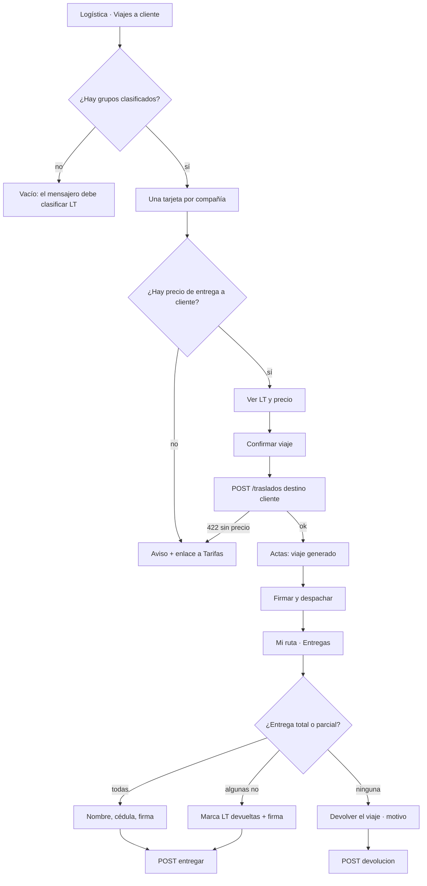

# UX — Logística · Viajes a cliente: registrar, despachar y entregar con firma (HU #14116)

Modo: full. Feature C2 #14092 · Épica 13758 · ADR-0030 (ciclo C2; destino FLIT queda fuera, 422).
Público: operador de la consola logística y mensajero en Mi ruta. Tono: **tutea**, calcando `FlitoLogistica.tsx` y `FlitoRuta.tsx` («Selecciona…», «Escanea las LT…»).
Mockup: pendiente (el hilo publica el Artifact `design` y espera el «ok» humano antes de `frontend-agent`).

UI dice **viaje**. Código y URLs dicen `traslado`. Nunca se pinta «traslado» en copy.

---

## Contexto y roles

- **Qué vino a hacer quien abre esto:**
  - En **Logística (consola):** las LT ya clasificadas de varias compañías están listas. Arma **un viaje por compañía**, ve el precio que se va a cobrar y lo registra. Luego, en Actas, despacha ese viaje a un mensajero.
  - En **Mi ruta:** llega a la empresa con las LT del viaje, captura nombre, cédula y firma del receptor, y si alguna no se entrega la marca como devuelta.
- **Público:** operador interno (`logistica.traslado.registrar`, `logistica.actas.despachar`) y mensajero de campo (`logistica.actas.entregar` / `devolver`). Escritorio para registrar/despachar; móvil primero para entregar.
- **Qué no es:** no es Finanzas ni Tarifas (allí se *fija* el precio; aquí se *ve* y se congela). No es «Viajes adicionales» del detalle del trámite ni la pestaña masiva (otro concepto: viajes extra cobrables). No es el viaje a FLIT (C3.4, 422). No es la recogida en el organismo (C1). No es el PDF del acta.

---

## Qué se ve / qué se calla

1. **Primero se ve (consola):** las compañías con LT clasificadas, cuántas LT lleva cada grupo y el precio de entrega a cliente (o el aviso de que falta). Eso decide «registro este viaje / no».
2. **Primero se ve (Mi ruta · Entregas):** la empresa, la dirección y las placas del viaje. Eso decide «entregué / no entregué esta LT».
3. **Una primaria por superficie:**
   - Lista de grupos: **Registrar viaje** en la tarjeta que tiene precio. Las que no tienen precio no tienen primaria.
   - Confirmación del grupo: **Confirmar viaje**.
   - Actas · despacho: **Firmar y despachar** (ya existe; se mantiene).
   - Mi ruta · lista: **Entregar**.
   - Paso de entrega: **Confirmar entrega**.
4. **Se calla (a un toque o fuera):**
   - VIN, combustible, propietario, NIT, proveedor, ANS, valor pagado, vigencia de tarifa, `trasladoId`, `actaId`.
   - Destino FLIT: no hay selector ni copy de ese camino.
   - Cédula del receptor: vive en el campo del paso de firma, viaja en el body y **desaparece** al confirmar. Nunca en URL, nunca en consola, nunca en el toast, nunca en la lista al volver.
5. **No está:** botón «Generar acta», llamada a `cerrar-lote`, KPI de adorno, tabla estilo reporte de costos.

### Dos disposiciones de la lista de grupos (se elige una)

| | A. Tarjetas por compañía (extiende «Generación de actas») | B. Tabla densa (compañía · N LT · precio · acción) + panel lateral |
|---|---|---|
| Pro | Una idea por tarjeta; el precio y la primaria conviven con el grupo; cabe en móvil sin scroll de página; es la familia de la consola (Mi ruta, actas). | Escanea muchas compañías en un vistazo. |
| Contra | Con 15 compañías hay que bajar. | Densidad de Finanzas; el precio y las LT se esconden; en móvil la tabla pide scroll horizontal. |

**Recomendación: A.** Oficio: quien abre esto viene a registrar *este* grupo, no a auditar una matriz. B copia Finanzas, prohibido en el pedido.

### Dos disposiciones del paso de entrega (se elige una)

| | A. Sustituye el panel (lista → paso de entrega, con «Atrás»), como la recogida HU #14111 | B. Expande la tarjeta (patrón actual de `Entrega` en `FlitoRuta`) |
|---|---|---|
| Pro | Lienzo de firma + lista de LT con casillas + nombre/cédula caben sin scroll anidado; teclado no tapa la firma. | Conserva las otras entregas a la vista. |
| Contra | Pierde de vista las otras empresas (se resume: «Transportes Andes · 10 LT»). | Casillas + firma + teclado en una tarjeta = área de firma inusable en 360 px. |

**Recomendación: A.** La entrega con parcial ya no cabe en el expandido de hoy. La hoja inferior se descarta por la misma razón que en #14111.

---

## Flujo de usuario



Un flujo. Destino FLIT no aparece.

---

## Pantalla 1 — Viajes a cliente (consola · pestaña)

Sustituye la pestaña **«Generación de actas»**. Misma ruta `/flito/logistica`, mismo `PageSlug` `flito_logistica`. La pestaña **«Viajes adicionales»** no se toca (otro trabajo).

Cabecera de página: sin cambio de título («Logística»). Subtítulo se mantiene. El label de la pestaña pasa a **Viajes a cliente**; el badge sigue siendo el total de LT clasificadas.

### Wireframe, lleno (escritorio)

```
 Logística
 Trámites aprobados a la espera de su licencia de tránsito: de la recogida
 en el organismo a la entrega firmada.

 [ Trámites 48 ] [ Viajes a cliente 14 ] [ Actas 2 ] [ Viajes adicionales ]

 Viajes a cliente
 Cada compañía con LT clasificadas es un viaje. Revisa el precio y regístralo.

 ┌ Transportes Andes · 8 LT ──────────────────────────────────────┐
 │ Se cobrará $12.000 por LT · Total $96.000                      │
 │ QOX858 · LT 10038156339                                        │
 │ ABC123 · LT 10038156340                                        │
 │ + 6 más ▾                                                      │
 │                                         [ Registrar viaje ]    │  ← primaria
 └────────────────────────────────────────────────────────────────┘

 ┌ Rápido del Valle · 6 LT ───────────────────────────────────────┐
 │ La compañía Rápido del Valle no tiene precio de entrega        │
 │ a cliente.  [ Ir a Tarifas ]                                   │  ← no hay primaria
 │ Falta el precio; no puedes registrar este viaje todavía.       │
 └────────────────────────────────────────────────────────────────┘
```

Las LT de la tarjeta: placa + N.º LT. A partir de 4, las demás van bajo «+ N más» (acordeón). No se listan VIN ni propietario.

Sin precio: el copy es el de AC3, con el **nombre de la compañía**. El enlace «Ir a Tarifas» va a `/flito/tarifas/:companiaId` solo si `hasPage('flito_tarifas')`; si no, el mismo aviso y la frase «Pídele a Finanzas que fije el precio de Entrega a cliente.» — un enlace que 403 no es siguiente paso.

### Wireframe, confirmación (`FlitModal`, no `wide`)

```
 Registrar viaje a Transportes Andes                          [×]
 8 LT · destino Cliente
 Se cobrará $12.000 por cada LT. Total $96.000.

 Este precio queda congelado en el viaje. Si Finanzas lo cambia
 después, este viaje no se mueve.

 QOX858 · LT 10038156339
 ABC123 · LT 10038156340
 …lista completa, scroll del modal…

                              [Cancelar]  [ Confirmar viaje ]
```

«Confirmar viaje» es la única primaria del modal. Cancelar cierra. No hay selector de destino. No se pide mensajero aquí (se elige al despachar).

### Estados (4) — pestaña Viajes a cliente

| Estado | Qué se ve |
|---|---|
| Cargando | Esqueleto de 2 tarjetas (cabecera + 2 líneas + botón) con `role="status"` `aria-label="Cargando viajes a cliente…"`. `PageContentSkeleton` no: la estructura es de tarjetas, no de página vacía. |
| Error | `role="alert"`: «No se pudieron cargar las LT listas para viaje.» + **Reintentar**. Nunca `e.message`. 403: «No tienes permiso para registrar viajes.» sin Reintentar. |
| Vacío | `FlitEmpty`: «No hay LT clasificadas listas para un viaje. El mensajero tiene que recogerlas y clasificarlas en el organismo primero.» Sin primaria. |
| Lleno | Tarjetas. Cada una con precio o con el aviso AC3. |

Tras registrar: la tarjeta de esa compañía desaparece (esas LT ya no están clasificadas). Toast de éxito. Si era la última, la pestaña cae a vacío.

### Acciones y validaciones

- **Registrar viaje** (primaria de tarjeta): abre el modal. Deshabilitada no: si no hay precio, el botón **no existe**.
- **Confirmar viaje**: POST con las `documentoId` del grupo, `destino: 'cliente'`, `Idempotency-Key`. Busy: el modal no cierra, primaria «Registrando…» deshabilitada, `aria-busy`.
- Errores de escritura **en el modal** (`role="alert"`), no toast:
  - `PRECIO_TRASLADO_NO_CONFIGURADO` → copy AC3 + enlace a Tarifas; el modal puede cerrarse y la tarjeta ya muestra el aviso.
  - `PROVEEDOR_LOGISTICA_REQUERIDO` → «Esta compañía no tiene proveedor de logística. Asígnalo antes de registrar el viaje.»
  - `LOGISTICA_AUTOGESTIONADA` → «La logística de esta compañía la gestiona el cliente.»
  - `LT_YA_EN_TRASLADO` / `LT_ESTADO_NO_ADMISIBLE` → «Alguna LT de este grupo ya no está lista. Cierra y recarga la lista.»
  - `LT_AJENA` → «Solo puedes registrar el viaje de las LT que recogiste tú.»
  - `TRASLADO_COMPANIA_MIXTA` / `TRASLADO_ORIGEN_MIXTO` → no deberían ocurrir si el grupo viene del servidor; copy: «Este grupo no se puede registrar junto. Recarga la lista.»
  - 5xx/red → «No se pudo registrar el viaje. Las LT siguen aquí; vuelve a intentarlo.» (reusa la misma `Idempotency-Key`).
- Destino `flit` **no se envía nunca**. Si alguien lo fuerza, el 422 `DESTINO_FLIT_NO_DISPONIBLE` se traduce: «Aquí solo se registran viajes a cliente.»
- **Prohibido** `POST /flito/logistica/cerrar-lote` en cualquier pestaña (AC7). El gate de la pestaña deja de ser `logistica.lote.cerrar`.

### Permiso y comportamiento por rol

- Pestaña visible y operable con `hasFuncion('logistica.traslado.registrar')`. Sin ella, la pestaña no se pinta (como «Viajes adicionales» hoy).
- Slug de página: `flito_logistica`. Sin slug nuevo. Sin rol `operaciones`.
- «Ir a Tarifas»: `hasPage('flito_tarifas')`. Finanzas no opera esta pestaña.

### Datos

| Uso | Endpoint existente | Cuerpo / lectura |
|---|---|---|
| Grupos | `GET /flito/logistica/facetas` → `companiasCerrables` | Hoy: `{ companiaId, nombre, disponibles }`. **Requerimiento 1** (abajo). |
| Registrar | `POST /flito/logistica/traslados` | `{ companiaId, destino: 'cliente', lts: [{ documentoId }] }` + `Idempotency-Key`. Respuesta: `{ id, actaId, documentos, lts[].precio, … }`. |
| Prohibido | `POST /flito/logistica/cerrar-lote` | No se llama. |

**Requerimiento de datos 1 (architecture/backend, no inventar otro GET):** cada ítem de `companiasCerrables` debe traer `precioEntregaCliente: number \| null` y `lts: Array<{ documentoId, placa, numeroLt, idFlit }>`. Sin el precio no se cumple AC2 (verlo *antes* de confirmar; Tarifas es otro permiso). Sin las LT no se puede armar el body. Un `null` de precio pinta el aviso AC3, nunca `$0`. El GET de Tarifas **no** se usa aquí.

---

## Pantalla 2 — Actas · despachar (delta)

La pestaña **Actas** se queda. Tras un viaje registrado, el acta de cliente aparece aquí (el POST ya la crea).

Delta mínimo:

- Vacío: «Aún no hay actas. Ve a «Viajes a cliente» y registra el viaje de una compañía con LT clasificadas.»
- **Firmar y despachar** sigue siendo la primaria de una acta `generada`. Modal actual (`DespacharModal`): mensajero + nombre opcional + `FirmaCanvas`. POST ` /flito/logistica/actas/:id/despachar` — el adaptador de #14115 despacha el traslado. Firma de Operaciones opcional en API; **la UI la sigue pidiendo** (el PDF del acta la lleva; no es esta HU quien la quita).
- No se añade anular (fuera de AC). No se muestra precio en Actas (regla vigente de viajes adicionales: esta consola no enseña precios fuera de la superficie de registro).

4 estados de Actas: no cambian, salvo el copy del vacío.

---

## Pantalla 3 — Mi ruta · Entregas (paso de entrega)

Ruta `/flito/ruta`, slug `flito_logistica_ruta`. Recogida no se toca.

Lista de entregas: se mantiene la tarjeta por empresa (nombre, dirección, placas). Primaria **Entregar**; secundaria **Devolver el viaje** (antes `prompt`; ahora `FlitModal` de motivo — el `prompt` nativo no es kit ni a11y).

Al pulsar **Entregar**, el panel de esa entrega **se sustituye** (disposición A): resumen arriba, LT con casillas, luego nombre / cédula / firma / foto opcional.

### Wireframe, paso de entrega (móvil 390 px)

```
┌──────────────────────────────┐
│ ‹ Entregas                   │
│ Transportes Andes            │
│ Cra 15 # 88-64, Bogotá       │
│ 10 LT · destino Cliente      │
├──────────────────────────────┤
│ LT de este viaje             │
│ Marca las que NO entregas.   │
│ Las demás quedan entregadas. │
│                              │
│ [ ] QOX858 · LT 10038156…    │
│ [ ] ABC123 · LT 10038156…    │
│ [x] DEF456 · LT 10038156…    │  ← devuelta
│ …                            │
│ Se entregarán 9 de 10.       │
│ 1 se marca como devuelta.    │
├──────────────────────────────┤
│ Nombre de quien recibe *     │
│ [                            ]│
│ Cédula de quien recibe *     │
│ [                            ]│
│ Firma de quien recibe *      │
│ ┌──────────────────────────┐ │
│ │     (FirmaCanvas)        │ │
│ └──────────────────────────┘ │
│ Adjuntar foto (opcional)     │
│                              │
│ [Cancelar] [Confirmar entrega]│  ← primaria
└──────────────────────────────┘
```

Casilla **sin marcar** = se entrega. Marcada = va en `ltsDevueltas`. Copy de la casilla (sr-only + visible): «No se entregó QOX858».

Si marca **todas**: la primaria se deshabilita y aparece `role="status"`: «Para devolver las 10 LT usa Devolver el viaje, no esta entrega.» Eso evita el 422 `ENTREGA_SIN_ENTREGADAS`.

### Wireframe, devolución total (`FlitModal`)

```
 Devolver el viaje · Transportes Andes                     [×]
 Motivo (obligatorio)
 [ Receptor ausente / rechazó / …                         ]
                         [Cancelar]  [ Devolver el viaje ]
```

### Estados (4) — bloque Entregas

| Estado | Qué se ve |
|---|---|
| Cargando | Esqueleto de 1 tarjeta (empresa + 2 líneas + 2 botones), `aria-label="Cargando entregas…"`. |
| Error | «No se pudieron cargar tus entregas.» + **Reintentar**. 403: «No tienes entregas asignadas.» sin Reintentar. |
| Vacío | Copy actual pulido: «No tienes viajes despachados para entregar. Cuando Operaciones despache un viaje, aparece aquí.» |
| Lleno | Tarjetas. El paso de entrega es el estado lleno de *esa* visita. |

### Acciones y validaciones

- Nombre: obligatorio, sin dígitos, ≥ 3 caracteres (mismo listón que recogida: `NOMBRE_OK`).
- Cédula: solo dígitos, 5 a 12 (`CEDULA_OK`). Label «Cédula de quien recibe». `autocomplete="off"` `inputMode="numeric"`. Valor **solo** en estado del componente; al confirmar se limpia. No va a `localStorage`, ni a query, ni a `console`, ni al toast, ni al `aria-live` de éxito.
- Firma: `FirmaCanvas` obligatorio. Mismo tope de peso que recogida (1 MB).
- Foto: opcional, `accept="image/*"` `capture="environment"`.
- Geo: `obtenerUbicacion()` solo al confirmar (RN-07). No se pinta.
- POST `/flito/logistica/actas/:id/entregar` (adaptador → traslado) con `{ receptorNombre, receptorDocumento, firma, ltsDevueltas?, foto?, lat, lng }` + `Idempotency-Key`. `actaId` en el path es UUID opaco, no PII.
- Devolución total: POST `/flito/logistica/actas/:id/devolucion` `{ motivo }`.
- Offline: se conserva la cola de campo de Mi ruta. Cédula viaja en el body encolado (ya ocurre en recogida); no se loguea al encolar.

Errores en el paso (`role="alert"`), no toast:

| codigo / caso | Copy |
|---|---|
| red / 5xx | «No se pudo registrar la entrega. Nombre, cédula y firma siguen aquí; vuelve a intentarlo.» |
| `TRASLADO_ESTADO_NO_ADMISIBLE` | «Este viaje ya no se puede entregar. Vuelve a Entregas y recarga.» |
| `TRASLADO_LTS_NO_COINCIDEN` | «Las LT marcadas no coinciden con este viaje. Recarga y vuelve a marcarlas.» |
| `ENTREGA_SIN_ENTREGADAS` | «La entrega necesita al menos una LT. Para devolver todas usa Devolver el viaje.» |
| 403 | «Esta entrega no es tuya.» |
| validación en línea | nombre / cédula / firma, copy de recogida adaptado a «quien recibe». |

---

## Responsive (`<lg`) — qué pasa en móvil, pantalla por pantalla

- **Viajes a cliente:** una columna; la barra de pestañas envuelve (`flex-wrap`); cada tarjeta apila el precio y la primaria a ancho completo debajo de las LT; sin `min-w`.
- **Modal confirmar viaje:** a viewport; lista con scroll del modal; primaria al pie, no al lado.
- **Actas:** la tabla usa el scroll de `FlitTable`; «Firmar y despachar» no se recorta.
- **Mi ruta · Entregas:** ya es una columna (`max-w-md`). El paso de entrega ocupa el panel; casillas y `FirmaCanvas` a ancho completo; primaria fija al pie, alcanzable con el teclado abierto. 360–390 px usable.

Tema oscuro: solo tokens `--flit-*` con par oscuro. El `bg-white` suelto de las tarjetas actuales de `Entrega` **no se replica** en lo nuevo (deuda declarada del archivo; esta HU no rediseña Recogida).

---

## Interacción y notificaciones

**Feedback de controles.** Todo botón, pestaña, casilla, acordeón «+ N más», ✕ del modal y lienzo: hover sutil (`--flit-bg-hover` o tono del propio token) + `flit-focus`. Disabled distinguible (`disabled:opacity-50`). Casilla con estado marcado visible en ambos temas (no solo color). Sin escalas, rebotes ni sombras nuevas.

**Toast vs aviso** (un canal por acción; cerrable; una frase; nunca el error crudo):

| Acción | Canal | Copy |
|---|---|---|
| Viaje registrado | Toast éxito ~4 s | «Viaje a cliente de Transportes Andes registrado (8 LT).» |
| Despacho | Toast éxito ~4 s | «Viaje despachado a Ana Ríos.» (nombre del mensajero, no PII de receptor) |
| Entrega | Toast éxito ~4 s | «Entrega registrada.» (sin nombre ni cédula) |
| Entrega parcial | Toast éxito ~4 s | «Entrega registrada: 9 LT entregadas, 1 devuelta.» |
| Devolución total | Toast éxito ~4 s | «Viaje devuelto.» |
| Guardado offline | Aviso de página (barra existente) | se conserva |
| Fallo de carga de lista | Aviso en página + Reintentar | ver estados |
| Fallo de escritura / validación | En el modal o el paso (`role="alert"`) | ver tablas; no toast |
| Sin precio | Aviso en la tarjeta (persistente) | AC3; no toast |

Un toast por acción. No uno por LT.

---

## Accesibilidad

- Cada input con `<label>` asociado. Placeholder no sustituye el label. Casilla: `<label>` que incluye la placa.
- `FirmaCanvas`: `role="img"` y `aria-label` «Firma de quien recibe, vacía» / «…capturada» (mismo patrón que recogida).
- Modal: `FlitModal` (`role="dialog"`, foco inicial, `Esc` cierra, restaura foco al botón que lo abrió).
- Errores `role="alert"`; contadores «Se entregarán 9 de 10» en `role="status"` `aria-live="polite"`. El `aria-live` **no** incluye la cédula.
- Contraste ≥ 4.5:1 texto y ≥ 3:1 foco, claro y oscuro. Peligro con `--flit-danger-ink`, no `text-red-600`.
- Objetivos táctiles ≥ 44 px en Mi ruta. Orden de tabulación = orden visual.
- Chips y avisos con texto, nunca solo color.
- Pestaña con badge: `aria-label="Viajes a cliente, 14"`.

---

## Notas para QA

1. Tres compañías con LT clasificadas → tres tarjetas; cada «Confirmar viaje» dispara un POST `/traslados` con `destino: 'cliente'` y las `documentoId` de *esa* compañía, no de las otras (AC1).
2. Con precio: el modal muestra unitario y total *antes* de confirmar; el toast no adelanta el POST (AC2). Formato `$12.000`, nunca `$0` por ausencia.
3. Sin precio: copy exacto «La compañía [nombre] no tiene precio de entrega a cliente» + enlace a Tarifas *o* la frase a Finanzas si no hay `flito_tarifas`. Sin botón Registrar (AC3).
4. Entrega: nombre + cédula + firma obligatorios; la cédula no aparece en la URL, ni en query, ni en `localStorage`, ni en consola, ni en el toast (AC4). Path solo con UUID de acta.
5. Marcar 2 de 10 como no entregadas → body `ltsDevueltas` con esos 2 UUID; las 8 restantes quedan entregadas (AC5). Marcar 10/10 deshabilita Confirmar y empuja a Devolver el viaje.
6. 4 estados de la pestaña y del bloque Entregas; Reintentar recarga esa superficie; 360 px sin desborde; ambos temas (AC6).
7. Ningún `POST /flito/logistica/cerrar-lote` en red al registrar (AC7). La pestaña ya no usa `logistica.lote.cerrar`.
8. Destino FLIT: no hay control; no sale en el body.
9. Doble clic / reintento reusa `Idempotency-Key`; no duplica el viaje.
10. Sin `logistica.traslado.registrar` la pestaña no existe; Actas y Recogida intactas. «Viajes adicionales» sigue en su pestaña.

---

## Decisiones y descartes

- **A (tarjetas) y no tabla de Finanzas.** El trabajo es registrar el grupo que se tiene delante.
- **A (paso de entrega) y no expandir la tarjeta.** Casillas + firma + teclado no caben en el patrón viejo.
- **Pestaña relabelada, no ruta nueva.** «Primera pantalla de viajes» vive donde ya estaba «Generación de actas». Evita un `PageSlug` y no pelea con «Viajes adicionales».
- **Adaptadores de acta para despachar/entregar/devolver.** #14115 ya reencamina el acta de cliente al traslado. Esta HU no inventa `GET /traslados`. Registrar sí va a `POST /traslados`.
- **Precio en facetas, no GET de Tarifas.** Tarifas es otro público y otro permiso; leerlo aquí rompería AC2 para quien solo opera logística.
- **Sin selector destino FLIT.** 422 de backend; no se diseña el camino.
- **Sin anular en UI.** El POST existe; el AC no lo pide.
- **Cédula solo en el campo y el body.** Calca `PasoFirma` de recogida.
- **Copy «viaje», nunca «traslado» ni «lote» ni «cerrar».**
- **No se satura:** una tarjeta = un grupo = un viaje. Totales de Finanzas, vigencia, proveedor y bitácora no entran.
- **Sin efectos.** Tokens, `StatusChip`, `FlitEmpty`, `FlitModal`, `FirmaCanvas`, `flitBtnPrimary`. Deuda `bg-white` de `FlitoRuta` no se copia en lo nuevo.

---

## Brief de mockup

El hilo publica un Artifact `design` (design system vigente del kit FLITO, no paleta inventada) con estas vistas, 4 estados navegables, claro y oscuro, escritorio y 390 px. **Sin «ok» humano no se lanza `frontend-agent`.**

**Pantallas / vistas**

1. Consola · Viajes a cliente — vacío, error+Reintentar, cargando (esqueleto de 2 tarjetas), lleno (una con precio y primaria, una sin precio + enlace).
2. Modal «Registrar viaje a Transportes Andes» — lista de LT, unitario + total, Cancelar / Confirmar viaje.
3. Actas — una fila `generada` con «Firmar y despachar» (delta de vacío mencionado, no hay que redibujar toda la tabla).
4. Mi ruta · Entregas — lista llena (2 empresas) y vacía.
5. Paso de entrega — 10 LT, 1 casilla marcada, nombre/cédula/firma, primaria; variante «todas marcadas» con primaria apagada; variante error en línea.
6. Modal «Devolver el viaje».

Cada vista de consola también en `<lg` (pestañas envueltas, primaria a ancho completo). Cada vista de Mi ruta en 390 px.

**Kit (nombres, no HEX):** `PageHeaderCard`, `FlitCard`, `FlitEmpty`, `FlitModal`, `FlitField`, `flitInp`, `flitBtnPrimary` / `flitBtnSecondary`, `StatusChip`, `FirmaCanvas`, `ToastFlito`, pestañas del patrón actual de `FlitoLogistica`, tokens `--flit-*` (incl. `--flit-danger-ink`, `--flit-warning-ink`, `--flit-bg-hover`, `--flit-gradient-primary`).

**Datos ficticios (nada real):** compañías «Transportes Andes», «Rápido del Valle S.A.»; placas `QOX858`, `ABC123`, `DEF456`; N.º LT `10038156339`; precio `$12.000`; receptor «Receptor de Prueba»; cédula de mockup **enmascarada** `••••0000` (el Artifact no lleva cédula completa); dirección genérica «Cra 15 # 88-64, Bogotá».

**Copy exacto:** el de los wireframes y las tablas de estados/errores. AC3 literal con el nombre de la compañía.

**No mostrar:** destino FLIT, VIN, propietario, cédula completa, `trasladoId`, tarifas de trámite, «Generar acta», «cerrar lote», jerga ANS/bolsa/proveedor, geolocalización, precios en Actas ni en Mi ruta.

**Mockup:** (el hilo pega la URL del Artifact aquí y en la Discussion de la HU).

---

## Contrato — Requerimiento de datos 1 (architecture slim)

Delta de `GET /flito/logistica/facetas` → `companiasCerrables`: `precioEntregaCliente: number | null` y `lts: { documentoId, placa, numeroLt, idFlit }[]`. Mismo GET; no Tarifas; placa solo en el JSON (no query, no `POST /buscar`). Diseño: [`logistica-viajes-cliente-14116-contrato.md`](./logistica-viajes-cliente-14116-contrato.md). Backend en este mismo eslabón #14116, antes del frontend.
